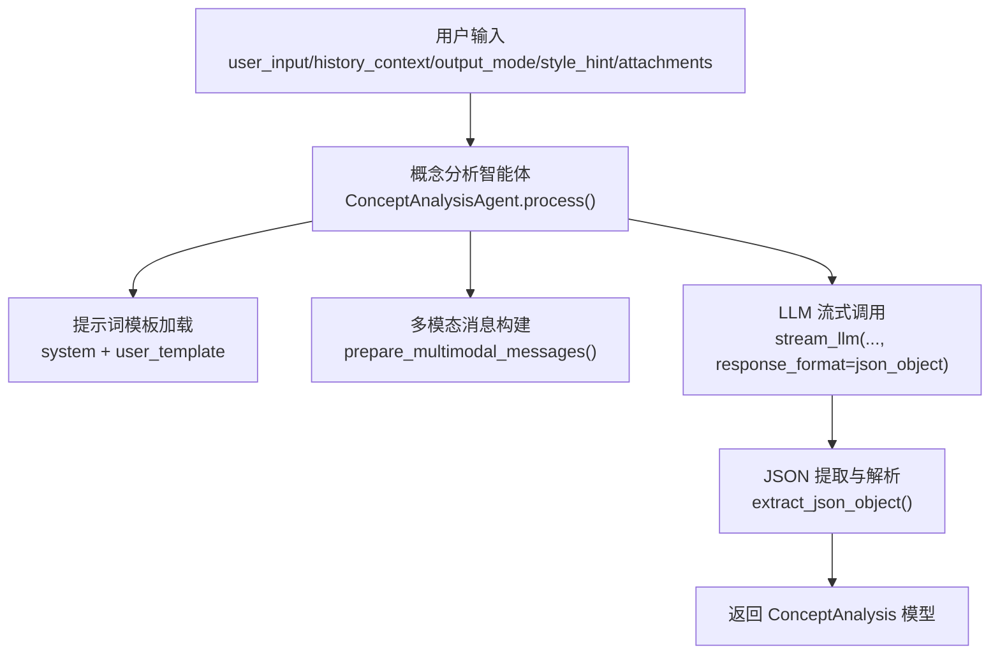
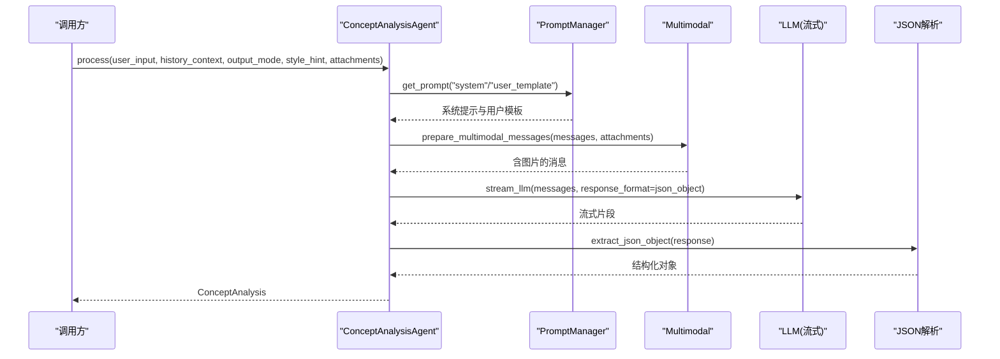
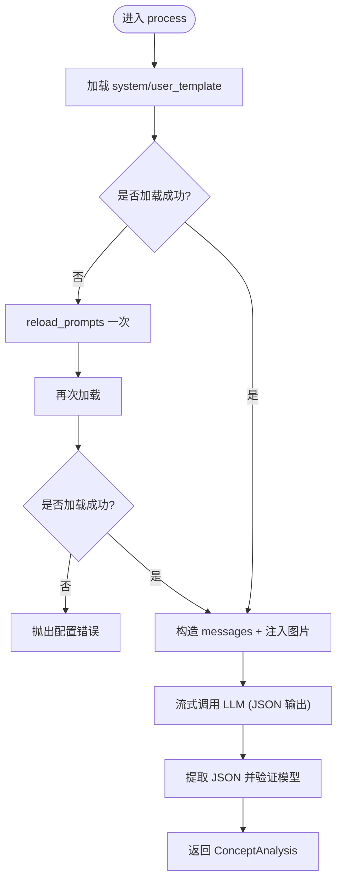
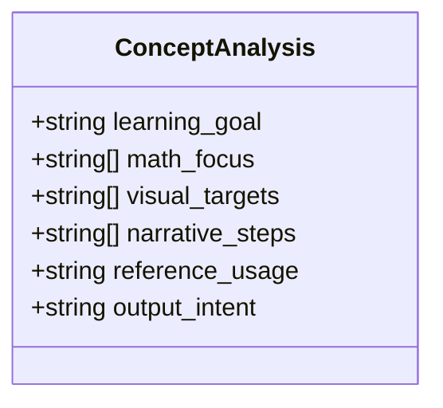
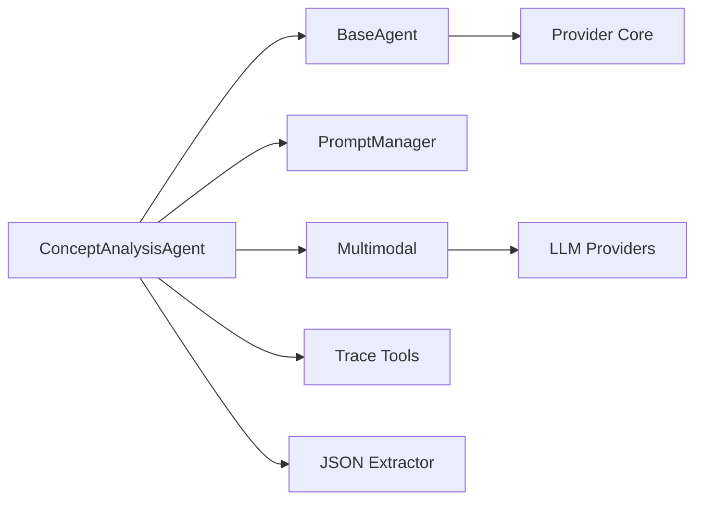

# 概念分析智能体

<cite>
**本文引用的文件**
- [concept_analysis_agent.py](file://deeptutor/agents/math_animator/agents/concept_analysis_agent.py)
- [models.py](file://deeptutor/agents/math_animator/models.py)
- [concept_analysis_agent.yaml（英文）](file://deeptutor/agents/math_animator/prompts/en/concept_analysis_agent.yaml)
- [concept_analysis_agent.yaml（中文）](file://deeptutor/agents/math_animator/prompts/zh/concept_analysis_agent.yaml)
- [base_agent.py](file://deeptutor/agents/base_agent.py)
- [multimodal.py](file://deeptutor/services/llm/multimodal.py)
- [request_config.py](file://deeptutor/agents/math_animator/request_config.py)
- [retry_manager.py](file://deeptutor/agents/math_animator/retry_manager.py)
- [loader.py](file://deeptutor/services/config/loader.py)
</cite>

## 目录
1. [简介](#简介)
2. [项目结构](#项目结构)
3. [核心组件](#核心组件)
4. [架构总览](#架构总览)
5. [详细组件分析](#详细组件分析)
6. [依赖关系分析](#依赖关系分析)
7. [性能考虑](#性能考虑)
8. [故障排查指南](#故障排查指南)
9. [结论](#结论)
10. [附录：配置与使用示例](#附录配置与使用示例)

## 简介
本文件面向“概念分析智能体”（ConceptAnalysisAgent），用于理解用户输入、历史上下文与参考图片，将其转化为结构化需求，供后续设计与代码生成阶段使用。该智能体以 JSON 形式输出 ConceptAnalysis 数据模型，支持多模态输入（图片附件），并内置提示词模板加载、流式调用与追踪元数据记录等能力。

## 项目结构
概念分析智能体位于数学动画能力（math_animator）子模块中，关键文件包括：
- 智能体实现：agents/math_animator/agents/concept_analysis_agent.py
- 数据模型：agents/math_animator/models.py
- 提示词模板：agents/math_animator/prompts/{en,zh}/concept_analysis_agent.yaml
- 基础能力：agents/base_agent.py（统一 LLM 调用、参数管理、提示词加载）
- 多模态处理：services/llm/multimodal.py（将图片附件注入到消息）
- 请求配置：agents/math_animator/request_config.py（output_mode、quality、style_hint 校验）
- 重试机制：agents/math_animator/retry_manager.py（渲染与修复循环）
- 配置加载：services/config/loader.py（按模块加载 agents.yaml 参数）

图表来源
- [concept_analysis_agent.py:31-88](file://deeptutor/agents/math_animator/agents/concept_analysis_agent.py#L31-L88)
- [multimodal.py:122-178](file://deeptutor/services/llm/multimodal.py#L122-L178)
- [models.py:8-17](file://deeptutor/agents/math_animator/models.py#L8-L17)

章节来源
- [concept_analysis_agent.py:1-88](file://deeptutor/agents/math_animator/agents/concept_analysis_agent.py#L1-L88)
- [models.py:1-96](file://deeptutor/agents/math_animator/models.py#L1-L96)
- [multimodal.py:122-178](file://deeptutor/services/llm/multimodal.py#L122-L178)

## 核心组件
- 概念分析智能体（ConceptAnalysisAgent）
  - 职责：接收用户输入、历史上下文、输出模式、风格提示与附件；加载提示词；构造消息；流式调用 LLM；解析 JSON 为 ConceptAnalysis。
  - 关键点：
    - 自动重试提示词加载：若首次未找到模板，会触发一次 reload_prompts 恢复。
    - 统计图片附件数量并注入到 user_template。
    - 强制 JSON 输出格式：response_format={"type": "json_object"}。
    - 记录追踪元数据：stage、phase、call_kind 等。
- 数据模型（ConceptAnalysis）
  - 字段：learning_goal、math_focus、visual_targets、narrative_steps、reference_usage、output_intent。
  - 用途：作为后续设计/代码生成阶段的“结构化需求”。
- 提示词模板
  - system：定义角色与任务约束（不直接写代码；video 模式需考虑讲解节奏）。
  - user_template：填充 user_input、history_context、output_mode、style_hint、reference_count，并要求返回指定 JSON 结构。
- 多模态处理
  - 将图片附件注入到最后一个 user 消息的 content-parts 中，适配不同提供商（OpenAI/Anthropic 等）。
- 请求配置
  - MathAnimatorRequestConfig：校验 output_mode（video/image）、quality（low/medium/high）、style_hint（长度限制）。

章节来源
- [concept_analysis_agent.py:14-88](file://deeptutor/agents/math_animator/agents/concept_analysis_agent.py#L14-L88)
- [models.py:8-17](file://deeptutor/agents/math_animator/models.py#L8-L17)
- [concept_analysis_agent.yaml（中文）:1-27](file://deeptutor/agents/math_animator/prompts/zh/concept_analysis_agent.yaml#L1-L27)
- [concept_analysis_agent.yaml（英文）:1-27](file://deeptutor/agents/math_animator/prompts/en/concept_analysis_agent.yaml#L1-L27)
- [multimodal.py:122-178](file://deeptutor/services/llm/multimodal.py#L122-L178)
- [request_config.py:10-32](file://deeptutor/agents/math_animator/request_config.py#L10-L32)

## 架构总览
概念分析智能体在 math_animator 管线中处于“需求结构化”阶段，上游提供自然语言与图片，下游消费 ConceptAnalysis 进行场景设计与代码生成。

图表来源
- [concept_analysis_agent.py:31-88](file://deeptutor/agents/math_animator/agents/concept_analysis_agent.py#L31-L88)
- [multimodal.py:122-178](file://deeptutor/services/llm/multimodal.py#L122-L178)

## 详细组件分析

### 概念分析智能体（ConceptAnalysisAgent）
- 初始化
  - 通过 BaseAgent 设置 module_name=math_animator、agent_name=concept_analysis_agent，并加载语言相关的提示词。
- 处理流程
  - 加载 system 与 user_template；若为空则尝试 reload_prompts 恢复。
  - 计算图片附件数量 reference_count，并格式化 user_template。
  - 构造 messages（system + user）。
  - 调用 stream_llm 流式获取响应，要求 JSON 对象格式。
  - 提取 JSON 并 model_validate 为 ConceptAnalysis。
- 错误处理
  - 若提示词仍未加载成功，抛出 ValueError。
  - 若 JSON 解析失败或模型验证失败，由上层捕获并处理（例如重试或降级）。

图表来源
- [concept_analysis_agent.py:31-88](file://deeptutor/agents/math_animator/agents/concept_analysis_agent.py#L31-L88)

章节来源
- [concept_analysis_agent.py:14-88](file://deeptutor/agents/math_animator/agents/concept_analysis_agent.py#L14-L88)

### 数据模型（ConceptAnalysis）
- learning_goal：用户希望解释或演示的数学目标。
- math_focus：核心概念列表。
- visual_targets：期望出现的视觉元素及停留时长要求。
- narrative_steps：推荐讲解步骤，细化到足以支撑完整讲解。
- reference_usage：参考图片的使用建议。
- output_intent：本轮更适合生成的最终产物类型（video/image）与时长策略。

图表来源
- [models.py:8-17](file://deeptutor/agents/math_animator/models.py#L8-L17)

章节来源
- [models.py:8-17](file://deeptutor/agents/math_animator/models.py#L8-L17)

### 提示词模板
- system：明确角色与约束，强调不直接写代码；video 模式需关注讲解节奏。
- user_template：包含用户输入、历史上下文、输出模式、风格提示与参考图数量，并要求返回固定 JSON 结构。

章节来源
- [concept_analysis_agent.yaml（中文）:1-27](file://deeptutor/agents/math_animator/prompts/zh/concept_analysis_agent.yaml#L1-L27)
- [concept_analysis_agent.yaml（英文）:1-27](file://deeptutor/agents/math_animator/prompts/en/concept_analysis_agent.yaml#L1-L27)

### 多模态输入处理（图片附件）
- 将图片附件注入到最后一个 user 消息的 content-parts 中，兼容 OpenAI/Anthropic 等不同提供商的图片格式。
- 对不支持 URL 的提供商，会将本地附件路径解析为 base64 后注入。
- 若模型无法处理图像，会在上层重试时降级为纯文本。

章节来源
- [multimodal.py:122-178](file://deeptutor/services/llm/multimodal.py#L122-L178)

### 基础能力与参数管理（BaseAgent）
- 统一加载 agents.yaml 中的 temperature、max_tokens 等参数。
- 统一 LLM 调用接口（complete/stream），支持 token 跟踪与日志。
- 支持 prompt 管理与语言切换。

章节来源
- [base_agent.py:32-145](file://deeptutor/agents/base_agent.py#L32-L145)
- [loader.py:209-249](file://deeptutor/services/config/loader.py#L209-L249)

## 依赖关系分析
- ConceptAnalysisAgent 依赖：
  - BaseAgent：LLM 调用、提示词加载、参数管理。
  - PromptManager：加载 math_animator/concept_analysis_agent 的提示词。
  - Multimodal：将图片附件注入消息。
  - JSON 工具：extract_json_object 从 LLM 响应中提取 JSON。
  - 追踪工具：build_trace_metadata/new_call_id 记录调用链路。
- 外部依赖：
  - LLM 提供商（OpenAI/Anthropic 等）：通过 provider_core 层处理流式与重试。
  - 配置中心：agents.yaml 提供温度、最大 token 等参数。

图表来源
- [concept_analysis_agent.py:1-88](file://deeptutor/agents/math_animator/agents/concept_analysis_agent.py#L1-L88)
- [base_agent.py:32-145](file://deeptutor/agents/base_agent.py#L32-L145)
- [multimodal.py:122-178](file://deeptutor/services/llm/multimodal.py#L122-L178)

章节来源
- [concept_analysis_agent.py:1-88](file://deeptutor/agents/math_animator/agents/concept_analysis_agent.py#L1-L88)
- [base_agent.py:32-145](file://deeptutor/agents/base_agent.py#L32-L145)
- [multimodal.py:122-178](file://deeptutor/services/llm/multimodal.py#L122-L178)

## 性能考虑
- 流式调用：减少首字节延迟，提升交互体验。
- 图片注入优化：仅在必要时将附件转为 base64，避免不必要的网络开销。
- 提示词缓存：PromptManager 不再缓存未命中结果，避免冷启动问题。
- 重试与降级：当模型不支持图像或非瞬时错误时，自动降级为纯文本并重试。

[本节为通用指导，无需特定文件引用]

## 故障排查指南
- 提示词未加载
  - 现象：process 抛出配置错误。
  - 处理：确保提示词文件存在且语言匹配；智能体会尝试一次 reload_prompts。
- JSON 解析失败
  - 现象：extract_json_object 无法提取有效 JSON。
  - 处理：检查 user_template 与 system 提示词是否要求了正确结构；可调整模型或提示词。
- 多模态失败
  - 现象：图像注入后模型报错。
  - 处理：上层会检测非瞬时错误并尝试去除图像部分重试；确认提供商是否支持 vision。
- 渲染与修复重试
  - 现象：渲染失败或视觉审查未通过。
  - 处理：CodeRetryManager 会多次尝试修复代码并重新渲染；注意超时与非可重试环境错误（如缺少 LaTeX）。

章节来源
- [concept_analysis_agent.py:40-55](file://deeptutor/agents/math_animator/agents/concept_analysis_agent.py#L40-L55)
- [retry_manager.py:21-157](file://deeptutor/agents/math_animator/retry_manager.py#L21-L157)

## 结论
概念分析智能体通过标准化的提示词模板与多模态消息注入，将用户的自然语言需求与参考图片转化为结构化的 ConceptAnalysis，为后续设计与代码生成提供稳定输入。其流式调用、追踪元数据与重试降级机制，保障了鲁棒性与性能。

[本节为总结性内容，无需特定文件引用]

## 附录：配置与使用示例

### 输入参数说明
- user_input：用户原始需求（字符串）。
- history_context：历史上下文（字符串，可为空）。
- output_mode：输出模式，取值为 video 或 image。
- style_hint：风格补充（字符串，长度受限）。
- attachments：附件列表，其中 type=image 的图片会被注入到消息中。

章节来源
- [concept_analysis_agent.py:31-39](file://deeptutor/agents/math_animator/agents/concept_analysis_agent.py#L31-L39)
- [request_config.py:10-16](file://deeptutor/agents/math_animator/request_config.py#L10-L16)
- [multimodal.py:122-178](file://deeptutor/services/llm/multimodal.py#L122-L178)

### 提示词模板使用
- system：定义角色与约束，强调不直接写代码；video 模式需考虑讲解节奏。
- user_template：填充 user_input、history_context、output_mode、style_hint、reference_count，并要求返回固定 JSON。

章节来源
- [concept_analysis_agent.yaml（中文）:1-27](file://deeptutor/agents/math_animator/prompts/zh/concept_analysis_agent.yaml#L1-L27)
- [concept_analysis_agent.yaml（英文）:1-27](file://deeptutor/agents/math_animator/prompts/en/concept_analysis_agent.yaml#L1-L27)

### 多模态输入处理（图片附件）
- 图片附件会被注入到最后一个 user 消息的 content-parts 中。
- 对于不支持 URL 的提供商，会将本地附件解析为 base64 后注入。
- 若模型无法处理图像，上层会尝试降级为纯文本并重试。

章节来源
- [multimodal.py:122-178](file://deeptutor/services/llm/multimodal.py#L122-L178)

### JSON 输出格式
- 要求返回 JSON 对象，字段包括：
  - learning_goal：学习/演示目标。
  - math_focus：核心概念列表。
  - visual_targets：视觉目标列表。
  - narrative_steps：讲解步骤列表。
  - reference_usage：参考图使用建议。
  - output_intent：最终产物类型与时长策略。

章节来源
- [models.py:8-17](file://deeptutor/agents/math_animator/models.py#L8-L17)
- [concept_analysis_agent.yaml（中文）:18-26](file://deeptutor/agents/math_animator/prompts/zh/concept_analysis_agent.yaml#L18-L26)

### 配置选项说明
- MathAnimatorRequestConfig：
  - output_mode：video 或 image。
  - quality：low、medium、high。
  - style_hint：字符串，最大长度限制。
- agents.yaml（按模块加载）：
  - temperature、max_tokens 等参数由 loader 根据模块名加载。

章节来源
- [request_config.py:10-32](file://deeptutor/agents/math_animator/request_config.py#L10-L32)
- [loader.py:209-249](file://deeptutor/services/config/loader.py#L209-L249)

### 使用示例（概念性）
- 基本调用
  - 传入 user_input、history_context、output_mode、style_hint、attachments。
  - 智能体返回 ConceptAnalysis。
- 带图片的调用
  - 在 attachments 中添加 type=image 的附件。
  - 多模态处理会将图片注入消息，模型可结合图片进行分析。
- 视频模式
  - output_mode=video，提示词会考虑讲解节奏与中间步骤。

[本节为概念性示例，无需特定文件引用]

### 错误处理与重试机制
- 提示词加载失败：智能体会尝试一次 reload_prompts；仍失败则抛出配置错误。
- JSON 解析失败：由上层捕获并决定重试或降级。
- 多模态失败：上层检测非瞬时错误并尝试去除图像部分重试。
- 渲染与修复重试：CodeRetryManager 负责多次尝试修复代码并重新渲染，记录重试历史。

章节来源
- [concept_analysis_agent.py:40-55](file://deeptutor/agents/math_animator/agents/concept_analysis_agent.py#L40-L55)
- [retry_manager.py:21-157](file://deeptutor/agents/math_animator/retry_manager.py#L21-L157)