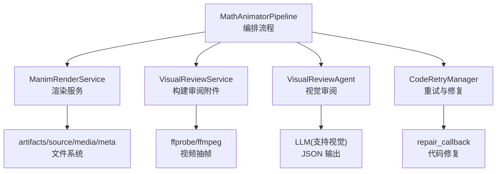
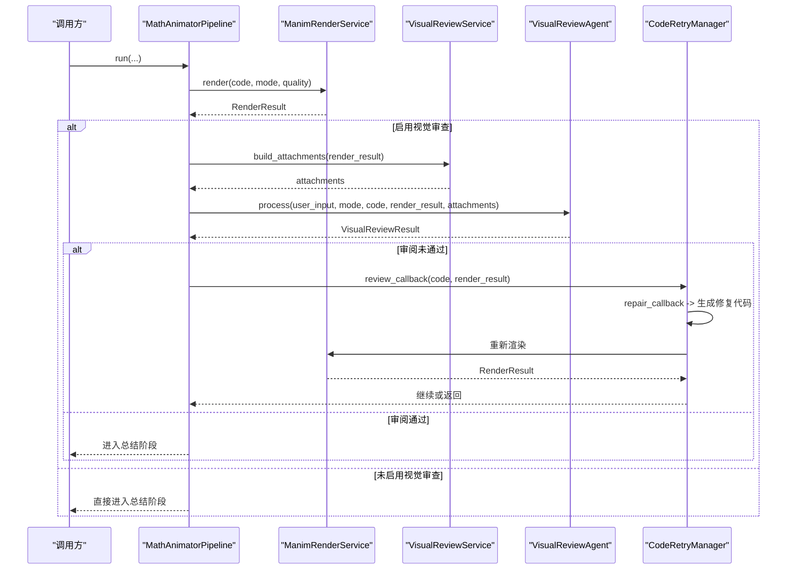
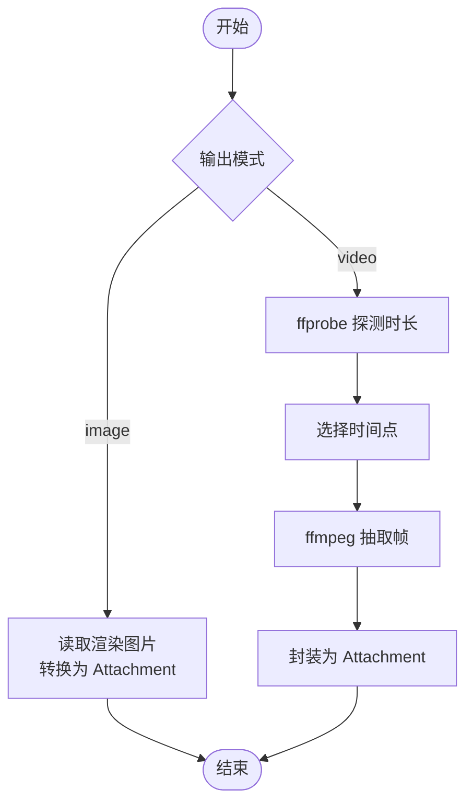
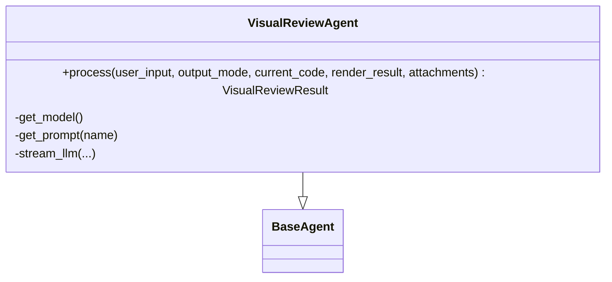
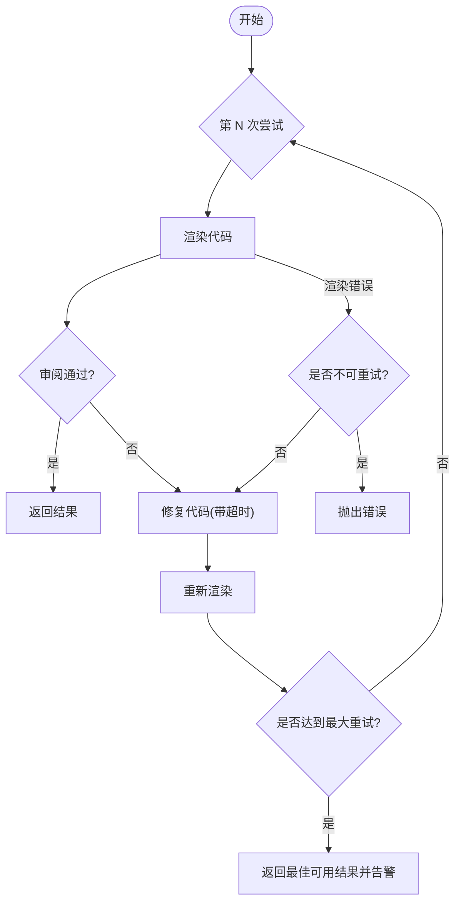
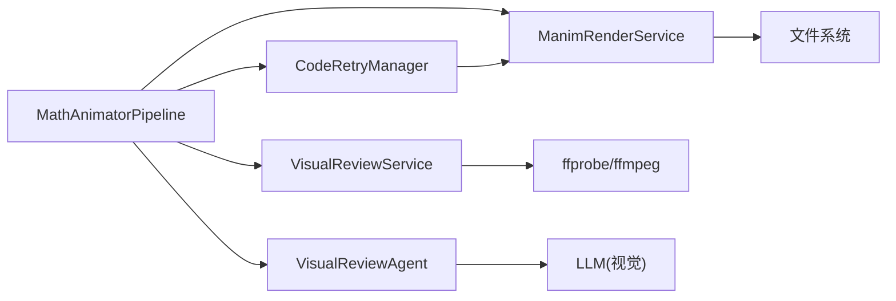

# 视觉审查智能体

<cite>
**本文引用的文件**
- [visual_review.py](file://deeptutor/agents/math_animator/visual_review.py)
- [pipeline.py](file://deeptutor/agents/math_animator/pipeline.py)
- [models.py](file://deeptutor/agents/math_animator/models.py)
- [request_config.py](file://deeptutor/agents/math_animator/request_config.py)
- [retry_manager.py](file://deeptutor/agents/math_animator/retry_manager.py)
- [renderer.py](file://deeptutor/agents/math_animator/renderer.py)
- [utils.py](file://deeptutor/agents/math_animator/utils.py)
- [duration_utils.py](file://deeptutor/agents/math_animator/duration_utils.py)
- [visual_review_agent.py](file://deeptutor/agents/math_animator/agents/visual_review_agent.py)
- [visual_review_agent.yaml（中文）](file://deeptutor/agents/math_animator/prompts/zh/visual_review_agent.yaml)
- [visual_review_agent.yaml（英文）](file://deeptutor/agents/math_animator/prompts/en/visual_review_agent.yaml)
</cite>

## 目录
1. [简介](#简介)
2. [项目结构](#项目结构)
3. [核心组件](#核心组件)
4. [架构总览](#架构总览)
5. [详细组件分析](#详细组件分析)
6. [依赖关系分析](#依赖关系分析)
7. [性能考量](#性能考量)
8. [故障排查指南](#故障排查指南)
9. [结论](#结论)
10. [附录](#附录)

## 简介
本文件面向“数学动画能力”中的视觉审查智能体，系统性说明其如何对渲染结果进行质量检查与自动修复。内容覆盖：
- 代码语法验证、渲染错误处理
- 动画效果评估（重叠、可读性、构图等）
- 数学准确性检查（通过提示词约束与上下文信息）
- 教育价值评估（教学清晰度、信息密度）
- 审查标准、问题识别机制与自动修复策略
- 审查配置选项、自定义规则设置与批量处理方法
- 常见问题诊断与解决方案

该智能体在渲染后抽取关键帧或图像，调用具备视觉能力的模型进行审阅，若发现问题则生成修复建议并驱动代码重试，直至满足质量标准或达到最大重试次数。

## 项目结构
视觉审查智能体位于 math_animator 能力中，围绕“渲染—审阅—修复—再渲染”的闭环工作流组织代码：
- pipeline.py：编排分析、设计、代码生成、渲染、审阅、总结全流程
- renderer.py：Manim 渲染服务，负责视频/图片产出与错误上报
- visual_review.py：从渲染产物中提取审阅素材（视频抽帧或图片直取），构造附件
- agents/visual_review_agent.py：视觉审阅代理，基于系统/用户提示词与多模态输入输出结构化结果
- retry_manager.py：重试管理器，串联渲染失败与审阅失败的修复流程
- models.py：统一数据模型（审阅结果、渲染结果、重试记录等）
- request_config.py：请求配置校验（输出模式、质量等级、风格提示）
- utils.py / duration_utils.py：工具函数（错误消息裁剪、目标时长解析等）

图表来源
- [pipeline.py:25-211](file://deeptutor/agents/math_animator/pipeline.py#L25-L211)
- [renderer.py:35-243](file://deeptutor/agents/math_animator/renderer.py#L35-L243)
- [visual_review.py:17-146](file://deeptutor/agents/math_animator/visual_review.py#L17-L146)
- [visual_review_agent.py:16-97](file://deeptutor/agents/math_animator/agents/visual_review_agent.py#L16-L97)
- [retry_manager.py:21-157](file://deeptutor/agents/math_animator/retry_manager.py#L21-L157)

章节来源
- [pipeline.py:25-211](file://deeptutor/agents/math_animator/pipeline.py#L25-L211)
- [renderer.py:35-243](file://deeptutor/agents/math_animator/renderer.py#L35-L243)
- [visual_review.py:17-146](file://deeptutor/agents/math_animator/visual_review.py#L17-L146)
- [visual_review_agent.py:16-97](file://deeptutor/agents/math_animator/agents/visual_review_agent.py#L16-L97)
- [retry_manager.py:21-157](file://deeptutor/agents/math_animator/retry_manager.py#L21-L157)

## 核心组件
- MathAnimatorPipeline：定义 run_analysis/run_design/run_code_generation/run_render/run_summary 等阶段；当 enable_visual_review=True 时注入审阅回调，将审阅结果写入 RenderResult 并参与重试决策。
- ManimRenderService：将代码写入 source，调用 Manim 渲染为 mp4 或 png，收集 artifacts，暴露 RenderResult。
- VisualReviewService：根据 output_mode 选择直接读取图片或使用 ffprobe/ffmpeg 从视频中按时间点抽样提取审阅帧，封装为 Attachment 列表。
- VisualReviewAgent：加载 system/user_template 提示词，向支持视觉的 LLM 发送审阅请求，返回 VisualReviewResult（passed/issues/suggested_fix/reviewed_frames）。
- CodeRetryManager：管理渲染与审阅的重试循环；审阅失败时触发 repair_callback 生成修复代码，继续重渲染；渲染失败时同样尝试修复；对特定环境错误（如缺少 LaTeX）做不可重试判断。
- models.py：定义 ConceptAnalysis、SceneDesign、GeneratedCode、SummaryPayload、RenderedArtifact、RetryAttempt、VisualReviewResult、RenderResult 等数据结构。
- request_config.py：校验 output_mode、quality、style_hint，提供 validate_math_animator_request_config。
- utils.py / duration_utils.py：错误消息裁剪、文件名规范化、目标时长解析等辅助逻辑。

章节来源
- [pipeline.py:25-211](file://deeptutor/agents/math_animator/pipeline.py#L25-L211)
- [renderer.py:35-243](file://deeptutor/agents/math_animator/renderer.py#L35-L243)
- [visual_review.py:17-146](file://deeptutor/agents/math_animator/visual_review.py#L17-L146)
- [visual_review_agent.py:16-97](file://deeptutor/agents/math_animator/agents/visual_review_agent.py#L16-L97)
- [retry_manager.py:21-157](file://deeptutor/agents/math_animator/retry_manager.py#L21-L157)
- [models.py:8-95](file://deeptutor/agents/math_animator/models.py#L8-L95)
- [request_config.py:10-38](file://deeptutor/agents/math_animator/request_config.py#L10-L38)
- [utils.py:10-53](file://deeptutor/agents/math_animator/utils.py#L10-L53)
- [duration_utils.py:7-37](file://deeptutor/agents/math_animator/duration_utils.py#L7-L37)

## 架构总览
视觉审查智能体的整体流程如下：
1. 管线接收用户输入与请求配置，执行概念分析与设计、代码生成。
2. 进入渲染阶段：ManimRenderService 将代码渲染为视频或图片。
3. 若启用视觉审查：VisualReviewService 准备审阅附件（视频抽帧或图片），VisualReviewAgent 调用视觉模型审阅。
4. 审阅结果决定后续动作：
   - passed=true：进入总结阶段，返回最终结果。
   - passed=false：记录问题与建议，触发修复回调，生成新代码并重试渲染。
5. 最多重试 N 次；若仍失败，返回最佳可用结果并附带警告。

图表来源
- [pipeline.py:137-194](file://deeptutor/agents/math_animator/pipeline.py#L137-L194)
- [visual_review.py:31-52](file://deeptutor/agents/math_animator/visual_review.py#L31-L52)
- [visual_review_agent.py:33-97](file://deeptutor/agents/math_animator/agents/visual_review_agent.py#L33-L97)
- [retry_manager.py:43-128](file://deeptutor/agents/math_animator/retry_manager.py#L43-L128)

## 详细组件分析

### 视觉审阅服务（VisualReviewService）
职责
- 根据 output_mode 准备审阅附件：
  - image：直接读取 artifacts 中的图片并转为 Attachment。
  - video：使用 ffprobe 探测时长，按策略选取时间点，用 ffmpeg 抽取若干帧作为审阅素材。
- 进度回调：向调用方推送审阅准备进度。

审阅帧选择策略
- 短于 2 秒的视频：抽取起始、中间、末尾附近三帧。
- 更长视频：抽取约 15%、50%、85% 时间点的三帧。

错误处理
- 缺失渲染视频、ffprobe/ffmpeg 执行失败、无法解析时长等场景抛出渲染错误。

图表来源
- [visual_review.py:31-52](file://deeptutor/agents/math_animator/visual_review.py#L31-L52)
- [visual_review.py:54-89](file://deeptutor/agents/math_animator/visual_review.py#L54-L89)
- [visual_review.py:91-130](file://deeptutor/agents/math_animator/visual_review.py#L91-L130)

章节来源
- [visual_review.py:17-146](file://deeptutor/agents/math_animator/visual_review.py#L17-L146)

### 视觉审阅代理（VisualReviewAgent）
职责
- 加载 system 与 user_template 提示词（中文/英文）。
- 若无审阅附件或当前模型不支持视觉，跳过审阅并标记通过。
- 以流式方式调用 LLM，要求 JSON 输出，解析为 VisualReviewResult。

审阅标准（来自提示词）
- 几何对象、标签、公式、辅助线是否重叠或遮挡
- 文字与公式的可读性
- 关键对象是否跑出画面、过小、过密
- 单帧信息密度是否过高
- 仅在画面清晰、无教学性问题时判定通过

输出字段
- passed：布尔值
- summary：一句话总结
- issues：问题列表（若未通过）
- suggested_fix：给代码修复器的具体修改建议
- reviewed_frames：实际审阅的帧数

图表来源
- [visual_review_agent.py:16-97](file://deeptutor/agents/math_animator/agents/visual_review_agent.py#L16-L97)

章节来源
- [visual_review_agent.py:16-97](file://deeptutor/agents/math_animator/agents/visual_review_agent.py#L16-L97)
- [visual_review_agent.yaml（中文）:1-32](file://deeptutor/agents/math_animator/prompts/zh/visual_review_agent.yaml#L1-L32)
- [visual_review_agent.yaml（英文）:1-32](file://deeptutor/agents/math_animator/prompts/en/visual_review_agent.yaml#L1-L32)

### 重试管理器（CodeRetryManager）
职责
- 管理渲染与审阅的重试循环，最多重试 N 次。
- 审阅失败时，将审阅摘要与建议组装为错误信息，触发修复回调生成新代码，然后重新渲染。
- 渲染失败时，区分可重试与不可重试错误（例如缺少 LaTeX 的环境错误）。
- 超时保护：审阅与修复均设置超时，避免长时间阻塞。

关键行为
- 审阅超时：抛出渲染错误，终止流程。
- 修复超时：抛出渲染错误，终止流程。
- 非重试环境错误：直接向上抛出，提示安装 LaTeX 或避免使用 Tex/MathTex。

图表来源
- [retry_manager.py:21-157](file://deeptutor/agents/math_animator/retry_manager.py#L21-L157)

章节来源
- [retry_manager.py:21-157](file://deeptutor/agents/math_animator/retry_manager.py#L21-L157)

### 渲染服务（ManimRenderService）
职责
- 将生成的代码保存至 source 目录。
- 根据 output_mode 分别渲染视频或图片块。
- 查找最终导出文件（排除临时片段），封装为 RenderedArtifact。
- 实时流式输出进程 stdout/stderr 到进度回调。

关键点
- 图片模式要求代码包含 YON_IMAGE 锚点块，否则报错。
- 视频模式会提取 Scene 类名并运行 Manim。
- 质量参数映射为 Manim 命令行标志。

章节来源
- [renderer.py:35-243](file://deeptutor/agents/math_animator/renderer.py#L35-L243)

### 数据模型（models.py）
- VisualReviewResult：审阅结果（passed/summary/issues/suggested_fix/reviewed_frames）
- RenderResult：渲染结果（output_mode/artifacts/public_code_path/source_code_path/quality/retry_attempts/retry_history/visual_review）
- RetryAttempt：单次重试记录（attempt/error）
- 其他：ConceptAnalysis、SceneDesign、GeneratedCode、SummaryPayload、RenderedArtifact

章节来源
- [models.py:8-95](file://deeptutor/agents/math_animator/models.py#L8-L95)

### 请求配置（request_config.py）
- output_mode：video 或 image
- quality：low、medium、high
- style_hint：风格提示（长度限制）
- 提供 validate_math_animator_request_config 进行严格校验

章节来源
- [request_config.py:10-38](file://deeptutor/agents/math_animator/request_config.py#L10-L38)

### 工具与辅助（utils.py / duration_utils.py）
- slugify_filename：文件名规范化
- trim_error_message：错误消息裁剪
- build_repair_error_message：针对常见 Manim 错误的定向修复提示（如 2D/3D 点不匹配）
- parse_target_duration_seconds：从用户文本中解析目标时长（秒/分钟/中文单位）

章节来源
- [utils.py:10-53](file://deeptutor/agents/math_animator/utils.py#L10-L53)
- [duration_utils.py:7-37](file://deeptutor/agents/math_animator/duration_utils.py#L7-L37)

## 依赖关系分析
- pipeline 依赖 renderer、visual_review_service、visual_review_agent、retry_manager、models、request_config、duration_utils。
- visual_review_service 依赖 path_service、models、renderer 的错误类型。
- visual_review_agent 依赖 base_agent、context.Attachment、llm 支持检测、utils.json_output。
- retry_manager 依赖 renderer、models。
- renderer 依赖 path_service、models、utils。

图表来源
- [pipeline.py:25-211](file://deeptutor/agents/math_animator/pipeline.py#L25-L211)
- [visual_review.py:17-146](file://deeptutor/agents/math_animator/visual_review.py#L17-L146)
- [visual_review_agent.py:16-97](file://deeptutor/agents/math_animator/agents/visual_review_agent.py#L16-L97)
- [retry_manager.py:21-157](file://deeptutor/agents/math_animator/retry_manager.py#L21-L157)
- [renderer.py:35-243](file://deeptutor/agents/math_animator/renderer.py#L35-L243)

章节来源
- [pipeline.py:25-211](file://deeptutor/agents/math_animator/pipeline.py#L25-L211)
- [visual_review.py:17-146](file://deeptutor/agents/math_animator/visual_review.py#L17-L146)
- [visual_review_agent.py:16-97](file://deeptutor/agents/math_animator/agents/visual_review_agent.py#L16-L97)
- [retry_manager.py:21-157](file://deeptutor/agents/math_animator/retry_manager.py#L21-L157)
- [renderer.py:35-243](file://deeptutor/agents/math_animator/renderer.py#L35-L243)

## 性能考量
- 审阅帧数量固定为 3 帧，平衡了覆盖率与耗时。
- 视频抽帧使用异步子进程，避免阻塞事件循环。
- 审阅与修复均设置超时，防止长尾任务拖慢整体流程。
- 渲染过程通过线程读取 stdout/stderr，保持实时进度反馈。
- 图片模式仅处理 YON_IMAGE 锚点块，减少无关代码带来的渲染开销。

[本节为通用性能讨论，无需列出具体文件来源]

## 故障排查指南
常见问题与定位要点
- 审阅被跳过
  - 原因：无审阅附件或当前模型不支持视觉。
  - 处理：确保渲染产物存在且模型具备视觉能力。
  - 参考路径：[visual_review_agent.py:42-55](file://deeptutor/agents/math_animator/agents/visual_review_agent.py#L42-L55)

- 视频抽帧失败
  - 原因：渲染视频缺失、ffprobe/ffmpeg 执行失败、时长解析失败。
  - 处理：检查渲染产物是否存在，确认系统已安装并可用 ffprobe/ffmpeg。
  - 参考路径：[visual_review.py:54-118](file://deeptutor/agents/math_animator/visual_review.py#L54-L118)

- 渲染失败（含 LaTeX 缺失）
  - 原因：本地缺少 LaTeX 或代码使用了 Tex/MathTex。
  - 处理：安装 LaTeX 或在生成代码中避免使用相关命令。
  - 参考路径：[retry_manager.py:12-18](file://deeptutor/agents/math_animator/retry_manager.py#L12-L18)、[retry_manager.py:129-134](file://deeptutor/agents/math_animator/retry_manager.py#L129-L134)

- 审阅超时或修复超时
  - 原因：审阅或修复步骤超过设定阈值。
  - 处理：调整 review_timeout_seconds 与 repair_timeout_seconds，或优化提示词与修复逻辑。
  - 参考路径：[retry_manager.py:69-77](file://deeptutor/agents/math_animator/retry_manager.py#L69-L77)、[retry_manager.py:110-119](file://deeptutor/agents/math_animator/retry_manager.py#L110-L119)

- 图片模式代码格式错误
  - 原因：未使用 YON_IMAGE 锚点块或包含多余代码。
  - 处理：确保代码仅包含受支持的图片块标记。
  - 参考路径：[renderer.py:84-93](file://deeptutor/agents/math_animator/renderer.py#L84-L93)

- 2D/3D 点不匹配导致的渲染错误
  - 原因：Manim 期望 3D 点但收到 2D 点。
  - 处理：将二维点扩展为三维点，或优先使用坐标转换方法。
  - 参考路径：[utils.py:22-45](file://deeptutor/agents/math_animator/utils.py#L22-L45)

章节来源
- [visual_review_agent.py:42-55](file://deeptutor/agents/math_animator/agents/visual_review_agent.py#L42-L55)
- [visual_review.py:54-118](file://deeptutor/agents/math_animator/visual_review.py#L54-L118)
- [retry_manager.py:12-18](file://deeptutor/agents/math_animator/retry_manager.py#L12-L18)
- [retry_manager.py:69-77](file://deeptutor/agents/math_animator/retry_manager.py#L69-L77)
- [retry_manager.py:110-119](file://deeptutor/agents/math_animator/retry_manager.py#L110-L119)
- [renderer.py:84-93](file://deeptutor/agents/math_animator/renderer.py#L84-L93)
- [utils.py:22-45](file://deeptutor/agents/math_animator/utils.py#L22-L45)

## 结论
视觉审查智能体通过“渲染—审阅—修复—再渲染”的闭环，有效提升了数学动画的教学可用性与稳定性。其核心优势包括：
- 明确的审阅标准与结构化输出，便于自动化决策
- 灵活的审阅附件构建，兼顾视频与图片模式
- 健壮的重试与超时控制，保障端到端可用性
- 可扩展的提示词与配置，支持不同语言与质量需求

建议在生产环境中：
- 明确启用视觉审查，并确保模型具备视觉能力
- 合理设置质量等级与重试次数，平衡质量与延迟
- 关注审阅失败时的 suggested_fix，持续优化生成代码质量

[本节为总结性内容，无需列出具体文件来源]

## 附录

### 审查配置选项
- output_mode：video 或 image，影响审阅附件构建与渲染流程
- quality：low、medium、high，影响渲染质量与耗时
- style_hint：风格提示，用于引导生成与审阅（长度限制）
- enable_visual_review：是否在管线中启用视觉审查

章节来源
- [request_config.py:10-38](file://deeptutor/agents/math_animator/request_config.py#L10-L38)
- [pipeline.py:25-70](file://deeptutor/agents/math_animator/pipeline.py#L25-L70)

### 自定义规则设置
- 审阅标准由提示词定义，可在 prompts/zh/visual_review_agent.yaml 与 prompts/en/visual_review_agent.yaml 中调整
- 可通过修改 user_template 与 system 提示词，强化或弱化某些审阅维度（如更强调可读性或更严格的信息密度控制）

章节来源
- [visual_review_agent.yaml（中文）:1-32](file://deeptutor/agents/math_animator/prompts/zh/visual_review_agent.yaml#L1-L32)
- [visual_review_agent.yaml（英文）:1-32](file://deeptutor/agents/math_animator/prompts/en/visual_review_agent.yaml#L1-L32)

### 批量处理方法
- 当前实现以单轮 turn_id 为单位处理单个渲染任务
- 如需批量处理，可在上层调用处并发多个 MathAnimatorPipeline.run，注意资源隔离与速率限制
- 审阅帧数量固定为 3 帧，适合批量场景下的稳定性能

[本节为通用指导，无需列出具体文件来源]