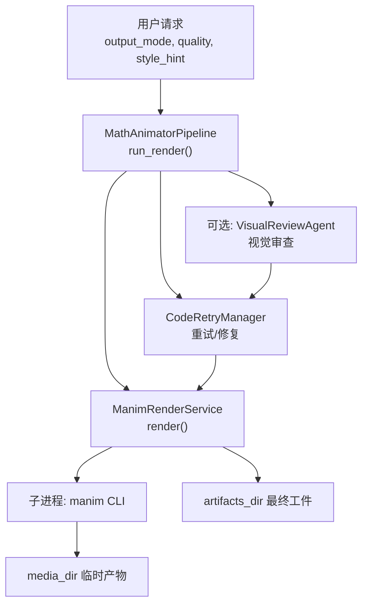
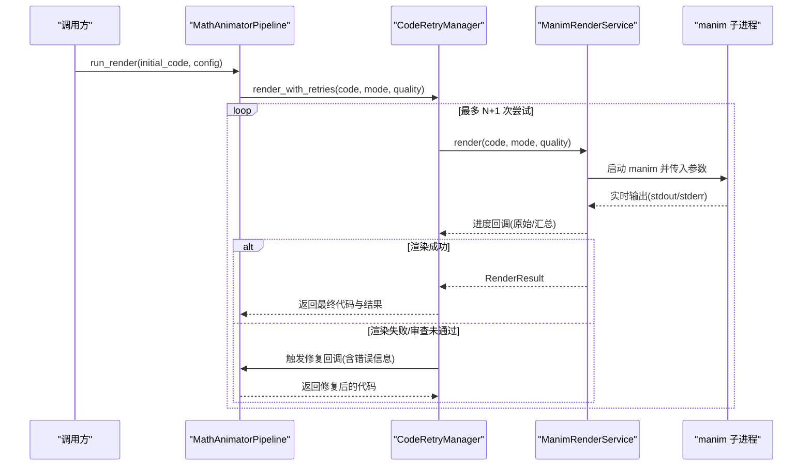
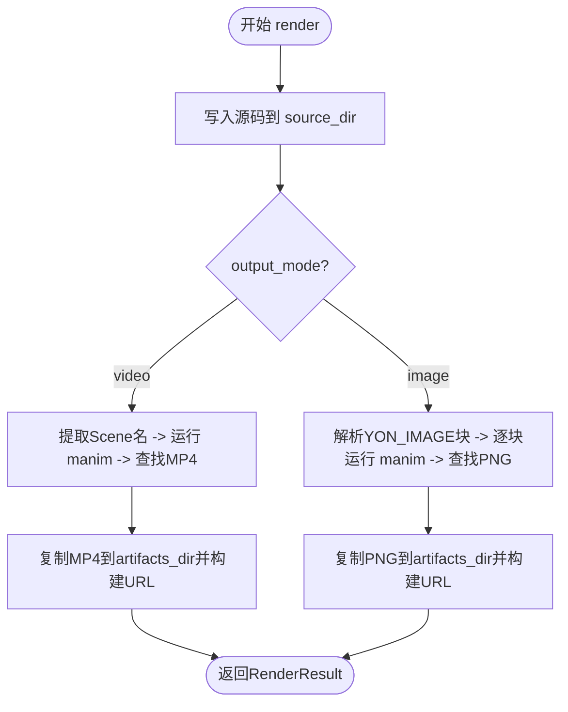
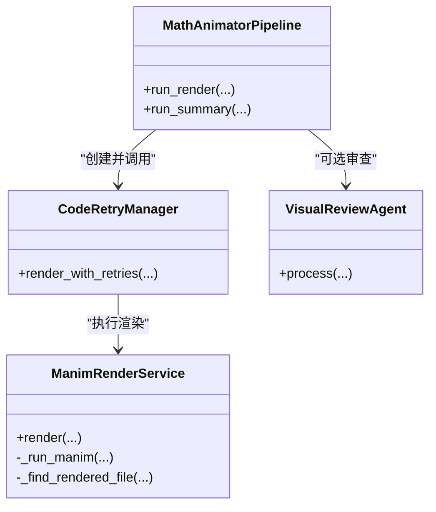
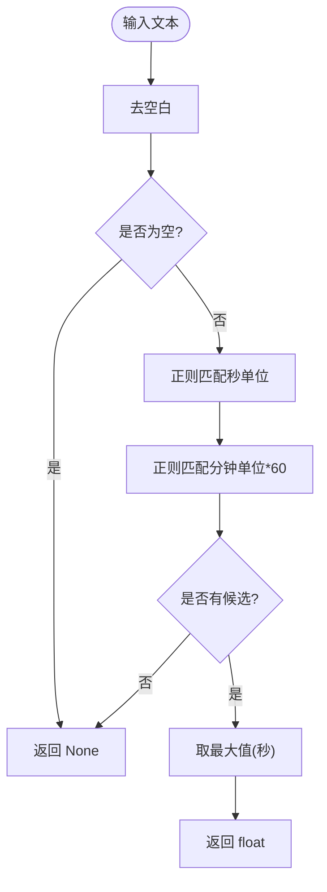
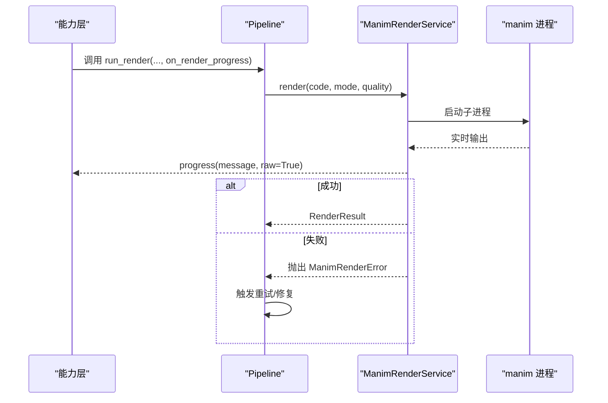
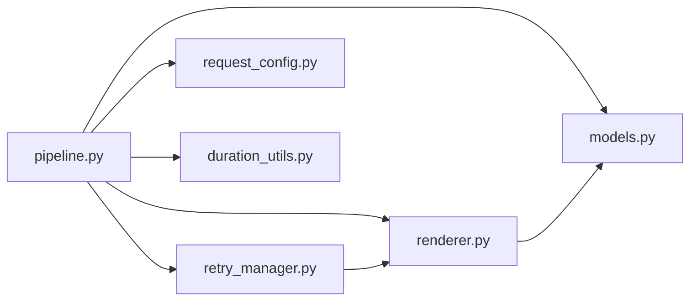

# 渲染引擎

<cite>
**本文引用的文件**
- [renderer.py](file://deeptutor/agents/math_animator/renderer.py)
- [pipeline.py](file://deeptutor/agents/math_animator/pipeline.py)
- [retry_manager.py](file://deeptutor/agents/math_animator/retry_manager.py)
- [models.py](file://deeptutor/agents/math_animator/models.py)
- [request_config.py](file://deeptutor/agents/math_animator/request_config.py)
- [duration_utils.py](file://deeptutor/agents/math_animator/duration_utils.py)
- [capability.py](file://deeptutor/agents/visualize/capability.py)
- [math-animator-types.ts](file://web/lib/math-animator-types.ts)
- [visualize-types.ts](file://web/lib/visualize-types.ts)
</cite>

## 目录
1. [简介](#简介)
2. [项目结构](#项目结构)
3. [核心组件](#核心组件)
4. [架构总览](#架构总览)
5. [详细组件分析](#详细组件分析)
6. [依赖关系分析](#依赖关系分析)
7. [性能考量](#性能考量)
8. [故障排查指南](#故障排查指南)
9. [结论](#结论)
10. [附录](#附录)

## 简介
本文件面向数学动画渲染引擎，系统性说明 ManimRenderService 的实现原理、Manim 脚本执行环境、渲染管道与输出处理；详解时间解析工具 parse_target_duration_seconds 的功能与用法；阐述渲染进度回调机制与错误处理策略；解释视频、图像等输出格式及质量设置；提供渲染配置示例与性能优化建议；并说明与操作系统集成的文件处理与进程管理。

## 项目结构
数学动画能力位于 agents/math_animator 下，围绕“分析-设计-生成代码-渲染-总结”的流水线组织：
- 渲染服务：ManimRenderService 负责写入源码、调用 manim CLI、读取产物、封装为统一工件。
- 渲染管线：MathAnimatorPipeline 编排各阶段（概念分析、场景设计、代码生成、渲染重试、视觉审查、摘要）。
- 重试管理：CodeRetryManager 在渲染失败或视觉审查不通过时驱动代码修复并重试。
- 数据模型：models.py 定义 RenderResult、RenderedArtifact、VisualReviewResult 等。
- 请求配置：request_config.py 校验 output_mode、quality、style_hint。
- 时长解析：duration_utils.py 从用户输入中解析目标时长（秒/分钟），用于提示词约束。
- 前端类型：web/lib 下的 math-animator-types.ts、visualize-types.ts 描述输出模式、质量等级与结果结构。

**图示来源**
- [pipeline.py:137-194](file://deeptutor/agents/math_animator/pipeline.py#L137-L194)
- [renderer.py:52-82](file://deeptutor/agents/math_animator/renderer.py#L52-L82)
- [retry_manager.py:43-157](file://deeptutor/agents/math_animator/retry_manager.py#L43-L157)

**章节来源**
- [pipeline.py:1-281](file://deeptutor/agents/math_animator/pipeline.py#L1-L281)
- [renderer.py:1-251](file://deeptutor/agents/math_animator/renderer.py#L1-L251)
- [retry_manager.py:1-161](file://deeptutor/agents/math_animator/retry_manager.py#L1-L161)
- [models.py:1-96](file://deeptutor/agents/math_animator/models.py#L1-L96)
- [request_config.py:1-39](file://deeptutor/agents/math_animator/request_config.py#L1-L39)
- [duration_utils.py:1-37](file://deeptutor/agents/math_animator/duration_utils.py#L1-L37)
- [math-animator-types.ts:1-39](file://web/lib/math-animator-types.ts#L1-L39)
- [visualize-types.ts:1-78](file://web/lib/visualize-types.ts#L1-L78)

## 核心组件
- ManimRenderService：创建隔离工作目录（source/artifacts/media/meta），写入生成的 Manim 脚本，调用 manim 命令行渲染，收集最终产物并返回统一工件列表。
- MathAnimatorPipeline：串联分析、设计、代码生成、渲染与总结；在 run_render 中注入进度回调、重试与可选视觉审查。
- CodeRetryManager：以最多 N 次重试循环驱动渲染；捕获渲染错误与视觉审查失败，调用修复回调再生成代码并重试；对不可重试的环境错误直接上抛。
- 数据模型：RenderResult/RenderedArtifact/VisualReviewResult 等承载渲染结果、工件元信息与审查结论。
- 请求配置：限制 output_mode 为 video/image，quality 为 low/medium/high，style_hint 长度上限。
- 时长解析：parse_target_duration_seconds 从自然语言中提取目标时长（秒/分钟），用于约束生成代码的时长。

**章节来源**
- [renderer.py:35-82](file://deeptutor/agents/math_animator/renderer.py#L35-L82)
- [pipeline.py:137-194](file://deeptutor/agents/math_animator/pipeline.py#L137-L194)
- [retry_manager.py:21-157](file://deeptutor/agents/math_animator/retry_manager.py#L21-L157)
- [models.py:46-83](file://deeptutor/agents/math_animator/models.py#L46-L83)
- [request_config.py:10-32](file://deeptutor/agents/math_animator/request_config.py#L10-L32)
- [duration_utils.py:17-36](file://deeptutor/agents/math_animator/duration_utils.py#L17-L36)

## 架构总览
渲染流程由 Pipeline 协调，关键路径如下：
- 准备阶段：根据 output_mode 选择视频或图片模式，写入对应源码文件。
- 执行阶段：通过 subprocess 启动 manim 进程，实时流式读取 stdout/stderr 并通过进度回调上报。
- 产物阶段：从 media_dir 筛选最终导出文件（跳过中间片段），复制到 artifacts_dir 并构建对外 URL。
- 重试阶段：若渲染失败或视觉审查未通过，进入修复-重渲染循环，直至成功或达到最大重试次数。
- 输出阶段：返回包含工件列表、源路径、质量、重试历史与可选视觉审查结果的 RenderResult。

**图示来源**
- [pipeline.py:137-194](file://deeptutor/agents/math_animator/pipeline.py#L137-L194)
- [retry_manager.py:43-157](file://deeptutor/agents/math_animator/retry_manager.py#L43-L157)
- [renderer.py:124-201](file://deeptutor/agents/math_animator/renderer.py#L124-L201)

## 详细组件分析

### ManimRenderService 实现原理
- 工作目录隔离：基于 turn_id 创建 source/artifacts/media/meta 四个目录，确保多任务并发互不干扰。
- 源码写入：按 output_mode 决定 scene.py 或 scene_image.py，将 LLM 生成的代码持久化。
- 视频渲染：提取 Scene 类名，调用 manim 渲染 MP4，从 media_dir 排除中间片段后选取最新产物，复制至 artifacts_dir 并构造相对 URL。
- 图片渲染：仅允许包含 YON_IMAGE 锚点块的内容，逐个块渲染 PNG，命名 image-01.png 等。
- 进程与流式输出：使用 subprocess.Popen + 线程读取 stdout/stderr，通过 asyncio.Queue 转交事件循环，避免 Windows SelectorEventLoop 兼容问题；每行输出经 _emit_progress 回调上报。
- 错误处理：非零退出码抛出 ManimRenderError，并附带清理后的标准输出/错误信息。

**图示来源**
- [renderer.py:52-82](file://deeptutor/agents/math_animator/renderer.py#L52-L82)
- [renderer.py:84-122](file://deeptutor/agents/math_animator/renderer.py#L84-L122)
- [renderer.py:208-227](file://deeptutor/agents/math_animator/renderer.py#L208-L227)

**章节来源**
- [renderer.py:35-227](file://deeptutor/agents/math_animator/renderer.py#L35-L227)

### 渲染管道与重试机制
- 管道编排：run_render 组装 ManimRenderService、可选 VisualReviewService、CodeRetryManager，并注入 on_retry/on_render_progress/on_retry_status 回调。
- 重试策略：最多 4 次重试；渲染异常或视觉审查失败时，调用修复回调生成新代码并重试；对缺失 LaTeX 等不可重试错误直接上抛。
- 超时保护：修复与视觉审查均带超时，防止长时间阻塞。
- 进度上报：渲染过程通过 on_render_progress 持续推送原始/汇总消息；重试阶段通过 on_retry_status 通知当前步骤。

**图示来源**
- [pipeline.py:137-194](file://deeptutor/agents/math_animator/pipeline.py#L137-L194)
- [retry_manager.py:21-157](file://deeptutor/agents/math_animator/retry_manager.py#L21-L157)
- [renderer.py:124-201](file://deeptutor/agents/math_animator/renderer.py#L124-L201)

**章节来源**
- [pipeline.py:137-194](file://deeptutor/agents/math_animator/pipeline.py#L137-L194)
- [retry_manager.py:21-157](file://deeptutor/agents/math_animator/retry_manager.py#L21-L157)

### 时间解析工具 parse_target_duration_seconds
- 功能：从用户输入文本中识别显式时长目标，支持秒（s/sec/second/seconds/秒/秒钟）与分钟（min/minute/分钟/m）单位，返回最大匹配值（秒）。
- 用途：在代码生成与修复阶段作为时长约束提示，帮助控制动画节奏与内容密度。
- 行为：空输入返回 None；无匹配返回 None；多个匹配取最大值。

**图示来源**
- [duration_utils.py:7-36](file://deeptutor/agents/math_animator/duration_utils.py#L7-L36)

**章节来源**
- [duration_utils.py:1-37](file://deeptutor/agents/math_animator/duration_utils.py#L1-L37)

### 输出格式与质量设置
- 输出模式：
  - video：渲染 MP4 视频，默认 --format mp4。
  - image：仅接受 YON_IMAGE 锚点块，渲染 PNG 静态图。
- 质量档位：low/medium/high，映射为 manim 的 -ql/-qm/-qh 参数。
- 前端契约：
  - math-animator-types.ts 定义输出模式 video/image、工件结构与渲染元信息。
  - visualize-types.ts 定义可视化表单中的 render_mode、quality 字段，以及 manim_video/manim_image 类型判断。

**章节来源**
- [renderer.py:24-28](file://deeptutor/agents/math_animator/renderer.py#L24-L28)
- [renderer.py:71-82](file://deeptutor/agents/math_animator/renderer.py#L71-L82)
- [renderer.py:84-122](file://deeptutor/agents/math_animator/renderer.py#L84-L122)
- [request_config.py:10-15](file://deeptutor/agents/math_animator/request_config.py#L10-L15)
- [math-animator-types.ts:1-39](file://web/lib/math-animator-types.ts#L1-L39)
- [visualize-types.ts:1-78](file://web/lib/visualize-types.ts#L1-L78)

### 进度回调与错误处理
- 进度回调：
  - ManimRenderService._emit_progress 将渲染各阶段消息通过 progress_callback(message, raw) 上报。
  - 上层 capability 将回调桥接到 stream.progress，标注 stage、metadata 与 trace_layer。
- 错误处理：
  - 渲染失败：ManimRenderService 抛出 ManimRenderError，携带清理后的 stdout/stderr。
  - 重试管理：CodeRetryManager 区分可重试与不可重试错误；对缺失 LaTeX 等环境错误直接上抛明确提示。
  - 超时保护：修复与视觉审查均设置超时，避免长时间挂起。

**图示来源**
- [capability.py:389-433](file://deeptutor/agents/visualize/capability.py#L389-L433)
- [renderer.py:124-201](file://deeptutor/agents/math_animator/renderer.py#L124-L201)
- [retry_manager.py:129-157](file://deeptutor/agents/math_animator/retry_manager.py#L129-L157)

**章节来源**
- [capability.py:389-433](file://deeptutor/agents/visualize/capability.py#L389-L433)
- [renderer.py:203-206](file://deeptutor/agents/math_animator/renderer.py#L203-L206)
- [retry_manager.py:129-157](file://deeptutor/agents/math_animator/retry_manager.py#L129-L157)

## 依赖关系分析
- 模块耦合：
  - pipeline.py 依赖 renderer.py、retry_manager.py、models.py、request_config.py、duration_utils.py。
  - retry_manager.py 依赖 renderer.py 与 models.py。
  - renderer.py 依赖 path_service（路径服务）、models.py、utils（文件名规范化与错误裁剪）。
- 外部依赖：
  - 通过 subprocess 调用系统安装的 manim CLI，依赖其环境与参数约定。
  - 文件系统读写依赖 path_service 提供的用户数据目录布局。
- 潜在环依赖：当前为单向依赖，未见循环导入。

**图示来源**
- [pipeline.py:1-23](file://deeptutor/agents/math_animator/pipeline.py#L1-L23)
- [retry_manager.py:1-9](file://deeptutor/agents/math_animator/retry_manager.py#L1-L9)
- [renderer.py:1-16](file://deeptutor/agents/math_animator/renderer.py#L1-L16)

**章节来源**
- [pipeline.py:1-23](file://deeptutor/agents/math_animator/pipeline.py#L1-L23)
- [retry_manager.py:1-9](file://deeptutor/agents/math_animator/retry_manager.py#L1-L9)
- [renderer.py:1-16](file://deeptutor/agents/math_animator/renderer.py#L1-L16)

## 性能考量
- 子进程 I/O：使用线程读取 stdout/stderr 并异步入队，避免阻塞事件循环；减少 UI 卡顿。
- 媒体文件筛选：跳过 partial_movie_files 中间产物，仅保留最终导出文件，降低误选风险。
- 质量与格式：高质量（-qh）提升画质但增加渲染耗时；按需选择 medium 平衡速度与质量。
- 重试与超时：合理设置修复与审查超时，避免长尾任务占用资源。
- 并发隔离：每个 turn_id 独立目录，避免跨任务竞争。

[本节为通用指导，无需特定文件引用]

## 故障排查指南
- 常见错误
  - 缺少 Scene 类：检查生成的代码是否定义了继承自 Scene 的类。
  - 图片模式非法：确保仅包含 YON_IMAGE 锚点块，且格式正确。
  - 找不到渲染产物：确认 media_dir 中存在最终导出文件（非中间片段）。
  - LaTeX 缺失：当出现 latex 相关错误时，需安装 LaTeX 或避免使用 Tex/MathTex。
- 定位方法
  - 查看进度回调中的原始输出（raw=True），快速定位 manim 报错位置。
  - 检查 artifacts_dir 与 source_dir 的文件是否存在与命名是否符合预期。
  - 关注重试历史与错误消息，结合修复提示调整代码。

**章节来源**
- [renderer.py:222-227](file://deeptutor/agents/math_animator/renderer.py#L222-L227)
- [renderer.py:84-93](file://deeptutor/agents/math_animator/renderer.py#L84-L93)
- [renderer.py:208-220](file://deeptutor/agents/math_animator/renderer.py#L208-L220)
- [retry_manager.py:12-18](file://deeptutor/agents/math_animator/retry_manager.py#L12-L18)
- [retry_manager.py:129-134](file://deeptutor/agents/math_animator/retry_manager.py#L129-L134)

## 结论
该渲染引擎以模块化方式解耦了 Manim 执行、重试与输出处理，配合进度回调与严格的数据模型，实现了稳定可控的视频/图像渲染流程。通过时长解析与质量配置，可在用户体验与渲染成本之间取得平衡。建议在部署环境中确保 manim 与 LaTeX 可用，并根据业务需求调节质量与重试策略。

[本节为总结性内容，无需特定文件引用]

## 附录

### 渲染配置示例
- 基础配置（后端）
  - output_mode: "video" | "image"
  - quality: "low" | "medium" | "high"
  - style_hint: 字符串（长度上限 500）
- 前端表单
  - render_mode: "auto" | "manim_video" | "manim_image" | ...
  - quality: "low" | "medium" | "high"
  - style_hint: 字符串
- 结果结构
  - response: 文本
  - output_mode: "video" | "image"
  - code: { language, content }
  - artifacts: [{ type, url, filename, content_type, label }]
  - timings: 各阶段耗时
  - render: { quality, retry_attempts, retry_history, source_code_path, visual_review }

**章节来源**
- [request_config.py:10-15](file://deeptutor/agents/math_animator/request_config.py#L10-L15)
- [visualize-types.ts:11-24](file://web/lib/visualize-types.ts#L11-L24)
- [math-animator-types.ts:1-39](file://web/lib/math-animator-types.ts#L1-L39)

### 与操作系统集成的文件与进程管理
- 文件处理
  - 使用 path_service 获取用户数据目录，按 turn_id 隔离 source/artifacts/media/meta。
  - 产物复制与相对 URL 构建，便于后续 API 访问。
- 进程管理
  - 通过 subprocess.Popen 启动 manim，线程读取输出并异步上报。
  - 退出码非零即视为失败，聚合 stdout/stderr 作为错误上下文。
  - 对 Windows 与 Unix 的差异进行兼容处理（SelectorEventLoop 与进程组信号）。

**章节来源**
- [renderer.py:41-50](file://deeptutor/agents/math_animator/renderer.py#L41-L50)
- [renderer.py:155-201](file://deeptutor/agents/math_animator/renderer.py#L155-L201)
- [renderer.py:229-243](file://deeptutor/agents/math_animator/renderer.py#L229-L243)