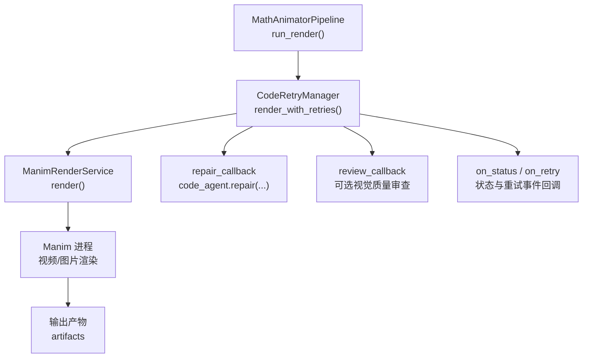
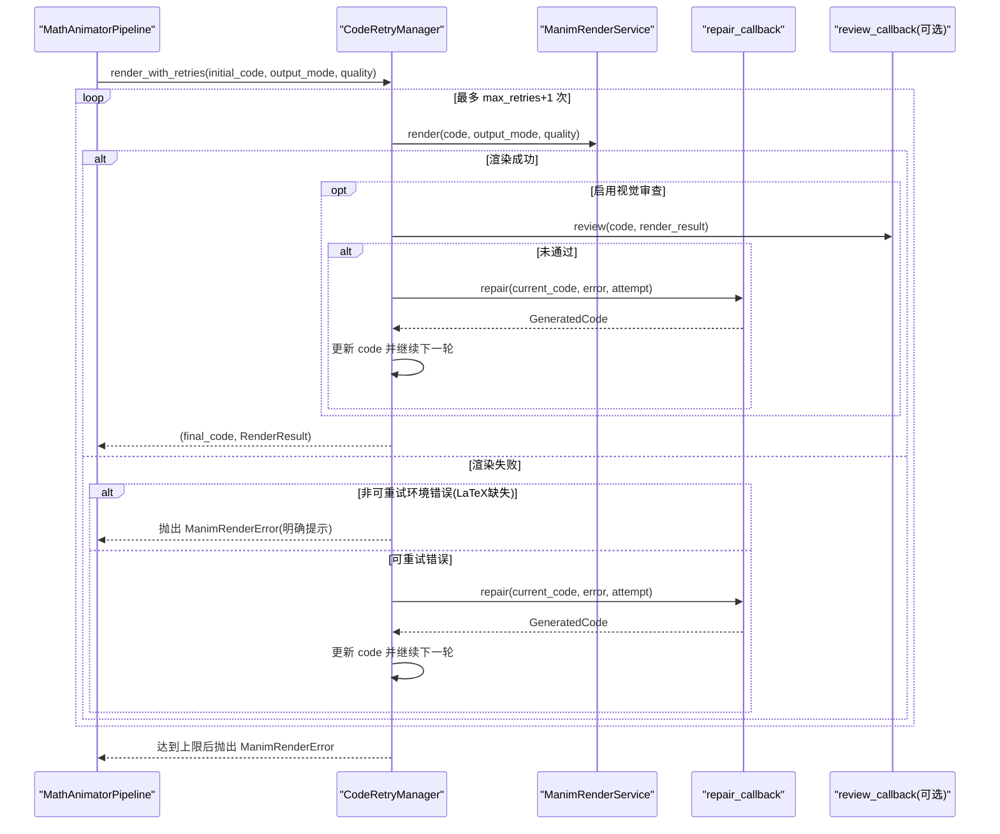
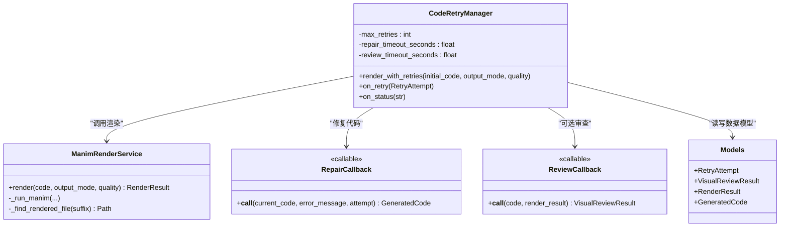

# 代码重试管理器

<cite>
**本文引用的文件**
- [retry_manager.py](file://deeptutor/agents/math_animator/retry_manager.py)
- [models.py](file://deeptutor/agents/math_animator/models.py)
- [renderer.py](file://deeptutor/agents/math_animator/renderer.py)
- [pipeline.py](file://deeptutor/agents/math_animator/pipeline.py)
- [test_retry_manager.py](file://tests/agents/math_animator/test_retry_manager.py)
</cite>

## 目录
1. [简介](#简介)
2. [项目结构](#项目结构)
3. [核心组件](#核心组件)
4. [架构总览](#架构总览)
5. [详细组件分析](#详细组件分析)
6. [依赖关系分析](#依赖关系分析)
7. [性能与超时控制](#性能与超时控制)
8. [故障排查指南](#故障排查指南)
9. [结论](#结论)
10. [附录：配置参数与使用示例](#附录配置参数与使用示例)

## 简介
本文件围绕数学动画管线中的“渲染-修复-再生成”闭环，系统性说明 CodeRetryManager 的实现原理与工作流。重点包括：
- 最大重试次数控制、重试间隔策略（通过回调与超时实现）和状态回调机制
- render_with_retries 的完整流程：渲染尝试、错误处理、自动修复、视觉质量审查
- 非可重试环境错误的识别与特殊处理（特别是 LaTeX 缺失导致的渲染失败）
- 重试历史记录的维护与状态更新触发时机
- 重试配置参数说明与在管道中的集成方式
- 错误分类策略与故障恢复机制

## 项目结构
CodeRetryManager 位于数学动画能力模块中，负责编排渲染与修复循环；渲染由 ManimRenderService 执行；数据模型集中在 models.py；整体由 MathAnimatorPipeline 装配并驱动。

图表来源
- [pipeline.py:137-194](file://deeptutor/agents/math_animator/pipeline.py#L137-L194)
- [retry_manager.py:21-157](file://deeptutor/agents/math_animator/retry_manager.py#L21-L157)
- [renderer.py:35-69](file://deeptutor/agents/math_animator/renderer.py#L35-L69)

章节来源
- [pipeline.py:137-194](file://deeptutor/agents/math_animator/pipeline.py#L137-L194)
- [retry_manager.py:21-157](file://deeptutor/agents/math_animator/retry_manager.py#L21-L157)
- [renderer.py:35-69](file://deeptutor/agents/math_animator/renderer.py#L35-L69)

## 核心组件
- CodeRetryManager：编排渲染、修复、视觉审查与重试循环，管理最大重试次数、超时与状态回调。
- ManimRenderService：封装 Manim 渲染过程，产出视频或图片产物，并在失败时抛出 ManimRenderError。
- 数据模型：GeneratedCode、RenderResult、VisualReviewResult、RetryAttempt 等，用于传递上下文与结果。
- MathAnimatorPipeline：将 CodeRetryManager 接入端到端流水线，注入 repair_callback 与 review_callback。

章节来源
- [retry_manager.py:21-157](file://deeptutor/agents/math_animator/retry_manager.py#L21-L157)
- [renderer.py:35-69](file://deeptutor/agents/math_animator/renderer.py#L35-L69)
- [models.py:30-83](file://deeptutor/agents/math_animator/models.py#L30-L83)
- [pipeline.py:137-194](file://deeptutor/agents/math_animator/pipeline.py#L137-L194)

## 架构总览
下图展示了从管线到重试管理器再到渲染服务与修复/审查回调的调用链，以及关键异常与返回路径。

图表来源
- [retry_manager.py:43-157](file://deeptutor/agents/math_animator/retry_manager.py#L43-L157)
- [renderer.py:52-69](file://deeptutor/agents/math_animator/renderer.py#L52-L69)
- [pipeline.py:174-194](file://deeptutor/agents/math_animator/pipeline.py#L174-L194)

## 详细组件分析

### CodeRetryManager：重试循环与状态回调
- 初始化参数
  - renderer：渲染服务实例
  - repair_callback：接收当前代码、错误信息、尝试次数，返回修复后的代码
  - review_callback（可选）：对渲染结果进行视觉质量审查
  - on_retry：每次进入修复前触发，便于记录或上报
  - on_status：渲染各阶段的状态消息回调
  - max_retries：最大重试次数（默认 4）
  - repair_timeout_seconds：修复回调超时（默认 180s）
  - review_timeout_seconds：视觉审查超时（默认 120s）

- render_with_retries 工作流程
  - 初始化 code 与 retry_history
  - 循环最多 max_retries+1 次：
    - 发出“开始第 N 次渲染”状态
    - 调用 renderer.render(...)
    - 若启用视觉审查：
      - 调用 review_callback，带超时保护
      - 若未通过：
        - 若已达最大重试次数：记录最终结果并返回“最佳可用结果”
        - 否则：构造 RetryAttempt，追加到历史记录，触发 on_retry，调用 repair_callback 生成新代码，继续下一轮
    - 若渲染成功且无审查或审查通过：直接返回
    - 若渲染失败：
      - 检测是否为“非可重试环境错误”（LaTeX 缺失），若是则抛出明确的 ManimRenderError
      - 若未达到最大重试次数：记录重试尝试，触发 on_retry，调用 repair_callback 修复并重试
      - 若已达到最大重试次数：抛出异常
  - 兜底：循环结束后抛出异常，表示渲染循环意外退出

- 非可重试环境错误识别
  - 基于错误消息匹配 LaTeX 相关关键字，如找不到 latex 命令或无法定位 LaTeX 安装
  - 遇到此类错误直接抛出带有明确提示的异常，避免无效重试

- 状态与历史记录
  - 每次渲染开始、修复生成、重新渲染、审查阶段均会触发 on_status
  - 每次进入修复前触发 on_retry，附带 RetryAttempt（包含 attempt 与 error）
  - RenderResult 中携带 retry_attempts 与 retry_history，便于上层追踪

章节来源
- [retry_manager.py:21-157](file://deeptutor/agents/math_animator/retry_manager.py#L21-L157)
- [models.py:56-83](file://deeptutor/agents/math_animator/models.py#L56-L83)

### ManimRenderService：渲染执行与异常
- render：根据 output_mode 选择图片或视频渲染路径，写入源码与产物，返回 RenderResult
- _render_video/_render_image_blocks：分别处理视频与图片块渲染，查找最终产物并构建 RenderedArtifact
- _run_manim：以子进程方式运行 manim，实时读取 stdout/stderr 并通过 progress_callback 上报进度；当返回码非零时抛出 ManimRenderError，并裁剪错误消息
- 其他辅助方法：提取场景名、查找最终产物、构建产物元信息

章节来源
- [renderer.py:35-69](file://deeptutor/agents/math_animator/renderer.py#L35-L69)
- [renderer.py:71-122](file://deeptutor/agents/math_animator/renderer.py#L71-L122)
- [renderer.py:124-201](file://deeptutor/agents/math_animator/renderer.py#L124-L201)
- [renderer.py:208-243](file://deeptutor/agents/math_animator/renderer.py#L208-L243)

### 数据模型：重试与结果
- RetryAttempt：记录每次重试的序号与错误信息
- VisualReviewResult：视觉审查结果，包含是否通过、摘要、问题列表、建议修复、审查帧数
- RenderResult：渲染结果，包含输出模式、产物、质量、重试次数与历史、视觉审查结果
- GeneratedCode：修复回调返回的代码与建议说明

章节来源
- [models.py:30-83](file://deeptutor/agents/math_animator/models.py#L30-L83)

### 管道集成：如何装配重试管理器
- MathAnimatorPipeline.run_render 中：
  - 创建 ManimRenderService
  - 可选启用视觉审查（VisualReviewService）
  - 创建 CodeRetryManager，注入 repair_callback（调用 code_agent.repair）、on_retry、on_status、review_callback
  - 调用 render_with_retries 获取最终代码与渲染结果
  - 将结果转换为标准 RenderResult 返回

章节来源
- [pipeline.py:137-194](file://deeptutor/agents/math_animator/pipeline.py#L137-L194)

## 依赖关系分析
- CodeRetryManager 依赖：
  - ManimRenderService：执行渲染
  - repair_callback：修复代码（通常由 code_agent 提供）
  - review_callback（可选）：视觉质量审查
  - on_retry/on_status：状态与重试事件回调
- ManimRenderService 依赖：
  - 系统 manim 工具与 LaTeX（若使用 Tex/MathTex）
  - 路径服务与文件系统
- 数据模型集中定义，供各组件共享

图表来源
- [retry_manager.py:21-157](file://deeptutor/agents/math_animator/retry_manager.py#L21-L157)
- [renderer.py:35-69](file://deeptutor/agents/math_animator/renderer.py#L35-L69)
- [models.py:30-83](file://deeptutor/agents/math_animator/models.py#L30-L83)

## 性能与超时控制
- 渲染阶段：由 ManimRenderService 以子进程方式执行，实时读取输出并通过回调上报，避免阻塞事件循环
- 修复阶段：通过 asyncio.wait_for 限制 repair_callback 的执行时间，防止长时间卡死
- 审查阶段：同样通过 wait_for 限制 review_callback 的执行时间
- 超时异常：统一包装为 ManimRenderError，便于上层捕获与展示

章节来源
- [retry_manager.py:70-77](file://deeptutor/agents/math_animator/retry_manager.py#L70-L77)
- [retry_manager.py:111-119](file://deeptutor/agents/math_animator/retry_manager.py#L111-L119)
- [retry_manager.py:144-152](file://deeptutor/agents/math_animator/retry_manager.py#L144-L152)
- [renderer.py:155-201](file://deeptutor/agents/math_animator/renderer.py#L155-L201)

## 故障排查指南
- 常见错误类型
  - LaTeX 缺失：错误消息包含找不到 latex 命令或无法定位 LaTeX 安装。此时应停止重试，安装 LaTeX 或避免在生成的代码中使用 Tex/MathTex
  - 渲染失败：Manim 进程返回非零退出码，错误消息被裁剪并抛出 ManimRenderError
  - 修复超时：repair_callback 执行超过 repair_timeout_seconds，抛出 ManimRenderError
  - 审查超时：review_callback 执行超过 review_timeout_seconds，抛出 ManimRenderError
- 诊断步骤
  - 检查 on_status 日志，确认当前处于哪一阶段（渲染、修复、审查）
  - 检查 on_retry 记录，查看每次重试的错误信息与尝试次数
  - 查看 RenderResult.retry_history，了解历史错误序列
  - 若出现 LaTeX 相关错误，优先检查系统 LaTeX 安装与 PATH 配置
- 恢复策略
  - 对于可重试错误：依靠 repair_callback 修正代码后继续渲染
  - 对于不可重试错误：立即终止并提示用户采取外部措施（安装 LaTeX 或调整代码）

章节来源
- [retry_manager.py:12-18](file://deeptutor/agents/math_animator/retry_manager.py#L12-L18)
- [retry_manager.py:129-157](file://deeptutor/agents/math_animator/retry_manager.py#L129-L157)
- [renderer.py:194-201](file://deeptutor/agents/math_animator/renderer.py#L194-L201)
- [test_retry_manager.py:23-81](file://tests/agents/math_animator/test_retry_manager.py#L23-L81)

## 结论
CodeRetryManager 提供了健壮且可观测的“渲染-修复-再生成”闭环，支持最大重试次数控制、超时保护、状态与重试事件回调，以及对 LaTeX 缺失等不可重试环境错误的快速识别与中断。结合 MathAnimatorPipeline 的装配，可在数学动画生成过程中显著提升鲁棒性与用户体验。

## 附录：配置参数与使用示例

### 配置参数说明
- max_retries：最大重试次数（默认 4）。实际尝试次数为 max_retries+1（首次 + 最多 max_retries 次修复后重试）
- repair_timeout_seconds：修复回调超时（默认 180s）
- review_timeout_seconds：视觉审查超时（默认 120s）
- on_retry：每次进入修复前的回调，接收 RetryAttempt
- on_status：渲染各阶段状态消息回调
- review_callback：可选，用于视觉质量审查
- repair_callback：必须，接收 current_code、error_message、attempt，返回 GeneratedCode

章节来源
- [retry_manager.py:21-41](file://deeptutor/agents/math_animator/retry_manager.py#L21-L41)
- [pipeline.py:174-194](file://deeptutor/agents/math_animator/pipeline.py#L174-L194)

### 使用示例（来自测试）
- 基本重试与恢复：第一次渲染失败，修复后第二次成功，验证状态消息与重试计数
- 修复超时：修复回调过慢导致超时，抛出 ManimRenderError
- 视觉审查失败重试：审查未通过时触发修复，再次渲染并通过审查
- 达到上限仍失败：审查持续失败，返回“最佳可用结果”，并保留审查结果与警告状态

章节来源
- [test_retry_manager.py:23-81](file://tests/agents/math_animator/test_retry_manager.py#L23-L81)
- [test_retry_manager.py:84-186](file://tests/agents/math_animator/test_retry_manager.py#L84-L186)