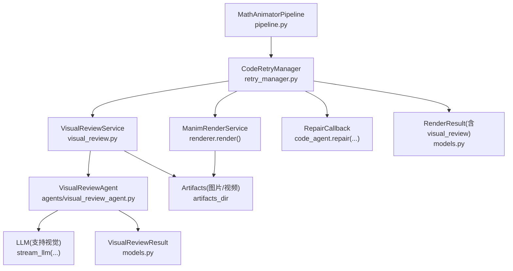
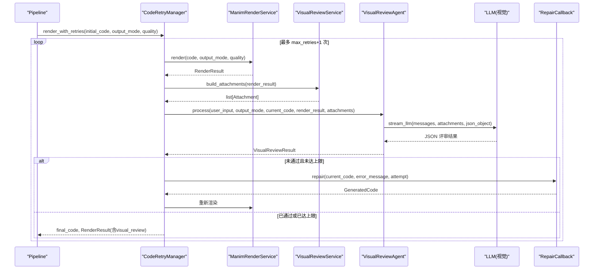
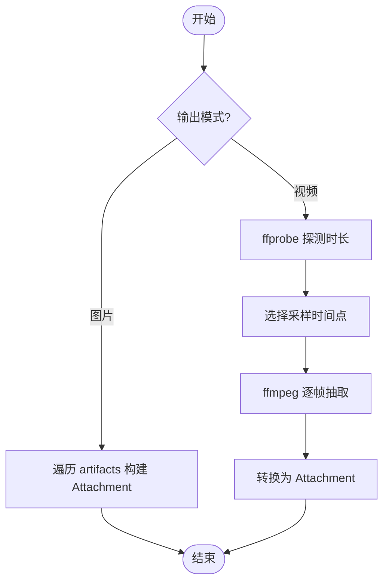
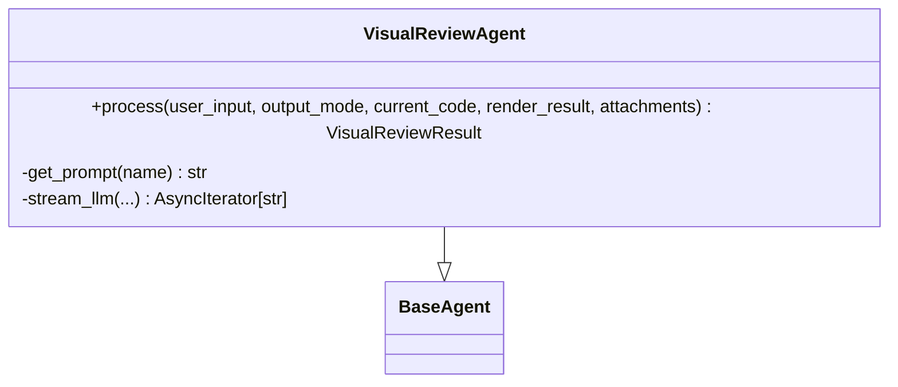
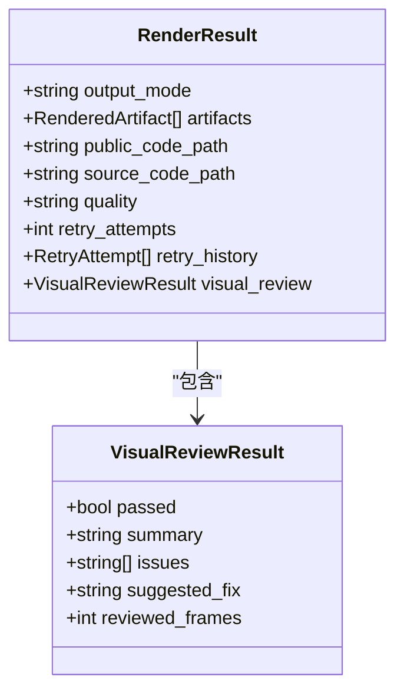
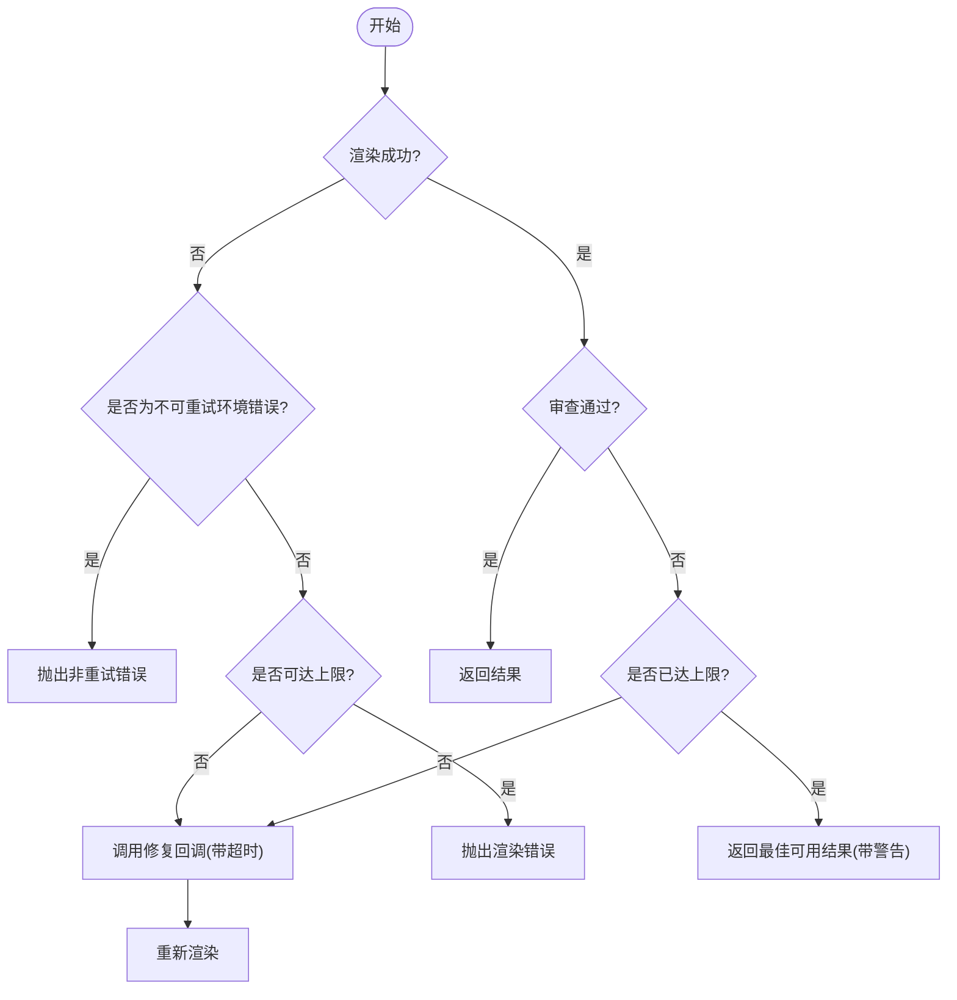
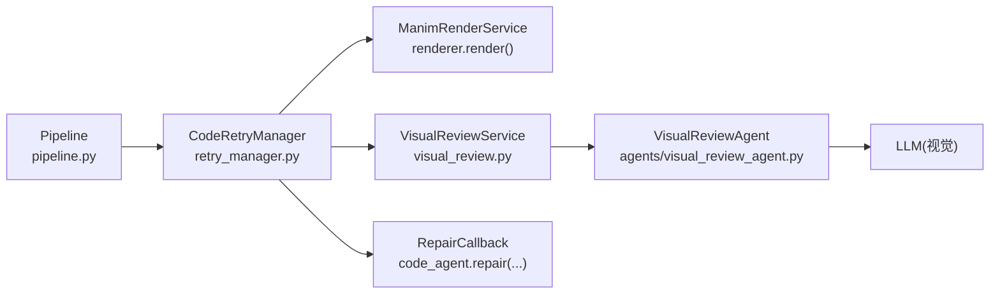

# 视觉审查服务

<cite>
**本文引用的文件**
- [visual_review.py](file://deeptutor/agents/math_animator/visual_review.py)
- [visual_review_agent.py](file://deeptutor/agents/math_animator/agents/visual_review_agent.py)
- [models.py](file://deeptutor/agents/math_animator/models.py)
- [retry_manager.py](file://deeptutor/agents/math_animator/retry_manager.py)
- [pipeline.py](file://deeptutor/agents/math_animator/pipeline.py)
- [visual_review_agent.yaml（中文）](file://deeptutor/agents/math_animator/prompts/zh/visual_review_agent.yaml)
- [visual_review_agent.yaml（英文）](file://deeptutor/agents/math_animator/prompts/en/visual_review_agent.yaml)
- [test_retry_manager.py](file://tests/agents/math_animator/test_retry_manager.py)
</cite>

## 目录
1. [简介](#简介)
2. [项目结构](#项目结构)
3. [核心组件](#核心组件)
4. [架构总览](#架构总览)
5. [详细组件分析](#详细组件分析)
6. [依赖关系分析](#依赖关系分析)
7. [性能考虑](#性能考虑)
8. [故障排查指南](#故障排查指南)
9. [结论](#结论)
10. [附录](#附录)

## 简介
本文件面向 DeepTutor 数学动画管线中的“视觉审查服务”，系统性说明 VisualReviewService 的实现原理、与代码重试管理器的集成机制、渲染结果分析算法与质量评估标准、审查工作流（重叠检测、可读性分析、构图检查）、审查结果格式、配置与自定义规则方法，以及性能优化与批量处理要点。该服务通过抽样抽取视频帧或读取图片产物，结合多模态大模型进行视觉质量评审，并将评审结果反馈给代码修复器，形成“渲染—审查—修复—再渲染”的闭环。

## 项目结构
视觉审查相关代码主要位于 math_animator 子模块中，关键文件职责如下：
- visual_review.py：负责从渲染产物中提取待审图像帧，构建附件并调用 LLM 审查。
- agents/visual_review_agent.py：封装视觉审查 Agent，构造提示词、发送请求并解析 JSON 结果。
- models.py：定义数据模型，包括 RenderResult、VisualReviewResult 等。
- retry_manager.py：实现渲染重试循环，并在每次渲染后执行视觉审查，驱动修复与重渲染。
- pipeline.py：编排整体流程，将视觉审查服务接入渲染阶段。
- prompts/.../visual_review_agent.yaml：中英文提示词模板，定义审查关注点与输出格式。
- tests/agents/math_animator/test_retry_manager.py：覆盖重试与视觉审查失败场景的测试用例。

图表来源
- [pipeline.py:150-194](file://deeptutor/agents/math_animator/pipeline.py#L150-L194)
- [retry_manager.py:43-128](file://deeptutor/agents/math_animator/retry_manager.py#L43-L128)
- [visual_review.py:31-52](file://deeptutor/agents/math_animator/visual_review.py#L31-L52)
- [visual_review_agent.py:33-97](file://deeptutor/agents/math_animator/agents/visual_review_agent.py#L33-L97)
- [models.py:63-83](file://deeptutor/agents/math_animator/models.py#L63-L83)

章节来源
- [pipeline.py:150-194](file://deeptutor/agents/math_animator/pipeline.py#L150-L194)
- [retry_manager.py:43-128](file://deeptutor/agents/math_animator/retry_manager.py#L43-L128)
- [visual_review.py:31-52](file://deeptutor/agents/math_animator/visual_review.py#L31-L52)
- [visual_review_agent.py:33-97](file://deeptutor/agents/math_animator/agents/visual_review_agent.py#L33-L97)
- [models.py:63-83](file://deeptutor/agents/math_animator/models.py#L63-L83)

## 核心组件
- VisualReviewService：根据渲染结果准备审查附件（图片直接读取；视频则抽帧），并通过进度回调上报状态。
- VisualReviewAgent：加载系统提示与用户模板，组装上下文（用户需求、输出模式、渲染结果 JSON、当前代码、附件），调用 LLM 返回结构化评审结果。
- CodeRetryManager：在渲染循环中插入视觉审查步骤，依据评审结果决定是否触发修复并重试，提供超时控制与错误处理。
- 数据模型：RenderResult 包含 artifacts、quality、retry_attempts/history 及 visual_review；VisualReviewResult 包含 passed、summary、issues、suggested_fix、reviewed_frames。

章节来源
- [visual_review.py:17-52](file://deeptutor/agents/math_animator/visual_review.py#L17-L52)
- [visual_review_agent.py:16-97](file://deeptutor/agents/math_animator/agents/visual_review_agent.py#L16-L97)
- [retry_manager.py:21-128](file://deeptutor/agents/math_animator/retry_manager.py#L21-L128)
- [models.py:56-83](file://deeptutor/agents/math_animator/models.py#L56-L83)

## 架构总览
视觉审查服务嵌入到数学动画渲染管线中，作为“渲染—审查—修复—再渲染”的关键环节。其核心交互如下：
- Pipeline 在渲染阶段启用视觉审查时，创建 VisualReviewService 并注入 review_callback。
- CodeRetryManager 每次渲染成功后，调用 review_callback 执行视觉审查。
- VisualReviewService 根据输出模式准备附件（图片/视频抽帧）。
- VisualReviewAgent 使用多模态 LLM 对附件进行分析，返回 VisualReviewResult。
- CodeRetryManager 根据 passed 字段决定继续或触发修复；若达到最大重试次数仍失败，返回最佳可用结果并附带警告。

图表来源
- [pipeline.py:150-194](file://deeptutor/agents/math_animator/pipeline.py#L150-L194)
- [retry_manager.py:43-128](file://deeptutor/agents/math_animator/retry_manager.py#L43-L128)
- [visual_review.py:31-52](file://deeptutor/agents/math_animator/visual_review.py#L31-L52)
- [visual_review_agent.py:33-97](file://deeptutor/agents/math_animator/agents/visual_review_agent.py#L33-L97)

## 详细组件分析

### VisualReviewService：渲染结果分析与附件构建
- 输入：RenderResult（包含 artifacts、output_mode）。
- 行为：
  - 若为图片模式：直接将 artifacts 转为 Attachment。
  - 若为视频模式：使用 ffprobe 探测时长，按策略选择时间点，调用 ffmpeg 抽取若干帧，转换为 Attachment。
  - 通过进度回调上报准备与抽取进度。
- 关键点：
  - 视频缺失或工具执行失败会抛出 ManimRenderError。
  - 时间戳选择策略：短于 2 秒的视频取首、中、尾三处；否则取约 15%、50%、85% 位置。

图表来源
- [visual_review.py:31-52](file://deeptutor/agents/math_animator/visual_review.py#L31-L52)
- [visual_review.py:54-89](file://deeptutor/agents/math_animator/visual_review.py#L54-L89)
- [visual_review.py:91-130](file://deeptutor/agents/math_animator/visual_review.py#L91-L130)

章节来源
- [visual_review.py:31-52](file://deeptutor/agents/math_animator/visual_review.py#L31-L52)
- [visual_review.py:54-89](file://deeptutor/agents/math_animator/visual_review.py#L54-L89)
- [visual_review.py:91-130](file://deeptutor/agents/math_animator/visual_review.py#L91-L130)

### VisualReviewAgent：多模态 LLM 审查与结果解析
- 前置检查：若无附件或模型不支持视觉，直接返回通过的跳过结果。
- 提示词：加载 system 与 user_template，注入用户需求、输出模式、已抽样帧数、渲染结果 JSON、当前代码。
- 调用：以流式方式请求 LLM，要求返回 JSON Object，并解析为 VisualReviewResult。
- 追踪：附带 trace_meta，便于可观测性与问题定位。

图表来源
- [visual_review_agent.py:16-97](file://deeptutor/agents/math_animator/agents/visual_review_agent.py#L16-L97)

章节来源
- [visual_review_agent.py:33-97](file://deeptutor/agents/math_animator/agents/visual_review_agent.py#L33-L97)

### 数据模型：审查结果与渲染结果
- VisualReviewResult：
  - passed：布尔值，表示是否通过。
  - summary：一句话总结。
  - issues：问题列表（当未通过时）。
  - suggested_fix：给修复器的具体修改建议。
  - reviewed_frames：实际审查的帧数。
- RenderResult：
  - 包含 output_mode、artifacts、quality、retry_attempts/history，以及 visual_review 字段用于承载本次审查结果。

图表来源
- [models.py:56-83](file://deeptutor/agents/math_animator/models.py#L56-L83)

章节来源
- [models.py:56-83](file://deeptutor/agents/math_animator/models.py#L56-L83)

### 代码重试管理器：超时控制与错误处理
- 渲染循环：最多尝试 max_retries+1 次。
- 视觉审查：每次渲染成功后调用 review_callback，并以 review_timeout_seconds 限制审查耗时。
- 修复循环：若未通过且未达上限，调用 repair_callback 生成修复代码，并以 repair_timeout_seconds 限制修复耗时。
- 错误处理：
  - 环境错误（如缺少 LaTeX）会被识别为非重试错误并直接抛出。
  - 超时异常统一包装为 ManimRenderError。
  - 达到上限仍失败时，返回最佳可用结果并记录警告状态。

图表来源
- [retry_manager.py:43-157](file://deeptutor/agents/math_animator/retry_manager.py#L43-L157)

章节来源
- [retry_manager.py:43-157](file://deeptutor/agents/math_animator/retry_manager.py#L43-L157)

### 审查工作流：重叠检测、可读性分析、构图检查
- 重叠检测：检查几何对象、标签、公式、辅助线之间是否存在遮挡或重叠。
- 可读性分析：确保文字与公式清晰可读，避免过小、过密或对比度不足。
- 构图检查：关键对象不应跑出画面，场景推进应清楚，单帧内容不宜过多。
- 这些规则由提示词模板明确约束，指导多模态模型做出判断与建议。

章节来源
- [visual_review_agent.yaml（中文）:1-32](file://deeptutor/agents/math_animator/prompts/zh/visual_review_agent.yaml#L1-L32)
- [visual_review_agent.yaml（英文）:1-32](file://deeptutor/agents/math_animator/prompts/en/visual_review_agent.yaml#L1-L32)

### 审查结果生成格式
- 通过/失败：passed 字段指示是否通过。
- 问题摘要：summary 提供一句话总结；issues 列出具体问题（未通过时）。
- 修复建议：suggested_fix 给出针对布局、顺序、间距、缩放等的具体修改指引。
- 审查范围：reviewed_frames 标明实际审查的帧数。
- 结果落盘：RenderResult.visual_review 保存最终审查结果，供上层展示与审计。

章节来源
- [models.py:63-83](file://deeptutor/agents/math_animator/models.py#L63-L83)
- [visual_review_agent.yaml（中文）:11-32](file://deeptutor/agents/math_animator/prompts/zh/visual_review_agent.yaml#L11-L32)
- [visual_review_agent.yaml（英文）:11-32](file://deeptutor/agents/math_animator/prompts/en/visual_review_agent.yaml#L11-L32)

### 与代码重试管理器的集成机制
- Pipeline 在启用视觉审查时，创建 VisualReviewService 并注入 review_callback。
- CodeRetryManager 在每次渲染后调用 review_callback，并将结果写入 RenderResult.visual_review。
- 若未通过，将基于 review_result.summary 与 suggested_fix 构造错误信息，驱动修复回调，并在限定时间内完成修复与重渲染。
- 达到最大重试次数仍失败时，返回最佳可用结果并记录警告状态。

章节来源
- [pipeline.py:150-194](file://deeptutor/agents/math_animator/pipeline.py#L150-L194)
- [retry_manager.py:64-128](file://deeptutor/agents/math_animator/retry_manager.py#L64-L128)
- [test_retry_manager.py:85-186](file://tests/agents/math_animator/test_retry_manager.py#L85-L186)

## 依赖关系分析
- VisualReviewService 依赖外部工具 ffprobe 与 ffmpeg 进行视频时长探测与帧抽取。
- VisualReviewAgent 依赖多模态 LLM（需支持视觉能力），并通过 BaseAgent 提供的流式接口获取结果。
- CodeRetryManager 依赖 ManimRenderService 执行渲染，并可通过 on_status/on_retry 回调上报状态与重试事件。
- Pipeline 将上述组件串联，形成端到端流程。

图表来源
- [pipeline.py:150-194](file://deeptutor/agents/math_animator/pipeline.py#L150-L194)
- [retry_manager.py:43-128](file://deeptutor/agents/math_animator/retry_manager.py#L43-L128)
- [visual_review.py:31-52](file://deeptutor/agents/math_animator/visual_review.py#L31-L52)
- [visual_review_agent.py:33-97](file://deeptutor/agents/math_animator/agents/visual_review_agent.py#L33-L97)

章节来源
- [pipeline.py:150-194](file://deeptutor/agents/math_animator/pipeline.py#L150-L194)
- [retry_manager.py:43-128](file://deeptutor/agents/math_animator/retry_manager.py#L43-L128)
- [visual_review.py:31-52](file://deeptutor/agents/math_animator/visual_review.py#L31-L52)
- [visual_review_agent.py:33-97](file://deeptutor/agents/math_animator/agents/visual_review_agent.py#L33-L97)

## 性能考虑
- 视频抽帧策略：对短于 2 秒的视频采用首、中、尾三点；较长视频采用约 15%、50%、85% 位置，平衡覆盖率与成本。
- 并发与异步：使用 asyncio.create_subprocess_exec 并行执行 ffprobe/ffmpeg，减少阻塞。
- 超时控制：审查与修复均设置超时，避免长时间占用资源。
- 批量处理：当前实现以单次渲染为单位进行审查；如需批量，可在 Pipeline 层聚合多个 turn_id 的渲染任务，复用 LLM 会话或批处理附件（需评估模型 API 限制）。
- 缓存与复用：可考虑对相同片段或相似代码的审查结果进行缓存，降低重复计算。

[本节为通用性能建议，不直接分析具体文件]

## 故障排查指南
- 视频缺失：若渲染产物视频不存在，会抛出 ManimRenderError，需检查渲染路径与产物生成。
- 工具不可用：ffprobe/ffmpeg 执行失败会抛出错误，需确认系统已安装对应工具且 PATH 正确。
- 模型不支持视觉：若当前模型不支持图像检查，审查将被跳过并返回通过结果。
- 超时：审查或修复超时将抛出 ManimRenderError，需调整 review_timeout_seconds 或 repair_timeout_seconds。
- 无法重试的环境错误：如缺少 LaTeX，会直接抛出非重试错误，需避免在生成代码中使用 Tex/MathTex 或安装 LaTeX。

章节来源
- [visual_review.py:54-89](file://deeptutor/agents/math_animator/visual_review.py#L54-L89)
- [visual_review.py:91-118](file://deeptutor/agents/math_animator/visual_review.py#L91-L118)
- [visual_review_agent.py:49-55](file://deeptutor/agents/math_animator/agents/visual_review_agent.py#L49-L55)
- [retry_manager.py:12-18](file://deeptutor/agents/math_animator/retry_manager.py#L12-L18)
- [retry_manager.py:74-77](file://deeptutor/agents/math_animator/retry_manager.py#L74-L77)
- [retry_manager.py:115-119](file://deeptutor/agents/math_animator/retry_manager.py#L115-L119)
- [retry_manager.py:129-134](file://deeptutor/agents/math_animator/retry_manager.py#L129-L134)

## 结论
视觉审查服务通过“抽样帧抽取 + 多模态 LLM 评审 + 超时与重试控制”的组合，有效提升了数学动画的教学可用性。它在渲染阶段自动发现重叠、可读性与构图问题，并将结构化建议反馈给代码修复器，形成闭环改进。配合合理的超时与错误处理策略，能够在保证质量的同时维持良好的性能与稳定性。

[本节为总结性内容，不直接分析具体文件]

## 附录

### 配置选项与自定义审查规则
- 启用视觉审查：在 Pipeline 中设置 enable_visual_review 并提供 visual_review_agent。
- 提示词定制：编辑 prompts/zh/visual_review_agent.yaml 或 prompts/en/visual_review_agent.yaml，调整审查关注点与输出格式。
- 超时参数：在 CodeRetryManager 中调整 review_timeout_seconds 与 repair_timeout_seconds。
- 重试上限：通过 max_retries 控制最大重试次数。
- 进度回调：通过 progress_callback 与 on_status/on_retry 回调实现前端或日志系统的实时反馈。

章节来源
- [pipeline.py:150-194](file://deeptutor/agents/math_animator/pipeline.py#L150-L194)
- [visual_review_agent.yaml（中文）:1-32](file://deeptutor/agents/math_animator/prompts/zh/visual_review_agent.yaml#L1-L32)
- [visual_review_agent.yaml（英文）:1-32](file://deeptutor/agents/math_animator/prompts/en/visual_review_agent.yaml#L1-L32)
- [retry_manager.py:21-41](file://deeptutor/agents/math_animator/retry_manager.py#L21-L41)

### 测试与验证
- 重试与恢复：验证渲染失败时的修复与重渲染流程。
- 超时保护：验证修复超时会抛出相应错误。
- 视觉审查失败：验证未通过时触发修复，并在达到上限后返回最佳可用结果。

章节来源
- [test_retry_manager.py:23-82](file://tests/agents/math_animator/test_retry_manager.py#L23-L82)
- [test_retry_manager.py:85-186](file://tests/agents/math_animator/test_retry_manager.py#L85-L186)