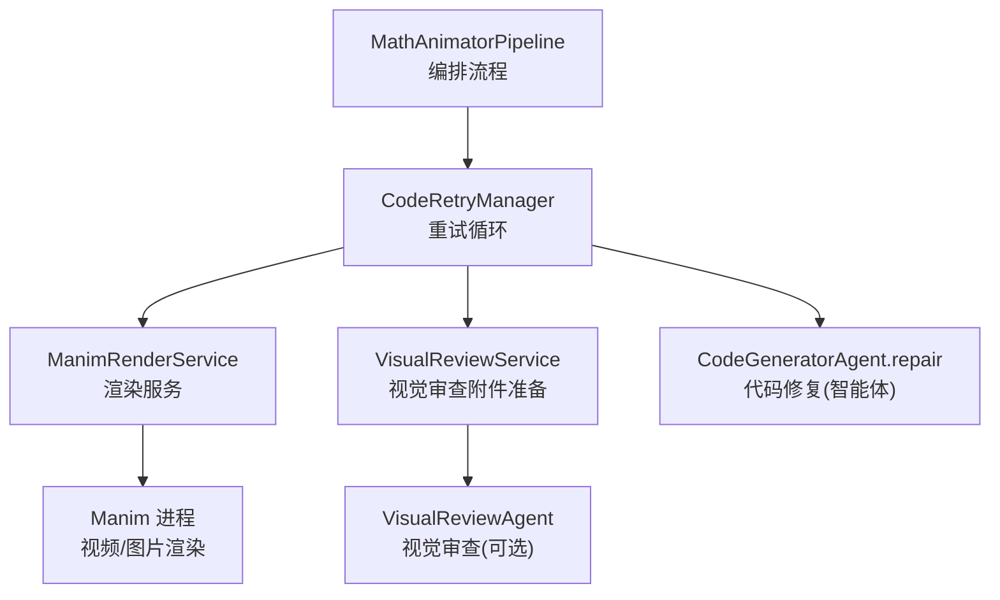
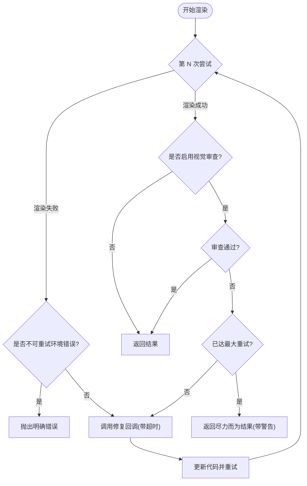
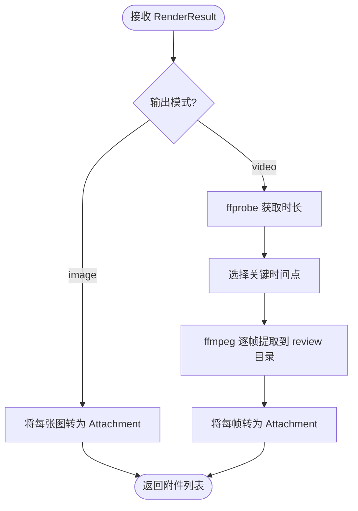
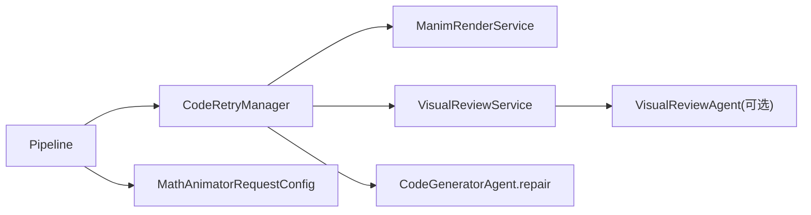

# 重试机制

<cite>
**本文引用的文件**
- [retry_manager.py](file://deeptutor/agents/math_animator/retry_manager.py)
- [visual_review.py](file://deeptutor/agents/math_animator/visual_review.py)
- [pipeline.py](file://deeptutor/agents/math_animator/pipeline.py)
- [renderer.py](file://deeptutor/agents/math_animator/renderer.py)
- [models.py](file://deeptutor/agents/math_animator/models.py)
- [request_config.py](file://deeptutor/agents/math_animator/request_config.py)
- [test_retry_manager.py](file://tests/agents/math_animator/test_retry_manager.py)
</cite>

## 目录
1. [简介](#简介)
2. [项目结构](#项目结构)
3. [核心组件](#核心组件)
4. [架构总览](#架构总览)
5. [详细组件分析](#详细组件分析)
6. [依赖关系分析](#依赖关系分析)
7. [性能与超时控制](#性能与超时控制)
8. [故障排除指南](#故障排除指南)
9. [结论](#结论)
10. [附录：配置示例与最佳实践](#附录：配置示例与最佳实践)

## 简介
本文件聚焦数学动画能力中的“渲染-修复-重试”闭环，系统性说明 CodeRetryManager 的重试策略、VisualReviewService 的视觉审查流程、错误分类与自动修复策略、进度跟踪与日志记录，以及与代码生成智能体的协作修复机制。目标是帮助开发者与使用者理解并可靠地部署该机制，快速定位问题并进行调优。

## 项目结构
数学动画能力位于 agents/math_animator 下，关键文件职责如下：
- pipeline.py：编排概念分析、场景设计、代码生成、渲染与总结；在渲染阶段接入重试与可选的视觉审查。
- retry_manager.py：实现渲染重试循环，统一处理渲染失败与视觉审查不通过时的修复与再渲染。
- visual_review.py：从渲染产物（图片或视频帧）构建附件，用于视觉审查。
- renderer.py：调用 Manim 执行渲染，封装输出产物与错误。
- models.py：定义重试尝试、渲染结果、视觉审查结果等数据模型。
- request_config.py：校验请求配置（输出模式、质量、风格提示）。
- test_retry_manager.py：覆盖重试、超时、视觉审查失败等用例，验证行为与回调。



图表来源
- [pipeline.py:137-194](file://deeptutor/agents/math_animator/pipeline.py#L137-L194)
- [retry_manager.py:21-157](file://deeptutor/agents/math_animator/retry_manager.py#L21-L157)
- [renderer.py:35-201](file://deeptutor/agents/math_animator/renderer.py#L35-L201)
- [visual_review.py:17-146](file://deeptutor/agents/math_animator/visual_review.py#L17-L146)

章节来源
- [pipeline.py:1-281](file://deeptutor/agents/math_animator/pipeline.py#L1-L281)
- [retry_manager.py:1-161](file://deeptutor/agents/math_animator/retry_manager.py#L1-L161)
- [renderer.py:1-251](file://deeptutor/agents/math_animator/renderer.py#L1-L251)
- [visual_review.py:1-150](file://deeptutor/agents/math_animator/visual_review.py#L1-L150)
- [models.py:1-96](file://deeptutor/agents/math_animator/models.py#L1-L96)
- [request_config.py:1-39](file://deeptutor/agents/math_animator/request_config.py#L1-L39)

## 核心组件
- CodeRetryManager：负责渲染重试循环，支持最大重试次数、渲染与修复超时、状态与重试事件回调，以及可选的视觉审查反馈驱动修复。
- VisualReviewService：将渲染产物转换为可被视觉审查智能体消费的附件（图片直接转附件；视频抽取关键帧），并上报进度。
- ManimRenderService：封装 Manim 渲染过程，输出 RenderResult，包含产物、质量、路径等信息，并在失败时抛出结构化异常。
- MathAnimatorPipeline：串联分析、设计、代码生成、渲染与总结，并在渲染阶段注入重试与视觉审查。

章节来源
- [retry_manager.py:21-157](file://deeptutor/agents/math_animator/retry_manager.py#L21-L157)
- [visual_review.py:17-146](file://deeptutor/agents/math_animator/visual_review.py#L17-L146)
- [renderer.py:35-201](file://deeptutor/agents/math_animator/renderer.py#L35-L201)
- [pipeline.py:137-194](file://deeptutor/agents/math_animator/pipeline.py#L137-L194)

## 架构总览
下图展示了“渲染-审查-修复-重试”的整体时序，包括状态回调、进度上报、超时保护与最终结果返回。

```mermaid
sequenceDiagram
participant P as "MathAnimatorPipeline"
participant R as "CodeRetryManager"
participant M as "ManimRenderService"
participant V as "VisualReviewService"
participant A as "VisualReviewAgent(可选)"
participant G as "CodeGeneratorAgent.repair"
P->>R : render_with_retries(initial_code, output_mode, quality)
loop 最多 max_retries+1 次
R->>M : render(code, output_mode, quality)
alt 渲染成功
opt 启用视觉审查
R->>V : build_attachments(render_result)
V-->>R : attachments
R->>A : process(user_input, current_code, render_result, attachments)
A-->>R : VisualReviewResult(passed?, summary, suggested_fix)
alt 审查未通过且未达上限
R->>G : repair(current_code, error_msg, attempt)
G-->>R : GeneratedCode(code)
R->>R : 更新 code 并继续下一轮
else 审查通过或已达上限
R-->>P : 返回最终 code 与 render_result
end
else 无视觉审查
R-->>P : 返回最终 code 与 render_result
end
else 渲染失败
alt 不可重试环境错误(如缺少 LaTeX)
R-->>P : 抛出明确错误
else 可重试错误
R->>G : repair(current_code, error_msg, attempt)
G-->>R : GeneratedCode(code)
R->>R : 更新 code 并继续下一轮
end
end
end
note over R,P : 若循环退出仍未成功，抛出兜底错误
```

图表来源
- [pipeline.py:137-194](file://deeptutor/agents/math_animator/pipeline.py#L137-L194)
- [retry_manager.py:43-157](file://deeptutor/agents/math_animator/retry_manager.py#L43-L157)
- [visual_review.py:31-52](file://deeptutor/agents/math_animator/visual_review.py#L31-L52)
- [renderer.py:52-69](file://deeptutor/agents/math_animator/renderer.py#L52-L69)

## 详细组件分析

### CodeRetryManager：重试循环、最大重试次数、超时与回调
- 最大重试次数：构造参数 max_retries 控制重试上限；实际循环为 max_retries + 1 次尝试（首次尝试 + 最多 max_retries 次修复后重渲染）。
- 渲染失败分支：
  - 识别“不可重试的环境错误”（例如本地缺失 LaTeX），直接抛出更明确的错误，避免无效重试。
  - 其他渲染错误进入修复流程，使用 repair_callback 生成新代码，带超时保护。
- 视觉审查分支（可选）：
  - 渲染成功后，若启用视觉审查，则调用 review_callback 进行审查。
  - 审查失败且未达上限：记录重试尝试，触发修复回调，重新渲染。
  - 审查失败但已达上限：返回“尽力而为”的结果，附带警告状态消息。
- 超时保护：
  - 视觉审查与修复均设置独立超时（review_timeout_seconds、repair_timeout_seconds），超时抛出自定义渲染错误，便于上层感知与降级。
- 回调与进度：
  - on_status：每次尝试开始、审查中、修复中、重新渲染前等关键节点上报状态。
  - on_retry：每次进入修复前上报重试尝试（含错误摘要）。



图表来源
- [retry_manager.py:43-157](file://deeptutor/agents/math_animator/retry_manager.py#L43-L157)

章节来源
- [retry_manager.py:21-157](file://deeptutor/agents/math_animator/retry_manager.py#L21-L157)
- [test_retry_manager.py:23-81](file://tests/agents/math_animator/test_retry_manager.py#L23-L81)
- [test_retry_manager.py:84-186](file://tests/agents/math_animator/test_retry_manager.py#L84-L186)

### VisualReviewService：渲染结果分析与附件构建
- 输入：渲染结果 RenderResult（包含 artifacts）。
- 图片模式：直接将每个渲染图片转为 Attachment 列表。
- 视频模式：
  - 使用 ffprobe 探测视频时长。
  - 根据时长选择关键时间点（短于2秒取首/中/尾；否则取约15%/50%/85%处）。
  - 使用 ffmpeg 提取指定时间点的单帧图片，保存至 review 目录。
  - 将每帧图片转为 Attachment（base64 编码）。
- 进度上报：通过 progress_callback 上报准备与提取进度。
- 错误处理：缺失视频、ffprobe/ffmpeg 执行失败、解析时长失败等均抛出渲染错误。



图表来源
- [visual_review.py:31-52](file://deeptutor/agents/math_animator/visual_review.py#L31-L52)
- [visual_review.py:54-130](file://deeptutor/agents/math_animator/visual_review.py#L54-L130)
- [visual_review.py:132-146](file://deeptutor/agents/math_animator/visual_review.py#L132-L146)

章节来源
- [visual_review.py:17-146](file://deeptutor/agents/math_animator/visual_review.py#L17-L146)

### 错误分类与自动修复策略
- 渲染错误分类：
  - 不可重试环境错误：例如本地缺失 LaTeX，直接抛出明确错误，避免浪费重试。
  - 可重试错误：语法错误、Manim 执行失败等，进入修复流程。
- 视觉审查失败：
  - 由 VisualReviewAgent 返回 passed=false 及建议修复内容，作为修复提示的一部分。
- 自动修复：
  - 通过 CodeGeneratorAgent.repair 基于当前代码、错误信息或视觉审查建议生成修复后的代码。
  - 修复过程带超时保护，防止长时间阻塞。
- 尽力而为：
  - 当视觉审查持续失败且达到最大重试次数，仍返回最后一次渲染结果，并附带审查摘要与建议，供上层展示或人工介入。

章节来源
- [retry_manager.py:12-18](file://deeptutor/agents/math_animator/retry_manager.py#L12-L18)
- [retry_manager.py:64-125](file://deeptutor/agents/math_animator/retry_manager.py#L64-L125)
- [pipeline.py:174-187](file://deeptutor/agents/math_animator/pipeline.py#L174-L187)
- [test_retry_manager.py:84-186](file://tests/agents/math_animator/test_retry_manager.py#L84-L186)

### 进度跟踪与日志记录
- 渲染进度：
  - ManimRenderService 在执行各阶段（准备工作区、保存源码、启动场景、写入产物、子进程输出行）通过 progress_callback 上报进度。
  - 支持 raw=true 的原始输出行转发，便于调试。
- 重试与审查进度：
  - CodeRetryManager 在每次尝试开始、审查中、修复中、重新渲染前通过 on_status 上报状态。
  - 每次进入修复通过 on_retry 上报重试尝试（含错误摘要）。
- 视觉审查进度：
  - VisualReviewService 在准备附件、提取帧时通过 progress_callback 上报进度。

章节来源
- [renderer.py:52-69](file://deeptutor/agents/math_animator/renderer.py#L52-L69)
- [renderer.py:124-201](file://deeptutor/agents/math_animator/renderer.py#L124-L201)
- [retry_manager.py:53-125](file://deeptutor/agents/math_animator/retry_manager.py#L53-L125)
- [visual_review.py:31-52](file://deeptutor/agents/math_animator/visual_review.py#L31-L52)
- [visual_review.py:74-88](file://deeptutor/agents/math_animator/visual_review.py#L74-L88)

### 与代码生成智能体的协作修复机制
- Pipeline 在 run_render 中创建 CodeRetryManager，并将 CodeGeneratorAgent.repair 作为修复回调传入。
- 修复回调接收：
  - 当前代码、错误信息或视觉审查建议、当前尝试序号、目标时长等上下文。
- 修复后代码会替换原代码并重新渲染，直至通过或达到上限。

章节来源
- [pipeline.py:174-187](file://deeptutor/agents/math_animator/pipeline.py#L174-L187)
- [retry_manager.py:110-125](file://deeptutor/agents/math_animator/retry_manager.py#L110-L125)
- [retry_manager.py:143-155](file://deeptutor/agents/math_animator/retry_manager.py#L143-L155)

## 依赖关系分析
- CodeRetryManager 依赖：
  - ManimRenderService：执行渲染。
  - 修复回调（通常为 CodeGeneratorAgent.repair）：生成修复代码。
  - 可选视觉审查回调（VisualReviewService + VisualReviewAgent）：提供视觉质量反馈。
  - 回调接口：on_status、on_retry。
- VisualReviewService 依赖：
  - 外部工具：ffprobe、ffmpeg（用于视频时长探测与帧提取）。
  - PathService：管理 math_animator 工作目录。
- ManimRenderService 依赖：
  - Manim 命令行：执行渲染。
  - PathService：管理 source/artifacts/media/meta 目录。
- Pipeline 依赖：
  - 多个 Agent：ConceptAnalysisAgent、ConceptDesignAgent、CodeGeneratorAgent、SummaryAgent、VisualReviewAgent（可选）。
  - 配置：MathAnimatorRequestConfig（output_mode、quality、style_hint）。



图表来源
- [pipeline.py:137-194](file://deeptutor/agents/math_animator/pipeline.py#L137-L194)
- [retry_manager.py:21-157](file://deeptutor/agents/math_animator/retry_manager.py#L21-L157)
- [visual_review.py:17-146](file://deeptutor/agents/math_animator/visual_review.py#L17-L146)
- [request_config.py:10-16](file://deeptutor/agents/math_animator/request_config.py#L10-L16)

章节来源
- [pipeline.py:137-194](file://deeptutor/agents/math_animator/pipeline.py#L137-L194)
- [retry_manager.py:21-157](file://deeptutor/agents/math_animator/retry_manager.py#L21-L157)
- [visual_review.py:17-146](file://deeptutor/agents/math_animator/visual_review.py#L17-L146)
- [request_config.py:10-16](file://deeptutor/agents/math_animator/request_config.py#L10-L16)

## 性能与超时控制
- 渲染超时：无显式全局超时，但通过 Manim 子进程输出流实时上报，便于上层监控。
- 修复超时：repair_timeout_seconds 限制修复回调耗时，默认值在管理器中设定，可在调用方调整。
- 审查超时：review_timeout_seconds 限制视觉审查耗时，默认值在管理器中设定，可在调用方调整。
- 视频帧提取：按固定比例选取关键点，减少不必要的帧数，降低 I/O 与 CPU 开销。
- 质量等级：low/medium/high 映射到不同 Manim 渲染参数，影响渲染速度与质量。

章节来源
- [retry_manager.py:21-41](file://deeptutor/agents/math_animator/retry_manager.py#L21-L41)
- [retry_manager.py:64-125](file://deeptutor/agents/math_animator/retry_manager.py#L64-L125)
- [renderer.py:24-28](file://deeptutor/agents/math_animator/renderer.py#L24-L28)
- [visual_review.py:120-130](file://deeptutor/agents/math_animator/visual_review.py#L120-L130)

## 故障排除指南
- 本地缺少 LaTeX：
  - 现象：渲染失败并提示无法找到 latex。
  - 处理：避免在生成代码中使用 Tex/MathTex，或安装 LaTeX 发行版。
- 视频审查失败：
  - 现象：视觉审查报告重叠、可读性或构图问题。
  - 处理：检查视觉审查建议，确认修复回调是否正确应用；必要时调整 style_hint 或质量等级。
- 修复超时：
  - 现象：修复回调执行过慢导致超时。
  - 处理：优化修复逻辑或增大 repair_timeout_seconds；确保 LLM 响应及时。
- 审查超时：
  - 现象：视觉审查回调执行过慢导致超时。
  - 处理：优化附件构建与审查逻辑，或增大 review_timeout_seconds。
- 视频帧提取失败：
  - 现象：ffprobe/ffmpeg 执行失败或缺失视频文件。
  - 处理：确认系统已安装 ffprobe/ffmpeg，并确保渲染产物存在。

章节来源
- [retry_manager.py:12-18](file://deeptutor/agents/math_animator/retry_manager.py#L12-L18)
- [retry_manager.py:64-125](file://deeptutor/agents/math_animator/retry_manager.py#L64-L125)
- [visual_review.py:54-118](file://deeptutor/agents/math_animator/visual_review.py#L54-L118)
- [test_retry_manager.py:59-81](file://tests/agents/math_animator/test_retry_manager.py#L59-L81)

## 结论
CodeRetryManager 提供了健壮的重试闭环，结合可选的视觉审查与智能体修复，能够在多种失败场景下自动恢复并尽可能产出可用结果。配合清晰的进度与状态回调，便于上层监控与用户反馈。通过合理配置超时与质量等级，可在稳定性与性能之间取得平衡。

## 附录：配置示例与最佳实践
- 基本配置项（来自请求配置）：
  - output_mode：video 或 image。
  - quality：low、medium、high。
  - style_hint：风格提示，可用于引导生成代码与后续修复。
- 重试与超时建议：
  - max_retries：根据业务容忍度设置，默认在管线中设为 4。
  - repair_timeout_seconds：根据修复复杂度设置，默认在管理器中设定。
  - review_timeout_seconds：根据审查复杂度设置，默认在管理器中设定。
- 回调使用建议：
  - on_status：用于前端或日志系统显示当前步骤。
  - on_retry：用于记录每次重试原因与修复方向。
  - progress_callback：用于渲染与审查过程中的细粒度进度上报。
- 最佳实践：
  - 在图像模式下确保代码仅包含 YON_IMAGE 锚点块。
  - 在视频模式下确保生成的 Manim Scene 类名正确可解析。
  - 对可能超时的外部调用（LLM、ffprobe/ffmpeg）设置合理的超时与重试边界。
  - 对不可重试的环境错误（如缺失 LaTeX）尽早失败，避免无效重试。

章节来源
- [request_config.py:10-16](file://deeptutor/agents/math_animator/request_config.py#L10-L16)
- [pipeline.py:174-187](file://deeptutor/agents/math_animator/pipeline.py#L174-L187)
- [retry_manager.py:21-41](file://deeptutor/agents/math_animator/retry_manager.py#L21-L41)
- [renderer.py:84-93](file://deeptutor/agents/math_animator/renderer.py#L84-L93)
- [renderer.py:222-227](file://deeptutor/agents/math_animator/renderer.py#L222-L227)