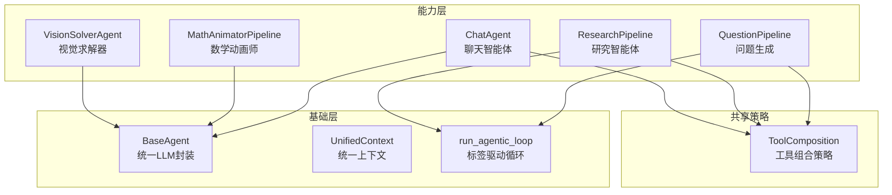
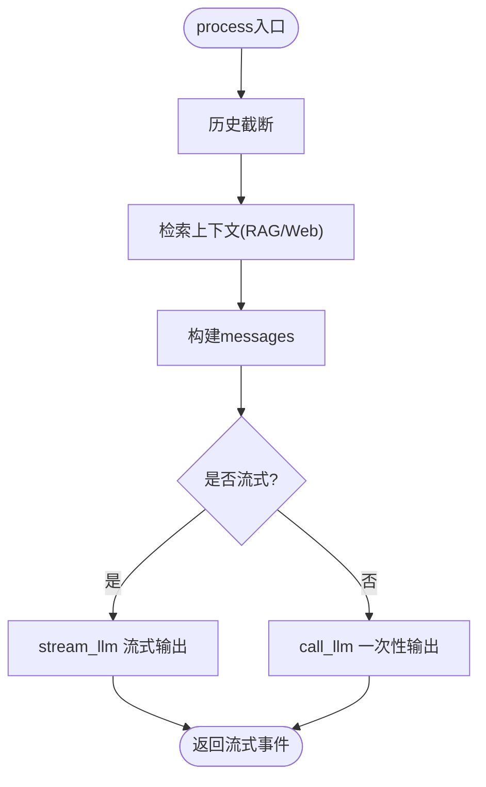
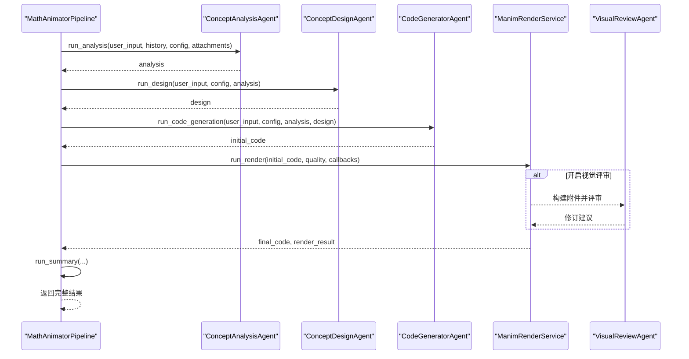
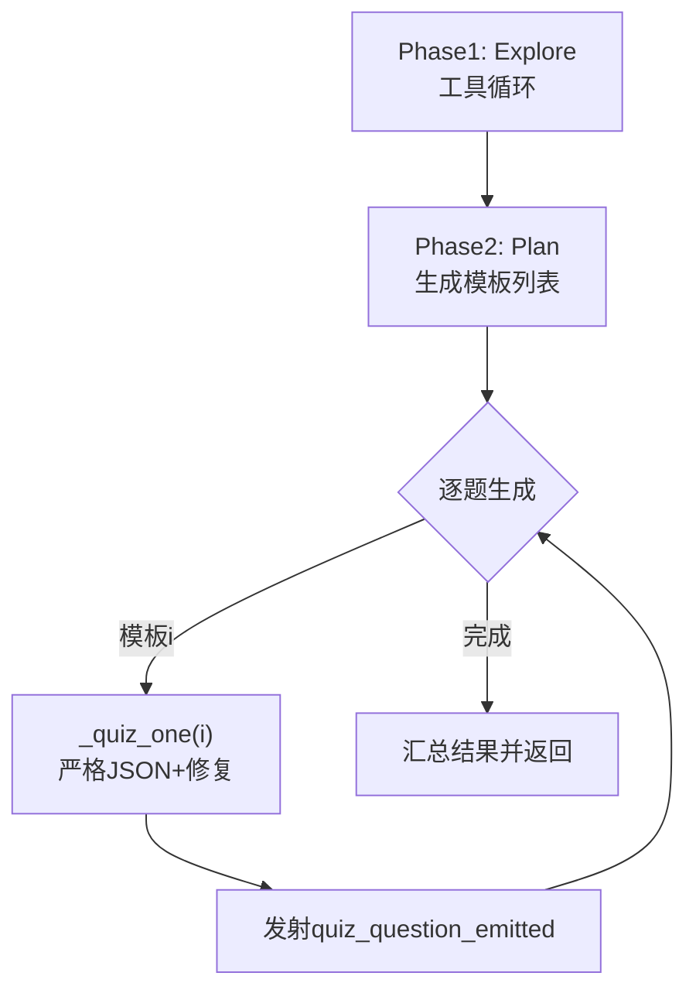
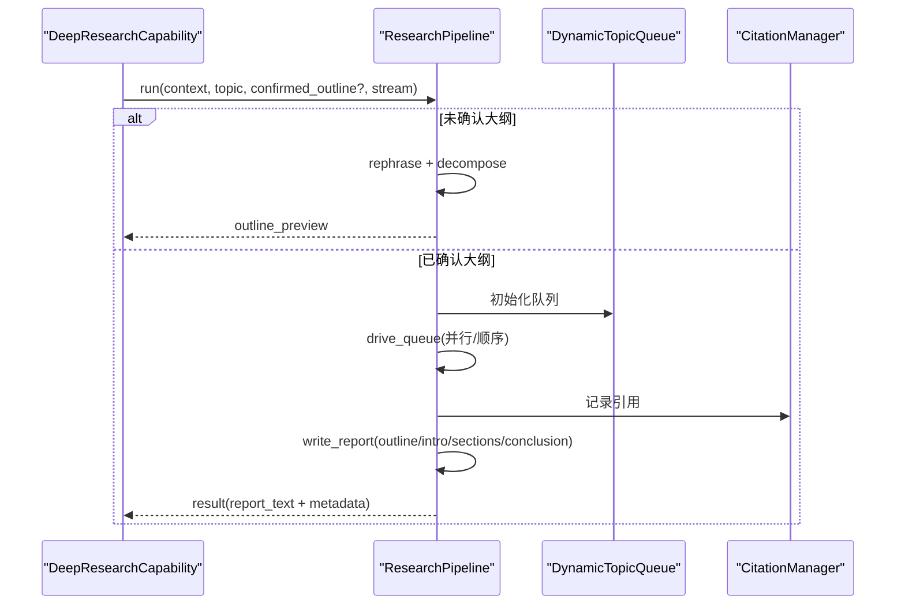
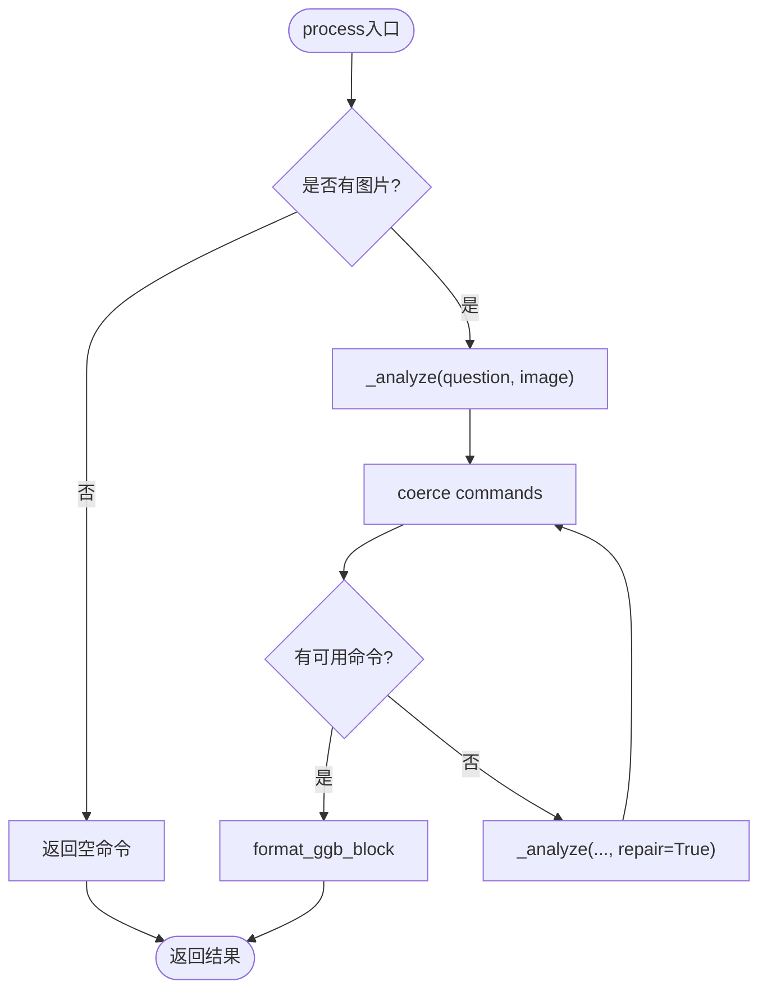
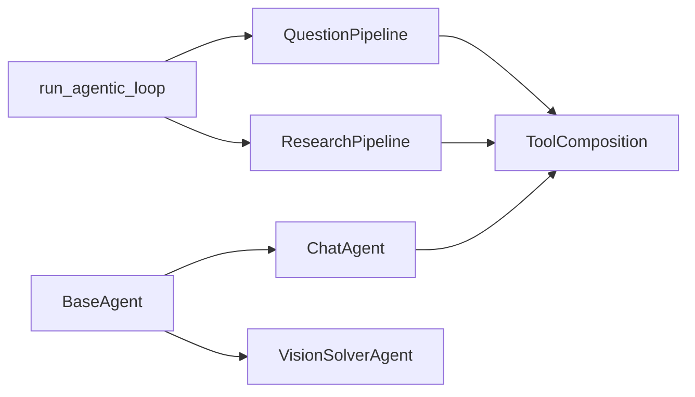

# 智能体系统

<cite>
**本文引用的文件**
- [base_agent.py](file://deeptutor/agents/base_agent.py)
- [chat_agent.py](file://deeptutor/agents/chat/chat_agent.py)
- [pipeline.py（数学动画师）](file://deeptutor/agents/math_animator/pipeline.py)
- [__init__.py（数学动画师）](file://deeptutor/agents/math_animator/__init__.py)
- [pipeline.py（问题生成）](file://deeptutor/agents/question/pipeline.py)
- [__init__.py（问题生成）](file://deeptutor/agents/question/__init__.py)
- [capability.py（研究能力）](file://deeptutor/agents/research/capability.py)
- [pipeline.py（研究）](file://deeptutor/agents/research/pipeline.py)
- [vision_solver_agent.py](file://deeptutor/agents/vision_solver/vision_solver_agent.py)
- [loop.py（智能体循环）](file://deeptutor/core/agentic/loop.py)
- [__init__.py（核心智能体引擎）](file://deeptutor/core/agentic/__init__.py)
- [context.py（统一上下文）](file://deeptutor/core/context.py)
- [tool_composition.py（工具组合策略）](file://deeptutor/agents/_shared/tool_composition.py)
</cite>

## 目录
1. [简介](#简介)
2. [项目结构](#项目结构)
3. [核心组件](#核心组件)
4. [架构总览](#架构总览)
5. [详细组件分析](#详细组件分析)
6. [依赖关系分析](#依赖关系分析)
7. [性能考虑](#性能考虑)
8. [故障诊断指南](#故障诊断指南)
9. [结论](#结论)
10. [附录：配置与参数调优](#附录：配置与参数调优)

## 简介
本文件面向DeepTutor智能体系统的实现与使用，覆盖聊天智能体、数学动画师、问题生成智能体、研究智能体与视觉求解器五大能力。文档解释统一的智能体循环（标签驱动、工具调用、上下文管理、结果处理），并给出各智能体的输入输出格式、使用场景、配置选项、参数调优与性能优化建议。同时提供协作机制、状态共享方式、调试排障指南以及可复用的调用路径参考。

## 项目结构
- 基础层
  - 统一基类与LLM封装：BaseAgent提供模型选择、温度/最大token、重试、流式/非流式调用、提示词加载、Token统计与追踪。
  - 统一上下文：UnifiedContext承载会话ID、用户消息、历史、启用工具、知识库、附件、语言等。
  - 智能体循环：LabelProtocol + run_agentic_loop 提供“THINK/TOOL/FINISH/PLAN/APPEND/OUTLINE/INTRO/SECTION/CONCLUSION”等标签驱动的迭代调度。
- 能力层
  - 聊天智能体：多轮对话、RAG/Web搜索增强、流式响应、历史截断。
  - 数学动画师：概念分析→设计→代码生成→渲染→可选视觉评审→总结的流水线。
  - 问题生成：探索→计划→逐题生成（支持模板复用/模仿模式）。
  - 研究智能体：重述→分解→分块研究（动态队列）→报告（结构化章节）。
  - 视觉求解器：单图到GeoGebra命令的一体化解析与修复。
- 共享策略
  - 工具组合策略：根据用户开关、上下文条件自动挂载工具，保证聊天与能力间一致的工具可见性。



**图表来源**
- [base_agent.py:32-146](file://deeptutor/agents/base_agent.py#L32-L146)
- [context.py:15-85](file://deeptutor/core/context.py#L15-L85)
- [loop.py:39-170](file://deeptutor/core/agentic/loop.py#L39-L170)
- [tool_composition.py:100-193](file://deeptutor/agents/_shared/tool_composition.py#L100-L193)

**章节来源**
- [base_agent.py:32-146](file://deeptutor/agents/base_agent.py#L32-L146)
- [context.py:15-85](file://deeptutor/core/context.py#L15-L85)
- [loop.py:39-170](file://deeptutor/core/agentic/loop.py#L39-L170)
- [tool_composition.py:100-193](file://deeptutor/agents/_shared/tool_composition.py#L100-L193)

## 核心组件
- BaseAgent
  - 统一模型/温度/最大token/重试策略；支持流式与非流式调用；提示词加载；Token统计；追踪回调。
- UnifiedContext
  - 跨能力传递的统一数据对象，包含会话、消息、历史、工具开关、知识库、附件、语言、记忆/技能/来源清单等。
- 智能体循环
  - LabelProtocol定义允许/终止/中间/最终标签集合；run_agentic_loop负责迭代调度、工具分发、暂停恢复、强制收尾、协议违规修复。
- 工具组合策略
  - 基于用户开关与上下文条件（KB/记忆/笔记本/技能/执行环境）计算本轮可用工具集，确保一致性。

**章节来源**
- [base_agent.py:32-146](file://deeptutor/agents/base_agent.py#L32-L146)
- [context.py:15-85](file://deeptutor/core/context.py#L15-L85)
- [loop.py:39-170](file://deeptutor/core/agentic/loop.py#L39-L170)
- [tool_composition.py:100-193](file://deeptutor/agents/_shared/tool_composition.py#L100-L193)

## 架构总览
下图展示从请求进入能力到工具调用、循环调度、结果输出的端到端流程。

```mermaid
sequenceDiagram
participant Client as "客户端"
participant Cap as "能力入口<br/>Capability/Pipeline"
participant Loop as "智能体循环<br/>run_agentic_loop"
participant Agent as "具体智能体<br/>BaseAgent子类"
participant Tools as "工具注册表"
participant LLM as "LLM工厂"
Client->>Cap : 发起请求(上下文+消息+附件)
Cap->>Loop : 构建初始消息/协议/参数
Loop->>Agent : 组装系统/用户提示
Agent->>LLM : 流式/非流式调用
LLM-->>Agent : 文本/工具调用
Agent->>Tools : 执行工具(并行/串行)
Tools-->>Agent : 结果/引用
Agent->>LLM : 继续下一轮(携带工具结果)
Loop-->>Cap : 终止标签/最终文本/来源
Cap-->>Client : 结果事件/流式内容
```

**图表来源**
- [loop.py:173-372](file://deeptutor/core/agentic/loop.py#L173-L372)
- [base_agent.py:348-509](file://deeptutor/agents/base_agent.py#L348-L509)
- [tool_composition.py:100-193](file://deeptutor/agents/_shared/tool_composition.py#L100-L193)

## 详细组件分析

### 聊天智能体（ChatAgent）
- 功能要点
  - 多轮对话历史管理与按token截断。
  - 可选RAG检索与网页搜索增强。
  - 流式/非流式响应生成。
  - 通过BaseAgent.stream_llm/call_llm路由到云或本地LLM。
- 输入输出
  - 输入：message、history、kb_name、enable_rag、enable_web_search、stream、attachments。
  - 输出：response、sources、truncated_history（非流）；或流式chunk与complete事件。
- 关键流程
  - retrieve_context → build_messages → stream_llm/call_llm → 返回结果。
- 使用场景
  - 通用问答、带知识增强的对话、需要流式体验的场景。



**图表来源**
- [chat_agent.py:365-431](file://deeptutor/agents/chat/chat_agent.py#L365-L431)
- [chat_agent.py:158-228](file://deeptutor/agents/chat/chat_agent.py#L158-L228)
- [chat_agent.py:230-310](file://deeptutor/agents/chat/chat_agent.py#L230-L310)

**章节来源**
- [chat_agent.py:21-66](file://deeptutor/agents/chat/chat_agent.py#L21-L66)
- [chat_agent.py:67-156](file://deeptutor/agents/chat/chat_agent.py#L67-L156)
- [chat_agent.py:158-228](file://deeptutor/agents/chat/chat_agent.py#L158-L228)
- [chat_agent.py:230-310](file://deeptutor/agents/chat/chat_agent.py#L230-L310)
- [chat_agent.py:312-431](file://deeptutor/agents/chat/chat_agent.py#L312-L431)

### 数学动画师（MathAnimatorPipeline）
- 功能要点
  - 概念分析→概念设计→代码生成→Manim渲染→可选视觉评审→总结。
  - 支持目标时长解析、代码重试与质量调节。
  - 可视化评审可附加渲染产物进行二次修正。
- 输入输出
  - 输入：user_input、history_context、request_config、attachments、turn_id。
  - 输出：analysis、design、code、render_result、summary、timings。
- 关键流程
  - run_analysis → run_design → run_code_generation → run_render（含重试/评审）→ run_summary。
- 使用场景
  - 将数学概念/题目转化为可播放的动画脚本与视频。



**图表来源**
- [pipeline.py（数学动画师）:25-83](file://deeptutor/agents/math_animator/pipeline.py#L25-L83)
- [pipeline.py（数学动画师）:84-211](file://deeptutor/agents/math_animator/pipeline.py#L84-L211)
- [pipeline.py（数学动画师）:213-277](file://deeptutor/agents/math_animator/pipeline.py#L213-L277)

**章节来源**
- [pipeline.py（数学动画师）:25-83](file://deeptutor/agents/math_animator/pipeline.py#L25-L83)
- [pipeline.py（数学动画师）:84-211](file://deeptutor/agents/math_animator/pipeline.py#L84-L211)
- [pipeline.py（数学动画师）:213-277](file://deeptutor/agents/math_animator/pipeline.py#L213-L277)
- [__init__.py（数学动画师）:1-14](file://deeptutor/agents/math_animator/__init__.py#L1-L14)

### 问题生成智能体（QuestionPipeline）
- 功能要点
  - Phase 1 Explore：工具循环探索主题与题型分布。
  - Phase 2 Plan：生成JSON计划（每道题的模板）。
  - Phase 3 Quiz：逐题生成，严格JSON校验与一次修复。
  - 支持模板复用（mimic模式）跳过Explore/Plan直接Quiz。
- 输入输出
  - 输入：context、user_message、num_questions、difficulty、question_types、per_type_counts、conversation_context、attachments、quiz_history、stream。
  - 输出：plan.templates与逐题QA对，附带trace事件与来源。
- 关键流程
  - _explore → _plan → 循环_quiz_one → 发射quiz_question_emitted事件 → 汇总结果。
- 使用场景
  - 自动生成测验题、适配不同题型与难度、结合历史避免重复与薄弱点覆盖。



**图表来源**
- [pipeline.py（问题生成）:438-602](file://deeptutor/agents/question/pipeline.py#L438-L602)
- [pipeline.py（问题生成）:607-750](file://deeptutor/agents/question/pipeline.py#L607-L750)

**章节来源**
- [pipeline.py（问题生成）:1-24](file://deeptutor/agents/question/pipeline.py#L1-L24)
- [pipeline.py（问题生成）:438-602](file://deeptutor/agents/question/pipeline.py#L438-L602)
- [pipeline.py（问题生成）:607-750](file://deeptutor/agents/question/pipeline.py#L607-L750)
- [__init__.py（问题生成）:1-34](file://deeptutor/agents/question/__init__.py#L1-L34)

### 研究智能体（ResearchPipeline + Capability）
- 功能要点
  - Phase 1 Rephrase：通过ask_user澄清主题。
  - Phase 2 Decompose：生成子主题大纲（可预览确认）。
  - Phase 3 Research Blocks：动态队列驱动的分块研究（支持并行/顺序）。
  - Phase 4 Reporting：结构化报告（outline/intro/sections/conclusion），引用管理。
- 输入输出
  - 输入：context、topic、confirmed_outline、attachments、stream。
  - 输出：outline_preview（首次）或最终report_text与元信息（block_count、citation_count、partial等）。
- 关键流程
  - capability.run → pipeline.run → 两阶段流程（若未确认大纲则返回preview）→ 确认后继续research/reporting。
- 使用场景
  - 深度调研、生成结构化研究报告、引用证据链。



**图表来源**
- [capability.py（研究能力）:37-100](file://deeptutor/agents/research/capability.py#L37-L100)
- [pipeline.py（研究）:443-630](file://deeptutor/agents/research/pipeline.py#L443-L630)
- [pipeline.py（研究）:663-795](file://deeptutor/agents/research/pipeline.py#L663-L795)

**章节来源**
- [capability.py（研究能力）:37-100](file://deeptutor/agents/research/capability.py#L37-L100)
- [pipeline.py（研究）:443-630](file://deeptutor/agents/research/pipeline.py#L443-L630)
- [pipeline.py（研究）:663-795](file://deeptutor/agents/research/pipeline.py#L663-L795)

### 视觉求解器（VisionSolverAgent）
- 功能要点
  - 单图到GeoGebra命令的一体化解析，失败时触发一次修复重试。
  - 输出标准化命令列表与几何摘要，支持前端ggbscript块渲染。
- 输入输出
  - 输入：question_text、image_base64、session_id。
  - 输出：has_image、final_ggb_commands、analysis_output、image_is_reference。
- 关键流程
  - process → _analyze → 若commands为空则repair → 格式化命令。
- 使用场景
  - 数学题配图解析，快速生成可执行的GeoGebra脚本。



**图表来源**
- [vision_solver_agent.py:48-92](file://deeptutor/agents/vision_solver/vision_solver_agent.py#L48-L92)
- [vision_solver_agent.py:96-142](file://deeptutor/agents/vision_solver/vision_solver_agent.py#L96-L142)
- [vision_solver_agent.py:144-189](file://deeptutor/agents/vision_solver/vision_solver_agent.py#L144-L189)

**章节来源**
- [vision_solver_agent.py:19-45](file://deeptutor/agents/vision_solver/vision_solver_agent.py#L19-L45)
- [vision_solver_agent.py:48-92](file://deeptutor/agents/vision_solver/vision_solver_agent.py#L48-L92)
- [vision_solver_agent.py:96-142](file://deeptutor/agents/vision_solver/vision_solver_agent.py#L96-L142)
- [vision_solver_agent.py:144-189](file://deeptutor/agents/vision_solver/vision_solver_agent.py#L144-L189)

## 依赖关系分析
- 组件耦合
  - 所有智能体均依赖BaseAgent提供的LLM封装与提示词加载。
  - 复杂能力（问题生成、研究）依赖core.agentic的循环原语与工具分发。
  - 工具组合策略统一控制各能力的工具可见性与自动挂载。
- 外部依赖
  - LLM工厂（cloud/local）、工具注册表、PromptManager、StreamBus、UsageTracker等。
- 潜在环依赖
  - 通过分层（基础层/能力层/共享策略）与按需导入避免循环。



**图表来源**
- [base_agent.py:32-146](file://deeptutor/agents/base_agent.py#L32-L146)
- [loop.py:39-170](file://deeptutor/core/agentic/loop.py#L39-L170)
- [tool_composition.py:100-193](file://deeptutor/agents/_shared/tool_composition.py#L100-L193)

**章节来源**
- [__init__.py（核心智能体引擎）:1-79](file://deeptutor/core/agentic/__init__.py#L1-L79)
- [tool_composition.py:100-193](file://deeptutor/agents/_shared/tool_composition.py#L100-L193)

## 性能考虑
- 流式优先：尽量使用stream_llm降低首字延迟，提升交互体验。
- 历史截断：聊天智能体按token限制保留最近消息，避免上下文溢出。
- 工具并行：循环内工具调用支持并行执行，缩短整体耗时。
- 重试与修复：数学动画师与问题生成内置修复逻辑，减少失败重试成本。
- Token预算：合理设置max_tokens与temperature，避免过长输出与过度发散。
- 资源隔离：通过UnifiedContext与工具白名单限制不必要的能力暴露。

[本节为通用指导，不直接分析具体文件]

## 故障诊断指南
- 常见问题定位
  - 模型未配置：BaseAgent.get_model会抛出错误，检查Settings中的模型目录。
  - 工具不可用：检查ToolComposition的自动挂载条件（KB/记忆/笔记本/技能/执行环境）。
  - 协议违规：循环检测到缺失标签/多标签/工具无调用等，会自动注入修复消息并重试。
  - JSON解析失败：问题生成与视觉求解器具备容错与修复路径。
- 调试建议
  - 启用trace回调：BaseAgent.set_trace_callback可捕获LLM调用事件。
  - 查看流式事件：通过StreamBus的阶段与进度事件观察流程。
  - 日志级别：调整logger输出以获取更详细的输入/输出与耗时。
  - 最小化复现：剥离非必要工具与附件，逐步缩小问题范围。

**章节来源**
- [base_agent.py:151-178](file://deeptutor/agents/base_agent.py#L151-L178)
- [base_agent.py:233-247](file://deeptutor/agents/base_agent.py#L233-L247)
- [loop.py:375-433](file://deeptutor/core/agentic/loop.py#L375-L433)
- [tool_composition.py:100-193](file://deeptutor/agents/_shared/tool_composition.py#L100-L193)

## 结论
DeepTutor智能体系统通过统一的BaseAgent与core.agentic循环，实现了聊天、数学动画、问题生成、研究与视觉求解等多能力的协同工作。工具组合策略确保了工具可见性与安全边界的一致性；流式与重试机制提升了鲁棒性与用户体验。通过合理的配置与参数调优，可在不同场景下取得良好的性能与效果。

[本节为总结，不直接分析具体文件]

## 附录：配置与参数调优
- 模型与参数
  - 模型优先级：agent_config > llm_config > 实例model > 环境变量。
  - temperature/max_tokens：由BaseAgent统一读取，可按能力定制。
  - 重试次数：get_max_retries默认来自全局设置，可按agent_config覆盖。
- 工具开关
  - 用户开关与自动挂载：compose_enabled_tools决定最终工具集。
  - 条件挂载：rag/kb_files/read_source/read_memory/list_notebook/write_note/read_skill/load_tools/exec/code_execution等。
- 能力特定配置
  - 聊天：max_history_tokens控制历史长度；enable_rag/enable_web_search控制增强。
  - 数学动画师：quality/style_hint/output_mode/target_duration影响代码与渲染。
  - 问题生成：num_questions/difficulty/question_types/per_type_counts控制题型与数量。
  - 研究：planning.researching.reporting.queue子配置控制行为与并行度。
- 调用示例（路径参考）
  - 聊天：process(message, history, kb_name, enable_rag, enable_web_search, stream, attachments)。
  - 数学动画师：run(turn_id, user_input, history_context, request_config, attachments)。
  - 问题生成：run(context, user_message, num_questions, difficulty, question_types, per_type_counts, conversation_context, attachments, quiz_history, stream)。
  - 研究：capability.run(context, stream) → pipeline.run(context, topic, confirmed_outline, attachments, stream)。
  - 视觉求解器：process(question_text, image_base64, session_id) → format_ggb_block(commands, page_id, title)。

**章节来源**
- [base_agent.py:151-206](file://deeptutor/agents/base_agent.py#L151-L206)
- [chat_agent.py:35-66](file://deeptutor/agents/chat/chat_agent.py#L35-L66)
- [pipeline.py（数学动画师）:25-83](file://deeptutor/agents/math_animator/pipeline.py#L25-L83)
- [pipeline.py（问题生成）:438-602](file://deeptutor/agents/question/pipeline.py#L438-L602)
- [capability.py（研究能力）:37-100](file://deeptutor/agents/research/capability.py#L37-L100)
- [vision_solver_agent.py:48-92](file://deeptutor/agents/vision_solver/vision_solver_agent.py#L48-L92)
- [tool_composition.py:100-193](file://deeptutor/agents/_shared/tool_composition.py#L100-L193)