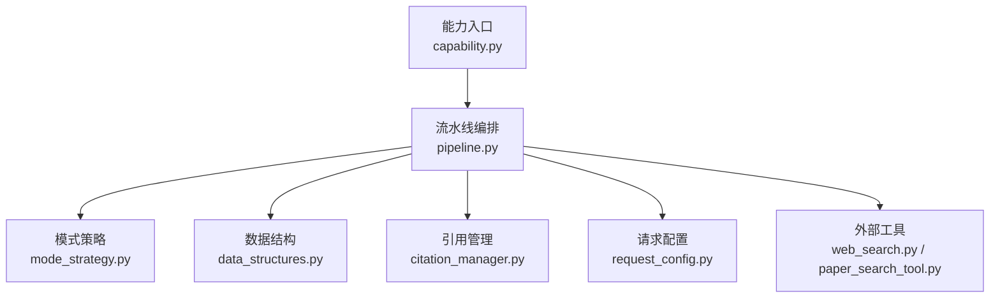
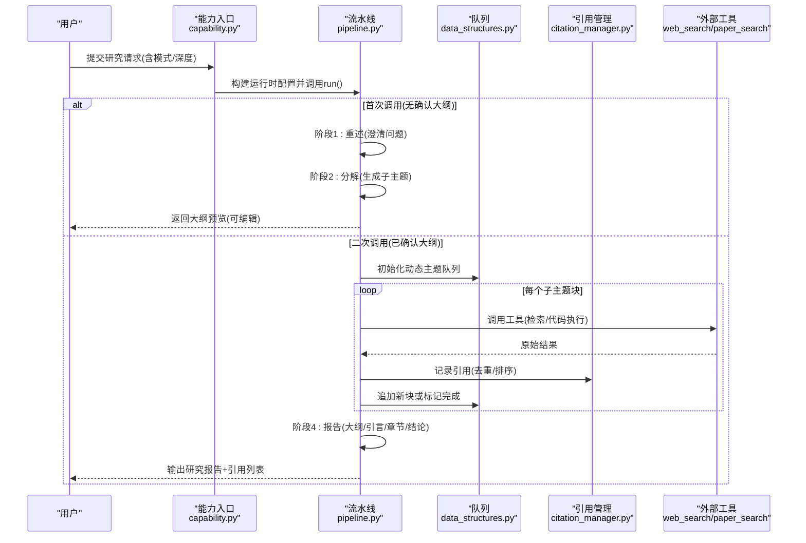
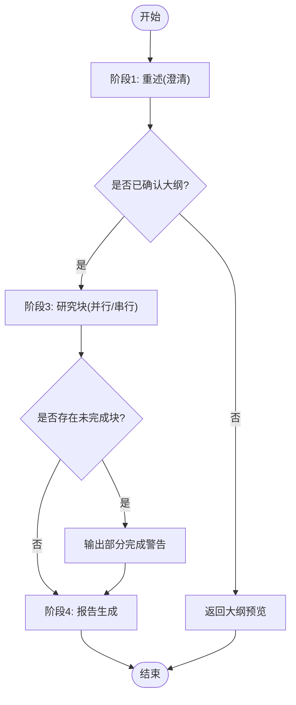
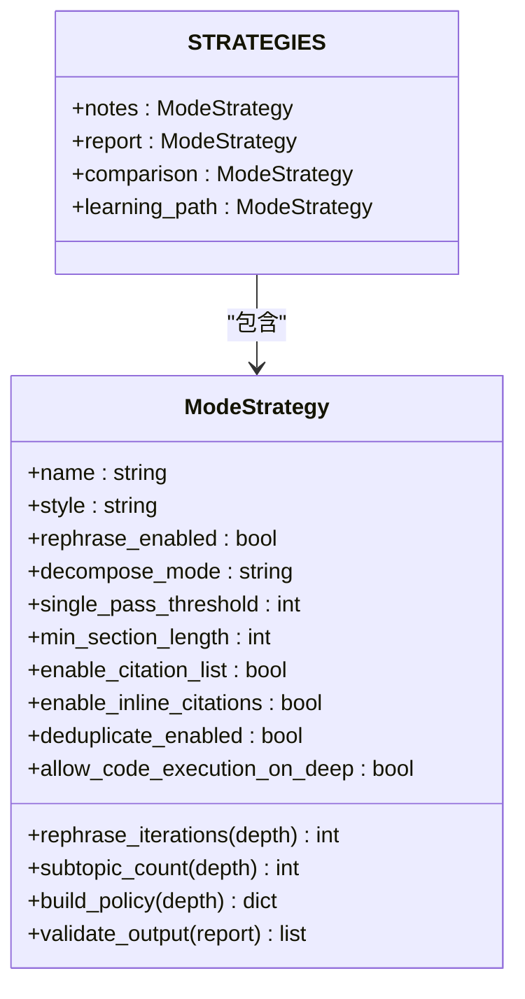
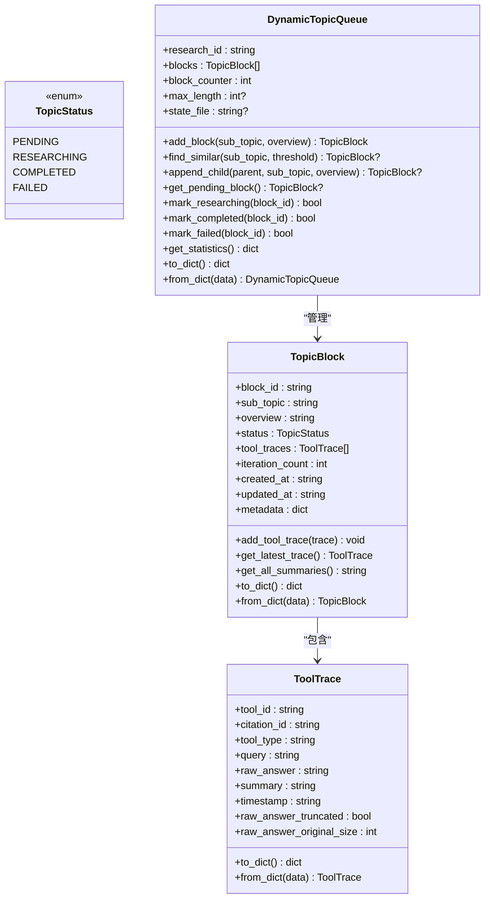
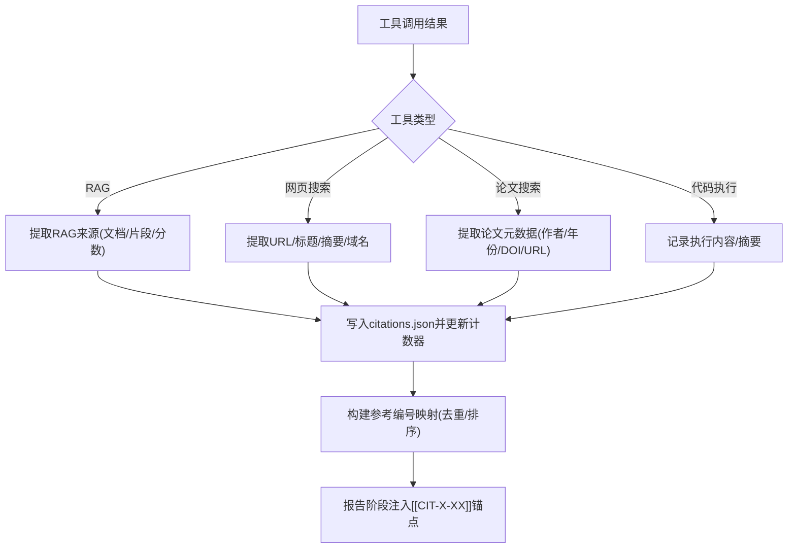
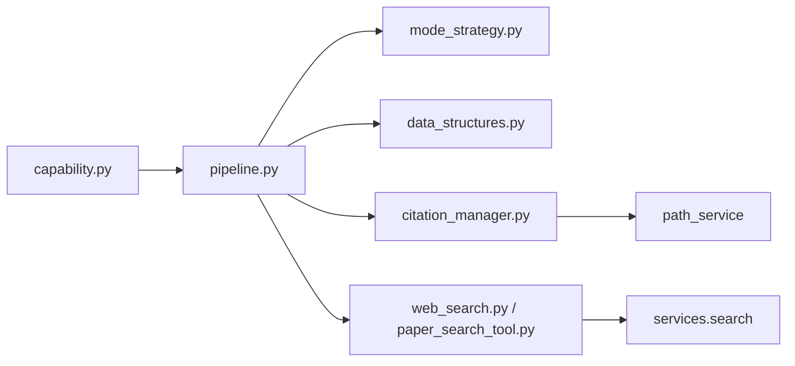

# 研究智能体

<cite>
**本文引用的文件**
- [pipeline.py](file://deeptutor/agents/research/pipeline.py)
- [mode_strategy.py](file://deeptutor/agents/research/mode_strategy.py)
- [data_structures.py](file://deeptutor/agents/research/data_structures.py)
- [capability.py](file://deeptutor/agents/research/capability.py)
- [request_config.py](file://deeptutor/agents/research/request_config.py)
- [citation_manager.py](file://deeptutor/agents/research/utils/citation_manager.py)
- [web_search.py](file://deeptutor/tools/web_search.py)
- [paper_search_tool.py](file://deeptutor/tools/paper_search_tool.py)
- [README.md](file://README.md)
</cite>

## 目录
1. [简介](#简介)
2. [项目结构](#项目结构)
3. [核心组件](#核心组件)
4. [架构总览](#架构总览)
5. [详细组件分析](#详细组件分析)
6. [依赖关系分析](#依赖关系分析)
7. [性能与可扩展性](#性能与可扩展性)
8. [故障排查指南](#故障排查指南)
9. [结论](#结论)
10. [附录：实践案例](#附录实践案例)

## 简介
本技术文档面向“深度研究”能力，系统性说明研究智能体的执行流程、模式策略、数据与引用管理、进度跟踪、质量评估、外部工具集成以及可视化输出。该能力通过统一的智能体循环驱动“澄清—分解—研究—报告”四阶段流水线，支持探索性、验证性与综合分析等多种研究模式，并在每个环节提供可追踪的引用来源与进度反馈。

## 项目结构
研究智能体位于 agents/research 目录下，围绕以下关键模块组织：
- 能力入口：capability.py 负责请求校验、运行时配置组装与两阶段大纲预览流程
- 流水线编排：pipeline.py 实现四阶段（重述、分解、研究块、报告）控制流与标签协议
- 模式策略：mode_strategy.py 定义不同研究模式的策略参数与输出校验
- 数据结构：data_structures.py 提供 TopicBlock、ToolTrace、DynamicTopicQueue 等核心状态
- 引用管理：utils/citation_manager.py 统一管理引用生成、去重、排序与格式化
- 请求配置：request_config.py 将用户意图映射为执行策略与运行时配置
- 外部工具：tools/web_search.py、tools/paper_search_tool.py 提供网络与论文检索能力

图表来源
- [capability.py:37-100](file://deeptutor/agents/research/capability.py#L37-L100)
- [pipeline.py:285-630](file://deeptutor/agents/research/pipeline.py#L285-L630)
- [mode_strategy.py:24-148](file://deeptutor/agents/research/mode_strategy.py#L24-L148)
- [data_structures.py:44-571](file://deeptutor/agents/research/data_structures.py#L44-L571)
- [citation_manager.py:18-800](file://deeptutor/agents/research/utils/citation_manager.py#L18-L800)
- [request_config.py:25-249](file://deeptutor/agents/research/request_config.py#L25-L249)
- [web_search.py:1-69](file://deeptutor/tools/web_search.py#L1-L69)
- [paper_search_tool.py:24-200](file://deeptutor/tools/paper_search_tool.py#L24-L200)

章节来源
- [capability.py:37-100](file://deeptutor/agents/research/capability.py#L37-L100)
- [pipeline.py:285-630](file://deeptutor/agents/research/pipeline.py#L285-L630)
- [mode_strategy.py:24-148](file://deeptutor/agents/research/mode_strategy.py#L24-L148)
- [data_structures.py:44-571](file://deeptutor/agents/research/data_structures.py#L44-L571)
- [citation_manager.py:18-800](file://deeptutor/agents/research/utils/citation_manager.py#L18-L800)
- [request_config.py:25-249](file://deeptutor/agents/research/request_config.py#L25-L249)
- [web_search.py:1-69](file://deeptutor/tools/web_search.py#L1-L69)
- [paper_search_tool.py:24-200](file://deeptutor/tools/paper_search_tool.py#L24-L200)

## 核心组件
- 能力入口（DeepResearchCapability）
  - 职责：解析上下文、校验请求配置、构建运行时配置、驱动两阶段大纲预览与确认流程
  - 关键点：首次调用返回大纲预览；确认后再次调用进入研究与报告阶段
- 流水线（ResearchPipeline）
  - 职责：四阶段编排（重述、分解、研究块、报告），维护标签协议与流式事件
  - 关键点：动态主题队列、并行/串行执行、部分完成告警、引用注入
- 模式策略（ModeStrategy）
  - 职责：按模式（笔记、报告、对比、学习路径）与深度（快速、标准、深入、手动）生成策略
  - 关键点：子主题数量、单遍阈值、最小段落长度、是否启用代码执行等
- 数据结构（DynamicTopicQueue、TopicBlock、ToolTrace）
  - 职责：研究任务的状态机、调度中心、工具调用轨迹记录
  - 关键点：模糊去重、最大容量限制、统计信息、持久化
- 引用管理（CitationManager）
  - 职责：生成唯一引用ID、提取来源信息、去重与排序、APA/网页链接格式
  - 关键点：RAG/网页/论文/代码执行多源统一处理，参考编号映射
- 请求配置（build_research_execution_policy/build_research_runtime_config）
  - 职责：将用户意图转换为规划、研究、报告、队列策略
  - 关键点：深度预设、手动模式覆盖、系统输出路径

章节来源
- [capability.py:37-100](file://deeptutor/agents/research/capability.py#L37-L100)
- [pipeline.py:285-630](file://deeptutor/agents/research/pipeline.py#L285-L630)
- [mode_strategy.py:24-148](file://deeptutor/agents/research/mode_strategy.py#L24-L148)
- [data_structures.py:44-571](file://deeptutor/agents/research/data_structures.py#L44-L571)
- [citation_manager.py:18-800](file://deeptutor/agents/research/utils/citation_manager.py#L18-L800)
- [request_config.py:25-249](file://deeptutor/agents/research/request_config.py#L25-L249)

## 架构总览
研究智能体采用“能力—流水线—策略—数据—引用—工具”的分层架构。能力入口接收用户请求并装配运行时配置；流水线作为编排器驱动各阶段；模式策略决定行为参数；数据结构承载任务状态；引用管理器保证学术规范；工具层对接外部搜索与知识库。

图表来源
- [capability.py:47-100](file://deeptutor/agents/research/capability.py#L47-L100)
- [pipeline.py:443-630](file://deeptutor/agents/research/pipeline.py#L443-L630)
- [data_structures.py:240-571](file://deeptutor/agents/research/data_structures.py#L240-L571)
- [citation_manager.py:18-800](file://deeptutor/agents/research/utils/citation_manager.py#L18-L800)
- [web_search.py:1-69](file://deeptutor/tools/web_search.py#L1-L69)
- [paper_search_tool.py:24-200](file://deeptutor/tools/paper_search_tool.py#L24-L200)

## 详细组件分析

### 流水线（ResearchPipeline）
- 阶段设计
  - 重述：通过 ask_user 进行最多三轮澄清，收敛到明确的研究主题
  - 分解：一次性生成子主题大纲，支持预览与用户确认
  - 研究块：对每个子主题执行 THINK/TOOL/APPEND/FINISH 循环，动态扩展队列
  - 报告：顺序生成报告大纲、引言、章节、结论，并注入引用锚点
- 控制与配置
  - 支持并行/串行执行、最大并行主题数、迭代次数上限
  - 根据模式策略调整最小段落长度、单遍阈值、是否允许代码执行
- 错误与部分完成
  - 若存在未完成块，输出警告并标注 partial 标志，确保报告仍可基于剩余证据生成

图表来源
- [pipeline.py:443-630](file://deeptutor/agents/research/pipeline.py#L443-L630)

章节来源
- [pipeline.py:285-630](file://deeptutor/agents/research/pipeline.py#L285-L630)

### 模式策略（ModeStrategy）
- 模式类型
  - 笔记：强调定义框与要点总结
  - 报告：自动分解，较短单遍阈值，较长段落要求
  - 对比：手动分解，强制表格输出，深度模式下允许代码执行
  - 学习路径：自动分解，强调检查点
- 深度预设
  - 快速/标准/深入/手动：分别控制迭代次数、执行模式、并行度、队列长度
- 输出校验
  - 根据模式正则匹配必要结构元素，缺失时发出警告

图表来源
- [mode_strategy.py:24-148](file://deeptutor/agents/research/mode_strategy.py#L24-L148)

章节来源
- [mode_strategy.py:24-148](file://deeptutor/agents/research/mode_strategy.py#L24-L148)

### 数据结构（DynamicTopicQueue、TopicBlock、ToolTrace）
- TopicStatus：pending/researching/completed/failed
- TopicBlock：最小调度单元，携带子主题、概览、工具轨迹、迭代计数、元数据
- ToolTrace：单次工具调用完整轨迹，含查询、原始答案、摘要、时间戳、截断标记
- DynamicTopicQueue：核心内存与调度中心
  - 支持最大容量限制、模糊去重、父子块关系、统计信息、JSON持久化

图表来源
- [data_structures.py:44-571](file://deeptutor/agents/research/data_structures.py#L44-L571)

章节来源
- [data_structures.py:44-571](file://deeptutor/agents/research/data_structures.py#L44-L571)

### 引用管理（CitationManager）
- 唯一ID生成：规划阶段 PLAN-XX，研究阶段 CIT-X-XX
- 多源提取：RAG、网页搜索、论文搜索、代码执行
- 去重与排序：按阶段与块号排序；论文按标题+首作者去重
- 格式化：APA风格论文条目、网页链接列表、RAG来源摘要
- 参考编号映射：构建 citation_id -> ref_number 映射，供报告注入锚点

图表来源
- [citation_manager.py:18-800](file://deeptutor/agents/research/utils/citation_manager.py#L18-L800)

章节来源
- [citation_manager.py:18-800](file://deeptutor/agents/research/utils/citation_manager.py#L18-L800)

### 外部工具集成
- 网页搜索（web_search.py）
  - 封装多种搜索引擎（Brave、Tavily、Jina、SearXNG、DuckDuckGo、Perplexity）
  - 返回结构化结果，便于引用管理提取 URL、标题、摘要
- 论文搜索（paper_search_tool.py）
  - 基于 arXiv 客户端，支持相关性/日期排序、年份限制、超时重试
  - 标准化元数据（标题、作者、年份、摘要、URL、arXiv ID）

章节来源
- [web_search.py:1-69](file://deeptutor/tools/web_search.py#L1-L69)
- [paper_search_tool.py:24-200](file://deeptutor/tools/paper_search_tool.py#L24-L200)

## 依赖关系分析
- 能力入口依赖流水线与请求配置
- 流水线依赖模式策略、数据结构、引用管理与外部工具
- 数据结构被流水线与引用管理共同使用
- 引用管理依赖路径服务与 JSON 解析工具
- 外部工具通过服务层暴露统一接口

图表来源
- [capability.py:37-100](file://deeptutor/agents/research/capability.py#L37-L100)
- [pipeline.py:285-630](file://deeptutor/agents/research/pipeline.py#L285-L630)
- [mode_strategy.py:24-148](file://deeptutor/agents/research/mode_strategy.py#L24-L148)
- [data_structures.py:44-571](file://deeptutor/agents/research/data_structures.py#L44-L571)
- [citation_manager.py:18-800](file://deeptutor/agents/research/utils/citation_manager.py#L18-L800)
- [web_search.py:1-69](file://deeptutor/tools/web_search.py#L1-L69)
- [paper_search_tool.py:24-200](file://deeptutor/tools/paper_search_tool.py#L24-L200)

章节来源
- [capability.py:37-100](file://deeptutor/agents/research/capability.py#L37-L100)
- [pipeline.py:285-630](file://deeptutor/agents/research/pipeline.py#L285-L630)
- [mode_strategy.py:24-148](file://deeptutor/agents/research/mode_strategy.py#L24-L148)
- [data_structures.py:44-571](file://deeptutor/agents/research/data_structures.py#L44-L571)
- [citation_manager.py:18-800](file://deeptutor/agents/research/utils/citation_manager.py#L18-L800)
- [web_search.py:1-69](file://deeptutor/tools/web_search.py#L1-L69)
- [paper_search_tool.py:24-200](file://deeptutor/tools/paper_search_tool.py#L24-L200)

## 性能与可扩展性
- 并行与串行执行：深度模式默认并行，提升吞吐；手动模式可按子主题数切换
- 队列容量限制：防止无限增长，保障稳定性
- 迭代预算：每块最大迭代次数与总 token 限制，避免过度消耗
- 工具超时与重试：论文搜索具备超时与限流重试机制
- 可扩展点：新增工具只需加入白名单与引用提取逻辑；新增模式仅需注册策略

[本节为通用指导，不直接分析具体文件]

## 故障排查指南
- 部分完成报告
  - 现象：报告中标注 partial，并提示若干子主题未完成
  - 原因：某些块在迭代预算内未产出 FINISH 或抛出异常
  - 处理：检查工具可用性、网络连通性、模型输出是否符合协议
- 引用缺失或无效
  - 现象：报告中引用锚点无法对应到参考文献
  - 原因：工具未返回结构化来源、引用提取失败
  - 处理：查看 citations.json，确认 add_citation 是否成功；必要时降级为通用引用
- 队列满或重复
  - 现象：无法添加新块或出现近似重复主题
  - 原因：达到 max_length；模糊匹配阈值过低
  - 处理：调整 queue.max_length 或 find_similar 阈值；合并重复主题

章节来源
- [pipeline.py:569-630](file://deeptutor/agents/research/pipeline.py#L569-L630)
- [citation_manager.py:175-233](file://deeptutor/agents/research/utils/citation_manager.py#L175-L233)
- [data_structures.py:311-372](file://deeptutor/agents/research/data_structures.py#L311-L372)

## 结论
研究智能体以清晰的四阶段流水线为核心，结合模式策略与动态队列，实现了从问题澄清到报告生成的端到端自动化。引用管理系统确保数据来源可追溯且符合学术规范；外部工具集成提供了广泛的信息获取能力。通过合理的预算控制与错误处理，系统在复杂研究任务中保持稳健与高效。

[本节为总结性内容，不直接分析具体文件]

## 附录：实践案例

### 文献综述（报告模式，标准深度）
- 目标：对某一主题进行系统性文献梳理，形成结构化报告
- 步骤
  - 选择模式 report，深度 standard
  - 流水线生成子主题（如背景、方法、应用、挑战）
  - 研究块调用 RAG/网页搜索/论文搜索，收集证据并记录引用
  - 报告阶段生成引言、分节论述与结论，插入引用锚点
- 质量评估
  - 模式策略校验段落长度与单遍阈值
  - 引用完整性检查（有效引用数量、APA格式）

章节来源
- [request_config.py:190-239](file://deeptutor/agents/research/request_config.py#L190-L239)
- [mode_strategy.py:107-114](file://deeptutor/agents/research/mode_strategy.py#L107-L114)
- [citation_manager.py:529-649](file://deeptutor/agents/research/utils/citation_manager.py#L529-L649)

### 数据分析（对比模式，深入深度）
- 目标：比较两种技术方案的数据表现
- 步骤
  - 选择模式 comparison，深度 deep
  - 手动设置子主题（如指标定义、实验设置、结果对比）
  - 研究块允许代码执行，运行统计分析与可视化脚本
  - 报告阶段强制表格输出，嵌入图表与引用
- 质量评估
  - 模式策略允许代码执行于深度模式
  - 输出校验检测 Markdown 表格存在性

章节来源
- [mode_strategy.py:115-129](file://deeptutor/agents/research/mode_strategy.py#L115-L129)
- [pipeline.py:110-112](file://deeptutor/agents/research/pipeline.py#L110-L112)

### 技术调研报告（笔记模式，快速深度）
- 目标：快速整理某技术的关键概念与要点
- 步骤
  - 选择模式 notes，深度 quick
  - 流水线生成少量子主题（如定义、特性、优缺点）
  - 研究块侧重网页搜索与知识库检索
  - 报告阶段输出定义框与要点总结
- 质量评估
  - 模式策略校验 Definition 框与 Key Takeaway 块

章节来源
- [mode_strategy.py:98-106](file://deeptutor/agents/research/mode_strategy.py#L98-L106)
- [mode_strategy.py:76-95](file://deeptutor/agents/research/mode_strategy.py#L76-L95)