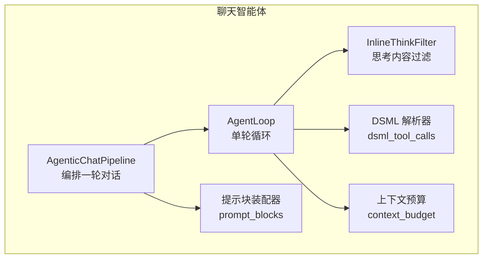
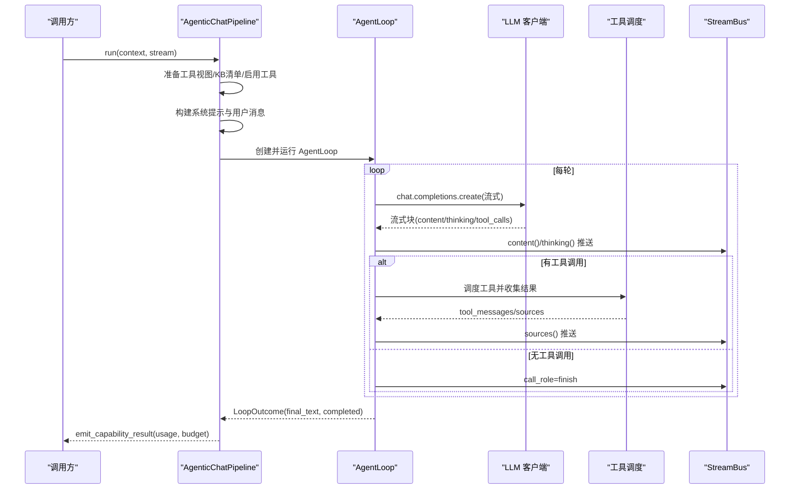
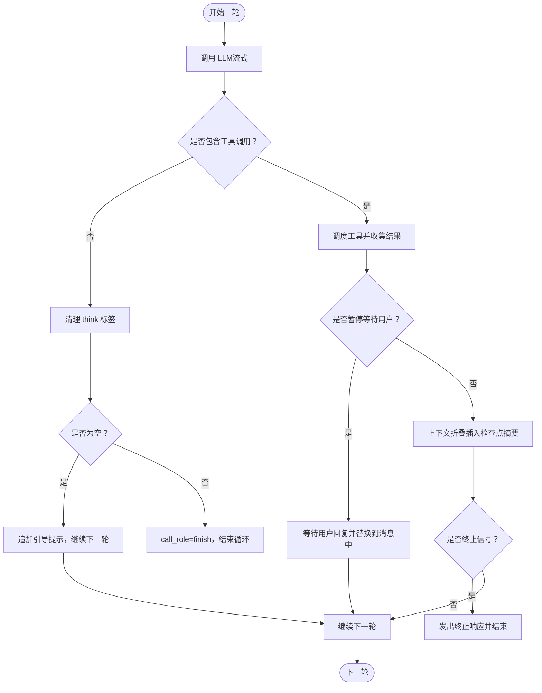
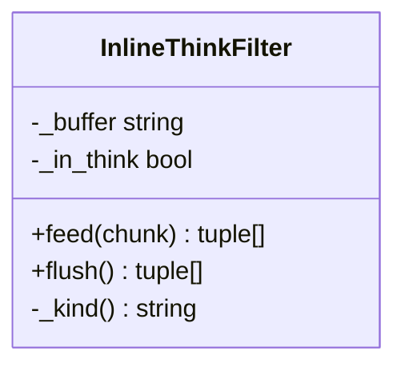
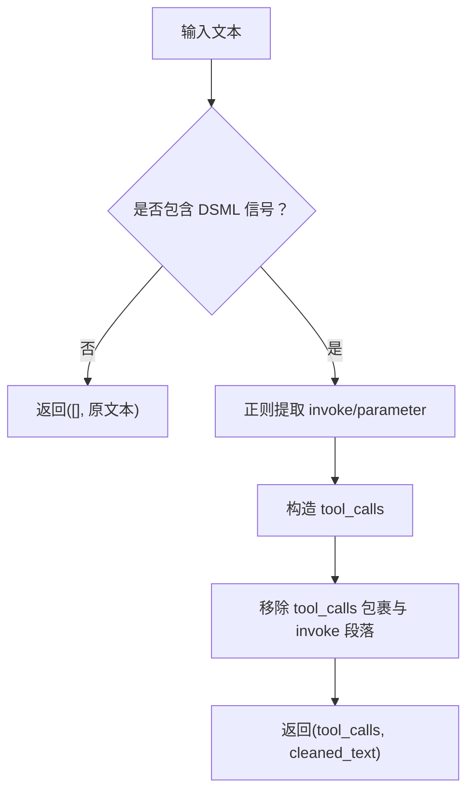
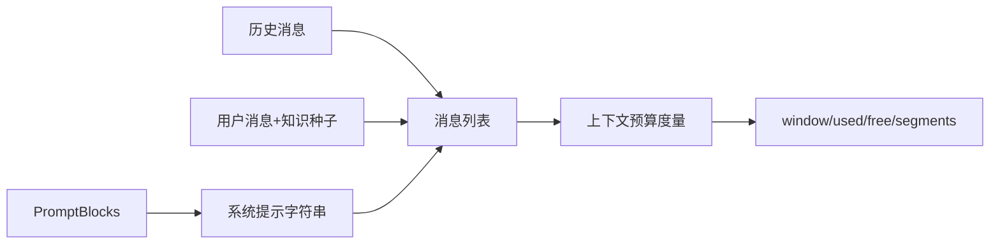
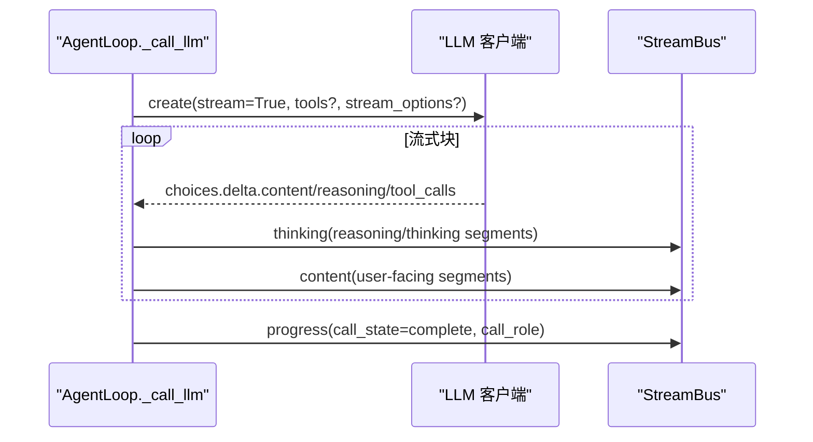
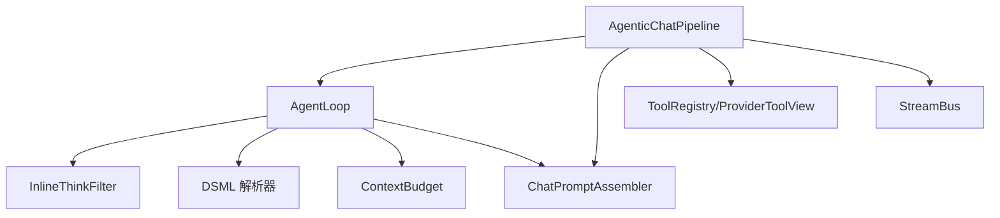

# 聊天智能体

<cite>
**本文引用的文件**
- [agent_loop.py](file://deeptutor/agents/chat/agent_loop.py)
- [dsml_tool_calls.py](file://deeptutor/agents/chat/dsml_tool_calls.py)
- [context_budget.py](file://deeptutor/agents/chat/context_budget.py)
- [agentic_pipeline.py](file://deeptutor/agents/chat/agentic_pipeline.py)
- [prompt_blocks.py](file://deeptutor/agents/chat/prompt_blocks.py)
- [chat_agent.py](file://deeptutor/agents/chat/chat_agent.py)
</cite>

## 目录
1. [简介](#简介)
2. [项目结构](#项目结构)
3. [核心组件](#核心组件)
4. [架构总览](#架构总览)
5. [详细组件分析](#详细组件分析)
6. [依赖关系分析](#依赖关系分析)
7. [性能考量](#性能考量)
8. [故障排查指南](#故障排查指南)
9. [结论](#结论)
10. [附录：配置与使用示例](#附录：配置与使用示例)

## 简介
本技术文档聚焦于聊天智能体的单轮对话循环实现，围绕 AgentLoop 的核心机制展开，包括：
- 单轮对话循环：每轮一次 LLM 调用，文本流式输出，工具调用结果回灌到对话上下文。
- 工具调用处理：原生函数调用与 DSML（DeepSeek Markup Language）文本格式调用的兼容解析。
- 上下文管理：系统提示块、会话历史、知识种子、能力注入与上下文预算度量。
- 流式响应与思考内容过滤：InlineThinkFilter 将用户可见内容与模型内部“思考”内容分离。
- 错误恢复与强制完成：在预算耗尽或中间失败时，强制结束并给出最终回答。
- 与其他组件的交互：AgenticChatPipeline、PromptAssembler、工具注册表、流总线等。

## 项目结构
聊天智能体位于 agents/chat 模块，关键文件职责如下：
- agent_loop.py：AgentLoop 单轮循环、流式处理、工具调度、错误恢复与强制完成。
- dsml_tool_calls.py：DSML 工具调用标记的解析与清理。
- context_budget.py：上下文窗口预算度量，按段统计 token 占用。
- agentic_pipeline.py：编排一轮对话的完整流程，组装提示、工具、消息，驱动 AgentLoop。
- prompt_blocks.py：结构化系统提示块装配器。
- chat_agent.py：轻量级聊天代理（非主循环），提供历史截断、RAG/Web 检索、流式生成等能力。

图表来源
- [agentic_pipeline.py:185-346](file://deeptutor/agents/chat/agentic_pipeline.py#L185-L346)
- [agent_loop.py:151-228](file://deeptutor/agents/chat/agent_loop.py#L151-L228)
- [agent_loop.py:66-119](file://deeptutor/agents/chat/agent_loop.py#L66-L119)
- [dsml_tool_calls.py:67-110](file://deeptutor/agents/chat/dsml_tool_calls.py#L67-L110)
- [context_budget.py:135-212](file://deeptutor/agents/chat/context_budget.py#L135-L212)
- [prompt_blocks.py:12-104](file://deeptutor/agents/chat/prompt_blocks.py#L12-L104)

章节来源
- [agentic_pipeline.py:185-346](file://deeptutor/agents/chat/agentic_pipeline.py#L185-L346)
- [agent_loop.py:151-228](file://deeptutor/agents/chat/agent_loop.py#L151-L228)

## 核心组件
- AgentLoop：单轮对话循环主体，负责 LLM 调用、流式内容分发、工具调用调度、上下文折叠、错误恢复与强制完成。
- InlineThinkFilter：增量分割流式内容中的 think 标签，将“思考”与“用户可见内容”分流。
- DSML 解析器：当模型以文本形式输出工具调用标记时，将其转换为结构化 tool_calls。
- 上下文预算：对一轮请求的实际上下文进行分段统计，用于前端展示与优化。
- AgenticChatPipeline：构建系统提示、工具清单、消息列表，驱动 AgentLoop 执行。
- ChatPromptAssembler：将多类提示块拼接为稳定的系统提示字符串。

章节来源
- [agent_loop.py:151-228](file://deeptutor/agents/chat/agent_loop.py#L151-L228)
- [agent_loop.py:66-119](file://deeptutor/agents/chat/agent_loop.py#L66-L119)
- [dsml_tool_calls.py:67-110](file://deeptutor/agents/chat/dsml_tool_calls.py#L67-L110)
- [context_budget.py:135-212](file://deeptutor/agents/chat/context_budget.py#L135-L212)
- [agentic_pipeline.py:185-346](file://deeptutor/agents/chat/agentic_pipeline.py#L185-L346)
- [prompt_blocks.py:12-104](file://deeptutor/agents/chat/prompt_blocks.py#L12-L104)

## 架构总览
聊天智能体的一轮对话由 AgenticChatPipeline 编排，其核心步骤包括：
- 准备延迟工具视图与知识库清单。
- 组合启用工具集，构建 LLM 工具模式（如支持）。
- 构建系统提示与用户消息（含知识种子与能力注入）。
- 启动 AgentLoop，进入探索阶段：每轮调用 LLM，若返回工具调用则执行并回灌；若无工具调用则作为最终回答结束。
- 在预算耗尽或异常时触发强制完成，禁用工具并让模型给出最终答案。
- 通过 StreamBus 推送流式内容、思考片段、进度与来源信息。

图表来源
- [agentic_pipeline.py:326-346](file://deeptutor/agents/chat/agentic_pipeline.py#L326-L346)
- [agent_loop.py:172-228](file://deeptutor/agents/chat/agent_loop.py#L172-L228)
- [agent_loop.py:438-637](file://deeptutor/agents/chat/agent_loop.py#L438-L637)

## 详细组件分析

### AgentLoop 单轮循环机制
- 循环目标：每轮一次 LLM 调用，文本流式输出给用户；若包含工具调用，则视为“叙述”，继续下一轮；若无工具调用，则为“完成”，本轮文本即最终答案。
- 探索阶段：默认最大轮数受配置限制；每轮记录 round 计数与工具步骤。
- 工具调用处理：将 assistant 消息（含工具调用）追加到 messages，调度工具后把 role=tool 的结果回灌。
- 上下文折叠：根据工具结果中的上下文检查点摘要，插入 system 消息以压缩上下文。
- 错误恢复与强制完成：
  - 若首轮失败直接抛出；后续轮失败则记录警告并强制完成。
  - 预算耗尽时，禁用工具再次调用 LLM 以产出最终答案。
- 空回答引导：若某轮仅产生内部思考而无用户可见内容，会追加提示让模型继续行动或给出最终答案。

图表来源
- [agent_loop.py:234-357](file://deeptutor/agents/chat/agent_loop.py#L234-L357)
- [agent_loop.py:379-434](file://deeptutor/agents/chat/agent_loop.py#L379-L434)

章节来源
- [agent_loop.py:234-357](file://deeptutor/agents/chat/agent_loop.py#L234-L357)
- [agent_loop.py:379-434](file://deeptutor/agents/chat/agent_loop.py#L379-L434)

### InlineThinkFilter 实时思考内容过滤
- 目的：将流式内容中的 <think> / </think> 片段剥离到“思考”通道，保持用户可见内容纯净。
- 工作方式：
  - 维护缓冲与状态（是否在思考块内）。
  - 逐块扫描，遇到开/闭标签时切换状态并切分片段。
  - 对尾部不完整标签进行短暂保留，直到下一个块或 flush。
- 与 DSML 流式处理协作：一旦检测到内容中包含 DSML 工具调用标记，则将剩余内容全部推送到思考通道，避免标记泄漏为用户答案。

图表来源
- [agent_loop.py:66-119](file://deeptutor/agents/chat/agent_loop.py#L66-L119)

章节来源
- [agent_loop.py:66-119](file://deeptutor/agents/chat/agent_loop.py#L66-L119)

### DSML 工具调用解析处理
- 背景：部分 DeepSeek 部署未提供原生函数调用，而是以 DSML 标记在内容通道输出工具调用。
- 解析策略：
  - 快速检测是否存在 DSML 信号（invoke/parameter 标签）。
  - 提取每个 invoke 的名称与参数，构造标准 tool_calls。
  - 从原始文本中移除 DSML 标记，得到 cleaned_text。
- 集成点：在 _call_llm 流结束后，若无结构化 tool_calls，则尝试从文本中提取 DSML 调用。

图表来源
- [dsml_tool_calls.py:67-110](file://deeptutor/agents/chat/dsml_tool_calls.py#L67-L110)

章节来源
- [dsml_tool_calls.py:67-110](file://deeptutor/agents/chat/dsml_tool_calls.py#L67-L110)

### 上下文管理与预算控制
- 系统提示块：由 ChatPromptAssembler 组装 general/runtime_policy/loop/persona/memory/tools/skills/sources/notebooks/workspace 等块，保证系统提示稳定可度量。
- 消息构建：系统提示 + 历史消息 + 用户消息（含知识种子与能力注入）。
- 预算度量：
  - 记录最后一次真实请求的消息与工具模式快照。
  - 按段统计 tokens：system_prompt、memory、tools、messages 等。
  - 计算 window、used_tokens、free_tokens，并标注 counter 类型与估计标志。
- 上下文折叠：根据工具结果中的上下文检查点摘要，插入 system 消息以压缩上下文，减少后续轮次的 token 消耗。

图表来源
- [prompt_blocks.py:12-104](file://deeptutor/agents/chat/prompt_blocks.py#L12-L104)
- [context_budget.py:135-212](file://deeptutor/agents/chat/context_budget.py#L135-L212)
- [agentic_pipeline.py:374-415](file://deeptutor/agents/chat/agentic_pipeline.py#L374-L415)

章节来源
- [prompt_blocks.py:12-104](file://deeptutor/agents/chat/prompt_blocks.py#L12-L104)
- [context_budget.py:135-212](file://deeptutor/agents/chat/context_budget.py#L135-L212)
- [agentic_pipeline.py:374-415](file://deeptutor/agents/chat/agentic_pipeline.py#L374-L415)

### 流式响应与数据流
- 流式内容：content 通道推送用户可见文本；thinking 通道推送模型内部思考片段。
- 工具调用流：delta.tool_calls 累积为结构化 tool_calls；若为空且检测到 DSML，则转为 DSML 解析路径。
- 使用量记录：累计 input_chars 与 output_chars，并在流结束后记录 usage。
- 兼容性降级：
  - 不支持 stream_options 时自动移除并重试。
  - 不支持工具模式时降级为非工具调用。
  - 不支持图像输入时剥离图像部分并重试。

图表来源
- [agent_loop.py:438-637](file://deeptutor/agents/chat/agent_loop.py#L438-L637)

章节来源
- [agent_loop.py:438-637](file://deeptutor/agents/chat/agent_loop.py#L438-L637)

### 错误恢复与强制完成机制
- 中间失败保护：若首轮失败直接抛出；后续轮失败则记录警告并强制完成，确保已收集的有用工作不丢失。
- 预算耗尽强制完成：达到最大轮数仍请求工具时，禁用工具再次调用 LLM 以产出最终答案。
- 空回答兜底：若最终回答为空，则输出协议级兜底文案。

章节来源
- [agent_loop.py:234-357](file://deeptutor/agents/chat/agent_loop.py#L234-L357)
- [agent_loop.py:379-434](file://deeptutor/agents/chat/agent_loop.py#L379-L434)

## 依赖关系分析
- AgenticChatPipeline 依赖：
  - AgentLoop：执行单轮循环。
  - ChatPromptAssembler：构建系统提示块。
  - ToolRegistry/ProviderToolView：工具授权与动态加载。
  - StreamBus：事件与流式数据广播。
  - UsageTracker：用量追踪。
- AgentLoop 依赖：
  - LLM 客户端：chat.completions.create。
  - InlineThinkFilter：思考内容过滤。
  - DSML 解析器：文本工具调用解析。
  - ContextBudget：上下文预算度量。
  - PromptBlocks：提示块装配。

图表来源
- [agentic_pipeline.py:185-346](file://deeptutor/agents/chat/agentic_pipeline.py#L185-L346)
- [agent_loop.py:151-228](file://deeptutor/agents/chat/agent_loop.py#L151-L228)

章节来源
- [agentic_pipeline.py:185-346](file://deeptutor/agents/chat/agentic_pipeline.py#L185-L346)
- [agent_loop.py:151-228](file://deeptutor/agents/chat/agent_loop.py#L151-L228)

## 性能考量
- 流式处理：降低首字延迟，提升用户体验；同时准确记录 usage。
- 上下文折叠：通过插入检查点摘要压缩上下文，减少后续轮次 token 消耗。
- 工具模式降级：在不支持的提供商上自动降级，避免失败重试开销。
- 预算控制：通过有效轮数与每轮 max_tokens 限制，防止过度消耗。
- 思考内容分离：避免思考片段污染用户可见内容，减少前端渲染负担。

## 故障排查指南
- 模型不支持流选项：自动移除 stream_options 并重试。
- 模型不支持工具模式：自动降级为非工具调用，并提示用户。
- 模型不支持图像输入：剥离图像部分并重试。
- 中间轮失败：记录警告并强制完成，确保已有工作成果可用。
- 预算耗尽：禁用工具并强制完成，输出最终答案。
- 空回答：输出协议级兜底文案，提示用户重试或缩小范围。

章节来源
- [agent_loop.py:639-689](file://deeptutor/agents/chat/agent_loop.py#L639-L689)
- [agent_loop.py:234-357](file://deeptutor/agents/chat/agent_loop.py#L234-L357)
- [agent_loop.py:379-434](file://deeptutor/agents/chat/agent_loop.py#L379-L434)

## 结论
聊天智能体通过 AgentLoop 实现了稳健的单轮对话循环，结合流式响应、思考内容过滤、DSML 兼容解析、上下文预算控制与错误恢复机制，提供了高可用、高性能的对话体验。AgenticChatPipeline 负责编排与装配，确保系统提示、工具与消息的一致性与可度量性。整体设计兼顾了灵活性与鲁棒性，适用于多种 LLM 提供商与部署环境。

## 附录：配置与使用示例
以下示例展示如何配置和使用聊天智能体，涵盖参数设置、工具集成与性能优化。注意：以下为概念性说明，具体实现请参考对应文件路径。

- 基本初始化与运行
  - 创建 AgenticChatPipeline，设置语言、温度、最大轮数与每轮 token 上限。
  - 传入 UnifiedContext 与 StreamBus，调用 run 执行一轮对话。
  - 参考路径：[agentic_pipeline.py:185-243](file://deeptutor/agents/chat/agentic_pipeline.py#L185-L243), [agentic_pipeline.py:326-346](file://deeptutor/agents/chat/agentic_pipeline.py#L326-L346)

- 工具集成
  - 通过 compose_enabled_tools 组合启用工具，必要时附加 ProviderToolView 进行授权过滤。
  - 构建 LLM 工具模式（如支持），增强模型的工具调用能力。
  - 参考路径：[agentic_pipeline.py:586-624](file://deeptutor/agents/chat/agentic_pipeline.py#L586-L624), [agentic_pipeline.py:699-738](file://deeptutor/agents/chat/agentic_pipeline.py#L699-L738)

- 流式响应与思考内容
  - 使用 StreamBus 推送 content 与 thinking 片段，前端可按需渲染。
  - InlineThinkFilter 自动分离思考片段，避免污染用户可见内容。
  - 参考路径：[agent_loop.py:512-522](file://deeptutor/agents/chat/agent_loop.py#L512-L522), [agent_loop.py:66-119](file://deeptutor/agents/chat/agent_loop.py#L66-L119)

- 上下文预算与优化
  - 通过 build_context_budget 获取 window、used_tokens、free_tokens 与 segments，用于前端展示与优化。
  - 利用上下文折叠插入检查点摘要，减少后续轮次 token 消耗。
  - 参考路径：[context_budget.py:135-212](file://deeptutor/agents/chat/context_budget.py#L135-L212), [agent_loop.py:359-377](file://deeptutor/agents/chat/agent_loop.py#L359-L377)

- 错误恢复与强制完成
  - 捕获中间轮失败，记录警告并强制完成，确保已有工作成果可用。
  - 预算耗尽时禁用工具，再次调用 LLM 产出最终答案。
  - 参考路径：[agent_loop.py:234-357](file://deeptutor/agents/chat/agent_loop.py#L234-L357), [agent_loop.py:379-434](file://deeptutor/agents/chat/agent_loop.py#L379-L434)

- 轻量级聊天代理（ChatAgent）
  - 提供历史截断、RAG/Web 检索、流式生成等能力，适合简单场景。
  - 参考路径：[chat_agent.py:21-435](file://deeptutor/agents/chat/chat_agent.py#L21-L435)