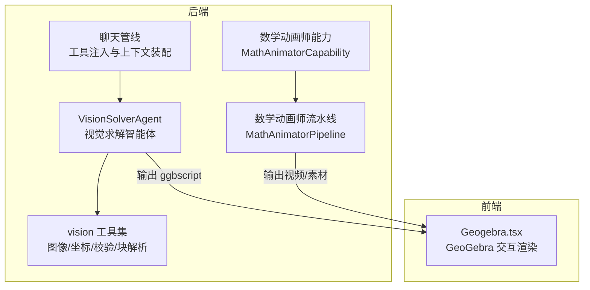
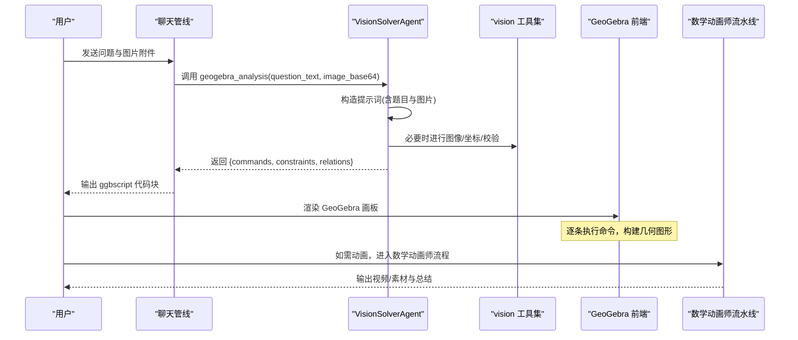
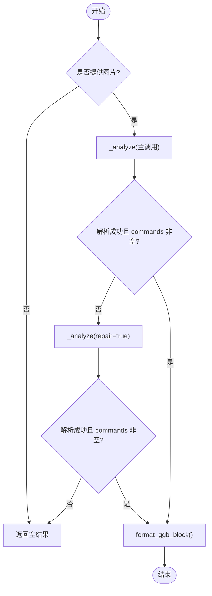
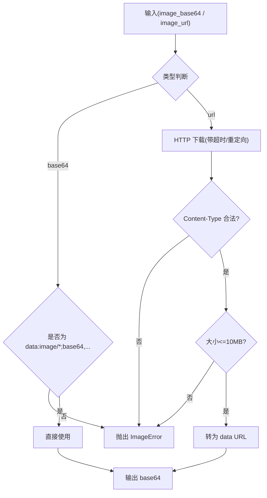
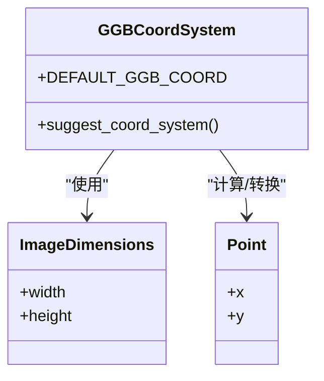
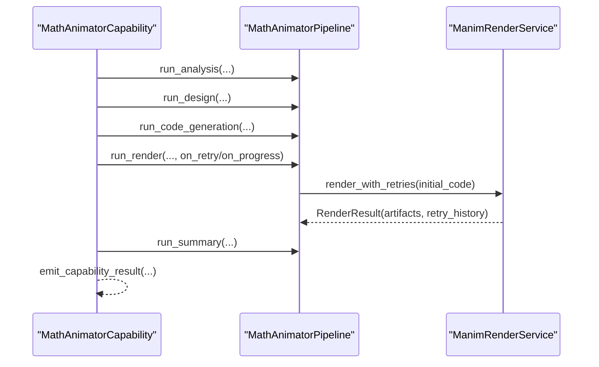
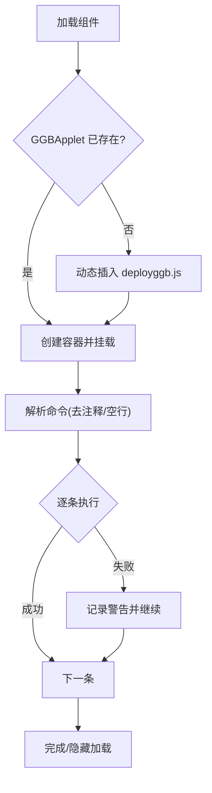
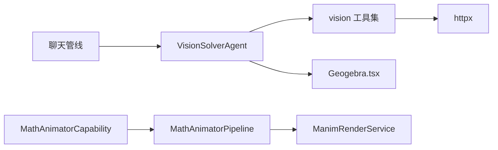

# 视觉求解器

<cite>
**本文引用的文件**
- [vision_solver_agent.py](file://deeptutor/agents/vision_solver/vision_solver_agent.py)
- [geogebra.md](file://deeptutor/agents/vision_solver/prompts/geogebra.md)
- [image_utils.py](file://deeptutor/tools/vision/image_utils.py)
- [coord_transform.py](file://deeptutor/tools/vision/coord_transform.py)
- [ggb_validator.py](file://deeptutor/tools/vision/ggb_validator.py)
- [block_parser.py](file://deeptutor/tools/vision/block_parser.py)
- [__init__.py](file://deeptutor/tools/vision/__init__.py)
- [agentic_pipeline.py](file://deeptutor/agents/chat/agentic_pipeline.py)
- [capability.py](file://deeptutor/agents/math_animator/capability.py)
- [pipeline.py](file://deeptutor/agents/math_animator/pipeline.py)
- [Geogebra.tsx](file://web/components/Geogebra.tsx)
</cite>

## 目录
1. [简介](#简介)
2. [项目结构](#项目结构)
3. [核心组件](#核心组件)
4. [架构总览](#架构总览)
5. [详细组件分析](#详细组件分析)
6. [依赖关系分析](#依赖关系分析)
7. [性能考虑](#性能考虑)
8. [故障排查指南](#故障排查指南)
9. [结论](#结论)
10. [附录：使用示例与最佳实践](#附录使用示例与最佳实践)

## 简介
本文件面向“视觉求解器”的完整技术文档，聚焦图像到几何命令的端到端处理流程。内容涵盖：
- 图像处理与几何分析的核心算法（图形识别、坐标变换、几何关系推导）
- GeoGebra 集成方式（交互式图表生成、动态演示、数学可视化）
- 视觉理解管道各阶段（图像预处理、特征提取、几何分析、结果验证）
- 与“数学动画师”协作机制（将视觉分析结果转化为动画演示）
- 错误处理机制与性能优化策略
- 具体使用示例与渲染优化建议

## 项目结构
视觉求解器由后端智能体、工具库与前端的协同组成：
- 智能体层：VisionSolverAgent 负责“单图→GeoGebra 命令”的一次性推理，并支持一次修复重试
- 工具层：vision 工具集提供图像输入解析、坐标系统转换、GeoGebra 脚本校验与块解析
- 编排层：聊天管线在工具调用时自动注入图片上下文；数学动画师能力通过 pipeline 驱动 Manim 渲染
- 前端层：Geogebra.tsx 负责加载 GeoGebra 脚本、执行命令并渲染交互图形



**图示来源**
- [vision_solver_agent.py:19-190](file://deeptutor/agents/vision_solver/vision_solver_agent.py#L19-L190)
- [__init__.py:1-80](file://deeptutor/tools/vision/__init__.py#L1-L80)
- [agentic_pipeline.py:699-725](file://deeptutor/agents/chat/agentic_pipeline.py#L699-L725)
- [capability.py:19-309](file://deeptutor/agents/math_animator/capability.py#L19-L309)
- [pipeline.py:25-281](file://deeptutor/agents/math_animator/pipeline.py#L25-L281)
- [Geogebra.tsx:1-195](file://web/components/Geogebra.tsx#L1-L195)

**章节来源**
- [vision_solver_agent.py:19-190](file://deeptutor/agents/vision_solver/vision_solver_agent.py#L19-L190)
- [__init__.py:1-80](file://deeptutor/tools/vision/__init__.py#L1-L80)
- [agentic_pipeline.py:699-725](file://deeptutor/agents/chat/agentic_pipeline.py#L699-L725)
- [capability.py:19-309](file://deeptutor/agents/math_animator/capability.py#L19-L309)
- [pipeline.py:25-281](file://deeptutor/agents/math_animator/pipeline.py#L25-L281)
- [Geogebra.tsx:1-195](file://web/components/Geogebra.tsx#L1-L195)

## 核心组件
- VisionSolverAgent：接收题干文本与图片，调用视觉大模型一次性输出 JSON（包含约束、几何关系、GeoGebra 命令），若首次未产出可用命令则触发一次修复重试；提供格式化 ggbscript 块的能力
- vision 工具集：
  - image_utils：统一图像输入（URL/Base64）、格式校验、大小限制、超时控制
  - coord_transform：GeoGebra 坐标系与图像像素坐标互转、点/线/距离/中点/平行垂直判定等几何计算
  - ggb_validator：GeoGebra 命令语法校验与帮助信息
  - block_parser：解析 ggbscript 代码块，支持流式解析
- 聊天管线：在工具 schema 中移除 image_base64 字段，从会话附件中提取图片并注入 geogebra_analysis 工具调用
- 数学动画师能力与流水线：概念分析→设计→代码生成→渲染（含重试与可选视觉评审）→总结，最终产出视频或素材
- 前端 Geogebra.tsx：懒加载 GeoGebra 脚本，逐条执行命令，容错跳过失败行，渲染可交互几何画板

**章节来源**
- [vision_solver_agent.py:19-190](file://deeptutor/agents/vision_solver/vision_solver_agent.py#L19-L190)
- [image_utils.py:27-211](file://deeptutor/tools/vision/image_utils.py#L27-L211)
- [coord_transform.py:1-200](file://deeptutor/tools/vision/coord_transform.py#L1-L200)
- [ggb_validator.py:1-200](file://deeptutor/tools/vision/ggb_validator.py#L1-L200)
- [block_parser.py:1-200](file://deeptutor/tools/vision/block_parser.py#L1-L200)
- [agentic_pipeline.py:699-725](file://deeptutor/agents/chat/agentic_pipeline.py#L699-L725)
- [capability.py:19-309](file://deeptutor/agents/math_animator/capability.py#L19-L309)
- [pipeline.py:25-281](file://deeptutor/agents/math_animator/pipeline.py#L25-L281)
- [Geogebra.tsx:1-195](file://web/components/Geogebra.tsx#L1-L195)

## 架构总览
下图展示从用户提问到可视化输出的端到端数据流：



**图示来源**
- [agentic_pipeline.py:699-725](file://deeptutor/agents/chat/agentic_pipeline.py#L699-L725)
- [vision_solver_agent.py:48-190](file://deeptutor/agents/vision_solver/vision_solver_agent.py#L48-L190)
- [image_utils.py:171-211](file://deeptutor/tools/vision/image_utils.py#L171-L211)
- [Geogebra.tsx:72-148](file://web/components/Geogebra.tsx#L72-L148)
- [pipeline.py:213-277](file://deeptutor/agents/math_animator/pipeline.py#L213-L277)

## 详细组件分析

### 视觉求解智能体（VisionSolverAgent）
- 目标：将“题图+题干”转换为可直接执行的 GeoGebra 命令序列，并附带约束与几何关系描述
- 关键流程：
  - process：若无图片直接返回空结果；否则调用 _analyze
  - _analyze：填充提示词（含题干），调用视觉 LLM；尝试解析 JSON；若为空则触发 repair 模式再次调用
  - _call_vision_llm：以多模态消息（文本+图片）流式获取响应
  - _extract_json：从 Markdown 代码块或原始文本中提取 JSON，兼容注释与尾逗号
  - format_ggb_block：将命令列表包装为前端可识别的 ggbscript 代码块
- 复杂度与健壮性：
  - 单次主调用 + 一次门控修复，避免无谓重试开销
  - 对模型输出做严格清洗与降级处理，提高鲁棒性



**图示来源**
- [vision_solver_agent.py:48-190](file://deeptutor/agents/vision_solver/vision_solver_agent.py#L48-L190)

**章节来源**
- [vision_solver_agent.py:19-190](file://deeptutor/agents/vision_solver/vision_solver_agent.py#L19-L190)
- [geogebra.md:1-86](file://deeptutor/agents/vision_solver/prompts/geogebra.md#L1-L86)

### 图像预处理与输入解析（image_utils）
- 功能：
  - 支持 Base64 data URL 与远程 URL 两种输入
  - 下载时校验 MIME、大小上限与超时
  - 统一转换为 data:image/...;base64,... 格式供视觉模型消费
- 错误处理：
  - 非法 URL、不支持的格式、过大图片、网络异常均抛出 ImageError
- 性能：
  - 设置合理超时与最大尺寸，避免资源耗尽



**图示来源**
- [image_utils.py:33-211](file://deeptutor/tools/vision/image_utils.py#L33-L211)

**章节来源**
- [image_utils.py:27-211](file://deeptutor/tools/vision/image_utils.py#L27-L211)

### 坐标变换与几何关系（coord_transform）
- 职责：
  - 定义 GeoGebra 坐标系常量与图像尺寸对象
  - 实现 bbox↔GGB 坐标互转、点/线段/距离/中点计算
  - 提供平行/垂直判定、坐标系建议、边界内点校验等
- 用途：
  - 将检测到的框或估计的点映射到 GeoGebra 坐标空间
  - 辅助生成更准确的几何命令（如交点、中点、垂线）



**图示来源**
- [coord_transform.py:1-200](file://deeptutor/tools/vision/coord_transform.py#L1-L200)

**章节来源**
- [coord_transform.py:1-200](file://deeptutor/tools/vision/coord_transform.py#L1-L200)

### GeoGebra 脚本校验与块解析（ggb_validator 与 block_parser）
- ggb_validator：
  - validate_command/validate_ggbscript：检查命令语法与整体脚本合法性
  - get_command_help：提供命令帮助信息，便于错误定位与修复
- block_parser：
  - parse_ggb_blocks/StreamingBlockParser：从文本中抽取 ggbscript 代码块，支持流式增量解析
- 作用：
  - 在生成后快速自检，减少前端执行失败
  - 为修复流程提供结构化反馈

**章节来源**
- [ggb_validator.py:1-200](file://deeptutor/tools/vision/ggb_validator.py#L1-L200)
- [block_parser.py:1-200](file://deeptutor/tools/vision/block_parser.py#L1-L200)
- [__init__.py:1-80](file://deeptutor/tools/vision/__init__.py#L1-L80)

### 聊天管线中的工具注入（agentic_pipeline）
- 行为：
  - 在构建工具 schema 时，针对 geogebra_analysis 移除 image_base64 参数，并从上下文中提取图片附件作为实际输入
  - 保证 LLM 侧无需显式传递图片，简化调用契约
- 影响：
  - 使 chat/solve 等能力均可无缝复用视觉求解能力

**章节来源**
- [agentic_pipeline.py:699-725](file://deeptutor/agents/chat/agentic_pipeline.py#L699-L725)

### 数学动画师协作（capability 与 pipeline）
- capability：
  - 声明能力清单与阶段（concept_analysis/design/code_generation/code_retry/summary/render_output）
  - 将 LLM 调用状态、进度与错误通过 StreamBus 暴露给前端
- pipeline：
  - 串联分析→设计→代码生成→渲染（含重试与可选视觉评审）→总结
  - 记录各阶段耗时，便于性能分析与调优
- 协作点：
  - 视觉求解产出的几何关系与约束可作为动画设计的输入
  - 渲染产物（视频/素材）可由前端统一展示



**图示来源**
- [capability.py:19-309](file://deeptutor/agents/math_animator/capability.py#L19-L309)
- [pipeline.py:25-281](file://deeptutor/agents/math_animator/pipeline.py#L25-L281)

**章节来源**
- [capability.py:19-309](file://deeptutor/agents/math_animator/capability.py#L19-L309)
- [pipeline.py:25-281](file://deeptutor/agents/math_animator/pipeline.py#L25-L281)

### 前端 GeoGebra 渲染（Geogebra.tsx）
- 特性：
  - 懒加载 GeoGebra 脚本，全局缓存以避免重复下载
  - 将命令按行解析，过滤注释与空行，逐条 evalCommand 执行
  - 单条命令失败不影响后续命令执行，提升容错性
  - 提供加载状态与错误提示
- 与后端对接：
  - 接受 ggbscript 代码块字符串，渲染为可交互几何画板



**图示来源**
- [Geogebra.tsx:32-148](file://web/components/Geogebra.tsx#L32-L148)

**章节来源**
- [Geogebra.tsx:1-195](file://web/components/Geogebra.tsx#L1-L195)

## 依赖关系分析
- 模块耦合：
  - VisionSolverAgent 依赖 vision 工具集（图像、坐标、校验、块解析）
  - 聊天管线依赖工具注册表，并在运行时注入图片上下文
  - 数学动画师能力依赖 pipeline，pipeline 依赖渲染服务与重试管理
  - 前端 Geogebra 仅依赖外部 GeoGebra 脚本与传入的命令字符串
- 外部依赖：
  - GeoGebra 在线脚本（CDN）
  - HTTP 客户端用于图片下载
  - Manim（可选，用于数学动画渲染）



**图示来源**
- [vision_solver_agent.py:19-190](file://deeptutor/agents/vision_solver/vision_solver_agent.py#L19-L190)
- [__init__.py:1-80](file://deeptutor/tools/vision/__init__.py#L1-L80)
- [agentic_pipeline.py:699-725](file://deeptutor/agents/chat/agentic_pipeline.py#L699-L725)
- [capability.py:19-309](file://deeptutor/agents/math_animator/capability.py#L19-L309)
- [pipeline.py:25-281](file://deeptutor/agents/math_animator/pipeline.py#L25-L281)
- [Geogebra.tsx:1-195](file://web/components/Geogebra.tsx#L1-L195)

**章节来源**
- [vision_solver_agent.py:19-190](file://deeptutor/agents/vision_solver/vision_solver_agent.py#L19-L190)
- [__init__.py:1-80](file://deeptutor/tools/vision/__init__.py#L1-L80)
- [agentic_pipeline.py:699-725](file://deeptutor/agents/chat/agentic_pipeline.py#L699-L725)
- [capability.py:19-309](file://deeptutor/agents/math_animator/capability.py#L19-L309)
- [pipeline.py:25-281](file://deeptutor/agents/math_animator/pipeline.py#L25-L281)
- [Geogebra.tsx:1-195](file://web/components/Geogebra.tsx#L1-L195)

## 性能考虑
- 视觉求解：
  - 单次主调用 + 一次门控修复，降低无效重试成本
  - 流式获取 LLM 响应，减少首字节延迟
- 图像输入：
  - 限制最大图片大小与请求超时，防止内存与时间资源浪费
- GeoGebra 前端：
  - 全局缓存 GeoGebra 脚本，避免重复下载
  - 逐条执行命令，单条失败不中断整体渲染
- 数学动画：
  - 分阶段计时，便于定位瓶颈
  - 渲染重试与可选视觉评审，平衡质量与速度

[本节为通用指导，不直接分析具体文件]

## 故障排查指南
- 图像输入问题：
  - 确认图片为 data:image/...;base64,... 或有效 URL
  - 检查 MIME 类型与大小限制，关注 ImageError 的具体原因
- JSON 解析失败：
  - 检查模型输出是否包含 ```json 代码块或纯 JSON
  - 注意尾逗号与注释，_extract_json 已做兼容处理
- GeoGebra 命令执行失败：
  - 使用 ggb_validator 校验命令语法
  - 前端会记录失败命令并继续执行其余命令
- 数学动画渲染失败：
  - 查看重试历史与错误信息
  - 根据视觉评审结果调整代码或风格提示

**章节来源**
- [image_utils.py:27-211](file://deeptutor/tools/vision/image_utils.py#L27-L211)
- [vision_solver_agent.py:144-156](file://deeptutor/agents/vision_solver/vision_solver_agent.py#L144-L156)
- [ggb_validator.py:1-200](file://deeptutor/tools/vision/ggb_validator.py#L1-L200)
- [Geogebra.tsx:133-141](file://web/components/Geogebra.tsx#L133-L141)
- [pipeline.py:174-194](file://deeptutor/agents/math_animator/pipeline.py#L174-L194)

## 结论
视觉求解器通过“单图→GeoGebra 命令”的一体化方案，结合严格的输入校验、坐标变换与脚本校验，实现了高鲁棒性的几何还原。与聊天管线的工具注入机制无缝衔接，并可进一步与数学动画师协作，将静态几何关系扩展为动态演示。前端 GeoGebra 渲染具备容错与性能优化，适合教学与互动场景。

[本节为总结性内容，不直接分析具体文件]

## 附录：使用示例与最佳实践
- 典型流程
  - 用户在聊天中上传题图并提问
  - 聊天管线自动提取图片并调用 geogebra_analysis
  - 后端返回 ggbscript 代码块，前端渲染为可交互几何画板
  - 如需动画，进入数学动画师流程，生成视频或素材
- 自定义可视化
  - 通过 prompt 模板（geogebra.md）约束输出结构与命令规范
  - 使用 coord_transform 将检测结果映射到 GeoGebra 坐标
  - 借助 ggb_validator 在生成后进行预校验
- 渲染优化
  - 前端按需加载 GeoGebra 脚本，避免首屏阻塞
  - 将复杂构造拆分为多条命令，降低单条失败风险
  - 对辅助对象使用 SetVisible[..., false] 隐藏，保持画面简洁

[本节为通用指导，不直接分析具体文件]