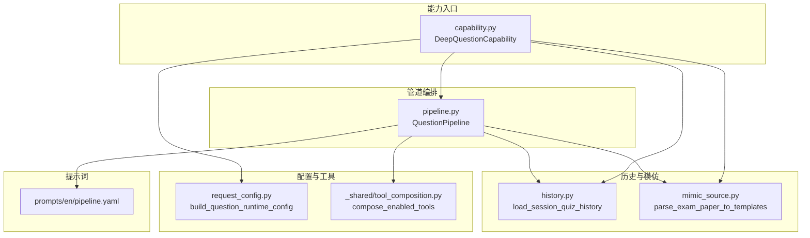
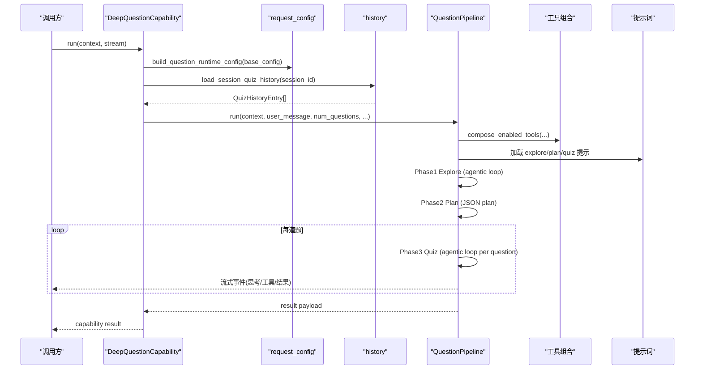
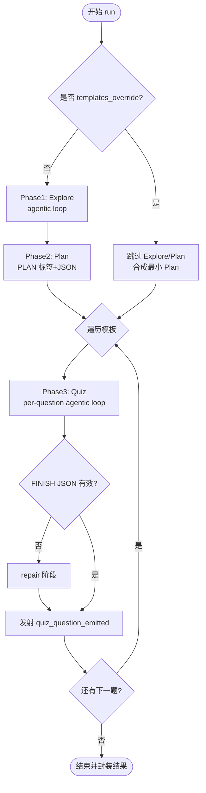
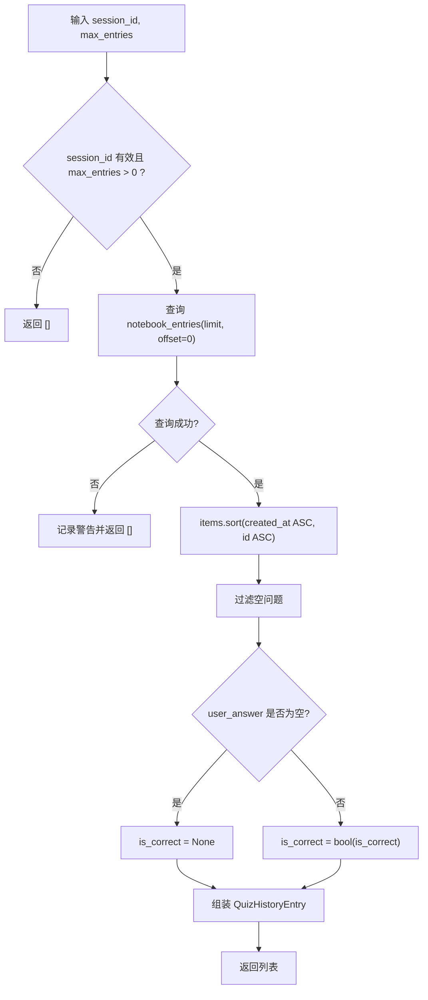
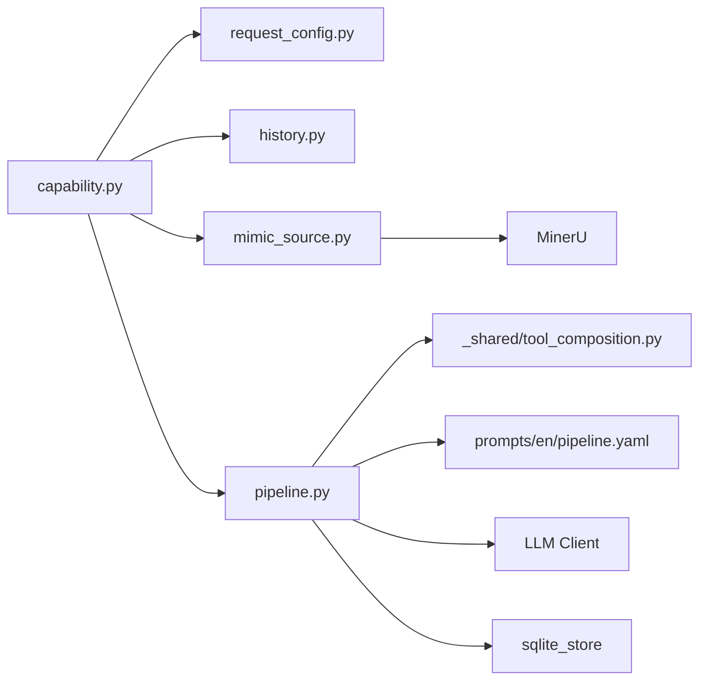

# 问题协调器

<cite>
**本文引用的文件**
- [deeptutor/agents/question/coordinator.py](file://deeptutor/agents/question/coordinator.py)
- [deeptutor/agents/question/pipeline.py](file://deeptutor/agents/question/pipeline.py)
- [deeptutor/agents/question/history.py](file://deeptutor/agents/question/history.py)
- [deeptutor/agents/question/capability.py](file://deeptutor/agents/question/capability.py)
- [deeptutor/agents/question/mimic_source.py](file://deeptutor/agents/question/mimic_source.py)
- [deeptutor/agents/question/request_config.py](file://deeptutor/agents/question/request_config.py)
- [deeptutor/agents/_shared/tool_composition.py](file://deeptutor/agents/_shared/tool_composition.py)
- [deeptutor/agents/question/prompts/en/pipeline.yaml](file://deeptutor/agents/question/prompts/en/pipeline.yaml)
</cite>

## 目录
1. [简介](#简介)
2. [项目结构](#项目结构)
3. [核心组件](#核心组件)
4. [架构总览](#架构总览)
5. [详细组件分析](#详细组件分析)
6. [依赖关系分析](#依赖关系分析)
7. [性能考量](#性能考量)
8. [故障排查指南](#故障排查指南)
9. [结论](#结论)
10. [附录：配置与扩展点](#附录：配置与扩展点)

## 简介
本文件面向“问题协调器”（Question Coordinator），聚焦其在多智能体协作中的角色、工作机制，以及历史管理、质量评估、知识库集成、配置与扩展等关键主题。系统通过“能力层 + 管道层 + 工具组合策略”的解耦设计，将用户请求转化为高质量、多样化且可追溯的问题生成流程；同时提供“模仿模式”以复用已有试卷的结构与风格。

## 项目结构
问题协调相关代码集中在 agents/question 目录下，围绕以下职责划分：
- 能力入口：DeepQuestionCapability 负责路由到 followup/custom/mimic 三种路径
- 管道编排：QuestionPipeline 驱动 Explore → Plan → Quiz 三阶段
- 历史管理：history 模块从会话存储中加载已答题目，避免重复并定位薄弱点
- 模仿源解析：mimic_source 将 PDF/已解析目录转换为模板列表
- 运行时配置：request_config 将主配置映射为 pipeline 可调参数
- 工具组合：tool_composition 统一决定本轮可用的工具集合
- 提示词：prompts 定义各阶段的系统/用户提示与协议约束

图表来源
- [deeptutor/agents/question/capability.py:28-156](file://deeptutor/agents/question/capability.py#L28-L156)
- [deeptutor/agents/question/pipeline.py:357-602](file://deeptutor/agents/question/pipeline.py#L357-L602)
- [deeptutor/agents/question/history.py:34-100](file://deeptutor/agents/question/history.py#L34-L100)
- [deeptutor/agents/question/mimic_source.py:58-157](file://deeptutor/agents/question/mimic_source.py#L58-L157)
- [deeptutor/agents/question/request_config.py:39-74](file://deeptutor/agents/question/request_config.py#L39-L74)
- [deeptutor/agents/_shared/tool_composition.py:100-193](file://deeptutor/agents/_shared/tool_composition.py#L100-L193)

章节来源
- [deeptutor/agents/question/capability.py:28-156](file://deeptutor/agents/question/capability.py#L28-L156)
- [deeptutor/agents/question/pipeline.py:357-602](file://deeptutor/agents/question/pipeline.py#L357-L602)

## 核心组件
- DeepQuestionCapability：统一入口，根据 mode 选择 followup/custom/mimic；在 custom/mimic 模式下构造 QuestionPipeline 并运行
- QuestionPipeline：三阶段编排（探索→计划→逐题生成），维护流式事件、追踪元数据、用量统计与结果封装
- History 模块：从会话存储读取历史答题，按时间排序并标准化为 QuizHistoryEntry，供 Explore 阶段使用
- Mimic Source：将上传或已解析的试卷转为 QuizTemplate 列表，支持进度回调与错误透传
- Request Config：将主配置中的 deep_question.exploring.* 映射为 pipeline 运行时参数
- Tool Composition：基于上下文标志（KB、记忆、笔记本、执行环境等）自动挂载工具，保证 chat/quiz 一致的工具可见性

章节来源
- [deeptutor/agents/question/capability.py:28-156](file://deeptutor/agents/question/capability.py#L28-L156)
- [deeptutor/agents/question/pipeline.py:357-602](file://deeptutor/agents/question/pipeline.py#L357-L602)
- [deeptutor/agents/question/history.py:34-100](file://deeptutor/agents/question/history.py#L34-L100)
- [deeptutor/agents/question/mimic_source.py:58-157](file://deeptutor/agents/question/mimic_source.py#L58-L157)
- [deeptutor/agents/question/request_config.py:39-74](file://deeptutor/agents/question/request_config.py#L39-L74)
- [deeptutor/agents/_shared/tool_composition.py:100-193](file://deeptutor/agents/_shared/tool_composition.py#L100-L193)

## 架构总览
下图展示一次自定义模式下的端到端调用链：能力入口解析参数 → 构建运行时配置 → 加载历史 → 启动 Pipeline → 三阶段推进 → 输出结果与流式事件。

图表来源
- [deeptutor/agents/question/capability.py:99-141](file://deeptutor/agents/question/capability.py#L99-L141)
- [deeptutor/agents/question/request_config.py:39-74](file://deeptutor/agents/question/request_config.py#L39-L74)
- [deeptutor/agents/question/history.py:34-100](file://deeptutor/agents/question/history.py#L34-L100)
- [deeptutor/agents/question/pipeline.py:438-602](file://deeptutor/agents/question/pipeline.py#L438-L602)
- [deeptutor/agents/_shared/tool_composition.py:100-193](file://deeptutor/agents/_shared/tool_composition.py#L100-L193)

## 详细组件分析

### 能力入口：DeepQuestionCapability
- 路由逻辑：
  - followup：针对上一题的追问，直接调用 FollowupAgent
  - custom：构造 QuestionPipeline，注入语言、KB、工具、运行时配置，并传入历史
  - mimic：先解析试卷为模板，再调用 Pipeline.run(templates_override=...) 跳过 Explore/Plan
- 流式桥接：将子代理的 trace 事件映射为 StreamBus 的事件，便于前端渲染

章节来源
- [deeptutor/agents/question/capability.py:28-156](file://deeptutor/agents/question/capability.py#L28-L156)
- [deeptutor/agents/question/capability.py:158-329](file://deeptutor/agents/question/capability.py#L158-L329)
- [deeptutor/agents/question/capability.py:330-448](file://deeptutor/agents/question/capability.py#L330-L448)

### 管道编排：QuestionPipeline
- 三阶段：
  - Explore：agentic loop，产出用户可见的“探索前言”和“探索轨迹”，用于后续阶段
  - Plan：单步 PLAN，输出 JSON 计划（题目模板列表）
  - Quiz：对每个模板执行 agentic loop，严格校验 FINISH JSON，必要时触发 repair
- 质量控制：
  - 类型与难度白名单、去重、数量一致性检查
  - 修复机制：当 FINISH JSON 不合法时，进入 repair 阶段尝试修正
  - 工具结果摘要：可选的 tool_summarizer 压缩工具返回，降低上下文开销
- 流式与追踪：
  - 分阶段 stage 标记、trace metadata、usage 记录
  - 逐题即时发射 quiz_question_emitted 事件，前端可实时渲染

图表来源
- [deeptutor/agents/question/pipeline.py:438-602](file://deeptutor/agents/question/pipeline.py#L438-L602)
- [deeptutor/agents/question/pipeline.py:607-750](file://deeptutor/agents/question/pipeline.py#L607-L750)
- [deeptutor/agents/question/pipeline.py:752-800](file://deeptutor/agents/question/pipeline.py#L752-L800)

章节来源
- [deeptutor/agents/question/pipeline.py:357-602](file://deeptutor/agents/question/pipeline.py#L357-L602)
- [deeptutor/agents/question/pipeline.py:607-750](file://deeptutor/agents/question/pipeline.py#L607-L750)
- [deeptutor/agents/question/pipeline.py:752-800](file://deeptutor/agents/question/pipeline.py#L752-L800)

### 历史管理：Quiz 历史记录
- 数据来源：notebook_entries 表（由 POST /sessions/{id}/quiz-results 写入）
- 读取与排序：按 created_at ASC、id ASC 稳定排序，确保“最早→最新”的阅读顺序
- 字段处理：
  - 若 user_answer 为空，则 is_correct 置为 None，表示“未作答”
  - 过滤空问题，仅保留有效条目
- 用途：Explore 阶段据此避免重复、识别薄弱点并调整覆盖策略

图表来源
- [deeptutor/agents/question/history.py:34-100](file://deeptutor/agents/question/history.py#L34-L100)

章节来源
- [deeptutor/agents/question/history.py:34-100](file://deeptutor/agents/question/history.py#L34-L100)

### 模仿模式：试卷解析与模板化
- 输入形态：
  - 上传 PDF：临时写入后交由 MinerU 解析
  - 已解析目录：直接读取 _questions.json
  - 无可用试卷：退化到 custom 模式并在消息前追加“尽量模仿附件”的提示
- 输出：QuizTemplate 列表（question_id/topic/question_type/difficulty/source/reference_*）
- 进度与错误：
  - progress_callback 将解析进度回推到流式通道
  - 解析失败抛出 MinerUError，能力层捕获并上报错误

章节来源
- [deeptutor/agents/question/mimic_source.py:58-157](file://deeptutor/agents/question/mimic_source.py#L58-L157)
- [deeptutor/agents/question/capability.py:158-329](file://deeptutor/agents/question/capability.py#L158-L329)

### 工具组合与知识库集成
- 工具挂载策略：
  - 用户启用的工具优先
  - 条件自动挂载：如存在 KB 则挂载 rag/kb_files；有笔记则挂载 list_notebook/write_note 等
  - 能力自有工具追加；始终开启的基础工具（write_memory/web_fetch/github/ask_user/cron）
- 知识库集成：
  - 通过 UnifiedContext.knowledge_bases 传递 KB 名称
  - 工具组合依据 has_kb 标志决定是否挂载检索类工具
  - Explore/Quiz 提示中注入 KB 说明与工具清单，引导模型正确引用来源

章节来源
- [deeptutor/agents/_shared/tool_composition.py:100-193](file://deeptutor/agents/_shared/tool_composition.py#L100-L193)
- [deeptutor/agents/question/pipeline.py:633-686](file://deeptutor/agents/question/pipeline.py#L633-L686)

### 质量评估机制
- 规划阶段约束：
  - 要求恰好输出 N 个模板，topic 不得重复，题型与难度受白名单与目标控制
- 生成阶段约束：
  - 严格协议：THINK/TOOL/FINISH 标签，禁止混用
  - FINISH JSON 强校验：题型特定规则（选择题选项数、填空题空白标记、概念题 true/false 等）
  - 去重：参考“本轮已生成问题”避免重复
- 修复机制：
  - 当 FINISH JSON 非法时，进入 repair 阶段，仅输出修正后的 JSON
  - 最终兜底：达到迭代上限时强制输出最佳可用结果
- 多样性保障：
  - 允许 per_type_counts 指定题型分布
  - Explore 阶段结合历史与素材，避免重复并覆盖薄弱点

章节来源
- [deeptutor/agents/question/prompts/en/pipeline.yaml:150-349](file://deeptutor/agents/question/prompts/en/pipeline.yaml#L150-L349)
- [deeptutor/agents/question/pipeline.py:752-800](file://deeptutor/agents/question/pipeline.py#L752-L800)

## 依赖关系分析
- 能力层依赖：
  - 运行时配置（request_config）
  - 历史加载（history）
  - 模仿源解析（mimic_source）
  - 管道（pipeline）
- 管道层依赖：
  - 工具组合（tool_composition）
  - 提示词（prompts）
  - 流式总线（StreamBus）、追踪（Trace）、LLM 客户端
- 外部服务：
  - 会话存储（sqlite_store）
  - 文档解析（MinerU）
  - 工具注册表（tool_registry）

图表来源
- [deeptutor/agents/question/capability.py:99-156](file://deeptutor/agents/question/capability.py#L99-L156)
- [deeptutor/agents/question/pipeline.py:438-602](file://deeptutor/agents/question/pipeline.py#L438-L602)
- [deeptutor/agents/question/mimic_source.py:58-157](file://deeptutor/agents/question/mimic_source.py#L58-L157)

章节来源
- [deeptutor/agents/question/capability.py:99-156](file://deeptutor/agents/question/capability.py#L99-L156)
- [deeptutor/agents/question/pipeline.py:438-602](file://deeptutor/agents/question/pipeline.py#L438-L602)
- [deeptutor/agents/question/mimic_source.py:58-157](file://deeptutor/agents/question/mimic_source.py#L58-L157)

## 性能考量
- 迭代预算：
  - Explore 最大迭代次数可配置（默认 8）
  - 每道题最大迭代次数可配置（默认 5）
- 上下文窗口保护：
  - 工具结果摘要（可选）压缩工具返回，减少后续轮次上下文占用
  - 必要时裁剪旧工具结果以避免超出上下文限制
- 并行工具调用：
  - 单轮最多并行工具调用数受框架限制，过多将被截断
- 资源释放：
  - 流式总线在 finally 中关闭，避免泄漏

章节来源
- [deeptutor/agents/question/pipeline.py:127-142](file://deeptutor/agents/question/pipeline.py#L127-L142)
- [deeptutor/agents/question/pipeline.py:357-420](file://deeptutor/agents/question/pipeline.py#L357-L420)
- [deeptutor/agents/question/pipeline.py:664-686](file://deeptutor/agents/question/pipeline.py#L664-L686)

## 故障排查指南
- 常见错误与处理：
  - 历史加载失败：记录警告并降级为“无历史”继续
  - 计划模板数量不匹配：发出警告并继续处理现有模板
  - FINISH JSON 无效：触发 repair；若仍失败，发出 best-effort 结果
  - 工具调用未知错误/协议违规：发出相应 notice 并重试/纠正
  - 模仿模式缺少试卷：提示需要上传 PDF 或提供已解析目录
- 调试建议：
  - 关注流式事件中的 trace_kind（call_status/llm_chunk/tool_call/tool_result）
  - 检查 plan_count_mismatch、max_iterations_reached、context_window_guard 等通知
  - 确认工具组合是否正确挂载（KB、记忆、笔记本等）

章节来源
- [deeptutor/agents/question/history.py:51-64](file://deeptutor/agents/question/history.py#L51-L64)
- [deeptutor/agents/question/pipeline.py:565-571](file://deeptutor/agents/question/pipeline.py#L565-L571)
- [deeptutor/agents/question/pipeline.py:739-750](file://deeptutor/agents/question/pipeline.py#L739-L750)
- [deeptutor/agents/question/capability.py:322-329](file://deeptutor/agents/question/capability.py#L322-L329)
- [deeptutor/agents/question/prompts/en/pipeline.yaml:321-333](file://deeptutor/agents/question/prompts/en/pipeline.yaml#L321-L333)

## 结论
问题协调器通过“能力入口 + 三阶段管道 + 工具组合策略”实现了高质量、多样化且可追溯的问题生成。历史管理确保避免重复并定位薄弱点；质量评估通过严格的协议与修复机制保障输出稳定性；知识库与工具组合使模型能基于上下文信息优化生成。配合灵活的运行时配置与扩展点，系统可在不同场景下稳定工作。

## 附录：配置与扩展点
- 运行时配置键（deep_question.exploring）：
  - exploring.max_iterations：探索阶段最大迭代次数（默认 8）
  - exploring.tool_summarizer.enabled：是否启用工具结果摘要（默认 True）
  - exploring.tool_summarizer.max_tokens：摘要最大 token 数（默认 800）
- 扩展点：
  - 自定义工具挂载：通过 ToolMountFlags 与 compose_enabled_tools 控制
  - 自定义提示词：替换 prompts 中的 system/user_template
  - 自定义历史来源：替换 history 的数据读取逻辑（保持 QuizHistoryEntry 结构）
  - 自定义模板来源：替换 mimic_source 的解析逻辑（保持 QuizTemplate 结构）

章节来源
- [deeptutor/agents/question/request_config.py:39-74](file://deeptutor/agents/question/request_config.py#L39-L74)
- [deeptutor/agents/_shared/tool_composition.py:100-193](file://deeptutor/agents/_shared/tool_composition.py#L100-L193)
- [deeptutor/agents/question/pipeline.py:357-420](file://deeptutor/agents/question/pipeline.py#L357-L420)