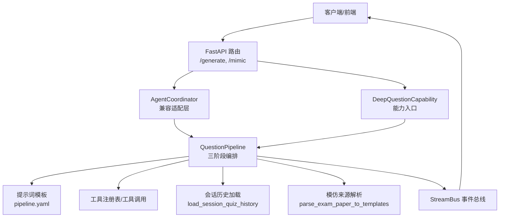
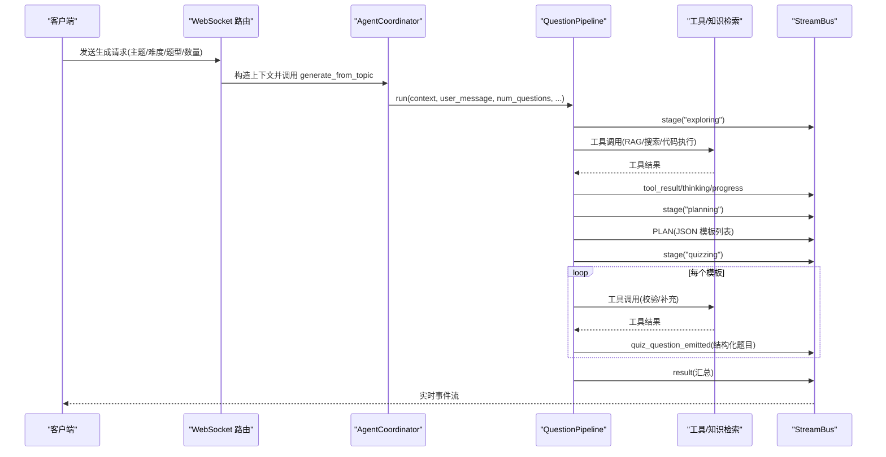
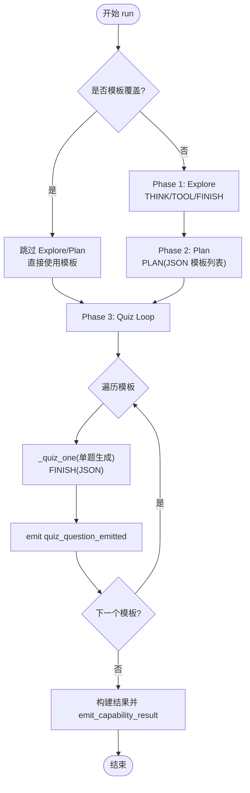
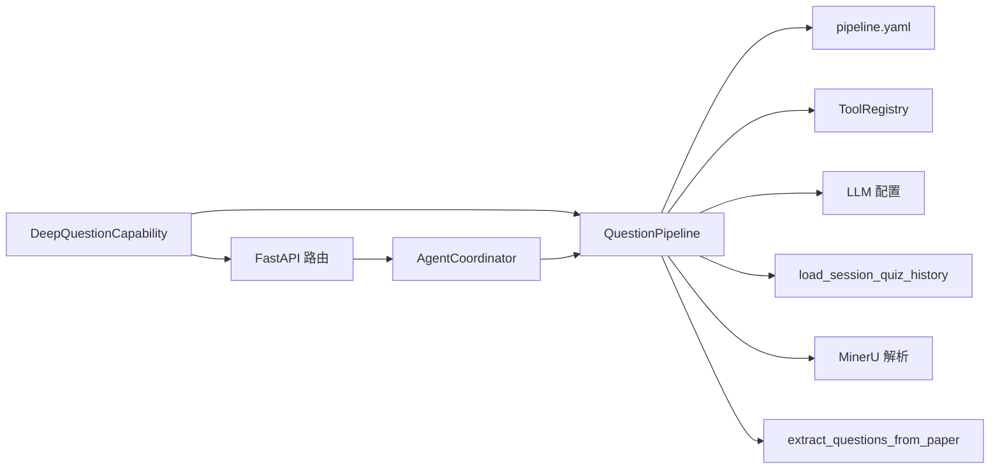

# 问题生成智能体

<cite>
**本文引用的文件**
- [coordinator.py](file://deeptutor/agents/question/coordinator.py)
- [pipeline.py](file://deeptutor/agents/question/pipeline.py)
- [capability.py](file://deeptutor/agents/question/capability.py)
- [history.py](file://deeptutor/agents/question/history.py)
- [mimic_source.py](file://deeptutor/agents/question/mimic_source.py)
- [request_config.py](file://deeptutor/agents/question/request_config.py)
- [pipeline.yaml](file://deeptutor/agents/question/prompts/en/pipeline.yaml)
- [question.py](file://deeptutor/api/routers/question.py)
- [__init__.py](file://deeptutor/tools/question/__init__.py)
- [followup_agent.py](file://deeptutor/agents/question/agents/followup_agent.py)
</cite>

## 目录
1. [简介](#简介)
2. [项目结构](#项目结构)
3. [核心组件](#核心组件)
4. [架构总览](#架构总览)
5. [详细组件分析](#详细组件分析)
6. [依赖关系分析](#依赖关系分析)
7. [性能与可扩展性](#性能与可扩展性)
8. [故障排查指南](#故障排查指南)
9. [结论](#结论)
10. [附录：使用示例与配置](#附录使用示例与配置)

## 简介
本文件面向“问题生成智能体”的完整实现，系统性说明从主题分析、问题构思、难度控制到答案验证的全流程；解释协调器在多智能体协作、历史管理与质量评估中的作用；介绍问题提取算法、模仿来源处理与后续问题生成机制；覆盖选择题、填空题、问答题等题型支持及难度级别控制；并提供实际使用示例，展示如何配置参数、自定义题型模板以及优化生成质量。同时说明与知识库的集成方式与个性化学习路径生成的支撑点。

## 项目结构
问题生成能力位于 agents/question 模块，由能力层（Capability）统一路由，内部通过 QuestionPipeline 驱动三阶段工作流（探索-计划-出题），并配合历史管理、模仿来源解析、提示词模板与工具调用。API 层提供 WebSocket 接口用于模拟试卷模式与批量生成。

图表来源
- [question.py:43-351](file://deeptutor/api/routers/question.py#L43-L351)
- [coordinator.py:31-167](file://deeptutor/agents/question/coordinator.py#L31-L167)
- [capability.py:28-157](file://deeptutor/agents/question/capability.py#L28-L157)
- [pipeline.py:357-602](file://deeptutor/agents/question/pipeline.py#L357-L602)
- [pipeline.yaml:1-354](file://deeptutor/agents/question/prompts/en/pipeline.yaml#L1-L354)

章节来源
- [question.py:43-351](file://deeptutor/api/routers/question.py#L43-L351)
- [coordinator.py:31-167](file://deeptutor/agents/question/coordinator.py#L31-L167)
- [capability.py:28-157](file://deeptutor/agents/question/capability.py#L28-L157)
- [pipeline.py:357-602](file://deeptutor/agents/question/pipeline.py#L357-L602)
- [pipeline.yaml:1-354](file://deeptutor/agents/question/prompts/en/pipeline.yaml#L1-L354)

## 核心组件
- 能力入口 DeepQuestionCapability：负责根据请求模式（followup/custom/mimic）选择执行路径，组装上下文与运行时配置，并调用 QuestionPipeline。
- 协调器 AgentCoordinator：为旧版入口提供兼容适配，将请求转发至 QuestionPipeline，并桥接 WebSocket 事件流。
- 流水线 QuestionPipeline：三阶段编排（Explore → Plan → Quiz），内置类型与难度规范、提示词装配、工具组合、错误修复与结果发射。
- 历史管理 history：从会话存储中加载已做过的题目，辅助 Explore 阶段避免重复并定位薄弱点。
- 模仿来源 mimic_source：将上传或已解析的试卷转换为 QuizTemplate 列表，供 Pipeline 直接跳过探索与计划进入逐题生成。
- 提示词 pipeline.yaml：定义各阶段的协议标签、JSON Schema、错误修复与通知文案，是模型行为的核心契约。
- API 路由 question.py：暴露 /generate 与 /mimic 两个 WebSocket 端点，承载认证、日志捕获、进度推送与最终完成信号。

章节来源
- [capability.py:28-157](file://deeptutor/agents/question/capability.py#L28-L157)
- [coordinator.py:31-167](file://deeptutor/agents/question/coordinator.py#L31-L167)
- [pipeline.py:357-602](file://deeptutor/agents/question/pipeline.py#L357-L602)
- [history.py:34-100](file://deeptutor/agents/question/history.py#L34-L100)
- [mimic_source.py:58-157](file://deeptutor/agents/question/mimic_source.py#L58-L157)
- [pipeline.yaml:1-354](file://deeptutor/agents/question/prompts/en/pipeline.yaml#L1-L354)
- [question.py:43-351](file://deeptutor/api/routers/question.py#L43-L351)

## 架构总览
问题生成采用“能力-流水线-工具”的分层架构：
- 能力层：接收外部请求，决定模式（followup/custom/mimic），准备上下文与配置。
- 流水线层：以协议标签驱动的 agentic loop 组织多轮思考、工具调用与最终输出；分阶段产出可追踪的中间产物。
- 工具层：RAG、搜索、代码执行等工具按需挂载，支持并行调用与结果压缩摘要。
- 事件总线：通过 StreamBus 实时推送 thinking、tool_call、tool_result、progress、content、result 等事件，前端据此渲染进度与卡片。

图表来源
- [question.py:353-571](file://deeptutor/api/routers/question.py#L353-L571)
- [coordinator.py:66-149](file://deeptutor/agents/question/coordinator.py#L66-L149)
- [pipeline.py:438-602](file://deeptutor/agents/question/pipeline.py#L438-L602)

## 详细组件分析

### 协调器 AgentCoordinator
- 职责：兼容旧版入口，封装 UnifiedContext，构建 QuestionPipeline，并通过 StreamBus 转发事件。
- 关键方法：
  - generate_from_topic：基于主题生成题目，传入 num_questions、difficulty、question_types、per_type_counts。
  - generate_from_exam：解析试卷为模板后，直接注入 templates_override 进入 Pipeline。
  - _run_with_forwarding：异步运行 Pipeline 并转发 stream 事件到 WebSocket。
- 设计要点：
  - 语言与知识库名称来自配置与服务。
  - 输出目录与 session_id 解析保证任务隔离。
  - 兼容总结字段映射，便于旧前端消费。

章节来源
- [coordinator.py:31-243](file://deeptutor/agents/question/coordinator.py#L31-L243)

### 能力 DeepQuestionCapability
- 职责：统一入口，按 mode 分发到 followup、custom、mimic 三种路径。
- 关键逻辑：
  - followup：调用 FollowupAgent 对单题进行追问回答。
  - custom：加载会话历史，构建运行时配置，调用 QuestionPipeline.run。
  - mimic：解析 PDF 或已解析目录为模板，再调用 Pipeline.run 并注入 templates_override。
- 事件桥接：将 LLM 与工具的 trace 事件映射到 StreamBus 的 thinking/tool_call/tool_result/progress/error。

章节来源
- [capability.py:28-448](file://deeptutor/agents/question/capability.py#L28-L448)
- [followup_agent.py:15-119](file://deeptutor/agents/question/agents/followup_agent.py#L15-L119)

### 流水线 QuestionPipeline
- 三阶段工作流：
  - Phase 1 Explore：agentic loop（THINK/TOOL/FINISH），收集材料，输出用户可见的探索前言与结构化 exploration_trace。
  - Phase 2 Plan：单次 LLM 调用输出 JSON {analysis, templates[]}，约束题型与难度分布。
  - Phase 3 Quiz：对每个模板执行 agentic loop，FINISH 必须为严格 JSON，失败时触发 repair 一次。
- 类型与难度：
  - 支持 choice、concept、fill_in_blank、short_answer、written、coding。
  - 难度 easy/medium/hard，允许 per_type_counts 精确分配。
- 历史与去重：
  - 读取会话历史，避免重复主题，针对薄弱点加权。
- 工具与摘要：
  - 工具结果经 summarizer 压缩后再进入下游，减少上下文开销。
- 事件与追踪：
  - 每道题生成即 emit quiz_question_emitted，前端可即时渲染卡片。
  - 使用 Trace 元数据标注 call_kind、trace_role、trace_group。

图表来源
- [pipeline.py:438-602](file://deeptutor/agents/question/pipeline.py#L438-L602)
- [pipeline.yaml:147-333](file://deeptutor/agents/question/prompts/en/pipeline.yaml#L147-L333)

章节来源
- [pipeline.py:357-800](file://deeptutor/agents/question/pipeline.py#L357-L800)
- [pipeline.yaml:1-354](file://deeptutor/agents/question/prompts/en/pipeline.yaml#L1-L354)

### 历史管理 load_session_quiz_history
- 作用：从会话存储中按时间顺序加载最近 N 条题目记录，供 Explore 阶段诊断薄弱点与避免重复。
- 关键点：
  - 排序稳定（created_at ASC, id ASC）。
  - 未作答的题目 is_correct 置为 None，避免误导。
  - 异常时返回空列表，保证鲁棒性。

章节来源
- [history.py:34-100](file://deeptutor/agents/question/history.py#L34-L100)

### 模仿来源 parse_exam_paper_to_templates
- 作用：将上传的 PDF 或已解析目录转换为 QuizTemplate 列表，保留原始题型与难度。
- 流程：
  - 若 paper_mode="upload"：通过 MinerU 解析并写入输出目录。
  - 若 paper_mode="parsed"：直接使用已有解析目录。
  - 抽取 *_questions.json，限制最大题目数，规范化题型与难度。
- 输出：templates 列表与 trace（包含工作目录、问题文件路径、模板计数）。

章节来源
- [mimic_source.py:58-157](file://deeptutor/agents/question/mimic_source.py#L58-L157)

### 提示词与协议
- 协议标签：THINK、TOOL、FINISH、PLAN，强制首行标签，禁止混用。
- FINISH JSON Schema：
  - choice：options 必须包含 A/B/C/D，correct_answer 为选项字母。
  - concept：correct_answer 为 "true"/"false"。
  - fill_in_blank：question 含唯一 ____，correct_answer 为填空词。
  - short_answer/written/coding：correct_answer 为参考文本或代码。
- 错误修复：repair 阶段仅修正 JSON 格式与必填项，不改变题型意图。
- 通知与空值占位：notices/empty 提供统一提示与降级文案。

章节来源
- [pipeline.yaml:1-354](file://deeptutor/agents/question/prompts/en/pipeline.yaml#L1-L354)

### API 路由与实时流
- /mimic：支持上传 PDF 或已解析目录，解析后进入 Pipeline，实时推送进度与结果。
- /generate：基于主题生成题目，使用 AgentCoordinator 兼容入口，流式推送状态与完成信号。
- 日志捕获：通过 capture_process_logs 与 StdoutInterceptor 将进程输出转为事件流。

章节来源
- [question.py:43-351](file://deeptutor/api/routers/question.py#L43-L351)
- [question.py:353-571](file://deeptutor/api/routers/question.py#L353-L571)

## 依赖关系分析
- 能力层依赖：
  - PromptManager：加载 pipeline.yaml 中的提示词。
  - ToolRegistry：动态挂载 RAG、web_search、code_execution 等工具。
  - LLM 配置：binding、model、reasoning_effort 等。
- 流水线依赖：
  - core.agentic：run_agentic_loop、run_labeled_step、dispatch_tool_calls。
  - services.parsing：MinerU 解析引擎。
  - tools.question：extract_questions_from_paper。
- 历史与存储：
  - sqlite_store：读取 notebook_entries 作为历史来源。
- 事件系统：
  - StreamBus：统一的事件发布订阅，贯穿前端渲染与后端追踪。

图表来源
- [capability.py:28-157](file://deeptutor/agents/question/capability.py#L28-L157)
- [pipeline.py:357-602](file://deeptutor/agents/question/pipeline.py#L357-L602)
- [mimic_source.py:58-157](file://deeptutor/agents/question/mimic_source.py#L58-L157)
- [question.py:43-351](file://deeptutor/api/routers/question.py#L43-L351)

章节来源
- [capability.py:28-157](file://deeptutor/agents/question/capability.py#L28-L157)
- [pipeline.py:357-602](file://deeptutor/agents/question/pipeline.py#L357-L602)
- [mimic_source.py:58-157](file://deeptutor/agents/question/mimic_source.py#L58-L157)
- [question.py:43-351](file://deeptutor/api/routers/question.py#L43-L351)

## 性能与可扩展性
- 迭代上限与 Token 限制：
  - Explore 默认最多 8 次迭代，Quiz 每题最多 5 次迭代。
  - 各阶段设置 MAX_TOKENS 限制，防止上下文溢出。
- 工具结果摘要：
  - 可选 summarizer 压缩工具输出，降低后续 LLM 调用成本。
- 并行工具调用：
  - 受 MAX_PARALLEL_TOOL_CALLS 限制，避免过载。
- 可扩展点：
  - 新增题型：在 QuestionType 枚举与提示词 Schema 中扩展。
  - 新工具：通过 ToolRegistry 注册并在 prompt 中声明可用能力。
  - 运行时配置：通过 request_config 调整 exploring.max_iterations 与 summarizer 开关。

[本节为通用指导，无需特定文件引用]

## 故障排查指南
- 常见问题与定位：
  - 无模板或模板为空：检查 mimic_source 解析是否成功，确认 *_questions.json 是否存在。
  - 计划模板数量不匹配：查看 plan_count_mismatch 通知，确认 per_type_counts 总和与 num_questions 一致。
  - FINISH JSON 无效：触发 repair 一次，若仍失败则发出 best-effort 版本。
  - 工具调用失败：检查 enabled_tools 与 KB 名称拼写，查看 tool_unknown_error 通知。
  - 历史加载失败：history 模块异常会返回空列表，不影响主流程。
- 日志与追踪：
  - 使用 StreamBus 的 thinking/tool_call/tool_result/progress/error 事件定位卡点。
  - 通过 Trace 元数据（call_kind、trace_role、trace_group）在前端 CallTracePanel 中可视化。

章节来源
- [pipeline.yaml:298-333](file://deeptutor/agents/question/prompts/en/pipeline.yaml#L298-L333)
- [pipeline.py:739-750](file://deeptutor/agents/question/pipeline.py#L739-L750)
- [history.py:51-64](file://deeptutor/agents/question/history.py#L51-L64)

## 结论
问题生成智能体以“能力-流水线-工具”分层架构实现了高可控、可追踪、可扩展的题库生成能力。通过三阶段工作流与严格的协议标签约束，系统在主题分析、问题构思、难度控制与答案验证方面具备良好的一致性与鲁棒性。模仿模式支持从真实试卷中提取并复用题型风格，结合会话历史实现个性化与薄弱点强化。API 层提供实时流式交互，便于前端渲染与用户体验优化。

[本节为总结，无需特定文件引用]

## 附录：使用示例与配置

### 基本用法（主题生成）
- 调用方式：通过 FastAPI WebSocket /generate 发送 requirement 字典，包含 knowledge_point、preference、difficulty、question_type、count 等。
- 参数说明：
  - knowledge_point：主题或知识点。
  - preference：偏好描述（如侧重概念理解或应用）。
  - difficulty：easy/medium/hard，留空表示自动。
  - question_type：单一题型或交由规划器选择。
  - count：生成题目数量。
- 事件流：
  - 初始化、上传/解析、处理中、批摘要、完成等状态通过 WebSocket 推送。

章节来源
- [question.py:353-571](file://deeptutor/api/routers/question.py#L353-L571)

### 模仿模式（试卷生成）
- 调用方式：通过 /mimic 上传 PDF 或指定已解析目录。
- 参数说明：
  - mode：upload 或 parsed。
  - pdf_data/base64：PDF 内容（upload 模式）。
  - paper_path：已解析目录路径（parsed 模式）。
  - max_questions：限制提取数量。
- 流程：
  - 解析 PDF → 抽取 *_questions.json → 转换为 QuizTemplate → 注入 Pipeline.templates_override → 逐题生成。

章节来源
- [question.py:43-351](file://deeptutor/api/routers/question.py#L43-L351)
- [mimic_source.py:58-157](file://deeptutor/agents/question/mimic_source.py#L58-L157)

### 运行时配置（quality & performance）
- 通过 main.yaml 的 capabilities.deep_question.exploring 配置：
  - max_iterations：探索阶段最大迭代次数。
  - tool_summarizer.enabled：是否启用工具结果摘要。
  - tool_summarizer.max_tokens：摘要最大 Token 数。
- 构建方式：使用 build_question_runtime_config 合并到 runtime_config。

章节来源
- [request_config.py:39-74](file://deeptutor/agents/question/request_config.py#L39-L74)

### 题型与难度控制
- 支持题型：choice、concept、fill_in_blank、short_answer、written、coding。
- 难度级别：easy、medium、hard。
- 分布控制：
  - question_types：白名单限制。
  - per_type_counts：按题型指定数量，需与 num_questions 一致。

章节来源
- [pipeline.py:144-162](file://deeptutor/agents/question/pipeline.py#L144-L162)
- [pipeline.yaml:147-189](file://deeptutor/agents/question/prompts/en/pipeline.yaml#L147-L189)

### 与知识库集成与个性化路径
- 知识库注入：
  - 通过 UnifiedContext.knowledge_bases 传递 KB 名称，Explore 阶段优先使用本地材料。
  - 提示词中注入 kb_note 与 tool_list，引导模型引用具体 source-id。
- 个性化学习路径：
  - 利用 load_session_quiz_history 获取历史表现，识别薄弱点。
  - Explore 阶段诊断后，Plan 阶段可偏向薄弱主题，Quiz 阶段避免重复并针对性强化。

章节来源
- [pipeline.py:633-686](file://deeptutor/agents/question/pipeline.py#L633-L686)
- [history.py:34-100](file://deeptutor/agents/question/history.py#L34-L100)
- [pipeline.yaml:83-118](file://deeptutor/agents/question/prompts/en/pipeline.yaml#L83-L118)