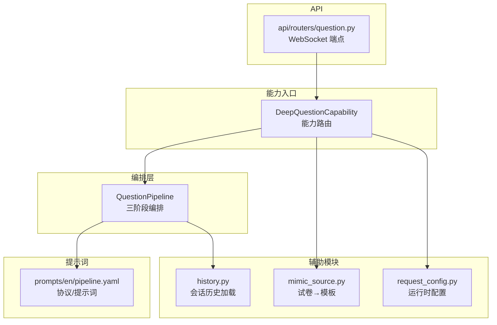
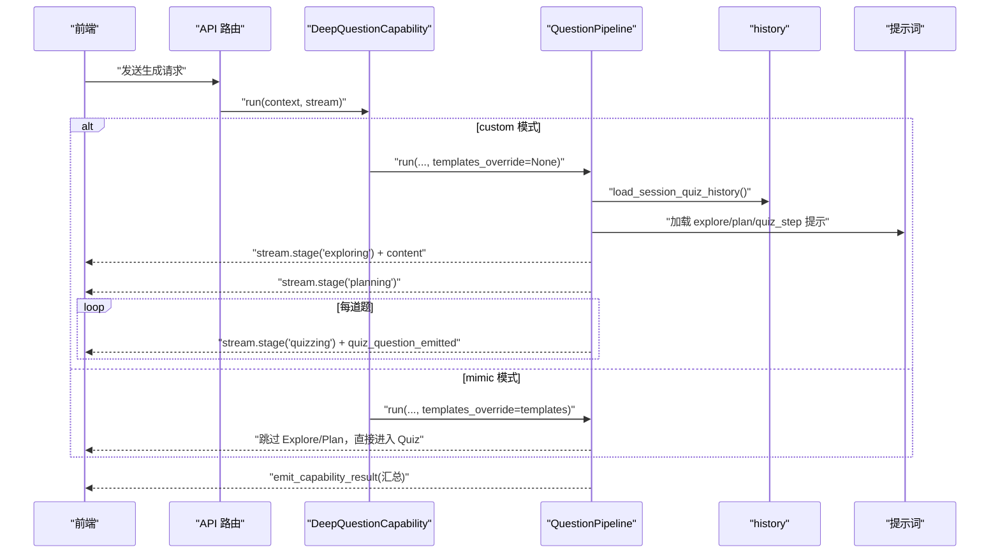
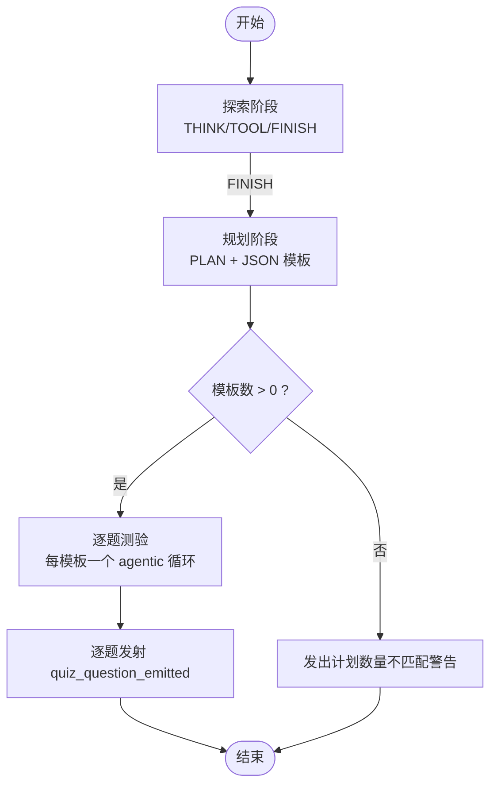
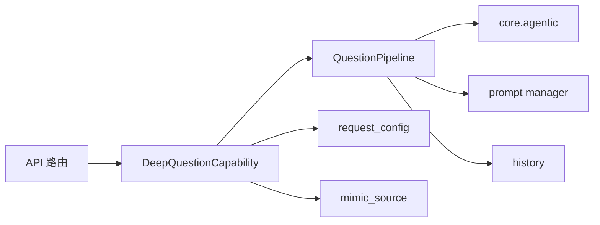

# 问题生成管道

<cite>
**本文引用的文件**
- [pipeline.py](file://deeptutor/agents/question/pipeline.py)
- [capability.py](file://deeptutor/agents/question/capability.py)
- [coordinator.py](file://deeptutor/agents/question/coordinator.py)
- [request_config.py](file://deeptutor/agents/question/request_config.py)
- [mimic_source.py](file://deeptutor/agents/question/mimic_source.py)
- [history.py](file://deeptutor/agents/question/history.py)
- [question.py](file://deeptutor/api/routers/question.py)
- [pipeline.yaml](file://deeptutor/agents/question/prompts/en/pipeline.yaml)
</cite>

## 目录
1. [简介](#简介)
2. [项目结构](#项目结构)
3. [核心组件](#核心组件)
4. [架构总览](#架构总览)
5. [详细组件分析](#详细组件分析)
6. [依赖关系分析](#依赖关系分析)
7. [性能与配置](#性能与配置)
8. [故障排查指南](#故障排查指南)
9. [结论](#结论)
10. [附录：使用示例](#附录使用示例)

## 简介
本文件面向“问题生成管道”的三阶段处理流程（探索 Explore、规划 Plan、测验 Quiz），系统性说明各阶段的职责、输入输出、处理逻辑，以及模板覆盖模式（mimic mode）的工作原理。同时给出管道配置参数、流式响应集成方式、错误处理机制与典型调用示例，帮助读者快速理解并正确使用该能力。

## 项目结构
问题生成管道位于 agents/question 下，由能力层（Capability）、编排层（Pipeline）、历史加载（History）、模拟源解析（Mimic Source）、请求配置（Request Config）以及 API 路由组成。提示词集中在 prompts/en/pipeline.yaml，定义了三阶段的协议标签、工具摘要器、修复策略等。

图表来源
- [capability.py:28-156](file://deeptutor/agents/question/capability.py#L28-L156)
- [pipeline.py:357-602](file://deeptutor/agents/question/pipeline.py#L357-L602)
- [history.py:34-100](file://deeptutor/agents/question/history.py#L34-L100)
- [mimic_source.py:58-157](file://deeptutor/agents/question/mimic_source.py#L58-L157)
- [request_config.py:39-74](file://deeptutor/agents/question/request_config.py#L39-L74)
- [question.py:43-351](file://deeptutor/api/routers/question.py#L43-L351)
- [pipeline.yaml:1-354](file://deeptutor/agents/question/prompts/en/pipeline.yaml#L1-L354)

章节来源
- [capability.py:28-156](file://deeptutor/agents/question/capability.py#L28-L156)
- [pipeline.py:357-602](file://deeptutor/agents/question/pipeline.py#L357-L602)
- [question.py:43-351](file://deeptutor/api/routers/question.py#L43-L351)

## 核心组件
- QuestionPipeline：三阶段编排器，负责 Explore → Plan → per-question Quiz 的控制流、提示组装、流式事件与结果封装。
- DeepQuestionCapability：能力入口，区分 followup/custom/mimic 三种模式，构造上下文与运行参数，驱动 Pipeline。
- AgentCoordinator：兼容旧接口，内部委托给 QuestionPipeline，提供 generate_from_topic / generate_from_exam 等便捷方法。
- request_config：从主配置中抽取 deep_question.exploring.* 参数，注入到 Pipeline 的 runtime_config。
- mimic_source：将上传或已解析的试卷解析为 QuizTemplate 列表，供 mimic 模式跳过 Explore/Plan 直接入 Quiz。
- history：加载同一会话的历史答题记录，用于避免重复与定位薄弱点。
- API 路由：提供 WebSocket 端点，支持实时进度与结果推送。

章节来源
- [pipeline.py:357-602](file://deeptutor/agents/question/pipeline.py#L357-L602)
- [capability.py:28-156](file://deeptutor/agents/question/capability.py#L28-L156)
- [coordinator.py:31-149](file://deeptutor/agents/question/coordinator.py#L31-L149)
- [request_config.py:39-74](file://deeptutor/agents/question/request_config.py#L39-L74)
- [mimic_source.py:58-157](file://deeptutor/agents/question/mimic_source.py#L58-L157)
- [history.py:34-100](file://deeptutor/agents/question/history.py#L34-L100)
- [question.py:43-351](file://deeptutor/api/routers/question.py#L43-L351)

## 架构总览
下图展示一次自定义模式（custom）的端到端调用链：前端通过 WebSocket 进入 API 路由，路由创建协调器或直接走 Capability；Capability 根据模式选择路径；最终由 QuestionPipeline 完成三阶段处理并通过 StreamBus 向前端推送中间状态与结果。

图表来源
- [question.py:43-351](file://deeptutor/api/routers/question.py#L43-L351)
- [capability.py:38-156](file://deeptutor/agents/question/capability.py#L38-L156)
- [pipeline.py:438-602](file://deeptutor/agents/question/pipeline.py#L438-L602)
- [history.py:34-100](file://deeptutor/agents/question/history.py#L34-L100)
- [pipeline.yaml:1-354](file://deeptutor/agents/question/prompts/en/pipeline.yaml#L1-L354)

## 详细组件分析

### 三阶段处理流程
- 探索阶段（Explore）
  - 目标：围绕用户主题进行检索与思考，产出对用户可见的简短前言与结构化探索轨迹（含工具调用与结果摘要）。
  - 输入：用户消息、知识基/附件摘要、会话历史、允许的题目类型与数量、难度偏好等。
  - 处理：基于协议标签 THINK/TOOL/FINISH 的 agentic 循环；每次工具结果经“工具摘要器”压缩后再回灌上下文；达到 FINISH 后结束。
  - 输出：finish_text（用户可见前言）、exploration_trace（后续阶段的结构化上下文）。
  - 关键实现：[pipeline.py:607-686](file://deeptutor/agents/question/pipeline.py#L607-L686)，提示词协议见 [pipeline.yaml:37-120](file://deeptutor/agents/question/prompts/en/pipeline.yaml#L37-L120)。

- 规划阶段（Plan）
  - 目标：依据探索轨迹与约束，生成题目模板清单（每个模板包含 question_id、topic、question_type、difficulty）。
  - 输入：用户原始请求、探索轨迹、题目数量、类型白名单、每类数量目标、难度。
  - 处理：单次 LLM 调用，要求以 PLAN 标签开头并输出 JSON；若数量不匹配会发出警告。
  - 输出：QuizPlan（analysis + templates[]）。
  - 关键实现：[pipeline.py:691-750](file://deeptutor/agents/question/pipeline.py#L691-L750)，提示词协议见 [pipeline.yaml:149-188](file://deeptutor/agents/question/prompts/en/pipeline.yaml#L149-L188)。

- 测验阶段（Quiz）
  - 目标：按模板逐一生成具体题目，严格遵循每种题型的答案格式。
  - 输入：模板、探索轨迹、计划摘要、本轮已生成题目（去重）、图片附件等。
  - 处理：对每个模板执行 agentic 循环（THINK/TOOL/FINISH），FINISH 必须输出符合 schema 的 JSON；若失败触发 repair 重试。
  - 输出：逐题发射 quiz_question_emitted 事件，最终汇总为结果包。
  - 关键实现：[pipeline.py:573-602](file://deeptutor/agents/question/pipeline.py#L573-L602)，提示词协议见 [pipeline.yaml:193-265](file://deeptutor/agents/question/prompts/en/pipeline.yaml#L193-L265)。

图表来源
- [pipeline.py:535-602](file://deeptutor/agents/question/pipeline.py#L535-L602)
- [pipeline.yaml:37-354](file://deeptutor/agents/question/prompts/en/pipeline.yaml#L37-L354)

章节来源
- [pipeline.py:607-750](file://deeptutor/agents/question/pipeline.py#L607-L750)
- [pipeline.yaml:37-354](file://deeptutor/agents/question/prompts/en/pipeline.yaml#L37-L354)

### 模板覆盖模式（mimic mode）工作原理与场景
- 工作原理
  - 当传入 templates_override 时，跳过 Explore 与 Plan，直接构造最小化的 Plan 信封进入 Quiz。
  - 模板来源于试卷解析（PDF 或已解析目录），每个模板携带 source="mimic" 及参考题干/答案，便于 Quiz 阶段仿写而非凭空创作。
  - 能力层在 mimic 模式下负责解析试卷并调用 Pipeline.run(templates_override=...)。
- 使用场景
  - 用户上传 PDF 试卷，系统解析并提取题目模板，再批量生成风格一致的变体题目。
  - 已有解析目录，直接复用其 questions.json 作为模板源。
- 关键实现
  - 能力层 mimic 分支与解析桥接：[capability.py:158-329](file://deeptutor/agents/question/capability.py#L158-L329)
  - 试卷→模板转换：[mimic_source.py:58-157](file://deeptutor/agents/question/mimic_source.py#L58-L157)
  - Pipeline 内 mimic 分支：[pipeline.py:512-534](file://deeptutor/agents/question/pipeline.py#L512-L534)

章节来源
- [capability.py:158-329](file://deeptutor/agents/question/capability.py#L158-L329)
- [mimic_source.py:58-157](file://deeptutor/agents/question/mimic_source.py#L58-L157)
- [pipeline.py:512-534](file://deeptutor/agents/question/pipeline.py#L512-L534)

### 数据模型与复杂度
- QuizTemplate：单题模板（id/topic/type/difficulty/source/reference_*）。
- QuizPlan：分析摘要 + 模板列表。
- QuizHistoryEntry：会话历史中的单条答题记录。
- QuizPair：最终发射给前端的题目对象（含选项、答案、解释、元数据）。
- 复杂度
  - 时间：Explore 最多 max_explore_iterations 次迭代；Plan 单次；Quiz 为 N 题 × 每題最多 max_quiz_iterations_per_question 次迭代。
  - 空间：主要受探索轨迹长度与工具结果摘要影响；工具摘要器限制 token 上限控制上下文膨胀。

章节来源
- [pipeline.py:302-350](file://deeptutor/agents/question/pipeline.py#L302-L350)
- [pipeline.py:127-141](file://deeptutor/agents/question/pipeline.py#L127-L141)

### 流式响应与事件
- 阶段标记：exploring/planning/quizzing，通过 stream.stage 包裹。
- 内容流：FINISH 文本在 Explore 阶段以 content 形式实时流式输出。
- 题目流：每生成一道题即发射 quiz_question_emitted 事件，前端可即时渲染卡片。
- 结果汇总：结束时 emit_capability_result 输出汇总信息。
- 关键实现
  - 阶段与事件：[pipeline.py:535-602](file://deeptutor/agents/question/pipeline.py#L535-L602)
  - 能力层 trace 桥接（followup 模式）：[capability.py:330-448](file://deeptutor/agents/question/capability.py#L330-L448)

章节来源
- [pipeline.py:535-602](file://deeptutor/agents/question/pipeline.py#L535-L602)
- [capability.py:330-448](file://deeptutor/agents/question/capability.py#L330-L448)

### 错误处理与修复
- 协议修复：当模型未按协议返回标签或 JSON 非法时，触发 repair 提示并重试。
- 计划数量不匹配：发出警告但继续执行。
- 工具摘要失败：降级为原始工具结果继续。
- 异常捕获：Pipeline.run 外层捕获异常并发送可见失败事件。
- 关键实现
  - 协议与修复提示：[pipeline.yaml:268-333](file://deeptutor/agents/question/prompts/en/pipeline.yaml#L268-L333)
  - 计划数量警告：[pipeline.py:739-750](file://deeptutor/agents/question/pipeline.py#L739-L750)
  - run 异常处理：[pipeline.py:474-493](file://deeptutor/agents/question/pipeline.py#L474-L493)

章节来源
- [pipeline.yaml:268-333](file://deeptutor/agents/question/prompts/en/pipeline.yaml#L268-L333)
- [pipeline.py:739-750](file://deeptutor/agents/question/pipeline.py#L739-L750)
- [pipeline.py:474-493](file://deeptutor/agents/question/pipeline.py#L474-L493)

## 依赖关系分析
- Capability 依赖 Pipeline 与 History/Mimic/RequestConfig。
- Pipeline 依赖 core.agentic 提供的 agentic 循环、标注步骤、工具调度与用法追踪；依赖 PromptManager 加载提示词；依赖工具注册表与 LLM 配置。
- API 路由通过 Coordinator 或直接 Capability 接入，统一通过 StreamBus 向前端推送事件。

图表来源
- [question.py:43-351](file://deeptutor/api/routers/question.py#L43-L351)
- [capability.py:38-156](file://deeptutor/agents/question/capability.py#L38-L156)
- [pipeline.py:44-75](file://deeptutor/agents/question/pipeline.py#L44-L75)

章节来源
- [question.py:43-351](file://deeptutor/api/routers/question.py#L43-L351)
- [capability.py:38-156](file://deeptutor/agents/question/capability.py#L38-L156)
- [pipeline.py:44-75](file://deeptutor/agents/question/pipeline.py#L44-L75)

## 性能与配置
- 最大迭代次数
  - Explore 阶段：默认 8 次，可通过 runtime_config.exploring.max_iterations 调整。
  - 每题 Quiz 阶段：默认 5 次，可通过构造参数 max_quiz_iterations_per_question 调整。
- 工具摘要器
  - 默认启用，max_tokens=800，温度 0.2；可在 runtime_config.exploring.tool_summarizer.* 中开关与调参。
- 其他令牌限制
  - Explore FINISH 最大 3000 tokens；Plan 最大 2000；Quiz FINISH 最大 3000；Repair 最大 2500。
- 难度控制
  - 支持 easy/medium/hard；未指定时由 Planner 自定；mimic 模式保留原卷难度。
- 题目类型与分布
  - 支持 choice/concept/fill_in_blank/short_answer/written/coding；可限制白名单与每类数量目标。
- 配置读取
  - 通过 build_question_runtime_config 从 main.yaml 的 capabilities.deep_question.exploring.* 读取。

章节来源
- [pipeline.py:127-141](file://deeptutor/agents/question/pipeline.py#L127-L141)
- [pipeline.py:360-401](file://deeptutor/agents/question/pipeline.py#L360-L401)
- [request_config.py:39-74](file://deeptutor/agents/question/request_config.py#L39-L74)
- [pipeline.yaml:149-188](file://deeptutor/agents/question/prompts/en/pipeline.yaml#L149-L188)

## 故障排查指南
- 无模板产出
  - 检查 Plan 是否返回空模板；查看“计划数量不匹配”警告；确认 allowed_types 与 per_type_counts 是否合理。
- 题目 JSON 非法
  - 观察是否触发 repair；检查提示词协议与模型输出；必要时降低 temperature 或增加迭代上限。
- 工具摘要失败
  - 降级为原始工具结果；检查工具输出过长或为空；可适当增大 tool_summarizer.max_tokens。
- 解析失败（mimic）
  - 校验 PDF 或解析目录；关注 MinerUError；确保 output_dir 可写。
- 流式中断
  - 检查 StreamBus 订阅与前端连接；确认 stage 与 event 是否正确转发。

章节来源
- [pipeline.py:739-750](file://deeptutor/agents/question/pipeline.py#L739-L750)
- [pipeline.yaml:268-333](file://deeptutor/agents/question/prompts/en/pipeline.yaml#L268-L333)
- [capability.py:256-288](file://deeptutor/agents/question/capability.py#L256-L288)

## 结论
问题生成管道以清晰的三阶段设计实现了从“探索—规划—生成”的解耦与可控性：Explore 聚焦资料收集与反思，Plan 明确题目蓝图，Quiz 严格落地为高质量题目。mimic 模式提供了基于真实试卷的高效仿写路径。配合流式事件与完善的错误修复机制，既保证了用户体验，也提升了鲁棒性与可维护性。

## 附录：使用示例

### 通过能力层调用（推荐）
- 自定义模式（custom）
  - 设置 overrides.mode = "custom"，提供 topic、num_questions、difficulty、question_types、per_type_counts。
  - 能力层自动构建 runtime_config 并调用 Pipeline.run。
  - 参考：[capability.py:85-142](file://deeptutor/agents/question/capability.py#L85-L142)
- 模拟模式（mimic）
  - 设置 overrides.mode = "mimic"，提供 paper_path 或上传 PDF；能力层解析后以 templates_override 调用 Pipeline。
  - 参考：[capability.py:158-329](file://deeptutor/agents/question/capability.py#L158-L329)

### 通过 WebSocket 端点调用
- /generate：传统批量生成，内部使用 Coordinator → Pipeline。
- /mimic：上传 PDF 或传入已解析目录，实时推送进度与结果。
- 参考：[question.py:43-351](file://deeptutor/api/routers/question.py#L43-L351)

### 通过 Coordinator 调用（兼容旧接口）
- generate_from_topic：基于主题生成题目。
- generate_from_exam：基于试卷生成题目（内部走 mimic 流程）。
- 参考：[coordinator.py:66-149](file://deeptutor/agents/question/coordinator.py#L66-L149)

### 配置示例（main.yaml 片段）
- 位置：capabilities.deep_question.exploring.*
- 关键键：
  - exploring.max_iterations：整数，默认 8
  - exploring.tool_summarizer.enabled：布尔，默认 True
  - exploring.tool_summarizer.max_tokens：整数，默认 800
- 参考：[request_config.py:39-74](file://deeptutor/agents/question/request_config.py#L39-L74)

### 结果与事件
- 阶段事件：exploring/planning/quizzing
- 题目事件：quiz_question_emitted（逐题）
- 最终结果：emit_capability_result 输出的汇总（包含 results、mode、metadata 等）
- 参考：[pipeline.py:535-602](file://deeptutor/agents/question/pipeline.py#L535-L602)