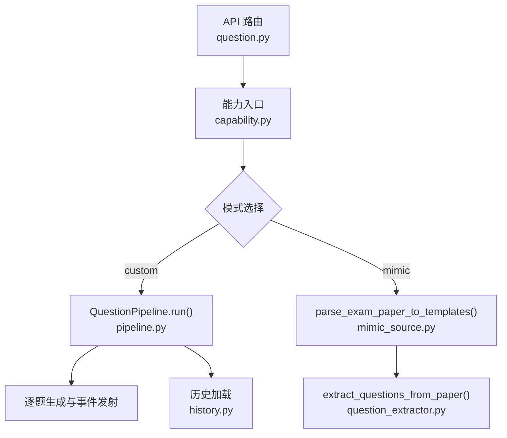
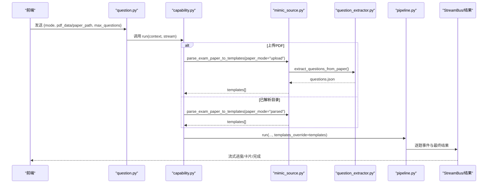
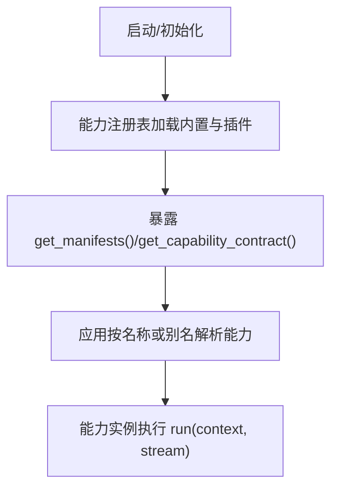
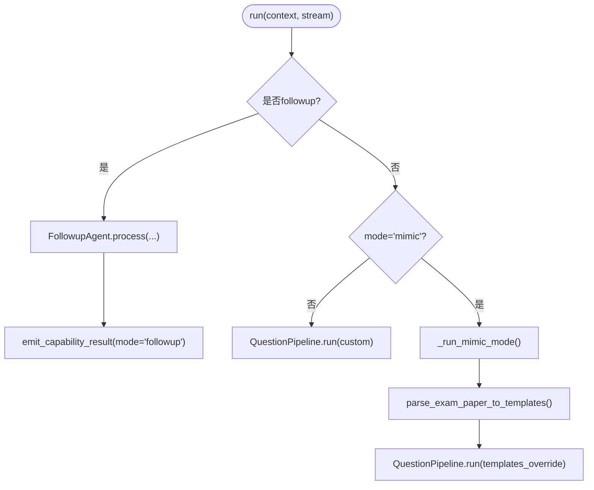
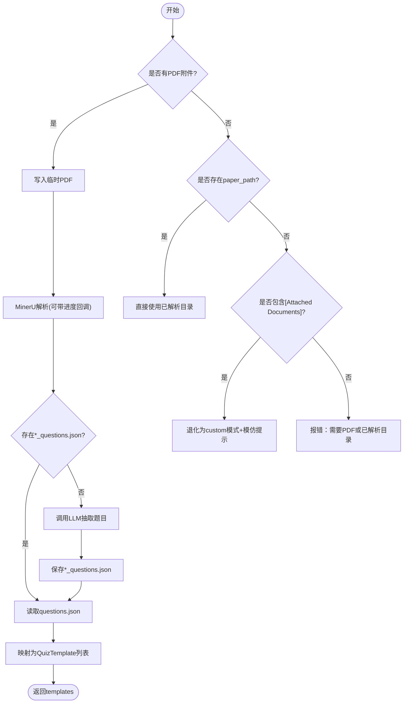
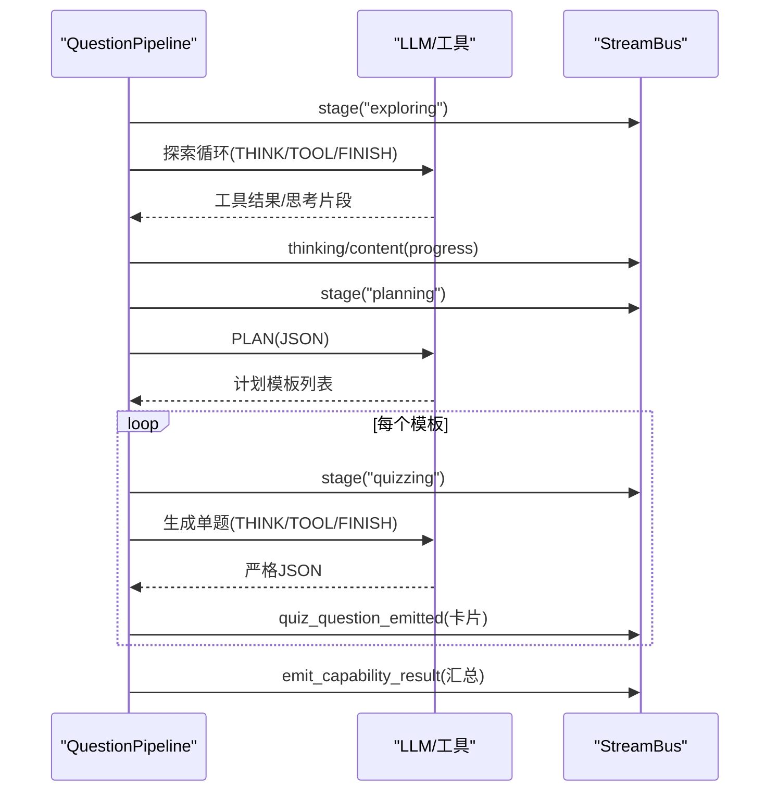
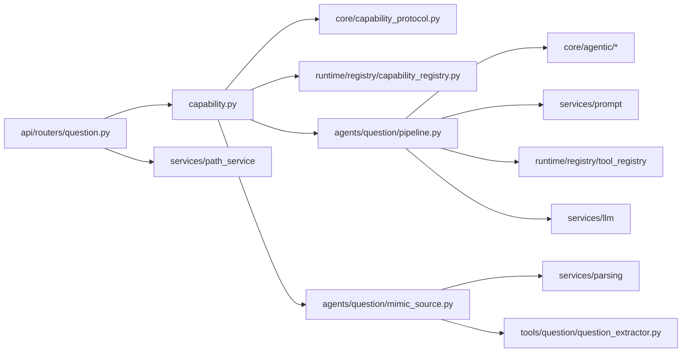

# 问题生成能力

<cite>
**本文引用的文件**
- [capability.py](file://deeptutor/agents/question/capability.py)
- [pipeline.py](file://deeptutor/agents/question/pipeline.py)
- [mimic_source.py](file://deeptutor/agents/question/mimic_source.py)
- [coordinator.py](file://deeptutor/agents/question/coordinator.py)
- [request_config.py](file://deeptutor/agents/question/request_config.py)
- [history.py](file://deeptutor/agents/question/history.py)
- [question_extractor.py](file://deeptutor/tools/question/question_extractor.py)
- [question.py](file://deeptutor/api/routers/question.py)
- [capability_protocol.py](file://deeptutor/core/capability_protocol.py)
- [capability_registry.py](file://deeptutor/runtime/registry/capability_registry.py)
</cite>

## 目录
1. [简介](#简介)
2. [项目结构](#项目结构)
3. [核心组件](#核心组件)
4. [架构总览](#架构总览)
5. [详细组件分析](#详细组件分析)
6. [依赖关系分析](#依赖关系分析)
7. [性能考虑](#性能考虑)
8. [故障排除指南](#故障排除指南)
9. [结论](#结论)
10. [附录：扩展开发指南](#附录：扩展开发指南)

## 简介
本文件系统性说明 DeepTutor 的“问题生成能力”（deep_question），覆盖能力注册与发现、两种运行模式（自定义主题与模仿来源）、从考试试卷提取问题模板的流程、能力配置与参数传递、与其他能力的交互与数据共享协议，以及扩展新题型与新来源格式的开发指南。同时提供性能优化建议与常见故障排除方法。

## 项目结构
问题生成能力由“能力层 + 流水线 + 来源适配 + 工具层 + API 路由”构成：
- 能力层：DeepQuestionCapability 负责入口路由、模式分发、流式事件与结果上报。
- 流水线：QuestionPipeline 驱动三阶段流程（探索→计划→逐题生成）。
- 来源适配：mimic_source 将 PDF/已解析目录转换为 QuizTemplate 列表，供流水线跳过探索与计划直接生成。
- 工具层：question_extractor 基于 MinerU 解析产物与 LLM 抽取题目元信息。
- API 路由：WebSocket 端点暴露 mimic/generate 能力，兼容旧版 AgentCoordinator。

**图表来源**
- [question.py:43-351](file://deeptutor/api/routers/question.py#L43-L351)
- [capability.py:28-157](file://deeptutor/agents/question/capability.py#L28-L157)
- [pipeline.py:438-602](file://deeptutor/agents/question/pipeline.py#L438-L602)
- [mimic_source.py:58-157](file://deeptutor/agents/question/mimic_source.py#L58-L157)
- [question_extractor.py:321-378](file://deeptutor/tools/question/question_extractor.py#L321-L378)
- [history.py:34-100](file://deeptutor/agents/question/history.py#L34-L100)

**章节来源**
- [capability.py:28-157](file://deeptutor/agents/question/capability.py#L28-L157)
- [pipeline.py:438-602](file://deeptutor/agents/question/pipeline.py#L438-L602)
- [mimic_source.py:58-157](file://deeptutor/agents/question/mimic_source.py#L58-L157)
- [question_extractor.py:321-378](file://deeptutor/tools/question/question_extractor.py#L321-L378)
- [question.py:43-351](file://deeptutor/api/routers/question.py#L43-L351)
- [history.py:34-100](file://deeptutor/agents/question/history.py#L34-L100)

## 核心组件
- DeepQuestionCapability：声明能力清单（名称、阶段、工具、CLI 别名、请求模式），根据上下文与覆盖参数选择 followup/custom/mimic 路径。
- QuestionPipeline：统一编排器，实现 Explore/Plan/Quiz 三阶段；支持 templates_override 以跳过前两个阶段。
- mimic_source：封装 MinerU 解析与 LLM 抽取，产出 QuizTemplate 列表（含 question_type/difficulty/source）。
- AgentCoordinator：兼容旧接口，内部委托 QuestionPipeline。
- request_config：构建运行时配置（exploring.max_iterations、tool_summarizer 开关与 token 上限）。
- history：加载会话内历史答题记录，辅助避免重复与定位薄弱点。
- API 路由：提供 /mimic 与 /generate WebSocket 端点，处理上传、解析、进度推送与完成信号。

**章节来源**
- [capability.py:28-157](file://deeptutor/agents/question/capability.py#L28-L157)
- [pipeline.py:357-602](file://deeptutor/agents/question/pipeline.py#L357-L602)
- [mimic_source.py:58-157](file://deeptutor/agents/question/mimic_source.py#L58-L157)
- [coordinator.py:31-149](file://deeptutor/agents/question/coordinator.py#L31-L149)
- [request_config.py:39-74](file://deeptutor/agents/question/request_config.py#L39-L74)
- [history.py:34-100](file://deeptutor/agents/question/history.py#L34-L100)
- [question.py:43-351](file://deeptutor/api/routers/question.py#L43-L351)

## 架构总览
下图展示一次“模仿模式”端到端调用链：API 接收消息 → 能力入口 → 来源解析 → 流水线生成 → 结果上报。

**图表来源**
- [question.py:43-351](file://deeptutor/api/routers/question.py#L43-L351)
- [capability.py:158-329](file://deeptutor/agents/question/capability.py#L158-L329)
- [mimic_source.py:58-157](file://deeptutor/agents/question/mimic_source.py#L58-L157)
- [question_extractor.py:321-378](file://deeptutor/tools/question/question_extractor.py#L321-L378)
- [pipeline.py:438-602](file://deeptutor/agents/question/pipeline.py#L438-L602)

## 详细组件分析

### 能力注册与发现机制
- 能力清单：通过 CapabilityManifest 声明 name、stages、tools_used、cli_aliases、request_schema 等元数据。
- 运行时注册：能力注册表在启动时加载内置能力与插件能力，并对外暴露 manifests 查询接口。
- 能力发现：应用门面根据名称或别名解析能力，并返回其可用性与契约。

**图表来源**
- [capability_protocol.py:20-69](file://deeptutor/core/capability_protocol.py#L20-L69)
- [capability_registry.py:49-114](file://deeptutor/runtime/registry/capability_registry.py#L49-L114)

**章节来源**
- [capability_protocol.py:20-69](file://deeptutor/core/capability_protocol.py#L20-L69)
- [capability_registry.py:49-114](file://deeptutor/runtime/registry/capability_registry.py#L49-L114)

### 能力启用与入口路由
- 入口：DeepQuestionCapability.run 根据上下文与覆盖参数决定 followup/custom/mimic 分支。
- custom：构造 QuestionPipeline 并传入 topic、num_questions、difficulty、question_types、per_type_counts 等。
- mimic：先解析来源为 templates，再调用 pipeline.run(templates_override=...) 跳过探索与计划。
- followup：使用 FollowupAgent 对上一题进行追问回复。

**图表来源**
- [capability.py:38-157](file://deeptutor/agents/question/capability.py#L38-L157)
- [capability.py:158-329](file://deeptutor/agents/question/capability.py#L158-L329)

**章节来源**
- [capability.py:38-157](file://deeptutor/agents/question/capability.py#L38-L157)
- [capability.py:158-329](file://deeptutor/agents/question/capability.py#L158-L329)

### 模仿来源处理与模板提取
- 输入形态：
  - 上传 PDF：写入临时文件，交由 MinerU 解析，回调进度至前端。
  - 已解析目录：直接读取解析产物，跳过解析步骤。
  - 无可用来源：退化为 custom 模式并在提示中附加“尽量模仿附件风格”的指令。
- 解析与抽取：
  - 通过 parse_exam_paper_to_templates 调用 get_parse_service().parse 或直接复用工作目录。
  - 若未找到 *_questions.json，则调用 extract_questions_from_paper 基于 LLM 抽取并保存。
  - 将每道题映射为 QuizTemplate（包含 question_type/difficulty/source/reference_*）。
- 错误处理：MinerUError 被捕获并转为用户可见错误；抽取失败抛出 RuntimeError 由上层处理。

**图表来源**
- [capability.py:158-329](file://deeptutor/agents/question/capability.py#L158-L329)
- [mimic_source.py:58-157](file://deeptutor/agents/question/mimic_source.py#L58-L157)
- [question_extractor.py:321-378](file://deeptutor/tools/question/question_extractor.py#L321-L378)

**章节来源**
- [capability.py:158-329](file://deeptutor/agents/question/capability.py#L158-L329)
- [mimic_source.py:58-157](file://deeptutor/agents/question/mimic_source.py#L58-L157)
- [question_extractor.py:321-378](file://deeptutor/tools/question/question_extractor.py#L321-L378)

### 流水线三阶段与数据流
- 阶段一（Explore）：多轮 THINK/TOOL/FINISH，产出用户可见的前言与探索轨迹。
- 阶段二（Plan）：单步 PLAN 输出 JSON 计划（每个题目的 topic/type/difficulty）。
- 阶段三（Quiz）：对每个模板执行 THINK/TOOL/FINISH，严格解析 JSON 并立即发射 quiz_question_emitted 事件。
- 当 templates_override 非空（mimic 模式）：跳过 Explore/Plan，直接进入 Quiz。

**图表来源**
- [pipeline.py:438-602](file://deeptutor/agents/question/pipeline.py#L438-L602)
- [pipeline.py:607-750](file://deeptutor/agents/question/pipeline.py#L607-L750)

**章节来源**
- [pipeline.py:438-602](file://deeptutor/agents/question/pipeline.py#L438-L602)
- [pipeline.py:607-750](file://deeptutor/agents/question/pipeline.py#L607-L750)

### 能力配置与参数传递
- 运行时配置：build_question_runtime_config 从 main.yaml 的 capabilities.deep_question.exploring 读取 max_iterations 与 tool_summarizer 开关/token 上限。
- 请求参数：
  - mode：custom/mimic/followup
  - topic：自定义模式的主题
  - num_questions/difficulty/question_types/per_type_counts：数量、难度、类型白名单与分布
  - paper_path/max_questions：模仿模式的来源与上限
- 上下文与历史：UnifiedContext 携带语言、知识库、工具集；quiz_history 用于避免重复与弱项强化。

**章节来源**
- [request_config.py:39-74](file://deeptutor/agents/question/request_config.py#L39-L74)
- [capability.py:85-142](file://deeptutor/agents/question/capability.py#L85-L142)
- [history.py:34-100](file://deeptutor/agents/question/history.py#L34-L100)

### 与其他能力的交互与数据共享协议
- 工具组合：通过 compose_enabled_tools 与默认可选工具策略装配 RAG、Web 搜索、代码执行等工具。
- 流式协议：使用 StreamBus 的 stage/thinking/progress/tool_call/tool_result/content/error/result 等事件，统一向前端与追踪面板广播。
- 结果协议：emit_capability_result 统一封装 usage、mode、results、metadata 等字段，便于前端渲染与统计。
- 兼容性：AgentCoordinator 将旧接口转发到 QuestionPipeline，保持 WebSocket 路由与工具模块向后兼容。

**章节来源**
- [pipeline.py:37-75](file://deeptutor/agents/question/pipeline.py#L37-L75)
- [capability.py:330-447](file://deeptutor/agents/question/capability.py#L330-L447)
- [coordinator.py:31-149](file://deeptutor/agents/question/coordinator.py#L31-L149)

## 依赖关系分析
- 能力层依赖 core.capability_protocol 定义基类与清单；runtime.registry 负责加载与发现。
- 流水线依赖 agentic 框架（run_agentic_loop、run_labeled_step）、prompt 管理、工具注册与 LLM 客户端。
- 来源适配依赖 parsing 服务与 tools.question 抽取器；API 路由依赖 path_service、llm_config、settings。
- 历史加载依赖 session 存储，保证按时间顺序注入到探索阶段。

**图表来源**
- [capability.py:18-25](file://deeptutor/agents/question/capability.py#L18-L25)
- [pipeline.py:37-75](file://deeptutor/agents/question/pipeline.py#L37-L75)
- [mimic_source.py:25-32](file://deeptutor/agents/question/mimic_source.py#L25-L32)
- [question.py:12-26](file://deeptutor/api/routers/question.py#L12-L26)
- [capability_registry.py:49-114](file://deeptutor/runtime/registry/capability_registry.py#L49-L114)

**章节来源**
- [capability.py:18-25](file://deeptutor/agents/question/capability.py#L18-L25)
- [pipeline.py:37-75](file://deeptutor/agents/question/pipeline.py#L37-L75)
- [mimic_source.py:25-32](file://deeptutor/agents/question/mimic_source.py#L25-L32)
- [question.py:12-26](file://deeptutor/api/routers/question.py#L12-L26)
- [capability_registry.py:49-114](file://deeptutor/runtime/registry/capability_registry.py#L49-L114)

## 性能考虑
- 解析与抽取：
  - 使用异步线程包装同步解析（asyncio.to_thread），避免阻塞事件循环。
  - 解析进度回调通过 run_coroutine_threadsafe 推送到主循环，提升前端感知。
- 探索阶段：
  - 工具结果摘要器（tool_summarizer）压缩原始工具输出，减少后续 LLM 输入长度与成本。
  - 可通过配置限制最大迭代次数与 token 上限。
- 并发与限流：
  - 工具调用并行度受 MAX_PARALLEL_TOOL_CALLS 控制，避免过载。
- I/O 与缓存：
  - 解析产物缓存于共享目录，避免重复解析；题目 JSON 输出到会话专属目录，避免污染缓存。
- 资源释放：
  - 流式通道关闭、任务队列清理、stdout 拦截恢复，确保长连接稳定。

**章节来源**
- [mimic_source.py:82-89](file://deeptutor/agents/question/mimic_source.py#L82-L89)
- [capability.py:223-235](file://deeptutor/agents/question/capability.py#L223-L235)
- [pipeline.py:135-141](file://deeptutor/agents/question/pipeline.py#L135-L141)
- [pipeline.py:58-59](file://deeptutor/agents/question/pipeline.py#L58-L59)
- [question.py:98-107](file://deeptutor/api/routers/question.py#L98-L107)

## 故障排除指南
- 无法解析 PDF：
  - 检查 MinerU 配置与可用性；确认上传文件合法且可读；关注 MinerUError 并查看日志。
- 未找到 *_questions.json：
  - 确认解析目录结构正确；必要时重新运行 extract_questions_from_paper；检查 LLM 配置与配额。
- 模板数量为 0：
  - 检查 max_questions 与过滤逻辑；确认题目文本非空；查看抽取结果与映射过程。
- 计划模板数量不匹配：
  - 流水线会发出警告；可调整 per_type_counts 或放宽 allowed types。
- WebSocket 断开或卡住：
  - 检查 pusher 任务与队列；确认 finally 块清理；验证 stdout 拦截器恢复。
- 历史加载失败：
  - 历史加载失败会降级为空列表，不影响主流程；检查会话存储权限与连接。

**章节来源**
- [capability.py:256-258](file://deeptutor/agents/question/capability.py#L256-L258)
- [mimic_source.py:115-125](file://deeptutor/agents/question/mimic_source.py#L115-L125)
- [pipeline.py:565-571](file://deeptutor/agents/question/pipeline.py#L565-L571)
- [question.py:310-351](file://deeptutor/api/routers/question.py#L310-L351)
- [history.py:53-64](file://deeptutor/agents/question/history.py#L53-L64)

## 结论
问题生成能力通过清晰的能力分层与流水线编排，实现了“自定义主题生成”和“模仿来源生成”两条路径的统一接入。借助 MinerU 解析与 LLM 抽取，系统能从考试试卷中提取结构化模板，并以流式方式向前端反馈进度与结果。通过运行时配置与历史记忆，系统在质量与成本之间取得平衡。扩展新题型与新来源只需遵循现有协议与规范即可平滑集成。

## 附录：扩展开发指南

### 添加新题型
- 在 QuestionType 枚举中添加新类型，并确保 _VALID_QUESTION_TYPES 包含该值。
- 在 plan 解析与 quiz 生成阶段加入对新类型的支持（选项、填空标记、概念答案集合等）。
- 更新前端类型与渲染逻辑，确保 UI 能正确展示新题型。

**章节来源**
- [pipeline.py:144-161](file://deeptutor/agents/question/pipeline.py#L144-L161)
- [pipeline.py:752-800](file://deeptutor/agents/question/pipeline.py#L752-L800)

### 支持新的来源格式
- 在 mimic_source 中新增来源适配器：
  - 识别新格式（如 EPUB、DOCX、HTML 等）。
  - 调用相应解析器，输出统一的 questions.json 或 QuizTemplate 列表。
  - 复用 extract_questions_from_paper 的 LLM 抽取流程，确保类型与难度规范化。
- 在 capability 入口增加对新来源参数的识别与路由。

**章节来源**
- [mimic_source.py:58-157](file://deeptutor/agents/question/mimic_source.py#L58-L157)
- [question_extractor.py:321-378](file://deeptutor/tools/question/question_extractor.py#L321-L378)
- [capability.py:158-329](file://deeptutor/agents/question/capability.py#L158-L329)

### 能力扩展与插件化
- 实现 BaseCapability 子类，声明 CapabilityManifest（name、stages、tools_used、cli_aliases、request_schema）。
- 通过插件钩子或内置注册表加载能力；确保 get_manifests 能返回新能力契约。
- 在能力 run 中使用 StreamBus 与 emit_capability_result 统一事件与结果。

**章节来源**
- [capability_protocol.py:20-69](file://deeptutor/core/capability_protocol.py#L20-L69)
- [capability_registry.py:49-114](file://deeptutor/runtime/registry/capability_registry.py#L49-L114)

### 配置与参数最佳实践
- 合理设置 exploring.max_iterations 与 tool_summarizer.max_tokens，平衡质量与成本。
- 使用 per_type_counts 精确控制题型分布；注意总和需与 num_questions 一致。
- 在 mimic 模式下，优先使用已解析目录以减少解析开销。

**章节来源**
- [request_config.py:39-74](file://deeptutor/agents/question/request_config.py#L39-L74)
- [capability.py:85-142](file://deeptutor/agents/question/capability.py#L85-L142)