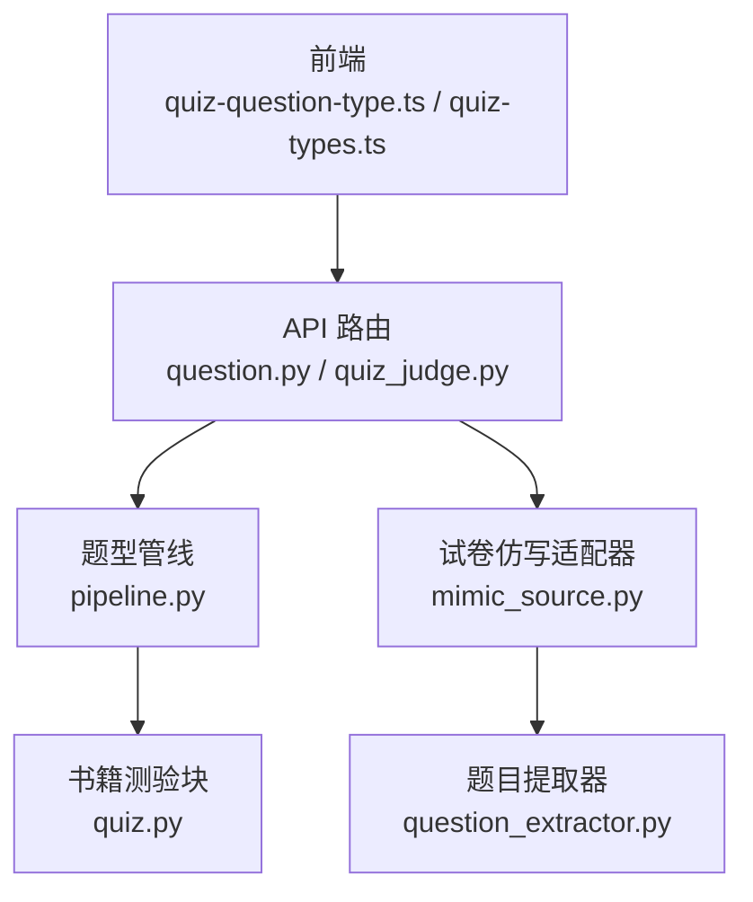
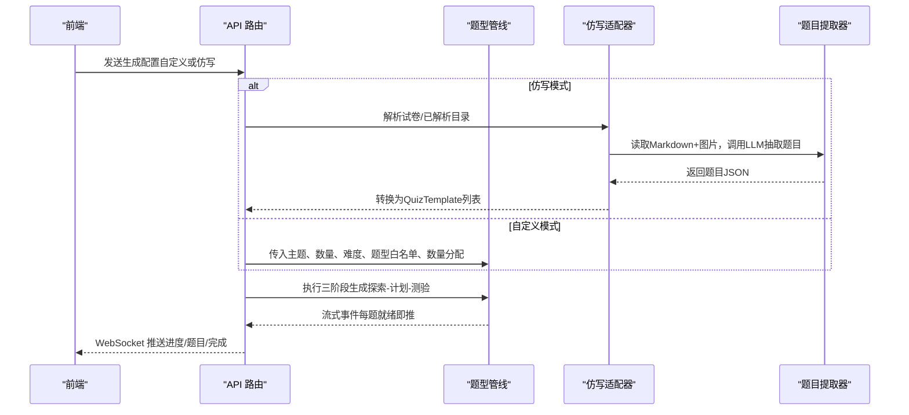
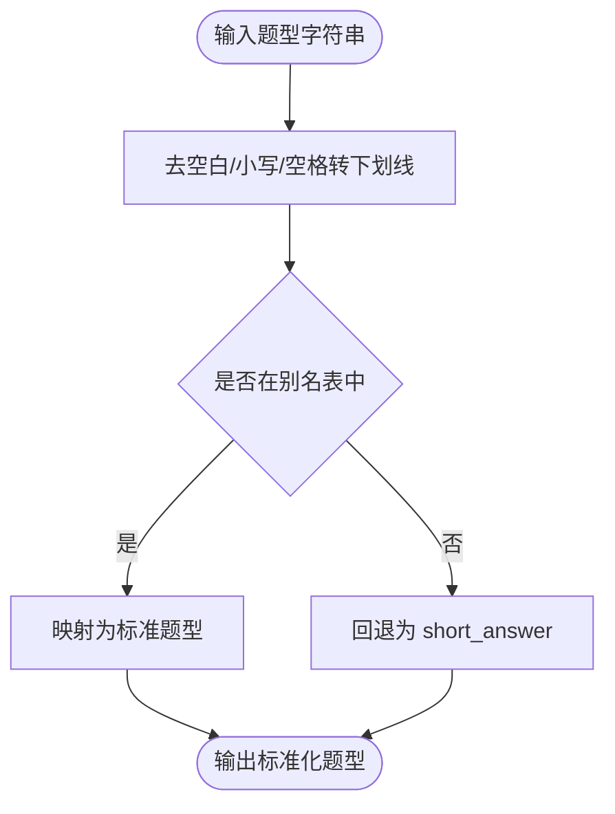
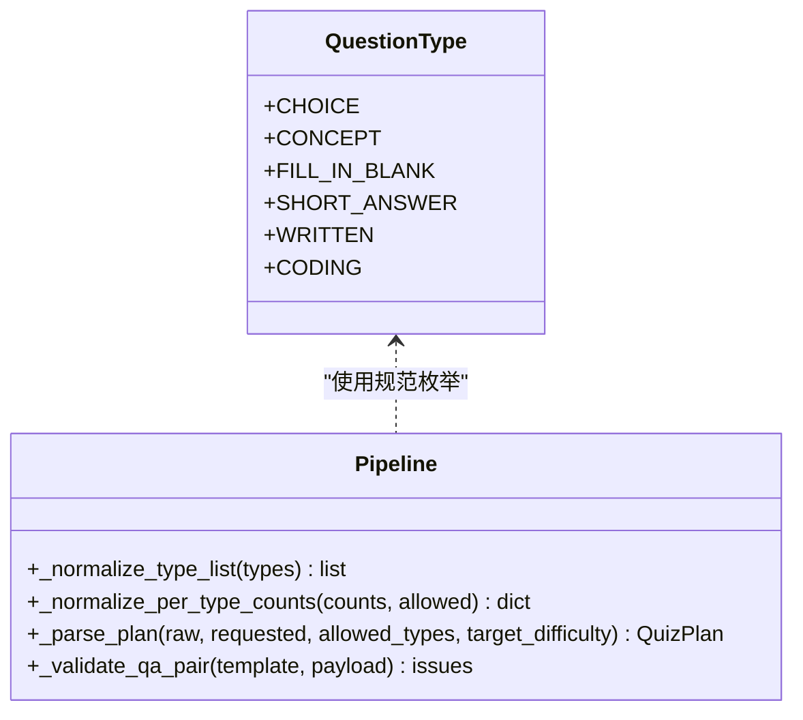
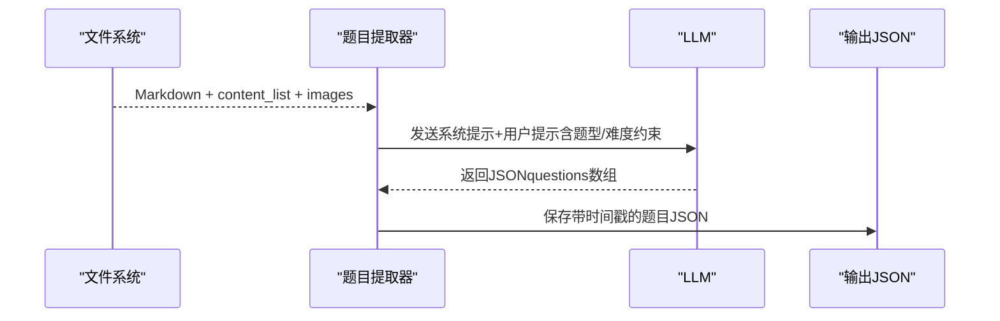
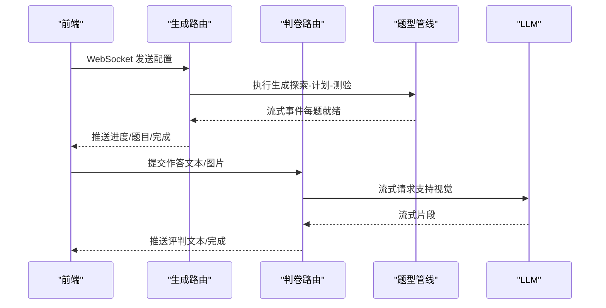
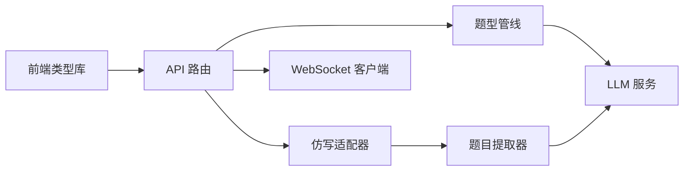

# 题型系统

<cite>
**本文引用的文件**
- [pipeline.py](file://deeptutor/agents/question/pipeline.py)
- [question_extractor.py](file://deeptutor/tools/question/question_extractor.py)
- [mimic_source.py](file://deeptutor/agents/question/mimic_source.py)
- [quiz-question-type.ts](file://web/lib/quiz-question-type.ts)
- [quiz-types.ts](file://web/lib/quiz-types.ts)
- [question.py](file://deeptutor/api/routers/question.py)
- [quiz_judge.py](file://deeptutor/api/routers/quiz_judge.py)
- [quiz.py](file://deeptutor/book/blocks/quiz.py)
</cite>

## 目录
1. [简介](#简介)
2. [项目结构](#项目结构)
3. [核心组件](#核心组件)
4. [架构总览](#架构总览)
5. [详细组件分析](#详细组件分析)
6. [依赖关系分析](#依赖关系分析)
7. [性能考虑](#性能考虑)
8. [故障排查指南](#故障排查指南)
9. [结论](#结论)
10. [附录：配置参考与最佳实践](#附录配置参考与最佳实践)

## 简介
本文件系统性地梳理 DeepTutor 的“题型系统”，覆盖支持的题型分类、结构定义、验证规则、渲染格式、题型白名单机制与类型规范化、题目提取算法（从考试试卷中识别并提取不同题型）、难度级别控制与质量评估标准，以及自定义题型开发与配置的参考与实践建议。该系统支持选择题、概念题、填空题、简答题、写作题和编程题六种规范题型，贯穿前端类型归一化、后端编排生成、试卷仿写提取、AI 判卷等全链路。

## 项目结构
题型系统横跨前后端与工具层：
- 前端类型与交互：统一题型枚举、别名映射、答案键解析、流式事件抽取与配置构建。
- 后端编排与生成：三阶段管线（探索-计划-测验），题型白名单与数量分配、模板到题目的严格校验与修复。
- 试卷仿写提取：基于 MinerU 解析结果与 LLM 的题目抽取，适配为管线可消费的模板。
- API 路由：WebSocket 驱动的生成与判卷流程，实时进度与结果推送。
- 书籍集成：章节内嵌“测验块”调用统一生成能力。

**图表来源**
- [quiz-question-type.ts:1-57](file://web/lib/quiz-question-type.ts#L1-L57)
- [quiz-types.ts:12-31](file://web/lib/quiz-types.ts#L12-L31)
- [question.py:43-321](file://deeptutor/api/routers/question.py#L43-L321)
- [pipeline.py:144-161](file://deeptutor/agents/question/pipeline.py#L144-L161)
- [mimic_source.py:1-39](file://deeptutor/agents/question/mimic_source.py#L1-L39)
- [question_extractor.py:103-280](file://deeptutor/tools/question/question_extractor.py#L103-L280)
- [quiz.py:14-66](file://deeptutor/book/blocks/quiz.py#L14-L66)

**章节来源**
- [quiz-question-type.ts:1-57](file://web/lib/quiz-question-type.ts#L1-L57)
- [quiz-types.ts:12-31](file://web/lib/quiz-types.ts#L12-L31)
- [question.py:43-321](file://deeptutor/api/routers/question.py#L43-L321)
- [pipeline.py:144-161](file://deeptutor/agents/question/pipeline.py#L144-L161)
- [mimic_source.py:1-39](file://deeptutor/agents/question/mimic_source.py#L1-L39)
- [question_extractor.py:103-280](file://deeptutor/tools/question/question_extractor.py#L103-L280)
- [quiz.py:14-66](file://deeptutor/book/blocks/quiz.py#L14-L66)

## 核心组件
- 题型枚举与规范化（前端）：统一题型集合、别名映射、类型归一化函数、答案键解析与概念题答案标准化。
- 题型管线（后端）：三阶段编排（探索-计划-测验），题型白名单过滤、每类数量目标、难度约束、模板到题目的严格校验与修复。
- 试卷仿写适配器：将 MinerU 解析产物与 LLM 抽取结果转换为管线可用的模板列表，保留源试卷题型分布。
- 题目提取器：读取 Markdown 与内容清单，调用 LLM 抽取题目、题型、难度、参考答案与关联图片，输出结构化 JSON。
- API 路由：提供 WebSocket 接口用于“仿写模式”和“自定义模式”的题目生成，以及 AI 判卷流式反馈。
- 书籍测验块：在书稿章节中一键生成测验，复用统一管线能力。

**章节来源**
- [quiz-question-type.ts:1-114](file://web/lib/quiz-question-type.ts#L1-L114)
- [quiz-types.ts:44-197](file://web/lib/quiz-types.ts#L44-L197)
- [pipeline.py:144-221](file://deeptutor/agents/question/pipeline.py#L144-L221)
- [mimic_source.py:41-157](file://deeptutor/agents/question/mimic_source.py#L41-L157)
- [question_extractor.py:103-280](file://deeptutor/tools/question/question_extractor.py#L103-L280)
- [question.py:43-321](file://deeptutor/api/routers/question.py#L43-L321)
- [quiz.py:14-66](file://deeptutor/book/blocks/quiz.py#L14-L66)

## 架构总览
题型系统采用“前端类型归一 + 后端三阶段管线 + 可选试卷仿写 + 流式交互”的架构。前端负责用户配置与类型规范化；后端通过管线进行知识探索、计划制定与逐题生成；若选择“仿写模式”，则先通过提取器从试卷中抽取题目并转为模板，再进入管线生成；最终通过 WebSocket 向前端推送进度与结果，并提供 AI 判卷能力。

**图表来源**
- [question.py:43-321](file://deeptutor/api/routers/question.py#L43-L321)
- [mimic_source.py:133-157](file://deeptutor/agents/question/mimic_source.py#L133-L157)
- [question_extractor.py:103-280](file://deeptutor/tools/question/question_extractor.py#L103-L280)
- [pipeline.py:1-24](file://deeptutor/agents/question/pipeline.py#L1-L24)

## 详细组件分析

### 题型枚举与规范化（前端）
- 题型集合：choice、concept、fill_in_blank、short_answer、written、coding。
- 别名映射：兼容多种历史命名（如 multiple_choice、mcq、true_false、cloze、open_ended、programming 等）。
- 归一化策略：去空白、小写、空格替换为下划线，查表映射；未知值回退为 short_answer。
- 答案键解析：选择题支持直接选项键（A/B/C/D）或按选项文本匹配；概念题答案强制为 true/false。

**图表来源**
- [quiz-question-type.ts:18-57](file://web/lib/quiz-question-type.ts#L18-L57)

**章节来源**
- [quiz-question-type.ts:1-114](file://web/lib/quiz-question-type.ts#L1-L114)

### 题型管线（后端）
- 题型白名单：接受外部传入的允许题型列表，未知项静默丢弃；空列表表示允许全部规范题型。
- 每类数量目标：对 per_type_counts 做合法性校验（仅保留规范且允许的键、正整数），为空时由规划器自由分配。
- 难度约束：仅允许 easy/medium/hard，非法值回退 medium。
- 模板到题目校验：针对每种题型强约束（如选择题必须 A/B/C/D 四个选项且正确答案为其中之一；概念题不得有选项且答案为 true/false；填空题题干必须包含占位符；非选择题不得带选项等），失败时收集问题并触发修复。

**图表来源**
- [pipeline.py:144-161](file://deeptutor/agents/question/pipeline.py#L144-L161)
- [pipeline.py:175-221](file://deeptutor/agents/question/pipeline.py#L175-L221)
- [pipeline.py:752-813](file://deeptutor/agents/question/pipeline.py#L752-L813)
- [pipeline.py:1371-1392](file://deeptutor/agents/question/pipeline.py#L1371-L1392)

**章节来源**
- [pipeline.py:144-221](file://deeptutor/agents/question/pipeline.py#L144-L221)
- [pipeline.py:752-813](file://deeptutor/agents/question/pipeline.py#L752-L813)
- [pipeline.py:1371-1392](file://deeptutor/agents/question/pipeline.py#L1371-L1392)

### 试卷仿写适配器与题目提取器
- 仿写适配器：将 MinerU 解析产物与 LLM 抽取结果转换为 QuizTemplate 列表，保留题型与难度，便于后续管线按源试卷分布生成。
- 题目提取器：定位解析目录，加载 Markdown 与 content_list.json，列举可用图片；构造系统提示词要求 LLM 严格按规范题型与难度输出 JSON；解析响应并保存结果。

**图表来源**
- [question_extractor.py:29-100](file://deeptutor/tools/question/question_extractor.py#L29-L100)
- [question_extractor.py:103-280](file://deeptutor/tools/question/question_extractor.py#L103-L280)
- [question_extractor.py:283-318](file://deeptutor/tools/question/question_extractor.py#L283-L318)
- [mimic_source.py:133-157](file://deeptutor/agents/question/mimic_source.py#L133-L157)

**章节来源**
- [question_extractor.py:29-100](file://deeptutor/tools/question/question_extractor.py#L29-L100)
- [question_extractor.py:103-280](file://deeptutor/tools/question/question_extractor.py#L103-L280)
- [question_extractor.py:283-318](file://deeptutor/tools/question/question_extractor.py#L283-L318)
- [mimic_source.py:133-157](file://deeptutor/agents/question/mimic_source.py#L133-L157)

### API 路由（生成与判卷）
- 生成路由：支持两种模式
  - 仿写模式：上传 PDF 或指定已解析目录，内部走 MinerU 解析与题目提取，再进入管线生成。
  - 自定义模式：根据主题、数量、难度、题型白名单与数量分配，直接调用管线。
- 判卷路由：接收题目、参考答案、解析与学习者作答（支持多模态图片），流式返回 AI 评判结果。

**图表来源**
- [question.py:43-321](file://deeptutor/api/routers/question.py#L43-L321)
- [question.py:353-571](file://deeptutor/api/routers/question.py#L353-L571)
- [quiz_judge.py:196-428](file://deeptutor/api/routers/quiz_judge.py#L196-L428)

**章节来源**
- [question.py:43-321](file://deeptutor/api/routers/question.py#L43-L321)
- [question.py:353-571](file://deeptutor/api/routers/question.py#L353-L571)
- [quiz_judge.py:196-428](file://deeptutor/api/routers/quiz_judge.py#L196-L428)

### 书籍测验块
- 在书稿章节中插入“测验块”，自动聚合章节标题、摘要与学习目标作为上下文，调用统一管线生成题目，并提取结果供渲染。

**章节来源**
- [quiz.py:14-66](file://deeptutor/book/blocks/quiz.py#L14-L66)

## 依赖关系分析
- 前端依赖：题型枚举与归一化函数、流式事件抽取、配置构建。
- 后端依赖：管线（题型白名单、难度、模板校验）、仿写适配器（MinerU 与 LLM 抽取）、API 路由（WebSocket 流式通信）、书籍模块（复用管线）。
- 外部依赖：LLM 服务（支持响应格式/视觉能力）、MinerU 解析产物（Markdown + content_list + images）。

**图表来源**
- [quiz-question-type.ts:1-57](file://web/lib/quiz-question-type.ts#L1-L57)
- [quiz-types.ts:286-314](file://web/lib/quiz-types.ts#L286-L314)
- [question.py:43-321](file://deeptutor/api/routers/question.py#L43-L321)
- [pipeline.py:144-221](file://deeptutor/agents/question/pipeline.py#L144-L221)
- [mimic_source.py:133-157](file://deeptutor/agents/question/mimic_source.py#L133-L157)
- [question_extractor.py:103-280](file://deeptutor/tools/question/question_extractor.py#L103-L280)

**章节来源**
- [quiz-question-type.ts:1-57](file://web/lib/quiz-question-type.ts#L1-L57)
- [quiz-types.ts:286-314](file://web/lib/quiz-types.ts#L286-L314)
- [question.py:43-321](file://deeptutor/api/routers/question.py#L43-L321)
- [pipeline.py:144-221](file://deeptutor/agents/question/pipeline.py#L144-L221)
- [mimic_source.py:133-157](file://deeptutor/agents/question/mimic_source.py#L133-L157)
- [question_extractor.py:103-280](file://deeptutor/tools/question/question_extractor.py#L103-L280)

## 性能考虑
- 流式事件：管线在每道题就绪时立即推送，减少前端等待时间。
- 并行工具调用：管线内部对工具调用设置最大并行度，提升吞吐。
- 资源限制：合理设置 max_tokens、温度与重试策略，避免过长响应与过多模型调用。
- 图片处理：判卷时对本地附件路径进行 base64 编码或 URL 透传，注意大小与网络开销。

[本节为通用指导，不直接分析具体文件]

## 故障排查指南
- 题型白名单无效：检查传入类型是否规范且属于允许集；未知类型会被静默丢弃。
- 数量分配不生效：确认 per_type_counts 的键合法且为正数；否则视为空，交由规划器自由分配。
- 题目生成失败：查看校验问题（如选择题选项缺失、概念题答案非 true/false、填空题缺少占位符等），必要时触发修复。
- 仿写模式无题目：确认 MinerU 解析产物存在（Markdown、content_list、images），LLM 响应可解析为 JSON。
- 判卷无反馈：检查是否同时提供文本作答或图片；若模型不支持视觉，将回退为文本判卷。

**章节来源**
- [pipeline.py:175-221](file://deeptutor/agents/question/pipeline.py#L175-L221)
- [pipeline.py:1371-1392](file://deeptutor/agents/question/pipeline.py#L1371-L1392)
- [question_extractor.py:263-280](file://deeptutor/tools/question/question_extractor.py#L263-L280)
- [quiz_judge.py:351-401](file://deeptutor/api/routers/quiz_judge.py#L351-L401)

## 结论
题型系统以统一的题型枚举与严格的校验为核心，结合三阶段管线实现可控、可解释的题目生成；通过仿写适配器与题目提取器，可将真实试卷的结构与题型分布迁移至新题生成流程；前后端协作通过流式事件与 WebSocket 提供即时体验；AI 判卷进一步闭环学习反馈。整体设计兼顾扩展性与鲁棒性，便于按需定制题型与流程。

[本节为总结，不直接分析具体文件]

## 附录：配置参考与最佳实践

### 题型白名单与数量分配
- 白名单：传入允许题型列表，未知项被丢弃；空列表表示允许全部规范题型。
- 数量分配：per_type_counts 仅保留规范且允许的键与正整数；为空时由规划器自由分配。

**章节来源**
- [pipeline.py:175-221](file://deeptutor/agents/question/pipeline.py#L175-L221)

### 难度级别控制
- 仅支持 easy、medium、hard；非法值回退 medium；可在计划阶段按模板或全局设定。

**章节来源**
- [pipeline.py:752-813](file://deeptutor/agents/question/pipeline.py#L752-L813)

### 题目结构与验证规则
- 选择题：options 必须为 A/B/C/D 四键；correct_answer 为其中之一。
- 概念题：不得有 options；correct_answer 为 true/false。
- 填空题：题干必须包含占位符；correct_answer 为填空短语。
- 简答/写作/编程：不得有 options；correct_answer 为参考文本或代码。

**章节来源**
- [pipeline.py:1371-1392](file://deeptutor/agents/question/pipeline.py#L1371-L1392)

### 渲染格式与前端处理
- 题型标签与国际化：前端维护题型标签映射，用于 UI 展示。
- 流式事件抽取：前端从事件流中提取题目并按 question_index 排序渲染。
- 答案键解析：选择题支持选项键或选项文本匹配；概念题答案标准化为 true/false。

**章节来源**
- [quiz-types.ts:243-251](file://web/lib/quiz-types.ts#L243-L251)
- [quiz-types.ts:95-130](file://web/lib/quiz-types.ts#L95-L130)
- [quiz-question-type.ts:72-113](file://web/lib/quiz-question-type.ts#L72-L113)

### 自定义题型开发指南
- 新增题型需在前端类型库中声明枚举与别名映射。
- 在后端管线中扩展题型枚举、白名单与校验逻辑（包括选项、答案、题干占位符等）。
- 更新提示词与模板，确保 LLM 输出符合新题型结构。
- 在 API 路由与书籍模块中保持对新题型的兼容。

[本节为通用指导，不直接分析具体文件]

### 最佳实践
- 明确题型白名单与数量分配，避免规划器过度发散。
- 严格控制难度级别，保证题目质量一致性。
- 利用流式事件优化用户体验，尽早渲染已就绪题目。
- 在仿写模式中充分利用源试卷题型分布，提高题目多样性。
- 判卷时优先使用支持视觉的模型，以获得更准确的图像作答评估。

[本节为通用指导，不直接分析具体文件]