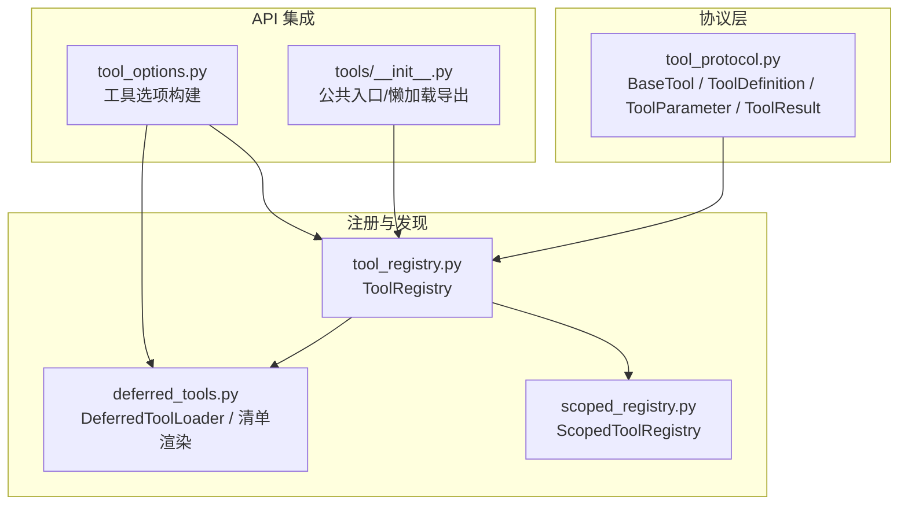
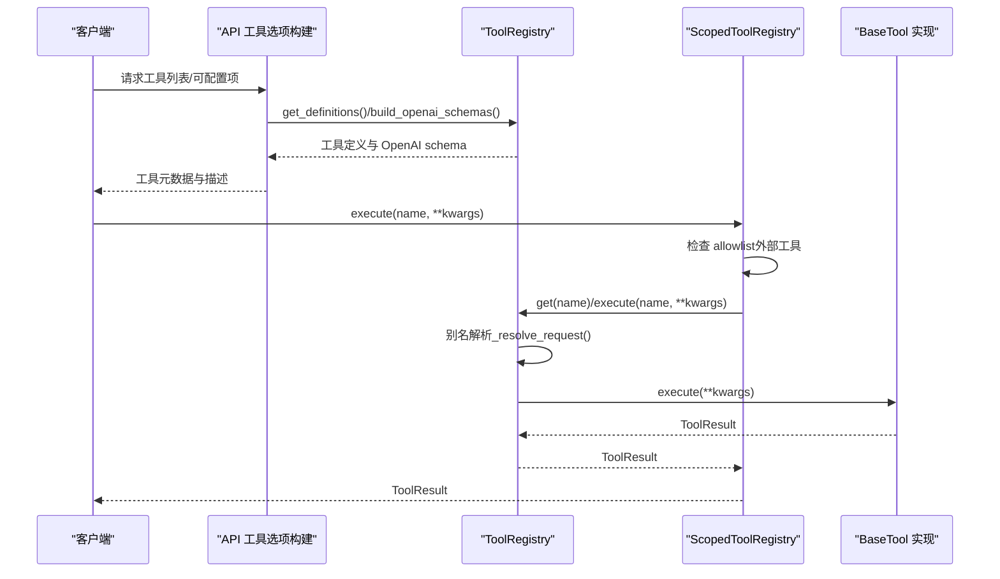
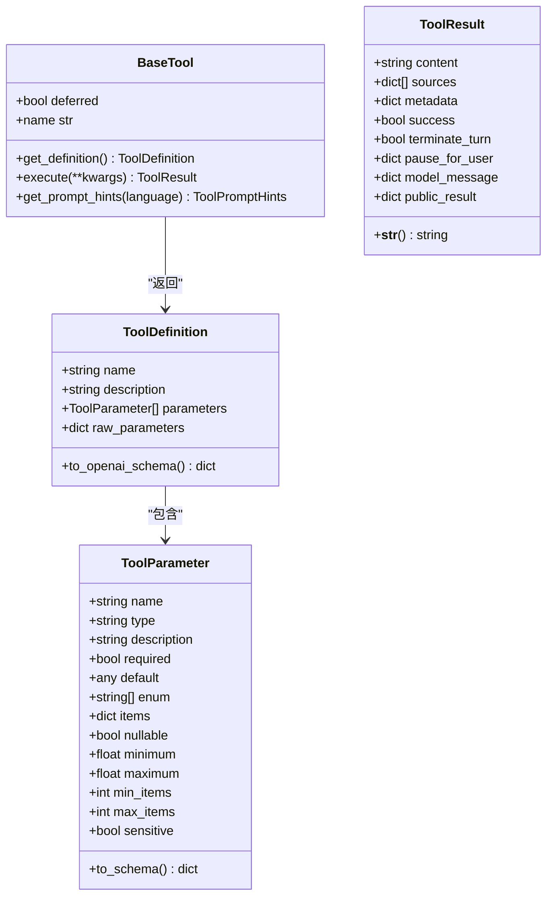
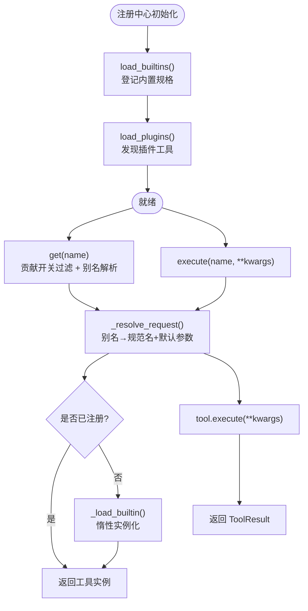
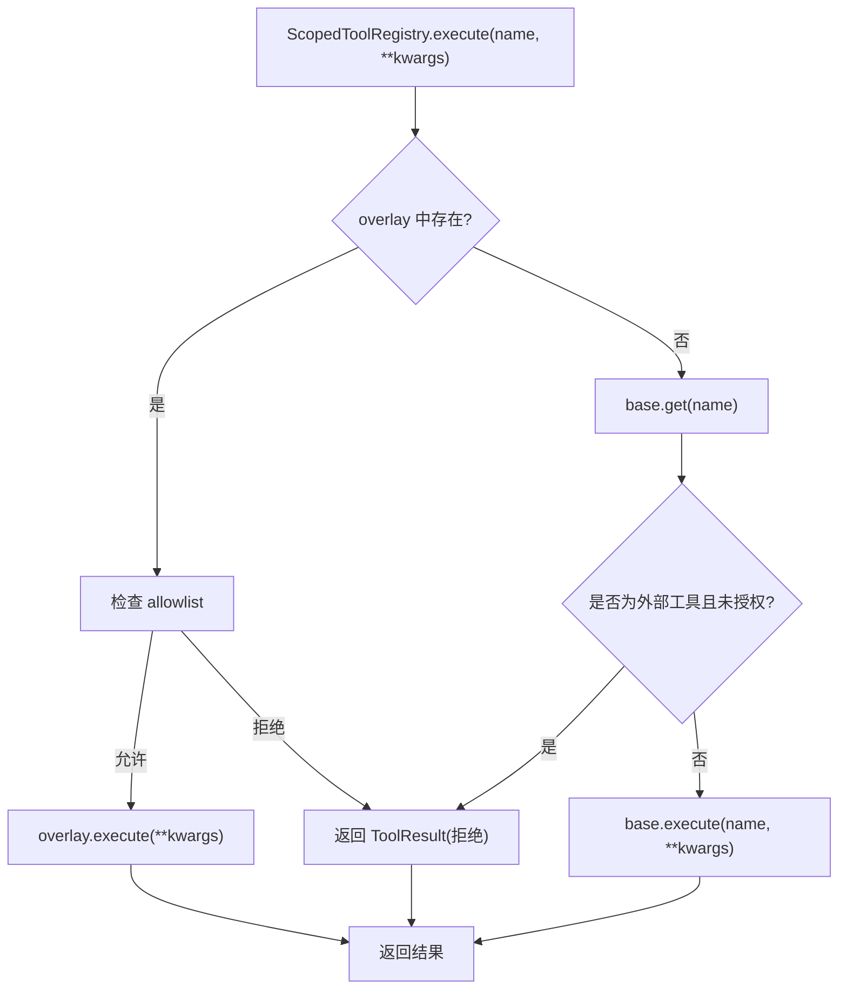
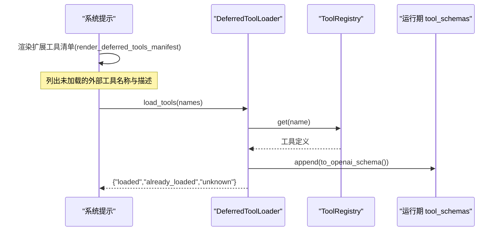
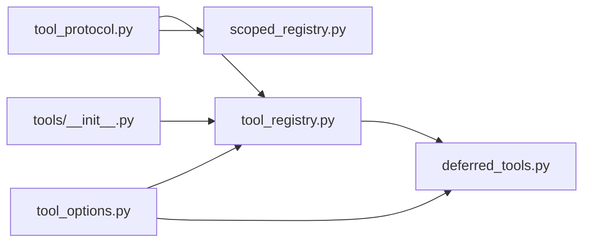

# 工具扩展机制

<cite>
**本文引用的文件**   
- [tool_protocol.py](file://deeptutor/core/tool_protocol.py)
- [tool_registry.py](file://deeptutor/runtime/registry/tool_registry.py)
- [scoped_registry.py](file://deeptutor/runtime/registry/scoped_registry.py)
- [deferred_tools.py](file://deeptutor/runtime/registry/deferred_tools.py)
- [tools/__init__.py](file://deeptutor/tools/__init__.py)
- [tool_options.py](file://deeptutor/api/utils/tool_options.py)
</cite>

## 目录
1. [引言](#引言)
2. [项目结构](#项目结构)
3. [核心组件](#核心组件)
4. [架构总览](#架构总览)
5. [详细组件分析](#详细组件分析)
6. [依赖关系分析](#依赖关系分析)
7. [性能考虑](#性能考虑)
8. [故障排除指南](#故障排除指南)
9. [结论](#结论)
10. [附录：工具开发完整指南](#附录工具开发完整指南)

## 引言
本文面向 DeepTutor 的工具扩展机制，聚焦以下目标：
- 解释 ToolRegistry 的工作原理、工具发现流程与元数据管理。
- 说明工具协议规范：函数签名约定、参数类型定义、返回值格式与错误处理标准。
- 记录提示词工具的开发方式：模板设计、上下文注入与响应解析。
- 说明内置工具的扩展点，以及如何扩展现有工具和新增工具类别。
- 提供同步/异步工具实现、权限控制与资源管理的实践。
- 给出测试策略、性能调优与故障排除建议。

## 项目结构
DeepTutor 的工具系统由“协议层 + 注册中心 + 作用域视图 + 延迟加载”组成，并与 API 层的工具选项构建逻辑协同工作：
- 协议层：定义 BaseTool、ToolDefinition、ToolParameter、ToolResult 等核心类型。
- 注册中心：维护进程级工具集合，负责发现、别名解析、OpenAI schema 生成与执行调度。
- 作用域视图：为单次对话提供用户/租户隔离的只读视图，并在执行时进行授权拦截。
- 延迟加载：对 MCP/CLI 等外部工具采用渐进式披露，减少初始 schema 体积。
- API 集成：通过工具选项构建器暴露可配置工具表面，并调用注册中心获取描述与 i18n。

**图表来源**
- [tool_protocol.py:16-329](file://deeptutor/core/tool_protocol.py#L16-L329)
- [tool_registry.py:29-232](file://deeptutor/runtime/registry/tool_registry.py#L29-L232)
- [scoped_registry.py:40-183](file://deeptutor/runtime/registry/scoped_registry.py#L40-L183)
- [deferred_tools.py:57-217](file://deeptutor/runtime/registry/deferred_tools.py#L57-L217)
- [tool_options.py:31-70](file://deeptutor/api/utils/tool_options.py#L31-L70)
- [tools/__init__.py:7-42](file://deeptutor/tools/__init__.py#L7-L42)

**章节来源**
- [tool_protocol.py:16-329](file://deeptutor/core/tool_protocol.py#L16-L329)
- [tool_registry.py:29-232](file://deeptutor/runtime/registry/tool_registry.py#L29-L232)
- [scoped_registry.py:40-183](file://deeptutor/runtime/registry/scoped_registry.py#L40-L183)
- [deferred_tools.py:57-217](file://deeptutor/runtime/registry/deferred_tools.py#L57-L217)
- [tool_options.py:31-70](file://deeptutor/api/utils/tool_options.py#L31-L70)
- [tools/__init__.py:7-42](file://deeptutor/tools/__init__.py#L7-L42)

## 核心组件
- BaseTool 与 ToolDefinition：所有工具的抽象基类与 OpenAI 风格元数据描述。
- ToolParameter：参数 JSON Schema 片段，支持枚举、范围、数组 items、敏感字段遮蔽等。
- ToolResult：统一返回体，包含内容、引用来源、结构化 UI 提示、终止/暂停语义与公开结果投影。
- ToolRegistry：进程级工具注册表，负责内置工具惰性加载、插件发现、别名解析、schema 生成与执行。
- ScopedToolRegistry：按会话/租户视角的只读视图，叠加用户专属工具，并在执行路径上拒绝未授权的外部工具。
- DeferredToolLoader：延迟加载工具 schema，配合系统提示中的“扩展工具清单”，按需将完整 schema 注入到当前轮次。
- tools/__init__.py：工具层公共入口，使用懒导入避免循环依赖和启动开销。
- tool_options.py：API 侧构建“可配置工具表面”，从注册中心拉取工具定义与多语言描述。

**章节来源**
- [tool_protocol.py:16-329](file://deeptutor/core/tool_protocol.py#L16-L329)
- [tool_registry.py:29-232](file://deeptutor/runtime/registry/tool_registry.py#L29-L232)
- [scoped_registry.py:40-183](file://deeptutor/runtime/registry/scoped_registry.py#L40-L183)
- [deferred_tools.py:116-217](file://deeptutor/runtime/registry/deferred_tools.py#L116-L217)
- [tools/__init__.py:7-42](file://deeptutor/tools/__init__.py#L7-L42)
- [tool_options.py:31-70](file://deeptutor/api/utils/tool_options.py#L31-L70)

## 架构总览
下图展示一次典型工具调用在系统中的流转：API 层构建工具选项 → 注册中心解析别名与发现工具 → 作用域视图校验权限 → 实际工具执行 → 返回标准化结果。

**图表来源**
- [tool_options.py:31-70](file://deeptutor/api/utils/tool_options.py#L31-L70)
- [tool_registry.py:99-197](file://deeptutor/runtime/registry/tool_registry.py#L99-L197)
- [scoped_registry.py:137-158](file://deeptutor/runtime/registry/scoped_registry.py#L137-L158)
- [tool_protocol.py:261-309](file://deeptutor/core/tool_protocol.py#L261-L309)

## 详细组件分析

### 工具协议与元数据
- BaseTool：要求实现 get_definition 与 execute；支持 deferred 标记以启用延迟加载；提供 name 属性与 get_prompt_hints 钩子。
- ToolDefinition：封装 name/description/parameters/raw_parameters；to_openai_schema 输出 OpenAI function-calling 兼容结构。
- ToolParameter：声明 type、required、default、enum、items、minimum/maximum、min_items/max_items、nullable、sensitive；to_schema 生成 JSON Schema 片段。
- ToolResult：content/sources/metadata/success/terminate_turn/pause_for_user/public_result/model_message；__str__ 返回 content。
- provider_identity：对外部工具标注 (kind, provider_id)，用于分组与追踪。

**图表来源**
- [tool_protocol.py:16-149](file://deeptutor/core/tool_protocol.py#L16-L149)
- [tool_protocol.py:166-309](file://deeptutor/core/tool_protocol.py#L166-L309)

**章节来源**
- [tool_protocol.py:16-149](file://deeptutor/core/tool_protocol.py#L16-L149)
- [tool_protocol.py:166-309](file://deeptutor/core/tool_protocol.py#L166-L309)

### 工具注册与发现
- ToolRegistry：
  - register/unregister：动态增删工具。
  - load_builtins/load_plugins：分别加载内置与插件工具；内置工具通过 spec.create 惰性实例化。
  - resolve_request/_resolve_request：别名解析与默认参数合并。
  - get/get_enabled/get_definitions/build_openai_schemas：查询与 schema 生成。
  - build_prompt_text：基于 ToolPromptHints 组装提示文本。
  - execute：位置参数 name，避免与工具同名参数冲突。
- 全局单例 get_tool_registry：首次调用时初始化并加载内置与插件；跨进程重启时保留部分共享外部工具实例。

**图表来源**
- [tool_registry.py:41-197](file://deeptutor/runtime/registry/tool_registry.py#L41-L197)
- [tool_registry.py:204-232](file://deeptutor/runtime/registry/tool_registry.py#L204-L232)

**章节来源**
- [tool_registry.py:29-232](file://deeptutor/runtime/registry/tool_registry.py#L29-L232)

### 作用域视图与权限控制
- ScopedToolRegistry：
  - overlay：会话内用户专属工具覆盖层，避免不同租户同名工具互相覆盖。
  - allowed：允许列表，仅对“外部工具”生效；内置工具不受此白名单限制。
  - execute：先查 overlay，再走 base registry；若外部工具不在 allowlist，直接返回失败结果。
  - list_tools/get_definitions/build_prompt_text：基于可见工具集生成 schema 与提示文本。

**图表来源**
- [scoped_registry.py:40-183](file://deeptutor/runtime/registry/scoped_registry.py#L40-L183)

**章节来源**
- [scoped_registry.py:40-183](file://deeptutor/runtime/registry/scoped_registry.py#L40-L183)

### 延迟加载与提示词工具
- DeferredToolLoader：
  - initial_schemas：返回本会话已加载的外部工具 schema。
  - load(names)：校验 allowlist 与 capability_names，追加到 live schemas 并持久化。
  - bind_live_schemas：绑定当前轮次的 tool_schemas 列表，供运行时增量更新。
- render_deferred_tools_manifest：按 provider_kind/provider_id 分组渲染“扩展工具清单”，中文/英文双语，强调名称与描述来自外部服务，不可作为指令。
- 用途：降低初始 schema 体积，提升弱模型工具选择准确率；同时保持“一键加载、立即可用”。

**图表来源**
- [deferred_tools.py:57-113](file://deeptutor/runtime/registry/deferred_tools.py#L57-L113)
- [deferred_tools.py:116-217](file://deeptutor/runtime/registry/deferred_tools.py#L116-L217)

**章节来源**
- [deferred_tools.py:57-113](file://deeptutor/runtime/registry/deferred_tools.py#L57-L113)
- [deferred_tools.py:116-217](file://deeptutor/runtime/registry/deferred_tools.py#L116-L217)

### API 工具选项与多语言描述
- tool_options.py：
  - 构建“可配置工具表面”，排除特定内置工具，支持可选工具白名单。
  - 调用 get_tool_registry().get(name).get_definition().description 获取描述，并结合 i18n 工具进行本地化。
  - 确保 MCP manager 已启动，以便后续工具发现。

**章节来源**
- [tool_options.py:31-70](file://deeptutor/api/utils/tool_options.py#L31-L70)

### 工具层公共入口
- tools/__init__.py：
  - 通过 _LAZY_EXPORTS 映射懒加载常用工具与提示词组合器，避免循环依赖与启动成本。
  - __getattr__ 在首次访问时动态 import 对应模块并缓存。

**章节来源**
- [tools/__init__.py:7-42](file://deeptutor/tools/__init__.py#L7-L42)

## 依赖关系分析
- 协议层被注册中心与作用域视图共同依赖，保证工具契约一致。
- 注册中心依赖内置工具规格与插件发现机制，并通过贡献开关控制工具可见性。
- 作用域视图依赖 allowlist 与基础注册中心，形成“只读视图 + 执行拦截”的安全边界。
- 延迟加载依赖 provider_identity 与 MCP 会话状态持久化，保障跨轮次一致性。
- API 层依赖注册中心与 MCP 管理器，提供可配置工具表面与多语言描述。

**图表来源**
- [tool_protocol.py:16-329](file://deeptutor/core/tool_protocol.py#L16-L329)
- [tool_registry.py:29-232](file://deeptutor/runtime/registry/tool_registry.py#L29-L232)
- [scoped_registry.py:40-183](file://deeptutor/runtime/registry/scoped_registry.py#L40-L183)
- [deferred_tools.py:57-217](file://deeptutor/runtime/registry/deferred_tools.py#L57-L217)
- [tool_options.py:31-70](file://deeptutor/api/utils/tool_options.py#L31-L70)
- [tools/__init__.py:7-42](file://deeptutor/tools/__init__.py#L7-L42)

**章节来源**
- [tool_protocol.py:16-329](file://deeptutor/core/tool_protocol.py#L16-L329)
- [tool_registry.py:29-232](file://deeptutor/runtime/registry/tool_registry.py#L29-L232)
- [scoped_registry.py:40-183](file://deeptutor/runtime/registry/scoped_registry.py#L40-L183)
- [deferred_tools.py:57-217](file://deeptutor/runtime/registry/deferred_tools.py#L57-L217)
- [tool_options.py:31-70](file://deeptutor/api/utils/tool_options.py#L31-L70)
- [tools/__init__.py:7-42](file://deeptutor/tools/__init__.py#L7-L42)

## 性能考虑
- 延迟加载外部工具 schema，显著降低初始 prompt 体积，提高弱模型工具选择准确率。
- 内置工具惰性实例化，避免不必要的导入与初始化开销。
- 作用域视图仅在 overlay 与 allowlist 层面做轻量过滤，不复制整个工具集。
- API 工具选项构建中，MCP 管理器启动失败会降级记录日志，不影响其他工具能力。

[本节为通用指导，不直接分析具体文件]

## 故障排除指南
- 未知工具错误：当 ToolRegistry.execute 无法解析工具名或贡献开关禁用时，抛出 KeyError。排查别名配置与贡献开关。
- 外部工具被拒绝：ScopedToolRegistry.execute 对未在 allowlist 的外部工具返回失败结果。检查 allowlist 与 provider 配置。
- 延迟工具加载失败：DeferredToolLoader.load 会将未知或未授权工具放入 unknown 列表。核对名称拼写与权限。
- 描述为空或异常：tool_options.py 在获取描述时捕获异常并回退空字符串，必要时检查工具定义的 description 字段。

**章节来源**
- [tool_registry.py:184-197](file://deeptutor/runtime/registry/tool_registry.py#L184-L197)
- [scoped_registry.py:137-162](file://deeptutor/runtime/registry/scoped_registry.py#L137-L162)
- [deferred_tools.py:176-202](file://deeptutor/runtime/registry/deferred_tools.py#L176-L202)
- [tool_options.py:62-70](file://deeptutor/api/utils/tool_options.py#L62-L70)

## 结论
DeepTutor 的工具扩展机制以清晰的协议为基础，通过进程级注册中心与会话级作用域视图解耦了工具生命周期与权限控制；延迟加载进一步平衡了功能丰富性与推理效率。API 层的多语言描述与可配置工具表面，使工具生态既灵活又可控。

[本节为总结性内容，不直接分析具体文件]

## 附录：工具开发完整指南

### 协议与实现要点
- 继承 BaseTool，实现 get_definition 与 execute。
- 使用 ToolDefinition 与 ToolParameter 声明参数类型、必填、默认值、枚举、范围与数组 items。
- 如需屏蔽敏感参数，设置 ToolParameter.sensitive = True。
- 返回 ToolResult，根据需要设置 success、sources、metadata、pause_for_user 或 public_result。

**章节来源**
- [tool_protocol.py:16-149](file://deeptutor/core/tool_protocol.py#L16-L149)
- [tool_protocol.py:166-309](file://deeptutor/core/tool_protocol.py#L166-L309)

### 同步与异步工具
- execute 必须为 async 方法；内部可使用 await 调用外部服务或数据库。
- 对于耗时操作，建议在 ToolResult.metadata 中传递 UI 提示，或使用 ToolEventSink 流式进度（如需要）。

**章节来源**
- [tool_protocol.py:294-297](file://deeptutor/core/tool_protocol.py#L294-L297)

### 权限控制与资源管理
- 外部工具需通过 allowlist 授权；ScopedToolRegistry 在执行路径强制拦截。
- 资源清理应在 execute 中使用 try/finally 或上下文管理器，确保连接释放与临时文件清理。

**章节来源**
- [scoped_registry.py:137-162](file://deeptutor/runtime/registry/scoped_registry.py#L137-L162)

### 延迟加载与提示词工具
- 将外部工具标记 deferred = True，使其不出现在初始 schema 列表。
- 使用 DeferredToolLoader.load 按需加载，并将 schema 追加到当前轮次的 tool_schemas。
- 系统提示中通过 render_deferred_tools_manifest 展示“扩展工具清单”，引导模型正确调用 load_tools。

**章节来源**
- [deferred_tools.py:57-113](file://deeptutor/runtime/registry/deferred_tools.py#L57-L113)
- [deferred_tools.py:116-217](file://deeptutor/runtime/registry/deferred_tools.py#L116-L217)

### 内置工具扩展点
- 通过 plugins.entry_points 与 PluginRegistry 发现并注册自定义工具。
- 使用 ToolRegistry.load_plugins 自动加载；避免与内置工具重名。
- 可通过 ToolRegistry.build_prompt_text 与 ToolPromptHints 定制提示词文案。

**章节来源**
- [tool_registry.py:78-97](file://deeptutor/runtime/registry/tool_registry.py#L78-L97)
- [tool_registry.py:154-178](file://deeptutor/runtime/registry/tool_registry.py#L154-L178)

### 测试策略
- 单元测试：验证 get_definition 的 schema 合法性、execute 的 ToolResult 结构与错误分支。
- 集成测试：模拟 MCP/CLI 外部工具，校验延迟加载与 allowlist 行为。
- 回归测试：确保别名解析、i18n 描述与贡献开关过滤稳定。

[本节为通用指导，不直接分析具体文件]

### 性能调优
- 合理拆分大 schema，优先使用延迟加载。
- 避免在 get_definition 中进行昂贵计算，改为惰性构造。
- 复用外部连接与缓存结果，减少重复 I/O。

[本节为通用指导，不直接分析具体文件]