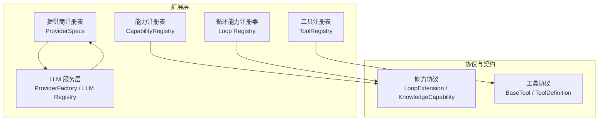
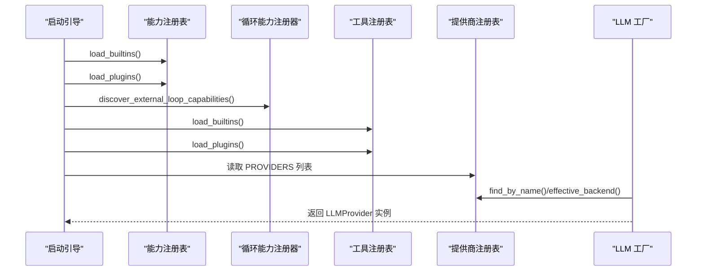
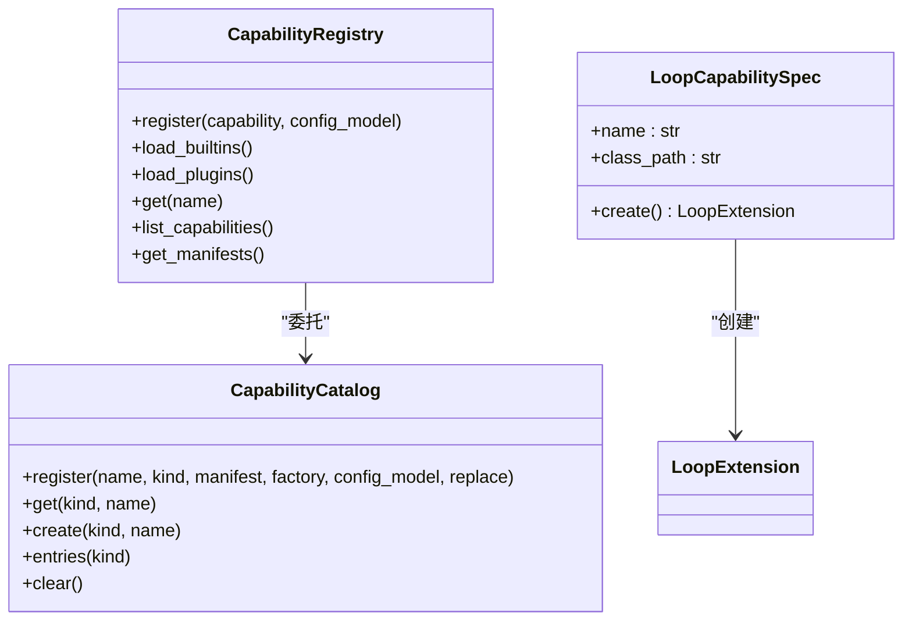
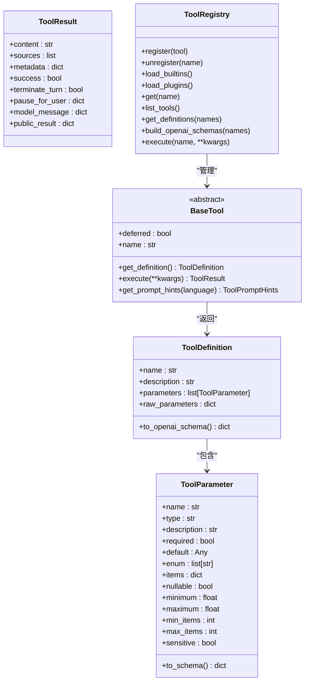
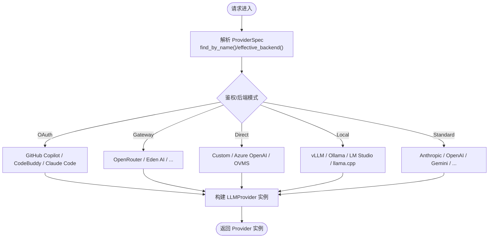
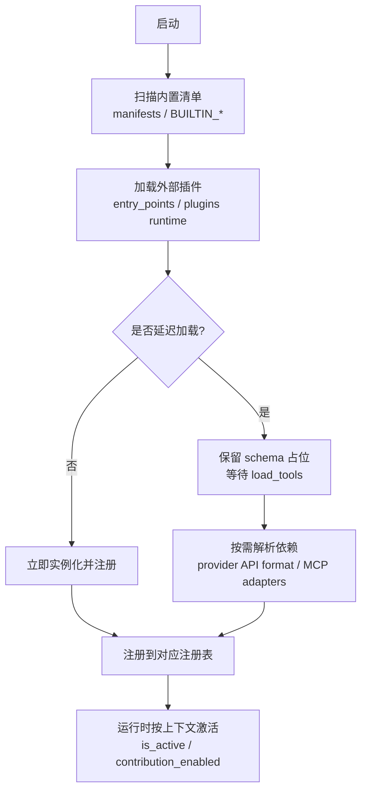
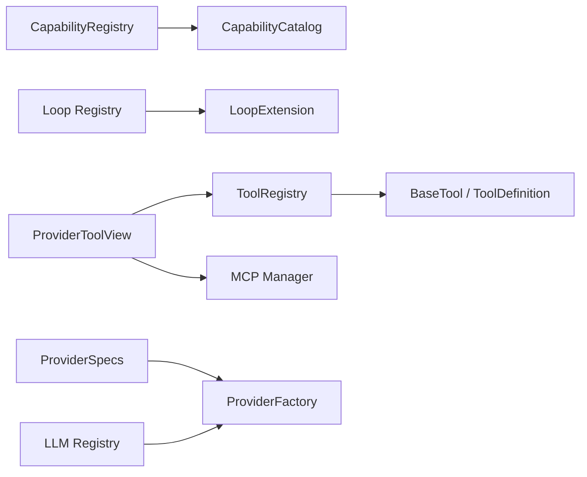

# 扩展机制设计

<cite>
**本文引用的文件**   
- [capabilities/registry.py](file://deeptutor/capabilities/registry.py)
- [capabilities/protocol.py](file://deeptutor/capabilities/protocol.py)
- [runtime/capability_catalog.py](file://deeptutor/runtime/capability_catalog.py)
- [runtime/registry/capability_registry.py](file://deeptutor/runtime/registry/capability_registry.py)
- [core/tool_protocol.py](file://deeptutor/core/tool_protocol.py)
- [runtime/registry/tool_registry.py](file://deeptutor/runtime/registry/tool_registry.py)
- [services/provider_registry.py](file://deeptutor/services/provider_registry.py)
- [services/llm/registry.py](file://deeptutor/services/llm/registry.py)
- [services/llm/provider_factory.py](file://deeptutor/services/llm/provider_factory.py)
- [runtime/providers/view.py](file://deeptutor/runtime/providers/view.py)
- [api/utils/tool_options.py](file://deeptutor/api/utils/tool_options.py)
- [partners/channels/registry.py](file://deeptutor/partners/channels/registry.py)
</cite>

## 目录
1. [引言](#引言)
2. [项目结构](#项目结构)
3. [核心组件](#核心组件)
4. [架构总览](#架构总览)
5. [详细组件分析](#详细组件分析)
6. [依赖关系分析](#依赖关系分析)
7. [性能与可扩展性](#性能与可扩展性)
8. [故障排查指南](#故障排查指南)
9. [结论](#结论)
10. [附录：扩展开发规范与最佳实践](#附录扩展开发规范与最佳实践)

## 引言
本文面向 DeepTutor 的扩展开发者，系统性说明插件系统的架构设计与实现原理，覆盖能力注册表、工具注册表和 LLM 提供商注册表；解释动态加载机制（模块发现、依赖解析、生命周期管理）；给出自定义能力和工具的编写规范；说明第三方集成接入点（LLM 提供商、外部服务、数据存储）；并提供扩展开发指南、示例路径和调试技巧。

## 项目结构
DeepTutor 的扩展机制围绕三个关键注册表展开：
- 能力注册表：管理“回合能力”和“循环能力扩展”，支持内置与外部插件。
- 工具注册表：统一管理所有工具（内置、插件、MCP），提供定义、提示、执行与延迟加载。
- 提供商注册表：集中声明 LLM 提供商元数据、路由策略与后端适配。

图表来源
- [runtime/registry/capability_registry.py:58-236](file://deeptutor/runtime/registry/capability_registry.py#L58-L236)
- [capabilities/registry.py:28-187](file://deeptutor/capabilities/registry.py#L28-L187)
- [runtime/registry/tool_registry.py:29-233](file://deeptutor/runtime/registry/tool_registry.py#L29-L233)
- [services/provider_registry.py:18-123](file://deeptutor/services/provider_registry.py#L18-L123)
- [services/llm/provider_factory.py:75-108](file://deeptutor/services/llm/provider_factory.py#L75-L108)

章节来源
- [runtime/registry/capability_registry.py:58-236](file://deeptutor/runtime/registry/capability_registry.py#L58-L236)
- [capabilities/registry.py:28-187](file://deeptutor/capabilities/registry.py#L28-L187)
- [runtime/registry/tool_registry.py:29-233](file://deeptutor/runtime/registry/tool_registry.py#L29-L233)
- [services/provider_registry.py:18-123](file://deeptutor/services/provider_registry.py#L18-L123)

## 核心组件
- 能力注册表（CapabilityRegistry）：统一注册“回合能力”，支持从内置清单与外部 entry_points 加载，并兼容旧版插件系统。
- 循环能力注册器（Loop Registry）：负责发现与实例化“循环能力扩展”，将 owned_tools 注入到当前回合的工具集合中。
- 工具注册表（ToolRegistry）：集中管理工具定义、别名、提示文本、OpenAI schema 生成与执行；支持延迟加载与插件合并。
- 提供商注册表（ProviderSpecs）：声明式配置 LLM 提供商，控制匹配优先级、鉴权模式、API 格式、模型重写等。
- LLM 服务层（ProviderFactory / LLM Registry）：根据 ProviderSpec 选择具体后端实现，构建运行时 provider 对象。

章节来源
- [runtime/registry/capability_registry.py:58-236](file://deeptutor/runtime/registry/capability_registry.py#L58-L236)
- [capabilities/registry.py:28-187](file://deeptutor/capabilities/registry.py#L28-L187)
- [runtime/registry/tool_registry.py:29-233](file://deeptutor/runtime/registry/tool_registry.py#L29-L233)
- [services/provider_registry.py:18-123](file://deeptutor/services/provider_registry.py#L18-L123)
- [services/llm/provider_factory.py:75-108](file://deeptutor/services/llm/provider_factory.py#L75-L108)

## 架构总览
DeepTutor 的扩展体系采用“声明 + 发现 + 工厂”的分层设计：
- 声明层：通过 ProviderSpec、BuiltinToolSpec、LoopCapabilitySpec 等描述元数据。
- 发现层：通过 pkgutil、entry_points、manifests 扫描与加载。
- 工厂层：按名称或类路径创建实例，并在运行时注册到对应注册表。

图表来源
- [runtime/registry/capability_registry.py:85-146](file://deeptutor/runtime/registry/capability_registry.py#L85-L146)
- [capabilities/registry.py:115-187](file://deeptutor/capabilities/registry.py#L115-L187)
- [runtime/registry/tool_registry.py:58-98](file://deeptutor/runtime/registry/tool_registry.py#L58-L98)
- [services/provider_registry.py:761-800](file://deeptutor/services/provider_registry.py#L761-L800)
- [services/llm/provider_factory.py:75-108](file://deeptutor/services/llm/provider_factory.py#L75-L108)

## 详细组件分析

### 能力注册表与循环能力扩展
- 能力注册表（CapabilityRegistry）
  - 职责：注册“回合能力”，从内置清单与外部 entry_points 加载，兼容旧插件系统。
  - 关键点：
    - register() 将 TurnCapability 或其工厂注册到 CapabilityCatalog。
    - load_builtins() 基于 manifests 与 contribution_enabled 过滤。
    - load_plugins() 优先使用 canonical group，再回退 legacy group。
    - get() 在需要时触发插件加载，并支持运行时插件能力包装。
- 循环能力注册器（Loop Registry）
  - 职责：发现 loop extension，校验 name 与 owned_tools，构造实例并注入 capability catalog。
  - 关键点：
    - _coerce_loop_factory() 兼容类、工厂函数与实例三种形式。
    - discover_external_loop_capabilities() 从 EXTENSIONS_GROUP 与 LOOP_CAPABILITIES_GROUP 加载。
    - all_loop_capabilities() 为每次 turn 重建实例缓存，并将 owned_tools 注册到 catalog。
    - active_loop_capabilities() 基于 is_active(context) 筛选。

图表来源
- [runtime/registry/capability_registry.py:58-236](file://deeptutor/runtime/registry/capability_registry.py#L58-L236)
- [capabilities/registry.py:28-187](file://deeptutor/capabilities/registry.py#L28-L187)
- [runtime/capability_catalog.py:21-79](file://deeptutor/runtime/capability_catalog.py#L21-L79)

章节来源
- [runtime/registry/capability_registry.py:58-236](file://deeptutor/runtime/registry/capability_registry.py#L58-L236)
- [capabilities/registry.py:28-187](file://deeptutor/capabilities/registry.py#L28-L187)
- [runtime/capability_catalog.py:21-79](file://deeptutor/runtime/capability_catalog.py#L21-L79)

### 工具注册表与工具协议
- 工具协议（BaseTool / ToolDefinition / ToolParameter / ToolResult）
  - BaseTool：抽象基类，要求实现 get_definition() 与 execute()，支持 deferred 延迟披露。
  - ToolDefinition：描述工具名称、描述与参数 schema，可输出 OpenAI function-calling schema。
  - ToolParameter：参数类型、约束、敏感字段、数组 items 等。
  - ToolResult：标准化返回体，支持 sources、metadata、pause_for_user、public_result 等。
- 工具注册表（ToolRegistry）
  - 职责：集中管理工具定义、别名、提示文本、schema 生成与执行；支持延迟加载与插件合并。
  - 关键点：
    - load_builtins() 登记 BUILTIN_TOOL_SPEC_BY_NAME。
    - load_plugins() 从 deeptutor.tools 与插件运行时加载。
    - build_openai_schemas() 与 build_prompt_text() 用于 LLM 调用与 UI 展示。
    - execute() 位置参数 name 避免与工具参数冲突。

图表来源
- [core/tool_protocol.py:16-330](file://deeptutor/core/tool_protocol.py#L16-L330)
- [runtime/registry/tool_registry.py:29-233](file://deeptutor/runtime/registry/tool_registry.py#L29-L233)

章节来源
- [core/tool_protocol.py:16-330](file://deeptutor/core/tool_protocol.py#L16-L330)
- [runtime/registry/tool_registry.py:29-233](file://deeptutor/runtime/registry/tool_registry.py#L29-L233)

### 提供商注册表与 LLM 服务层
- 提供商注册表（ProviderSpecs）
  - 职责：集中声明 LLM 提供商元数据，包括鉴权模式、默认端点、API 格式、模型重写、检测规则等。
  - 关键点：
    - ProviderSpec.mode/auth_mode/api_formats/default_api_format 等派生属性。
    - PROVIDERS 列表顺序决定匹配优先级；支持 gateway、direct、local、oauth 等模式。
    - find_by_name()、wire_api_for_provider()、api_format_for_provider() 等查询与规范化方法。
- LLM 服务层（ProviderFactory / LLM Registry）
  - ProviderFactory：根据 LLMConfig 与 ProviderSpec 选择后端实现（openai_compat、anthropic、azure_openai、github_copilot、codebuddy 等）。
  - LLM Registry：简单装饰器注册系统，便于扩展新的 provider 类。

图表来源
- [services/provider_registry.py:18-123](file://deeptutor/services/provider_registry.py#L18-L123)
- [services/provider_registry.py:761-800](file://deeptutor/services/provider_registry.py#L761-L800)
- [services/llm/provider_factory.py:75-108](file://deeptutor/services/llm/provider_factory.py#L75-L108)
- [services/llm/registry.py:14-71](file://deeptutor/services/llm/registry.py#L14-L71)

章节来源
- [services/provider_registry.py:18-123](file://deeptutor/services/provider_registry.py#L18-L123)
- [services/provider_registry.py:761-800](file://deeptutor/services/provider_registry.py#L761-L800)
- [services/llm/provider_factory.py:75-108](file://deeptutor/services/llm/provider_factory.py#L75-L108)
- [services/llm/registry.py:14-71](file://deeptutor/services/llm/registry.py#L14-L71)

### 动态加载机制：模块发现、依赖解析与生命周期管理
- 模块发现
  - 能力：builtin capabilities 通过 manifests 与 contribution_enabled 过滤；loop extensions 通过 entry_points 组加载。
  - 工具：builtin tools 通过 BUILTIN_TOOL_SPEC_BY_NAME；plugins 通过 deeptutor.tools 与插件运行时。
  - 渠道：partners channels 通过 pkgutil 扫描与 entry_points 合并。
- 依赖解析
  - 工具延迟加载：BaseTool.deferred 标记，按需通过 load_tools 暴露完整 schema。
  - 提供商 API 格式：根据 backend 与 api_base_by_format 选择 openai_chat/openai_responses/anthropic。
- 生命周期管理
  - 能力实例：all_loop_capabilities() 每轮重建并缓存于 context.runtime.loop_extensions。
  - 工具实例：ToolRegistry.get() 惰性加载 builtin，插件工具在 load_plugins() 阶段注册。
  - 提供商实例：ProviderFactory 根据配置与后端选择创建 provider，必要时复用池。

图表来源
- [capabilities/registry.py:115-187](file://deeptutor/capabilities/registry.py#L115-L187)
- [runtime/registry/tool_registry.py:58-98](file://deeptutor/runtime/registry/tool_registry.py#L58-L98)
- [runtime/providers/view.py:40-115](file://deeptutor/runtime/providers/view.py#L40-L115)
- [partners/channels/registry.py:27-85](file://deeptutor/partners/channels/registry.py#L27-L85)

章节来源
- [capabilities/registry.py:115-187](file://deeptutor/capabilities/registry.py#L115-L187)
- [runtime/registry/tool_registry.py:58-98](file://deeptutor/runtime/registry/tool_registry.py#L58-L98)
- [runtime/providers/view.py:40-115](file://deeptutor/runtime/providers/view.py#L40-L115)
- [partners/channels/registry.py:27-85](file://deeptutor/partners/channels/registry.py#L27-L85)

## 依赖关系分析
- 组件耦合
  - CapabilityRegistry 依赖 CapabilityCatalog 与 manifests；Loop Registry 依赖 protocol 与 catalog。
  - ToolRegistry 依赖 tool_protocol 与 builtin_specs；ProviderToolView 依赖 ToolLookup 与 MCP manager。
  - ProviderFactory 依赖 ProviderSpecs 与后端实现；LLM Registry 提供装饰器注册。
- 直接/间接依赖
  - 工具视图通过 base_registry.deferred_tools() 获取延迟工具，并通过 MCP manager 装配适配器。
  - 能力扩展通过 owned_tools 向 catalog 注册，影响 UI 分组与设置。
- 外部依赖与集成点
  - entry_points 组：deeptutor.extensions、deeptutor.tools、deeptutor.partners.channels。
  - MCP 服务：动态加载外部工具，按 provider_kind/provider_id 分组。

图表来源
- [runtime/registry/capability_registry.py:58-236](file://deeptutor/runtime/registry/capability_registry.py#L58-L236)
- [capabilities/registry.py:28-187](file://deeptutor/capabilities/registry.py#L28-L187)
- [runtime/registry/tool_registry.py:29-233](file://deeptutor/runtime/registry/tool_registry.py#L29-L233)
- [runtime/providers/view.py:40-115](file://deeptutor/runtime/providers/view.py#L40-L115)
- [services/provider_registry.py:18-123](file://deeptutor/services/provider_registry.py#L18-L123)
- [services/llm/registry.py:14-71](file://deeptutor/services/llm/registry.py#L14-L71)

章节来源
- [runtime/registry/capability_registry.py:58-236](file://deeptutor/runtime/registry/capability_registry.py#L58-L236)
- [capabilities/registry.py:28-187](file://deeptutor/capabilities/registry.py#L28-L187)
- [runtime/registry/tool_registry.py:29-233](file://deeptutor/runtime/registry/tool_registry.py#L29-L233)
- [runtime/providers/view.py:40-115](file://deeptutor/runtime/providers/view.py#L40-L115)
- [services/provider_registry.py:18-123](file://deeptutor/services/provider_registry.py#L18-L123)
- [services/llm/registry.py:14-71](file://deeptutor/services/llm/registry.py#L14-L71)

## 性能与可扩展性
- 性能特性
  - 延迟加载：BaseTool.deferred 减少初始 schema 体积，按需加载提升首包速度。
  - 缓存与重用：ProviderFactory 对 provider 实例进行池化；Loop Registry 每轮重建但缓存于 context。
  - 快速发现：pkgutil 与 entry_points 仅在启动或首次访问时扫描。
- 可扩展性建议
  - 新增能力：实现 LoopExtension 或 TurnCapability，并通过 entry_points 注册。
  - 新增工具：继承 BaseTool，实现 get_definition 与 execute，并通过 deeptutor.tools 注册。
  - 新增提供商：在 PROVIDERS 中添加 ProviderSpec，或在 LLM Registry 中装饰新 provider 类。

[本节为通用指导，不直接分析具体文件]

## 故障排查指南
- 能力未生效
  - 检查 contribution_enabled("capabilities", name) 与 manifests 是否包含该能力。
  - 确认 entry_points 组是否正确注册，且类名与 class_path 一致。
- 工具不可用
  - 检查 ToolRegistry.list_tools() 是否包含目标工具；确认 deferred 工具已通过 load_tools 加载。
  - 查看贡献开关 contribution_enabled("tools", name)。
- 提供商无法识别
  - 核对 PROVIDERS 中的 keywords、env_key、default_api_base 与 detect_by_* 规则。
  - 确认 LLMConfig.binding/provider_name 与 ProviderSpec.name 匹配。
- MCP 工具异常
  - 检查 ProviderToolView 组装过程与 MCP manager 状态；关注 provider_kind/provider_id 元数据。

章节来源
- [runtime/registry/capability_registry.py:85-146](file://deeptutor/runtime/registry/capability_registry.py#L85-L146)
- [runtime/registry/tool_registry.py:58-98](file://deeptutor/runtime/registry/tool_registry.py#L58-L98)
- [services/provider_registry.py:761-800](file://deeptutor/services/provider_registry.py#L761-L800)
- [runtime/providers/view.py:40-115](file://deeptutor/runtime/providers/view.py#L40-L115)

## 结论
DeepTutor 的扩展机制以“声明 + 发现 + 工厂”为核心，通过能力注册表、工具注册表与提供商注册表解耦业务逻辑与基础设施。延迟加载、上下文感知与插件化入口使系统具备良好的可扩展性与可维护性。遵循本文规范与最佳实践，可高效扩展能力、工具与第三方集成。

[本节为总结性内容，不直接分析具体文件]

## 附录：扩展开发规范与最佳实践

### 自定义能力编写规范
- 接口定义
  - 循环能力：实现 LoopExtension，提供 name、owned_tools、is_active(context)、system_block()、augment_kwargs()、pre_loop_seed() 等。
  - 知识能力：继承 KnowledgeCapability，设置 exclusive_tools=True，并实现 owned_kbs(context)。
- 配置参数
  - 使用 CapabilityCatalog.config_model 指定 Pydantic 模型；EmptyConfig 表示无选项。
- 错误处理
  - 在 pre_loop/system_block/augment_kwargs 中捕获异常并返回 None 或空块，避免中断主流程。
- 示例路径
  - 参考现有能力模块的结构与命名约定。

章节来源
- [capabilities/protocol.py:30-174](file://deeptutor/capabilities/protocol.py#L30-L174)
- [runtime/capability_catalog.py:15-79](file://deeptutor/runtime/capability_catalog.py#L15-L79)

### 自定义工具编写规范
- 接口定义
  - 继承 BaseTool，实现 get_definition() 与 execute()；可选实现 get_prompt_hints()。
- 参数与 Schema
  - 使用 ToolParameter 定义参数类型、约束与敏感字段；必要时使用 raw_parameters 传递完整 JSON Schema。
- 返回值
  - 返回 ToolResult，合理使用 content、sources、metadata、pause_for_user、public_result。
- 延迟加载
  - 若工具较重或依赖外部服务，设置 deferred=True，并通过 load_tools 暴露 schema。
- 示例路径
  - 参考 tools/builtin_specs 与现有工具实现。

章节来源
- [core/tool_protocol.py:16-330](file://deeptutor/core/tool_protocol.py#L16-L330)
- [runtime/registry/tool_registry.py:58-98](file://deeptutor/runtime/registry/tool_registry.py#L58-L98)

### 第三方集成接入方式
- LLM 提供商
  - 在 PROVIDERS 中添加 ProviderSpec，设置 backend、env_key、default_api_base、detect_by_* 等。
  - 如需新后端实现，在 LLM Registry 中使用 register_provider 装饰器注册 provider 类。
- 外部服务
  - 通过 MCP 或 CLI 工具暴露能力，由 ProviderToolView 装配到当前回合的工具集。
- 数据存储
  - 通过能力或工具封装存储访问逻辑，遵循 ToolResult 与 ToolDefinition 契约。

章节来源
- [services/provider_registry.py:18-123](file://deeptutor/services/provider_registry.py#L18-L123)
- [services/llm/registry.py:14-71](file://deeptutor/services/llm/registry.py#L14-L71)
- [runtime/providers/view.py:40-115](file://deeptutor/runtime/providers/view.py#L40-L115)

### 调试技巧
- 能力调试
  - 打印 CapabilityRegistry.get_manifests() 与 CapabilityCatalog.entries("turn")。
  - 使用 contribution_enabled 开关逐步启用/禁用能力。
- 工具调试
  - 调用 ToolRegistry.list_tools() 与 build_openai_schemas() 检查 schema。
  - 对 deferred 工具，确认 load_tools 已调用并返回预期 schema。
- 提供商调试
  - 使用 find_by_name() 与 effective_backend() 验证匹配结果。
  - 检查 LLMConfig.binding/provider_name 与 ProviderSpec.name 一致性。

章节来源
- [runtime/registry/capability_registry.py:178-224](file://deeptutor/runtime/registry/capability_registry.py#L178-L224)
- [runtime/registry/tool_registry.py:126-182](file://deeptutor/runtime/registry/tool_registry.py#L126-L182)
- [services/provider_registry.py:761-800](file://deeptutor/services/provider_registry.py#L761-L800)