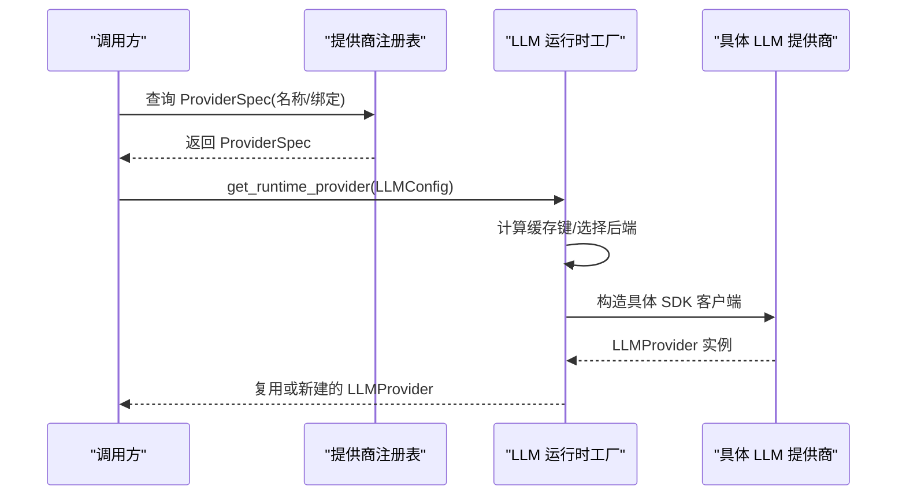
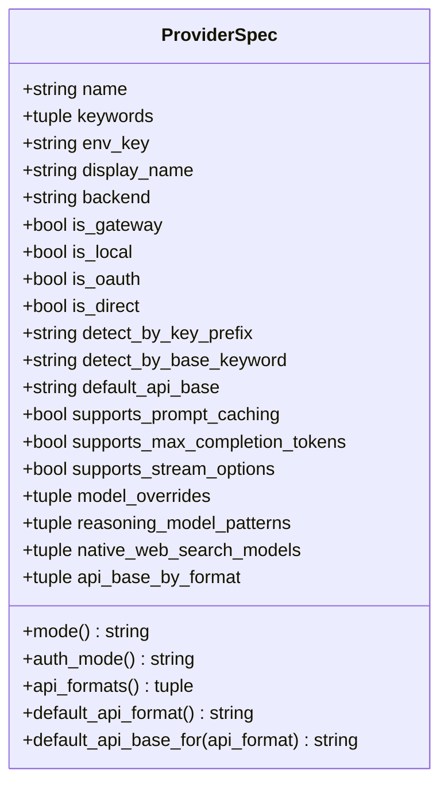
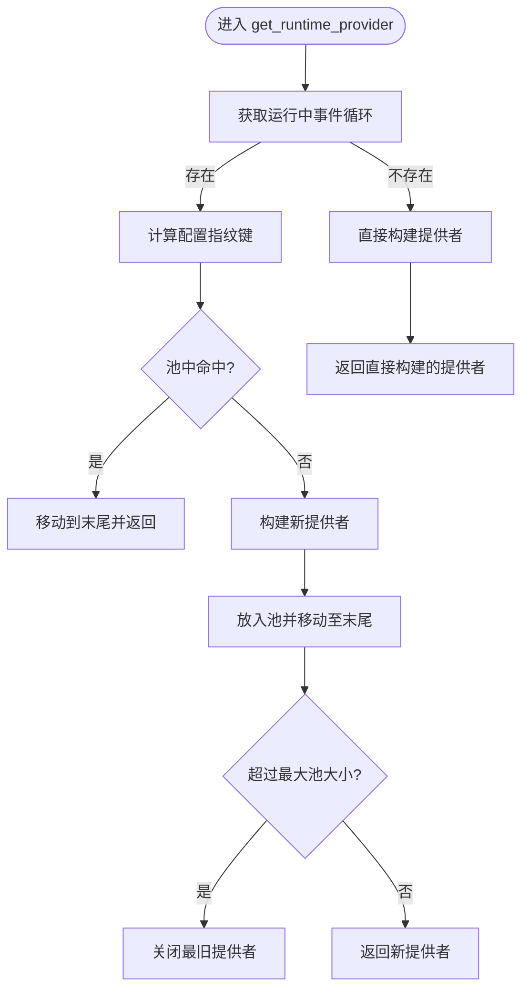
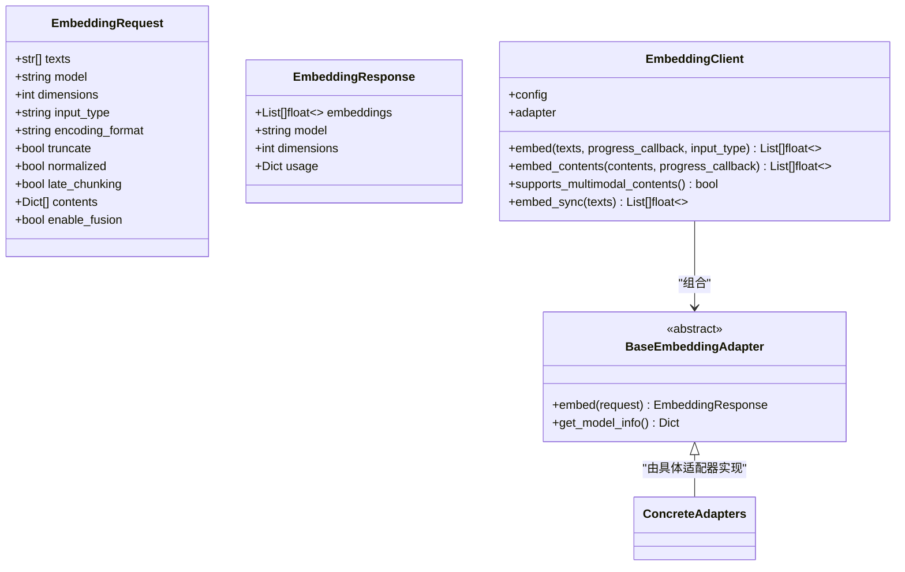
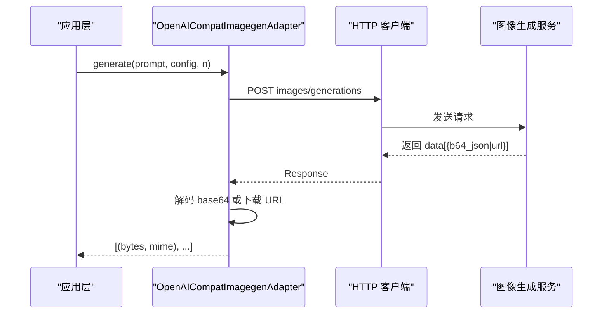
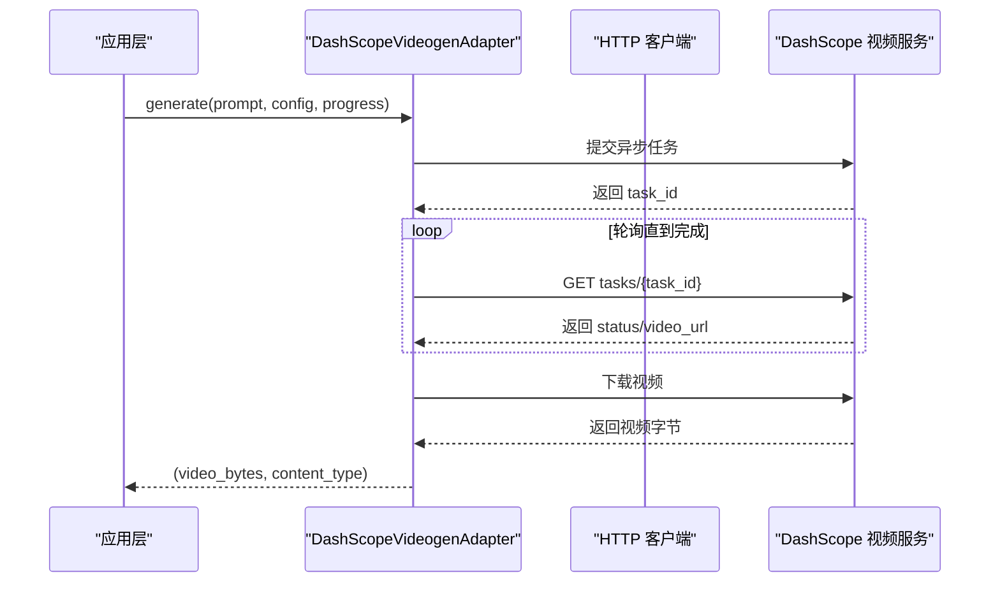
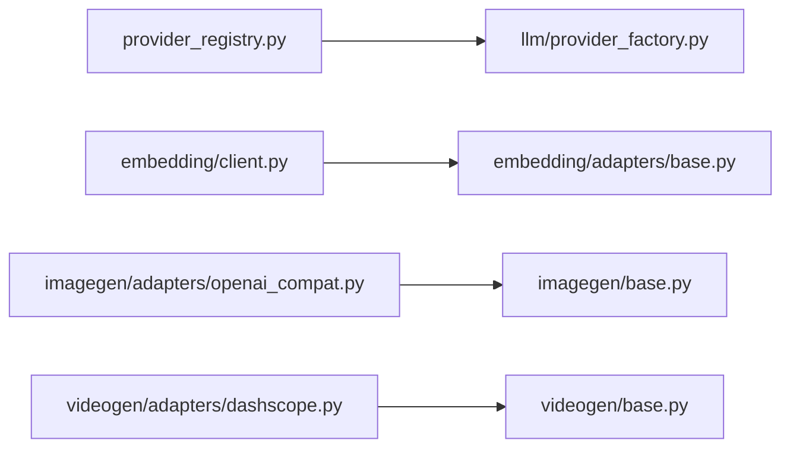

# 提供商扩展机制

<cite>
**本文引用的文件**   
- [deeptutor/services/provider_registry.py](file://deeptutor/services/provider_registry.py)
- [deeptutor/runtime/providers/text.py](file://deeptutor/runtime/providers/text.py)
- [deeptutor/services/llm/provider_factory.py](file://deeptutor/services/llm/provider_factory.py)
- [deeptutor/services/embedding/adapters/base.py](file://deeptutor/services/embedding/adapters/base.py)
- [deeptutor/services/embedding/client.py](file://deeptutor/services/embedding/client.py)
- [deeptutor/services/imagegen/base.py](file://deeptutor/services/imagegen/base.py)
- [deeptutor/services/imagegen/adapters/openai_compat.py](file://deeptutor/services/imagegen/adapters/openai_compat.py)
- [deeptutor/services/videogen/base.py](file://deeptutor/services/videogen/base.py)
- [deeptutor/services/videogen/adapters/dashscope.py](file://deeptutor/services/videogen/adapters/dashscope.py)
</cite>

## 目录
1. [引言](#引言)
2. [项目结构](#项目结构)
3. [核心组件](#核心组件)
4. [架构总览](#架构总览)
5. [详细组件分析](#详细组件分析)
6. [依赖关系分析](#依赖关系分析)
7. [性能与容量控制](#性能与容量控制)
8. [故障诊断与排错](#故障诊断与排错)
9. [测试与监控建议](#测试与监控建议)
10. [结论](#结论)

## 引言
本文面向 DeepTutor 的“提供商扩展机制”，系统性说明 LLM、嵌入模型、图像生成和视频渲染四类提供商的发现、注册、配置、生命周期与调用路径。文档同时给出适配器接口规范、第三方服务集成要点（认证、错误映射、重试）、以及测试与监控方法，帮助开发者快速接入新供应商并保证系统稳定性。

## 项目结构
DeepTutor 将“提供商元数据”和“运行时实现”解耦：
- 提供商元数据集中在统一注册表，负责名称规范化、别名、默认端点、能力标记和匹配优先级。
- LLM 通过工厂按后端类型构建具体 SDK 客户端，并进行连接池复用。
- 嵌入、图像、视频分别以抽象适配器定义契约，再由各厂商适配器实现。

```mermaid
graph TB
subgraph "LLM"
REG["提供商注册表<br/>ProviderSpec / PROVIDERS"]
FACT["运行时工厂<br/>get_runtime_provider()"]
PROV["具体提供商实现<br/>OpenAI / Anthropic / Azure / OAuth 等"]
end
subgraph "嵌入模型"
EBASE["抽象适配器<br/>BaseEmbeddingAdapter"]
ECLI["统一客户端<br/>EmbeddingClient"]
EADP["各厂商适配器<br/>OpenAI / Cohere / Ollama 等"]
end
subgraph "图像生成"
IBASE["抽象适配器<br/>BaseImagegenAdapter"]
IADP["OpenAI 兼容适配器<br/>OpenAICompatImagegenAdapter"]
end
subgraph "视频渲染"
VBASE["抽象适配器<br/>BaseVideogenAdapter"]
VADP["DashScope 适配器<br/>DashScopeVideogenAdapter"]
end
REG --> FACT
FACT --> PROV
EBASE --> ECLI
ECLI --> EADP
IBASE --> IADP
VBASE --> VADP
```

图示来源
- [deeptutor/services/provider_registry.py:18-127](file://deeptutor/services/provider_registry.py#L18-L127)
- [deeptutor/services/llm/provider_factory.py:59-160](file://deeptutor/services/llm/provider_factory.py#L59-L160)
- [deeptutor/services/embedding/adapters/base.py:130-198](file://deeptutor/services/embedding/adapters/base.py#L130-L198)
- [deeptutor/services/embedding/client.py:39-117](file://deeptutor/services/embedding/client.py#L39-L117)
- [deeptutor/services/imagegen/base.py:10-24](file://deeptutor/services/imagegen/base.py#L10-L24)
- [deeptutor/services/imagegen/adapters/openai_compat.py:30-68](file://deeptutor/services/imagegen/adapters/openai_compat.py#L30-L68)
- [deeptutor/services/videogen/base.py:31-58](file://deeptutor/services/videogen/base.py#L31-L58)
- [deeptutor/services/videogen/adapters/dashscope.py:56-97](file://deeptutor/services/videogen/adapters/dashscope.py#L56-L97)

章节来源
- [deeptutor/services/provider_registry.py:18-127](file://deeptutor/services/provider_registry.py#L18-L127)
- [deeptutor/services/llm/provider_factory.py:59-160](file://deeptutor/services/llm/provider_factory.py#L59-L160)
- [deeptutor/services/embedding/adapters/base.py:130-198](file://deeptutor/services/embedding/adapters/base.py#L130-L198)
- [deeptutor/services/embedding/client.py:39-117](file://deeptutor/services/embedding/client.py#L39-L117)
- [deeptutor/services/imagegen/base.py:10-24](file://deeptutor/services/imagegen/base.py#L10-L24)
- [deeptutor/services/imagegen/adapters/openai_compat.py:30-68](file://deeptutor/services/imagegen/adapters/openai_compat.py#L30-L68)
- [deeptutor/services/videogen/base.py:31-58](file://deeptutor/services/videogen/base.py#L31-L58)
- [deeptutor/services/videogen/adapters/dashscope.py:56-97](file://deeptutor/services/videogen/adapters/dashscope.py#L56-L97)

## 核心组件
- 提供商注册表 ProviderSpec：集中声明所有 LLM 提供商的名称、关键词、环境变量键、显示名、后端实现、是否网关/本地/OAuth、默认端点、能力开关（如提示词缓存、流式选项、最大完成 token）及模型覆盖规则。
- LLM 运行时工厂：根据配置解析后端类型，按需导入对应 SDK 类，构造 LLMProvider，并按事件循环进行小容量连接池管理。
- 嵌入模型适配器基类：定义 EmbeddingRequest/Response 标准结构与 BaseEmbeddingAdapter 抽象接口；支持多模态内容输入、维度与任务角色参数、批量处理与校验。
- 图像生成适配器基类：定义 BaseImagegenAdapter.generate(prompt, config, n) 返回字节与 MIME 类型。
- 视频渲染适配器基类：定义 submit_task/generate 异步流程，并提供 poll 超时预算上下文管理器。

章节来源
- [deeptutor/services/provider_registry.py:18-127](file://deeptutor/services/provider_registry.py#L18-L127)
- [deeptutor/services/llm/provider_factory.py:59-160](file://deeptutor/services/llm/provider_factory.py#L59-L160)
- [deeptutor/services/embedding/adapters/base.py:33-87](file://deeptutor/services/embedding/adapters/base.py#L33-L87)
- [deeptutor/services/embedding/adapters/base.py:130-198](file://deeptutor/services/embedding/adapters/base.py#L130-L198)
- [deeptutor/services/imagegen/base.py:10-24](file://deeptutor/services/imagegen/base.py#L10-L24)
- [deeptutor/services/videogen/base.py:31-58](file://deeptutor/services/videogen/base.py#L31-L58)

## 架构总览
DeepTutor 的扩展点围绕“注册表 + 工厂 + 适配器”展开：
- 注册表提供“发现与匹配”：通过名称、关键词、API Key 前缀、base_url 关键字、模型家族等进行自动识别，决定路由到哪个后端。
- 工厂提供“实例化与复用”：按后端类型选择具体 SDK 实现，并在事件循环内维护有限大小的连接池，避免频繁创建销毁带来的内存与连接开销。
- 适配器提供“统一契约”：嵌入、图像、视频三类媒体能力均以抽象基类约束实现，屏蔽底层差异。

图示来源
- [deeptutor/services/provider_registry.py:761-768](file://deeptutor/services/provider_registry.py#L761-L768)
- [deeptutor/services/llm/provider_factory.py:176-202](file://deeptutor/services/llm/provider_factory.py#L176-L202)

## 详细组件分析

### LLM 提供商注册与发现
- ProviderSpec 字段职责：
  - name/keywords/env_key/display_name/backend：标识与实现后端。
  - is_gateway/is_local/is_oauth/is_direct：模式分类，影响 UI 展示与行为。
  - detect_by_key_prefix/detect_by_base_keyword/default_api_base：网关/直连自动发现。
  - supports_prompt_caching/supports_max_completion_tokens/supports_stream_options：能力开关。
  - model_overrides/reasoning_model_patterns/native_web_search_models/api_base_by_format：模型级覆盖与格式选择。
- 名称规范化与别名：canonical_provider_name 对传入名称做标准化，并映射历史别名。
- API 格式与 Wire 协议：在 OpenAI 兼容后端上可显式选择 responses/chat_completions，其他后端固定。

图示来源
- [deeptutor/services/provider_registry.py:18-127](file://deeptutor/services/provider_registry.py#L18-L127)

章节来源
- [deeptutor/services/provider_registry.py:18-127](file://deeptutor/services/provider_registry.py#L18-L127)
- [deeptutor/services/provider_registry.py:168-176](file://deeptutor/services/provider_registry.py#L168-L176)
- [deeptutor/services/provider_registry.py:771-800](file://deeptutor/services/provider_registry.py#L771-L800)

### LLM 提供商运行时与生命周期
- 工厂函数 _build_runtime_provider：
  - 根据 provider_name/binding 查找 ProviderSpec，确定 effective_backend。
  - 针对 openai_codex/github_copilot/codebuddy/claude_code/azure_openai/anthropic/openai_compat 等分支构造具体 SDK 客户端。
  - 注入 GenerationSettings（temperature/max_tokens/reasoning_effort）。
- 连接池：
  - get_runtime_provider 基于事件循环与配置指纹建立有序字典缓存，限制最大池大小，最近使用项置顶，超限时关闭最久未用项。
  - close_runtime_provider_pool/reset_runtime_provider_pool 用于重启或配置变更时清理。

图示来源
- [deeptutor/services/llm/provider_factory.py:176-202](file://deeptutor/services/llm/provider_factory.py#L176-L202)
- [deeptutor/services/llm/provider_factory.py:59-160](file://deeptutor/services/llm/provider_factory.py#L59-L160)

章节来源
- [deeptutor/services/llm/provider_factory.py:59-160](file://deeptutor/services/llm/provider_factory.py#L59-L160)
- [deeptutor/services/llm/provider_factory.py:176-202](file://deeptutor/services/llm/provider_factory.py#L176-L202)
- [deeptutor/services/llm/provider_factory.py:205-235](file://deeptutor/services/llm/provider_factory.py#L205-L235)

### 嵌入模型提供商接口与批量处理
- 抽象契约：
  - EmbeddingRequest：texts/model/dimensions/input_type/encoding_format/truncate/normalized/late_chunking/contents/enable_fusion。
  - EmbeddingResponse：embeddings/model/dimensions/usage。
  - BaseEmbeddingAdapter：embed(request) 与 get_model_info()。
- 统一客户端 EmbeddingClient：
  - 根据 binding 解析适配器类，构造适配器实例。
  - embed()/embed_contents() 支持文本与多模态内容批量向量化，按供应商上限裁剪 batch_size，跨线程节流，进度回调。
  - 校验响应维度一致性，失败时记录批次上下文便于诊断。

图示来源
- [deeptutor/services/embedding/adapters/base.py:33-87](file://deeptutor/services/embedding/adapters/base.py#L33-L87)
- [deeptutor/services/embedding/adapters/base.py:130-198](file://deeptutor/services/embedding/adapters/base.py#L130-L198)
- [deeptutor/services/embedding/client.py:39-117](file://deeptutor/services/embedding/client.py#L39-L117)
- [deeptutor/services/embedding/client.py:118-218](file://deeptutor/services/embedding/client.py#L118-L218)
- [deeptutor/services/embedding/client.py:232-290](file://deeptutor/services/embedding/client.py#L232-L290)

章节来源
- [deeptutor/services/embedding/adapters/base.py:33-87](file://deeptutor/services/embedding/adapters/base.py#L33-L87)
- [deeptutor/services/embedding/adapters/base.py:130-198](file://deeptutor/services/embedding/adapters/base.py#L130-L198)
- [deeptutor/services/embedding/client.py:39-117](file://deeptutor/services/embedding/client.py#L39-L117)
- [deeptutor/services/embedding/client.py:118-218](file://deeptutor/services/embedding/client.py#L118-L218)
- [deeptutor/services/embedding/client.py:232-290](file://deeptutor/services/embedding/client.py#L232-L290)

### 图像生成提供商适配器
- 抽象接口 BaseImagegenAdapter.generate(prompt, config, n) 返回 (image_bytes, content_type)。
- OpenAI 兼容适配器：
  - 调用 POST {base}/images/generations，支持 b64_json 与 url 两种返回形态，统一转为原始字节。
  - 封装认证头、可选 size/quality/style/response_format 等参数。
  - 对 HTTP 错误进行统一包装为 GenerationProviderError。

图示来源
- [deeptutor/services/imagegen/base.py:10-24](file://deeptutor/services/imagegen/base.py#L10-L24)
- [deeptutor/services/imagegen/adapters/openai_compat.py:30-68](file://deeptutor/services/imagegen/adapters/openai_compat.py#L30-L68)
- [deeptutor/services/imagegen/adapters/openai_compat.py:70-95](file://deeptutor/services/imagegen/adapters/openai_compat.py#L70-L95)

章节来源
- [deeptutor/services/imagegen/base.py:10-24](file://deeptutor/services/imagegen/base.py#L10-L24)
- [deeptutor/services/imagegen/adapters/openai_compat.py:30-68](file://deeptutor/services/imagegen/adapters/openai_compat.py#L30-L68)
- [deeptutor/services/imagegen/adapters/openai_compat.py:70-95](file://deeptutor/services/imagegen/adapters/openai_compat.py#L70-L95)

### 视频渲染提供商适配器
- 抽象接口 BaseVideogenAdapter：
  - submit_task(prompt, config) -> task_id
  - generate(prompt, config, progress) -> (video_bytes, content_type)
  - video_poll_budget(seconds, task_id) 提供带超时的轮询预算上下文。
- DashScope 适配器：
  - 提交异步任务，轮询状态直至成功/失败/超时，下载视频并返回字节与 MIME。
  - 根据模型与分辨率/纵横比映射尺寸，校验固定时长模型。
  - 统一错误包装与进度回调。

图示来源
- [deeptutor/services/videogen/base.py:31-58](file://deeptutor/services/videogen/base.py#L31-L58)
- [deeptutor/services/videogen/adapters/dashscope.py:56-97](file://deeptutor/services/videogen/adapters/dashscope.py#L56-L97)
- [deeptutor/services/videogen/adapters/dashscope.py:192-243](file://deeptutor/services/videogen/adapters/dashscope.py#L192-L243)

章节来源
- [deeptutor/services/videogen/base.py:31-58](file://deeptutor/services/videogen/base.py#L31-L58)
- [deeptutor/services/videogen/adapters/dashscope.py:56-97](file://deeptutor/services/videogen/adapters/dashscope.py#L56-L97)
- [deeptutor/services/videogen/adapters/dashscope.py:192-243](file://deeptutor/services/videogen/adapters/dashscope.py#L192-L243)

### 第三方工具文本安全与注入防护
- runtime/providers/text.py 提供 sanitize_provider_text/sanitize_provider_document，用于清洗来自外部工具提供商的文本（如 MCP 工具描述），防止换行、控制字符、零宽字符、双向覆盖符等注入风险，并对长度进行上限控制。

章节来源
- [deeptutor/runtime/providers/text.py:1-19](file://deeptutor/runtime/providers/text.py#L1-L19)
- [deeptutor/runtime/providers/text.py:40-83](file://deeptutor/runtime/providers/text.py#L40-L83)

## 依赖关系分析
- 注册表与工厂：工厂依赖注册表提供的 ProviderSpec 与名称规范化逻辑，据此选择后端实现。
- 嵌入客户端与适配器：客户端根据 binding 解析适配器类，再构造具体适配器；适配器实现统一接口。
- 图像/视频适配器：均依赖统一的 HTTP 工具与错误包装，确保一致的错误语义与认证头构造。

图示来源
- [deeptutor/services/provider_registry.py:761-768](file://deeptutor/services/provider_registry.py#L761-L768)
- [deeptutor/services/llm/provider_factory.py:59-160](file://deeptutor/services/llm/provider_factory.py#L59-L160)
- [deeptutor/services/embedding/client.py:23-36](file://deeptutor/services/embedding/client.py#L23-L36)
- [deeptutor/services/embedding/adapters/base.py:130-198](file://deeptutor/services/embedding/adapters/base.py#L130-L198)
- [deeptutor/services/imagegen/adapters/openai_compat.py:30-68](file://deeptutor/services/imagegen/adapters/openai_compat.py#L30-L68)
- [deeptutor/services/imagegen/base.py:10-24](file://deeptutor/services/imagegen/base.py#L10-L24)
- [deeptutor/services/videogen/adapters/dashscope.py:56-97](file://deeptutor/services/videogen/adapters/dashscope.py#L56-L97)
- [deeptutor/services/videogen/base.py:31-58](file://deeptutor/services/videogen/base.py#L31-L58)

章节来源
- [deeptutor/services/provider_registry.py:761-768](file://deeptutor/services/provider_registry.py#L761-L768)
- [deeptutor/services/llm/provider_factory.py:59-160](file://deeptutor/services/llm/provider_factory.py#L59-L160)
- [deeptutor/services/embedding/client.py:23-36](file://deeptutor/services/embedding/client.py#L23-L36)
- [deeptutor/services/embedding/adapters/base.py:130-198](file://deeptutor/services/embedding/adapters/base.py#L130-L198)
- [deeptutor/services/imagegen/adapters/openai_compat.py:30-68](file://deeptutor/services/imagegen/adapters/openai_compat.py#L30-L68)
- [deeptutor/services/imagegen/base.py:10-24](file://deeptutor/services/imagegen/base.py#L10-L24)
- [deeptutor/services/videogen/adapters/dashscope.py:56-97](file://deeptutor/services/videogen/adapters/dashscope.py#L56-L97)
- [deeptutor/services/videogen/base.py:31-58](file://deeptutor/services/videogen/base.py#L31-L58)

## 性能与容量控制
- LLM 提供商连接池：
  - 每个事件循环最多保留少量 LLMProvider 实例，避免频繁创建导致的高水位与连接丢失。
  - 池满后按 LRU 淘汰并异步关闭。
- 嵌入模型批量与节流：
  - 按供应商 per-request 上限裁剪 batch_size，避免索引阶段批量过大失败。
  - 跨线程全局间隔锁，避免并发突发导致限流。
- 视频轮询预算：
  - 使用 asyncio.timeout 包裹整个轮询过程，超时抛出结构化错误。
- 图像/视频下载：
  - 统一将远程 URL 转为本地字节，避免过期链接与额外网络抖动。

章节来源
- [deeptutor/services/llm/provider_factory.py:176-202](file://deeptutor/services/llm/provider_factory.py#L176-L202)
- [deeptutor/services/embedding/client.py:42-87](file://deeptutor/services/embedding/client.py#L42-L87)
- [deeptutor/services/embedding/client.py:134-145](file://deeptutor/services/embedding/client.py#L134-L145)
- [deeptutor/services/videogen/base.py:18-28](file://deeptutor/services/videogen/base.py#L18-L28)
- [deeptutor/services/imagegen/adapters/openai_compat.py:79-95](file://deeptutor/services/imagegen/adapters/openai_compat.py#L79-L95)

## 故障诊断与排错
- 嵌入模型错误：
  - EmbeddingProviderError 携带 status/body/model/url/provider，便于日志与 UI 展示可操作信息。
  - EmbeddingClient 在批量失败时记录批次索引、chunk 长度等上下文。
- 图像/视频错误：
  - 统一使用 GenerationProviderError 包装 HTTP 异常与业务错误（如无图片返回、空响应、任务超时等）。
- LLM 提供商：
  - 工厂在构建过程中捕获异常并向上抛出，结合 ProviderSpec 的能力开关（如不支持流式、不支持 temperature）避免无效参数。

章节来源
- [deeptutor/services/embedding/adapters/base.py:89-127](file://deeptutor/services/embedding/adapters/base.py#L89-L127)
- [deeptutor/services/embedding/client.py:158-176](file://deeptutor/services/embedding/client.py#L158-L176)
- [deeptutor/services/imagegen/adapters/openai_compat.py:57-68](file://deeptutor/services/imagegen/adapters/openai_compat.py#L57-L68)
- [deeptutor/services/videogen/adapters/dashscope.py:192-243](file://deeptutor/services/videogen/adapters/dashscope.py#L192-L243)

## 测试与监控建议
- 单元测试要点：
  - 注册表：名称规范化、别名映射、API 格式与 Wire 协议归一化。
  - 工厂：不同后端分支的构造路径、连接池大小与淘汰策略。
  - 嵌入：批量裁剪、维度一致性校验、多模态内容路由。
  - 图像/视频：错误路径、URL 与 base64 双形态、轮询超时。
- 集成测试建议：
  - 使用沙箱或 Mock 服务端验证认证头、端点路径、参数映射。
  - 对长耗时视频任务模拟不同状态（pending/succeeded/failed/expired）验证边界。
- 监控指标：
  - LLM：连接池大小、请求延迟、错误率、流式中断次数。
  - 嵌入：批大小分布、维度不一致告警、供应商限流次数。
  - 图像/视频：成功率、下载失败率、轮询超时率。

[本节为通用指导，不直接分析具体文件]

## 结论
DeepTutor 的提供商扩展机制通过“注册表 + 工厂 + 适配器”三层解耦，实现了：
- 灵活的 LLM 提供商发现与路由；
- 稳定的运行时连接复用与生命周期管理；
- 统一的嵌入、图像、视频能力契约；
- 完善的错误包装、批量与容量控制、以及可观测性基础。

新增第三方服务时，优先完善注册表元数据与适配器契约，再补充工厂分支与适配实现，即可以最小侵入方式接入生态。