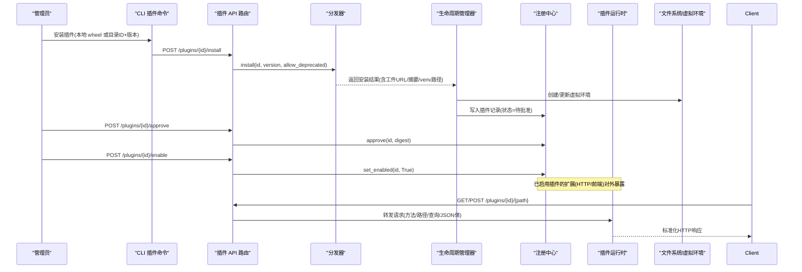
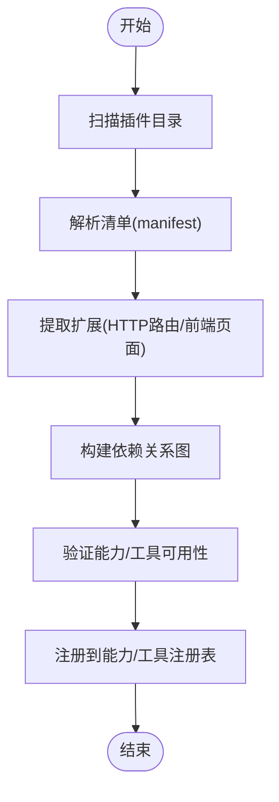
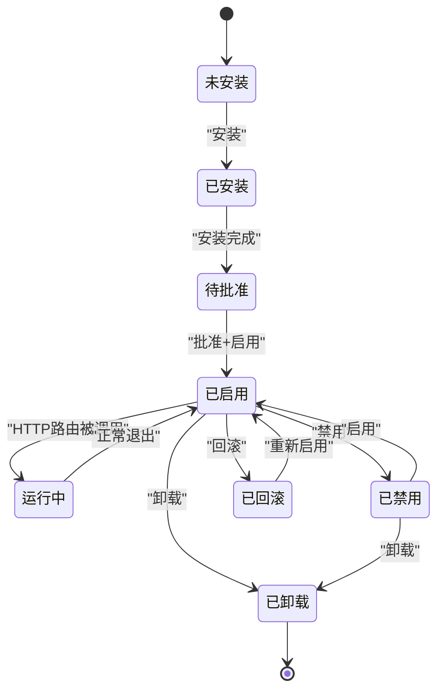
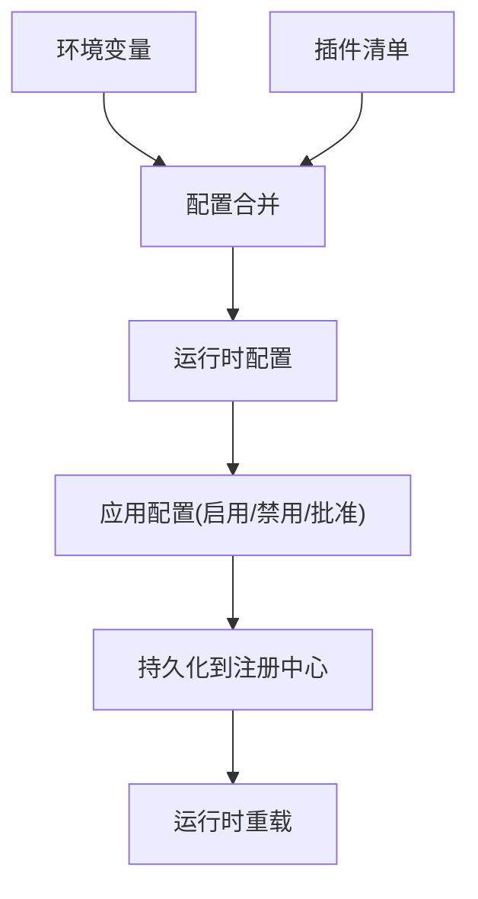
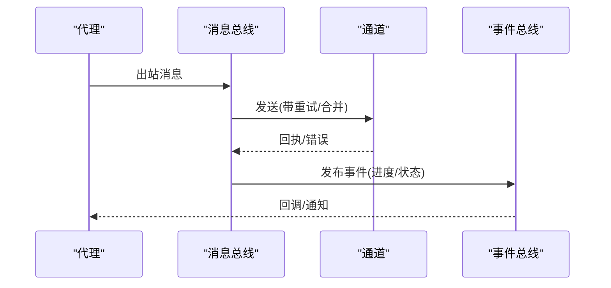
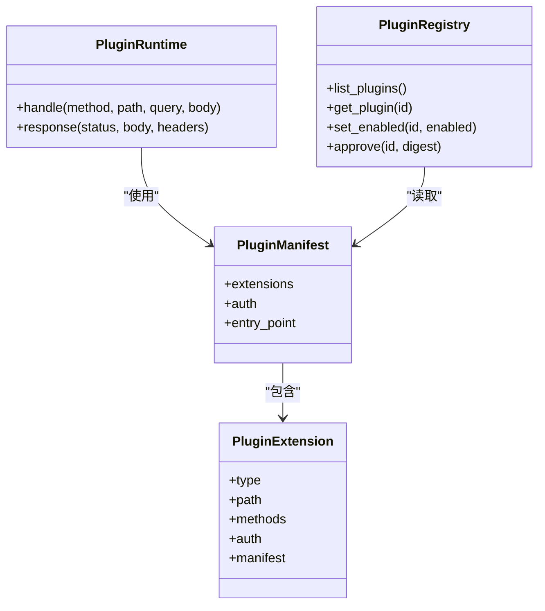
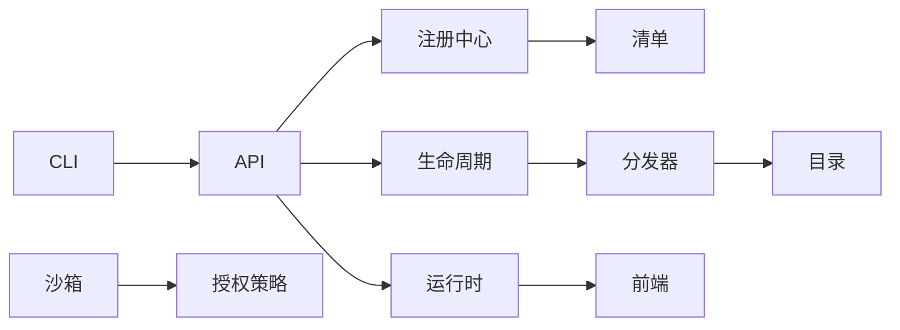

# 插件系统架构

<cite>
**本文引用的文件**   
- [deeptutor_cli/plugin.py](file://deeptutor_cli/plugin.py)
- [plugins.py](file://deeptutor/api/routers/plugins.py)
- [registry.py](file://deeptutor/plugins/registry.py)
- [lifecycle.py](file://deeptutor/plugins/lifecycle.py)
- [distribution.py](file://deeptutor/plugins/distribution.py)
- [catalog.py](file://deeptutor/plugins/catalog.py)
- [entry_points.py](file://deeptutor/plugins/entry_points.py)
- [manifest.py](file://deeptutor/plugins/manifest.py)
- [runtime.py](file://deeptutor/plugins/runtime.py)
- [frontend.py](file://deeptutor/plugins/frontend.py)
- [environment.py](file://deeptutor/plugins/environment.py)
- [loader.py](file://deeptutor/plugins/loader.py)
- [transactions.py](file://deeptutor/plugins/transactions.py)
- [capability_registry.py](file://deeptutor/runtime/registry/capability_registry.py)
- [tool_registry.py](file://deeptutor/runtime/registry/tool_registry.py)
- [event_bus.py](file://deeptutor/events/event_bus.py)
- [manager.py](file://deeptutor/services/partners/manager.py)
- [base.py](file://deeptutor/partners/channels/base.py)
- [__init__.py](file://deeptutor/partners/bus/__init__.py)
- [service.py](file://deeptutor/services/sandbox/service.py)
- [config.py](file://deeptutor/services/sandbox/config.py)
- [spec.py](file://deeptutor/services/sandbox/spec.py)
- [backends.py](file://deeptutor/services/sandbox/backends.py)
- [models.py](file://deeptutor/services/cli_apps/models.py)
- [installer.py](file://deeptutor/services/cli_apps/installer.py)
- [paths.py](file://deeptutor/services/cli_apps/paths.py)
- [space_cli_apps.py](file://deeptutor/api/routers/space_cli_apps.py)
- [provider.py](file://deeptutor/services/cli_apps/provider.py)
- [grants.py](file://deeptutor/multi_user/grants.py)
- [tool_access.py](file://deeptutor/multi_user/tool_access.py)
</cite>

## 目录
1. [简介](#简介)
2. [项目结构](#项目结构)
3. [核心组件](#核心组件)
4. [架构总览](#架构总览)
5. [详细组件分析](#详细组件分析)
6. [依赖关系分析](#依赖关系分析)
7. [性能考虑](#性能考虑)
8. [故障排查指南](#故障排查指南)
9. [结论](#结论)
10. [附录：插件开发指南](#附录插件开发指南)

## 简介
本文件系统性梳理 DeepTutor 插件系统的架构与实现，覆盖以下关键主题：
- 插件发现机制：目录扫描、清单解析、依赖图构建。
- 生命周期管理：初始化、启动、运行、销毁阶段的钩子与状态流转。
- 配置系统：环境变量注入、配置文件合并、运行时更新。
- 插件间通信：事件总线、消息传递与服务发现。
- 插件开发指南：项目结构、入口点、API 暴露、资源管理。
- 打包发布、版本管理与安全沙箱：安装策略、权限审批、隔离执行。

该文档面向开发者与集成者，既提供高层架构图，也给出代码级映射与流程图，帮助读者快速理解并扩展插件体系。

## 项目结构
DeepTutor 的插件能力由多个模块协作完成：
- CLI 层：提供插件列表、安装、启用/禁用、审批等命令。
- API 路由层：对外暴露插件目录、状态、安装、审批、HTTP 路由转发、前端页面托管等接口。
- 插件注册中心：维护已安装插件记录、状态、清单、安装信息。
- 插件生命周期管理器：负责安装、回滚、卸载、环境准备与清理。
- 分发器：从官方目录下载并校验插件包。
- 目录与清单：读取插件元数据、扩展声明（HTTP 路由、前端页面）。
- 运行时：在独立工作进程中处理插件 HTTP 请求。
- 前端页面：加载与校验插件前端清单与静态资源。
- 环境与事务：为插件安装/卸载提供原子性事务保障。
- 能力与工具注册：将插件暴露的能力与工具接入主进程。
- 事件总线：跨组件异步事件通知。
- 沙箱与 CLI 应用：对第三方可执行进行隔离与配额控制。

```mermaid
graph TB
subgraph "CLI"
CLI["deeptutor_cli/plugin.py"]
end
subgraph "API"
Router["api/routers/plugins.py"]
SpaceApps["api/routers/space_cli_apps.py"]
end
subgraph "插件核心"
Registry["plugins/registry.py"]
Lifecycle["plugins/lifecycle.py"]
Distribution["plugins/distribution.py"]
Catalog["plugins/catalog.py"]
Manifest["plugins/manifest.py"]
Runtime["plugins/runtime.py"]
Frontend["plugins/frontend.py"]
Environment["plugins/environment.py"]
Loader["plugins/loader.py"]
Transactions["plugins/transactions.py"]
EntryPoints["plugins/entry_points.py"]
end
subgraph "运行时与注册"
CapReg["runtime/registry/capability_registry.py"]
ToolReg["runtime/registry/tool_registry.py"]
EventBus["events/event_bus.py"]
end
subgraph "外部集成"
PartnersMgr["services/partners/manager.py"]
ChannelsBase["partners/channels/base.py"]
BusInit["partners/bus/__init__.py"]
end
subgraph "安全与执行"
SandboxSvc["services/sandbox/service.py"]
SandboxCfg["services/sandbox/config.py"]
SandboxSpec["services/sandbox/spec.py"]
SandboxBackends["services/sandbox/backends.py"]
CliModels["services/cli_apps/models.py"]
CliInstaller["services/cli_apps/installer.py"]
CliPaths["services/cli_apps/paths.py"]
Provider["services/cli_apps/provider.py"]
Grants["multi_user/grants.py"]
ToolAccess["multi_user/tool_access.py"]
end
CLI --> Router
Router --> Registry
Router --> Lifecycle
Router --> Distribution
Router --> Catalog
Router --> Runtime
Router --> Frontend
Registry --> Manifest
Registry --> Environment
Registry --> Transactions
Lifecycle --> Registry
Lifecycle --> Distribution
Lifecycle --> Environment
Distribution --> Catalog
Runtime --> Registry
Runtime --> Manifest
CapReg --> EntryPoints
ToolReg --> EntryPoints
EventBus --> PartnersMgr
PartnersMgr --> ChannelsBase
PartnersMgr --> BusInit
SandboxSvc --> SandboxCfg
SandboxSvc --> SandboxSpec
SandboxSvc --> SandboxBackends
CliModels --> CliInstaller
CliModels --> CliPaths
SpaceApps --> CliModels
Provider --> CliModels
Provider --> Grants
ToolAccess --> SandboxSvc
```

**图示来源**
- [deeptutor_cli/plugin.py:21-305](file://deeptutor_cli/plugin.py#L21-L305)
- [plugins.py:1-417](file://deeptutor/api/routers/plugins.py#L1-L417)
- [registry.py](file://deeptutor/plugins/registry.py)
- [lifecycle.py](file://deeptutor/plugins/lifecycle.py)
- [distribution.py](file://deeptutor/plugins/distribution.py)
- [catalog.py](file://deeptutor/plugins/catalog.py)
- [manifest.py](file://deeptutor/plugins/manifest.py)
- [runtime.py](file://deeptutor/plugins/runtime.py)
- [frontend.py](file://deeptutor/plugins/frontend.py)
- [environment.py](file://deeptutor/plugins/environment.py)
- [loader.py](file://deeptutor/plugins/loader.py)
- [transactions.py](file://deeptutor/plugins/transactions.py)
- [capability_registry.py](file://deeptutor/runtime/registry/capability_registry.py)
- [tool_registry.py](file://deeptutor/runtime/registry/tool_registry.py)
- [event_bus.py](file://deeptutor/events/event_bus.py)
- [manager.py:769-793](file://deeptutor/services/partners/manager.py#L769-L793)
- [base.py:164-184](file://deeptutor/partners/channels/base.py#L164-L184)
- [__init__.py:1-6](file://deeptutor/partners/bus/__init__.py#L1-L6)
- [service.py:86-132](file://deeptutor/services/sandbox/service.py#L86-L132)
- [config.py:1-38](file://deeptutor/services/sandbox/config.py#L1-L38)
- [spec.py:1-49](file://deeptutor/services/sandbox/spec.py#L1-L49)
- [backends.py:152-181](file://deeptutor/services/sandbox/backends.py#L152-L181)
- [models.py:55-123](file://deeptutor/services/cli_apps/models.py#L55-L123)
- [installer.py:196-253](file://deeptutor/services/cli_apps/installer.py#L196-L253)
- [paths.py:78-109](file://deeptutor/services/cli_apps/paths.py#L78-L109)
- [space_cli_apps.py:70-106](file://deeptutor/api/routers/space_cli_apps.py#L70-L106)
- [provider.py:74-110](file://deeptutor/services/cli_apps/provider.py#L74-L110)
- [grants.py:1-137](file://deeptutor/multi_user/grants.py#L1-L137)
- [tool_access.py:1-113](file://deeptutor/multi_user/tool_access.py#L1-L113)

**章节来源**
- [deeptutor_cli/plugin.py:21-305](file://deeptutor_cli/plugin.py#L21-L305)
- [plugins.py:1-417](file://deeptutor/api/routers/plugins.py#L1-L417)

## 核心组件
- 插件注册中心：维护插件 ID、版本、状态（可用/已启用/已禁用/已批准）、清单、安装路径、分布来源等；支持列出、查询、启用/禁用、批准等操作。
- 插件生命周期管理器：封装安装、回滚、卸载流程，创建与管理插件虚拟环境，处理失败恢复与状态一致性。
- 分发器：对接官方目录，按版本选择、校验摘要、下载工件，并与生命周期管理器协作完成安装。
- 目录与清单：读取插件元数据，解析扩展类型（HTTP 路由、前端页面），生成依赖关系与访问策略。
- 运行时：以独立线程或进程方式执行插件提供的 HTTP 路由处理器，限制请求体大小、方法白名单，返回标准化响应。
- 前端页面：校验插件前端清单与资源路径，通过 CSP 与安全头保护页面与资产。
- 环境与事务：为插件安装/卸载提供原子性操作，避免部分成功导致的状态不一致。
- 能力与工具注册：通过 entry points 将插件暴露的能力与工具注册到主进程，供业务调用。
- 事件总线：用于跨组件异步通知，如伙伴通道出站消息合并与投递。
- 沙箱与 CLI 应用：对第三方可执行进行隔离执行，结合配额、用户授权与部署策略决定是否允许执行。

**章节来源**
- [registry.py](file://deeptutor/plugins/registry.py)
- [lifecycle.py](file://deeptutor/plugins/lifecycle.py)
- [distribution.py](file://deeptutor/plugins/distribution.py)
- [catalog.py](file://deeptutor/plugins/catalog.py)
- [manifest.py](file://deeptutor/plugins/manifest.py)
- [runtime.py](file://deeptutor/plugins/runtime.py)
- [frontend.py](file://deeptutor/plugins/frontend.py)
- [environment.py](file://deeptutor/plugins/environment.py)
- [transactions.py](file://deeptutor/plugins/transactions.py)
- [capability_registry.py](file://deeptutor/runtime/registry/capability_registry.py)
- [tool_registry.py](file://deeptutor/runtime/registry/tool_registry.py)
- [event_bus.py](file://deeptutor/events/event_bus.py)
- [service.py:86-132](file://deeptutor/services/sandbox/service.py#L86-L132)

## 架构总览
插件系统采用“注册中心 + 生命周期 + 分发 + 运行时”的分层架构：
- 控制面（CLI/API）：负责插件的发现、安装、启用/禁用、审批、状态查询。
- 数据面（注册中心/清单）：持久化插件元数据与状态，提供查询接口。
- 执行面（运行时）：在隔离环境中执行插件 HTTP 路由，限制资源与输入。
- 基础设施（沙箱/CLI 应用）：对第三方二进制与脚本进行隔离与配额控制。



**图示来源**
- [deeptutor_cli/plugin.py:183-262](file://deeptutor_cli/plugin.py#L183-L262)
- [plugins.py:345-376](file://deeptutor/api/routers/plugins.py#L345-L376)
- [distribution.py](file://deeptutor/plugins/distribution.py)
- [lifecycle.py](file://deeptutor/plugins/lifecycle.py)
- [registry.py](file://deeptutor/plugins/registry.py)
- [runtime.py](file://deeptutor/plugins/runtime.py)

## 详细组件分析

### 插件发现机制
- 目录扫描：通过注册中心与清单模块扫描已安装插件目录，识别扩展类型（HTTP 路由、前端页面）。
- 清单解析：读取插件清单，提取扩展声明、认证策略、入口文件等元数据。
- 依赖图构建：基于清单中的依赖字段与能力/工具注册表，构建插件间的依赖关系，确保加载顺序与可用性检查。



**图示来源**
- [registry.py](file://deeptutor/plugins/registry.py)
- [manifest.py](file://deeptutor/plugins/manifest.py)
- [capability_registry.py](file://deeptutor/runtime/registry/capability_registry.py)
- [tool_registry.py](file://deeptutor/runtime/registry/tool_registry.py)
- [entry_points.py](file://deeptutor/plugins/entry_points.py)

**章节来源**
- [registry.py](file://deeptutor/plugins/registry.py)
- [manifest.py](file://deeptutor/plugins/manifest.py)
- [capability_registry.py](file://deeptutor/runtime/registry/capability_registry.py)
- [tool_registry.py](file://deeptutor/runtime/registry/tool_registry.py)
- [entry_points.py](file://deeptutor/plugins/entry_points.py)

### 生命周期管理
插件生命周期包括：
- 初始化：创建虚拟环境、安装依赖、校验工件摘要。
- 启动：加载清单、注册扩展、预热运行时。
- 运行：处理 HTTP 请求、限制请求体与方法、返回标准化响应。
- 销毁：停止运行时、清理虚拟环境、移除状态记录。



**图示来源**
- [lifecycle.py](file://deeptutor/plugins/lifecycle.py)
- [registry.py](file://deeptutor/plugins/registry.py)
- [runtime.py](file://deeptutor/plugins/runtime.py)

**章节来源**
- [lifecycle.py](file://deeptutor/plugins/lifecycle.py)
- [registry.py](file://deeptutor/plugins/registry.py)
- [runtime.py](file://deeptutor/plugins/runtime.py)

### 配置系统
- 环境变量注入：通过环境变量控制沙箱后端选择、并发与速率配额、是否允许子进程执行等。
- 配置文件合并：插件清单与环境变量合并，形成最终运行配置；支持运行时更新（如启用/禁用、批准）。
- 运行时更新：通过 API 或 CLI 触发插件状态变更，注册中心持久化新状态，运行时按需重载。



**图示来源**
- [config.py:1-38](file://deeptutor/services/sandbox/config.py#L1-L38)
- [service.py:86-132](file://deeptutor/services/sandbox/service.py#L86-L132)
- [registry.py](file://deeptutor/plugins/registry.py)

**章节来源**
- [config.py:1-38](file://deeptutor/services/sandbox/config.py#L1-L38)
- [service.py:86-132](file://deeptutor/services/sandbox/service.py#L86-L132)
- [registry.py](file://deeptutor/plugins/registry.py)

### 插件间通信
- 事件总线：用于跨组件异步通知，例如伙伴通道出站消息合并与投递。
- 消息传递：通过消息队列与事件类型定义，解耦通道与代理之间的通信。
- 服务发现：通过注册中心与清单暴露的服务端点，实现插件间服务发现。



**图示来源**
- [manager.py:769-793](file://deeptutor/services/partners/manager.py#L769-L793)
- [base.py:164-184](file://deeptutor/partners/channels/base.py#L164-L184)
- [__init__.py:1-6](file://deeptutor/partners/bus/__init__.py#L1-L6)
- [event_bus.py](file://deeptutor/events/event_bus.py)

**章节来源**
- [manager.py:769-793](file://deeptutor/services/partners/manager.py#L769-L793)
- [base.py:164-184](file://deeptutor/partners/channels/base.py#L164-L184)
- [__init__.py:1-6](file://deeptutor/partners/bus/__init__.py#L1-L6)
- [event_bus.py](file://deeptutor/events/event_bus.py)

### 插件开发与资源管理
- 项目结构：插件应包含清单文件、扩展定义（HTTP 路由或前端页面）、依赖声明。
- 入口点定义：通过 entry points 暴露能力与工具，供主进程注册。
- API 暴露：插件可通过 HTTP 路由扩展 API，需声明方法与认证策略。
- 资源管理：前端页面需遵循清单与 CSP 策略，静态资源路径需校验。



**图示来源**
- [manifest.py](file://deeptutor/plugins/manifest.py)
- [runtime.py](file://deeptutor/plugins/runtime.py)
- [registry.py](file://deeptutor/plugins/registry.py)

**章节来源**
- [manifest.py](file://deeptutor/plugins/manifest.py)
- [runtime.py](file://deeptutor/plugins/runtime.py)
- [registry.py](file://deeptutor/plugins/registry.py)

## 依赖关系分析
插件系统与外部组件的依赖关系如下：
- CLI 与 API：提供用户交互与管理接口。
- 注册中心与生命周期：管理插件状态与安装流程。
- 分发器与目录：获取插件工件与元数据。
- 运行时与前端：执行插件逻辑与托管前端资源。
- 沙箱与 CLI 应用：隔离第三方执行并提供配额控制。
- 多用户授权：根据授予策略决定是否允许执行或访问。



**图示来源**
- [deeptutor_cli/plugin.py:21-305](file://deeptutor_cli/plugin.py#L21-L305)
- [plugins.py:1-417](file://deeptutor/api/routers/plugins.py#L1-L417)
- [registry.py](file://deeptutor/plugins/registry.py)
- [lifecycle.py](file://deeptutor/plugins/lifecycle.py)
- [distribution.py](file://deeptutor/plugins/distribution.py)
- [catalog.py](file://deeptutor/plugins/catalog.py)
- [runtime.py](file://deeptutor/plugins/runtime.py)
- [frontend.py](file://deeptutor/plugins/frontend.py)
- [service.py:86-132](file://deeptutor/services/sandbox/service.py#L86-L132)
- [grants.py:1-137](file://deeptutor/multi_user/grants.py#L1-L137)

**章节来源**
- [deeptutor_cli/plugin.py:21-305](file://deeptutor_cli/plugin.py#L21-L305)
- [plugins.py:1-417](file://deeptutor/api/routers/plugins.py#L1-L417)
- [registry.py](file://deeptutor/plugins/registry.py)
- [lifecycle.py](file://deeptutor/plugins/lifecycle.py)
- [distribution.py](file://deeptutor/plugins/distribution.py)
- [catalog.py](file://deeptutor/plugins/catalog.py)
- [runtime.py](file://deeptutor/plugins/runtime.py)
- [frontend.py](file://deeptutor/plugins/frontend.py)
- [service.py:86-132](file://deeptutor/services/sandbox/service.py#L86-L132)
- [grants.py:1-137](file://deeptutor/multi_user/grants.py#L1-L137)

## 性能考虑
- 插件请求体限制：防止过大请求阻塞工作线程。
- 沙箱后端健康检查：自动降级到受限子进程，保证基本可用性。
- 并发与配额：限制每用户并发执行次数与每分钟执行次数，避免资源耗尽。
- 前端资源缓存控制：设置 no-store 与 CSP，避免敏感信息泄露。

**章节来源**
- [plugins.py:247-253](file://deeptutor/api/routers/plugins.py#L247-L253)
- [service.py:86-132](file://deeptutor/services/sandbox/service.py#L86-L132)
- [config.py:32-38](file://deeptutor/services/sandbox/config.py#L32-L38)
- [plugins.py:399-413](file://deeptutor/api/routers/plugins.py#L399-L413)

## 故障排查指南
- 插件未找到：检查插件 ID 是否正确，确认已安装且状态为已启用。
- 审批失败：核对快照摘要是否与清单一致，确保管理员权限。
- 运行时错误：查看插件日志，确认 HTTP 路由方法与路径匹配，请求体为 JSON。
- 沙箱不可用：检查环境变量与后端健康状态，必要时启用受限子进程模式。
- CLI 应用被阻止：确认授予策略与执行开关，检查账户权限。

**章节来源**
- [plugins.py:309-376](file://deeptutor/api/routers/plugins.py#L309-L376)
- [service.py:86-132](file://deeptutor/services/sandbox/service.py#L86-L132)
- [space_cli_apps.py:70-106](file://deeptutor/api/routers/space_cli_apps.py#L70-L106)
- [provider.py:74-110](file://deeptutor/services/cli_apps/provider.py#L74-L110)

## 结论
DeepTutor 插件系统通过清晰的职责分离与严格的权限控制，实现了可扩展、可审计、可隔离的插件生态。注册中心与生命周期管理器确保插件状态一致，分发器与目录提供安全的工件来源，运行时与前端提供稳定的执行与展示环境，沙箱与 CLI 应用则保障第三方代码的安全执行。事件总线与消息传递机制解耦了组件间通信，提升了系统整体稳定性与可维护性。

## 附录：插件开发指南
- 项目结构：
  - 清单文件：声明扩展类型、认证策略、入口文件。
  - 扩展实现：HTTP 路由处理器或前端页面。
  - 依赖声明：Python 包或 Node 包。
- 入口点定义：
  - 通过 entry points 暴露能力与工具，供主进程注册。
- API 暴露：
  - 在清单中声明 HTTP 路由，指定方法与认证策略。
  - 处理请求体与查询参数，返回标准化响应。
- 资源管理：
  - 前端页面需遵循清单与 CSP 策略，静态资源路径需校验。
- 打包发布：
  - 使用官方目录发布插件，确保版本与摘要正确。
- 版本管理：
  - 支持 latest 与具体版本安装，支持回滚与卸载。
- 安全沙箱：
  - 第三方可执行需在沙箱中运行，受配额与授权策略约束。

**章节来源**
- [manifest.py](file://deeptutor/plugins/manifest.py)
- [entry_points.py](file://deeptutor/plugins/entry_points.py)
- [runtime.py](file://deeptutor/plugins/runtime.py)
- [frontend.py](file://deeptutor/plugins/frontend.py)
- [catalog.py](file://deeptutor/plugins/catalog.py)
- [lifecycle.py](file://deeptutor/plugins/lifecycle.py)
- [service.py:86-132](file://deeptutor/services/sandbox/service.py#L86-L132)