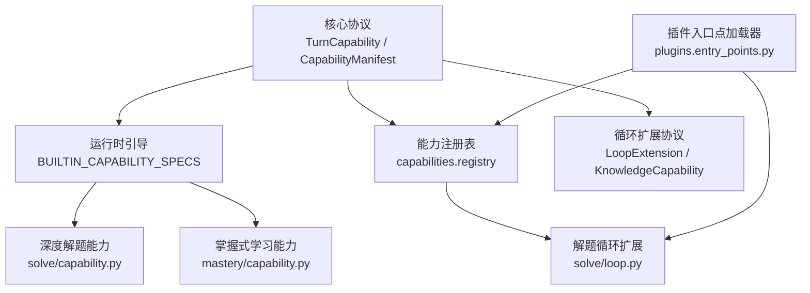
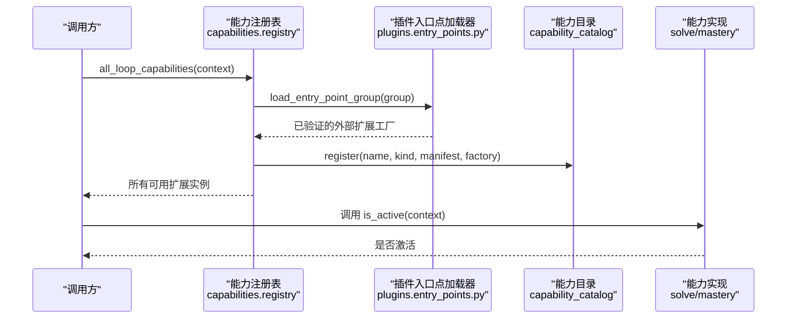
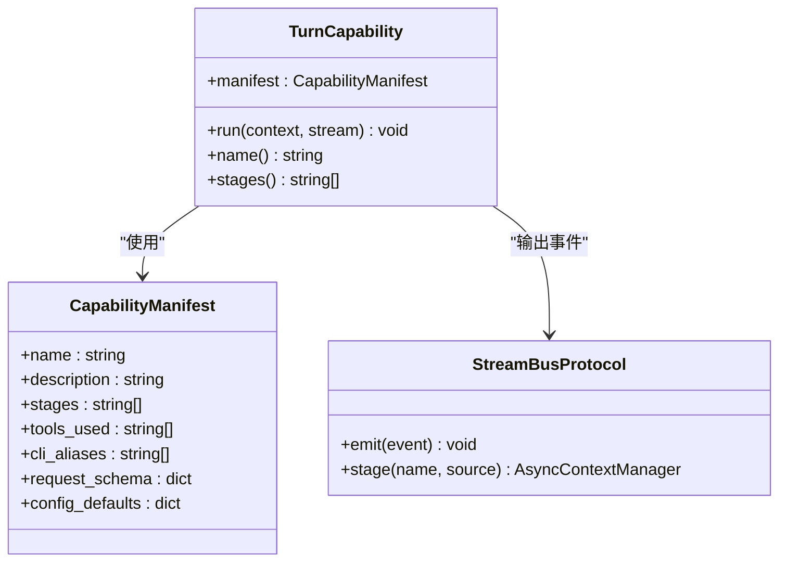
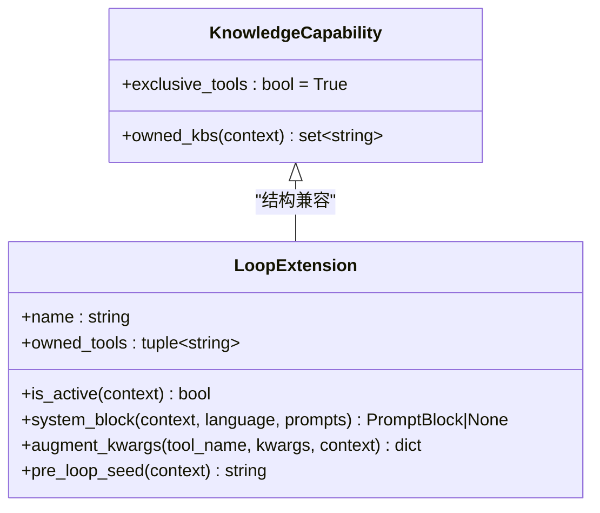
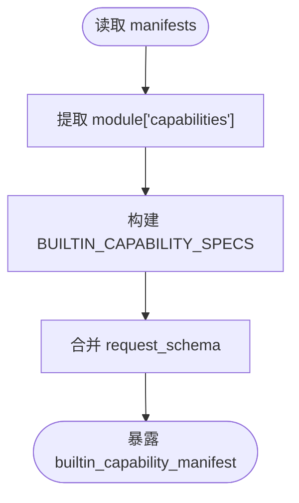
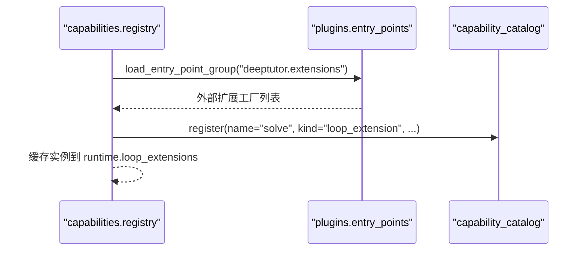
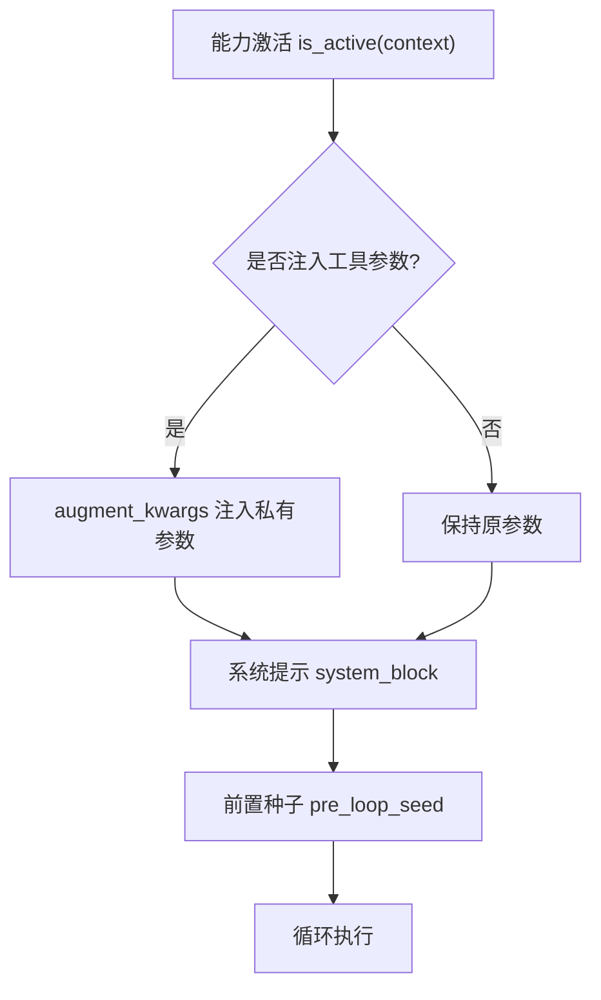
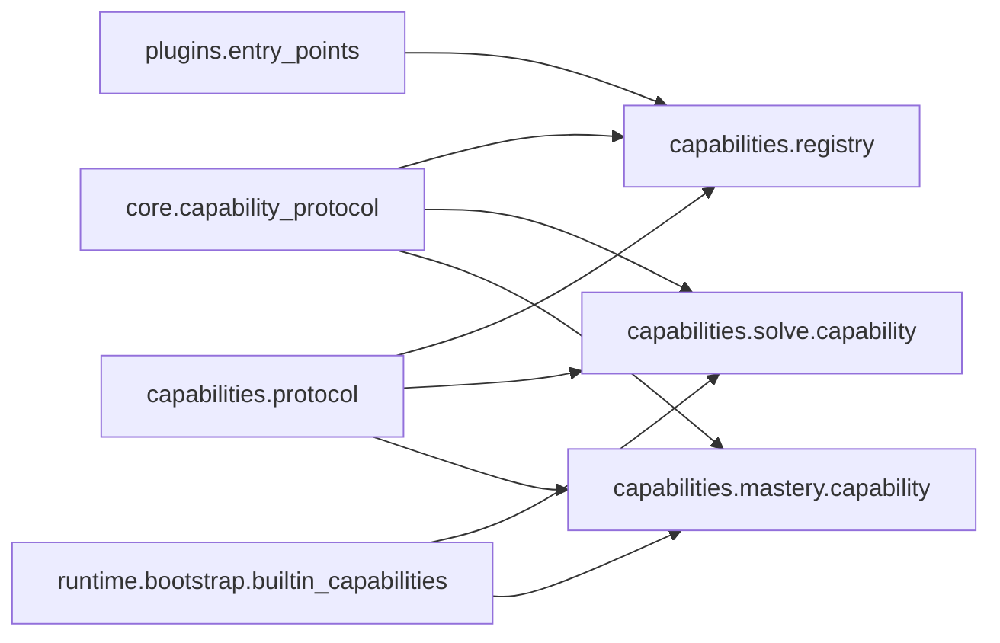

# 能力扩展机制

<cite>
**本文引用的文件**   
- [capability_protocol.py](file://deeptutor/core/capability_protocol.py)
- [protocol.py](file://deeptutor/capabilities/protocol.py)
- [registry.py](file://deeptutor/capabilities/registry.py)
- [__init__.py](file://deeptutor/capabilities/__init__.py)
- [builtin_capabilities.py](file://deeptutor/runtime/bootstrap/builtin_capabilities.py)
- [entry_points.py](file://deeptutor/plugins/entry_points.py)
- [capability_registry.py](file://deeptutor/runtime/registry/capability_registry.py)
- [capability.py](file://deeptutor/capabilities/solve/capability.py)
- [loop.py](file://deeptutor/capabilities/solve/loop.py)
- [capability.py](file://deeptutor/capabilities/mastery/capability.py)
- [pipeline.py](file://deeptutor/capabilities/mastery/pipeline.py)
</cite>

## 目录
1. [引言](#引言)
2. [项目结构](#项目结构)
3. [核心组件](#核心组件)
4. [架构总览](#架构总览)
5. [详细组件分析](#详细组件分析)
6. [依赖关系分析](#依赖关系分析)
7. [性能与可观测性](#性能与可观测性)
8. [故障排查指南](#故障排查指南)
9. [结论](#结论)
10. [附录：开发示例与最佳实践](#附录开发示例与最佳实践)

## 引言
本文件系统性说明 DeepTutor 的能力扩展机制，覆盖两类“能力”：
- 回合级能力（Level 2）：以 TurnCapability 为基类，代表一个完整的深度模式工作流，例如“深度解题”“掌握式学习”。
- 聊天循环扩展（Loop Extension）：以 LoopExtension/KnowledgeCapability 为协议，对现有聊天循环进行增强或接管。

文档将解释能力的定义、注册、发现、生命周期管理、依赖注入、配置管理、版本兼容策略，并提供从简单工具型到复杂多步骤工作流的开发指南与调试建议。

## 项目结构
DeepTutor 的能力体系由以下关键模块组成：
- 核心协议层：TurnCapability、CapabilityManifest、StreamBusProtocol 定义回合级能力接口；LoopExtension、KnowledgeCapability 定义聊天循环扩展协议。
- 内置能力声明：通过模块清单 manifests 暴露 class_path 与 manifest，运行时组装 BUILTIN_CAPABILITY_SPECS。
- 能力注册与发现：capabilities.registry 负责聊天循环扩展的工厂注册与外部插件发现；runtime.registry.capability_registry 提供回合级能力的 Catalog 视图。
- 插件入口点：plugins.entry_points 统一加载 entry point group，支持官方模块开关与第三方插件安全加载。
- 具体能力实现：solve、mastery 等能力分别实现 TurnCapability 与对应的 LoopExtension。

**图表来源**
- [capability_protocol.py:33-81](file://deeptutor/core/capability_protocol.py#L33-L81)
- [protocol.py:30-150](file://deeptutor/capabilities/protocol.py#L30-L150)
- [registry.py:28-65](file://deeptutor/capabilities/registry.py#L28-L65)
- [builtin_capabilities.py:11-30](file://deeptutor/runtime/bootstrap/builtin_capabilities.py#L11-L30)
- [entry_points.py:37-97](file://deeptutor/plugins/entry_points.py#L37-L97)
- [capability.py](file://deeptutor/capabilities/solve/capability.py)
- [loop.py](file://deeptutor/capabilities/solve/loop.py)
- [capability.py](file://deeptutor/capabilities/mastery/capability.py)

**章节来源**
- [capability_protocol.py:1-103](file://deeptutor/core/capability_protocol.py#L1-L103)
- [protocol.py:1-188](file://deeptutor/capabilities/protocol.py#L1-L188)
- [registry.py:1-223](file://deeptutor/capabilities/registry.py#L1-L223)
- [builtin_capabilities.py:1-49](file://deeptutor/runtime/bootstrap/builtin_capabilities.py#L1-L49)
- [entry_points.py:1-101](file://deeptutor/plugins/entry_points.py#L1-L101)

## 核心组件
- 回合级能力协议
  - TurnCapability：抽象基类，要求子类提供 manifest 并实现 run(context, stream)。
  - CapabilityManifest：静态元数据，包含 name、description、stages、tools_used、cli_aliases、request_schema、config_defaults。
  - StreamBusProtocol：最小输出端口，支持 emit(event) 与 stage(name, source) 上下文管理器。
- 聊天循环扩展协议
  - LoopExtension：可选钩子集合，包括 is_active、system_block、augment_kwargs、pre_loop_seed，以及可选 pre_loop、on_user_pause/resume、finish_instruction、settlement_recovery 等。
  - KnowledgeCapability：知识型能力基类，设置 exclusive_tools=True，表示该能力拥有回合的工具表面，替换而非追加 chat 内置工具。

这些组件共同构成能力扩展的两条主线：
- 一条是“回合级能力”，用于驱动完整的多步智能流程。
- 另一条是“聊天循环扩展”，用于在现有聊天循环中挂载工具、注入系统提示、控制行为。

**章节来源**
- [capability_protocol.py:21-81](file://deeptutor/core/capability_protocol.py#L21-L81)
- [protocol.py:30-150](file://deeptutor/capabilities/protocol.py#L30-L150)

## 架构总览
DeepTutor 的能力扩展遵循“协议 + 注册 + 发现 + 实例化”的分层设计：
- 协议层定义能力契约，确保不同能力与运行时的稳定交互。
- 引导层从 manifests 读取内置能力的 class_path 与 manifest，生成 BUILTIN_CAPABILITY_SPECS。
- 注册层维护 LoopExtension 工厂与实例缓存，并在需要时向 capability catalog 登记。
- 发现层通过 plugins.entry_points 加载官方与第三方插件，支持模块开关与安全校验。
- 运行时根据 UnifiedContext 选择激活的能力，并注入工具、提示与状态。

**图表来源**
- [registry.py:159-187](file://deeptutor/capabilities/registry.py#L159-L187)
- [entry_points.py:37-97](file://deeptutor/plugins/entry_points.py#L37-L97)

**章节来源**
- [registry.py:1-223](file://deeptutor/capabilities/registry.py#L1-L223)
- [entry_points.py:1-101](file://deeptutor/plugins/entry_points.py#L1-L101)

## 详细组件分析

### 回合级能力协议与生命周期
- 定义
  - TurnCapability 要求子类提供 manifest 与 run(context, stream)。
  - CapabilityManifest 描述能力的静态元数据，供 UI、CLI 与运行时使用。
- 生命周期
  - 启动阶段：manifest 被读取并注入 request_schema。
  - 执行阶段：run 方法接收 UnifiedContext 与 StreamBusProtocol，负责编排异步流程并通过 stream.stage 标注阶段。
  - 结束阶段：完成所有阶段后返回，由上层服务持久化与广播事件。

**图表来源**
- [capability_protocol.py:33-81](file://deeptutor/core/capability_protocol.py#L33-L81)

**章节来源**
- [capability_protocol.py:1-103](file://deeptutor/core/capability_protocol.py#L1-L103)

### 聊天循环扩展协议与知识型能力
- LoopExtension
  - 提供 is_active、system_block、augment_kwargs、pre_loop_seed 等钩子。
  - 可选 pre_loop、on_user_pause/resume、finish_instruction、settlement_recovery 等高级钩子。
- KnowledgeCapability
  - 继承 LoopExtension 结构，但设置 exclusive_tools=True，表示该能力拥有回合工具表面。
  - owned_kbs(context) 返回该能力独占的知识库引用，避免与其他 KB 冲突。

**图表来源**
- [protocol.py:30-150](file://deeptutor/capabilities/protocol.py#L30-L150)

**章节来源**
- [protocol.py:1-188](file://deeptutor/capabilities/protocol.py#L1-L188)

### 内置能力声明与请求契约
- builtin_capabilities.py 从 manifests 读取 capabilities 条目，生成 BUILTIN_CAPABILITY_SPECS 与 BUILTIN_CAPABILITY_CLASSES。
- builtin_capability_manifest(name) 会合并运行时 request_schema，使每个能力具备参数校验契约。

**图表来源**
- [builtin_capabilities.py:17-40](file://deeptutor/runtime/bootstrap/builtin_capabilities.py#L17-L40)

**章节来源**
- [builtin_capabilities.py:1-49](file://deeptutor/runtime/bootstrap/builtin_capabilities.py#L1-L49)

### 能力发现与动态加载流程
- capabilities.registry
  - 维护 LOOP_EXTENSION_FACTORIES 与 BUILTIN_LOOP_CAPABILITY_SPECS。
  - _discover_external_loop_capabilities 通过 entry points 加载外部扩展，并进行名称去重与兼容性检查。
  - all_loop_capabilities 创建实例、缓存到 runtime.loop_extensions，并向 capability catalog 登记。
- plugins.entry_points
  - load_entry_point_group 统一处理官方与第三方插件，支持模块开关、编辑安装源补充、异常隔离与日志记录。

**图表来源**
- [registry.py:115-187](file://deeptutor/capabilities/registry.py#L115-L187)
- [entry_points.py:37-97](file://deeptutor/plugins/entry_points.py#L37-L97)

**章节来源**
- [registry.py:1-223](file://deeptutor/capabilities/registry.py#L1-L223)
- [entry_points.py:1-101](file://deeptutor/plugins/entry_points.py#L1-L101)

### 依赖注入机制
- 工具注入
  - LoopExtension.augment_kwargs 允许能力为特定工具注入私有参数，例如 solve 能力注入 _solve_session_id 与 max_replans。
- 系统提示注入
  - system_block 返回 PromptBlock，作为系统提示的一部分注入到循环。
- 前置种子注入
  - pre_loop_seed 可在首轮 LLM 调用前追加用户消息种子文本。
- 知识型能力
  - KnowledgeCapability.exclusive_tools=True 替换工具表面；owned_kbs 排除非拥有的 KB 引用，避免冲突。

**图表来源**
- [loop.py:50-70](file://deeptutor/capabilities/solve/loop.py#L50-L70)
- [protocol.py:114-136](file://deeptutor/capabilities/protocol.py#L114-L136)

**章节来源**
- [loop.py:1-84](file://deeptutor/capabilities/solve/loop.py#L1-L84)
- [protocol.py:1-188](file://deeptutor/capabilities/protocol.py#L1-L188)

### 版本兼容性与弃用路径
- BaseCapability 已弃用，TurnCapability 替代；访问 BaseCapability 会触发 DeprecationWarning。
- LoopCapability 已弃用，LoopExtension 替代；访问 LoopCapability 会触发 DeprecationWarning。
- 旧版 loop_capabilities 组仍被兼容加载，但会发出弃用警告，建议迁移至 deeptutor.extensions。

**章节来源**
- [capability_protocol.py:84-94](file://deeptutor/core/capability_protocol.py#L84-L94)
- [protocol.py:177-187](file://deeptutor/capabilities/protocol.py#L177-L187)
- [registry.py:136-144](file://deeptutor/capabilities/registry.py#L136-L144)

### 错误处理模式
- 前置条件失败
  - CapabilityPrerequisiteError 表示必需的前置条件未满足，不应被强制绕过。
- 插件加载异常隔离
  - plugins.entry_points.load_entry_point_group 捕获导入与 coerce 异常，记录警告并跳过失败项，不影响其他插件。
- 能力实现防御性读取
  - solve/capability.py 在读取 solve 参数时使用 try/except 并回退默认值，防止配置读取失败导致崩溃。

**章节来源**
- [capability_protocol.py:21-23](file://deeptutor/core/capability_protocol.py#L21-L23)
- [entry_points.py:52-97](file://deeptutor/plugins/entry_points.py#L52-L97)
- [capability.py](file://deeptutor/capabilities/solve/capability.py)

## 依赖关系分析
- 耦合与内聚
  - TurnCapability 与 CapabilityManifest 高内聚，职责清晰。
  - LoopExtension 与 KnowledgeCapability 解耦于具体能力实现，仅约定钩子。
- 直接依赖
  - registry.py 依赖 protocol.py、modules.catalog.manifests、plugins.entry_points、runtime.capability_catalog。
  - builtin_capabilities.py 依赖 modules.catalog.manifests 与 runtime.request_contracts。
- 间接依赖
  - solve/mastery 能力依赖各自的 pipeline、tools、session 等模块，体现功能域内聚。
- 外部依赖
  - plugins.entry_points 依赖 importlib.metadata.entry_points，并与 deeptutor.plugins.runtime 的安全策略协作。

**图表来源**
- [capability_protocol.py:1-103](file://deeptutor/core/capability_protocol.py#L1-L103)
- [protocol.py:1-188](file://deeptutor/capabilities/protocol.py#L1-L188)
- [registry.py:1-223](file://deeptutor/capabilities/registry.py#L1-L223)
- [builtin_capabilities.py:1-49](file://deeptutor/runtime/bootstrap/builtin_capabilities.py#L1-L49)
- [entry_points.py:1-101](file://deeptutor/plugins/entry_points.py#L1-L101)

**章节来源**
- [capability_protocol.py:1-103](file://deeptutor/core/capability_protocol.py#L1-L103)
- [protocol.py:1-188](file://deeptutor/capabilities/protocol.py#L1-L188)
- [registry.py:1-223](file://deeptutor/capabilities/registry.py#L1-L223)
- [builtin_capabilities.py:1-49](file://deeptutor/runtime/bootstrap/builtin_capabilities.py#L1-L49)
- [entry_points.py:1-101](file://deeptutor/plugins/entry_points.py#L1-L101)

## 性能与可观测性
- 异步与线程池
  - mastery/pipeline.py 使用 asyncio.to_thread 执行存储与检索操作，避免阻塞事件循环。
- 预算与限制
  - solve 能力通过 metadata 传递 max_rounds、max_tokens、temperature 与 max_replans，限制模型调用与重规划次数。
- 流式事件
  - TurnCapability.run 应使用 StreamBusProtocol.stage 标注阶段，便于前端展示与后端追踪。
- 延迟工具加载
  - mastery/pipeline.py 对部分工具进行延迟加载，减少初始开销。

**章节来源**
- [pipeline.py:79-215](file://deeptutor/capabilities/mastery/pipeline.py#L79-L215)
- [capability.py](file://deeptutor/capabilities/solve/capability.py)

## 故障排查指南
- 插件无法加载
  - 检查 entry point group 是否正确注册，查看日志中的弃用警告与跳过原因。
  - 确认模块开关是否启用，官方模块受 manifests 控制。
- 能力未激活
  - 检查 is_active 逻辑，确保 context.metadata 标志位正确设置。
- 工具参数未注入
  - 检查 augment_kwargs 是否匹配 tool_name 与能力激活状态。
- 配置读取失败
  - 参考 solve 能力的防御性读取模式，添加 try/except 与默认值回退。

**章节来源**
- [entry_points.py:52-97](file://deeptutor/plugins/entry_points.py#L52-L97)
- [loop.py:34-70](file://deeptutor/capabilities/solve/loop.py#L34-L70)
- [capability.py](file://deeptutor/capabilities/solve/capability.py)

## 结论
DeepTutor 的能力扩展机制通过清晰的协议分层、稳健的注册与发现流程、安全的插件加载策略，实现了高度可扩展的智能能力体系。开发者可以基于 TurnCapability 构建回合级工作流，或通过 LoopExtension/KnowledgeCapability 增强聊天循环。结合配置契约、流式事件与异步优化，能力既能灵活又可观测，适合从简单工具到复杂多步骤工作流的广泛场景。

## 附录：开发示例与最佳实践

### 开发指南概览
- 继承基类
  - 回合级能力：继承 TurnCapability，提供 manifest 与 run。
  - 聊天循环扩展：实现 LoopExtension 或继承 KnowledgeCapability。
- 必要方法
  - TurnCapability.run(context, stream)
  - LoopExtension.is_active(context)、system_block、augment_kwargs、pre_loop_seed
- 异步与错误处理
  - 使用 asyncio 与 asyncio.to_thread 避免阻塞。
  - 捕获配置读取与外部依赖异常，提供默认值与降级路径。
- 配置管理
  - 使用 builtin_capability_manifest 获取 request_schema，进行参数校验。
  - 通过 config_defaults 提供默认值，支持环境变量注入（由上层配置层决定）。

**章节来源**
- [capability_protocol.py:33-81](file://deeptutor/core/capability_protocol.py#L33-L81)
- [protocol.py:114-150](file://deeptutor/capabilities/protocol.py#L114-L150)
- [builtin_capabilities.py:33-40](file://deeptutor/runtime/bootstrap/builtin_capabilities.py#L33-L40)

### 简单工具型能力示例
- 目标：提供一个只读工具，如查询当前会话语言。
- 步骤：
  - 定义 LoopExtension，实现 is_active 与 augment_kwargs。
  - 在 augment_kwargs 中注入 session_id 或语言信息。
  - 通过 system_block 提供简短的系统提示。
- 关键点：
  - 不改变工具表面，仅增强现有工具。
  - 保持轻量，避免引入额外依赖。

**章节来源**
- [protocol.py:114-136](file://deeptutor/capabilities/protocol.py#L114-L136)

### 复杂多步骤工作流示例
- 目标：实现类似 solve 的多步骤问题求解。
- 步骤：
  - 定义 TurnCapability，设置 solve_mode 与 session_id。
  - 读取配置参数，设置 max_rounds、max_tokens、temperature、max_replans。
  - 调用 AgenticChatPipeline 或自定义 pipeline 执行循环。
  - 在 LoopExtension 中挂载 solve 工具，注入 session 状态。
- 关键点：
  - 使用 stream.stage 标注规划、推理、写作等阶段。
  - 通过 metadata 传递预算与状态，避免模型直接写入。
  - 防御性读取配置，确保鲁棒性。

**章节来源**
- [capability.py](file://deeptutor/capabilities/solve/capability.py)
- [loop.py:34-70](file://deeptutor/capabilities/solve/loop.py#L34-L70)

### 调试技巧
- 启用日志
  - 使用 Python logging 记录插件加载、能力激活与工具注入过程。
- 流式事件
  - 通过 StreamBusProtocol.emit 与 stage 观察阶段进度。
- 单元测试
  - 模拟 UnifiedContext 与 StreamBusProtocol，验证能力行为。
- 插件沙箱
  - 利用 plugins.entry_points 的异常隔离特性，逐步定位问题插件。

**章节来源**
- [entry_points.py:52-97](file://deeptutor/plugins/entry_points.py#L52-L97)
- [capability_protocol.py:25-31](file://deeptutor/core/capability_protocol.py#L25-L31)

### 性能优化建议
- 延迟加载
  - 对重型工具或资源进行延迟加载，减少启动开销。
- 预算控制
  - 通过 metadata 传递 max_rounds、max_tokens、max_replans，限制模型调用。
- 异步 IO
  - 使用 asyncio.to_thread 执行磁盘或网络 IO，避免阻塞事件循环。
- 缓存
  - 复用能力实例与工具视图，减少重复初始化。

**章节来源**
- [pipeline.py:237-289](file://deeptutor/capabilities/mastery/pipeline.py#L237-L289)
- [capability.py](file://deeptutor/capabilities/solve/capability.py)

### 最佳实践
- 明确职责边界
  - 回合级能力负责整体流程，循环扩展负责增强与注入。
- 保持向后兼容
  - 使用弃用警告过渡旧接口，逐步迁移到新协议。
- 安全优先
  - 插件加载需经过安全检查，避免恶意或损坏插件影响系统。
- 可观测性
  - 通过流式事件与日志记录能力执行过程，便于监控与排错。

**章节来源**
- [capability_protocol.py:84-94](file://deeptutor/core/capability_protocol.py#L84-L94)
- [protocol.py:177-187](file://deeptutor/capabilities/protocol.py#L177-L187)
- [entry_points.py:71-97](file://deeptutor/plugins/entry_points.py#L71-L97)