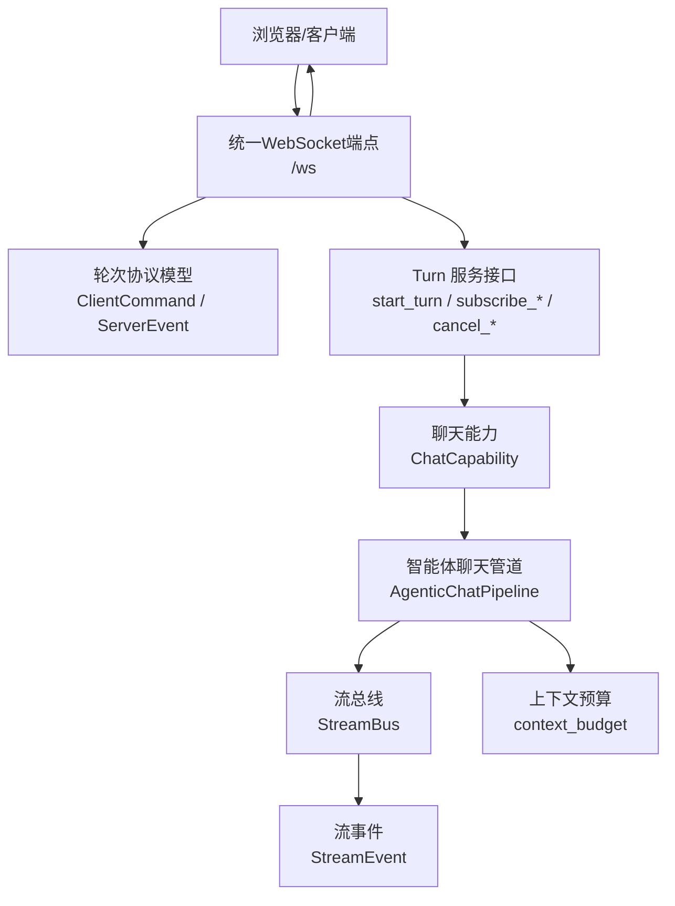
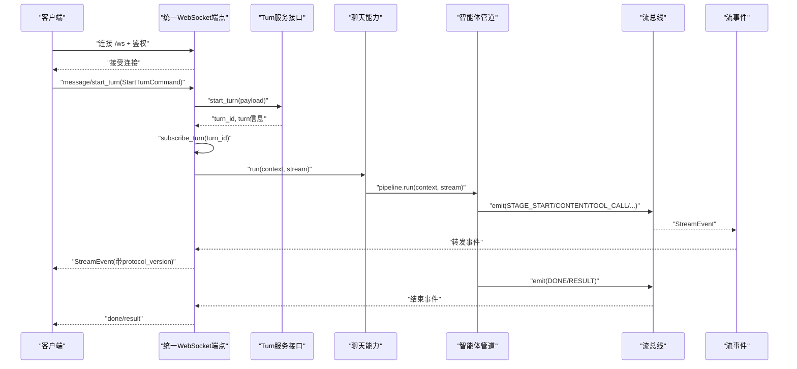
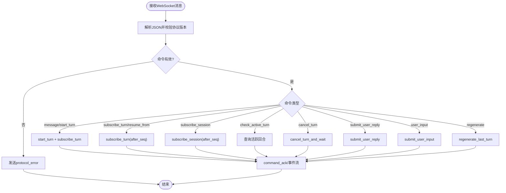
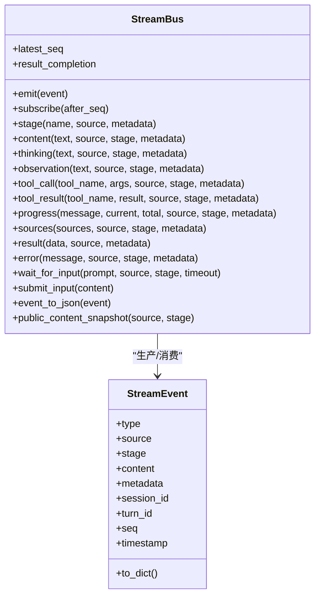
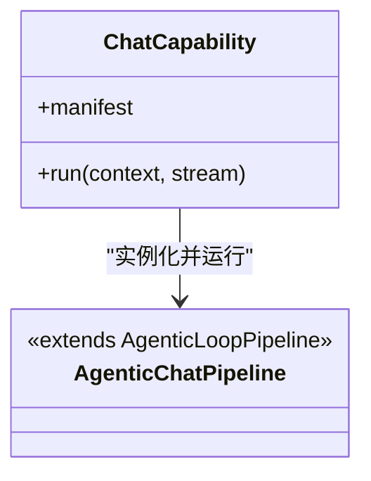
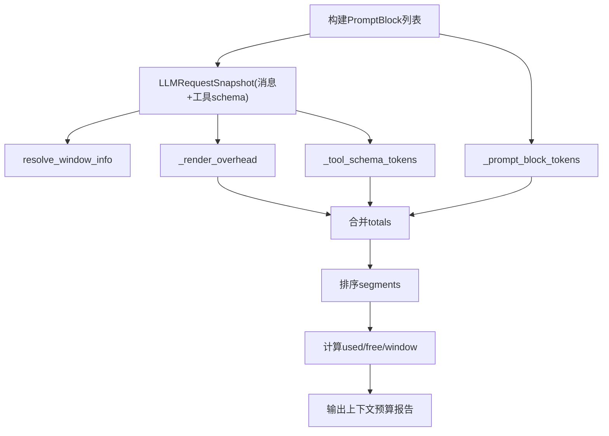
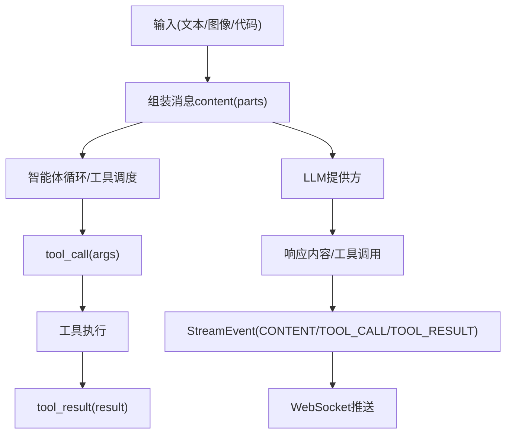
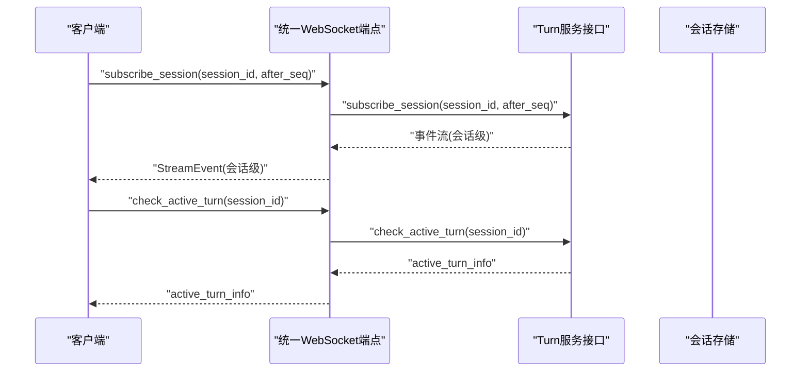
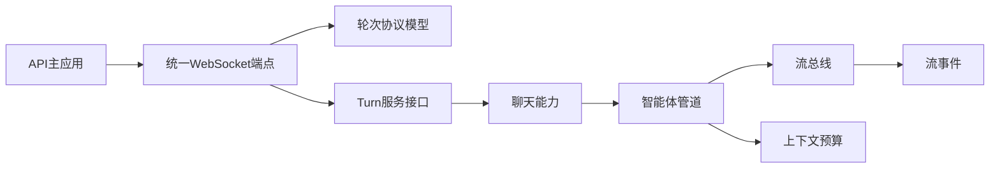

# 数据流设计

<cite>
**本文引用的文件**   
- [deeptutor/api/main.py](file://deeptutor/api/main.py)
- [deeptutor/api/routers/unified_ws.py](file://deeptutor/api/routers/unified_ws.py)
- [deeptutor/api/contracts/turn_protocol.py](file://deeptutor/api/contracts/turn_protocol.py)
- [deeptutor/core/stream.py](file://deeptutor/core/stream.py)
- [deeptutor/runtime/stream_bus.py](file://deeptutor/runtime/stream_bus.py)
- [deeptutor/agents/chat/capability.py](file://deeptutor/agents/chat/capability.py)
- [deeptutor/agents/chat/agentic_pipeline.py](file://deeptutor/agents/chat/agentic_pipeline.py)
- [deeptutor/agents/loop/context_budget.py](file://deeptutor/agents/loop/context_budget.py)
</cite>

## 目录
1. [引言](#引言)
2. [项目结构](#项目结构)
3. [核心组件](#核心组件)
4. [架构总览](#架构总览)
5. [详细组件分析](#详细组件分析)
6. [依赖关系分析](#依赖关系分析)
7. [性能考虑](#性能考虑)
8. [故障排查指南](#故障排查指南)
9. [结论](#结论)
10. [附录](#附录)

## 引言
本设计文档聚焦 DeepTutor 从用户请求到响应返回的完整数据流，覆盖以下关键方面：
- API 路由与统一 WebSocket 入口
- 智能体调用与工具执行
- 流式事件协议、实时数据传输与会话状态同步
- 会话上下文预算控制、历史持久化与并发访问
- 多模态数据的流转与转换
- 关键业务场景的数据流图与时序图

目标是帮助开发者与产品人员理解系统如何把一次聊天或任务请求，转化为可观测、可回放、可恢复的流式结果。

## 项目结构
DeepTutor 后端以 FastAPI 应用为入口，通过统一的 WebSocket 端点处理“回合”（turn）生命周期；内部通过能力（capability）与管道（pipeline）驱动智能体循环，使用流总线（StreamBus）广播事件；协议层定义客户端与服务端之间的消息模型；上下文预算模块负责统计并暴露模型上下文窗口使用情况。

**图表来源**
- [deeptutor/api/main.py:364-517](file://deeptutor/api/main.py#L364-L517)
- [deeptutor/api/routers/unified_ws.py:43-389](file://deeptutor/api/routers/unified_ws.py#L43-L389)
- [deeptutor/api/contracts/turn_protocol.py:16-228](file://deeptutor/api/contracts/turn_protocol.py#L16-L228)
- [deeptutor/agents/chat/capability.py:12-17](file://deeptutor/agents/chat/capability.py#L12-L17)
- [deeptutor/agents/chat/agentic_pipeline.py:36-37](file://deeptutor/agents/chat/agentic_pipeline.py#L36-L37)
- [deeptutor/runtime/stream_bus.py:32-158](file://deeptutor/runtime/stream_bus.py#L32-L158)
- [deeptutor/core/stream.py:17-73](file://deeptutor/core/stream.py#L17-L73)
- [deeptutor/agents/loop/context_budget.py:142-239](file://deeptutor/agents/loop/context_budget.py#L142-L239)

**章节来源**
- [deeptutor/api/main.py:364-517](file://deeptutor/api/main.py#L364-L517)
- [deeptutor/api/routers/unified_ws.py:43-389](file://deeptutor/api/routers/unified_ws.py#L43-L389)
- [deeptutor/api/contracts/turn_protocol.py:16-228](file://deeptutor/api/contracts/turn_protocol.py#L16-L228)
- [deeptutor/agents/chat/capability.py:12-17](file://deeptutor/agents/chat/capability.py#L12-L17)
- [deeptutor/agents/chat/agentic_pipeline.py:36-37](file://deeptutor/agents/chat/agentic_pipeline.py#L36-L37)
- [deeptutor/runtime/stream_bus.py:32-158](file://deeptutor/runtime/stream_bus.py#L32-L158)
- [deeptutor/core/stream.py:17-73](file://deeptutor/core/stream.py#L17-L73)
- [deeptutor/agents/loop/context_budget.py:142-239](file://deeptutor/agents/loop/context_budget.py#L142-L239)

## 核心组件
- 统一 WebSocket 适配器：负责鉴权、命令解析、订阅管理、错误与重试提示、活跃回合查询、取消与重生成等。
- 轮次协议模型：定义客户端命令与服务端事件的统一数据结构，包括协议版本、状态枚举、失败码、会话摘要等。
- 流事件与流总线：定义标准流事件类型，提供发布/订阅、序列号、阶段边界、工具调用/结果、进度、来源、最终结果、等待输入等能力。
- 聊天能力与智能体管道：将聊天请求绑定到探索型智能体循环，复用通用管道实现。
- 上下文预算：对实际发送给模型的请求进行分块统计，输出窗口大小、已用/剩余 token、各段占比、计数器来源等。

**章节来源**
- [deeptutor/api/routers/unified_ws.py:43-389](file://deeptutor/api/routers/unified_ws.py#L43-L389)
- [deeptutor/api/contracts/turn_protocol.py:16-228](file://deeptutor/api/contracts/turn_protocol.py#L16-L228)
- [deeptutor/core/stream.py:17-73](file://deeptutor/core/stream.py#L17-L73)
- [deeptutor/runtime/stream_bus.py:32-158](file://deeptutor/runtime/stream_bus.py#L32-L158)
- [deeptutor/agents/chat/capability.py:12-17](file://deeptutor/agents/chat/capability.py#L12-L17)
- [deeptutor/agents/chat/agentic_pipeline.py:36-37](file://deeptutor/agents/chat/agentic_pipeline.py#L36-L37)
- [deeptutor/agents/loop/context_budget.py:142-239](file://deeptutor/agents/loop/context_budget.py#L142-L239)

## 架构总览
下图展示从客户端发起请求到服务端返回流式结果的端到端路径，以及订阅回放机制。

**图表来源**
- [deeptutor/api/routers/unified_ws.py:43-389](file://deeptutor/api/routers/unified_ws.py#L43-L389)
- [deeptutor/api/contracts/turn_protocol.py:69-178](file://deeptutor/api/contracts/turn_protocol.py#L69-L178)
- [deeptutor/agents/chat/capability.py:12-17](file://deeptutor/agents/chat/capability.py#L12-L17)
- [deeptutor/agents/chat/agentic_pipeline.py:36-37](file://deeptutor/agents/chat/agentic_pipeline.py#L36-L37)
- [deeptutor/runtime/stream_bus.py:96-158](file://deeptutor/runtime/stream_bus.py#L96-L158)
- [deeptutor/core/stream.py:17-73](file://deeptutor/core/stream.py#L17-L73)

## 详细组件分析

### 统一 WebSocket 端点与命令分发
- 鉴权与会话隔离：在连接建立前完成鉴权，确保每个 socket 处于稳定的工作区作用域。
- 命令解析：使用 Pydantic 校验协议版本与命令结构，拒绝无效 JSON、未知类型或不兼容协议版本。
- 回合生命周期：
  - start_turn：创建回合并立即订阅该回合事件流。
  - subscribe_turn/resume_from：支持按序列号回放历史事件。
  - subscribe_session：订阅整个会话的事件流。
  - check_active_turn：查询当前会话是否已有活跃回合及其状态。
  - cancel_turn：取消活跃回合，返回命令确认。
  - submit_user_reply/user_input：在回合等待输入或运行中提交用户回复。
  - regenerate：基于会话重新生成最后一个回合。
- 错误处理：协议错误、订阅失败、启动被拒、重生成被拒等均有明确 error_code 与可重试标记。

**图表来源**
- [deeptutor/api/routers/unified_ws.py:180-376](file://deeptutor/api/routers/unified_ws.py#L180-L376)
- [deeptutor/api/contracts/turn_protocol.py:69-178](file://deeptutor/api/contracts/turn_protocol.py#L69-L178)

**章节来源**
- [deeptutor/api/routers/unified_ws.py:43-389](file://deeptutor/api/routers/unified_ws.py#L43-L389)
- [deeptutor/api/contracts/turn_protocol.py:16-228](file://deeptutor/api/contracts/turn_protocol.py#L16-L228)

### 流式事件协议与流总线
- 事件类型：包含阶段开始/结束、思考、观察、内容、工具调用/结果、进度、来源、最终结果、错误、会话元信息、等待输入、完成等。
- 流总线特性：
  - 单回合扇出：一个 StreamBus 对应一个回合，生产者（能力/管道）写入，消费者（CLI、WebSocket、JSON 写入器）读取。
  - 序列号与回放：可选分配 seq，支持 after_seq 回放历史事件。
  - 阶段边界：stage 上下文管理器自动发出 STAGE_START/STAGE_END。
  - 工具调用与结果：tool_call/tool_result 附带参数与工具名。
  - 进度与来源：progress/sources 用于外部工具或检索过程的可观测性。
  - 等待输入：wait_for_input 暂停能力执行，直到前端提交 user_input。
  - 关闭语义：mark_closed/close 向所有订阅者发送终止信号。

**图表来源**
- [deeptutor/core/stream.py:17-73](file://deeptutor/core/stream.py#L17-L73)
- [deeptutor/runtime/stream_bus.py:32-158](file://deeptutor/runtime/stream_bus.py#L32-L158)
- [deeptutor/runtime/stream_bus.py:162-421](file://deeptutor/runtime/stream_bus.py#L162-L421)

**章节来源**
- [deeptutor/core/stream.py:17-73](file://deeptutor/core/stream.py#L17-L73)
- [deeptutor/runtime/stream_bus.py:32-158](file://deeptutor/runtime/stream_bus.py#L32-L158)
- [deeptutor/runtime/stream_bus.py:162-421](file://deeptutor/runtime/stream_bus.py#L162-L421)

### 聊天能力与智能体管道
- ChatCapability 将聊天请求绑定到 AgenticChatPipeline，后者继承通用智能体循环管道，复用默认协议、工具表面与提示包。
- 深度模式（如 solve、ask_questions、reading、watching、course study、visualize）可直接构造该管道，仅覆盖预算与流命名空间。

**图表来源**
- [deeptutor/agents/chat/capability.py:12-17](file://deeptutor/agents/chat/capability.py#L12-L17)
- [deeptutor/agents/chat/agentic_pipeline.py:36-37](file://deeptutor/agents/chat/agentic_pipeline.py#L36-L37)

**章节来源**
- [deeptutor/agents/chat/capability.py:12-17](file://deeptutor/agents/chat/capability.py#L12-L17)
- [deeptutor/agents/chat/agentic_pipeline.py:36-37](file://deeptutor/agents/chat/agentic_pipeline.py#L36-L37)

### 上下文预算控制
- 目标：精确统计一次真实 LLM 请求所携带的上下文窗口占用，避免重复计算系统提示与动态块。
- 主要功能：
  - resolve_window_info：根据配置或模型名称推断窗口大小，并标注是否估计值。
  - build_context_budget：对 PromptBlock 列表与实际请求快照进行分段统计，输出 window、used_tokens、free_tokens、segments、counter 来源等。
  - _prompt_block_tokens/_render_overhead/_tool_schema_tokens：分别统计静态/动态块、系统提示开销、工具 schema 来源（内置 vs MCP）。
  - _message_tokens：对文本内容与 tool_calls 进行 token 计数；多模态图片部分不计入文本 token，由提供方计费。

**图表来源**
- [deeptutor/agents/loop/context_budget.py:78-106](file://deeptutor/agents/loop/context_budget.py#L78-L106)
- [deeptutor/agents/loop/context_budget.py:142-239](file://deeptutor/agents/loop/context_budget.py#L142-L239)
- [deeptutor/agents/loop/context_budget.py:242-337](file://deeptutor/agents/loop/context_budget.py#L242-L337)

**章节来源**
- [deeptutor/agents/loop/context_budget.py:142-239](file://deeptutor/agents/loop/context_budget.py#L142-L239)
- [deeptutor/agents/loop/context_budget.py:242-337](file://deeptutor/agents/loop/context_budget.py#L242-L337)

### 多模态数据处理流程
- 文本：作为 StreamEvent.content 或 messages 中的 text part 传输。
- 图像：在消息 content 中以结构化 parts 形式存在；上下文预算模块仅对 text 部分计数，图片计费由提供方决定。
- 代码：通常以文本形式进入消息或工具调用参数；工具执行后以 TOOL_RESULT 事件回传结果。
- 工具调用：通过 StreamBus.tool_call/tool_result 记录工具名与参数/结果，便于追踪与回放。

**图表来源**
- [deeptutor/core/stream.py:17-73](file://deeptutor/core/stream.py#L17-L73)
- [deeptutor/runtime/stream_bus.py:241-275](file://deeptutor/runtime/stream_bus.py#L241-L275)
- [deeptutor/agents/loop/context_budget.py:297-313](file://deeptutor/agents/loop/context_budget.py#L297-L313)

**章节来源**
- [deeptutor/core/stream.py:17-73](file://deeptutor/core/stream.py#L17-L73)
- [deeptutor/runtime/stream_bus.py:241-275](file://deeptutor/runtime/stream_bus.py#L241-L275)
- [deeptutor/agents/loop/context_budget.py:297-313](file://deeptutor/agents/loop/context_budget.py#L297-L313)

### 会话状态管理与并发访问
- 会话摘要与会话详情：协议定义了 SessionSummary 与 SessionDetail，包含标题、时间戳、活跃回合、消息列表与偏好设置。
- 活跃回合检查：客户端可通过 check_active_turn 获取 session 的活跃回合信息与拥有者。
- 并发安全：
  - WebSocket 订阅任务以 asyncio.Task 管理，支持取消与清理。
  - StreamBus 维护订阅队列与历史事件，支持跨事件循环投递（call_soon_threadsafe）。
  - 用户输入通过 bus_registry 按 turn_id 路由，避免跨回合冲突。
- 历史持久化与回放：
  - subscribe_turn/subsribe_session 支持 after_seq 回放。
  - StreamBus 维护有限历史（可配置），保证回放范围可控。

**图表来源**
- [deeptutor/api/routers/unified_ws.py:159-177](file://deeptutor/api/routers/unified_ws.py#L159-L177)
- [deeptutor/api/routers/unified_ws.py:263-277](file://deeptutor/api/routers/unified_ws.py#L263-L277)
- [deeptutor/api/contracts/turn_protocol.py:246-257](file://deeptutor/api/contracts/turn_protocol.py#L246-L257)

**章节来源**
- [deeptutor/api/routers/unified_ws.py:159-177](file://deeptutor/api/routers/unified_ws.py#L159-L177)
- [deeptutor/api/routers/unified_ws.py:263-277](file://deeptutor/api/routers/unified_ws.py#L263-L277)
- [deeptutor/api/contracts/turn_protocol.py:246-257](file://deeptutor/api/contracts/turn_protocol.py#L246-L257)

## 依赖关系分析
- API 主应用：FastAPI 应用初始化、中间件、健康检查、路由加载、生命周期管理。
- WebSocket 适配器：依赖轮次协议模型与 Turn 服务接口，负责命令分发与事件转发。
- 能力与管道：ChatCapability 绑定 AgenticChatPipeline，后者复用通用智能体循环。
- 流事件与总线：StreamEvent 定义事件结构，StreamBus 提供发布/订阅与辅助方法。
- 上下文预算：依赖 PromptBlock 与 LLM 上下文窗口解析，产出预算报告。

**图表来源**
- [deeptutor/api/main.py:364-517](file://deeptutor/api/main.py#L364-L517)
- [deeptutor/api/routers/unified_ws.py:43-389](file://deeptutor/api/routers/unified_ws.py#L43-L389)
- [deeptutor/api/contracts/turn_protocol.py:16-228](file://deeptutor/api/contracts/turn_protocol.py#L16-L228)
- [deeptutor/agents/chat/capability.py:12-17](file://deeptutor/agents/chat/capability.py#L12-L17)
- [deeptutor/agents/chat/agentic_pipeline.py:36-37](file://deeptutor/agents/chat/agentic_pipeline.py#L36-L37)
- [deeptutor/runtime/stream_bus.py:32-158](file://deeptutor/runtime/stream_bus.py#L32-L158)
- [deeptutor/core/stream.py:17-73](file://deeptutor/core/stream.py#L17-L73)
- [deeptutor/agents/loop/context_budget.py:142-239](file://deeptutor/agents/loop/context_budget.py#L142-L239)

**章节来源**
- [deeptutor/api/main.py:364-517](file://deeptutor/api/main.py#L364-L517)
- [deeptutor/api/routers/unified_ws.py:43-389](file://deeptutor/api/routers/unified_ws.py#L43-L389)
- [deeptutor/api/contracts/turn_protocol.py:16-228](file://deeptutor/api/contracts/turn_protocol.py#L16-L228)
- [deeptutor/agents/chat/capability.py:12-17](file://deeptutor/agents/chat/capability.py#L12-L17)
- [deeptutor/agents/chat/agentic_pipeline.py:36-37](file://deeptutor/agents/chat/agentic_pipeline.py#L36-L37)
- [deeptutor/runtime/stream_bus.py:32-158](file://deeptutor/runtime/stream_bus.py#L32-L158)
- [deeptutor/core/stream.py:17-73](file://deeptutor/core/stream.py#L17-L73)
- [deeptutor/agents/loop/context_budget.py:142-239](file://deeptutor/agents/loop/context_budget.py#L142-L239)

## 性能考虑
- 流总线历史长度限制：通过 max_history 控制回放历史规模，避免无限增长。
- 跨事件循环投递：使用 call_soon_threadsafe 确保不同事件循环下的队列投递可靠。
- 工具调用与结果：减少不必要的序列化开销，仅在必要时传递结构化 metadata。
- 上下文预算测量：避免重复计算系统提示与动态块，确保统计与真实请求一致。
- WebSocket 订阅任务：及时取消与清理，防止资源泄漏。

[本节为通用指导，不直接分析具体文件]

## 故障排查指南
- 协议错误：
  - invalid_json：客户端发送非 JSON。
  - invalid_command：命令不符合协议模型。
  - unsupported_protocol_version：客户端协议版本不匹配。
  - unknown_message_type：未知命令类型。
- 订阅失败：
  - subscription_failed：订阅过程中发生异常，建议客户端重试。
- 回合操作失败：
  - start_turn_rejected：回合启动被拒绝。
  - turn_not_active：回合未处于活动状态。
  - turn_not_waiting_input：回合未在等待用户输入。
  - regenerate_rejected：重生成被拒绝。
- 内部错误：
  - internal_error：服务器内部异常，标记为可重试。

建议排查步骤：
1. 检查客户端协议版本与命令结构是否符合轮次协议模型。
2. 查看 WebSocket 日志中的 protocol_error 与 error_code。
3. 确认会话是否存在活跃回合，必要时使用 check_active_turn。
4. 若订阅失败，检查 after_seq 是否合理，必要时重新订阅。
5. 对于工具执行问题，关注 TOOL_CALL/TOOL_RESULT 事件与上下文预算报告。

**章节来源**
- [deeptutor/api/routers/unified_ws.py:75-109](file://deeptutor/api/routers/unified_ws.py#L75-L109)
- [deeptutor/api/routers/unified_ws.py:140-177](file://deeptutor/api/routers/unified_ws.py#L140-L177)
- [deeptutor/api/routers/unified_ws.py:220-376](file://deeptutor/api/routers/unified_ws.py#L220-L376)
- [deeptutor/api/contracts/turn_protocol.py:37-45](file://deeptutor/api/contracts/turn_protocol.py#L37-L45)

## 结论
DeepTutor 的数据流以统一 WebSocket 为入口，通过轮次协议模型规范客户端与服务端的交互；智能体管道驱动工具执行与内容生成，借助流总线广播标准化事件；上下文预算模块确保对模型上下文窗口的透明计量。该设计实现了可观测、可回放、可恢复的流式响应，同时兼顾多模态数据与并发访问的安全性与一致性。

[本节为总结性内容，不直接分析具体文件]

## 附录
- 关键协议字段说明：
  - protocol_version：当前为 2.0，客户端必须匹配。
  - type：命令或事件类型，如 message、start_turn、subscribe_turn、stream_event 等。
  - session_id/turn_id：会话与回合标识。
  - seq：事件序列号，用于回放与去重。
  - status/query_state：回合状态与查询状态，包括 queued、running、waiting_input、completed、failed、cancelled 等。
  - owner_id：回合拥有者，用于并发与恢复。
- 最佳实践：
  - 客户端应缓存 last_seq，断线重连时使用 resume_from 或 subscribe_session(after_seq)。
  - 对 wait_for_input 场景，前端需及时提交 user_input，避免超时。
  - 监控上下文预算报告，优化 PromptBlock 与工具 schema 以减少窗口占用。

[本节为补充说明，不直接分析具体文件]