# 架构设计

<cite>
**本文引用的文件**   
- [deeptutor/api/main.py](file://deeptutor/api/main.py)
- [deeptutor/runtime/orchestrator.py](file://deeptutor/runtime/orchestrator.py)
- [deeptutor/capabilities/registry.py](file://deeptutor/capabilities/registry.py)
- [deeptutor/capabilities/protocol.py](file://deeptutor/capabilities/protocol.py)
- [deeptutor/services/provider_registry.py](file://deeptutor/services/provider_registry.py)
- [deeptutor/services/llm/provider_factory.py](file://deeptutor/services/llm/provider_factory.py)
- [deeptutor/api/routers/unified_ws.py](file://deeptutor/api/routers/unified_ws.py)
- [deeptutor/runtime/registry/tool_registry.py](file://deeptutor/runtime/registry/tool_registry.py)
- [deeptutor/runtime/registry/capability_registry.py](file://deeptutor/runtime/registry/capability_registry.py)
- [deeptutor/events/event_bus.py](file://deeptutor/events/event_bus.py)
- [compose.yaml](file://compose.yaml)
- [Dockerfile](file://Dockerfile)
</cite>

## 目录
1. [引言](#引言)
2. [项目结构](#项目结构)
3. [核心组件](#核心组件)
4. [架构总览](#架构总览)
5. [详细组件分析](#详细组件分析)
6. [依赖关系分析](#依赖关系分析)
7. [性能与可扩展性](#性能与可扩展性)
8. [横切关注点](#横切关注点)
9. [部署拓扑与基础设施](#部署拓扑与基础设施)
10. [故障排查指南](#故障排查指南)
11. [结论](#结论)

## 引言
本架构设计文档面向 DeepTutor 系统，聚焦高层设计、架构模式、系统边界、多智能体能力编排、插件系统与微服务式部署。DeepTutor 以 FastAPI 为后端入口，通过统一 WebSocket 协议驱动“回合制”对话执行；在运行时由编排器将用户消息路由到具体“能力”，能力通过工具注册表调用内置或插件工具，并通过 LLM 提供商工厂选择并复用模型客户端；事件总线用于跨模块异步通信；容器化部署采用 Compose 编排后端、前端与可选的 PocketBase 认证存储。

## 项目结构
DeepTutor 仓库包含以下关键层次：
- API 层：FastAPI 应用、中间件、路由加载、健康检查、CORS 与安全守卫。
- 运行时编排：统一编排器负责会话/回合生命周期、流式事件分发与完成事件发布。
- 能力与工具：能力注册表与协议定义能力扩展点；工具注册表统一管理内置与插件工具。
- LLM 集成：提供商元数据注册与运行时工厂，按配置构建并缓存 SDK 客户端。
- 事件总线：进程内异步事件队列与订阅处理。
- 部署：Docker 多阶段镜像与 Podman Compose 编排，支持只读根文件系统、非 root 运行与可选侧车。

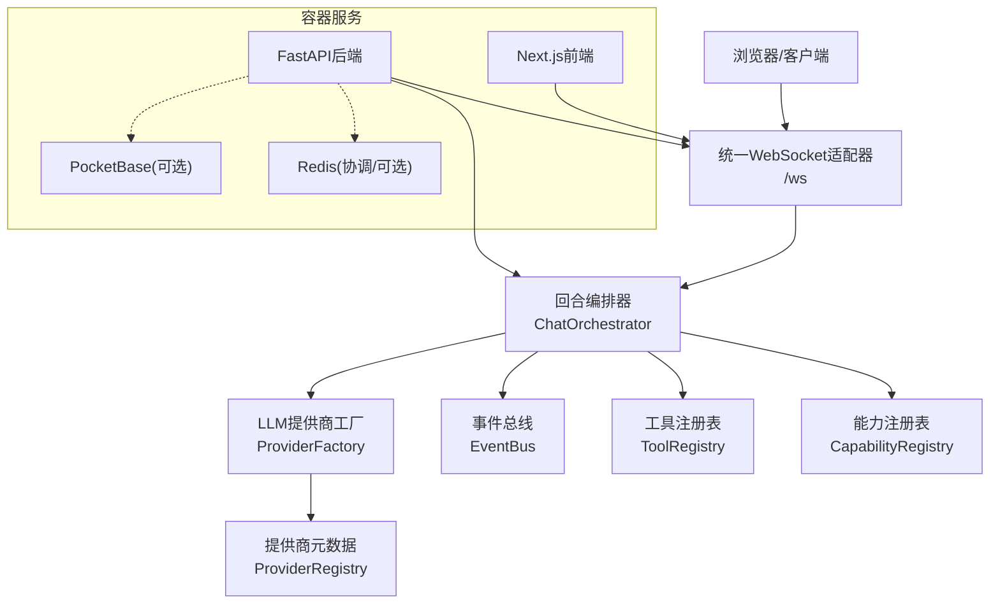

**图表来源**
- [deeptutor/api/main.py:364-548](file://deeptutor/api/main.py#L364-L548)
- [deeptutor/api/routers/unified_ws.py:43-389](file://deeptutor/api/routers/unified_ws.py#L43-L389)
- [deeptutor/runtime/orchestrator.py:54-278](file://deeptutor/runtime/orchestrator.py#L54-L278)
- [deeptutor/runtime/registry/capability_registry.py:58-244](file://deeptutor/runtime/registry/capability_registry.py#L58-L244)
- [deeptutor/runtime/registry/tool_registry.py:29-233](file://deeptutor/runtime/registry/tool_registry.py#L29-L233)
- [deeptutor/services/llm/provider_factory.py:176-245](file://deeptutor/services/llm/provider_factory.py#L176-L245)
- [deeptutor/services/provider_registry.py:18-128](file://deeptutor/services/provider_registry.py#L18-L128)
- [compose.yaml:67-231](file://compose.yaml#L67-L231)

**章节来源**
- [deeptutor/api/main.py:364-548](file://deeptutor/api/main.py#L364-L548)
- [compose.yaml:67-231](file://compose.yaml#L67-L231)

## 核心组件
- FastAPI 应用与生命周期管理：初始化日志、安全守卫、CORS、工作区目录、路由加载、健康端点、后台任务协调器与 MCP/LLM 资源清理。
- 统一 WebSocket 适配器：认证、命令校验、回合启动/取消/重生成、会话与回合订阅、活跃回合检查。
- 回合编排器：根据上下文选择能力（默认 chat），创建 StreamBus 流通道，执行能力 run，捕获错误并发布 CAPABILITY_COMPLETE 事件。
- 能力协议与注册：LoopExtension/KnowledgeCapability 定义能力扩展点；CapabilityRegistry 加载内置与插件能力；LoopCapabilitySpec 描述循环能力。
- 工具注册表：集中发现内置与插件工具，提供别名解析、OpenAI schema 生成与执行。
- LLM 提供商注册与工厂：ProviderSpec 声明供应商元数据；ProviderFactory 按配置构建并池化 SDK 客户端。
- 事件总线：进程内异步队列，支持类型化事件、订阅者、flush/stop/reset。

**章节来源**
- [deeptutor/api/main.py:108-360](file://deeptutor/api/main.py#L108-L360)
- [deeptutor/api/routers/unified_ws.py:43-389](file://deeptutor/api/routers/unified_ws.py#L43-L389)
- [deeptutor/runtime/orchestrator.py:54-278](file://deeptutor/runtime/orchestrator.py#L54-L278)
- [deeptutor/capabilities/protocol.py:30-174](file://deeptutor/capabilities/protocol.py#L30-L174)
- [deeptutor/capabilities/registry.py:28-223](file://deeptutor/capabilities/registry.py#L28-L223)
- [deeptutor/runtime/registry/capability_registry.py:58-244](file://deeptutor/runtime/registry/capability_registry.py#L58-L244)
- [deeptutor/runtime/registry/tool_registry.py:29-233](file://deeptutor/runtime/registry/tool_registry.py#L29-L233)
- [deeptutor/services/provider_registry.py:18-128](file://deeptutor/services/provider_registry.py#L18-L128)
- [deeptutor/services/llm/provider_factory.py:176-245](file://deeptutor/services/llm/provider_factory.py#L176-L245)
- [deeptutor/events/event_bus.py:22-210](file://deeptutor/events/event_bus.py#L22-L210)

## 架构总览
DeepTutor 采用“API 网关 + 运行时编排 + 能力/工具插件 + LLM 抽象 + 事件总线”的分层架构。API 层暴露 HTTP 与 WebSocket；运行时编排器作为单一入口，将请求路由到能力；能力通过工具注册表调用工具，必要时调用 LLM；事件总线解耦跨模块通知。部署上，后端与前端同镜像运行，可选 Redis/PocketBase 作为协调与认证存储。

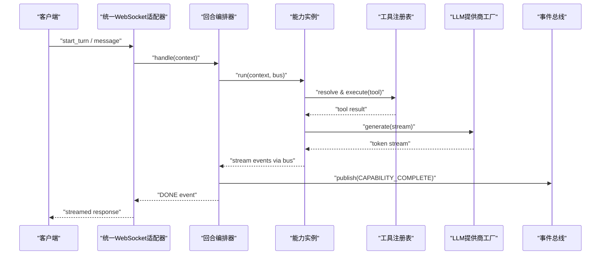

**图表来源**
- [deeptutor/api/routers/unified_ws.py:220-238](file://deeptutor/api/routers/unified_ws.py#L220-L238)
- [deeptutor/runtime/orchestrator.py:64-248](file://deeptutor/runtime/orchestrator.py#L64-L248)
- [deeptutor/runtime/registry/tool_registry.py:184-197](file://deeptutor/runtime/registry/tool_registry.py#L184-L197)
- [deeptutor/services/llm/provider_factory.py:176-202](file://deeptutor/services/llm/provider_factory.py#L176-L202)
- [deeptutor/events/event_bus.py:101-144](file://deeptutor/events/event_bus.py#L101-L144)

## 详细组件分析

### FastAPI 应用与生命周期
- 启动流程：确保运行时设置、导出环境变量、配置日志、验证工具一致性、初始化应用容器、迁移数据、初始化 LLM 客户端、启动事件总线、启动后台领导者监督器、探测 PocketBase、迁移旧版记忆文件、标记 ready。
- 中间件：工作区活动记录、JSON 错误边界、访问日志、CORS、安全守卫。
- 路由加载：延迟加载路由模块，挂载模块路由。
- 健康端点：/health/live 与 /health/ready 返回存活与就绪状态。

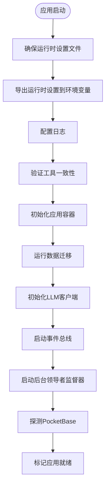

**图表来源**
- [deeptutor/api/main.py:108-360](file://deeptutor/api/main.py#L108-L360)

**章节来源**
- [deeptutor/api/main.py:108-360](file://deeptutor/api/main.py#L108-L360)
- [deeptutor/api/main.py:364-548](file://deeptutor/api/main.py#L364-L548)

### 统一 WebSocket 适配器
- 认证与会话：鉴权失败直接返回；成功后接受连接并建立订阅任务字典。
- 命令协议：校验 protocol_version 与命令结构，支持 start_turn、subscribe_turn、subscribe_session、check_active_turn、cancel_turn、submit_user_reply、regenerate、user_input、unsubscribe、ping。
- 订阅转发：为每个 turn/session 维护独立订阅任务，异常时发送 protocol_error。
- 生命周期：断开连接后清理所有订阅任务并重置当前用户上下文。

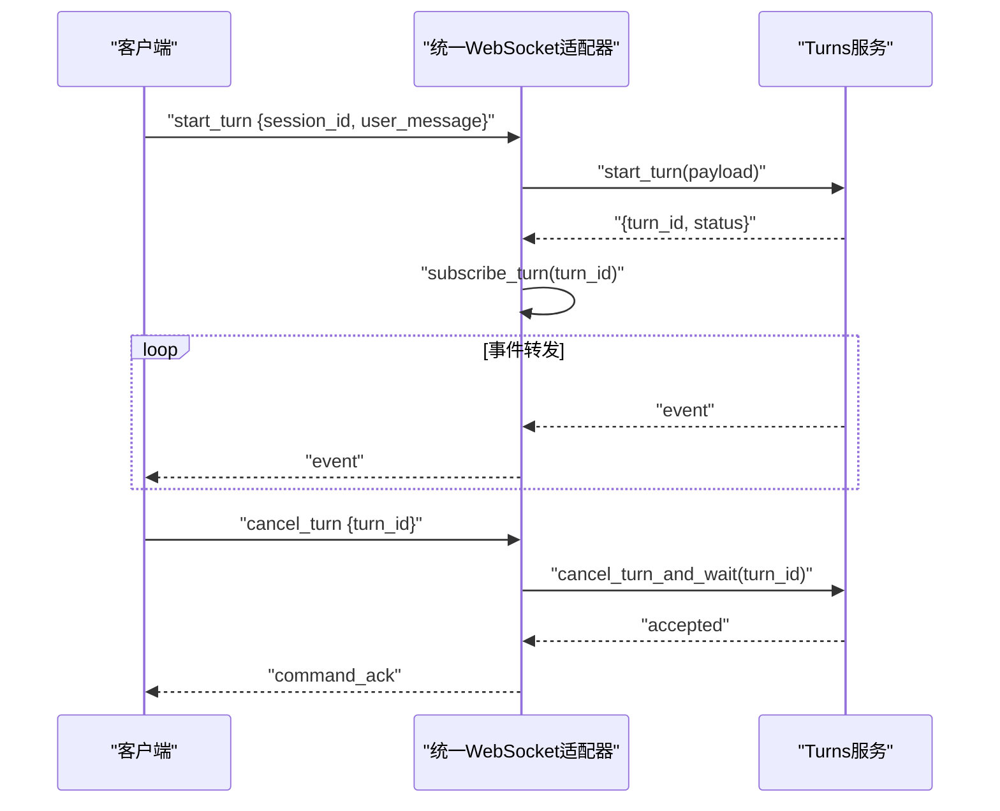

**图表来源**
- [deeptutor/api/routers/unified_ws.py:43-389](file://deeptutor/api/routers/unified_ws.py#L43-L389)

**章节来源**
- [deeptutor/api/routers/unified_ws.py:43-389](file://deeptutor/api/routers/unified_ws.py#L43-L389)

### 回合编排器与能力协议
- 能力选择：若 context.runtime.answer_by 存在则使用 HandoffCapability；否则从 CapabilityRegistry 获取 active_capability 或默认 chat。
- 流式执行：创建 StreamBus，注册/注销 turn_id 映射，执行 capability.run，捕获异常并标准化错误元数据，最终发出 DONE 事件。
- 完成事件：封装 agent_output 与 metadata，发布 CAPABILITY_COMPLETE 到全局 EventBus。
- 能力协议：LoopExtension 定义 name、owned_tools、is_active、system_block、augment_kwargs、pre_loop_seed 等扩展点；KnowledgeCapability 表示独占工具集的知识类能力。

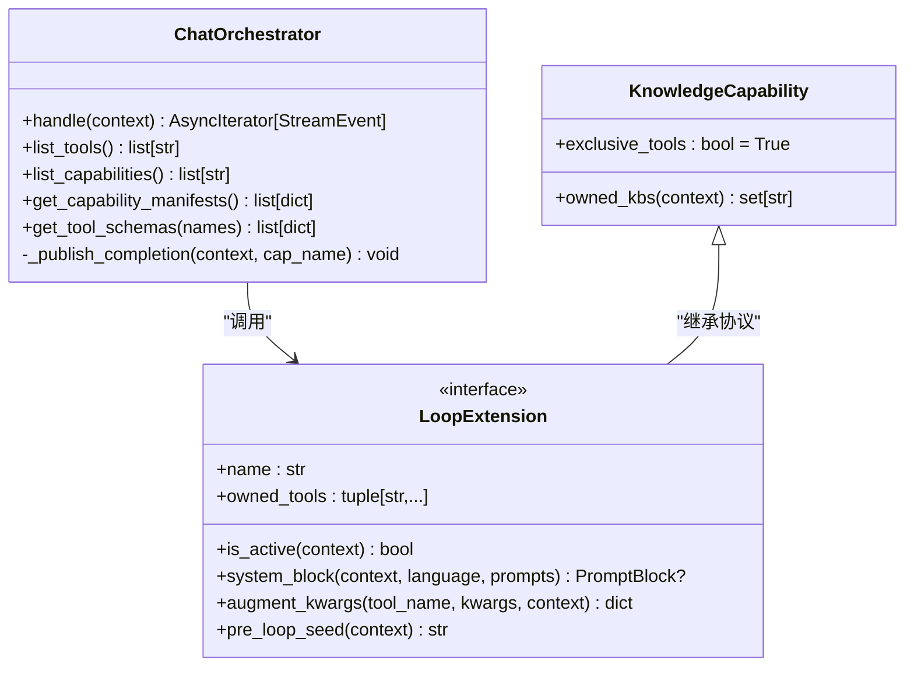

**图表来源**
- [deeptutor/runtime/orchestrator.py:54-278](file://deeptutor/runtime/orchestrator.py#L54-L278)
- [deeptutor/capabilities/protocol.py:30-174](file://deeptutor/capabilities/protocol.py#L30-L174)

**章节来源**
- [deeptutor/runtime/orchestrator.py:54-278](file://deeptutor/runtime/orchestrator.py#L54-L278)
- [deeptutor/capabilities/protocol.py:30-174](file://deeptutor/capabilities/protocol.py#L30-L174)

### 能力注册表与循环能力
- 内置循环能力：基于 manifests 中的 loops 条目构造 LoopCapabilitySpec，惰性创建实例。
- 外部循环能力：通过 entry points 组 deeptutor.extensions 与兼容组 deeptutor.loop_capabilities 发现工厂，去重并忽略被内置覆盖的扩展。
- 激活与工具归属：all_loop_capabilities 按上下文缓存实例并注册到 CapabilityCatalog；active_loop_capabilities 过滤 is_active；capability_tool_owners 汇总 owned_tools 归属。

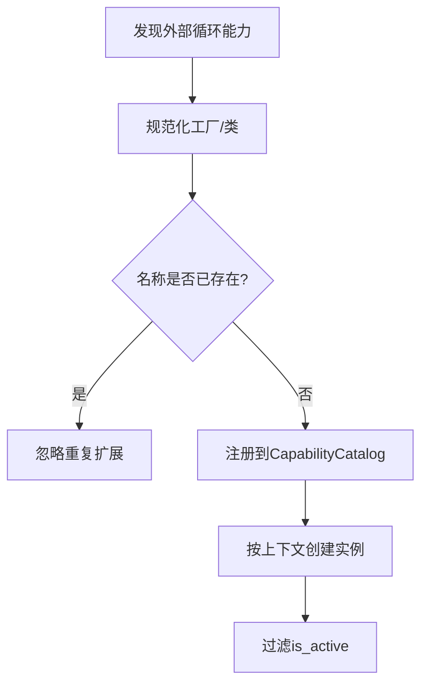

**图表来源**
- [deeptutor/capabilities/registry.py:86-187](file://deeptutor/capabilities/registry.py#L86-L187)

**章节来源**
- [deeptutor/capabilities/registry.py:28-223](file://deeptutor/capabilities/registry.py#L28-L223)

### 工具注册表
- 内置与插件：load_builtins 注册描述符；load_plugins 从 entry points 与 PluginRegistry 加载工具，避免与内置冲突。
- 别名与贡献开关：resolve_request 支持别名合并默认参数；get/list 受 contribution_enabled("tools", name) 控制。
- OpenAI Schema：build_openai_schemas 生成函数调用 schema；execute 位置参数 name 避免与工具参数冲突。

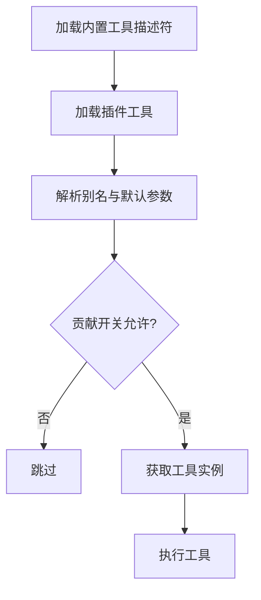

**图表来源**
- [deeptutor/runtime/registry/tool_registry.py:58-197](file://deeptutor/runtime/registry/tool_registry.py#L58-L197)

**章节来源**
- [deeptutor/runtime/registry/tool_registry.py:29-233](file://deeptutor/runtime/registry/tool_registry.py#L29-L233)

### LLM 提供商注册与工厂
- 提供商元数据：ProviderSpec 定义 name、keywords、env_key、backend、api_base、supports_* 等属性；PROVIDERS 列表顺序决定匹配优先级；支持 OAuth/Direct/Gateway/Local 等多种模式。
- 工厂构建：_build_runtime_provider 根据 backend 与 api_format 选择具体实现（OpenAICompat/Azure/OpenAICodex/GitHubCopilot/Codebuddy/ClaudeCode/TypeScriptProvider）；GenerationSettings 注入 temperature/max_tokens/reasoning_effort。
- 池化与关闭：get_runtime_provider 按 (loop, provider_name, model, secret fingerprint, headers, wire_api, api_format, concurrency, owner_identity) 键缓存小尺寸池；close_runtime_provider_pool 在关闭时释放 SDK 连接。

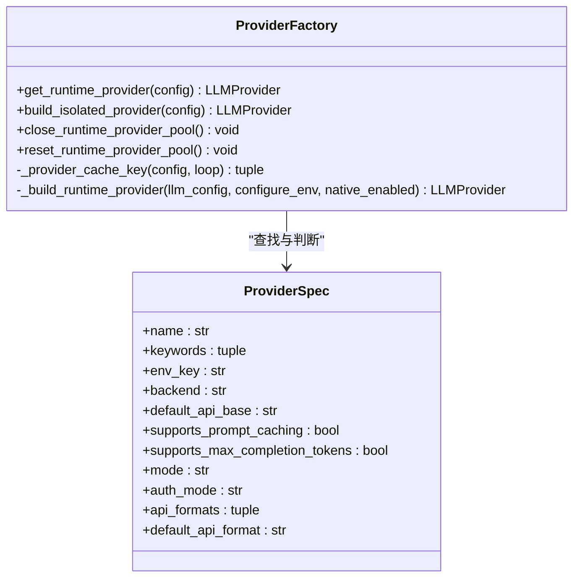

**图表来源**
- [deeptutor/services/provider_registry.py:18-128](file://deeptutor/services/provider_registry.py#L18-L128)
- [deeptutor/services/llm/provider_factory.py:59-202](file://deeptutor/services/llm/provider_factory.py#L59-L202)

**章节来源**
- [deeptutor/services/provider_registry.py:18-128](file://deeptutor/services/provider_registry.py#L18-L128)
- [deeptutor/services/llm/provider_factory.py:176-245](file://deeptutor/services/llm/provider_factory.py#L176-L245)

### 事件总线
- 事件类型：SOLVE_COMPLETE、QUESTION_COMPLETE、CAPABILITY_COMPLETE。
- 发布/订阅：publish 入队，后台 _process_events 轮询队列并调用处理器；start/stop/flush/reset 管理生命周期。
- 错误隔离：处理器异常仅记录日志，不影响其他处理器。

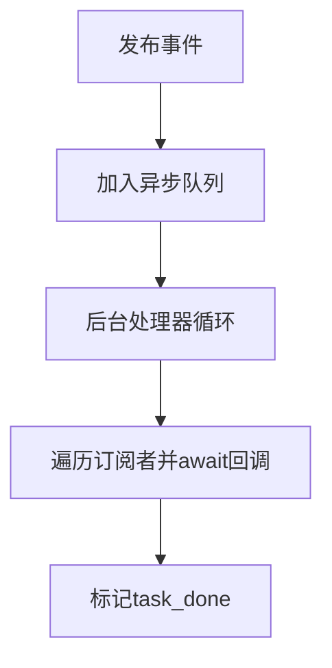

**图表来源**
- [deeptutor/events/event_bus.py:101-144](file://deeptutor/events/event_bus.py#L101-L144)

**章节来源**
- [deeptutor/events/event_bus.py:22-210](file://deeptutor/events/event_bus.py#L22-L210)

## 依赖关系分析
- 耦合关系：
  - API 层依赖 orchestrator、capability_registry、tool_registry、event_bus、provider_factory。
  - orchestrator 依赖 capability_registry 与 tool_registry，并通过 StreamBus 与能力交互。
  - provider_factory 依赖 provider_registry 与具体后端实现。
  - unified_ws 依赖 turns 服务（由容器提供）与 auth 中间件。
- 外部依赖：
  - LLM 提供商（OpenAI、Anthropic、Azure、GitHub Copilot、Codebuddy、Claude Code 等）。
  - 可选服务：Redis（协调）、PocketBase（认证/存储）。
- 潜在循环依赖：
  - 通过延迟导入与按需模块启用（module_enabled）避免启动期循环。
  - 插件与能力通过 entry points 与 catalog 解耦。

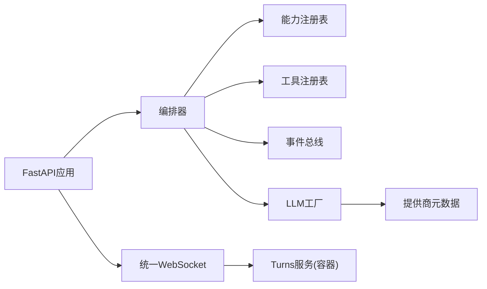

**图表来源**
- [deeptutor/api/main.py:364-548](file://deeptutor/api/main.py#L364-L548)
- [deeptutor/runtime/orchestrator.py:54-278](file://deeptutor/runtime/orchestrator.py#L54-L278)
- [deeptutor/runtime/registry/capability_registry.py:58-244](file://deeptutor/runtime/registry/capability_registry.py#L58-L244)
- [deeptutor/runtime/registry/tool_registry.py:29-233](file://deeptutor/runtime/registry/tool_registry.py#L29-L233)
- [deeptutor/services/llm/provider_factory.py:176-245](file://deeptutor/services/llm/provider_factory.py#L176-L245)
- [deeptutor/services/provider_registry.py:18-128](file://deeptutor/services/provider_registry.py#L18-L128)

**章节来源**
- [deeptutor/api/main.py:364-548](file://deeptutor/api/main.py#L364-L548)
- [deeptutor/runtime/orchestrator.py:54-278](file://deeptutor/runtime/orchestrator.py#L54-L278)

## 性能与可扩展性
- 性能特性：
  - LLM 提供商池化：按事件循环与配置指纹缓存，限制最大池大小，减少连接重建与内存水位。
  - 流式事件：StreamBus 与 WebSocket 订阅任务并行转发，降低端到端延迟。
  - 日志与访问日志：选择性记录非 200 响应，减少噪声。
- 可扩展性：
  - 能力与工具通过注册表与 entry points 动态发现，支持插件扩展。
  - 提供商元数据集中管理，新增供应商仅需添加 ProviderSpec。
  - 容器编排支持水平扩展（workers 环境变量）与只读根文件系统提升稳定性。

[本节为通用指导，不直接分析具体文件]

## 横切关注点
- 安全性：
  - CORS 策略根据认证开关切换严格/宽松模式；安全守卫安装于中间件链中。
  - 容器以非 root 用户运行，只读根文件系统，tmpfs 限定可写区域。
- 监控与可观测性：
  - 健康端点 /health/live 与 /health/ready 供探针检测。
  - 访问日志与结构化错误边界输出 JSON 错误体。
  - 事件总线提供 CAPABILITY_COMPLETE 等事件用于追踪。
- 灾难恢复：
  - 启动时迁移旧版聊天与工作区偏好；v1 记忆文件归档。
  - 后台领导者监督器协调 cron/partner 服务重启与重载。
  - 关闭时有序清理 MCP 连接、LLM 提供商池与 agentic 客户端池。

**章节来源**
- [deeptutor/api/main.py:77-105](file://deeptutor/api/main.py#L77-L105)
- [deeptutor/api/main.py:379-492](file://deeptutor/api/main.py#L379-L492)
- [compose.yaml:137-231](file://compose.yaml#L137-L231)
- [Dockerfile:207-278](file://Dockerfile#L207-L278)

## 部署拓扑与基础设施
- 容器镜像：
  - 多阶段构建：前端 Node 构建、Python 依赖构建、生产镜像合并。
  - supervisord 管理后端与前端进程，非 root 用户运行，端口 8001/3782。
  - 入口脚本读取 data/user/settings/*.json 并导出环境变量，支持可选 APT 包与 Python extras。
- Compose 编排：
  - redis：持久化 appendonly，健康检查。
  - pocketbase：可选认证/存储侧车，卷挂载 /pb_data、/pb_public、/pb_hooks。
  - deeptutor：绑定 host 端口至 127.0.0.1，依赖 redis/pocketbase 健康状态，数据卷 /app/data 与 /workspace。
- 网络与安全：
  - 内部网络 deeptutor bridge。
  - userns_mode keep-id 与 :U 卷挂载保证主机 UID 与容器 UID 对齐。
  - 可选 security_opt no-new-privileges 与资源限制（pids_limit/mem_limit/cpus）。

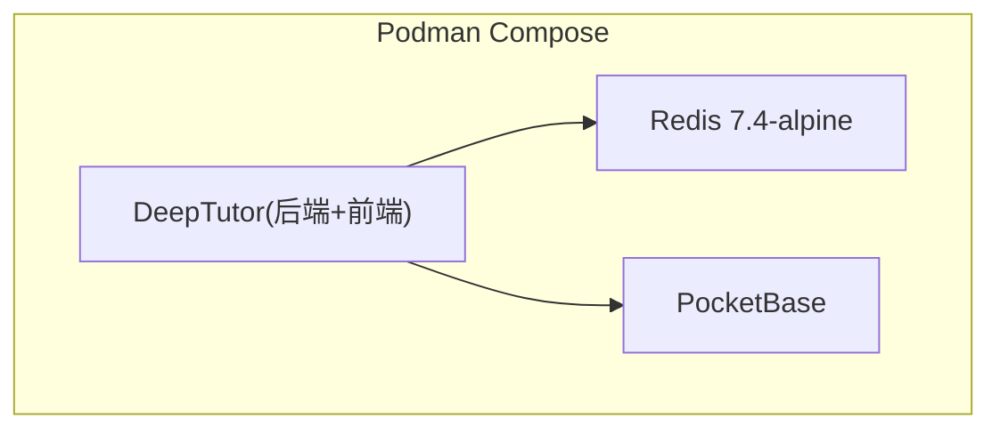

**图表来源**
- [compose.yaml:67-231](file://compose.yaml#L67-L231)
- [Dockerfile:237-278](file://Dockerfile#L237-L278)
- [Dockerfile:337-521](file://Dockerfile#L337-L521)

**章节来源**
- [compose.yaml:67-231](file://compose.yaml#L67-L231)
- [Dockerfile:1-624](file://Dockerfile#L1-L624)

## 故障排查指南
- 启动失败：
  - 检查运行时设置文件是否存在且可写；确认 DEEPTUTOR_API_BASE_URL 与 AUTH_ENABLED 正确导出。
  - 查看健康端点 /health/ready 返回 not_ready 的原因（如 coordination_unavailable）。
- WebSocket 错误：
  - 协议版本不匹配或命令无效会收到 protocol_error；检查 client 端协议版本与命令结构。
  - 订阅失败会返回 subscription_failed；检查 turn/session id 是否正确。
- LLM 调用问题：
  - 提供商密钥或 base_url 配置错误；检查 ProviderSpec 与 LLMConfig。
  - 池化连接泄漏：确认 close_runtime_provider_pool 在关闭时被调用。
- 权限与卷：
  - 容器内 /app/data 不可写会导致设置初始化失败；核对 PUID/PGID 与卷挂载权限。

**章节来源**
- [deeptutor/api/main.py:525-541](file://deeptutor/api/main.py#L525-L541)
- [deeptutor/api/routers/unified_ws.py:75-109](file://deeptutor/api/routers/unified_ws.py#L75-L109)
- [deeptutor/services/llm/provider_factory.py:205-245](file://deeptutor/services/llm/provider_factory.py#L205-L245)
- [Dockerfile:412-439](file://Dockerfile#L412-L439)

## 结论
DeepTutor 通过 FastAPI 与统一 WebSocket 协议提供稳定的 API 入口，以编排器为核心驱动多能力协作，借助注册表机制实现能力与工具的插件化扩展，并以提供商元数据与工厂抽象 LLM 集成。事件总线解耦跨模块通信，容器化部署保障安全与可运维性。该架构在可扩展性、可观测性与可靠性方面具备良好基础，适合持续演进与生态扩展。