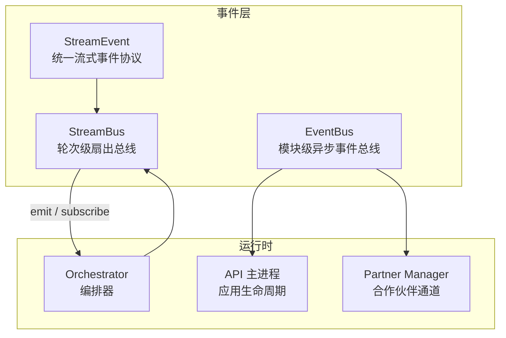
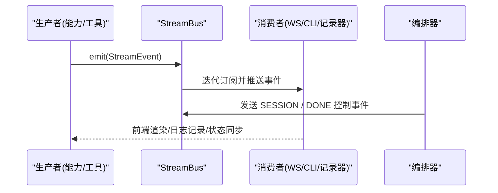
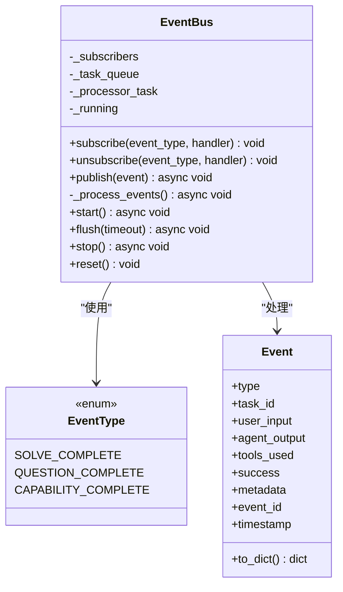
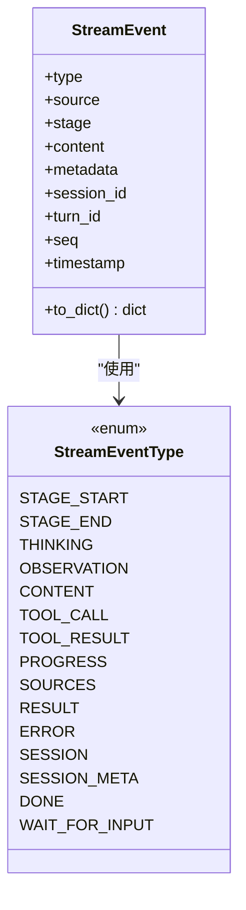
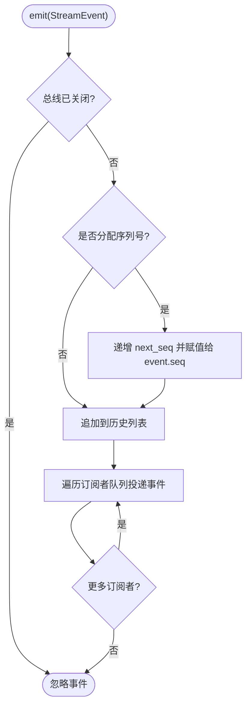
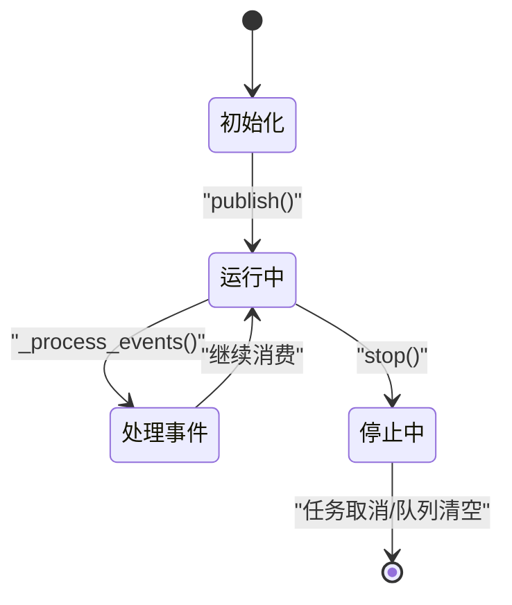
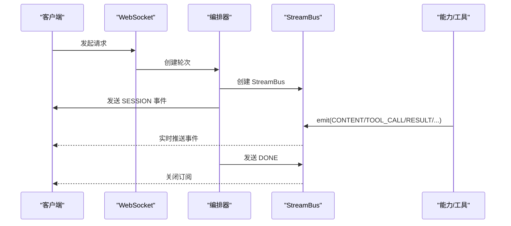
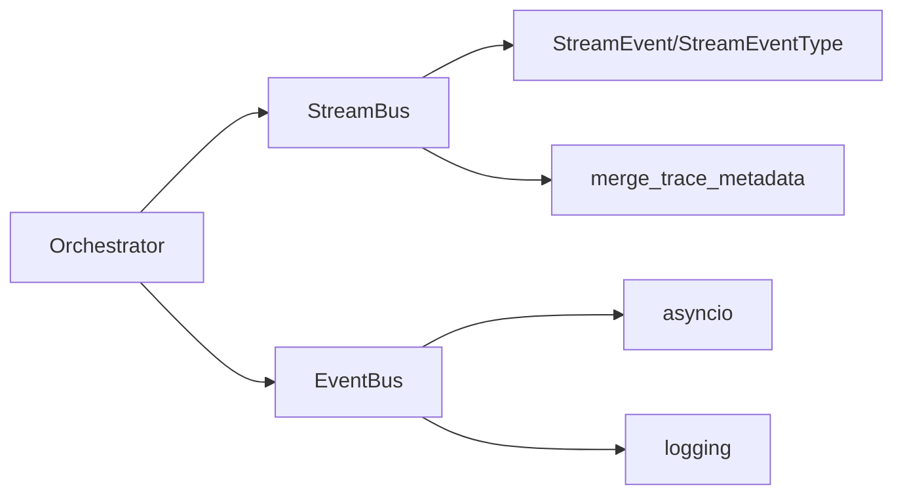

# 事件驱动架构

<cite>
**本文引用的文件**   
- [event_bus.py](file://deeptutor/events/event_bus.py)
- [stream.py](file://deeptutor/core/stream.py)
- [stream_bus.py](file://deeptutor/runtime/stream_bus.py)
- [orchestrator.py](file://deeptutor/runtime/orchestrator.py)
- [main.py](file://deeptutor/api/main.py)
- [manager.py](file://deeptutor/services/partners/manager.py)
- [test_event_bus.py](file://tests/events/test_event_bus.py)
</cite>

## 目录
1. [引言](#引言)
2. [项目结构](#项目结构)
3. [核心组件](#核心组件)
4. [架构总览](#架构总览)
5. [详细组件分析](#详细组件分析)
6. [依赖关系分析](#依赖关系分析)
7. [性能与配置](#性能与配置)
8. [故障排查指南](#故障排查指南)
9. [结论](#结论)

## 引言
本文面向 DeepTutor 的事件驱动架构，重点说明两类事件机制：
- 模块间异步事件总线 EventBus：用于跨模块、非阻塞的领域事件分发。
- 流式响应 StreamEvent + StreamBus：用于一次对话轮次内的实时进度、工具调用、结果等细粒度事件推送。

文档将覆盖事件类型定义、消息格式规范、生命周期管理、订阅发布模式、错误恢复、与 WebSocket 的集成方式，以及配置选项、性能优化和调试方法。

## 项目结构
DeepTutor 中与事件驱动相关的关键代码位于以下路径：
- deeptutor/events/event_bus.py：模块级 EventBus 实现，提供单例、队列化异步处理、启动/停止/刷新能力。
- deeptutor/core/stream.py：统一流式事件协议 StreamEvent 与枚举 StreamEventType。
- deeptutor/runtime/stream_bus.py：会话/轮次级 StreamBus，负责 fan-out 到多个消费者（CLI、WebSocket、JSON 写入）。
- deeptutor/runtime/orchestrator.py：编排器中创建并消费 StreamBus，发送 SESSION/DONE 等控制事件。
- deeptutor/api/main.py：API 层在应用生命周期中获取并使用 EventBus。
- deeptutor/services/partners/manager.py：合作伙伴通道在完成能力后通过 EventBus 发布 CAPABILITY_COMPLETE。

图表来源
- [event_bus.py:61-209](file://deeptutor/events/event_bus.py#L61-L209)
- [stream.py:17-72](file://deeptutor/core/stream.py#L17-L72)
- [stream_bus.py:32-421](file://deeptutor/runtime/stream_bus.py#L32-L421)
- [orchestrator.py:110-146](file://deeptutor/runtime/orchestrator.py#L110-L146)
- [main.py:181-183](file://deeptutor/api/main.py#L181-L183)
- [manager.py:877-888](file://deeptutor/services/partners/manager.py#L877-L888)

章节来源
- [event_bus.py:1-210](file://deeptutor/events/event_bus.py#L1-L210)
- [stream.py:1-73](file://deeptutor/core/stream.py#L1-L73)
- [stream_bus.py:1-421](file://deeptutor/runtime/stream_bus.py#L1-L421)
- [orchestrator.py:110-146](file://deeptutor/runtime/orchestrator.py#L110-L146)
- [main.py:181-183](file://deeptutor/api/main.py#L181-L183)
- [manager.py:877-888](file://deeptutor/services/partners/manager.py#L877-L888)

## 核心组件
- EventBus：模块级单例异步事件总线，基于 asyncio.Queue 进行非阻塞分发，支持 start/stop/flush/reset。
- Event 与 EventType：事件数据模型与受控事件类型集合。
- StreamEvent 与 StreamEventType：统一的流式事件协议，描述一次对话轮次中的阶段、内容、工具调用、结果、错误等。
- StreamBus：轮次级扇出总线，维护历史、序列号、订阅者队列，提供 emit/subscribe/stage/content/tool_call/result/error/wait_for_input 等方法。

章节来源
- [event_bus.py:22-58](file://deeptutor/events/event_bus.py#L22-L58)
- [event_bus.py:61-209](file://deeptutor/events/event_bus.py#L61-L209)
- [stream.py:17-72](file://deeptutor/core/stream.py#L17-L72)
- [stream_bus.py:32-159](file://deeptutor/runtime/stream_bus.py#L32-L159)

## 架构总览
DeepTutor 采用“双总线”设计：
- 模块级 EventBus：用于跨模块的粗粒度领域事件（如能力完成、任务完成），适合后台任务、外部系统通知等场景。
- 轮次级 StreamBus + StreamEvent：用于一次对话轮次的细粒度实时通信，包括思考过程、工具调用、中间结果、最终结果、错误等。

图表来源
- [stream_bus.py:96-159](file://deeptutor/runtime/stream_bus.py#L96-L159)
- [orchestrator.py:136-146](file://deeptutor/runtime/orchestrator.py#L136-L146)

章节来源
- [stream_bus.py:96-159](file://deeptutor/runtime/stream_bus.py#L96-L159)
- [orchestrator.py:136-146](file://deeptutor/runtime/orchestrator.py#L136-L146)

## 详细组件分析

### EventBus：模块级异步事件总线
- 事件类型
  - 当前支持的 EventType：SOLVE_COMPLETE、QUESTION_COMPLETE、CAPABILITY_COMPLETE。
- 事件数据模型 Event
  - 包含 type、task_id、user_input、agent_output、tools_used、success、metadata、event_id、timestamp。
  - 提供 to_dict() 序列化方法，便于日志或持久化。
- 订阅与发布
  - subscribe(event_type, handler)：注册异步处理器。
  - unsubscribe(event_type, handler)：移除处理器。
  - publish(event)：将事件入队；若未运行则自动 start()。
- 异步处理机制
  - _process_events() 循环从队列取事件，按类型分发给所有处理器。
  - 单个处理器异常不会中断其他处理器；异常被记录。
  - 使用 asyncio.wait_for 超时等待队列项，避免空转。
- 生命周期管理
  - start()：启动后台任务。
  - flush(timeout)：等待队列清空，支持超时。
  - stop()：优雅关闭，等待队列处理完毕并取消处理器任务。
  - reset()：重置单例缓存，便于测试或重启。
- 访问器
  - get_event_bus()：返回全局单例实例。

图表来源
- [event_bus.py:22-58](file://deeptutor/events/event_bus.py#L22-L58)
- [event_bus.py:61-209](file://deeptutor/events/event_bus.py#L61-L209)

章节来源
- [event_bus.py:22-58](file://deeptutor/events/event_bus.py#L22-L58)
- [event_bus.py:61-209](file://deeptutor/events/event_bus.py#L61-L209)

### StreamEvent：统一流式事件协议
- 事件类型 StreamEventType
  - 覆盖阶段开始/结束、思考、观察、内容、工具调用/结果、进度、来源、结果、错误、会话信息、完成、等待输入等。
- 数据结构 StreamEvent
  - 字段：type、source、stage、content、metadata、session_id、turn_id、seq、timestamp。
  - to_dict() 输出标准 JSON 可序列化结构。
- 用途
  - 作为所有工具、能力、插件向 CLI、WebSocket、SDK 输出的统一格式。

图表来源
- [stream.py:17-72](file://deeptutor/core/stream.py#L17-L72)

章节来源
- [stream.py:17-72](file://deeptutor/core/stream.py#L17-L72)

### StreamBus：轮次级扇出总线
- 设计目标
  - 为一次对话轮次提供 fan-out 的事件通道，支持多消费者并行读取。
- 关键特性
  - 历史回放：维护事件历史列表，新订阅者可回放已发生事件。
  - 序列号：可选 assign_seq，为事件分配递增 seq，便于断点续传与去重。
  - 多事件循环兼容：每个订阅者绑定其所在事件循环，跨循环投递使用 call_soon_threadsafe。
  - 公开快照：public_content_snapshot 只读获取指定 source/stage 的内容片段。
  - 结果完成标记：result_completion 可从历史中读取最后 RESULT 的 completed 标志。
- 主要接口
  - emit(event)：广播事件到所有订阅者。
  - subscribe(after_seq=0)：异步迭代事件，直到总线关闭。
  - mark_closed()/close()：关闭总线，向订阅者发送哨兵 None。
  - stage()/content()/thinking()/observation()/tool_call()/tool_result()/progress()/sources()/result()/error()/wait_for_input()/submit_input()：便捷方法封装常见事件。
  - event_to_json(event)：NDJSON 序列化。
- 用户输入路由
  - register_bus(turn_id, bus)/unregister_bus/get_bus：根据 turn_id 定位活跃 StreamBus，供 WebSocket 投递用户输入。

图表来源
- [stream_bus.py:96-112](file://deeptutor/runtime/stream_bus.py#L96-L112)

章节来源
- [stream_bus.py:32-159](file://deeptutor/runtime/stream_bus.py#L32-L159)
- [stream_bus.py:397-421](file://deeptutor/runtime/stream_bus.py#L397-L421)

### 事件生命周期管理与状态转换
- StreamEvent 生命周期
  - 由能力/工具在生产端 emit，经 StreamBus 广播给订阅者。
  - 典型流程：SESSION -> STAGE_START -> THINKING/OBSERVATION/CONTENT/TOOL_CALL/TOOL_RESULT/PROGRESS/SOURCES -> RESULT -> DONE。
  - 错误路径：ERROR 可在任意阶段出现，随后可能以 DONE 结束。
- EventBus 生命周期
  - 首次 publish 时自动 start()，后台任务持续消费队列。
  - stop() 等待队列清空并取消处理器任务；reset() 清理单例缓存。
- 编排器 Orchestrator
  - 创建 StreamBus，发送 SESSION 事件，并在能力不可用时发送 ERROR 与 DONE。

图表来源
- [event_bus.py:101-185](file://deeptutor/events/event_bus.py#L101-L185)
- [orchestrator.py:110-146](file://deeptutor/runtime/orchestrator.py#L110-L146)

章节来源
- [event_bus.py:101-185](file://deeptutor/events/event_bus.py#L101-L185)
- [orchestrator.py:110-146](file://deeptutor/runtime/orchestrator.py#L110-L146)

### 事件订阅与发布模式
- 过滤与优先级
  - EventBus：按 EventType 精确匹配，无内置优先级；可通过多次 subscribe 与处理器顺序控制。
  - StreamBus：按订阅顺序广播，无优先级；可通过 after_seq 过滤历史回放范围。
- 错误恢复
  - EventBus：单个处理器异常不影响其他处理器；异常被记录。
  - StreamBus：emit 内部不捕获业务异常；建议消费者侧做异常隔离。
- 与 WebSocket 集成
  - StreamBus.subscribe 提供异步迭代，适合 WS 逐条推送。
  - wait_for_input/submit_input 支持前端交互输入，WS 可将用户输入投递到对应 turn_id 的 bus。

章节来源
- [event_bus.py:91-144](file://deeptutor/events/event_bus.py#L91-L144)
- [stream_bus.py:113-159](file://deeptutor/runtime/stream_bus.py#L113-L159)
- [stream_bus.py:346-394](file://deeptutor/runtime/stream_bus.py#L346-L394)

### 与流式响应的集成方式
- 编排器 Orchestrator
  - 创建 StreamBus，发送 SESSION 事件，携带 session_id 与 turn_id。
  - 在能力不可用时发送 ERROR 与 DONE，确保客户端收到终止信号。
- 能力/工具
  - 通过 StreamBus.content/thinking/tool_call/tool_result/result/error 等方法发出细粒度事件。
- 前端/WS
  - 订阅 StreamBus，渲染实时内容、工具调用、进度与结果。

图表来源
- [orchestrator.py:136-146](file://deeptutor/runtime/orchestrator.py#L136-L146)
- [stream_bus.py:96-159](file://deeptutor/runtime/stream_bus.py#L96-L159)

章节来源
- [orchestrator.py:136-146](file://deeptutor/runtime/orchestrator.py#L136-L146)
- [stream_bus.py:96-159](file://deeptutor/runtime/stream_bus.py#L96-L159)

## 依赖关系分析
- EventBus 依赖
  - asyncio：队列、任务、超时等待。
  - logging：事件处理日志。
  - dataclasses/enum/uuid/datetime：事件建模与时间戳。
- StreamBus 依赖
  - deeptutor.core.stream.StreamEvent/StreamEventType：统一事件协议。
  - deeptutor.core.trace.merge_trace_metadata：合并追踪元数据。
  - asyncio：队列、事件循环、上下文管理器。
- Orchestrator 依赖
  - StreamBus：创建与管理轮次级事件通道。
  - EventBus：在需要时发布领域事件。

图表来源
- [event_bus.py:1-20](file://deeptutor/events/event_bus.py#L1-L20)
- [stream_bus.py:20-30](file://deeptutor/runtime/stream_bus.py#L20-L30)
- [orchestrator.py:110-146](file://deeptutor/runtime/orchestrator.py#L110-L146)

章节来源
- [event_bus.py:1-20](file://deeptutor/events/event_bus.py#L1-L20)
- [stream_bus.py:20-30](file://deeptutor/runtime/stream_bus.py#L20-L30)
- [orchestrator.py:110-146](file://deeptutor/runtime/orchestrator.py#L110-L146)

## 性能与配置
- EventBus 配置与优化
  - 队列大小：默认无界，注意内存占用；在高吞吐场景可考虑限制队列或背压策略。
  - 处理器并发：当前串行处理同一类型事件的处理器，避免竞争但可能成为瓶颈；可按需拆分处理器或引入线程池。
  - 刷新与停止：flush(timeout) 可用于优雅退出；stop() 会等待队列清空并取消任务。
- StreamBus 配置与优化
  - max_history：限制历史长度，避免无限增长；长生命周期总线应设置上限。
  - assign_seq：启用序列号以便断点续传与去重；对高吞吐场景增加少量开销。
  - 多事件循环：跨循环投递使用 call_soon_threadsafe，避免死锁。
- 与 WebSocket 集成
  - 使用 StreamBus.subscribe 异步迭代事件，逐条推送至前端。
  - 使用 wait_for_input/submit_input 实现交互式流程。
- 调试工具
  - 日志：EventBus 与 StreamBus 均使用 logging 记录关键节点。
  - 公开快照：public_content_snapshot 可快速查看已产生的答案文本。
  - 结果完成标记：result_completion 可判断能力是否显式声明完成。

章节来源
- [event_bus.py:101-185](file://deeptutor/events/event_bus.py#L101-L185)
- [stream_bus.py:35-57](file://deeptutor/runtime/stream_bus.py#L35-L57)
- [stream_bus.py:78-94](file://deeptutor/runtime/stream_bus.py#L78-L94)
- [stream_bus.py:64-76](file://deeptutor/runtime/stream_bus.py#L64-L76)

## 故障排查指南
- EventBus 常见问题
  - 处理器异常：检查日志中的 Handler error 记录；确认处理器逻辑健壮性。
  - 队列积压：使用 flush(timeout) 监控队列清空情况；必要时调整处理器性能或拆分处理器。
  - 单例状态：使用 reset() 清理旧实例，避免测试或重启后状态污染。
- StreamBus 常见问题
  - 事件丢失：确认总线未提前 close()；检查订阅者是否正确处理 None 哨兵。
  - 序列号重复或缺失：确保 assign_seq=True 且消费者按 seq 排序/去重。
  - 用户输入未送达：检查 turn_id 是否正确注册 bus，WS 是否正确调用 submit_input。
- 编排器问题
  - 未收到 SESSION/DONE：检查 Orchestrator 是否正确创建并关闭 StreamBus。
  - 能力不可用：确认 capability 注册表与 active_capability 设置。

章节来源
- [event_bus.py:108-144](file://deeptutor/events/event_bus.py#L108-L144)
- [event_bus.py:153-185](file://deeptutor/events/event_bus.py#L153-L185)
- [stream_bus.py:113-159](file://deeptutor/runtime/stream_bus.py#L113-L159)
- [stream_bus.py:346-394](file://deeptutor/runtime/stream_bus.py#L346-L394)
- [orchestrator.py:110-146](file://deeptutor/runtime/orchestrator.py#L110-L146)

## 结论
DeepTutor 的事件驱动架构通过 EventBus 与 StreamBus 的双层设计，兼顾了模块间解耦与轮次内实时通信的需求：
- EventBus 提供稳定的领域事件分发，适合后台任务与跨模块通知。
- StreamBus + StreamEvent 提供细粒度的流式事件通道，支撑 CLI、WebSocket 与 SDK 的实时渲染与交互。
在实际使用中，建议合理配置历史长度、序列号与处理器并发，结合日志与快照工具进行性能调优与故障排查。