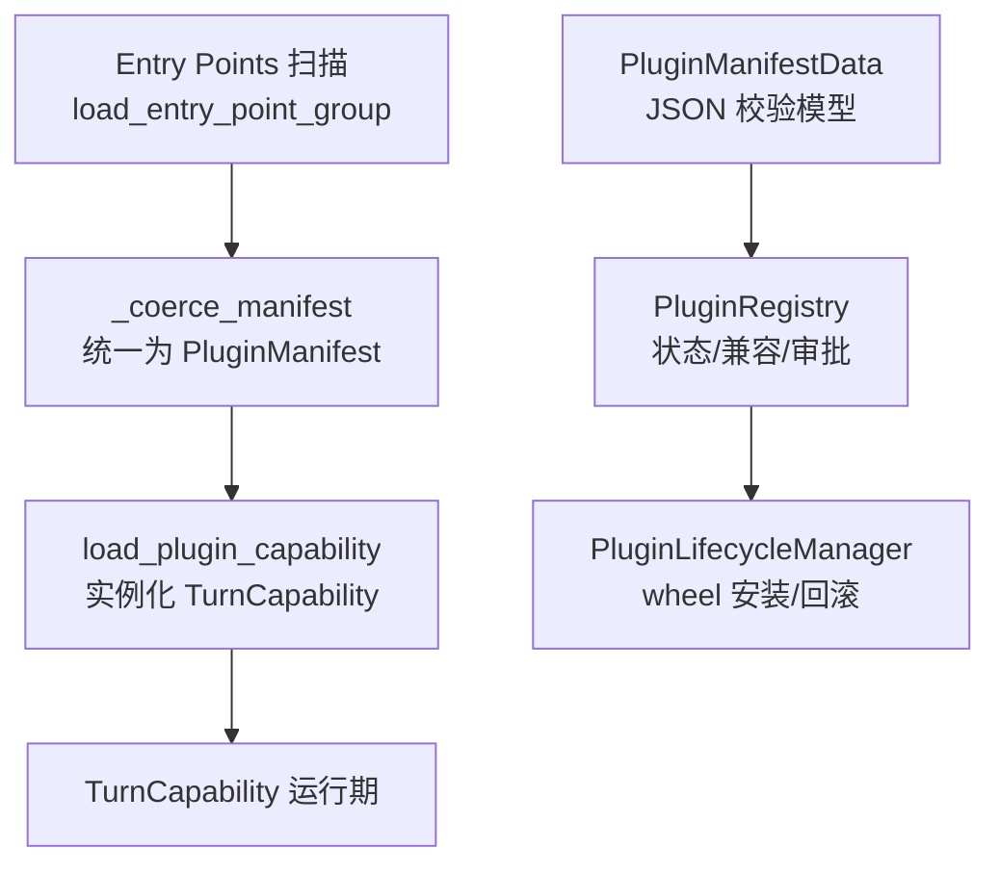
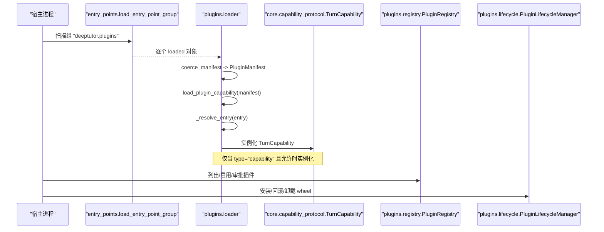
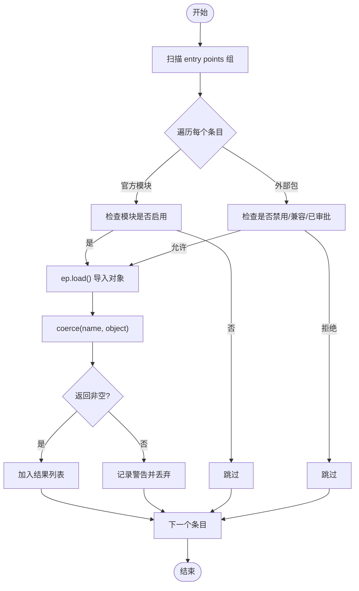
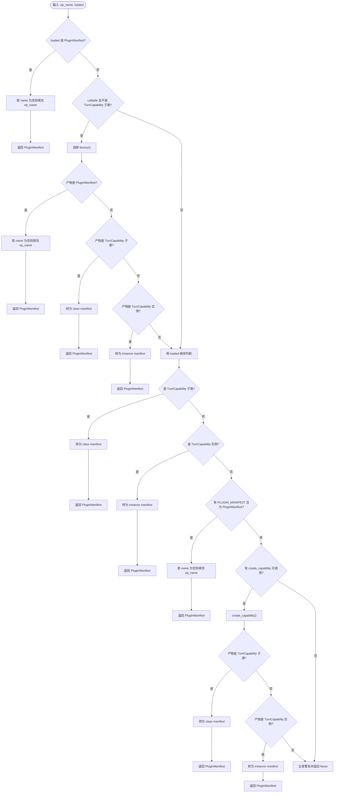
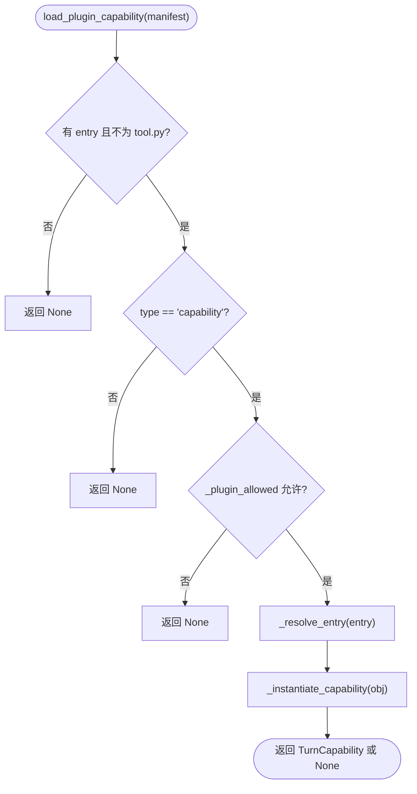
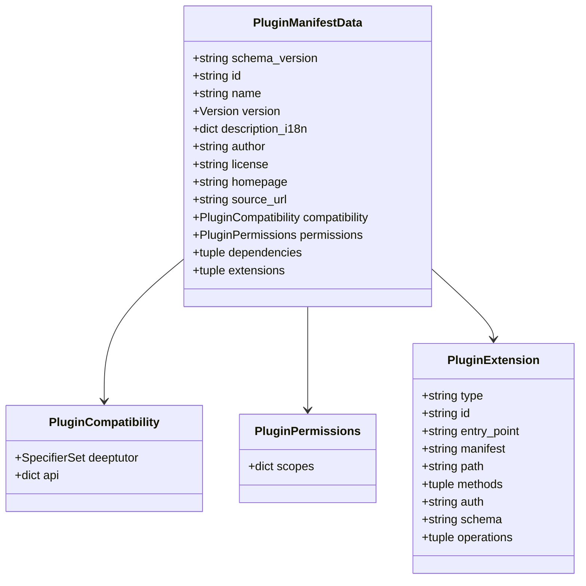
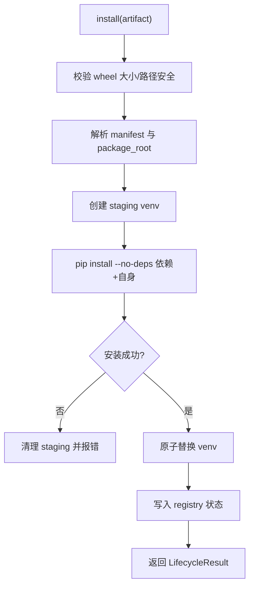
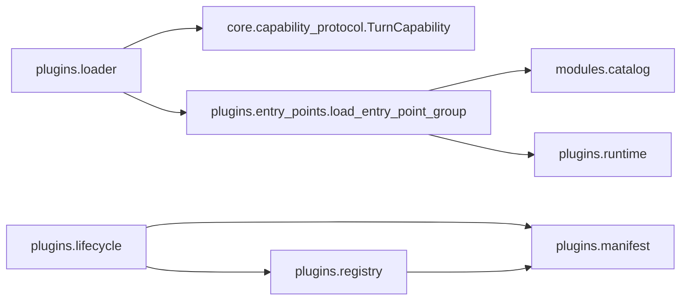

# 插件加载器

<cite>
**本文引用的文件**   
- [deeptutor/plugins/__init__.py](file://deeptutor/plugins/__init__.py)
- [deeptutor/plugins/loader.py](file://deeptutor/plugins/loader.py)
- [deeptutor/plugins/entry_points.py](file://deeptutor/plugins/entry_points.py)
- [deeptutor/core/capability_protocol.py](file://deeptutor/core/capability_protocol.py)
- [deeptutor/plugins/manifest.py](file://deeptutor/plugins/manifest.py)
- [deeptutor/plugins/lifecycle.py](file://deeptutor/plugins/lifecycle.py)
- [deeptutor/plugins/registry.py](file://deeptutor/plugins/registry.py)
- [deeptutor/runtime/registry/capability_registry.py](file://deeptutor/runtime/registry/capability_registry.py)
</cite>

## 目录
1. [简介](#简介)
2. [项目结构](#项目结构)
3. [核心组件](#核心组件)
4. [架构总览](#架构总览)
5. [详细组件分析](#详细组件分析)
6. [依赖关系分析](#依赖关系分析)
7. [性能与稳定性考虑](#性能与稳定性考虑)
8. [故障排查指南](#故障排查指南)
9. [结论](#结论)
10. [附录：插件开发示例](#附录插件开发示例)

## 简介
本文面向 DeepTutor 的“插件加载器”，聚焦以下目标：
- 解释插件发现机制：entry points 组扫描、动态模块导入与元数据提取。
- 说明运行时能力插件实例化流程：类检测、工厂函数处理与属性解析。
- 梳理 PluginManifest 数据类的字段含义与验证规则。
- 解析 _coerce_manifest 的多输入格式支持：直接实例、类定义、工厂函数与配置对象。
- 提供能力插件注册与实现的实践指引，帮助开发者正确编写自定义能力插件。

## 项目结构
DeepTutor 插件体系由“发现层”“协调层”“协议层”“包生命周期层”“注册表层”共同组成：
- 发现层：通过 Python entry points 扫描外部包，统一入口为 load_entry_point_group。
- 协调层：loader 将任意可调用对象转换为统一的 PluginManifest，并负责能力实例化。
- 协议层：TurnCapability 与 CapabilityManifest 定义能力契约。
- 包生命周期层：lifecycle 管理 wheel 安装、隔离环境、回滚等。
- 注册表层：registry 维护已安装插件清单、状态、权限审批与兼容性检查。

**图表来源**
- [deeptutor/plugins/entry_points.py:37-97](file://deeptutor/plugins/entry_points.py#L37-L97)
- [deeptutor/plugins/loader.py:42-165](file://deeptutor/plugins/loader.py#L42-L165)
- [deeptutor/core/capability_protocol.py:33-81](file://deeptutor/core/capability_protocol.py#L33-L81)
- [deeptutor/plugins/registry.py:159-444](file://deeptutor/plugins/registry.py#L159-L444)
- [deeptutor/plugins/lifecycle.py:50-174](file://deeptutor/plugins/lifecycle.py#L50-L174)
- [deeptutor/plugins/manifest.py:118-228](file://deeptutor/plugins/manifest.py#L118-L228)

**章节来源**
- [deeptutor/plugins/__init__.py:1-14](file://deeptutor/plugins/__init__.py#L1-L14)
- [deeptutor/plugins/entry_points.py:1-101](file://deeptutor/plugins/entry_points.py#L1-L101)
- [deeptutor/plugins/loader.py:1-165](file://deeptutor/plugins/loader.py#L1-L165)
- [deeptutor/core/capability_protocol.py:1-103](file://deeptutor/core/capability_protocol.py#L1-L103)
- [deeptutor/plugins/manifest.py:1-540](file://deeptutor/plugins/manifest.py#L1-L540)
- [deeptutor/plugins/lifecycle.py:1-469](file://deeptutor/plugins/lifecycle.py#L1-L469)
- [deeptutor/plugins/registry.py:1-659](file://deeptutor/plugins/registry.py#L1-L659)

## 核心组件
- 插件发现与协调
  - load_entry_point_group：安全地读取指定 group 的所有 entry point，逐个导入并交给 coerce 函数处理；失败不阻断其他插件。
  - discover_plugins：对外暴露的插件发现接口，返回 PluginManifest 列表。
  - _coerce_manifest：将 entry point 产出的任意对象规范化为 PluginManifest。
  - load_plugin_capability：根据 manifest.entry 动态解析并实例化 TurnCapability。
- 能力协议
  - TurnCapability：所有能力必须继承的抽象基类，要求实现 manifest 与 run。
  - CapabilityManifest：能力的静态元数据（名称、描述、阶段、工具、CLI 别名、请求 schema、默认配置）。
- 包级元数据模型
  - PluginManifestData：对 deeptutor.plugin.json 的强校验模型，包含 id、name、version、description_i18n、author、license、homepage、source_url、compatibility、permissions、dependencies、extensions 等。
- 生命周期与注册表
  - PluginLifecycleManager：在隔离 venv 中安装 wheel，记录 artifact SHA-256，支持回滚与卸载。
  - PluginRegistry：只读发现已安装插件与目录项，管理启用/禁用、权限审批、兼容性检查。

**章节来源**
- [deeptutor/plugins/entry_points.py:37-97](file://deeptutor/plugins/entry_points.py#L37-L97)
- [deeptutor/plugins/loader.py:29-165](file://deeptutor/plugins/loader.py#L29-L165)
- [deeptutor/core/capability_protocol.py:33-81](file://deeptutor/core/capability_protocol.py#L33-L81)
- [deeptutor/plugins/manifest.py:118-228](file://deeptutor/plugins/manifest.py#L118-L228)
- [deeptutor/plugins/lifecycle.py:50-174](file://deeptutor/plugins/lifecycle.py#L50-L174)
- [deeptutor/plugins/registry.py:159-444](file://deeptutor/plugins/registry.py#L159-L444)

## 架构总览
下图展示从 entry points 到能力实例化的完整链路，以及包生命周期与注册表的协作关系。

**图表来源**
- [deeptutor/plugins/entry_points.py:37-97](file://deeptutor/plugins/entry_points.py#L37-L97)
- [deeptutor/plugins/loader.py:42-165](file://deeptutor/plugins/loader.py#L42-L165)
- [deeptutor/core/capability_protocol.py:46-81](file://deeptutor/core/capability_protocol.py#L46-L81)
- [deeptutor/plugins/registry.py:175-223](file://deeptutor/plugins/registry.py#L175-L223)
- [deeptutor/plugins/lifecycle.py:72-174](file://deeptutor/plugins/lifecycle.py#L72-L174)

## 详细组件分析

### 插件发现机制：entry points 组扫描与动态导入
- 组名约定
  - 能力插件组：deeptutor.plugins
  - 循环能力组：deeptutor.loop_capabilities（由 runtime 侧使用）
- 扫描流程
  - 通过 importlib.metadata.entry_points(group=...) 获取候选条目。
  - 官方模块的 entry points 受模块开关控制；外部包的 entry points 需通过运行时策略（是否禁用、是否兼容、是否已审批）后才允许导入。
  - 每个条目调用 ep.load() 触发第三方代码导入，随后交给 coerce 函数进行类型归一化。
- 错误隔离
  - 单个条目的导入或 coerce 异常会被捕获并记录警告，不影响其他条目加载。

**图表来源**
- [deeptutor/plugins/entry_points.py:37-97](file://deeptutor/plugins/entry_points.py#L37-L97)

**章节来源**
- [deeptutor/plugins/entry_points.py:1-101](file://deeptutor/plugins/entry_points.py#L1-L101)

### 元数据提取与规范化：_coerce_manifest
_coerce_manifest 支持多种 entry point 产出形式，最终统一为 PluginManifest：
- 直接返回 PluginManifest：若 name 为空则回填 entry point 名称。
- 返回工厂函数（callable，且不是 TurnCapability 子类）：
  - 调用工厂得到产物后，按以下优先级识别：
    - 产物为 PluginManifest：回填 name 后返回。
    - 产物为 TurnCapability 子类：转为 class manifest。
    - 产物为 TurnCapability 实例：转为 instance manifest。
    - 否则继续以原始 loaded 对象尝试后续分支。
- 直接返回 TurnCapability 子类：转为 class manifest。
- 直接返回 TurnCapability 实例：转为 instance manifest。
- 对象上存在 PLUGIN_MANIFEST 属性且为 PluginManifest：回填 name 后返回。
- 对象上存在 create_capability 可调用属性：
  - 调用后若返回 TurnCapability 实例或子类，分别转为对应 manifest。
- 以上均失败：记录警告并返回 None。

**图表来源**
- [deeptutor/plugins/loader.py:63-106](file://deeptutor/plugins/loader.py#L63-L106)

**章节来源**
- [deeptutor/plugins/loader.py:29-106](file://deeptutor/plugins/loader.py#L29-L106)

### 能力插件实例化流程：类检测、工厂函数与属性解析
- 入口：load_plugin_capability(manifest)
  - 过滤条件：
    - 必须有 entry 字段。
    - entry 不能指向 tool.py。
    - type 必须为 capability。
    - 若存在 _plugin_allowed 属性，需返回 True。
  - 解析 entry：
    - 形如 "module.path:Class.attr" 或 "package.module"。
    - 通过 _resolve_entry 动态 import 并按 "." 逐级 getattr。
  - 实例化：
    - 若 obj 已是 TurnCapability 实例：直接返回。
    - 若 obj 是 TurnCapability 子类：实例化后返回。
    - 若 obj 是普通 callable：调用一次，若返回 TurnCapability 实例或子类，再按需实例化。
    - 否则返回 None。

**图表来源**
- [deeptutor/plugins/loader.py:47-60](file://deeptutor/plugins/loader.py#L47-L60)
- [deeptutor/plugins/loader.py:142-165](file://deeptutor/plugins/loader.py#L142-L165)

**章节来源**
- [deeptutor/plugins/loader.py:47-165](file://deeptutor/plugins/loader.py#L47-L165)

### PluginManifest 数据类设计（运行时）
- 字段
  - name：插件显示名，未设置时可由 entry point 名称回填。
  - type：插件类型，如 "capability"。
  - description：能力描述。
  - stages：能力阶段列表。
  - version：版本字符串。
  - author：作者。
  - entry：动态解析的目标标识，形如 "module:Class"。
- 用途
  - 作为 loader 层的轻量元数据载体，用于发现与实例化能力。
- 注意
  - 该结构与包级 manifest 模型（PluginManifestData）不同，后者用于 JSON 校验与注册表。

**章节来源**
- [deeptutor/plugins/loader.py:29-40](file://deeptutor/plugins/loader.py#L29-L40)

### PluginManifestData 数据类设计（包级 JSON 模型）
- 关键字段
  - schema_version：固定为 "deeptutor.plugin/v1"。
  - id：小写反向 DNS 风格标识符。
  - name：插件名称。
  - version：语义化版本。
  - description_i18n：多语言描述，至少包含英文。
  - author、license、homepage、source_url：元信息。
  - compatibility：
    - deeptutor：版本范围。
    - api：各扩展类型的 API 版本要求。
  - permissions：权限作用域映射，如 reading、models、ui 等。
  - dependencies：PEP 508 依赖列表，限制数量与格式。
  - extensions：扩展声明数组，含 capability、tool、http_route、frontend_page、visualizer、persistence_schema、app_connector、reading_extension、loop_capability 等类型。
- 校验要点
  - 未知顶层字段将被拒绝。
  - id/name/version 等必填字段长度与格式严格校验。
  - URL 必须为 http(s) 绝对地址。
  - permissions 的作用域键值受限且去重。
  - dependencies 不允许 extras/markers/url，且去重。
  - extensions 按类型限定允许字段，并对 path/methods/auth/schema/operations 做格式校验。
  - frontend_page 若带 manifest，需要 ui.sandboxed-iframe 权限。

**图表来源**
- [deeptutor/plugins/manifest.py:67-141](file://deeptutor/plugins/manifest.py#L67-L141)
- [deeptutor/plugins/manifest.py:144-228](file://deeptutor/plugins/manifest.py#L144-L228)
- [deeptutor/plugins/manifest.py:324-403](file://deeptutor/plugins/manifest.py#L324-L403)

**章节来源**
- [deeptutor/plugins/manifest.py:1-540](file://deeptutor/plugins/manifest.py#L1-L540)

### 包生命周期与注册表
- 生命周期
  - install：校验 wheel 大小与内容，创建隔离 venv，使用 pip --no-deps 安装依赖与自身，原子替换旧环境，记录 artifact SHA-256 与安装日志。
  - rollback：基于历史快照恢复上一个版本，校验 artifact 一致性。
  - uninstall：清理状态与本地目录。
- 注册表
  - list_plugins：合并已管理与外部分布，结合 catalog 标记可用/弃用。
  - set_enabled/approve：启用/禁用与权限审批，持久化状态。
  - _compatible：检查 DeepTutor 版本与各扩展 API 版本是否满足。

**图表来源**
- [deeptutor/plugins/lifecycle.py:72-174](file://deeptutor/plugins/lifecycle.py#L72-L174)
- [deeptutor/plugins/lifecycle.py:293-347](file://deeptutor/plugins/lifecycle.py#L293-L347)

**章节来源**
- [deeptutor/plugins/lifecycle.py:50-174](file://deeptutor/plugins/lifecycle.py#L50-L174)
- [deeptutor/plugins/registry.py:175-444](file://deeptutor/plugins/registry.py#L175-L444)

## 依赖关系分析
- loader 依赖
  - core.capability_protocol.TurnCapability：能力协议基类。
  - plugins.entry_points.load_entry_point_group：统一 entry points 扫描与容错。
- entry_points 依赖
  - modules.catalog.manifests/module_enabled/source_checkout：官方模块开关与源码检出模式下的补充。
  - plugins.runtime.entry_point_can_load/guard_entry_point_loaded：外部包的启用/兼容/审批守卫。
- lifecycle 依赖
  - plugins.manifest.parse_manifest：解析 wheel 内 manifest。
  - plugins.registry.PluginRegistry：持久化安装状态。
- registry 依赖
  - plugins.manifest.parse_manifest/version_matches/approval_digest：校验与兼容性计算。
  - services.file_io.atomic_write_json：原子写入状态文件。

**图表来源**
- [deeptutor/plugins/loader.py:21-26](file://deeptutor/plugins/loader.py#L21-L26)
- [deeptutor/plugins/entry_points.py:27-34](file://deeptutor/plugins/entry_points.py#L27-L34)
- [deeptutor/plugins/entry_points.py:83-91](file://deeptutor/plugins/entry_points.py#L83-L91)
- [deeptutor/plugins/lifecycle.py:20-32](file://deeptutor/plugins/lifecycle.py#L20-L32)
- [deeptutor/plugins/registry.py:22-38](file://deeptutor/plugins/registry.py#L22-L38)

**章节来源**
- [deeptutor/plugins/loader.py:1-26](file://deeptutor/plugins/loader.py#L1-L26)
- [deeptutor/plugins/entry_points.py:1-101](file://deeptutor/plugins/entry_points.py#L1-L101)
- [deeptutor/plugins/lifecycle.py:1-33](file://deeptutor/plugins/lifecycle.py#L1-L33)
- [deeptutor/plugins/registry.py:1-38](file://deeptutor/plugins/registry.py#L1-L38)

## 性能与稳定性考虑
- 导入隔离
  - 外部包仅在必要时导入，并通过 guard 机制避免不可信代码影响主进程。
- 错误隔离
  - 单个 entry point 导入或 coerce 失败不会中断其余插件加载。
- 资源限制
  - wheel 大小与展开体积上限、manifest 大小上限，防止恶意包耗尽资源。
- 依赖隔离
  - 使用 --no-deps 安装，避免污染宿主环境；依赖图在隔离 venv 中重建。
- 状态原子性
  - 状态文件通过 atomic_write_json 写入，避免部分更新导致损坏。

[本节为通用指导，不直接分析具体文件]

## 故障排查指南
- 常见现象与定位
  - 插件未被发现：检查 entry point 组名是否正确，外部包是否已通过 approval 且未被禁用。
  - 能力未实例化：确认 manifest.type 为 "capability"，entry 指向有效类或工厂，且允许访问。
  - 安装失败：查看 install.log 与 pip 输出，确认依赖与网络代理设置。
  - 回滚失败：检查历史快照是否存在，artifact SHA-256 是否一致。
  - 兼容性报错：核对 compatibility.deeptutor 与 compatibility.api 的版本约束。
- 关键断点
  - entry_points.load_entry_point_group：观察警告日志，确认被跳过的条目。
  - loader._coerce_manifest：确认返回的 PluginManifest 是否符合预期。
  - lifecycle._manifest_from_wheel：检查 wheel 内容与 manifest 一致性。
  - registry._compatible：查看兼容性错误原因。

**章节来源**
- [deeptutor/plugins/entry_points.py:71-97](file://deeptutor/plugins/entry_points.py#L71-L97)
- [deeptutor/plugins/loader.py:63-106](file://deeptutor/plugins/loader.py#L63-L106)
- [deeptutor/plugins/lifecycle.py:293-347](file://deeptutor/plugins/lifecycle.py#L293-L347)
- [deeptutor/plugins/registry.py:436-444](file://deeptutor/plugins/registry.py#L436-L444)

## 结论
DeepTutor 插件加载器通过标准化的 entry points 扫描、严格的元数据校验与安全的实例化流程，实现了可扩展的能力生态。loader 层将多样化的插件入口统一为 PluginManifest，并在运行时安全地实例化 TurnCapability；lifecycle 与 registry 层确保插件的安装、状态与兼容性可控。遵循本文规范，开发者可以可靠地注册和实现自定义能力插件。

[本节为总结性内容，不直接分析具体文件]

## 附录：插件开发示例
以下为“如何正确注册和实现自定义能力插件”的实践步骤与最佳实践。为避免泄露实现细节，此处仅提供路径指引与要点说明。

- 注册方式（三种推荐）
  - 方式一：在 entry point 中直接导出 TurnCapability 子类
    - 参考路径：[deeptutor/plugins/loader.py:109-117](file://deeptutor/plugins/loader.py#L109-L117)
  - 方式二：在 entry point 中导出 TurnCapability 实例
    - 参考路径：[deeptutor/plugins/loader.py:120-127](file://deeptutor/plugins/loader.py#L120-L127)
  - 方式三：在 entry point 中导出工厂函数，返回类或实例
    - 参考路径：[deeptutor/plugins/loader.py:69-80](file://deeptutor/plugins/loader.py#L69-L80)
- 能力协议实现
  - 继承 TurnCapability，提供 manifest 与 run 方法。
  - 参考路径：[deeptutor/core/capability_protocol.py:33-81](file://deeptutor/core/capability_protocol.py#L33-L81)
- 元数据与阶段
  - 在 CapabilityManifest 中填写 name、description、stages 等。
  - 参考路径：[deeptutor/core/capability_protocol.py:33-44](file://deeptutor/core/capability_protocol.py#L33-L44)
- 动态解析与实例化
  - 确保 entry 指向有效的 module:Class 或 package.module。
  - 参考路径：[deeptutor/plugins/loader.py:142-165](file://deeptutor/plugins/loader.py#L142-L165)
- 包级清单（可选）
  - 如需发布 wheel，请提供 deeptutor.plugin.json，遵循 PluginManifestData 校验规则。
  - 参考路径：[deeptutor/plugins/manifest.py:144-228](file://deeptutor/plugins/manifest.py#L144-L228)

**章节来源**
- [deeptutor/plugins/loader.py:69-127](file://deeptutor/plugins/loader.py#L69-L127)
- [deeptutor/core/capability_protocol.py:33-81](file://deeptutor/core/capability_protocol.py#L33-L81)
- [deeptutor/plugins/manifest.py:144-228](file://deeptutor/plugins/manifest.py#L144-L228)