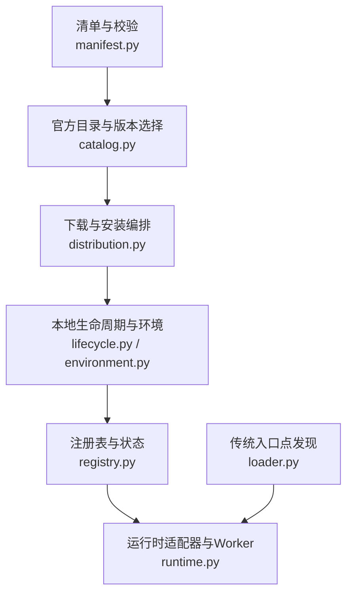
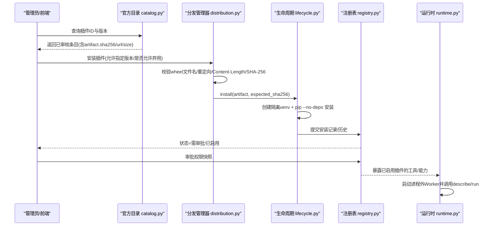
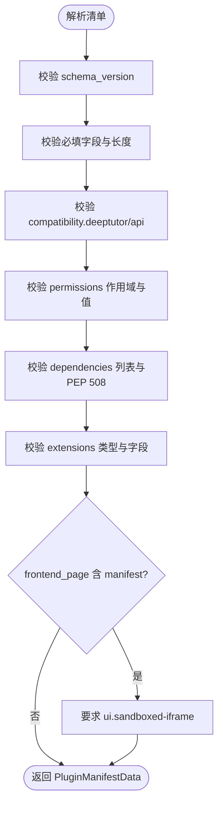
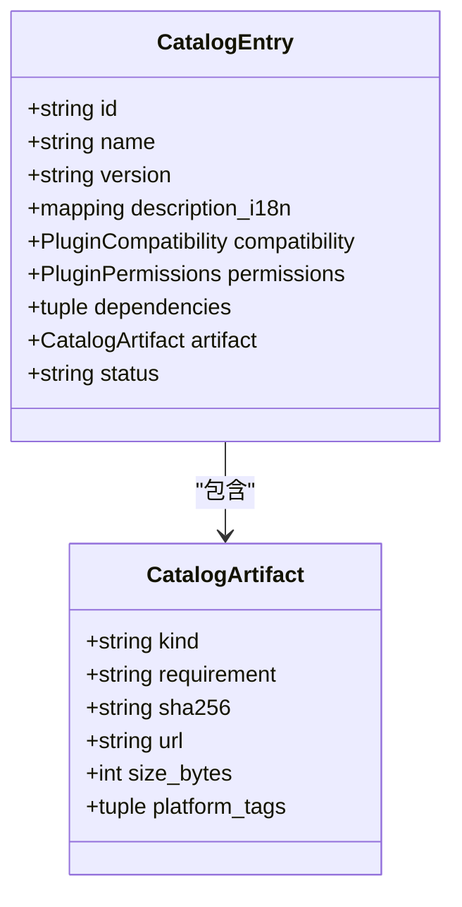
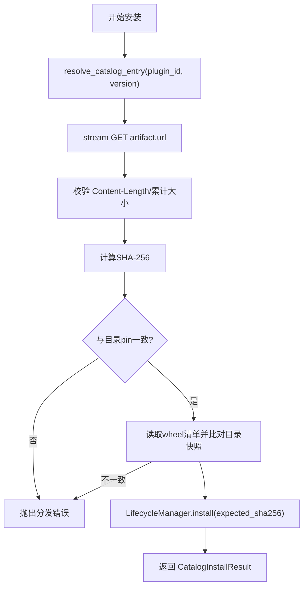
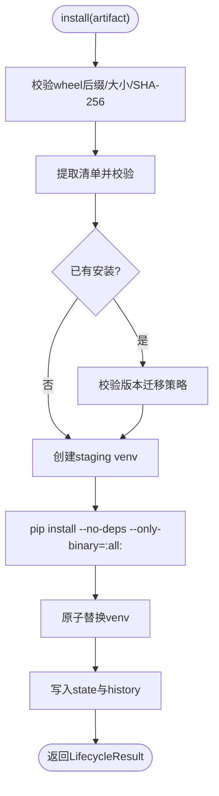
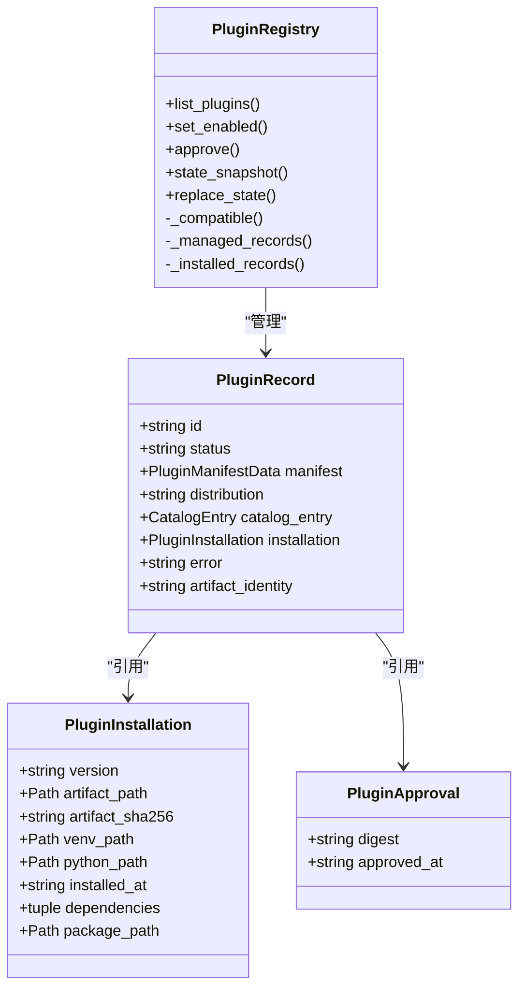
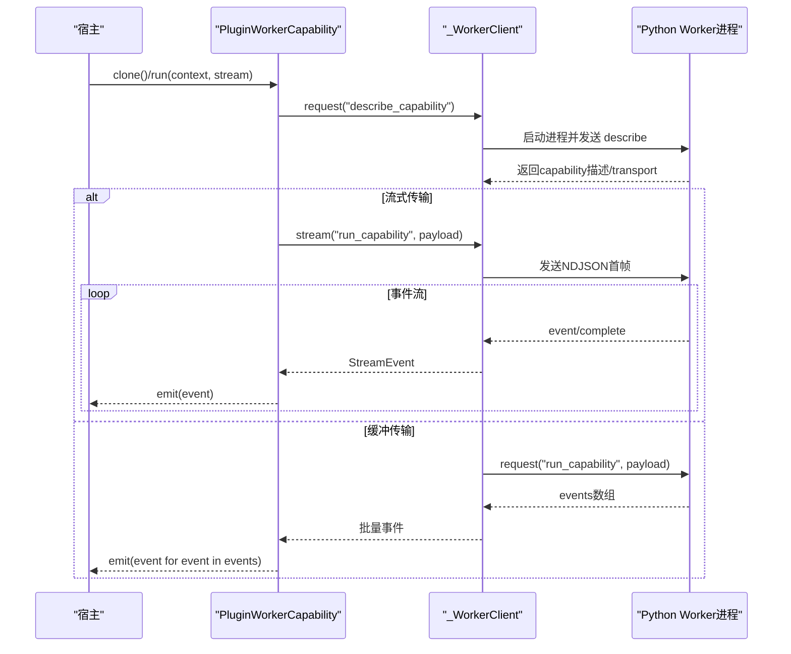
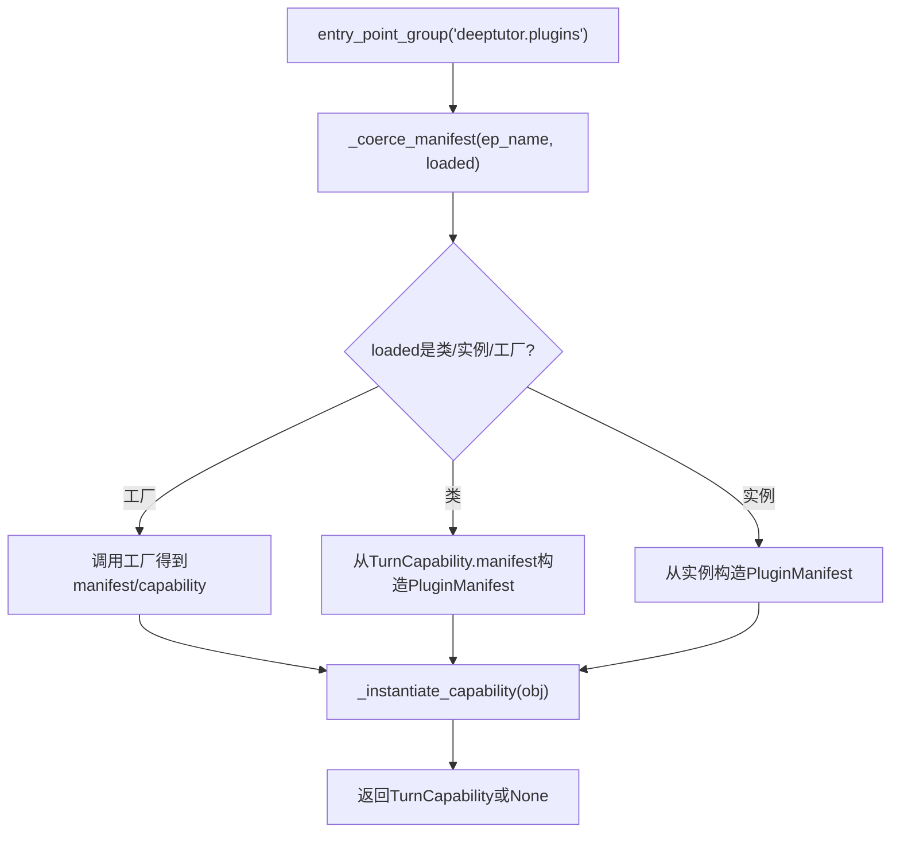
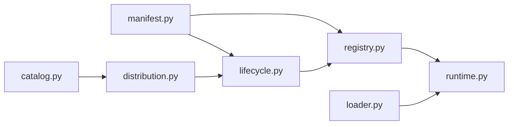

# 插件扩展机制

<cite>
**本文引用的文件**   
- [lifecycle.py](file://deeptutor/plugins/lifecycle.py)
- [distribution.py](file://deeptutor/plugins/distribution.py)
- [environment.py](file://deeptutor/plugins/environment.py)
- [loader.py](file://deeptutor/plugins/loader.py)
- [manifest.py](file://deeptutor/plugins/manifest.py)
- [registry.py](file://deeptutor/plugins/registry.py)
- [runtime.py](file://deeptutor/plugins/runtime.py)
- [catalog.py](file://deeptutor/plugins/catalog.py)
</cite>

## 目录
1. [引言](#引言)
2. [项目结构](#项目结构)
3. [核心组件](#核心组件)
4. [架构总览](#架构总览)
5. [详细组件分析](#详细组件分析)
6. [依赖关系分析](#依赖关系分析)
7. [性能与资源控制](#性能与资源控制)
8. [故障排查指南](#故障排查指南)
9. [结论](#结论)
10. [附录：清单格式与开发指南](#附录：清单格式与开发指南)

## 引言
本文件系统性梳理 DeepTutor 的插件扩展机制，覆盖以下关键主题：
- 插件加载器：基于 Python entry-point 的动态模块发现、能力实例化与安全门控。
- 依赖解析与版本兼容性：清单校验、宿主 API 版本匹配、DeepTutor 版本约束。
- 插件注册表：能力发现、工具与服务绑定、启用/禁用与审批状态管理。
- 生命周期管理：隔离环境安装、升级、回滚、卸载；进程外 Worker 运行与销毁。
- 清单文件格式与验证规则：元数据、权限范围、扩展点、兼容性声明。
- 插件开发指南：最佳实践、安全边界、性能优化建议。

## 项目结构
DeepTutor 插件子系统位于 `deeptutor/plugins` 下，按职责拆分为多个模块：
- 清单与校验：`manifest.py`
- 官方目录与版本选择：`catalog.py`
- 下载与安装编排：`distribution.py`
- 本地生命周期与环境：`lifecycle.py`、`environment.py`
- 运行时适配器与 Worker：`runtime.py`
- 注册表与状态：`registry.py`
- 传统入口点发现（兼容层）：`loader.py`

**图表来源**
- [manifest.py:1-540](file://deeptutor/plugins/manifest.py#L1-L540)
- [catalog.py:1-388](file://deeptutor/plugins/catalog.py#L1-L388)
- [distribution.py:1-210](file://deeptutor/plugins/distribution.py#L1-L210)
- [lifecycle.py:1-469](file://deeptutor/plugins/lifecycle.py#L1-L469)
- [environment.py:1-24](file://deeptutor/plugins/environment.py#L1-L24)
- [registry.py:1-659](file://deeptutor/plugins/registry.py#L1-L659)
- [runtime.py:1-813](file://deeptutor/plugins/runtime.py#L1-L813)
- [loader.py:1-165](file://deeptutor/plugins/loader.py#L1-L165)

**章节来源**
- [manifest.py:1-540](file://deeptutor/plugins/manifest.py#L1-L540)
- [catalog.py:1-388](file://deeptutor/plugins/catalog.py#L1-L388)
- [distribution.py:1-210](file://deeptutor/plugins/distribution.py#L1-L210)
- [lifecycle.py:1-469](file://deeptutor/plugins/lifecycle.py#L1-L469)
- [environment.py:1-24](file://deeptutor/plugins/environment.py#L1-L24)
- [registry.py:1-659](file://deeptutor/plugins/registry.py#L1-L659)
- [runtime.py:1-813](file://deeptutor/plugins/runtime.py#L1-L813)
- [loader.py:1-165](file://deeptutor/plugins/loader.py#L1-L165)

## 核心组件
- 清单模型与校验器：定义插件元数据、权限、扩展点、兼容性，并进行严格校验。
- 官方目录：离线可浏览的已审核插件索引，支持按 ID 和版本解析。
- 分发管理器：从目录中解析并下载受审的 wheel，校验大小、SHA-256 与清单一致性。
- 生命周期管理器：在隔离 venv 中安装/升级/回滚/卸载插件，维护历史与日志。
- 注册表：聚合已安装与目录中的插件记录，计算状态（可用、需审批、兼容、不兼容、已禁用等）。
- 运行时适配器：将已启用的插件能力与工具以进程外 Worker 形式暴露给宿主。
- 传统加载器：通过 entry-point 发现 legacy 插件，提供向后兼容。

**章节来源**
- [manifest.py:1-540](file://deeptutor/plugins/manifest.py#L1-L540)
- [catalog.py:1-388](file://deeptutor/plugins/catalog.py#L1-L388)
- [distribution.py:1-210](file://deeptutor/plugins/distribution.py#L1-L210)
- [lifecycle.py:1-469](file://deeptutor/plugins/lifecycle.py#L1-L469)
- [registry.py:1-659](file://deeptutor/plugins/registry.py#L1-L659)
- [runtime.py:1-813](file://deeptutor/plugins/runtime.py#L1-L813)
- [loader.py:1-165](file://deeptutor/plugins/loader.py#L1-L165)

## 架构总览
插件系统围绕“清单—目录—分发—生命周期—注册表—运行时”的流水线构建，确保第三方代码在不污染宿主进程的前提下被安全加载与执行。

**图表来源**
- [catalog.py:177-215](file://deeptutor/plugins/catalog.py#L177-L215)
- [distribution.py:154-201](file://deeptutor/plugins/distribution.py#L154-L201)
- [lifecycle.py:72-174](file://deeptutor/plugins/lifecycle.py#L72-L174)
- [registry.py:159-274](file://deeptutor/plugins/registry.py#L159-L274)
- [runtime.py:390-439](file://deeptutor/plugins/runtime.py#L390-L439)

## 详细组件分析

### 清单与校验（manifest.py）
- 定义根清单字段：schema_version、id、name、version、description_i18n、author、license、homepage、source_url、compatibility、permissions、dependencies、extensions。
- 校验策略：
  - 拒绝未知顶层字段，保证向后兼容。
  - id/name/version 等基础字段强校验。
  - compatibility.deeptutor 使用 SpecifierSet 约束宿主版本；compatibility.api 针对各扩展类型声明最低 API 版本。
  - permissions 限定作用域集合，并对每个 scope 的值去重与长度限制。
  - dependencies 仅允许 PEP 508 名称+版本要求，禁止 URL/marker/extras，限制最多 50 项且去重。
  - extensions 支持 capability/tool/http_route/frontend_page/persistence_schema/app_connector/reading_extension/visualizer 等类型，每种类型有最小必填字段集与路径/方法/操作ID等校验。
  - frontend_page 若包含 manifest，则必须申请 ui.sandboxed-iframe 权限。
- 辅助函数：permission_digest、approval_digest 用于生成稳定的权限与审批摘要。

**图表来源**
- [manifest.py:144-228](file://deeptutor/plugins/manifest.py#L144-L228)
- [manifest.py:256-403](file://deeptutor/plugins/manifest.py#L256-L403)

**章节来源**
- [manifest.py:1-540](file://deeptutor/plugins/manifest.py#L1-L540)

### 官方目录与版本解析（catalog.py）
- 目录为离线 JSON 索引，包含 entries 数组与 meta 信息。
- 支持 v1/v2 两种 schema，v2 新增 artifact.url/size_bytes/platform_tags。
- 解析流程：
  - load_catalog 缓存目录内容，过滤 hidden 条目，按 (id, version) 去重。
  - resolve_catalog_entry 支持 latest 或精确版本，可选择是否允许 deprecated/prerelease。
  - parse_catalog_entry 复用清单校验逻辑，并额外校验 artifact 字段与平台标签。
- 安全约束：
  - artifact.requirement 必须为 == 精确 pin，且与 entry.version 一致。
  - artifact.url 必须为 HTTPS 直链 wheel，不允许用户名/密码/query/fragment。
  - size_bytes 必须在 0..256MiB 范围内，platform_tags 非空且唯一。

**图表来源**
- [catalog.py:50-104](file://deeptutor/plugins/catalog.py#L50-L104)

**章节来源**
- [catalog.py:1-388](file://deeptutor/plugins/catalog.py#L1-L388)

### 分发与下载（distribution.py）
- CatalogArtifactDownloader：
  - 流式下载 wheel，禁止重定向，校验 Content-Length 与累计大小不超过 reviewed size。
  - 计算 SHA-256 并与目录 pin 比较。
  - 失败时清理临时目录。
- CatalogInstallManager：
  - 先 resolve_catalog_entry，再下载并校验 wheel 清单与目录快照的一致性（id/version/permissions/dependencies/compatibility）。
  - 调用 LifecycleManager.install(expected_sha256)。

**图表来源**
- [distribution.py:55-139](file://deeptutor/plugins/distribution.py#L55-L139)
- [distribution.py:154-201](file://deeptutor/plugins/distribution.py#L154-L201)

**章节来源**
- [distribution.py:1-210](file://deeptutor/plugins/distribution.py#L1-L210)

### 生命周期与环境（lifecycle.py、environment.py）
- PluginLifecycleManager：
  - install：校验 wheel 后缀与大小，计算 SHA-256，提取清单，检查现有安装与版本迁移策略，创建 staging venv，pip --no-deps --only-binary=:all: 安装依赖与自身包，原子替换 venv，写入历史记录。
  - rollback：根据 history 恢复上一个 installation，校验 artifact SHA-256，更新 state。
  - uninstall：移除 state 中记录与本地目录。
  - _validate_transition：阻止直接降级，要求显式 reinstall 或 rollback。
- 环境与命令执行：
  - plugin_environment 仅保留必要环境变量，避免污染子进程。
  - _run_command 封装 subprocess.run，捕获输出与超时。

**图表来源**
- [lifecycle.py:72-174](file://deeptutor/plugins/lifecycle.py#L72-L174)
- [lifecycle.py:251-290](file://deeptutor/plugins/lifecycle.py#L251-L290)
- [environment.py:1-24](file://deeptutor/plugins/environment.py#L1-L24)

**章节来源**
- [lifecycle.py:1-469](file://deeptutor/plugins/lifecycle.py#L1-L469)
- [environment.py:1-24](file://deeptutor/plugins/environment.py#L1-L24)

### 注册表与状态（registry.py）
- PluginRegistry：
  - list_plugins：合并本地已安装分布与官方目录，计算每条记录的 status（available/broken/incompatible/approval-required/enabled/disabled/deprecated）。
  - set_enabled/disable：修改 disabled 列表，持久化到 state_path。
  - approve：保存用户批准的权限快照 digest，与当前 manifest+artifact_identity 对比。
  - _compatible：检查 DeepTutor 版本与扩展 API 版本是否满足。
  - _managed_records/_installed_records：分别处理 managed 安装与外部 distribution 发现的清单。
- 状态文档：
  - 包含 version、disabled、plugins 键，plugins 内每个插件行包含 manifest/installation/history/approval。
  - 读写均通过 atomic_write_json 保证原子性。

**图表来源**
- [registry.py:61-157](file://deeptutor/plugins/registry.py#L61-L157)
- [registry.py:159-274](file://deeptutor/plugins/registry.py#L159-L274)
- [registry.py:436-444](file://deeptutor/plugins/registry.py#L436-L444)

**章节来源**
- [registry.py:1-659](file://deeptutor/plugins/registry.py#L1-L659)

### 运行时适配器与 Worker（runtime.py）
- _WorkerClient：
  - request/request_async：同步/异步调用 worker 模块，输入 JSON，输出 JSON，限制请求体大小与 stderr 缓冲区。
  - stream：NDJSON v1 流式协议，限制输出总量与事件数量，支持取消与进程树清理。
  - validate_permissions：校验 worker 返回的权限声明必须是已批准子集。
- 适配类：
  - PluginWorkerTool：描述工具定义并执行 execute_tool。
  - PluginWorkerHttpRoute：校验 HTTP method/path/auth，转发 handle_http。
  - PluginWorkerCapability：描述能力并 run_capability，支持 NDJSON 流式事件。
- 加载与门控：
  - load_enabled_workers/load_enabled_tools/load_enabled_capabilities：仅对 enabled 且具安装记录的插件构建适配器。
  - entry_point_allowed/entry_point_can_load/guard_entry_point_loaded：对 legacy entry-point 进行白名单与代际一致性检查。
  - _managed_guard：对托管安装的运行时调用进行实时状态与代际校验。

**图表来源**
- [runtime.py:65-234](file://deeptutor/plugins/runtime.py#L65-L234)
- [runtime.py:323-388](file://deeptutor/plugins/runtime.py#L323-L388)

**章节来源**
- [runtime.py:1-813](file://deeptutor/plugins/runtime.py#L1-L813)

### 传统入口点发现（loader.py）
- discover_plugins：通过 entry-point group deeptutor.plugins 发现插件。
- load_plugin_capability：从 manifest.entry 动态导入对象，支持类/实例/工厂函数多种形态，最终实例化 TurnCapability。
- 兼容策略：
  - 支持 PLUGIN_MANIFEST 属性、create_capability 工厂。
  - 对 tool.py 入口进行过滤，仅加载 capability 类型。
  - 结合 runtime.entry_point_allowed 进行白名单与状态门控。

**图表来源**
- [loader.py:42-60](file://deeptutor/plugins/loader.py#L42-L60)
- [loader.py:63-106](file://deeptutor/plugins/loader.py#L63-L106)
- [loader.py:142-164](file://deeptutor/plugins/loader.py#L142-L164)

**章节来源**
- [loader.py:1-165](file://deeptutor/plugins/loader.py#L1-L165)

## 依赖关系分析
- 模块耦合：
  - lifecycle.py 依赖 manifest.py、registry.py、environment.py。
  - distribution.py 依赖 catalog.py、lifecycle.py。
  - runtime.py 依赖 manifest.py、registry.py、environment.py，并通过 subprocess 启动独立 Python 进程。
  - registry.py 依赖 catalog.py、manifest.py、path_service/file_io。
  - loader.py 依赖 core.capability_protocol 与 entry_points 工具。
- 外部依赖：
  - packaging.* 用于版本与需求解析。
  - httpx 用于目录工件下载。
  - importlib.metadata 用于扫描已安装 distribution。

**图表来源**
- [lifecycle.py:20-33](file://deeptutor/plugins/lifecycle.py#L20-L33)
- [distribution.py:15-24](file://deeptutor/plugins/distribution.py#L15-L24)
- [registry.py:21-38](file://deeptutor/plugins/registry.py#L21-L38)
- [runtime.py:31-40](file://deeptutor/plugins/runtime.py#L31-L40)
- [loader.py:21-23](file://deeptutor/plugins/loader.py#L21-L23)

**章节来源**
- [lifecycle.py:1-469](file://deeptutor/plugins/lifecycle.py#L1-L469)
- [distribution.py:1-210](file://deeptutor/plugins/distribution.py#L1-L210)
- [registry.py:1-659](file://deeptutor/plugins/registry.py#L1-L659)
- [runtime.py:1-813](file://deeptutor/plugins/runtime.py#L1-L813)
- [loader.py:1-165](file://deeptutor/plugins/loader.py#L1-L165)

## 性能与资源控制
- 清单与目录缓存：
  - catalog.load_catalog 使用 lru_cache 缓存目录解析结果。
  - registry._distributions 支持注入测试分布列表，避免重复扫描。
- 安装与依赖：
  - lifecycle.pip 使用 --no-deps --only-binary=:all:，避免网络与依赖图爆炸，提升安装确定性。
  - 限制 wheel 文件大小与展开后大小，防止磁盘耗尽。
- Worker 进程：
  - 请求体上限 1 MiB，stderr 上限 64 KiB，流式输出上限 16 MiB。
  - 进程超时与取消：request_async 支持 asyncio.CancelledError 传播；stream 使用 TaskGroup 与超时保护。
  - 进程树清理：异常或取消时调用 kill_process_tree，避免僵尸进程。
- 内存与状态：
  - registry.state_snapshot/replace_state 原子写状态文件，避免并发损坏。
  - approval_digest 稳定哈希，避免重复审批。

[本节为通用指导，不直接分析具体文件]

## 故障排查指南
- 清单校验失败：
  - 常见原因：未知字段、版本号无效、permissions 重复或缺失、extensions 字段缺失或不合法。
  - 定位：查看 parse_manifest 抛出的 ManifestValidationError 消息。
- 目录解析失败：
  - 常见原因：artifact.requirement 未精确 pin、url 非 HTTPS 直链、size_bytes 超限、platform_tags 非法。
  - 定位：查看 CatalogValidationError 与 _validate_download_artifact 相关断言。
- 下载失败：
  - 常见原因：HTTP 非 200、重定向、Content-Length 不匹配、累计大小超过 reviewed size、SHA-256 不一致。
  - 定位：CatalogArtifactDownloader.download 的错误分支。
- 安装失败：
  - 常见原因：wheel 不安全路径/符号链接、manifest 不在 wheel 中、版本不匹配、venv 创建失败、pip 安装失败。
  - 定位：_manifest_from_wheel 与 lifecycle.install 的错误分支。
- 状态与审批：
  - 常见原因：状态文件损坏、schema 不支持、approval digest 不匹配。
  - 定位：registry._state/_validate_state 与 approve 的逻辑。
- 运行时错误：
  - 常见原因：worker 返回非 JSON、权限声明超出批准范围、HTTP 响应状态/头不合法、流结束未完成。
  - 定位：_WorkerClient.request/stream/_http_response 的错误分支。

**章节来源**
- [manifest.py:144-228](file://deeptutor/plugins/manifest.py#L144-L228)
- [catalog.py:218-305](file://deeptutor/plugins/catalog.py#L218-L305)
- [distribution.py:65-139](file://deeptutor/plugins/distribution.py#L65-L139)
- [lifecycle.py:293-347](file://deeptutor/plugins/lifecycle.py#L293-L347)
- [registry.py:446-474](file://deeptutor/plugins/registry.py#L446-L474)
- [runtime.py:83-234](file://deeptutor/plugins/runtime.py#L83-L234)

## 结论
DeepTutor 的插件扩展机制通过严格的清单校验、离线目录与受审工件、隔离安装与进程外运行，实现了高安全性与高可控性的扩展体系。注册表统一管理状态与审批，运行时适配器将能力与工具以标准协议暴露给宿主，同时保持主进程不受第三方代码影响。该设计兼顾了向后兼容与传统入口点生态，适合企业级场景下的插件治理与审计。

[本节为总结性内容，不直接分析具体文件]

## 附录：清单格式与开发指南

### 清单文件格式与验证规则
- 根字段：
  - schema_version：固定为 deeptutor.plugin/v1。
  - id：小写反向 DNS 风格标识符。
  - name/version：插件名称与语义化版本。
  - description_i18n：多语言描述，至少包含 en。
  - author/license/homepage/source_url：元数据与来源。
  - compatibility：
    - deeptutor：SpecifierSet 字符串，约束宿主版本。
    - api：映射扩展类型到最低 API 版本。
  - permissions：作用域与授权值，如 reading、learning_events、network、models、storage、ui。
  - dependencies：PEP 508 名称+版本列表，最多 50 项，去重。
  - extensions：扩展点数组，每种类型有最小字段集与约束。
- 扩展点类型与关键字段：
  - capability/loop_capability：type/id/entry_point。
  - tool：type/id/entry_point，id 需符合工具函数命名规范。
  - http_route：type/id/entry_point/path/methods/auth，path 唯一且静态相对路径。
  - frontend_page：type/id/path/auth/manifest，若含 manifest 需 ui.sandboxed-iframe。
  - persistence_schema：type/id/schema/operations，schema 为包内 JSON 路径。
  - app_connector：type/id/operations。
  - reading_extension/visualizer：各自的最小字段约束。

**章节来源**
- [manifest.py:144-403](file://deeptutor/plugins/manifest.py#L144-L403)

### 插件开发最佳实践
- 明确声明兼容性：
  - 使用 compatibility.deeptutor 约束宿主版本，避免在新版本上出现破坏性变更。
  - 对使用的 API 扩展类型声明最低版本，便于宿主判断兼容性。
- 最小权限原则：
  - 仅在 permissions 中申请必要的 scope 与值，减少审批阻力。
  - 避免在 worker 中声明超出批准的权限。
- 安全边界：
  - 不要依赖全局状态或共享可变对象，所有状态应随进程隔离。
  - 对输入参数进行严格校验，避免注入与越权访问。
- 性能优化：
  - 尽量使用流式 NDJSON 协议处理大数据量任务，避免一次性返回大对象。
  - 控制 stdout/stderr 输出规模，避免触发缓冲区上限。
  - 避免在 worker 中进行长时间阻塞 I/O，必要时使用异步或分片处理。
- 可观测性与调试：
  - 在 worker 中输出结构化日志，便于问题定位。
  - 利用 lifecycle.log 与安装日志排查安装与依赖问题。

[本节为通用指导，不直接分析具体文件]