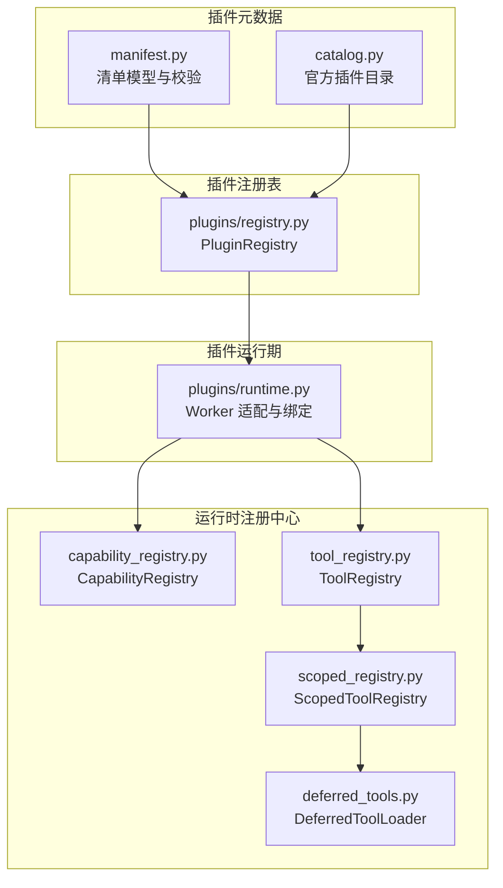
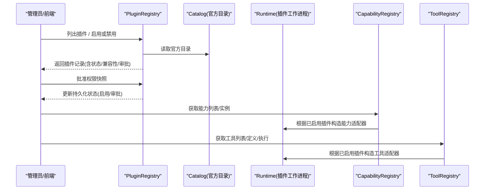
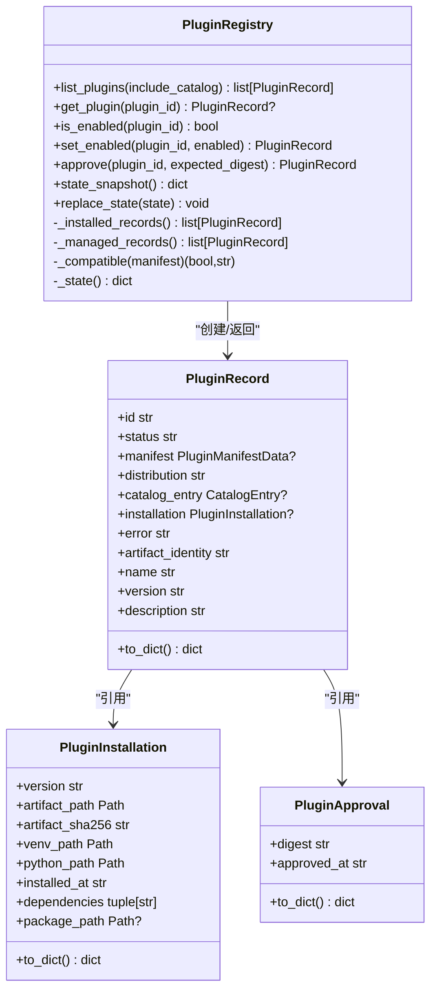
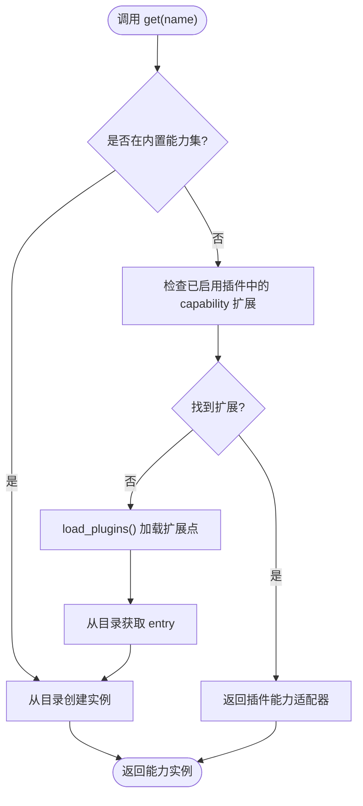
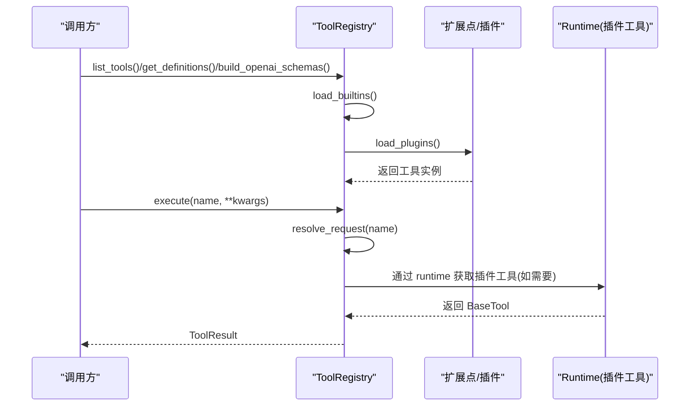
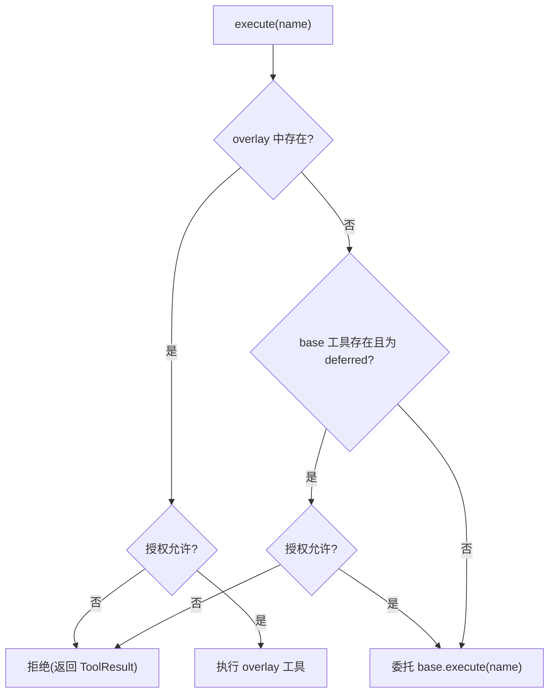
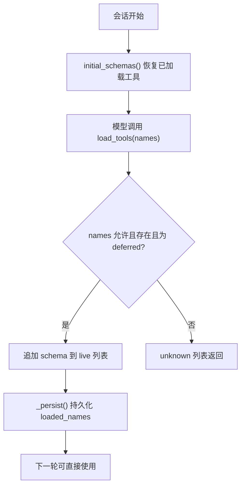
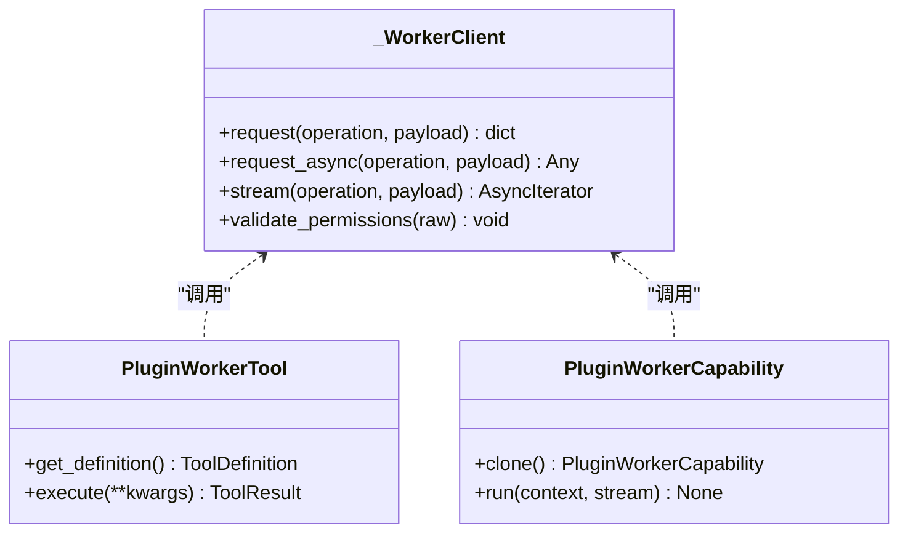
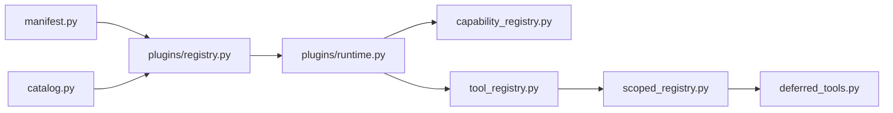

# 插件注册表

<cite>
**本文引用的文件**   
- [deeptutor/plugins/registry.py](file://deeptutor/plugins/registry.py)
- [deeptutor/plugins/catalog.py](file://deeptutor/plugins/catalog.py)
- [deeptutor/plugins/manifest.py](file://deeptutor/plugins/manifest.py)
- [deeptutor/runtime/registry/capability_registry.py](file://deeptutor/runtime/registry/capability_registry.py)
- [deeptutor/runtime/registry/tool_registry.py](file://deeptutor/runtime/registry/tool_registry.py)
- [deeptutor/runtime/registry/scoped_registry.py](file://deeptutor/runtime/registry/scoped_registry.py)
- [deeptutor/runtime/registry/deferred_tools.py](file://deeptutor/runtime/registry/deferred_tools.py)
- [deeptutor/plugins/runtime.py](file://deeptutor/plugins/runtime.py)
</cite>

## 目录
1. [简介](#简介)
2. [项目结构](#项目结构)
3. [核心组件](#核心组件)
4. [架构总览](#架构总览)
5. [详细组件分析](#详细组件分析)
6. [依赖关系分析](#依赖关系分析)
7. [性能与可扩展性](#性能与可扩展性)
8. [故障排查指南](#故障排查指南)
9. [结论](#结论)
10. [附录：操作示例与最佳实践](#附录操作示例与最佳实践)

## 简介
本文件面向 DeepTutor 的“插件注册表”子系统，系统性说明插件发现、能力注册、工具注册与服务绑定的实现原理；解释注册表的存储结构（内存缓存、持久化状态、版本与兼容性策略）；记录插件查询接口（按名称查找、类型过滤、依赖解析）；阐述冲突检测与解决机制（版本兼容检查、命名空间隔离）；并提供动态增删改插件注册信息的操作示例。

## 项目结构
围绕插件注册表的核心代码分布在以下模块：
- 插件元数据与清单校验：manifest.py、catalog.py
- 插件注册表与状态管理：plugins/registry.py
- 运行时能力与工具注册：runtime/registry/capability_registry.py、tool_registry.py、scoped_registry.py、deferred_tools.py
- 插件工作进程与绑定：plugins/runtime.py

**图示来源**  
- [deeptutor/plugins/manifest.py:144-228](file://deeptutor/plugins/manifest.py#L144-L228)  
- [deeptutor/plugins/catalog.py:107-138](file://deeptutor/plugins/catalog.py#L107-L138)  
- [deeptutor/plugins/registry.py:159-275](file://deeptutor/plugins/registry.py#L159-L275)  
- [deeptutor/runtime/registry/capability_registry.py:58-103](file://deeptutor/runtime/registry/capability_registry.py#L58-L103)  
- [deeptutor/runtime/registry/tool_registry.py:29-98](file://deeptutor/runtime/registry/tool_registry.py#L29-L98)  
- [deeptutor/runtime/registry/scoped_registry.py:40-88](file://deeptutor/runtime/registry/scoped_registry.py#L40-L88)  
- [deeptutor/runtime/registry/deferred_tools.py:116-202](file://deeptutor/runtime/registry/deferred_tools.py#L116-L202)  
- [deeptutor/plugins/runtime.py:390-439](file://deeptutor/plugins/runtime.py#L390-L439)

**章节来源**  
- [deeptutor/plugins/registry.py:159-275](file://deeptutor/plugins/registry.py#L159-L275)  
- [deeptutor/runtime/registry/capability_registry.py:58-103](file://deeptutor/runtime/registry/capability_registry.py#L58-L103)  
- [deeptutor/runtime/registry/tool_registry.py:29-98](file://deeptutor/runtime/registry/tool_registry.py#L29-L98)

## 核心组件
- PluginRegistry：只读式插件发现与本地启用状态管理，负责扫描已安装分布、合并官方目录、计算兼容性与审批状态，并持久化启用/禁用与审批快照。
- CapabilityRegistry：将 TurnCapability 能力注册到内部目录，支持内置能力加载、扩展点加载、以及从已启用插件中导出能力。
- ToolRegistry：集中注册与发现所有工具（内置与插件），提供别名解析、定义生成、OpenAI schema 构建与执行入口。
- ScopedToolRegistry：每轮对话的工具视图，叠加用户级工具与授权白名单，拒绝未授权提供者工具。
- DeferredToolLoader：延迟加载工具 schema，减少系统提示开销，并在会话内持久化已加载工具名。
- plugins.runtime：为已启用插件创建工作进程适配器，将插件声明的能力与工具桥接到运行时协议。

**章节来源**  
- [deeptutor/plugins/registry.py:159-275](file://deeptutor/plugins/registry.py#L159-L275)  
- [deeptutor/runtime/registry/capability_registry.py:58-103](file://deeptutor/runtime/registry/capability_registry.py#L58-L103)  
- [deeptutor/runtime/registry/tool_registry.py:29-98](file://deeptutor/runtime/registry/tool_registry.py#L29-L98)  
- [deeptutor/runtime/registry/scoped_registry.py:40-88](file://deeptutor/runtime/registry/scoped_registry.py#L40-L88)  
- [deeptutor/runtime/registry/deferred_tools.py:116-202](file://deeptutor/runtime/registry/deferred_tools.py#L116-L202)  
- [deeptutor/plugins/runtime.py:390-439](file://deeptutor/plugins/runtime.py#L390-L439)

## 架构总览
插件注册体系分为三层：
- 元数据层：manifest.py 定义插件清单模型与校验规则；catalog.py 维护官方可浏览插件目录。
- 注册表层：plugins/registry.py 汇总已安装与目录项，计算兼容性、审批与启用状态，并持久化状态。
- 运行时层：capability_registry.py 与 tool_registry.py 分别暴露能力与工具的发现与调用接口；scoped_registry.py 与 deferred_tools.py 提供会话级可见性与延迟加载；plugins/runtime.py 将已启用插件以工作进程形式接入。

**图示来源**  
- [deeptutor/plugins/registry.py:175-275](file://deeptutor/plugins/registry.py#L175-L275)  
- [deeptutor/plugins/catalog.py:107-138](file://deeptutor/plugins/catalog.py#L107-L138)  
- [deeptutor/runtime/registry/capability_registry.py:147-224](file://deeptutor/runtime/registry/capability_registry.py#L147-L224)  
- [deeptutor/runtime/registry/tool_registry.py:78-98](file://deeptutor/runtime/registry/tool_registry.py#L78-L98)  
- [deeptutor/plugins/runtime.py:390-439](file://deeptutor/plugins/runtime.py#L390-L439)

## 详细组件分析

### 插件注册表（PluginRegistry）
职责
- 发现已安装的插件清单与官方目录条目。
- 计算插件兼容性（DeepTutor 版本与 API 版本）。
- 管理启用/禁用与权限审批快照。
- 持久化状态，保证原子写入与状态校验。

关键数据结构
- PluginRecord：插件记录（id、status、manifest、distribution、catalog_entry、installation、error、artifact_identity）。
- PluginInstallation：受管安装信息（version、artifact_path/sha256、venv/python path、installed_at、dependencies、package_path）。
- PluginApproval：用户批准的权限快照（digest、approved_at）。

状态存储
- 持久化路径由 PathService 提供，默认位于设置目录下。
- 状态文档包含 version、disabled、plugins 三个顶层字段，并通过 _validate_state 严格校验。
- 读写使用原子写入，避免并发损坏。

兼容性检查
- 基于 manifest.compatibility.deeptutor 与 HOST_API_VERSIONS 比较各 extension.type 所需 API 版本。
- 不满足则标记 incompatible，并附带错误信息。

启用与审批
- set_enabled：仅允许对非 broken/incompatible 且已安装的插件切换启用状态。
- approve：在 approval-required 状态下保存权限快照，并与当前清单+工件身份计算 digest 进行一致性校验。

查询接口
- list_plugins(include_catalog=True)：合并已安装与官方目录，去重并按 id 排序。
- get_plugin(plugin_id)：按 id 精确查找。
- is_enabled(plugin_id)：判断是否被禁用。

**图示来源**  
- [deeptutor/plugins/registry.py:61-157](file://deeptutor/plugins/registry.py#L61-L157)  
- [deeptutor/plugins/registry.py:159-275](file://deeptutor/plugins/registry.py#L159-L275)

**章节来源**  
- [deeptutor/plugins/registry.py:159-275](file://deeptutor/plugins/registry.py#L159-L275)  
- [deeptutor/plugins/registry.py:436-444](file://deeptutor/plugins/registry.py#L436-L444)  
- [deeptutor/plugins/registry.py:446-463](file://deeptutor/plugins/registry.py#L446-L463)  
- [deeptutor/plugins/registry.py:487-524](file://deeptutor/plugins/registry.py#L487-L524)

### 能力注册（CapabilityRegistry）
职责
- 注册 TurnCapability（类、工厂或实例）。
- 加载内置能力与扩展点。
- 从已启用插件中导出 capability 扩展。

流程要点
- register：将能力注册到 CapabilityCatalog，并关联配置模型。
- load_builtins：按贡献开关加载内置能力。
- load_plugins：优先加载新扩展点组，再回退旧入口点组，忽略重复与工具脚本。
- get(name)：若 name 不在内置集，则尝试从已启用插件中匹配 capability 扩展；否则走 catalog 创建。

**图示来源**  
- [deeptutor/runtime/registry/capability_registry.py:147-176](file://deeptutor/runtime/registry/capability_registry.py#L147-L176)  
- [deeptutor/runtime/registry/capability_registry.py:178-224](file://deeptutor/runtime/registry/capability_registry.py#L178-L224)

**章节来源**  
- [deeptutor/runtime/registry/capability_registry.py:58-103](file://deeptutor/runtime/registry/capability_registry.py#L58-L103)  
- [deeptutor/runtime/registry/capability_registry.py:105-146](file://deeptutor/runtime/registry/capability_registry.py#L105-L146)  
- [deeptutor/runtime/registry/capability_registry.py:147-224](file://deeptutor/runtime/registry/capability_registry.py#L147-L224)

### 工具注册（ToolRegistry）
职责
- 集中注册与发现所有工具（内置与插件）。
- 提供别名解析、定义生成、OpenAI schema 构建与执行入口。
- 支持延迟工具（deferred）与 MCP 共享工具复用。

关键点
- load_builtins：注册内置工具描述符（惰性实例化）。
- load_plugins：从扩展点与已启用插件加载工具，跳过与内置同名者。
- resolve_request/get：处理别名与贡献开关，按需实例化内置工具。
- build_openai_schemas/build_prompt_text：对外暴露工具定义与提示文本。
- execute：统一执行入口，位置参数避免与工具参数冲突。

**图示来源**  
- [deeptutor/runtime/registry/tool_registry.py:58-98](file://deeptutor/runtime/registry/tool_registry.py#L58-L98)  
- [deeptutor/runtime/registry/tool_registry.py:120-197](file://deeptutor/runtime/registry/tool_registry.py#L120-L197)  
- [deeptutor/plugins/runtime.py:430-439](file://deeptutor/plugins/runtime.py#L430-L439)

**章节来源**  
- [deeptutor/runtime/registry/tool_registry.py:29-98](file://deeptutor/runtime/registry/tool_registry.py#L29-L98)  
- [deeptutor/runtime/registry/tool_registry.py:120-197](file://deeptutor/runtime/registry/tool_registry.py#L120-L197)

### 作用域工具视图（ScopedToolRegistry）
职责
- 为单次对话提供“覆盖层”，优先返回用户级工具，其次回退到进程级工具。
- 在执行时拒绝未授权的提供者工具（deferred 工具需经 Allowlist）。

行为要点
- overlay 与 base 分离，避免多租户同名工具互相覆盖。
- execute 中对 overlay 与 base 的 deferred 工具均进行授权检查。
- _visible_tools 过滤掉未允许的提供者工具，确保列表与执行一致。

**图示来源**  
- [deeptutor/runtime/registry/scoped_registry.py:137-158](file://deeptutor/runtime/registry/scoped_registry.py#L137-L158)  
- [deeptutor/runtime/registry/scoped_registry.py:166-180](file://deeptutor/runtime/registry/scoped_registry.py#L166-L180)

**章节来源**  
- [deeptutor/runtime/registry/scoped_registry.py:40-88](file://deeptutor/runtime/registry/scoped_registry.py#L40-L88)  
- [deeptutor/runtime/registry/scoped_registry.py:137-158](file://deeptutor/runtime/registry/scoped_registry.py#L137-L158)

### 延迟工具加载（DeferredToolLoader）
职责
- 将标记为 deferred 的工具（默认 MCP 工具）从初始 schema 列表中移除，仅在模型显式调用 load_tools 时加载。
- 维护会话内已加载工具集合，持久化以便后续轮次复用。
- 支持按能力范围限制可加载工具集合。

流程要点
- initial_schemas：返回会话历史中已加载且仍有效的工具 schema。
- load(names)：校验允许列表、存在性与 deferred 属性，追加至 live schemas 并持久化。
- render_deferred_tools_manifest：生成系统提示中的扩展工具清单。

**图示来源**  
- [deeptutor/runtime/registry/deferred_tools.py:116-202](file://deeptutor/runtime/registry/deferred_tools.py#L116-L202)  
- [deeptutor/runtime/registry/deferred_tools.py:57-113](file://deeptutor/runtime/registry/deferred_tools.py#L57-L113)

**章节来源**  
- [deeptutor/runtime/registry/deferred_tools.py:116-202](file://deeptutor/runtime/registry/deferred_tools.py#L116-L202)

### 插件工作进程与绑定（plugins.runtime）
职责
- 为已启用的插件创建工作进程客户端，封装 describe/execute/stream 等协议。
- 将插件声明的 tool 与 capability 扩展转换为运行时对象（PluginWorkerTool、PluginWorkerCapability）。
- 提供 entry_point_allowed/guard_entry_point_loaded 等钩子，确保只有声明且已启用的扩展点可被加载。

关键点
- _WorkerClient：限制请求大小、输出缓冲、超时与取消传播。
- validate_permissions：校验 worker 返回的权限声明不超过清单授权范围。
- load_enabled_workers/load_enabled_tools/load_enabled_capabilities：按已启用记录构造适配器。

**图示来源**  
- [deeptutor/plugins/runtime.py:65-109](file://deeptutor/plugins/runtime.py#L65-L109)  
- [deeptutor/plugins/runtime.py:236-274](file://deeptutor/plugins/runtime.py#L236-L274)  
- [deeptutor/plugins/runtime.py:323-387](file://deeptutor/plugins/runtime.py#L323-L387)  
- [deeptutor/plugins/runtime.py:390-439](file://deeptutor/plugins/runtime.py#L390-L439)

**章节来源**  
- [deeptutor/plugins/runtime.py:65-109](file://deeptutor/plugins/runtime.py#L65-L109)  
- [deeptutor/plugins/runtime.py:236-274](file://deeptutor/plugins/runtime.py#L236-L274)  
- [deeptutor/plugins/runtime.py:323-387](file://deeptutor/plugins/runtime.py#L323-L387)  
- [deeptutor/plugins/runtime.py:390-439](file://deeptutor/plugins/runtime.py#L390-L439)

## 依赖关系分析
- manifest.py 提供清单模型与校验，被 registry.py、catalog.py、runtime.py 共同依赖。
- catalog.py 提供官方插件目录，供 registry.py 合并展示。
- registry.py 是状态中枢，被 capability_registry.py、tool_registry.py、runtime.py 用于查询已启用插件。
- runtime.py 将已启用插件映射为运行时对象，供 capability_registry.py 与 tool_registry.py 消费。
- scoped_registry.py 与 deferred_tools.py 作用于工具执行与 schema 生命周期，与 ToolRegistry 协作。

**图示来源**  
- [deeptutor/plugins/manifest.py:144-228](file://deeptutor/plugins/manifest.py#L144-L228)  
- [deeptutor/plugins/catalog.py:107-138](file://deeptutor/plugins/catalog.py#L107-L138)  
- [deeptutor/plugins/registry.py:159-275](file://deeptutor/plugins/registry.py#L159-L275)  
- [deeptutor/plugins/runtime.py:390-439](file://deeptutor/plugins/runtime.py#L390-L439)  
- [deeptutor/runtime/registry/capability_registry.py:147-224](file://deeptutor/runtime/registry/capability_registry.py#L147-L224)  
- [deeptutor/runtime/registry/tool_registry.py:78-98](file://deeptutor/runtime/registry/tool_registry.py#L78-L98)  
- [deeptutor/runtime/registry/scoped_registry.py:40-88](file://deeptutor/runtime/registry/scoped_registry.py#L40-L88)  
- [deeptutor/runtime/registry/deferred_tools.py:116-202](file://deeptutor/runtime/registry/deferred_tools.py#L116-L202)

**章节来源**  
- [deeptutor/plugins/registry.py:159-275](file://deeptutor/plugins/registry.py#L159-L275)  
- [deeptutor/plugins/runtime.py:390-439](file://deeptutor/plugins/runtime.py#L390-L439)

## 性能与可扩展性
- 清单与目录读取：catalog.py 使用 lru_cache 缓存目录；registry.py 通过快速文本检查跳过不含清单的分发包，避免导入第三方模块。
- 工具实例化：ToolRegistry 对内置工具采用惰性实例化；DeferredToolLoader 延迟加载外部工具 schema，降低系统提示体积。
- 作用域视图：ScopedToolRegistry 避免跨租户覆盖，减少全局锁竞争。
- 工作进程：plugins.runtime 限制输入/输出大小、流式事件上限与超时，防止资源耗尽。

[本节为通用指导，不直接分析具体文件]

## 故障排查指南
常见问题与定位建议
- 插件状态不可读或模式不支持：检查 state_path 文件是否损坏或 schema_version 不被支持。参考 _state 与 _validate_state 的错误抛出路径。
- 插件不兼容：查看 _compatible 返回的不兼容原因（DeepTutor 版本或 API 版本不满足）。
- 权限审批失败：approve 时 expected_digest 与实际 digest 不一致，需重新审阅清单。
- 工具不可用：确认 ToolRegistry.get 的贡献开关、别名解析与插件加载是否成功；检查 DeferredToolLoader 的 allowed 集合。
- 执行被拒绝：ScopedToolRegistry.execute 对未授权的提供者工具会返回拒绝结果，检查 Allowlist 配置。
- 插件工作进程异常：plugins.runtime 中 _WorkerClient 会捕获子进程错误、JSON 解析错误与权限越界，关注日志中的 PluginRuntimeError 详情。

**章节来源**  
- [deeptutor/plugins/registry.py:446-463](file://deeptutor/plugins/registry.py#L446-L463)  
- [deeptutor/plugins/registry.py:487-524](file://deeptutor/plugins/registry.py#L487-L524)  
- [deeptutor/plugins/registry.py:436-444](file://deeptutor/plugins/registry.py#L436-L444)  
- [deeptutor/runtime/registry/tool_registry.py:120-197](file://deeptutor/runtime/registry/tool_registry.py#L120-L197)  
- [deeptutor/runtime/registry/scoped_registry.py:137-158](file://deeptutor/runtime/registry/scoped_registry.py#L137-L158)  
- [deeptutor/plugins/runtime.py:65-109](file://deeptutor/plugins/runtime.py#L65-L109)

## 结论
DeepTutor 的插件注册表以“清单校验 + 目录索引 + 状态持久化”为核心，结合运行时能力与工具注册中心，实现了安全、可控、可扩展的插件生态。通过兼容性检查、权限审批与作用域视图，系统在保持灵活性的同时确保了稳定性与安全性。延迟加载与惰性实例化进一步提升了整体性能与用户体验。

[本节为总结性内容，不直接分析具体文件]

## 附录：操作示例与最佳实践

- 动态添加插件注册信息
  - 步骤：
    1) 确保插件清单符合 manifest.py 规范，并在官方目录或已安装分发中包含清单。
    2) 调用 PluginRegistry.list_plugins 查看插件状态。
    3) 若状态为 approval-required，调用 approve 提交权限快照。
    4) 调用 set_enabled 启用插件。
  - 参考路径：
    - [deeptutor/plugins/registry.py:175-275](file://deeptutor/plugins/registry.py#L175-L275)

- 动态移除插件注册信息
  - 步骤：
    1) 调用 set_enabled(plugin_id, False) 禁用插件。
    2) 如需清理，可在上层事务中替换状态（replace_state），但需谨慎保留 history 与 approval。
  - 参考路径：
    - [deeptutor/plugins/registry.py:202-222](file://deeptutor/plugins/registry.py#L202-L222)
    - [deeptutor/plugins/registry.py:272-275](file://deeptutor/plugins/registry.py#L272-L275)

- 动态更新插件注册信息
  - 步骤：
    1) 更新插件分发或清单后，重新扫描（list_plugins 会自动发现新版本）。
    2) 若兼容性变化导致 incompatible，需调整清单或升级宿主。
    3) 若权限变更，需重新 approve。
  - 参考路径：
    - [deeptutor/plugins/registry.py:276-370](file://deeptutor/plugins/registry.py#L276-L370)
    - [deeptutor/plugins/registry.py:436-444](file://deeptutor/plugins/registry.py#L436-L444)

- 按名称查找与类型过滤
  - 能力：
    - CapabilityRegistry.get(name) 返回能力实例；list_capabilities/get_manifests 用于枚举。
  - 工具：
    - ToolRegistry.get(name)/list_tools/get_definitions 用于查找与列举。
  - 参考路径：
    - [deeptutor/runtime/registry/capability_registry.py:147-224](file://deeptutor/runtime/registry/capability_registry.py#L147-L224)
    - [deeptutor/runtime/registry/tool_registry.py:120-197](file://deeptutor/runtime/registry/tool_registry.py#L120-L197)

- 依赖解析
  - 插件清单 dependencies 字段经 parse_manifest 校验，registry 在 managed 记录中保留 installation.dependencies。
  - 参考路径：
    - [deeptutor/plugins/manifest.py:295-321](file://deeptutor/plugins/manifest.py#L295-L321)
    - [deeptutor/plugins/registry.py:372-434](file://deeptutor/plugins/registry.py#L372-L434)

- 冲突检测与解决
  - 版本兼容性：_compatible 检查 DeepTutor 与 API 版本，不满足则标记 incompatible。
  - 命名空间隔离：
    - CapabilityRegistry 对重复扩展点忽略后注册的项。
    - ToolRegistry 跳过与内置同名的插件工具。
    - ScopedToolRegistry 拒绝 overlay 与 shared 工具同名冲突。
  - 参考路径：
    - [deeptutor/plugins/registry.py:436-444](file://deeptutor/plugins/registry.py#L436-L444)
    - [deeptutor/runtime/registry/capability_registry.py:105-146](file://deeptutor/runtime/registry/capability_registry.py#L105-L146)
    - [deeptutor/runtime/registry/tool_registry.py:78-98](file://deeptutor/runtime/registry/tool_registry.py#L78-L98)
    - [deeptutor/runtime/registry/scoped_registry.py:60-80](file://deeptutor/runtime/registry/scoped_registry.py#L60-L80)

- 最佳实践
  - 始终使用 approved digest 进行权限审批，避免不同工件被误批。
  - 在清单中明确 compatibility.api 与各 extension.type 的版本要求。
  - 对大型外部工具使用 deferred 模式，配合 DeferredToolLoader 控制 schema 体积。
  - 使用 ScopedToolRegistry 保障多租户工具隔离与执行授权。

[本节为操作指引，不直接分析具体文件]