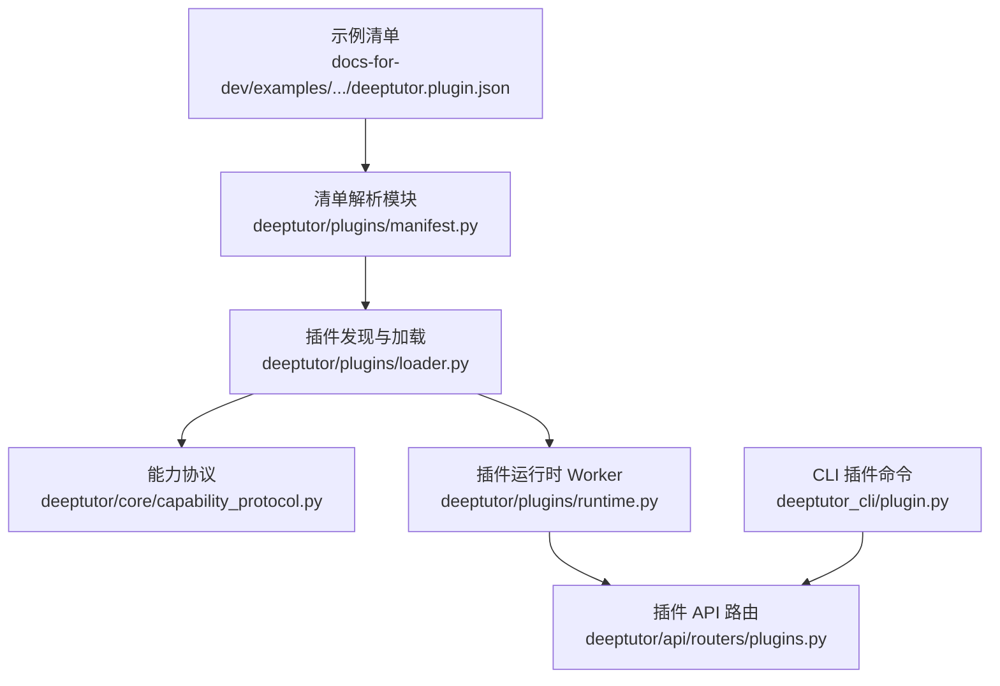
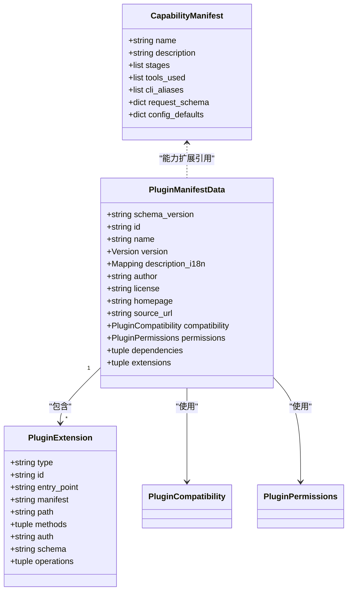
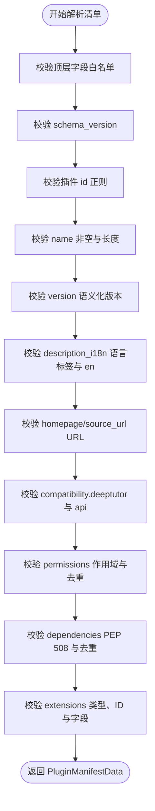
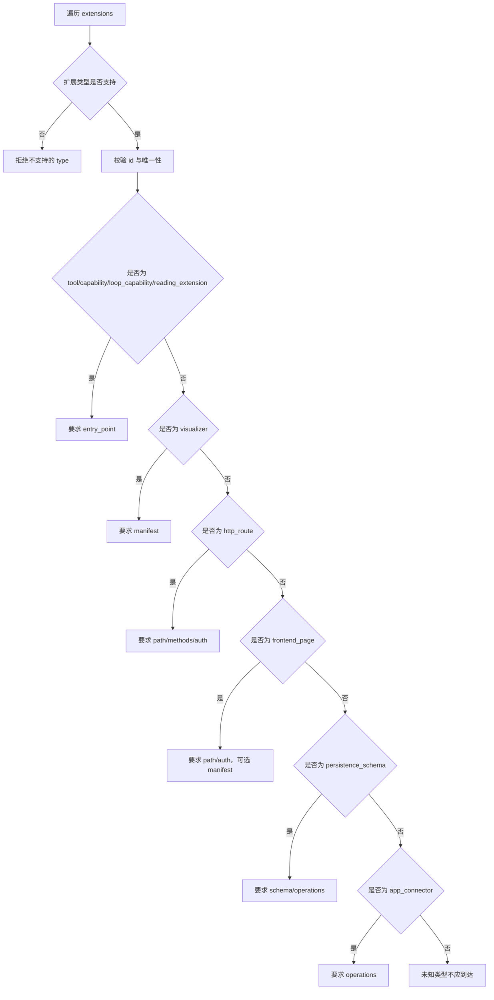
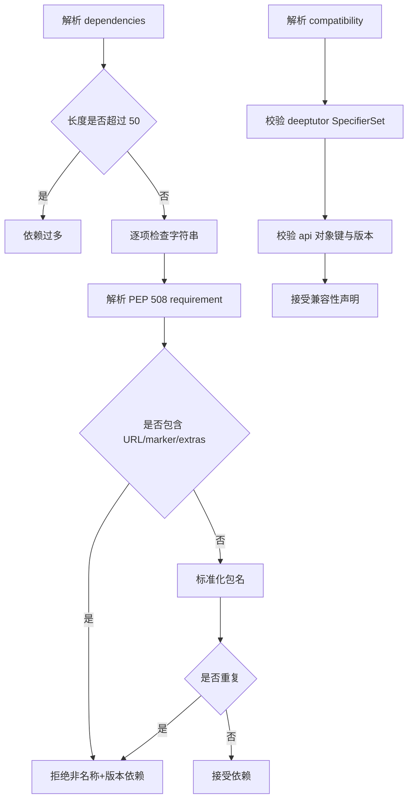
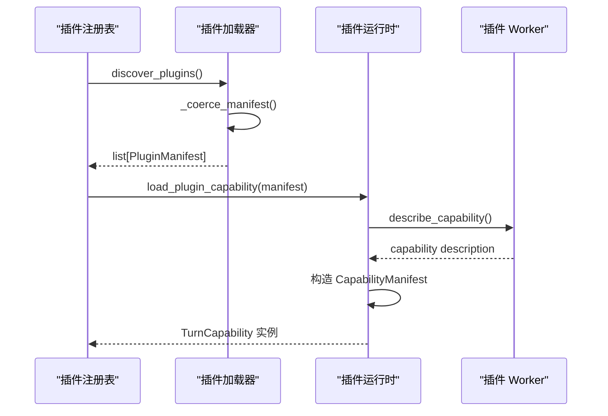

# 插件清单规范

<cite>
**本文引用的文件**   
- [manifest.py](file://deeptutor/plugins/manifest.py)
- [loader.py](file://deeptutor/plugins/loader.py)
- [capability_protocol.py](file://deeptutor/core/capability_protocol.py)
- [runtime.py](file://deeptutor/plugins/runtime.py)
- [plugins.py](file://deeptutor/api/routers/plugins.py)
- [plugin.py](file://deeptutor_cli/plugin.py)
- [PLUGINS.md](file://docs-for-dev/PLUGINS.md)
- [learning_echo/deeptutor.plugin.json](file://docs-for-dev/examples/learning_echo/learning_echo/deeptutor.plugin.json)
</cite>

## 目录
1. [引言](#引言)
2. [项目结构定位](#项目结构定位)
3. [核心概念与数据模型](#核心概念与数据模型)
4. [清单文件格式与字段定义](#清单文件格式与字段定义)
5. [清单验证规则](#清单验证规则)
6. [不同插件类型的清单差异](#不同插件类型的清单差异)
7. [清单组织结构与命名约定](#清单组织结构与命名约定)
8. [完整清单示例与最佳实践](#完整清单示例与最佳实践)
9. [依赖关系与版本兼容性](#依赖关系与版本兼容性)
10. [运行时加载与能力扩展流程](#运行时加载与能力扩展流程)
11. [性能与安全特性](#性能与安全特性)
12. [故障排查指南](#故障排查指南)
13. [结论](#结论)

## 引言
本文件面向 DeepTutor 插件开发者与维护者，系统性说明插件清单规范的格式、字段含义、验证约束、类型差异、组织结构、命名约定以及典型配置模板。DeepTutor 的插件系统通过静态清单描述插件身份、元数据、权限、依赖和扩展点；运行时再根据清单发现并加载工具、能力、HTTP 路由、前端页面等扩展。

清单的核心目标是：
- 明确插件的身份、版本、作者、许可、主页与源码地址。
- 声明插件对 DeepTutor 和 API 合约的版本兼容范围。
- 显式披露权限作用域，避免隐式权限提升。
- 以结构化方式声明 tool、capability、http_route、frontend_page、visualizer、reading_extension、persistence_schema、app_connector、loop_capability 等扩展。
- 在解析阶段拒绝未知字段、非法路径、重复 ID、不合法依赖和不可信 URL，提高可审计性与安全性。

**章节来源**
- [PLUGINS.md:11-36](file://docs-for-dev/PLUGINS.md#L11-L36)

## 项目结构定位
DeepTutor 插件清单相关代码主要分布在以下位置：
- 清单解析与校验：`deeptutor/plugins/manifest.py`
- 插件入口发现与能力实例化：`deeptutor/plugins/loader.py`
- 能力协议与能力清单数据结构：`deeptutor/core/capability_protocol.py`
- 插件运行时 Worker 协议与能力包装：`deeptutor/plugins/runtime.py`
- 插件 API 路由：`deeptutor/api/routers/plugins.py`
- CLI 插件命令：`deeptutor_cli/plugin.py`
- 官方开发文档：`docs-for-dev/PLUGINS.md`
- 示例清单：`docs-for-dev/examples/learning_echo/learning_echo/deeptutor.plugin.json`

**图表来源**
- [manifest.py:1-10](file://deeptutor/plugins/manifest.py#L1-L10)
- [loader.py:1-11](file://deeptutor/plugins/loader.py#L1-L11)
- [capability_protocol.py:33-43](file://deeptutor/core/capability_protocol.py#L33-L43)
- [runtime.py:323-358](file://deeptutor/plugins/runtime.py#L323-L358)
- [plugin.py:21-93](file://deeptutor_cli/plugin.py#L21-L93)
- [learning_echo/deeptutor.plugin.json:1-60](file://docs-for-dev/examples/learning_echo/learning_echo/deeptutor.plugin.json#L1-L60)

**章节来源**
- [manifest.py:1-26](file://deeptutor/plugins/manifest.py#L1-L26)
- [loader.py:1-11](file://deeptutor/plugins/loader.py#L1-L11)
- [PLUGINS.md:11-36](file://docs-for-dev/PLUGINS.md#L11-L36)

## 核心概念与数据模型
DeepTutor 插件体系中存在两类清单相关模型：

1. **插件包清单模型 `PluginManifestData`**  
   用于解析和校验 `deeptutor.plugin.json`，描述插件包的元数据、兼容性、权限、依赖和扩展列表。该模型是 JSON 到 Python 数据类的规范化结果，所有字段均经过严格校验。

2. **能力清单模型 `CapabilityManifest`**  
   用于描述单个能力的静态元数据，包括能力名称、描述、执行阶段、使用的工具、CLI 别名、请求 Schema 和配置默认值。它通常由内置能力或插件能力类提供。

此外，`loader.py` 中的 `PluginManifest` 是更轻量的“已发现插件”元数据对象，主要用于入口发现阶段的能力加载，不是最终持久化的插件包清单。

**图表来源**
- [manifest.py:67-141](file://deeptutor/plugins/manifest.py#L67-L141)
- [capability_protocol.py:33-43](file://deeptutor/core/capability_protocol.py#L33-L43)

**章节来源**
- [manifest.py:67-141](file://deeptutor/plugins/manifest.py#L67-L141)
- [capability_protocol.py:33-43](file://deeptutor/core/capability_protocol.py#L33-L43)

## 清单文件格式与字段定义
插件清单文件固定命名为 `deeptutor.plugin.json`，根对象必须满足 `parse_manifest` 的允许字段集合。当前支持的清单 Schema 版本为 `deeptutor.plugin/v1`。

### 顶层字段总览
| 字段 | 是否必填 | 类型 | 说明 |
|---|---:|---|---|
| `schema_version` | 是 | 字符串 | 清单 Schema 版本，当前仅支持 `deeptutor.plugin/v1` |
| `id` | 是 | 字符串 | 插件唯一标识，要求小写反向 DNS 风格 |
| `name` | 是 | 字符串 | 插件显示名称，最大长度限制 |
| `version` | 是 | 字符串 | 语义化版本 |
| `description_i18n` | 是 | 对象 | 多语言描述，至少包含 `en` |
| `author` | 是 | 字符串 | 作者信息 |
| `license` | 是 | 字符串 | 许可证标识 |
| `homepage` | 否 | 字符串 | 可选主页 URL，必须是绝对 http(s) 地址 |
| `source_url` | 是 | 字符串 | 源码地址，必须是绝对 http(s) 地址 |
| `compatibility` | 是 | 对象 | 声明 DeepTutor 和 API 合约兼容范围 |
| `permissions` | 是 | 对象 | 声明权限作用域及子项 |
| `dependencies` | 否 | 数组 | PEP 508 名称加版本依赖，最多 50 项 |
| `extensions` | 否 | 数组 | 插件扩展点列表 |

### 关键字段校验要点
- `schema_version` 必须等于常量 `SCHEMA_VERSION`，否则抛出清单验证错误。
- `id` 必须符合 `_PLUGIN_ID` 正则，即小写字母、数字、点、下划线、连字符组成的反向 DNS 风格标识。
- `name` 是必填字符串，有最大长度限制。
- `version` 必须能通过语义化版本解析。
- `description_i18n` 必须是对象，每个键是语言标签，值是非空字符串；`en` 必须存在且非空白。
- `source_url` 必须是绝对 http(s) URL。
- `homepage` 若提供，也必须是绝对 http(s) URL。
- `compatibility.deeptutor` 必填，必须是合法的 SpecifierSet。
- `compatibility.api` 是对象，键必须是受支持的 API 合约类型，值是版本号。
- `permissions` 是对象，键必须是受支持的作用域，值是字符串数组，不允许重复值。
- `dependencies` 是字符串数组，每项必须是 PEP 508 名称加版本依赖，不允许 URL、marker、extras，不允许重复包名。
- `extensions` 是对象数组，每项必须包含 `type` 和 `id`，并根据扩展类型校验其他字段。

**章节来源**
- [manifest.py:24-59](file://deeptutor/plugins/manifest.py#L24-L59)
- [manifest.py:144-228](file://deeptutor/plugins/manifest.py#L144-L228)
- [manifest.py:256-321](file://deeptutor/plugins/manifest.py#L256-L321)
- [manifest.py:456-490](file://deeptutor/plugins/manifest.py#L456-L490)

## 清单验证规则
清单验证采用“白名单 + 强类型 + 安全约束”的策略：

1. **未知字段拒绝**  
   顶层对象、`compatibility`、`permissions`、每个 extension 都使用 `_reject_unknown` 检查，任何未声明字段都会直接报错。这保证第三方插件不会因拼写错误或旧字段继续运行。

2. **类型检查**  
   所有字段都有明确的类型期望：字符串、对象、数组、版本号、URL、正则匹配 ID、HTTP 方法、操作 ID、语言标签等。

3. **依赖关系验证**  
   - 依赖数量上限为 50。
   - 每项必须是字符串。
   - 每项必须是有效的 PEP 508 requirement。
   - 只允许“名称+版本”，不允许 URL、marker、extras。
   - 包名标准化后不允许重复。

4. **版本兼容性检查**  
   - `compatibility.deeptutor` 使用 `SpecifierSet` 解析。
   - `compatibility.api` 中每个键必须是受支持的 API 合约类型。
   - 每个 API 版本必须是合法语义化版本。
   - 提供 `version_matches` 函数用于判断给定版本是否满足需求。

5. **权限作用域校验**  
   - 权限键必须是 `SUPPORTED_PERMISSION_SCOPES` 之一。
   - 每个作用域的值是字符串数组。
   - 数组内不允许重复值。
   - 当 `frontend_page` 使用可执行页面时，需要 `permissions.ui.sandboxed-iframe`。

6. **扩展点校验**  
   - 扩展 `type` 必须在 `SUPPORTED_EXTENSION_TYPES` 中。
   - 每个扩展必须有 `id`，且符合 `_EXTENSION_ID` 正则。
   - `tool` 扩展的 `id` 还必须符合工具函数名模式。
   - 扩展 `id` 全局唯一。
   - 不同扩展类型有不同的必填字段和附加校验。

**图表来源**
- [manifest.py:144-228](file://deeptutor/plugins/manifest.py#L144-L228)
- [manifest.py:256-321](file://deeptutor/plugins/manifest.py#L256-L321)
- [manifest.py:324-403](file://deeptutor/plugins/manifest.py#L324-L403)
- [manifest.py:406-453](file://deeptutor/plugins/manifest.py#L406-L453)

**章节来源**
- [manifest.py:144-228](file://deeptutor/plugins/manifest.py#L144-L228)
- [manifest.py:256-321](file://deeptutor/plugins/manifest.py#L256-L321)
- [manifest.py:324-403](file://deeptutor/plugins/manifest.py#L324-L403)
- [manifest.py:406-453](file://deeptutor/plugins/manifest.py#L406-L453)

## 不同插件类型的清单差异
插件清单中的 `extensions` 数组可以声明多种扩展类型。每种扩展类型对应不同的运行时契约和字段要求。

### 支持的扩展类型
| 扩展类型 | 必填字段 | 可选字段 | 运行时行为 |
|---|---|---|---|
| `tool` | `type`、`id`、`entry_point` | 无 | 托管 Worker 或宿主入口协议的工具 |
| `capability` | `type`、`id`、`entry_point` | 无 | 能力扩展，可能通过 Worker 暴露能力描述 |
| `loop_capability` | `type`、`id`、`entry_point` | 无 | 共享循环扩展协议 |
| `reading_extension` | `type`、`id`、`entry_point` | 无 | 服务端验证 Reading 上下文与结果类型 |
| `visualizer` | `type`、`id`、`manifest` | 无 | 打包可视化器清单 |
| `http_route` | `type`、`id`、`entry_point`、`path`、`methods`、`auth` | 无 | 托管 HTTP 路由 |
| `frontend_page` | `type`、`id`、`path`、`auth` | `manifest` | 静态前端页面，可能需要 UI 权限 |
| `persistence_schema` | `type`、`id`、`schema`、`operations` | 无 | 持久化 Schema 声明 |
| `app_connector` | `type`、`id`、`operations` | 无 | 应用连接器操作声明 |

### 各类型关键约束
- `tool`、`capability`、`loop_capability`、`reading_extension` 必须提供 `entry_point`。
- `visualizer` 必须提供 `manifest`，指向打包 JSON 文件。
- `http_route` 必须提供 `entry_point`、`path`、`methods`、`auth`；`path` 必须是静态相对路径，`methods` 必须是允许的 HTTP 方法集合，`auth` 必须是 `public`、`authenticated` 或 `admin`。
- `frontend_page` 必须提供 `path` 和 `auth`；若提供 `manifest`，必须是 POSIX 包路径并以 `.json` 结尾。
- `persistence_schema` 必须提供 `schema` 和 `operations`；`operations` 最多 32 个，每个操作 ID 必须符合正则。
- `app_connector` 必须提供 `operations`。
- 所有扩展 `id` 全局唯一；`tool` 扩展 `id` 还需符合工具函数名模式。

**图表来源**
- [manifest.py:324-403](file://deeptutor/plugins/manifest.py#L324-L403)

**章节来源**
- [manifest.py:27-39](file://deeptutor/plugins/manifest.py#L27-L39)
- [manifest.py:324-403](file://deeptutor/plugins/manifest.py#L324-L403)
- [PLUGINS.md:21-29](file://docs-for-dev/PLUGINS.md#L21-L29)

## 清单组织结构与命名约定
### 文件名与位置
- 插件包清单文件名固定为 `deeptutor.plugin.json`。
- 示例位于 `docs-for-dev/examples/learning_echo/learning_echo/deeptutor.plugin.json`。
- 前端页面清单应作为打包资源，例如 `frontend/page.json`，并通过 `frontend_page.manifest` 引用。

### 插件 ID 命名
- 插件 `id` 应为小写反向 DNS 风格，例如 `org.deeptutor.learning_echo`。
- 扩展 `id` 应为小写字母、数字、点、下划线、连字符组成，长度受限。
- `tool` 扩展的 `id` 还应符合工具函数名模式，便于工具注册和调用。

### 入口点命名
- `entry_point` 通常是 Python 模块路径，例如 `learning_echo.worker`。
- 能力加载器支持模块路径或 `module:attr` 形式，但清单解析阶段只保存字符串。
- 能力类或能力实例会通过 `loader.py` 转换为轻量 `PluginManifest`，其中 `entry` 字段记录可解析的入口。

### 元数据声明
- `name` 是用户可见名称。
- `description_i18n` 至少包含 `en`，建议同时提供本地化描述。
- `author`、`license`、`homepage`、`source_url` 提供插件来源和法律信息。
- `compatibility` 声明插件适用的 DeepTutor 版本范围和 API 合约版本。
- `permissions` 声明插件需要的权限作用域。
- `dependencies` 声明插件所需的 Python 包闭包。
- `extensions` 声明插件暴露的所有扩展点。

**章节来源**
- [manifest.py:54-60](file://deeptutor/plugins/manifest.py#L54-L60)
- [manifest.py:118-141](file://deeptutor/plugins/manifest.py#L118-L141)
- [loader.py:29-40](file://deeptutor/plugins/loader.py#L29-L40)
- [loader.py:142-150](file://deeptutor/plugins/loader.py#L142-L150)
- [learning_echo/deeptutor.plugin.json:1-60](file://docs-for-dev/examples/learning_echo/learning_echo/deeptutor.plugin.json#L1-L60)

## 完整清单示例与最佳实践
仓库提供了一个最小可用的示例清单，展示了 tool、capability、http_route、frontend_page 的组合。

### 示例清单结构说明
- `schema_version` 使用 `deeptutor.plugin/v1`。
- `id` 使用反向 DNS 风格。
- `description_i18n` 提供英文和中文描述。
- `compatibility.api` 声明了 `tool`、`capability`、`http_route`、`frontend_page` 的 API 版本。
- `permissions.ui` 包含 `sandboxed-iframe`，因为示例包含前端页面。
- `extensions` 包含：
  - `tool`：`learning_echo`
  - `capability`：`learning_echo_capability`
  - `http_route`：`learning_echo_http`，路径 `/echo`，方法 `POST`，认证策略 `public`
  - `frontend_page`：`learning_echo_page`，路径 `/learning-echo`，认证策略 `authenticated`，清单 `frontend/page.json`

### 最佳实践
1. **尽量精确声明依赖**  
   只声明必要的 PEP 508 名称+版本依赖，避免引入不必要的包。
2. **最小权限原则**  
   只在 `permissions` 中声明实际需要的作用域，不要申请宽泛权限。
3. **使用托管 Worker**  
   对于外部插件，优先使用托管 Worker 模式，减少宿主解释器风险。
4. **前端页面使用沙箱**  
   如果声明 `frontend_page`，确保具备 `ui.sandboxed-iframe` 权限，并使用受限 CSP。
5. **保持 API 合约稳定**  
   在 `compatibility.api` 中声明稳定的 API 版本，避免频繁破坏性升级。
6. **清晰的多语言描述**  
   至少提供 `en`，对外发布时提供目标语言描述。
7. **测试清单解析**  
   构建 wheel 前先用清单解析逻辑验证，避免安装阶段失败。

**章节来源**
- [learning_echo/deeptutor.plugin.json:1-60](file://docs-for-dev/examples/learning_echo/learning_echo/deeptutor.plugin.json#L1-L60)
- [PLUGINS.md:78-103](file://docs-for-dev/PLUGINS.md#L78-L103)

## 依赖关系与版本兼容性
### 依赖关系
- `dependencies` 是 PEP 508 名称+版本依赖数组。
- 不允许 URL、marker、extras。
- 包名标准化后不允许重复。
- 依赖数量最多 50。
- 这些约束确保插件环境可预测、可审计、可回滚。

### 版本兼容性
- `compatibility.deeptutor` 是 SpecifierSet，表示插件适用的 DeepTutor 版本范围。
- `compatibility.api` 是 API 合约到版本的映射，键必须是受支持的扩展类型。
- `version_matches` 可用于判断某个具体版本是否满足需求。
- 清单解析阶段会拒绝非法 SpecifierSet 和非法 API 版本。

**图表来源**
- [manifest.py:295-321](file://deeptutor/plugins/manifest.py#L295-L321)
- [manifest.py:256-277](file://deeptutor/plugins/manifest.py#L256-L277)
- [manifest.py:231-238](file://deeptutor/plugins/manifest.py#L231-L238)

**章节来源**
- [manifest.py:231-238](file://deeptutor/plugins/manifest.py#L231-L238)
- [manifest.py:256-321](file://deeptutor/plugins/manifest.py#L256-L321)

## 运行时加载与能力扩展流程
插件清单不仅用于静态校验，还参与运行时发现与加载。

### 能力清单模型
能力通过 `CapabilityManifest` 描述其静态元数据，包括：
- `name`：能力名称
- `description`：能力描述
- `stages`：能力执行的阶段
- `tools_used`：能力使用的工具
- `cli_aliases`：CLI 别名
- `request_schema`：能力请求 Schema
- `config_defaults`：配置默认值

### 插件入口加载
`loader.py` 负责从 `deeptutor.plugins` 入口组发现插件，并将入口对象转换为轻量 `PluginManifest`。它支持多种入口形式：
- 直接返回 `PluginManifest`
- 工厂函数返回 `PluginManifest`
- 工厂函数返回 `TurnCapability` 子类或实例
- 能力类或能力实例
- 带 `PLUGIN_MANIFEST` 属性的对象
- 带 `create_capability` 方法的对象

### 托管 Worker 能力
插件能力可以通过 Worker 暴露能力描述。`runtime.py` 中的 `PluginWorkerCapability` 会：
- 根据清单创建 Worker 客户端
- 调用 `describe_capability` 获取能力描述
- 将 Worker 返回的描述转换为 `CapabilityManifest`
- 校验能力名称是否与扩展 ID 一致

**图表来源**
- [loader.py:42-60](file://deeptutor/plugins/loader.py#L42-L60)
- [loader.py:63-106](file://deeptutor/plugins/loader.py#L63-L106)
- [runtime.py:323-358](file://deeptutor/plugins/runtime.py#L323-L358)

**章节来源**
- [capability_protocol.py:33-43](file://deeptutor/core/capability_protocol.py#L33-L43)
- [loader.py:29-60](file://deeptutor/plugins/loader.py#L29-L60)
- [loader.py:63-106](file://deeptutor/plugins/loader.py#L63-L106)
- [runtime.py:323-358](file://deeptutor/plugins/runtime.py#L323-L358)

## 性能与安全特性
### 性能特性
- 清单解析只处理 JSON 兼容字典，不导入第三方 Python 模块，避免注册浏览时的昂贵导入。
- 使用 dataclass 和 frozen slots 模型，减少内存占用。
- 依赖和扩展解析使用集合去重，避免重复计算。
- CLI 插件命令通过注册表查询工具、能力和插件状态，避免全量扫描。

### 安全特性
- 未知字段直接拒绝，防止历史字段漂移导致行为变化。
- URL 必须为绝对 http(s) 地址。
- 前端页面清单必须是 POSIX 包路径，禁止路径穿越。
- `frontend_page` 需要 `ui.sandboxed-iframe` 权限。
- 托管 HTTP 路由使用受限认证策略和静态路径。
- 依赖只允许名称+版本，避免任意 URL 安装。
- 清单批准绑定规范化清单和工件身份，支持审计和回滚。

**章节来源**
- [manifest.py:1-7](file://deeptutor/plugins/manifest.py#L1-L7)
- [manifest.py:431-440](file://deeptutor/plugins/manifest.py#L431-L440)
- [manifest.py:207-212](file://deeptutor/plugins/manifest.py#L207-L212)
- [PLUGINS.md:78-110](file://docs-for-dev/PLUGINS.md#L78-L110)

## 故障排查指南
### 常见清单错误
| 错误现象 | 可能原因 | 修复建议 |
|---|---|---|
| 清单解析失败，提示不支持的 `schema_version` | 使用了错误的清单 Schema 版本 | 改为 `deeptutor.plugin/v1` |
| `id` 无效 | 不符合小写反向 DNS 风格 | 使用类似 `org.example.plugin` 的格式 |
| `description_i18n.en` 缺失 | 缺少英文描述 | 添加 `en` 字段并提供非空描述 |
| `source_url` 不是绝对 URL | 使用了相对路径或不合法 URL | 改为 `https://...` |
| `compatibility.deeptutor` 无效 | SpecifierSet 语法错误 | 使用合法版本范围表达式 |
| `permissions` 中有未知作用域 | 使用了不支持的作用域键 | 只使用 `reading`、`learning_events`、`network`、`models`、`storage`、`ui` |
| `dependencies` 中包含 URL 或 marker | 使用了非名称+版本依赖 | 改为 `package==version` 形式 |
| `extensions` 中 `tool` 的 `id` 无效 | 不符合工具函数名模式 | 使用小写字母、数字、下划线、连字符组合 |
| `http_route.path` 重复 | 多个路由声明相同路径 | 修改为不同路径 |
| `frontend_page` 没有 `ui.sandboxed-iframe` | 可执行前端页面缺少必要权限 | 在 `permissions.ui` 中添加 `sandboxed-iframe` |

### 运行时问题
- 能力加载返回 `None`：可能是入口为空、入口指向 `tool.py`、类型不是 `capability`，或入口解析失败。
- Worker 能力描述不匹配：Worker 返回的能力名称与扩展 ID 不一致。
- 插件状态异常：检查插件是否已安装、是否已批准、是否启用、是否兼容。

### 调试建议
1. 使用 `deeptutor plugin list` 查看已注册工具、能力和插件包。
2. 使用 `deeptutor plugin info <name>` 查看工具、能力或插件详情。
3. 使用 `deeptutor plugin state` 查看插件包状态。
4. 使用 `deeptutor plugin show <id>` 查看完整插件元数据。
5. 检查清单解析日志，确认具体字段错误。
6. 对于托管 Worker，检查 Worker 是否正确实现 `describe_capability`。

**章节来源**
- [plugin.py:21-93](file://deeptutor_cli/plugin.py#L21-L93)
- [loader.py:47-60](file://deeptutor/plugins/loader.py#L47-L60)
- [runtime.py:343-358](file://deeptutor/plugins/runtime.py#L343-L358)
- [manifest.py:63-65](file://deeptutor/plugins/manifest.py#L63-L65)

## 结论
DeepTutor 插件清单规范通过严格的 JSON Schema 解析、白名单字段校验、依赖与权限约束、API 合约版本管理，构建了安全、可审计、可扩展的插件生态。开发者应：
- 使用 `deeptutor.plugin/v1` 清单格式。
- 准确填写 `id`、`name`、`version`、`description_i18n`、`compatibility`、`permissions`、`extensions`。
- 遵循扩展类型的字段要求和运行时契约。
- 最小化权限和依赖，优先使用托管 Worker。
- 在安装前验证清单，安装后批准权限，启用后测试能力、工具和页面。

这套规范既保证了插件的可发现性和可组合性，也限制了潜在的安全风险，是 DeepTutor 插件生态的基础契约。