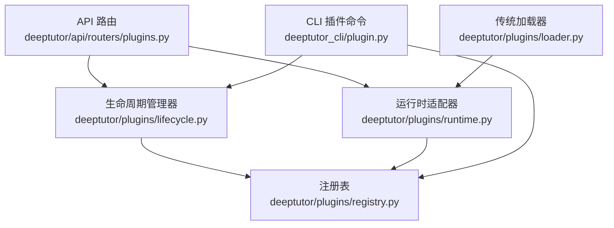
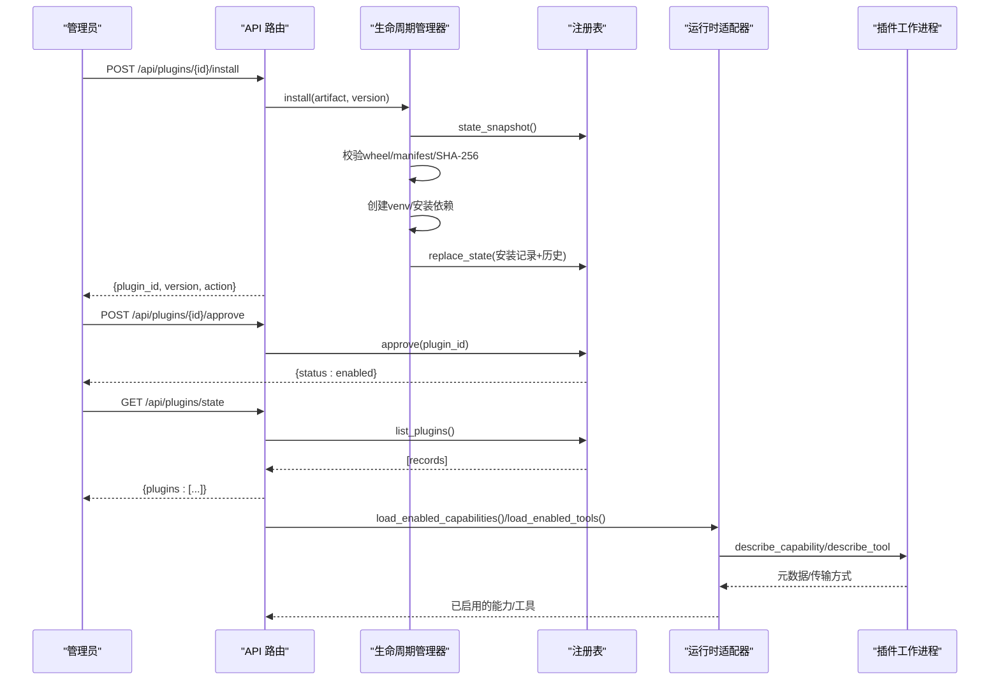
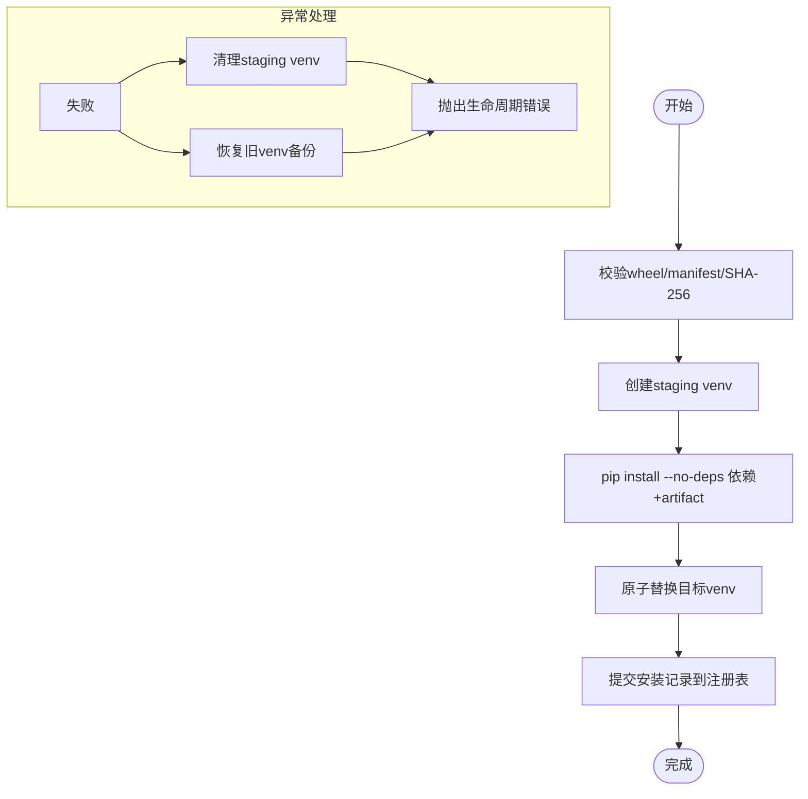
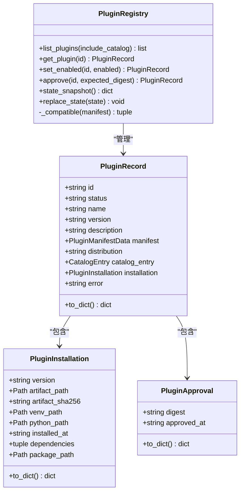
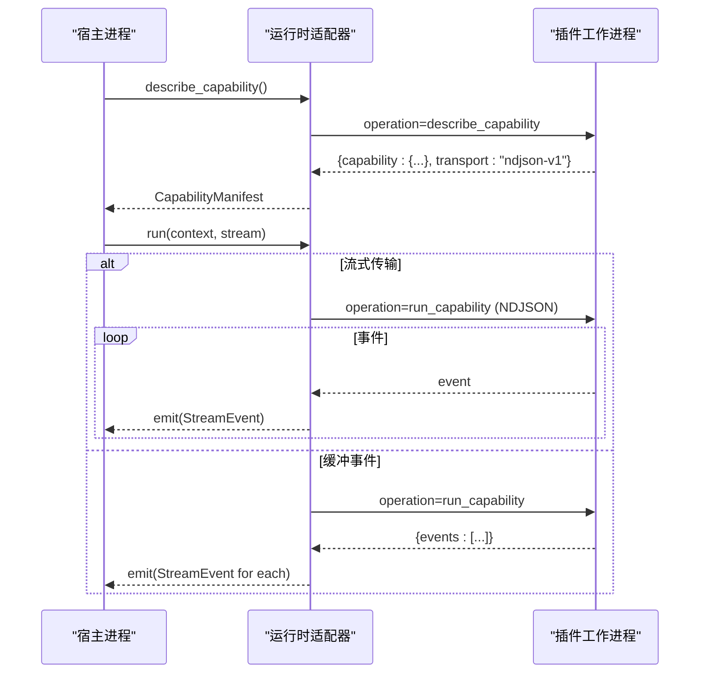
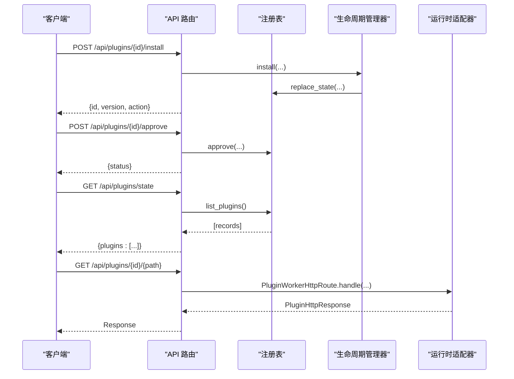
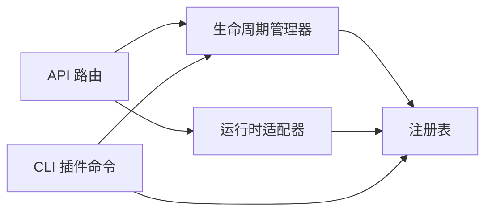

# 插件生命周期管理

<cite>
**本文引用的文件**   
- [plugins.py](file://deeptutor/api/routers/plugins.py)
- [lifecycle.py](file://deeptutor/plugins/lifecycle.py)
- [registry.py](file://deeptutor/plugins/registry.py)
- [runtime.py](file://deeptutor/plugins/runtime.py)
- [loader.py](file://deeptutor/plugins/loader.py)
- [plugin.py](file://deeptutor_cli/plugin.py)
</cite>

## 目录
1. [引言](#引言)
2. [项目结构](#项目结构)
3. [核心组件](#核心组件)
4. [架构总览](#架构总览)
5. [详细组件分析](#详细组件分析)
6. [依赖关系分析](#依赖关系分析)
7. [性能与资源特性](#性能与资源特性)
8. [故障排查指南](#故障排查指南)
9. [结论](#结论)

## 引言
本文面向 DeepTutor 的插件系统，系统化说明插件从安装、启用、运行到卸载销毁的完整生命周期。重点覆盖：
- 生命周期阶段：安装/回滚/卸载、启用/禁用、运行时调用、进程隔离与清理。
- 生命周期钩子：当前实现以“安装/启用/运行/卸载”为主；未提供 on_load/on_start/on_stop/on_destroy 等回调点。
- 状态管理：注册表状态、审批快照、兼容性校验、错误恢复（回滚）和资源清理策略。
- 依赖与启动顺序：通过 manifest 声明扩展点，由运行时按类型装配工具和能力；无显式依赖图或循环依赖检测。
- 监控与调试：通过 API 和 CLI 暴露插件状态、安装日志、错误信息，便于跟踪状态变化与定位问题。

## 项目结构
DeepTutor 插件相关代码集中在以下模块：
- API 路由层：对外暴露插件安装、启用、禁用、回滚、卸载、状态查询以及插件 HTTP 路由转发。
- 生命周期管理层：负责 wheel 包安装、虚拟环境构建、版本历史与回滚、状态持久化。
- 注册表：维护插件清单、安装记录、启用/禁用状态、兼容性检查与权限审批快照。
- 运行时适配器：将已启用的插件能力封装为 Tool/Capability，并通过独立 Python 进程执行。
- 加载器：发现并实例化传统 entry-point 形式的 capability 插件（迁移期兼容）。
- CLI：提供插件列表、查看、安装、启用、批准、回滚、卸载等命令。

**图表来源**
- [plugins.py:1-417](file://deeptutor/api/routers/plugins.py#L1-L417)
- [lifecycle.py:1-469](file://deeptutor/plugins/lifecycle.py#L1-L469)
- [registry.py:1-659](file://deeptutor/plugins/registry.py#L1-L659)
- [runtime.py:1-813](file://deeptutor/plugins/runtime.py#L1-L813)
- [loader.py:1-165](file://deeptutor/plugins/loader.py#L1-L165)
- [plugin.py:1-305](file://deeptutor_cli/plugin.py#L1-L305)

**章节来源**
- [plugins.py:1-417](file://deeptutor/api/routers/plugins.py#L1-L417)
- [lifecycle.py:1-469](file://deeptutor/plugins/lifecycle.py#L1-L469)
- [registry.py:1-659](file://deeptutor/plugins/registry.py#L1-L659)
- [runtime.py:1-813](file://deeptutor/plugins/runtime.py#L1-L813)
- [loader.py:1-165](file://deeptutor/plugins/loader.py#L1-L165)
- [plugin.py:1-305](file://deeptutor_cli/plugin.py#L1-L305)

## 核心组件
- 生命周期管理器 PluginLifecycleManager
  - 负责 wheel 包校验、虚拟环境创建、依赖安装、版本历史与回滚、状态提交。
  - 关键方法：install、rollback、uninstall。
- 注册表 PluginRegistry
  - 维护插件清单、安装记录、启用/禁用状态、兼容性校验、权限审批快照。
  - 关键方法：list_plugins、get_plugin、set_enabled、approve、state_snapshot、replace_state。
- 运行时适配器
  - 将已启用插件的能力与工具包装为 TurnCapability/BaseTool，并在独立进程中执行。
  - 关键类：PluginWorkerCapability、PluginWorkerTool、PluginWorkerHttpRoute。
- API 路由
  - 暴露插件安装、启用、禁用、回滚、卸载、状态查询、插件 HTTP 路由转发。
- CLI 插件命令
  - 提供 list/info/state/search/show/install/rollback/uninstall/enable/disable 等命令。

**章节来源**
- [lifecycle.py:50-290](file://deeptutor/plugins/lifecycle.py#L50-L290)
- [registry.py:159-475](file://deeptutor/plugins/registry.py#L159-L475)
- [runtime.py:236-439](file://deeptutor/plugins/runtime.py#L236-L439)
- [plugins.py:299-376](file://deeptutor/api/routers/plugins.py#L299-L376)
- [plugin.py:21-305](file://deeptutor_cli/plugin.py#L21-L305)

## 架构总览
插件生命周期在系统中分为四层：
- 控制面（API/CLI）：用户操作入口，触发安装、启用、禁用、回滚、卸载等操作。
- 生命周期层：对 wheel 包进行安全校验、隔离安装、版本管理与回滚。
- 注册表层：持久化插件状态、兼容性校验、权限审批与启用开关。
- 运行层面：将已启用插件的能力/工具注入运行时，并以独立进程执行，严格限制输出与权限。

**图表来源**
- [plugins.py:345-376](file://deeptutor/api/routers/plugins.py#L345-L376)
- [lifecycle.py:72-174](file://deeptutor/plugins/lifecycle.py#L72-L174)
- [registry.py:224-274](file://deeptutor/plugins/registry.py#L224-L274)
- [runtime.py:390-439](file://deeptutor/plugins/runtime.py#L390-L439)

## 详细组件分析

### 生命周期管理器：安装、回滚、卸载
- 安装流程
  - 校验 wheel 大小、路径安全性、manifest 唯一性与版本一致性。
  - 使用 staging venv 安装依赖（--no-deps），成功后原子替换目标 venv。
  - 提交安装记录到注册表，保留历史以便回滚。
- 回滚流程
  - 读取历史中最近一条安装记录，校验 artifact SHA-256 与环境存在性。
  - 更新当前 installation 与 manifest，追加历史项，移除 approval。
- 卸载流程
  - 从注册表移除插件记录，清理本地 plugin_root 目录。

**图表来源**
- [lifecycle.py:72-174](file://deeptutor/plugins/lifecycle.py#L72-L174)
- [lifecycle.py:176-226](file://deeptutor/plugins/lifecycle.py#L176-L226)
- [lifecycle.py:228-249](file://deeptutor/plugins/lifecycle.py#L228-L249)

**章节来源**
- [lifecycle.py:72-174](file://deeptutor/plugins/lifecycle.py#L72-L174)
- [lifecycle.py:176-226](file://deeptutor/plugins/lifecycle.py#L176-L226)
- [lifecycle.py:228-249](file://deeptutor/plugins/lifecycle.py#L228-L249)

### 注册表：状态、兼容性、审批
- 状态模型
  - PluginRecord：插件标识、名称、版本、状态、描述、manifest、distribution、installation、error。
  - PluginInstallation：版本、artifact 路径与哈希、venv/python 路径、安装时间、依赖、package_path。
  - PluginApproval：审批摘要与时间戳。
- 关键行为
  - set_enabled：切换启用/禁用，禁止对 incompatible/broken/available 状态直接启用。
  - approve：基于 manifest + artifact_sha256 计算 digest，持久化审批快照。
  - _compatible：校验 DeepTutor 版本与各扩展 API 版本要求。
  - state_snapshot/replace_state：事务化读写状态文档。

**图表来源**
- [registry.py:61-157](file://deeptutor/plugins/registry.py#L61-L157)
- [registry.py:159-475](file://deeptutor/plugins/registry.py#L159-L475)

**章节来源**
- [registry.py:61-157](file://deeptutor/plugins/registry.py#L61-L157)
- [registry.py:159-475](file://deeptutor/plugins/registry.py#L159-L475)

### 运行时适配器：能力、工具与 HTTP 路由
- 能力适配
  - PluginWorkerCapability：通过 describe_capability 获取能力元数据，支持 ndjson-v1 流式传输或缓冲事件。
  - run(context, stream)：将上下文序列化后发送给 worker，映射 worker 事件为 StreamEvent。
- 工具适配
  - PluginWorkerTool：describe_tool 获取定义，execute 返回 ToolResult。
- HTTP 路由
  - PluginWorkerHttpRoute：handle_http 接收请求，校验方法与路径，返回受控的 PluginHttpResponse。
- 权限与边界
  - validate_permissions：校验 worker 声明的权限范围是否在审批范围内。
  - guard：每次调用前检查插件是否仍为 enabled 且属于同一生成（digest 一致）。

**图表来源**
- [runtime.py:323-388](file://deeptutor/plugins/runtime.py#L323-L388)
- [runtime.py:236-275](file://deeptutor/plugins/runtime.py#L236-L275)
- [runtime.py:277-321](file://deeptutor/plugins/runtime.py#L277-L321)

**章节来源**
- [runtime.py:236-439](file://deeptutor/plugins/runtime.py#L236-L439)
- [runtime.py:497-541](file://deeptutor/plugins/runtime.py#L497-L541)
- [runtime.py:698-721](file://deeptutor/plugins/runtime.py#L698-L721)

### API 路由：插件管理接口
- 安装/回滚/卸载
  - install：通过 CatalogInstallManager 或 PluginLifecycleManager 安装，返回生命周期结果。
  - rollback：回滚到上一版本，需重新审批。
  - uninstall：删除安装与环境，清理状态。
- 启用/禁用/审批
  - enable/disable：切换启用状态，受状态机约束。
  - approve：基于期望 digest 审批权限。
- 状态与信息
  - state：列出所有插件记录。
  - info：查询单个插件详情。
- 插件 HTTP 路由转发
  - 认证与授权：根据 extension.auth 决定是否需要管理员权限。
  - 请求体限制：最大 JSON body 大小限制，非法 JSON 报错。
  - 转发至 worker：构造 PluginWorkerHttpRoute 并调用 handle。

**图表来源**
- [plugins.py:345-376](file://deeptutor/api/routers/plugins.py#L345-L376)
- [plugins.py:304-314](file://deeptutor/api/routers/plugins.py#L304-L314)
- [plugins.py:235-287](file://deeptutor/api/routers/plugins.py#L235-L287)

**章节来源**
- [plugins.py:299-376](file://deeptutor/api/routers/plugins.py#L299-L376)
- [plugins.py:235-287](file://deeptutor/api/routers/plugins.py#L235-L287)

### CLI 插件命令
- 列表/信息/状态/搜索/显示
  - list：展示工具、能力与插件包。
  - info：展示指定工具/能力/插件详情。
  - state：展示安装、目录、审批与兼容性状态。
  - search：搜索官方目录。
  - show：展示已安装或目录中的插件元数据。
- 安装/启用/批准/回滚/卸载/禁用
  - install：支持本地 wheel 或目录版本安装，提示下一步审批。
  - enable/disable：切换启用状态。
  - approve：审批权限。
  - rollback：回滚到上一版本。
  - uninstall：彻底移除插件与环境。

**章节来源**
- [plugin.py:21-305](file://deeptutor_cli/plugin.py#L21-L305)

### 传统加载器：entry-point 兼容
- discover_plugins：扫描 deeptutor.plugins 组，产出静态 Manifest。
- load_plugin_capability：从 Manifest 解析并实例化 TurnCapability。
- 兼容多种导出形式：类、实例、工厂函数、PLUGIN_MANIFEST、create_capability。

**章节来源**
- [loader.py:42-165](file://deeptutor/plugins/loader.py#L42-L165)

## 依赖关系分析
- 组件耦合
  - API 路由依赖生命周期管理器与注册表，用于状态变更与查询。
  - 生命周期管理器依赖注册表进行状态持久化。
  - 运行时适配器依赖注册表获取已启用插件的安装信息。
  - CLI 同时依赖生命周期管理器与注册表。
- 外部依赖
  - subprocess/venv/pip：用于隔离安装与执行。
  - packaging.version：用于版本比较与兼容性校验。
- 潜在循环依赖
  - 当前模块间为单向依赖，未发现循环导入。
- 启动顺序控制
  - 运行时通过 load_enabled_capabilities/load_enabled_tools 按扩展类型装配，不依赖显式依赖图。
  - 无循环依赖检测逻辑。

**图表来源**
- [plugins.py:1-417](file://deeptutor/api/routers/plugins.py#L1-L417)
- [lifecycle.py:1-469](file://deeptutor/plugins/lifecycle.py#L1-L469)
- [registry.py:1-659](file://deeptutor/plugins/registry.py#L1-L659)
- [runtime.py:1-813](file://deeptutor/plugins/runtime.py#L1-L813)
- [plugin.py:1-305](file://deeptutor_cli/plugin.py#L1-L305)

**章节来源**
- [plugins.py:1-417](file://deeptutor/api/routers/plugins.py#L1-L417)
- [lifecycle.py:1-469](file://deeptutor/plugins/lifecycle.py#L1-L469)
- [registry.py:1-659](file://deeptutor/plugins/registry.py#L1-L659)
- [runtime.py:1-813](file://deeptutor/plugins/runtime.py#L1-L813)
- [plugin.py:1-305](file://deeptutor_cli/plugin.py#L1-L305)

## 性能与资源特性
- 隔离执行
  - 每个插件在独立 venv 中运行，避免污染宿主环境。
  - 工作进程通过 subprocess 启动，限制 stdout/stderr 大小与超时。
- 内存与 I/O 限制
  - NDJSON 流式传输限制总长度与单行大小，防止内存溢出。
  - HTTP 请求体限制最大 JSON 大小，非法响应头白名单校验。
- 并发与取消
  - 异步任务支持取消信号，worker 可被终止以避免僵尸进程。
- 回滚与恢复
  - 安装失败时清理 staging venv，必要时恢复旧 venv 备份。
  - 回滚依赖历史安装记录，确保 artifact 完整性。

[本节为通用指导，无需具体文件引用]

## 故障排查指南
- 常见问题
  - 安装失败：检查 wheel 大小、manifest 合法性、依赖安装日志。
  - 启用失败：确认插件状态非 incompatible/broken/available，且已通过 approve。
  - 运行时错误：检查 worker 返回的 error 字段、权限声明是否获批。
  - 状态损坏：若注册表不可读，原始文件会被保留，需修复状态文件。
- 诊断步骤
  - 使用 API /api/plugins/state 或 CLI plugin state 查看状态。
  - 使用 API /api/plugins/{id}/info 查看详细信息。
  - 查看安装日志：插件根目录下的 install.log。
  - 检查 worker stderr 输出，定位运行时错误。
- 恢复策略
  - 回滚到上一版本：使用 API 或 CLI 执行 rollback。
  - 重新审批：修改 manifest 或 artifact 后重新 approve。
  - 卸载并重装：uninstall 后重新 install。

**章节来源**
- [lifecycle.py:293-347](file://deeptutor/plugins/lifecycle.py#L293-L347)
- [registry.py:446-463](file://deeptutor/plugins/registry.py#L446-L463)
- [runtime.py:94-109](file://deeptutor/plugins/runtime.py#L94-L109)
- [plugins.py:304-314](file://deeptutor/api/routers/plugins.py#L304-L314)
- [plugin.py:95-111](file://deeptutor_cli/plugin.py#L95-L111)

## 结论
DeepTutor 的插件生命周期管理以“隔离安装 + 状态驱动 + 进程执行”为核心：
- 生命周期钩子：当前实现聚焦于安装/启用/运行/卸载，未提供 on_load/on_start/on_stop/on_destroy 等回调点。
- 状态管理：注册表提供完整的状态机、兼容性校验与审批快照，支持回滚与恢复。
- 依赖与启动顺序：通过扩展点类型装配工具与能力，无显式依赖图或循环依赖检测。
- 监控与调试：API 与 CLI 提供丰富的状态查询与错误信息，配合安装日志与 worker 输出，便于定位问题。

建议在后续演进中：
- 明确生命周期钩子语义（如 on_load/on_start/on_stop/on_destroy），并与现有状态机对齐。
- 引入依赖图与循环依赖检测，提升多插件间的启动顺序可控性。
- 增强健康检查与自动恢复机制，结合状态变更事件进行统一监控。

[本节为总结性内容，无需具体文件引用]