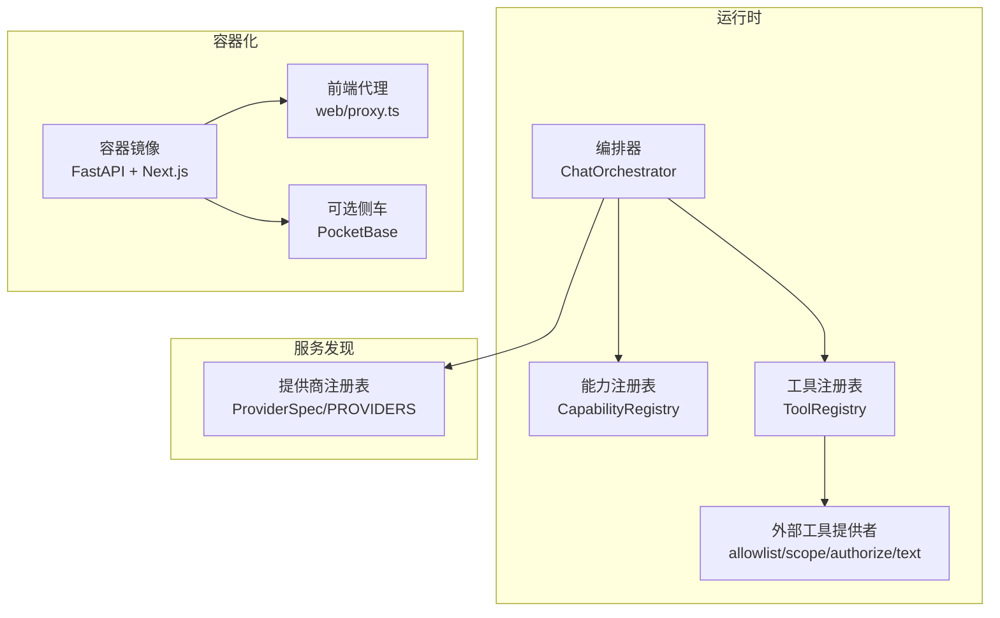
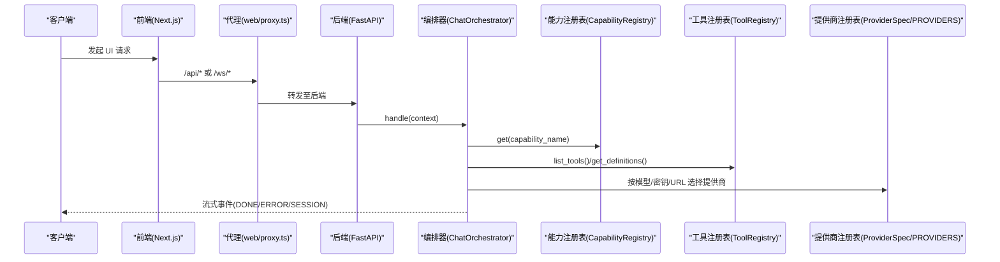
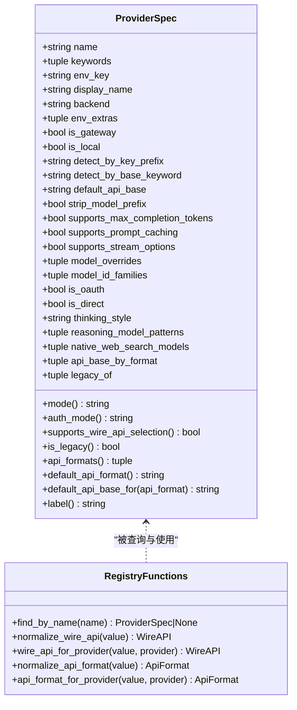
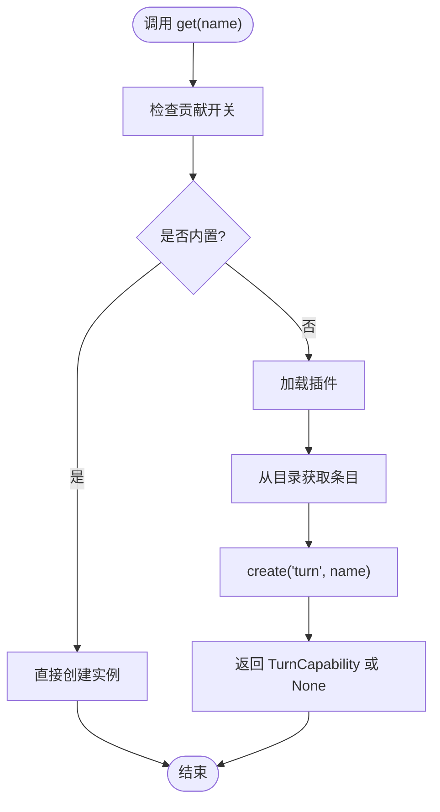
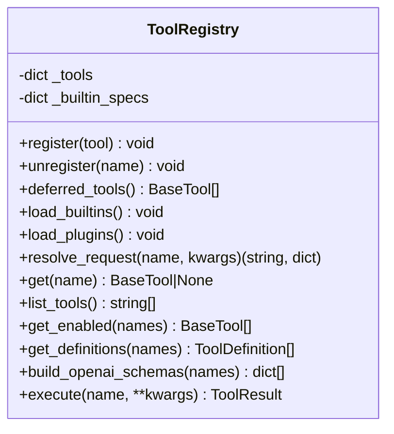
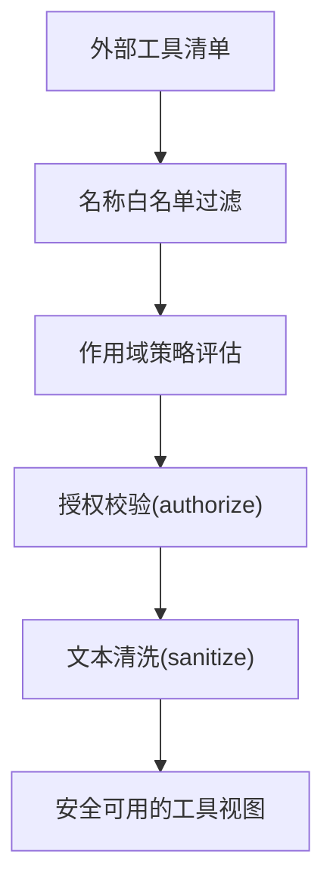
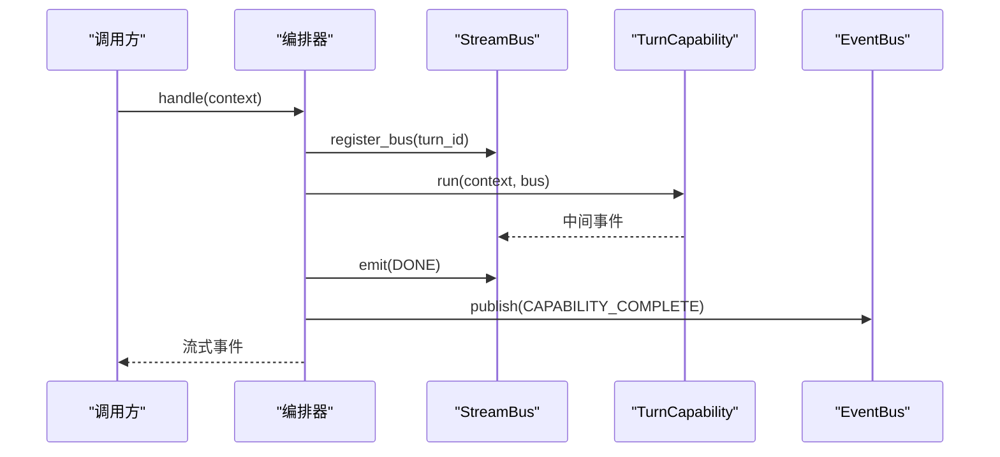
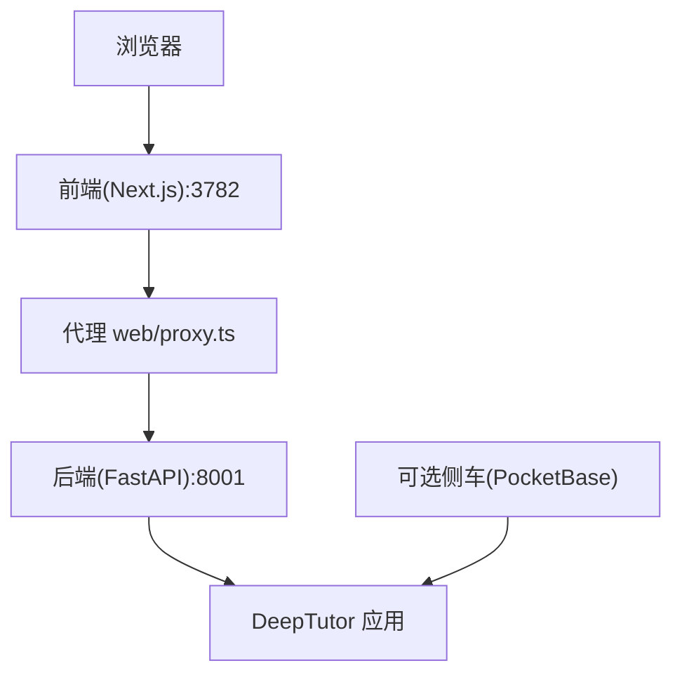
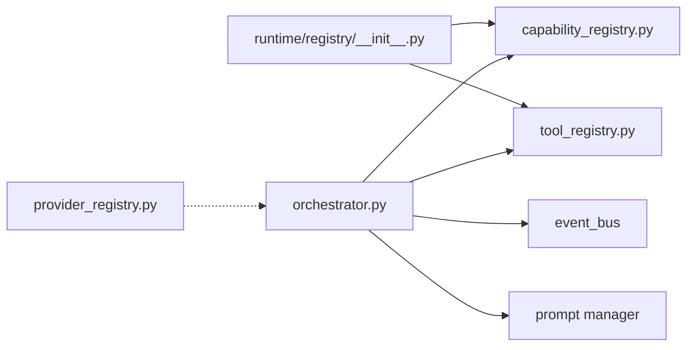

# 服务发现与依赖注入

<cite>
**本文引用的文件**   
- [deeptutor/services/provider_registry.py](file://deeptutor/services/provider_registry.py)
- [deeptutor/runtime/providers/__init__.py](file://deeptutor/runtime/providers/__init__.py)
- [deeptutor/runtime/registry/__init__.py](file://deeptutor/runtime/registry/__init__.py)
- [deeptutor/runtime/registry/capability_registry.py](file://deeptutor/runtime/registry/capability_registry.py)
- [deeptutor/runtime/registry/tool_registry.py](file://deeptutor/runtime/registry/tool_registry.py)
- [deeptutor/runtime/orchestrator.py](file://deeptutor/runtime/orchestrator.py)
- [docs-for-dev/CONTAINERIZATION.md](file://docs-for-dev/CONTAINERIZATION.md)
</cite>

## 目录
1. [引言](#引言)
2. [项目结构](#项目结构)
3. [核心组件](#核心组件)
4. [架构总览](#架构总览)
5. [详细组件分析](#详细组件分析)
6. [依赖关系分析](#依赖关系分析)
7. [性能考量](#性能考量)
8. [故障排查指南](#故障排查指南)
9. [结论](#结论)

## 引言
本文聚焦 DeepTutor 的“服务发现与依赖注入”体系，围绕以下目标展开：
- 容器化架构中的服务注册、实例管理与生命周期控制。
- 依赖注入容器的实现原理，包括构造函数注入、属性注入与方法注入的支持方式。
- 服务发现机制：静态配置发现与动态服务注册。
- 提供商注册表的工作原理：LLM 提供商、存储后端与其他外部服务的统一管理。
- 服务间通信模式、错误传播机制与监控集成方案。

DeepTutor 在运行时通过“注册表 + 编排器”的方式组织能力与工具，并通过“提供商注册表”统一抽象 LLM 与外部服务；同时以容器镜像运行 FastAPI 后端与 Next.js 前端，配合代理转发与可选侧车（如 PocketBase）完成部署与服务发现。

## 项目结构
从服务发现与依赖注入视角，关键代码集中在以下模块：
- 提供商注册表：deeptutor/services/provider_registry.py
- 运行时注册表：deeptutor/runtime/registry/*
- 外部工具提供者治理：deeptutor/runtime/providers/*
- 编排入口：deeptutor/runtime/orchestrator.py
- 容器化部署说明：docs-for-dev/CONTAINERIZATION.md

**图示来源**
- [deeptutor/runtime/orchestrator.py:54-70](file://deeptutor/runtime/orchestrator.py#L54-L70)
- [deeptutor/runtime/registry/capability_registry.py:58-83](file://deeptutor/runtime/registry/capability_registry.py#L58-L83)
- [deeptutor/runtime/registry/tool_registry.py:29-56](file://deeptutor/runtime/registry/tool_registry.py#L29-L56)
- [deeptutor/runtime/providers/__init__.py:1-26](file://deeptutor/runtime/providers/__init__.py#L1-L26)
- [deeptutor/services/provider_registry.py:18-69](file://deeptutor/services/provider_registry.py#L18-L69)
- [docs-for-dev/CONTAINERIZATION.md:15-54](file://docs-for-dev/CONTAINERIZATION.md#L15-L54)

**章节来源**
- [docs-for-dev/CONTAINERIZATION.md:15-54](file://docs-for-dev/CONTAINERIZATION.md#L15-L54)

## 核心组件
- 提供商注册表 ProviderSpec/PROVIDERS：集中声明所有 LLM 提供商元数据、默认端点、鉴权方式、协议格式与检测规则，是系统对外的“服务目录”。
- 能力注册表 CapabilityRegistry：管理“回合能力”的发现、注册与实例化，支持内置能力与插件扩展。
- 工具注册表 ToolRegistry：集中管理工具（含 MCP 等外部工具），提供别名解析、定义生成与执行调度。
- 外部工具提供者治理 allowlist/scope/authorize/text：对第三方工具进行名称白名单、作用域策略、授权校验与文本清洗。
- 编排器 ChatOrchestrator：统一入口，将用户消息路由到具体能力，管理流式事件总线与生命周期。
- 容器化部署：单镜像包含后端与前端，通过前端代理转发 API/WS 请求，可选 PocketBase 作为认证与存储侧车。

**章节来源**
- [deeptutor/services/provider_registry.py:18-69](file://deeptutor/services/provider_registry.py#L18-L69)
- [deeptutor/runtime/registry/capability_registry.py:58-83](file://deeptutor/runtime/registry/capability_registry.py#L58-L83)
- [deeptutor/runtime/registry/tool_registry.py:29-56](file://deeptutor/runtime/registry/tool_registry.py#L29-L56)
- [deeptutor/runtime/providers/__init__.py:1-26](file://deeptutor/runtime/providers/__init__.py#L1-L26)
- [deeptutor/runtime/orchestrator.py:54-70](file://deeptutor/runtime/orchestrator.py#L54-L70)
- [docs-for-dev/CONTAINERIZATION.md:15-54](file://docs-for-dev/CONTAINERIZATION.md#L15-L54)

## 架构总览
DeepTutor 的服务发现与依赖注入采用“分层注册表 + 编排器”的模式：
- 服务发现层：ProviderSpec/PROVIDERS 提供静态服务目录；运行时根据模型名、密钥前缀、基础 URL 关键词等进行匹配与选择。
- 依赖注入层：CapabilityRegistry 与 ToolRegistry 分别负责能力与工具的发现、延迟加载与实例化；外部工具提供者治理确保安全性与可观测性。
- 编排层：ChatOrchestrator 作为统一入口，协调能力执行、工具调用、事件总线与指标统计。
- 容器化层：镜像内运行后端与前端，前端代理转发 API/WS 请求；可选 PocketBase 侧车提供多用户认证与存储。

**图示来源**
- [docs-for-dev/CONTAINERIZATION.md:39-54](file://docs-for-dev/CONTAINERIZATION.md#L39-L54)
- [deeptutor/runtime/orchestrator.py:64-70](file://deeptutor/runtime/orchestrator.py#L64-L70)
- [deeptutor/runtime/registry/capability_registry.py:147-176](file://deeptutor/runtime/registry/capability_registry.py#L147-L176)
- [deeptutor/runtime/registry/tool_registry.py:120-152](file://deeptutor/runtime/registry/tool_registry.py#L120-L152)
- [deeptutor/services/provider_registry.py:761-768](file://deeptutor/services/provider_registry.py#L761-L768)

## 详细组件分析

### 提供商注册表 ProviderSpec/PROVIDERS
- 职责：集中声明所有 LLM 提供商的元数据，包括后端类型、鉴权方式、默认端点、协议格式、检测规则（密钥前缀、URL 关键词）、模型覆盖规则等。
- 设计要点：
  - 顺序即优先级：网关类提供商优先，其次是标准提供商，最后是本地/直连提供商。
  - 支持多种协议格式（OpenAI Chat Completions、Responses、Anthropic Messages）。
  - 支持 OAuth、Direct、Gateway、Local 等多种模式。
  - 提供 find_by_name、wire_api_for_provider、api_format_for_provider 等查询与规范化方法。

**图示来源**
- [deeptutor/services/provider_registry.py:18-128](file://deeptutor/services/provider_registry.py#L18-L128)
- [deeptutor/services/provider_registry.py:761-800](file://deeptutor/services/provider_registry.py#L761-L800)

**章节来源**
- [deeptutor/services/provider_registry.py:18-128](file://deeptutor/services/provider_registry.py#L18-L128)
- [deeptutor/services/provider_registry.py:761-800](file://deeptutor/services/provider_registry.py#L761-L800)

### 能力注册表 CapabilityRegistry
- 职责：管理“回合能力”的发现、注册与实例化；支持内置能力与插件扩展；暴露清单与配置模型。
- 关键点：
  - register 支持类、工厂或实例；自动关联配置模型。
  - load_builtins 与 load_plugins 分别加载内置与插件能力。
  - get 返回 TurnCapability 实例；未找到时返回 None。
  - list_capabilities 与 get_manifests 用于对外暴露能力清单与描述。

**图示来源**
- [deeptutor/runtime/registry/capability_registry.py:147-176](file://deeptutor/runtime/registry/capability_registry.py#L147-L176)
- [deeptutor/runtime/registry/capability_registry.py:85-103](file://deeptutor/runtime/registry/capability_registry.py#L85-L103)
- [deeptutor/runtime/registry/capability_registry.py:105-146](file://deeptutor/runtime/registry/capability_registry.py#L105-L146)

**章节来源**
- [deeptutor/runtime/registry/capability_registry.py:58-83](file://deeptutor/runtime/registry/capability_registry.py#L58-L83)
- [deeptutor/runtime/registry/capability_registry.py:147-176](file://deeptutor/runtime/registry/capability_registry.py#L147-L176)

### 工具注册表 ToolRegistry
- 职责：集中管理所有工具（内置与插件），提供别名解析、定义生成、提示词构建与执行调度。
- 关键点：
  - load_builtins 注册导入轻量描述符；_load_builtin 按需实例化工具。
  - load_plugins 通过 entry points 与插件运行时加载工具。
  - resolve_request 处理别名与默认参数合并。
  - build_openai_schemas 生成 OpenAI function-calling 工具定义。
  - execute 异步执行工具并返回结果。

**图示来源**
- [deeptutor/runtime/registry/tool_registry.py:29-56](file://deeptutor/runtime/registry/tool_registry.py#L29-L56)
- [deeptutor/runtime/registry/tool_registry.py:58-98](file://deeptutor/runtime/registry/tool_registry.py#L58-L98)
- [deeptutor/runtime/registry/tool_registry.py:120-152](file://deeptutor/runtime/registry/tool_registry.py#L120-L152)
- [deeptutor/runtime/registry/tool_registry.py:184-197](file://deeptutor/runtime/registry/tool_registry.py#L184-L197)

**章节来源**
- [deeptutor/runtime/registry/tool_registry.py:29-56](file://deeptutor/runtime/registry/tool_registry.py#L29-L56)
- [deeptutor/runtime/registry/tool_registry.py:120-152](file://deeptutor/runtime/registry/tool_registry.py#L120-L152)
- [deeptutor/runtime/registry/tool_registry.py:184-197](file://deeptutor/runtime/registry/tool_registry.py#L184-L197)

### 外部工具提供者治理
- 职责：对第三方工具（如 MCP 服务器）进行名称白名单、作用域策略、授权校验与文本清洗。
- 关键点：
  - allowlist：允许的工具名集合，支持显式的“不受限”状态。
  - scope：每轮调用的策略输入。
  - authorize：按提供者种类实现授权函数。
  - text：对提供者提供的提示文本进行清洗。

**图示来源**
- [deeptutor/runtime/providers/__init__.py:1-26](file://deeptutor/runtime/providers/__init__.py#L1-L26)

**章节来源**
- [deeptutor/runtime/providers/__init__.py:1-26](file://deeptutor/runtime/providers/__init__.py#L1-L26)

### 编排器 ChatOrchestrator
- 职责：统一入口，将用户消息路由到具体能力；管理流式事件总线与生命周期；发布完成事件。
- 关键点：
  - handle(context) 根据 active_capability 或默认 chat 能力执行。
  - 通过 StreamBus 发送 SESSION/DONE/ERROR 等事件。
  - 捕获异常并标准化错误元数据（error_code、retryable、partial_response）。
  - 完成后发布 CAPABILITY_COMPLETE 事件到全局 EventBus。

**图示来源**
- [deeptutor/runtime/orchestrator.py:64-70](file://deeptutor/runtime/orchestrator.py#L64-L70)
- [deeptutor/runtime/orchestrator.py:145-149](file://deeptutor/runtime/orchestrator.py#L145-L149)
- [deeptutor/runtime/orchestrator.py:167-227](file://deeptutor/runtime/orchestrator.py#L167-L227)
- [deeptutor/runtime/orchestrator.py:250-265](file://deeptutor/runtime/orchestrator.py#L250-L265)

**章节来源**
- [deeptutor/runtime/orchestrator.py:54-70](file://deeptutor/runtime/orchestrator.py#L54-L70)
- [deeptutor/runtime/orchestrator.py:167-227](file://deeptutor/runtime/orchestrator.py#L167-L227)
- [deeptutor/runtime/orchestrator.py:250-265](file://deeptutor/runtime/orchestrator.py#L250-L265)

### 容器化架构与服务发现
- 单镜像部署：FastAPI 后端与 Next.js 前端在同一容器中由 supervisord 管理。
- 前端代理：web/proxy.ts 在请求时将 /api/* 与 /ws/* 转发到后端，读取 DEEPTUTOR_API_BASE_URL。
- 分离部署：可通过 system.json 设置 next_public_api_base 与 next_public_api_base_external，使前端在服务端侧访问后端。
- 可选侧车：PocketBase 作为认证与存储侧车，启用后主应用将账户与会话存储于 PocketBase。

**图示来源**
- [docs-for-dev/CONTAINERIZATION.md:15-54](file://docs-for-dev/CONTAINERIZATION.md#L15-L54)
- [docs-for-dev/CONTAINERIZATION.md:235-262](file://docs-for-dev/CONTAINERIZATION.md#L235-L262)
- [docs-for-dev/CONTAINERIZATION.md:450-469](file://docs-for-dev/CONTAINERIZATION.md#L450-L469)

**章节来源**
- [docs-for-dev/CONTAINERIZATION.md:15-54](file://docs-for-dev/CONTAINERIZATION.md#L15-L54)
- [docs-for-dev/CONTAINERIZATION.md:235-262](file://docs-for-dev/CONTAINERIZATION.md#L235-L262)
- [docs-for-dev/CONTAINERIZATION.md:450-469](file://docs-for-dev/CONTAINERIZATION.md#L450-L469)

## 依赖关系分析
- 运行时注册表懒加载：runtime/registry/__init__.py 通过 __getattr__ 延迟导入 CapabilityRegistry 与 ToolRegistry，避免启动时冷路径依赖。
- 编排器依赖：
  - 能力注册表：get_capability_registry()
  - 工具注册表：get_tool_registry()
  - 事件总线：get_event_bus()
  - 提示词管理：get_prompt_manager()
- 提供商注册表独立：ProviderSpec/PROVIDERS 不依赖运行时注册表，便于在更上层进行服务发现与路由。

**图示来源**
- [deeptutor/runtime/registry/__init__.py:1-30](file://deeptutor/runtime/registry/__init__.py#L1-L30)
- [deeptutor/runtime/orchestrator.py:21-27](file://deeptutor/runtime/orchestrator.py#L21-L27)
- [deeptutor/services/provider_registry.py:1-8](file://deeptutor/services/provider_registry.py#L1-L8)

**章节来源**
- [deeptutor/runtime/registry/__init__.py:1-30](file://deeptutor/runtime/registry/__init__.py#L1-L30)
- [deeptutor/runtime/orchestrator.py:21-27](file://deeptutor/runtime/orchestrator.py#L21-L27)

## 性能考量
- 懒加载与延迟实例化：
  - 能力与工具注册表在首次使用时才加载内置与插件，减少启动开销。
  - 工具按需实例化，避免一次性加载重型依赖。
- 流式事件与任务隔离：
  - 编排器通过 StreamBus 与 asyncio task 隔离能力执行，避免消费者提前关闭流导致资源泄漏。
- 提供商选择优化：
  - ProviderSpec 的顺序与检测规则（密钥前缀、URL 关键词）减少匹配成本。
  - wire_api/api_format 规范化避免无效协议尝试。

[本节为通用指导，无需特定文件引用]

## 故障排查指南
- 未知能力错误：
  - 现象：编排器报告 Unknown capability。
  - 排查：确认能力已注册且未被贡献开关禁用；检查 list_capabilities 输出。
  - 相关逻辑：orchestrator 中 get(capability_name) 失败时的错误事件。
- 工具未找到：
  - 现象：ToolRegistry.execute 抛出 KeyError。
  - 排查：确认工具名是否存在别名映射；检查 load_plugins 是否正确加载。
- 容器连接问题：
  - 现象：Settings 显示“后端不可达”。
  - 排查：检查前端代理转发与 DEEPTUTOR_API_BASE_URL；确认后端进程是否正常启动。
- 权限与数据目录：
  - 现象：Permission denied 或 Data directory is not writable。
  - 排查：确认 PUID/PGID 与 bind mount 权限；rootless Podman 下保持非 root 运行。

**章节来源**
- [deeptutor/runtime/orchestrator.py:116-134](file://deeptutor/runtime/orchestrator.py#L116-L134)
- [deeptutor/runtime/registry/tool_registry.py:184-197](file://deeptutor/runtime/registry/tool_registry.py#L184-L197)
- [docs-for-dev/CONTAINERIZATION.md:481-501](file://docs-for-dev/CONTAINERIZATION.md#L481-L501)

## 结论
DeepTutor 的服务发现与依赖注入体系以“提供商注册表 + 能力/工具注册表 + 编排器”为核心，结合容器化部署与可选侧车，实现了：
- 统一的 LLM 与外部服务发现与选择。
- 灵活的能力与工具扩展机制（内置、插件、MCP）。
- 安全的第三方工具治理（白名单、作用域、授权、文本清洗）。
- 清晰的编排流程与事件驱动的错误传播。
- 可插拔的容器化部署形态（单镜像、分离部署、根文件系统只读）。

该设计在保证可扩展性的同时，兼顾了性能与安全，适合在复杂的多模型、多工具环境中稳定运行。