# 核心组件设计

<cite>
**本文引用的文件**   
- [capability_protocol.py](file://deeptutor/core/capability_protocol.py)
- [orchestrator.py](file://deeptutor/runtime/orchestrator.py)
- [stream_bus.py](file://deeptutor/runtime/stream_bus.py)
- [event_bus.py](file://deeptutor/events/event_bus.py)
- [capability_registry.py](file://deeptutor/runtime/registry/capability_registry.py)
- [provider_registry.py](file://deeptutor/services/provider_registry.py)
- [plugins_registry.py](file://deeptutor/plugins/registry.py)
- [plugins_runtime.py](file://deeptutor/plugins/runtime.py)
- [plugins_lifecycle.py](file://deeptutor/plugins/lifecycle.py)
</cite>

## 目录
1. [引言](#引言)
2. [项目结构](#项目结构)
3. [核心组件](#核心组件)
4. [架构总览](#架构总览)
5. [详细组件分析](#详细组件分析)
6. [依赖关系分析](#依赖关系分析)
7. [性能与可扩展性](#性能与可扩展性)
8. [故障排查指南](#故障排查指南)
9. [结论](#结论)

## 引言
本设计文档聚焦 DeepTutor 的核心运行时能力：能力协议、运行时编排器、提供商注册表、事件总线，以及插件系统。目标是帮助读者理解“用户请求如何被路由到具体能力”“能力如何通过流式总线输出事件”“全局事件总线如何解耦模块通信”“提供商如何被声明和选择”“插件如何实现动态加载、版本管理与隔离执行”。

## 项目结构
DeepTutor 将“能力定义”“运行时编排”“事件通道”“插件生命周期”分层组织：
- 能力协议层：定义 TurnCapability 抽象与 CapabilityManifest 静态元数据。
- 运行时编排层：ChatOrchestrator 负责会话上下文、能力查找、流式总线生命周期、完成事件发布。
- 事件通道层：StreamBus 提供单轮对话的 fan-out 事件流；EventBus 提供进程级异步事件总线。
- 注册表层：能力注册表、工具注册表、LLM 提供商注册表。
- 插件系统：注册表、运行时适配器、生命周期管理器，实现隔离安装、权限校验、动态加载。

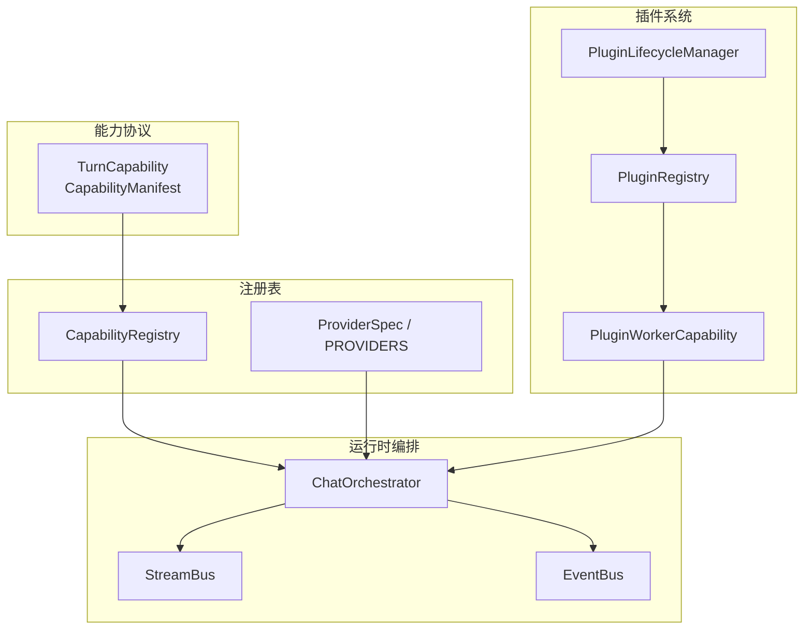

**图表来源**
- [capability_protocol.py:33-81](file://deeptutor/core/capability_protocol.py#L33-L81)
- [orchestrator.py:54-278](file://deeptutor/runtime/orchestrator.py#L54-L278)
- [stream_bus.py:32-158](file://deeptutor/runtime/stream_bus.py#L32-L158)
- [event_bus.py:22-209](file://deeptutor/events/event_bus.py#L22-L209)
- [capability_registry.py:58-236](file://deeptutor/runtime/registry/capability_registry.py#L58-L236)
- [provider_registry.py:18-127](file://deeptutor/services/provider_registry.py#L18-L127)
- [plugins_registry.py:159-475](file://deeptutor/plugins/registry.py#L159-L475)
- [plugins_runtime.py:323-387](file://deeptutor/plugins/runtime.py#L323-L387)
- [plugins_lifecycle.py:50-174](file://deeptutor/plugins/lifecycle.py#L50-L174)

**章节来源**
- [capability_protocol.py:1-103](file://deeptutor/core/capability_protocol.py#L1-L103)
- [orchestrator.py:1-278](file://deeptutor/runtime/orchestrator.py#L1-L278)
- [stream_bus.py:1-421](file://deeptutor/runtime/stream_bus.py#L1-L421)
- [event_bus.py:1-210](file://deeptutor/events/event_bus.py#L1-L210)
- [capability_registry.py:1-244](file://deeptutor/runtime/registry/capability_registry.py#L1-L244)
- [provider_registry.py:1-800](file://deeptutor/services/provider_registry.py#L1-L800)
- [plugins_registry.py:1-659](file://deeptutor/plugins/registry.py#L1-L659)
- [plugins_runtime.py:1-813](file://deeptutor/plugins/runtime.py#L1-L813)
- [plugins_lifecycle.py:1-469](file://deeptutor/plugins/lifecycle.py#L1-L469)

## 核心组件
- 能力协议（Capability Protocol）
  - 定义 TurnCapability 抽象类与 CapabilityManifest 静态描述，要求子类提供 manifest 并实现 run(context, stream)。
  - 通过 StreamBusProtocol 暴露 emit(stage) 等最小输出端口，使能力无需感知具体实现细节。
- 运行时编排器（ChatOrchestrator）
  - 统一入口：根据 context.active_capability 或默认 chat 能力路由请求。
  - 管理 StreamBus 生命周期：创建、订阅、错误处理、DONE 事件、任务取消保护。
  - 完成后发布 CAPABILITY_COMPLETE 到全局 EventBus。
- 流式总线（StreamBus）
  - 单轮对话 fan-out 通道：emit/subscribe/stage/content/tool_call/result/error/wait_for_input 等。
  - 支持多事件循环写入、历史回放、序列号、结果 completion 语义。
- 事件总线（EventBus）
  - 进程级异步事件总线：publish/subscribe/start/stop/flush/reset。
  - 后台处理器队列消费，非阻塞投递，支持超时 flush 与优雅停止。
- 提供商注册表（ProviderSpec/PROVIDERS）
  - 集中声明 LLM 提供商元数据：后端类型、鉴权模式、API base、模型覆盖、格式选择等。
  - 提供名称规范化、wire API 与 API format 推导、按模型族匹配等能力。
- 能力注册表（CapabilityRegistry）
  - 基于 CapabilityCatalog 的兼容视图：注册内置能力、加载插件扩展、列出清单、按需实例化。
  - 支持贡献开关、插件运行时包装、manifest 国际化与 schema 导出。
- 插件系统
  - PluginRegistry：发现已安装/目录项、状态机（available/approval-required/enabled/disabled/incompatible/broken）、审批摘要、兼容性检查。
  - PluginRuntime：为托管插件构建 WorkerClient，封装 tool/capability/http_route 适配，NDJSON v1 流式传输、权限校验、进程隔离与清理。
  - PluginLifecycleManager：wheel 安装、独立 venv、依赖隔离、回滚、卸载、日志记录。

**章节来源**
- [capability_protocol.py:21-81](file://deeptutor/core/capability_protocol.py#L21-L81)
- [orchestrator.py:54-278](file://deeptutor/runtime/orchestrator.py#L54-L278)
- [stream_bus.py:32-421](file://deeptutor/runtime/stream_bus.py#L32-L421)
- [event_bus.py:22-209](file://deeptutor/events/event_bus.py#L22-L209)
- [provider_registry.py:18-127](file://deeptutor/services/provider_registry.py#L18-L127)
- [capability_registry.py:58-236](file://deeptutor/runtime/registry/capability_registry.py#L58-L236)
- [plugins_registry.py:159-475](file://deeptutor/plugins/registry.py#L159-L475)
- [plugins_runtime.py:65-387](file://deeptutor/plugins/runtime.py#L65-L387)
- [plugins_lifecycle.py:50-174](file://deeptutor/plugins/lifecycle.py#L50-L174)

## 架构总览
下图展示一次典型“深度能力”调用链：客户端进入编排器，编排器解析能力、创建流式总线、执行能力、发布完成事件。

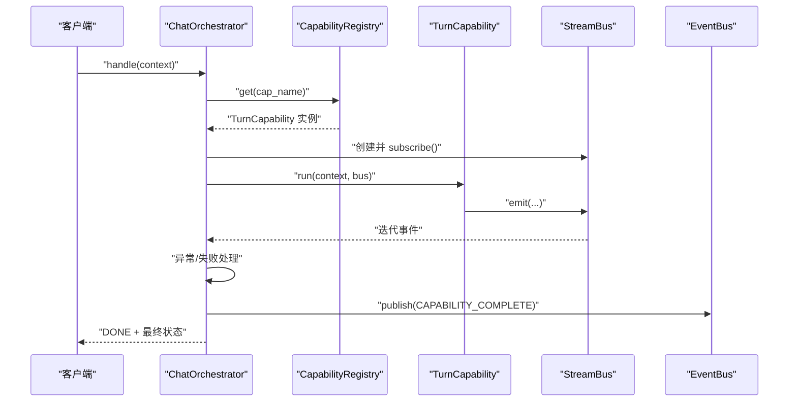

**图表来源**
- [orchestrator.py:64-278](file://deeptutor/runtime/orchestrator.py#L64-L278)
- [capability_registry.py:147-176](file://deeptutor/runtime/registry/capability_registry.py#L147-L176)
- [stream_bus.py:96-158](file://deeptutor/runtime/stream_bus.py#L96-L158)
- [event_bus.py:101-151](file://deeptutor/events/event_bus.py#L101-L151)

## 详细组件分析

### 能力协议与能力清单
- TurnCapability 抽象：强制实现 run(context, stream)，并提供 name/stages 访问器。
- CapabilityManifest：声明 stages、tools_used、cli_aliases、request_schema、config_defaults 等静态信息。
- StreamBusProtocol：仅暴露 emit 与 stage 上下文管理器，降低耦合。

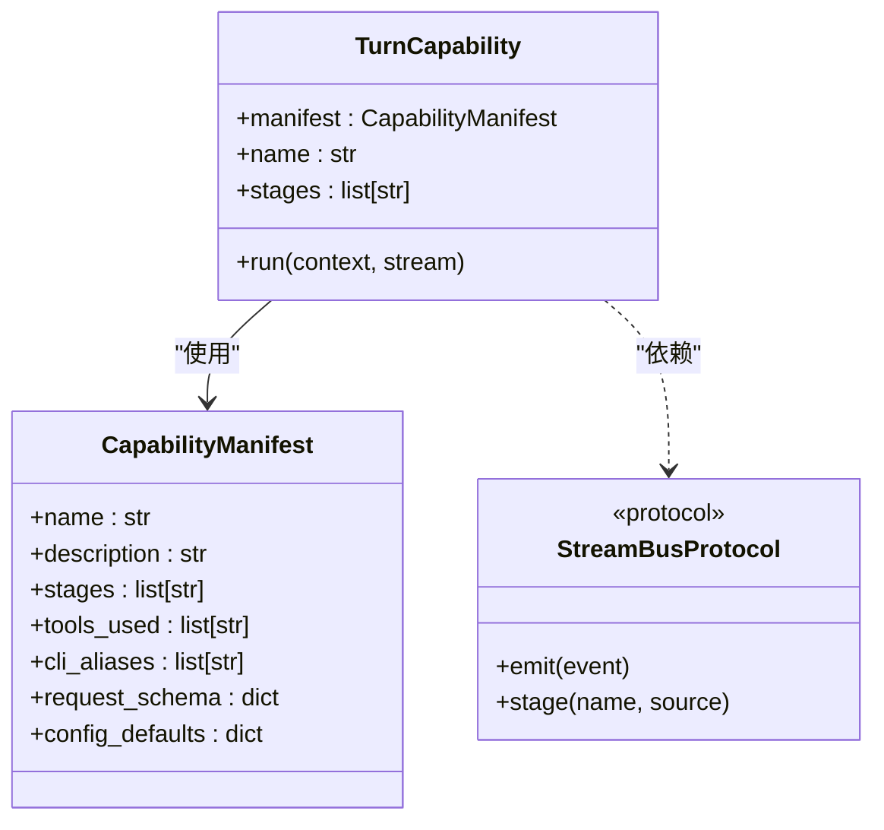

**图表来源**
- [capability_protocol.py:33-81](file://deeptutor/core/capability_protocol.py#L33-L81)

**章节来源**
- [capability_protocol.py:21-81](file://deeptutor/core/capability_protocol.py#L21-L81)

### 运行时编排器 ChatOrchestrator
职责：
- 会话与会话 ID 初始化。
- 知识索引有效性校验（可选）。
- 能力解析：优先 runtime.answer_by 的 handoff，否则 active_capability 或默认 chat。
- 流式总线生命周期：注册/注销 per-turn bus、统计 usage、错误包装、DONE 事件。
- 完成后发布 CAPABILITY_COMPLETE 到 EventBus。

关键流程要点：
- 未知能力：返回 failed 状态与可用能力列表。
- 能力未完成：若 result_completion 为 False，标记 capability_incomplete。
- 消费者提前关闭：取消后台任务，避免悬空 ask_user 或持续调用模型。

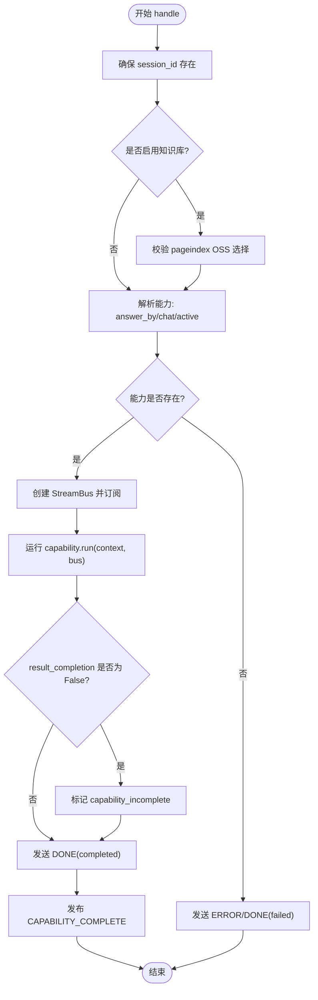

**图表来源**
- [orchestrator.py:64-278](file://deeptutor/runtime/orchestrator.py#L64-L278)

**章节来源**
- [orchestrator.py:31-51](file://deeptutor/runtime/orchestrator.py#L31-L51)
- [orchestrator.py:64-278](file://deeptutor/runtime/orchestrator.py#L64-L278)

### 流式总线 StreamBus
功能：
- 单轮对话 fan-out：多个订阅者同时接收事件。
- 阶段上下文：stage(name, source) 自动包裹 STAGE_START/STAGE_END。
- 便捷方法：content/thinking/observation/tool_call/tool_result/progress/sources/result/error。
- 交互输入：wait_for_input 暂停能力执行，等待前端提交；submit_input 投递输入。
- 跨事件循环安全：不同 loop 下通过 call_soon_threadsafe 投递。

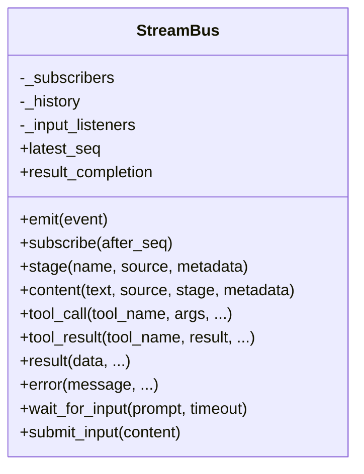

**图表来源**
- [stream_bus.py:32-421](file://deeptutor/runtime/stream_bus.py#L32-L421)

**章节来源**
- [stream_bus.py:32-158](file://deeptutor/runtime/stream_bus.py#L32-L158)
- [stream_bus.py:160-421](file://deeptutor/runtime/stream_bus.py#L160-L421)

### 事件总线 EventBus
职责：
- 进程级异步事件分发：publish 入队，后台 _process_events 顺序消费。
- 生命周期：start/stop/flush/reset。
- 事件类型：SOLVE_COMPLETE、QUESTION_COMPLETE、CAPABILITY_COMPLETE。
- 健壮性：处理器异常不中断其他 handler；flush 支持超时；stop 等待队列清空。

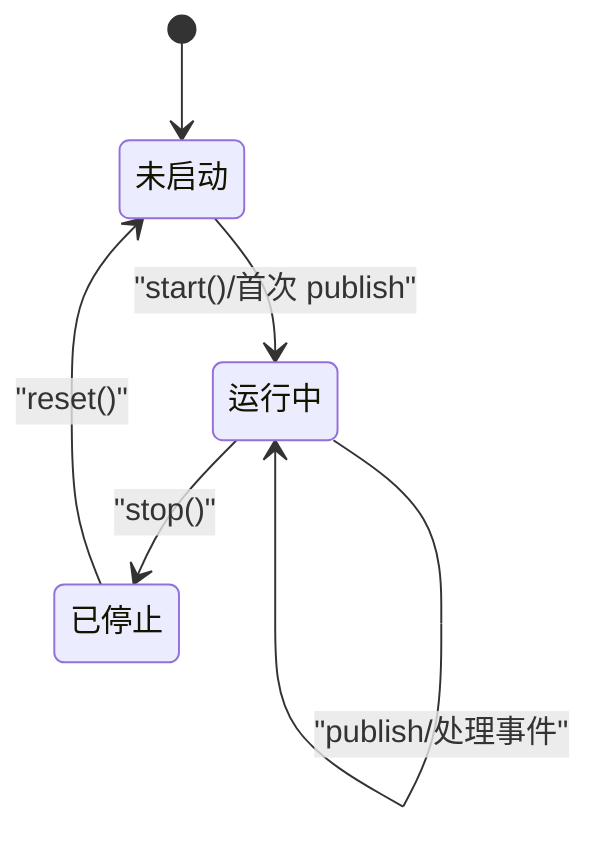

**图表来源**
- [event_bus.py:61-185](file://deeptutor/events/event_bus.py#L61-L185)

**章节来源**
- [event_bus.py:22-58](file://deeptutor/events/event_bus.py#L22-L58)
- [event_bus.py:61-209](file://deeptutor/events/event_bus.py#L61-L209)

### 提供商注册表 ProviderSpec/PROVIDERS
职责：
- 单一事实源：集中声明所有 LLM 提供商元数据。
- 属性与推导：mode/auth_mode/api_formats/default_api_format/wire_api 等。
- 别名与规范化：canonical_provider_name 统一命名。
- 模型族覆盖：OPENAI_REASONING_FAMILIES、ANTHROPIC_EFFORT_BASED_FAMILIES 等。

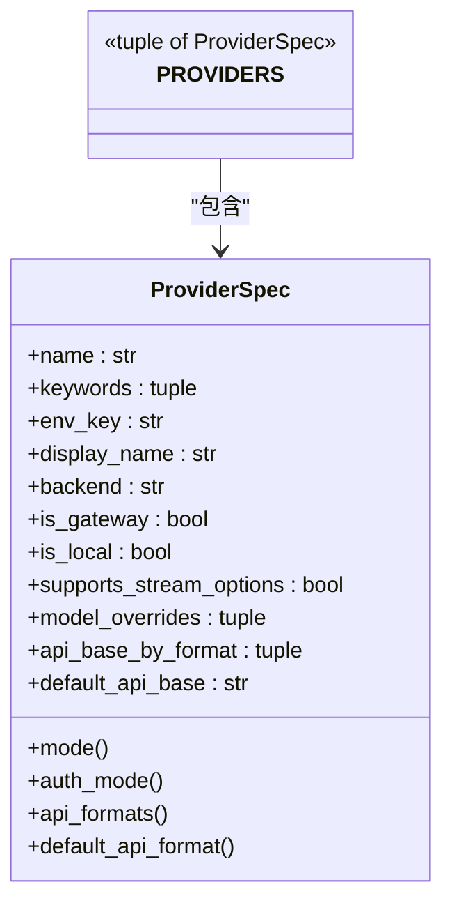

**图表来源**
- [provider_registry.py:18-127](file://deeptutor/services/provider_registry.py#L18-L127)

**章节来源**
- [provider_registry.py:18-127](file://deeptutor/services/provider_registry.py#L18-L127)
- [provider_registry.py:168-177](file://deeptutor/services/provider_registry.py#L168-L177)
- [provider_registry.py:179-201](file://deeptutor/services/provider_registry.py#L179-L201)
- [provider_registry.py:208-734](file://deeptutor/services/provider_registry.py#L208-L734)

### 能力注册表 CapabilityRegistry
职责：
- 兼容视图：基于 CapabilityCatalog 管理 turn 能力。
- 注册机制：register/load_builtins/load_plugins。
- 实例化：get 时按贡献开关与插件运行时包装返回 TurnCapability。
- 清单导出：list_capabilities/get_manifests 输出 i18n 描述、schema、默认配置。

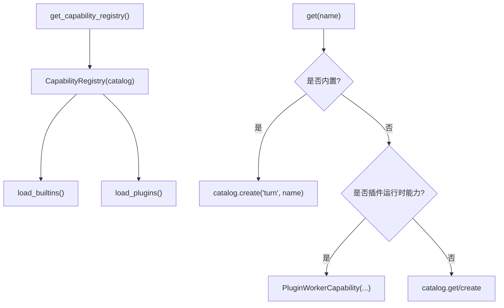

**图表来源**
- [capability_registry.py:58-236](file://deeptutor/runtime/registry/capability_registry.py#L58-L236)

**章节来源**
- [capability_registry.py:58-104](file://deeptutor/runtime/registry/capability_registry.py#L58-L104)
- [capability_registry.py:105-176](file://deeptutor/runtime/registry/capability_registry.py#L105-L176)
- [capability_registry.py:178-236](file://deeptutor/runtime/registry/capability_registry.py#L178-L236)

### 插件系统：注册、运行时与生命周期

#### 插件注册表 PluginRegistry
职责：
- 发现已安装与目录项，合并 catalog 条目。
- 状态机：available/approval-required/enabled/disabled/incompatible/broken。
- 审批与兼容性：approval_digest、host API 版本检查、DeepTutor 版本匹配。
- 持久化：atomic_write_json 原子写入 state_path。

```mermaid
stateDiagram-v2
[*] --> available
available --> approval-required : "安装成功"
approval-required --> enabled : "approve()"
enabled --> disabled : "set_enabled(False)"
disabled --> enabled : "set_enabled(True)"
approved --> incompatible : "兼容性检查失败"
broken --> [*]
```

**图表来源**
- [plugins_registry.py:159-475](file://deeptutor/plugins/registry.py#L159-L475)

**章节来源**
- [plugins_registry.py:159-475](file://deeptutor/plugins/registry.py#L159-L475)

#### 插件运行时 PluginRuntime
职责：
- 为托管插件构建 WorkerClient，封装 subprocess/asyncio 子进程通信。
- 支持两种传输：
  - 同步 request/request_async：一次性 JSON 响应。
  - 流式 NDJSON v1：bounded queue、complete 标志、stderr 限制、进程树清理。
- 能力/工具/HTTP 路由适配器：
  - PluginWorkerCapability：描述能力、映射 StreamEvent、支持 streaming。
  - PluginWorkerTool：describe_tool/execute_tool。
  - PluginWorkerHttpRoute：handle_http 校验方法与路径。
- 权限校验：scopes 白名单、严格字段校验。

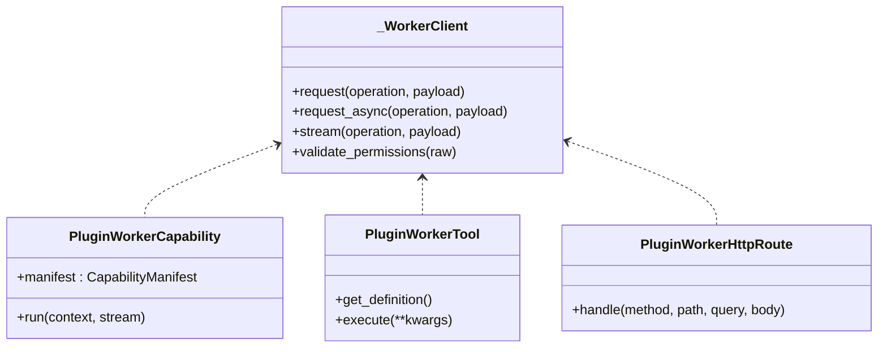

**图表来源**
- [plugins_runtime.py:65-387](file://deeptutor/plugins/runtime.py#L65-L387)

**章节来源**
- [plugins_runtime.py:65-235](file://deeptutor/plugins/runtime.py#L65-L235)
- [plugins_runtime.py:236-387](file://deeptutor/plugins/runtime.py#L236-L387)

#### 插件生命周期 PluginLifecycleManager
职责：
- wheel 安装：校验 SHA-256、提取 manifest、创建独立 venv、pip install --no-deps。
- 原子提交：备份旧 venv、替换 staging、记录 installation 与 history。
- 回滚/卸载：从 history 恢复、删除 plugin root、清理 state。
- 安全约束：wheel 大小、展开大小、路径安全检查、metadata 版本一致性。

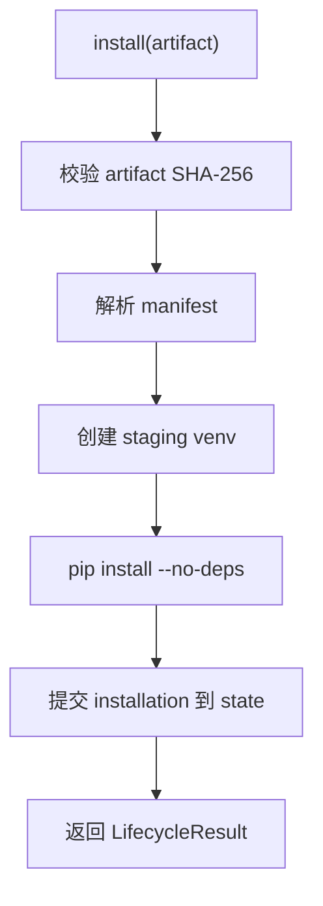

**图表来源**
- [plugins_lifecycle.py:72-174](file://deeptutor/plugins/lifecycle.py#L72-L174)

**章节来源**
- [plugins_lifecycle.py:50-174](file://deeptutor/plugins/lifecycle.py#L50-L174)
- [plugins_lifecycle.py:176-290](file://deeptutor/plugins/lifecycle.py#L176-L290)
- [plugins_lifecycle.py:293-469](file://deeptutor/plugins/lifecycle.py#L293-L469)

## 依赖关系分析
- 编排器依赖：
  - 能力注册表：获取 TurnCapability。
  - 工具注册表：列举工具与 OpenAI schema。
  - 流式总线：事件 fan-out 与生命周期。
  - 事件总线：发布 CAPABILITY_COMPLETE。
- 能力协议依赖：
  - UnifiedContext：会话上下文。
  - StreamBusProtocol：最小输出端口。
- 插件系统依赖：
  - PluginRegistry：状态与兼容性。
  - PluginLifecycleManager：安装/回滚/卸载。
  - PluginRuntime：进程隔离与协议适配。

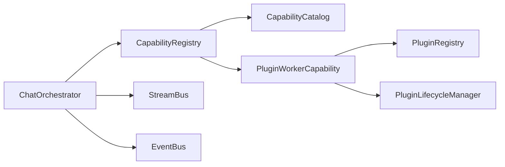

**图表来源**
- [orchestrator.py:54-278](file://deeptutor/runtime/orchestrator.py#L54-L278)
- [capability_registry.py:58-236](file://deeptutor/runtime/registry/capability_registry.py#L58-L236)
- [plugins_runtime.py:323-387](file://deeptutor/plugins/runtime.py#L323-L387)
- [plugins_registry.py:159-475](file://deeptutor/plugins/registry.py#L159-L475)
- [plugins_lifecycle.py:50-174](file://deeptutor/plugins/lifecycle.py#L50-L174)

**章节来源**
- [orchestrator.py:54-278](file://deeptutor/runtime/orchestrator.py#L54-L278)
- [capability_registry.py:58-236](file://deeptutor/runtime/registry/capability_registry.py#L58-L236)
- [plugins_runtime.py:323-387](file://deeptutor/plugins/runtime.py#L323-L387)
- [plugins_registry.py:159-475](file://deeptutor/plugins/registry.py#L159-L475)
- [plugins_lifecycle.py:50-174](file://deeptutor/plugins/lifecycle.py#L50-L174)

## 性能与可扩展性
- 流式总线
  - 多事件循环安全：call_soon_threadsafe 避免跨 loop 写入问题。
  - 历史回放：新订阅者可回放已有事件，支持 after_seq 去重。
  - 结果 completion 语义：result_completion 明确能力是否完成工作。
- 事件总线
  - 后台处理器：非阻塞投递，避免发布者阻塞。
  - flush/stop：可控退出，避免事件丢失。
- 插件运行时
  - 进程隔离：独立 venv 与子进程，限制 stdout/stderr 大小，超时与取消保护。
  - 流式传输：NDJSON v1 bounded queue，complete 标志保证有序与完整性。
- 提供商注册表
  - 声明式配置：新增 provider 仅需添加 ProviderSpec，减少分支逻辑。
  - 模型族覆盖：针对推理模型温度等参数进行自动修正。

[本节为通用指导，不直接分析具体文件]

## 故障排查指南
- 能力未找到
  - 现象：Unknown capability 错误，附带可用能力列表。
  - 排查：确认 active_capability 是否正确；检查 CapabilityRegistry 是否已加载内置/插件能力。
  - 参考：[orchestrator.py:116-134](file://deeptutor/runtime/orchestrator.py#L116-L134)
- 能力未完成
  - 现象：status=failed，error_code=capability_incomplete。
  - 排查：检查能力是否显式发出 RESULT(completed=True)；查看 StreamBus.result_completion。
  - 参考：[orchestrator.py:169-186](file://deeptutor/runtime/orchestrator.py#L169-L186)、[stream_bus.py:64-76](file://deeptutor/runtime/stream_bus.py#L64-L76)
- 事件总线未处理
  - 现象：CAPABILITY_COMPLETE 未到达订阅者。
  - 排查：确认 EventBus.start 已调用；flush 是否超时；stop 是否过早。
  - 参考：[event_bus.py:101-151](file://deeptutor/events/event_bus.py#L101-L151)
- 插件运行时错误
  - 现象：PluginRuntimeError：worker 返回无效 JSON/权限不合法/流结束无 complete。
  - 排查：检查 worker 模块入口、permissions.scopes、NDJSON 信封格式。
  - 参考：[plugins_runtime.py:83-109](file://deeptutor/plugins/runtime.py#L83-L109)、[plugins_runtime.py:124-219](file://deeptutor/plugins/runtime.py#L124-L219)
- 插件安装失败
  - 现象：PluginLifecycleError：wheel 过大/manifest 缺失/venv 创建失败/pip 安装失败。
  - 排查：检查 wheel 大小、manifest 唯一性与路径安全、venv 与 pip 命令输出。
  - 参考：[plugins_lifecycle.py:72-174](file://deeptutor/plugins/lifecycle.py#L72-L174)、[plugins_lifecycle.py:293-347](file://deeptutor/plugins/lifecycle.py#L293-L347)

**章节来源**
- [orchestrator.py:116-186](file://deeptutor/runtime/orchestrator.py#L116-L186)
- [stream_bus.py:64-76](file://deeptutor/runtime/stream_bus.py#L64-L76)
- [event_bus.py:101-151](file://deeptutor/events/event_bus.py#L101-L151)
- [plugins_runtime.py:83-219](file://deeptutor/plugins/runtime.py#L83-L219)
- [plugins_lifecycle.py:72-174](file://deeptutor/plugins/lifecycle.py#L72-L174)
- [plugins_lifecycle.py:293-347](file://deeptutor/plugins/lifecycle.py#L293-L347)

## 结论
DeepTutor 的核心组件围绕“能力协议—编排器—流式总线—事件总线—注册表—插件系统”形成清晰的分层与解耦：
- 能力协议标准化了多步 Agent 管道的接口与元数据。
- 编排器统一管理会话、能力路由、流式输出与完成事件。
- 流式总线与事件总线分别承担“单轮 fan-out”和“进程级异步解耦”。
- 提供商注册表以声明式方式集中管理 LLM 后端。
- 插件系统通过注册表、运行时适配器与生命周期管理器，实现安全的动态加载、版本管理与隔离执行。

该设计在保证可扩展性的同时，兼顾了可观测性（事件流/trace）、安全性（权限/隔离）与稳定性（超时/取消/回滚）。