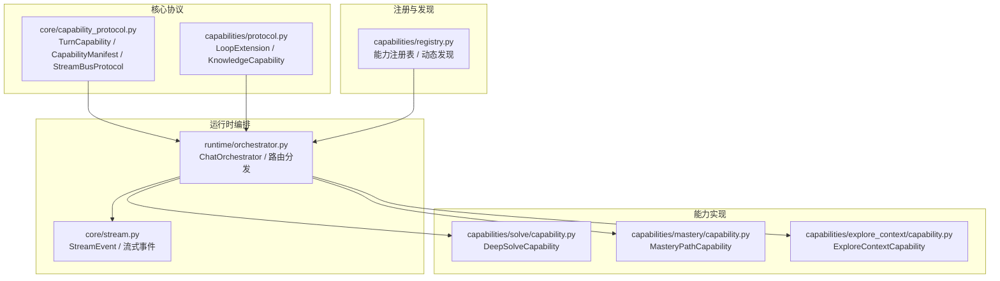
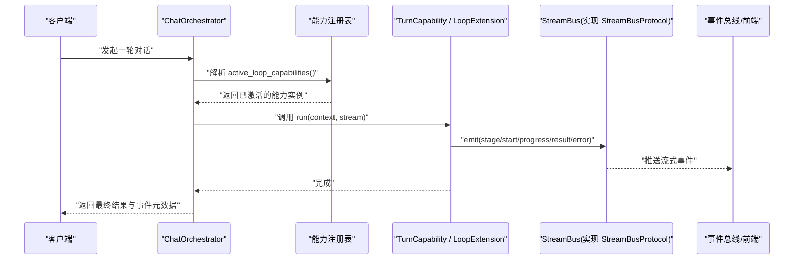
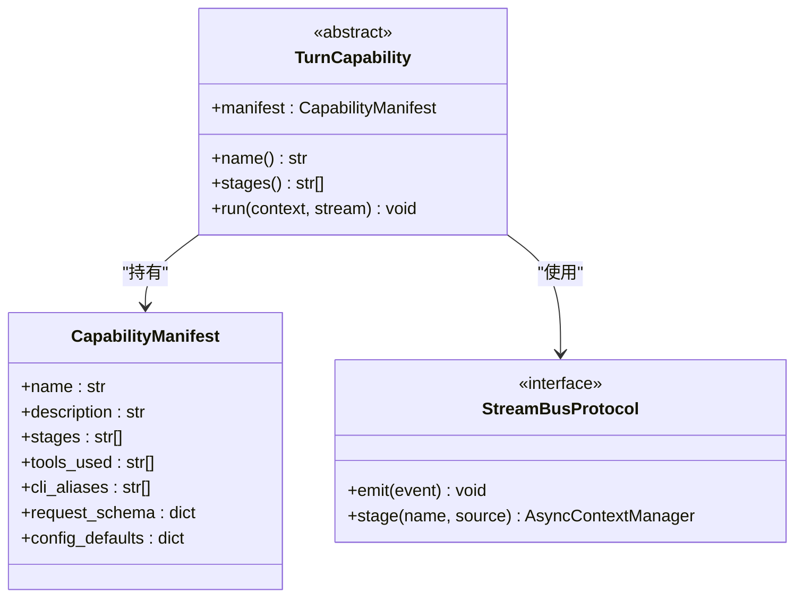
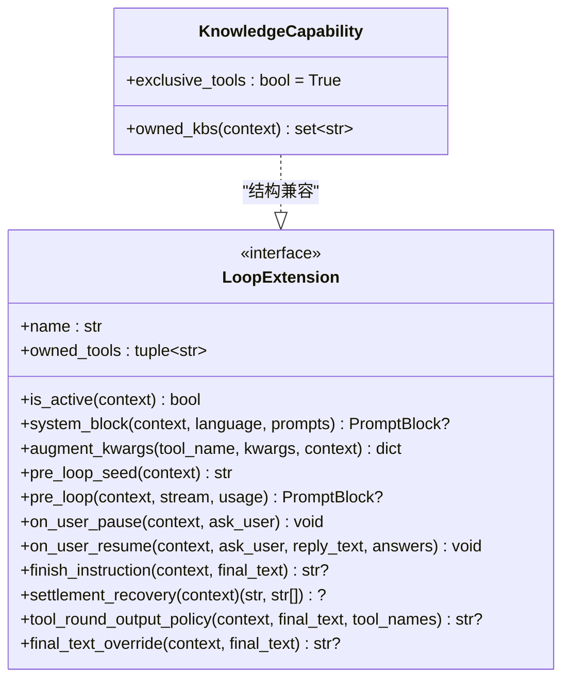
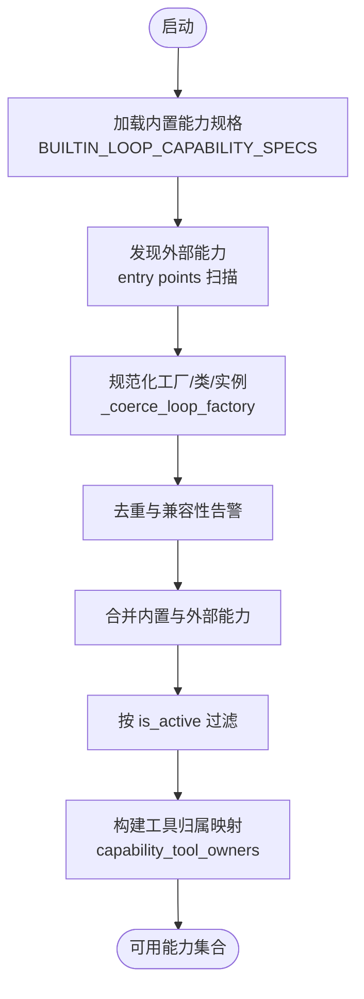
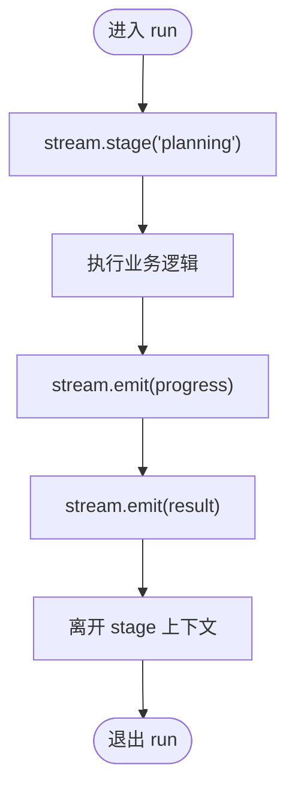
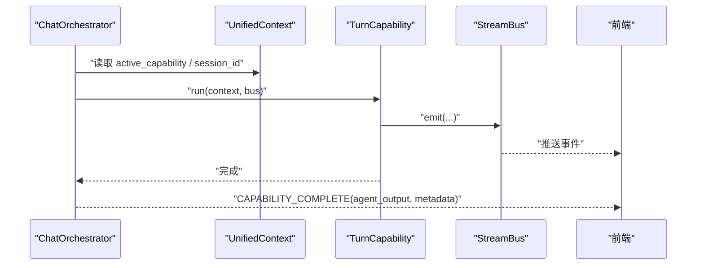
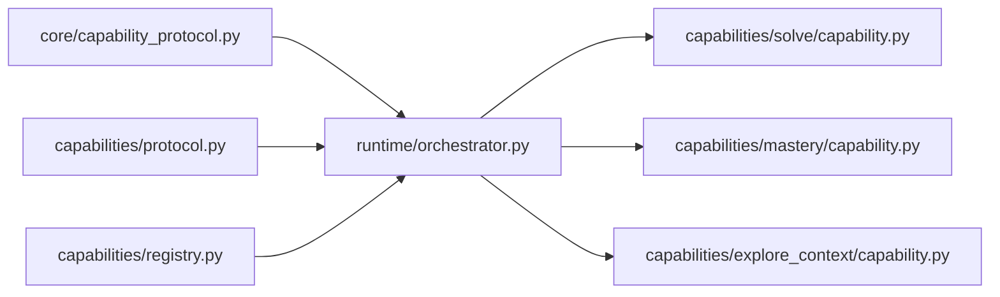

# 能力协议系统

<cite>
**本文引用的文件**   
- [capabilities/protocol.py](file://deeptutor/capabilities/protocol.py)
- [capabilities/registry.py](file://deeptutor/capabilities/registry.py)
- [core/capability_protocol.py](file://deeptutor/core/capability_protocol.py)
- [core/stream.py](file://deeptutor/core/stream.py)
- [runtime/orchestrator.py](file://deeptutor/runtime/orchestrator.py)
- [capabilities/solve/capability.py](file://deeptutor/capabilities/solve/capability.py)
- [capabilities/mastery/capability.py](file://deeptutor/capabilities/mastery/capability.py)
- [capabilities/explore_context/capability.py](file://deeptutor/capabilities/explore_context/capability.py)
</cite>

## 目录
1. [引言](#引言)
2. [项目结构](#项目结构)
3. [核心组件](#核心组件)
4. [架构总览](#架构总览)
5. [详细组件分析](#详细组件分析)
6. [依赖关系分析](#依赖关系分析)
7. [性能考虑](#性能考虑)
8. [故障排查指南](#故障排查指南)
9. [结论](#结论)
10. [附录：自定义深度模式能力实现示例](#附录自定义深度模式能力实现示例)

## 引言
本文件系统化梳理 DeepTutor 的“能力协议系统”，聚焦以下目标：
- 解释 TurnCapability 抽象基类的设计模式，包括 CapabilityManifest 元数据、阶段 stages 管理与流式事件处理。
- 说明 LoopExtension/KnowledgeCapability 在聊天循环中的扩展点与工具集控制策略。
- 阐述能力注册表的工作原理：动态加载、版本兼容、路由分发与生命周期管理。
- 记录 StreamBusProtocol 接口规范，以及事件发射与阶段管理的实现要点。
- 总结能力生命周期、依赖注入模式与错误处理策略。
- 提供具体能力实现示例，指导如何创建自定义深度模式功能。

## 项目结构
围绕能力协议系统的核心代码分布在以下模块：
- deeptutor/core/capability_protocol.py：TurnCapability 抽象基类、CapabilityManifest 元数据、StreamBusProtocol 最小输出端口。
- deeptutor/capabilities/protocol.py：LoopExtension 协议与 KnowledgeCapability 基类，定义聊天循环扩展点与工具集独占策略。
- deeptutor/capabilities/registry.py：内置与外部能力发现、工厂缓存、激活过滤、工具归属映射。
- deeptutor/core/stream.py：StreamEvent 与流式事件类型（由 StreamBusProtocol.emit 使用）。
- deeptutor/runtime/orchestrator.py：编排器将上下文路由到能力，并管理 StreamBus 生命周期与完成事件发布。
- deeptutor/capabilities/{solve|mastery|explore_context}/capability.py：典型能力实现样例，展示 TurnCapability 与 LoopExtension 的使用方式。

**图表来源**
- [core/capability_protocol.py:1-103](file://deeptutor/core/capability_protocol.py#L1-L103)
- [capabilities/protocol.py:1-188](file://deeptutor/capabilities/protocol.py#L1-L188)
- [capabilities/registry.py:1-223](file://deeptutor/capabilities/registry.py#L1-L223)
- [runtime/orchestrator.py:40-81](file://deeptutor/runtime/orchestrator.py#L40-L81)
- [core/stream.py](file://deeptutor/core/stream.py)

**章节来源**
- [core/capability_protocol.py:1-103](file://deeptutor/core/capability_protocol.py#L1-L103)
- [capabilities/protocol.py:1-188](file://deeptutor/capabilities/protocol.py#L1-L188)
- [capabilities/registry.py:1-223](file://deeptutor/capabilities/registry.py#L1-L223)
- [runtime/orchestrator.py:40-81](file://deeptutor/runtime/orchestrator.py#L40-L81)

## 核心组件
- TurnCapability 抽象基类
  - 通过 manifest 声明能力的静态元数据（名称、描述、stages、tools_used、cli_aliases、request_schema、config_defaults）。
  - run(context, stream) 为能力主流程入口，负责向 stream 发射流式事件并使用 stage 管理阶段。
  - 暴露 name 与 stages 属性，便于上层 UI 与诊断显示。
- CapabilityManifest 元数据
  - 结构化描述能力的可观测面：阶段列表、使用的工具名、CLI 别名、请求校验 schema、配置默认值等。
- StreamBusProtocol 接口
  - emit(event)：发射统一事件对象。
  - stage(name, source="")：以异步上下文管理器形式管理阶段，确保阶段开始/结束语义清晰。
- LoopExtension 协议
  - 面向聊天循环的扩展点，声明 owned_tools、is_active、system_block、augment_kwargs、pre_loop_seed 等可选钩子。
  - pre_loop 钩子可在首轮 LLM 调用前执行一次预检查或上下文准备。
  - 支持 on_user_pause/on_user_resume、rebinding_tools、finish_instruction、settlement_recovery 等高级钩子。
- KnowledgeCapability 基类
  - 当能力子类化该基类时，表示该能力“拥有”本轮的工具集（exclusive_tools=True），替换而非叠加聊天内置工具。
  - 可通过 owned_kbs 声明能力专属的知识库引用，避免被通用 rag 表面覆盖。

**章节来源**
- [core/capability_protocol.py:21-103](file://deeptutor/core/capability_protocol.py#L21-L103)
- [capabilities/protocol.py:30-164](file://deeptutor/capabilities/protocol.py#L30-L164)

## 架构总览
能力协议系统由“协议定义 + 注册发现 + 运行时编排 + 能力实现”四层构成：
- 协议层：TurnCapability、CapabilityManifest、StreamBusProtocol、LoopExtension、KnowledgeCapability。
- 注册层：BUILTIN_LOOP_CAPABILITY_SPECS、外部插件发现、工厂缓存、激活过滤、工具归属映射。
- 编排层：ChatOrchestrator 根据上下文选择能力，管理 StreamBus 生命周期，并发布完成事件。
- 实现层：DeepSolveCapability、MasteryPathCapability、ExploreContextCapability 等具体能力。

**图表来源**
- [runtime/orchestrator.py:40-81](file://deeptutor/runtime/orchestrator.py#L40-L81)
- [capabilities/registry.py:159-208](file://deeptutor/capabilities/registry.py#L159-L208)
- [core/capability_protocol.py:46-82](file://deeptutor/core/capability_protocol.py#L46-L82)

## 详细组件分析

### TurnCapability 与 CapabilityManifest
- 设计要点
  - 将“能力是什么”（manifest）与“能力怎么做”（run）解耦。
  - stages 作为能力内部阶段的契约，配合 StreamBusProtocol.stage 形成可观测的阶段边界。
  - tools_used 用于声明能力调用的工具集合，便于权限与审计。
- 复杂度与可扩展性
  - manifest 为只读静态描述，新增字段不影响运行期行为。
  - run 方法内可自由组合多个 stage，每个 stage 可独立发射 progress/result/error。
- 错误处理
  - 建议在 run 中捕获异常并通过 stream.error 上报，同时保持阶段状态一致。

**图表来源**
- [core/capability_protocol.py:33-82](file://deeptutor/core/capability_protocol.py#L33-L82)

**章节来源**
- [core/capability_protocol.py:33-82](file://deeptutor/core/capability_protocol.py#L33-L82)

### LoopExtension 与 KnowledgeCapability
- LoopExtension
  - 面向聊天循环的扩展点，允许能力在活跃时挂载自有工具 owned_tools，并在 is_active 控制下参与当前轮次。
  - system_block 贡献系统提示片段；pre_loop_seed 追加用户消息种子；augment_kwargs 注入私有参数。
  - 可选 pre_loop 钩子在首轮 LLM 调用前执行一次预检查，适合做受控的“前置探索”。
  - 高级钩子支持用户交互暂停/恢复、工具重绑定、收尾指令与结算恢复等复杂场景。
- KnowledgeCapability
  - 子类化后 exclusive_tools=True，表示该能力“拥有”本轮工具集，替换聊天内置工具集。
  - owned_kbs 声明能力专属知识库引用，避免与通用 rag 表面冲突。

**图表来源**
- [capabilities/protocol.py:38-164](file://deeptutor/capabilities/protocol.py#L38-L164)

**章节来源**
- [capabilities/protocol.py:38-164](file://deeptutor/capabilities/protocol.py#L38-L164)

### 能力注册表与动态加载
- 内置能力规格
  - BUILTIN_LOOP_CAPABILITY_SPECS 从 manifests 聚合 loops 条目，生成 LoopCapabilitySpec。
  - spec.create() 通过 class_path 动态导入并实例化，校验 name 一致性。
- 外部能力发现
  - _discover_external_loop_capabilities 扫描 entry points 组，兼容新旧命名空间，去重并警告阴影覆盖。
  - 支持插件授权回调 _plugin_allowed，便于运行时撤销。
- 激活与路由
  - all_loop_capabilities(context) 合并内置与外部能力，按 context.runtime.loop_extensions 复用实例，并向 catalog 注册。
  - active_loop_capabilities(context) 基于 is_active 过滤。
  - any_exclusive_capability_active(context) 判断是否存在独占工具集的能力。
  - capability_tool_owners() 建立工具名到能力名的归属映射。

**图表来源**
- [capabilities/registry.py:28-59](file://deeptutor/capabilities/registry.py#L28-L59)
- [capabilities/registry.py:86-144](file://deeptutor/capabilities/registry.py#L86-L144)
- [capabilities/registry.py:159-208](file://deeptutor/capabilities/registry.py#L159-L208)

**章节来源**
- [capabilities/registry.py:28-59](file://deeptutor/capabilities/registry.py#L28-L59)
- [capabilities/registry.py:86-144](file://deeptutor/capabilities/registry.py#L86-L144)
- [capabilities/registry.py:159-208](file://deeptutor/capabilities/registry.py#L159-L208)

### StreamBusProtocol 与流式事件
- 接口约定
  - emit(StreamEvent)：统一事件发射口，所有能力通过它向前端或下游消费者推送进度、思考、结果、错误等。
  - stage(name, source="")：异步上下文管理器，用于标记一个逻辑阶段，保证阶段开始/结束的语义与资源清理。
- 实现建议
  - 在 run 中用 with stream.stage(...) 包裹关键步骤，确保阶段可观测。
  - 对长耗时任务分片发射 progress，避免阻塞。
  - 异常路径通过 stream.error 上报，并尽量保留上下文信息。

**图表来源**
- [core/capability_protocol.py:25-31](file://deeptutor/core/capability_protocol.py#L25-L31)

**章节来源**
- [core/capability_protocol.py:25-31](file://deeptutor/core/capability_protocol.py#L25-L31)

### 能力生命周期与编排
- ChatOrchestrator.handle
  - 若存在 knowledge_bases，按需加载知识模块并校验页面索引选择。
  - 根据 context.active_capability 选择能力，否则回退到默认 chat 能力。
  - 管理 StreamBus 生命周期，并在完成时发布 CAPABILITY_COMPLETE 事件，携带 agent_output 与 event_metadata。
- 完成事件元数据
  - AGENT_OUTPUT 与 EVENT_METADATA 为兼容键，新实现应优先使用 typed interaction/capability_output。

**图表来源**
- [runtime/orchestrator.py:40-81](file://deeptutor/runtime/orchestrator.py#L40-L81)
- [capabilities/protocol.py:10-28](file://deeptutor/capabilities/protocol.py#L10-L28)

**章节来源**
- [runtime/orchestrator.py:40-81](file://deeptutor/runtime/orchestrator.py#L40-L81)
- [capabilities/protocol.py:10-28](file://deeptutor/capabilities/protocol.py#L10-L28)

### 典型能力实现示例

#### DeepSolveCapability（深度求解）
- 职责
  - 设置 solve_mode 与 solve_session_id，读取 solve 参数并注入上下文。
  - 构造 AgenticChatPipeline 并驱动标准聊天循环，将 solve 工具与策略注入 loop。
- 关键点
  - 通过 context.metadata 传递会话级预算与开关，供 loop 与工具协作。
  - 使用 StreamBus 透传流式事件。

**章节来源**
- [capabilities/solve/capability.py:62-84](file://deeptutor/capabilities/solve/capability.py#L62-L84)

#### MasteryPathCapability（掌握路径）
- 职责
  - 解析 mastery_path_id，维护 path lease，驱动 MasteryLoopPipeline。
  - CLI/SDK 直接调用时自行获取/释放 lease，Web 场景交由 TurnRuntimeManager 管理。
- 关键点
  - 通过 LearningStore 进行路径绑定与租约管理，确保并发安全。
  - 在 finally 中释放 turn 相关租约，防止泄漏。

**章节来源**
- [capabilities/mastery/capability.py:56-100](file://deeptutor/capabilities/mastery/capability.py#L56-L100)

#### ExploreContextCapability（上下文探索）
- 职责
  - 当存在可读附件源时，在首轮 LLM 调用前执行一次“客观调查”，并将调查结果折叠进用户消息种子。
  - 不挂载 answer-loop 工具，read_source 仅在 pre_loop 内部工具循环中使用。
- 关键点
  - 通过 LoopExtension.pre_loop 钩子实现“前置探索”，避免模型混淆第一人称与第三人称视角。
  - 语言相关提示词本地缓存，减少 I/O 开销。

**章节来源**
- [capabilities/explore_context/capability.py:82-141](file://deeptutor/capabilities/explore_context/capability.py#L82-L141)

## 依赖关系分析
- 耦合关系
  - TurnCapability 依赖 StreamBusProtocol 与 UnifiedContext，保持低耦合。
  - LoopExtension 与 KnowledgeCapability 仅定义协议与默认行为，具体能力按需实现。
  - registry 依赖 modules.catalog.manifests 与 plugins.entry_points 进行动态发现。
  - orchestrator 依赖 registry 与 services.rag.pipelines.pageindex（按需加载）。
- 潜在循环依赖
  - explore_context 在 pre_loop 中延迟导入 explorer，以避免循环依赖。
- 外部依赖
  - 通过 entry points 组 deeptutor.extensions 与 deeptutor.loop_capabilities 发现外部能力。

**图表来源**
- [core/capability_protocol.py:1-103](file://deeptutor/core/capability_protocol.py#L1-L103)
- [capabilities/protocol.py:1-188](file://deeptutor/capabilities/protocol.py#L1-L188)
- [capabilities/registry.py:1-223](file://deeptutor/capabilities/registry.py#L1-L223)
- [runtime/orchestrator.py:40-81](file://deeptutor/runtime/orchestrator.py#L40-L81)

**章节来源**
- [capabilities/explore_context/capability.py:118-141](file://deeptutor/capabilities/explore_context/capability.py#L118-L141)
- [capabilities/registry.py:115-144](file://deeptutor/capabilities/registry.py#L115-L144)

## 性能考虑
- 延迟加载
  - 外部能力与 heavy 模块（如 LLM/RAG）在需要时再导入，降低冷启动成本。
- 实例复用
  - all_loop_capabilities 使用 context.runtime.loop_extensions 缓存能力实例，避免重复构造。
- 事件批量化
  - 能力应在长任务中分批发射 progress，避免一次性大消息造成前端卡顿。
- 阶段边界
  - 合理使用 stage 划分逻辑单元，便于定位瓶颈与统计耗时。

[本节为通用指导，无需列出具体文件来源]

## 故障排查指南
- 能力未激活
  - 检查 is_active 条件是否满足，确认 context 中必要字段（如 source_index、mastery_path_id、solve_mode）是否正确设置。
- 工具归属冲突
  - 若存在 KnowledgeCapability 子类，exclusive_tools=True 会替换内置工具集，需确认 owned_kbs 与 owned_tools 是否符合预期。
- 外部能力被忽略
  - 查看日志中关于无效类/工厂、名称冲突、插件授权的警告信息，必要时清理旧命名空间或调整优先级。
- 流式事件缺失
  - 确认 run 中正确调用 stream.emit 与 stream.stage，并确保 StreamBus 已初始化且未被提前关闭。
- 完成事件无 agent_output
  - 检查 capability_output.agent_output 与 EVENT_METADATA 是否被正确填充，或使用新的 typed interaction/capability_output。

**章节来源**
- [capabilities/registry.py:115-144](file://deeptutor/capabilities/registry.py#L115-L144)
- [capabilities/protocol.py:10-28](file://deeptutor/capabilities/protocol.py#L10-L28)
- [runtime/orchestrator.py:40-81](file://deeptutor/runtime/orchestrator.py#L40-L81)

## 结论
DeepTutor 的能力协议系统通过 TurnCapability 与 LoopExtension/KnowledgeCapability 将“能力定义”和“循环扩展”解耦，借助 StreamBusProtocol 提供一致的流式事件通道，并由 capabilities/registry.py 实现动态发现与激活过滤，最终由 runtime/orchestrator.py 完成路由与生命周期管理。该体系具备良好的可扩展性与可观测性，适合持续演进多模态、多领域的深度模式能力。

[本节为总结性内容，无需列出具体文件来源]

## 附录：自定义深度模式能力实现示例
以下给出创建自定义深度模式的步骤与最佳实践（不展示具体代码内容，仅提供路径参考）：
- 定义能力元数据
  - 在 TurnCapability 子类中声明 manifest，包含 name、description、stages、tools_used、request_schema、config_defaults 等。
  - 参考路径：[capabilities/solve/capability.py:62-64](file://deeptutor/capabilities/solve/capability.py#L62-L64)、[capabilities/mastery/capability.py:56-58](file://deeptutor/capabilities/mastery/capability.py#L56-L58)。
- 实现 run 流程
  - 使用 stream.stage 划分阶段，逐步发射 progress/result/error。
  - 参考路径：[core/capability_protocol.py:46-82](file://deeptutor/core/capability_protocol.py#L46-L82)。
- 接入聊天循环扩展（可选）
  - 如需在聊天循环中挂载工具或注入系统提示，实现 LoopExtension 协议，并在 is_active 中控制激活条件。
  - 参考路径：[capabilities/protocol.py:38-164](file://deeptutor/capabilities/protocol.py#L38-L164)。
- 注册与发现
  - 内置能力通过 manifests 配置；外部能力通过 entry points 注册，注意名称唯一性与授权回调。
  - 参考路径：[capabilities/registry.py:28-59](file://deeptutor/capabilities/registry.py#L28-L59)、[capabilities/registry.py:115-144](file://deeptutor/capabilities/registry.py#L115-L144)。
- 事件与阶段
  - 使用 StreamBusProtocol.emit 与 stage 管理事件与阶段，确保可观测与可调试。
  - 参考路径：[core/capability_protocol.py:25-31](file://deeptutor/core/capability_protocol.py#L25-L31)。

[本节为概念性指导，无需列出具体文件来源]