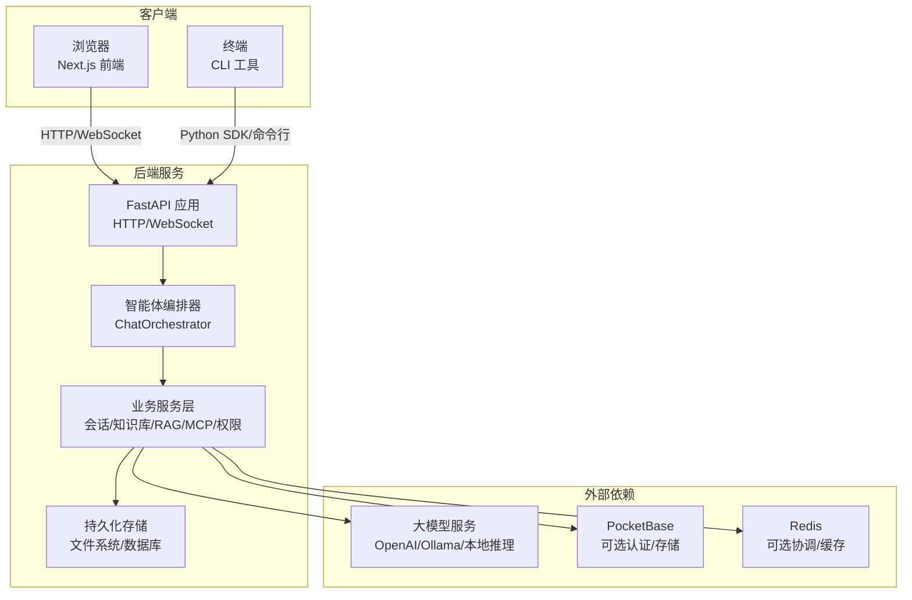
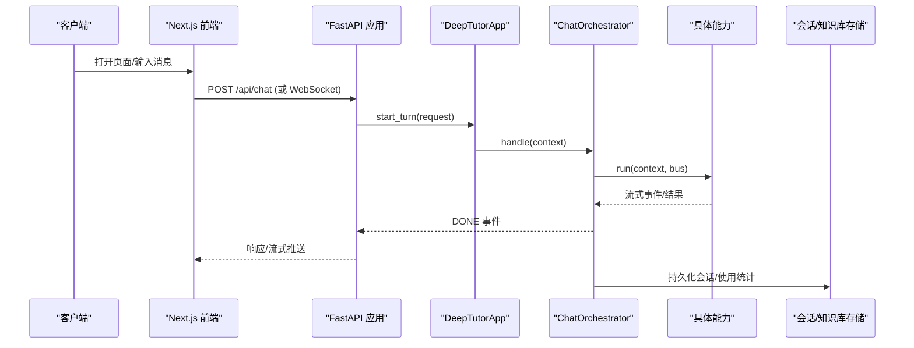
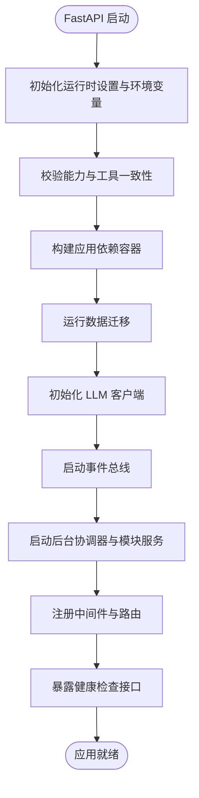
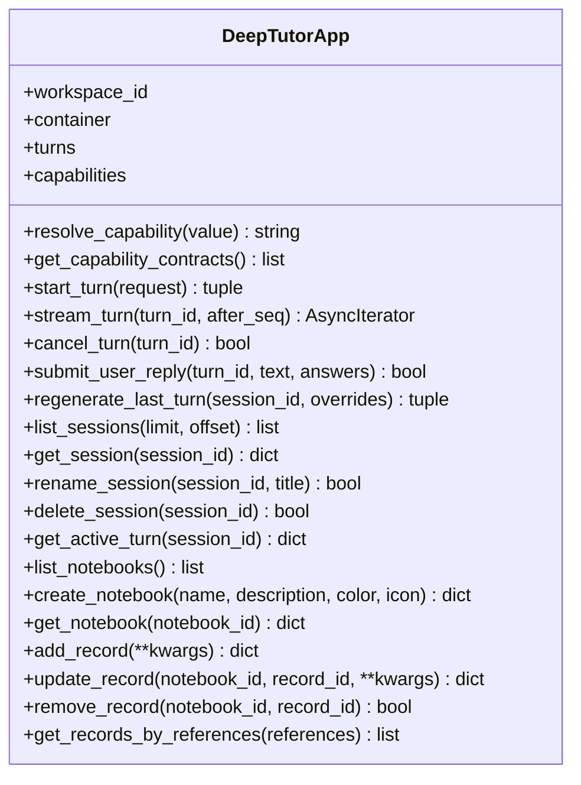
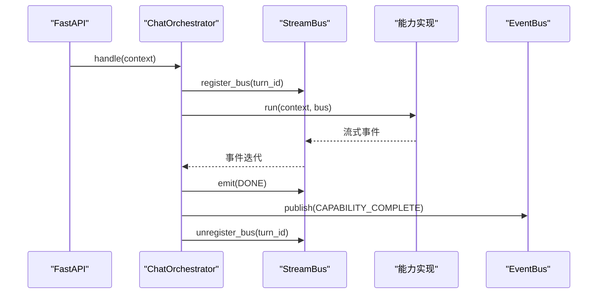
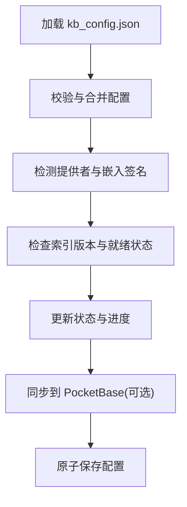
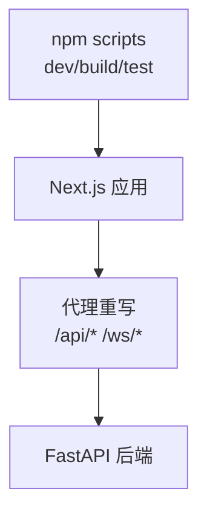
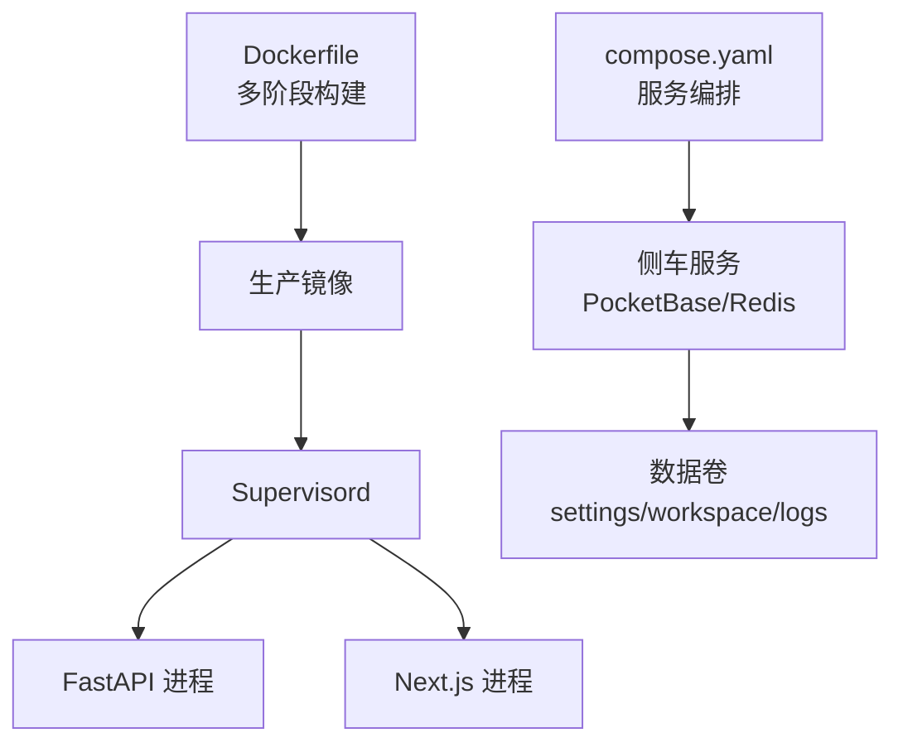
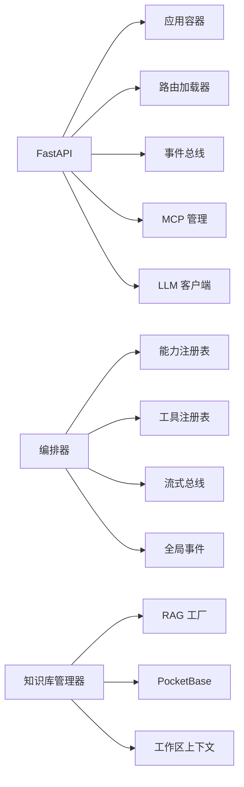

# 系统整体架构

<cite>
**本文引用的文件**   
- [README.md](file://README.md)
- [deeptutor/api/main.py](file://deeptutor/api/main.py)
- [deeptutor/app/facade.py](file://deeptutor/app/facade.py)
- [deeptutor/runtime/orchestrator.py](file://deeptutor/runtime/orchestrator.py)
- [deeptutor/knowledge/manager.py](file://deeptutor/knowledge/manager.py)
- [web/package.json](file://web/package.json)
- [compose.yaml](file://compose.yaml)
- [Dockerfile](file://Dockerfile)
</cite>

## 目录
1. [引言](#引言)
2. [项目结构](#项目结构)
3. [核心组件](#核心组件)
4. [架构总览](#架构总览)
5. [详细组件分析](#详细组件分析)
6. [依赖关系分析](#依赖关系分析)
7. [性能与可扩展性](#性能与可扩展性)
8. [故障排查指南](#故障排查指南)
9. [结论](#结论)

## 引言
本文件面向 DeepTutor 系统的整体架构设计，目标是帮助读者理解：
- 后端 FastAPI 服务、前端 Next.js 应用、CLI 工具之间的交互模式。
- 智能体能力编排、知识库管理、会话管理等核心服务的职责边界。
- 系统启动流程、进程管理与依赖注入机制。
- 容器化部署与云服务集成方案。
- 各组件间的通信协议、接口定义和关键数据流。

DeepTutor 采用“后端 API + 前端 Web + CLI”的三层形态，并通过可插拔的智能体能力、RAG 知识库、会话与事件总线等子系统支撑多场景学习体验。

**章节来源**
- [README.md:1-200](file://README.md#L1-L200)

## 项目结构
仓库主要包含以下层次：
- 后端服务：`deeptutor/`，基于 FastAPI，提供 HTTP/WebSocket API、智能体编排、会话、知识库、RAG、MCP、权限与多用户等能力。
- 前端应用：`web/`，基于 Next.js，提供聊天、知识空间、设置、协作写作、可视化等界面。
- CLI 工具：`deeptutor_cli/`，提供本地命令入口，复用后端应用层门面进行对话、知识库、笔记本等操作。
- 容器化与编排：`Dockerfile`、`compose.yaml`、`docker-compose*.yml` 等，负责构建镜像、启动前后端进程、挂载数据卷与可选侧车（PocketBase、Redis）。

**图表来源**
- [deeptutor/api/main.py:364-548](file://deeptutor/api/main.py#L364-L548)
- [deeptutor/runtime/orchestrator.py:54-278](file://deeptutor/runtime/orchestrator.py#L54-L278)
- [web/package.json:1-98](file://web/package.json#L1-L98)
- [compose.yaml:67-231](file://compose.yaml#L67-L231)

**章节来源**
- [web/package.json:1-98](file://web/package.json#L1-L98)
- [compose.yaml:67-231](file://compose.yaml#L67-L231)
- [Dockerfile:1-624](file://Dockerfile#L1-L624)

## 核心组件
- FastAPI 应用：负责生命周期管理、中间件、路由加载、健康检查、CORS、访问日志与安全守卫。
- 应用门面 `DeepTutorApp`：为 CLI 与内部调用提供统一的工作区上下文、能力解析、会话与笔记本操作。
- 智能体编排器 `ChatOrchestrator`：将用户消息路由到具体能力（如 chat、question、research），通过 StreamBus 输出流式事件，并对外发布完成事件。
- 知识库管理器 `KnowledgeBaseManager`：管理多个 RAG 知识库的生命周期、索引版本、状态同步与元数据。
- 前端 Next.js：提供 Web UI，通过代理重写 `/api/*` 与 `/ws/*` 请求到后端。
- 容器编排：Supervisord 同时管理后端与前端进程；可选 PocketBase 与 Redis 作为侧车。

**章节来源**
- [deeptutor/api/main.py:108-360](file://deeptutor/api/main.py#L108-L360)
- [deeptutor/app/facade.py:57-276](file://deeptutor/app/facade.py#L57-L276)
- [deeptutor/runtime/orchestrator.py:54-278](file://deeptutor/runtime/orchestrator.py#L54-L278)
- [deeptutor/knowledge/manager.py:322-800](file://deeptutor/knowledge/manager.py#L322-L800)

## 架构总览
DeepTutor 的整体架构分为四层：
- 客户端层：浏览器（Next.js）与终端（CLI）。
- 接入层：FastAPI 应用，处理 HTTP/WebSocket 请求、鉴权、CORS、访问日志与健康检查。
- 业务层：智能体编排、会话管理、知识库与 RAG、MCP、权限与多用户、设置与配置。
- 基础设施层：文件系统、数据库（SQLite/PocketBase）、Redis、外部 LLM 服务。

**图表来源**
- [deeptutor/app/facade.py:129-179](file://deeptutor/app/facade.py#L129-L179)
- [deeptutor/runtime/orchestrator.py:64-248](file://deeptutor/runtime/orchestrator.py#L64-L248)
- [deeptutor/api/main.py:520-541](file://deeptutor/api/main.py#L520-L541)

## 详细组件分析

### FastAPI 应用与服务生命周期
FastAPI 应用在启动时执行以下关键步骤：
- 初始化运行时设置与环境变量导出。
- 校验能力清单与工具注册一致性。
- 创建应用级依赖容器并启动。
- 运行数据迁移、LLM 客户端初始化、事件总线启动。
- 启动后台任务协调器与模块服务回调。
- 注册中间件（工作区活动、安全守卫、JSON 错误边界、CORS、访问日志）。
- 动态加载路由与模块路由。
- 暴露根路径与健康检查接口。

**图表来源**
- [deeptutor/api/main.py:108-360](file://deeptutor/api/main.py#L108-L360)
- [deeptutor/api/main.py:364-548](file://deeptutor/api/main.py#L364-L548)

**章节来源**
- [deeptutor/api/main.py:108-360](file://deeptutor/api/main.py#L108-L360)
- [deeptutor/api/main.py:364-548](file://deeptutor/api/main.py#L364-L548)

### 应用门面与 CLI 交互
`DeepTutorApp` 是 CLI 与后端共享的应用门面，负责：
- 解析能力名称与别名。
- 在工作区上下文中发起 turn、流式订阅、取消 turn。
- 提交用户回复、再生成最后一条、列出/获取/重命名/删除会话。
- 懒加载笔记本功能并在受保护方法中校验工作区状态。

**图表来源**
- [deeptutor/app/facade.py:57-276](file://deeptutor/app/facade.py#L57-L276)

**章节来源**
- [deeptutor/app/facade.py:57-276](file://deeptutor/app/facade.py#L57-L276)

### 智能体编排与会话流
`ChatOrchestrator` 是统一的智能体入口，负责：
- 根据上下文选择能力（默认 chat，或通过 active_capability 指定）。
- 当存在 answer_by 时切换到 handoff 能力。
- 通过 StreamBus 输出流式事件，包括 SESSION、DONE 与错误事件。
- 在完成后发布 CAPABILITY_COMPLETE 事件到全局 EventBus。
- 管理 TurnUsage 统计与异常处理。

**图表来源**
- [deeptutor/runtime/orchestrator.py:64-278](file://deeptutor/runtime/orchestrator.py#L64-L278)

**章节来源**
- [deeptutor/runtime/orchestrator.py:64-278](file://deeptutor/runtime/orchestrator.py#L64-L278)

### 知识库管理与 RAG 集成
`KnowledgeBaseManager` 负责：
- 维护 kb_config.json，支持原子写入与共享锁。
- 自动发现与注册知识库，清理孤儿条目。
- 检测与对齐嵌入签名、索引版本与提供者。
- 更新知识库状态与进度，并与 PocketBase 同步元数据。
- 提供列表、状态查询与条目读取接口。

**图表来源**
- [deeptutor/knowledge/manager.py:322-800](file://deeptutor/knowledge/manager.py#L322-L800)

**章节来源**
- [deeptutor/knowledge/manager.py:322-800](file://deeptutor/knowledge/manager.py#L322-L800)

### 前端 Next.js 应用
前端基于 Next.js，提供：
- 开发脚本与构建流程。
- 单元测试、E2E 测试与类型检查。
- 通过代理重写 `/api/*` 与 `/ws/*` 到后端。
- 国际化、主题、UI 组件与业务页面。

**图表来源**
- [web/package.json:1-98](file://web/package.json#L1-L98)

**章节来源**
- [web/package.json:1-98](file://web/package.json#L1-L98)

### 容器化与进程管理
Dockerfile 与 compose.yaml 定义了：
- 多阶段构建：前端静态资源构建、Node 运行时、Python 依赖、生产镜像。
- Supervisord 管理后端与前端进程，分别以非 root 用户运行。
- 环境变量从运行时 JSON 设置导出，避免构建期硬编码。
- 可选侧车：PocketBase（认证/存储）、Redis（协调/缓存）。
- 只读根文件系统与 tmpfs 可写表面，提升安全性。

**图表来源**
- [Dockerfile:1-624](file://Dockerfile#L1-L624)
- [compose.yaml:67-231](file://compose.yaml#L67-L231)

**章节来源**
- [Dockerfile:1-624](file://Dockerfile#L1-L624)
- [compose.yaml:67-231](file://compose.yaml#L67-L231)

## 依赖关系分析
- FastAPI 应用依赖：
  - 运行时设置与路径服务。
  - 能力与工具注册表。
  - 事件总线与后台协调器。
  - MCP 管理与 LLM 客户端池。
- 编排器依赖：
  - 能力注册表与工具注册表。
  - Prompt 管理与流式总线。
  - 全局事件总线用于完成事件发布。
- 知识库管理器依赖：
  - RAG 工厂与索引探测。
  - PocketBase 客户端（可选）。
  - 工作区与多用户上下文。

**图表来源**
- [deeptutor/api/main.py:108-360](file://deeptutor/api/main.py#L108-L360)
- [deeptutor/runtime/orchestrator.py:64-278](file://deeptutor/runtime/orchestrator.py#L64-L278)
- [deeptutor/knowledge/manager.py:322-800](file://deeptutor/knowledge/manager.py#L322-L800)

**章节来源**
- [deeptutor/api/main.py:108-360](file://deeptutor/api/main.py#L108-L360)
- [deeptutor/runtime/orchestrator.py:64-278](file://deeptutor/runtime/orchestrator.py#L64-L278)
- [deeptutor/knowledge/manager.py:322-800](file://deeptutor/knowledge/manager.py#L322-L800)

## 性能与可扩展性
- 流式处理：编排器通过 StreamBus 输出流式事件，减少首屏延迟，提升用户体验。
- 异步任务：能力执行在独立 asyncio 任务中运行，避免消费者早退导致资源泄漏。
- 连接池：LLM 客户端与 Agentic 客户端池在关闭时显式释放，避免连接泄漏。
- 只读根文件系统：容器内仅允许必要的 tmpfs 写入，降低安全风险与 I/O 竞争。
- 横向扩展：FastAPI 可通过 uvicorn workers 参数扩展；Redis 可用于多 worker 协调。

[本节为通用指导，不直接分析具体文件]

## 故障排查指南
- 健康检查失败：
  - 检查 `/health/live` 与 `/health/ready` 返回状态。
  - 确认应用容器已启动且协调器可用。
- CORS 跨域问题：
  - 检查系统设置中的 CORS 源与认证开关。
  - 确认前端端口与后端端口配置一致。
- 能力工具不一致：
  - 启动时会校验能力清单与工具注册一致性，若缺失会抛出配置漂移错误。
- 知识库状态异常：
  - 检查 kb_config.json 是否损坏或权限不足。
  - 查看嵌入签名与索引版本是否匹配。
- 容器权限问题：
  - 确认 PUID/PGID 与宿主目录所有者一致。
  - 检查只读根文件系统与 tmpfs 挂载是否正确。

**章节来源**
- [deeptutor/api/main.py:47-74](file://deeptutor/api/main.py#L47-L74)
- [deeptutor/api/main.py:520-541](file://deeptutor/api/main.py#L520-L541)
- [deeptutor/knowledge/manager.py:378-457](file://deeptutor/knowledge/manager.py#L378-L457)
- [Dockerfile:337-521](file://Dockerfile#L337-L521)

## 结论
DeepTutor 通过 FastAPI 后端、Next.js 前端与 CLI 工具形成完整的学习助手生态。系统以智能体编排为核心，结合知识库与 RAG 能力，提供流式交互与可扩展的业务模块。容器化与编排方案确保部署的安全性与可维护性，同时支持可选的 PocketBase 与 Redis 侧车以满足多用户与高并发场景。

[本节为总结性内容，不直接分析具体文件]