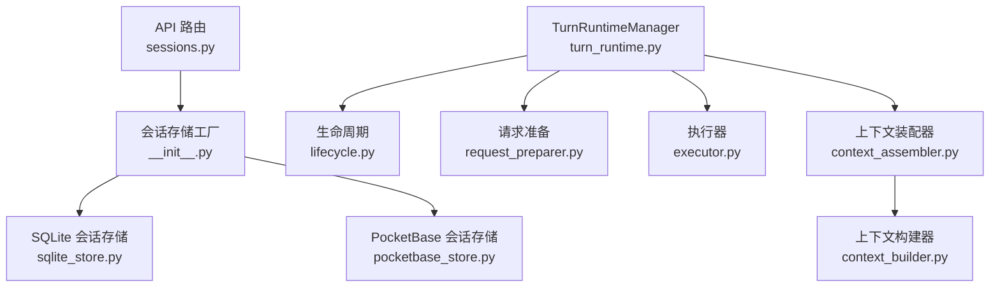
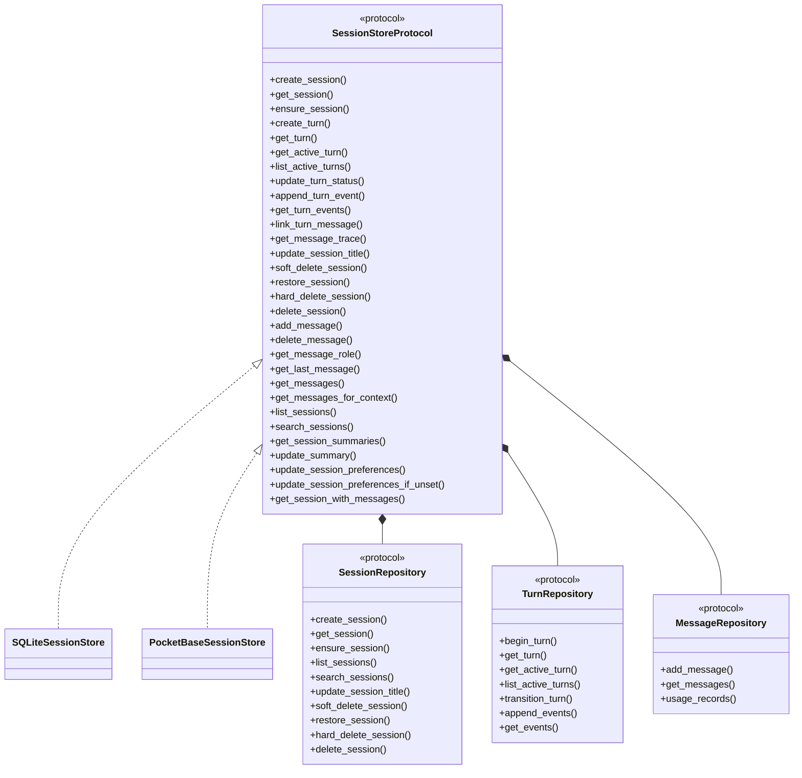
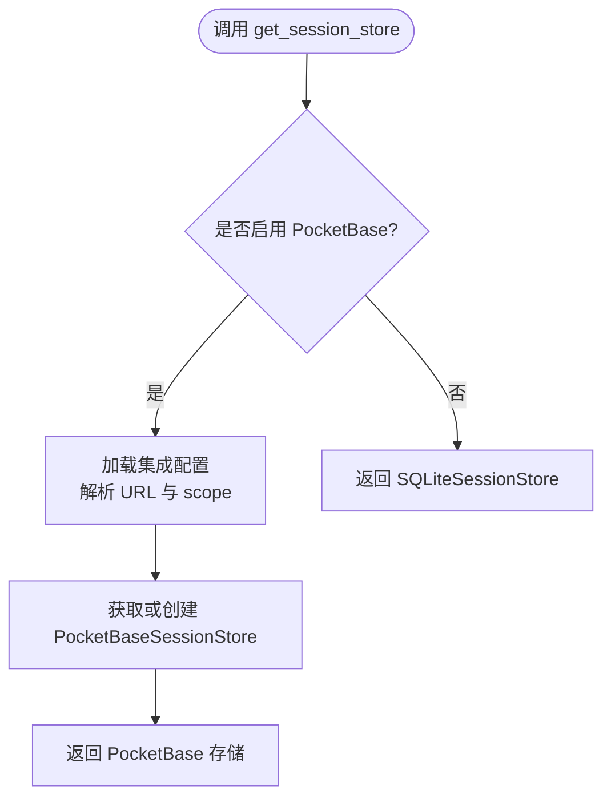
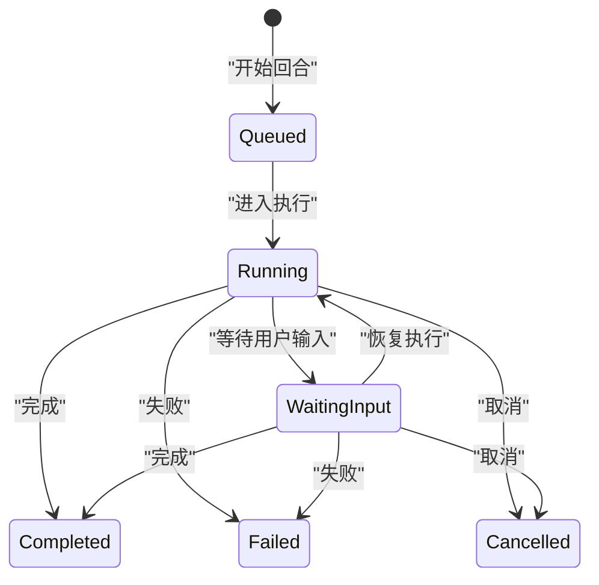
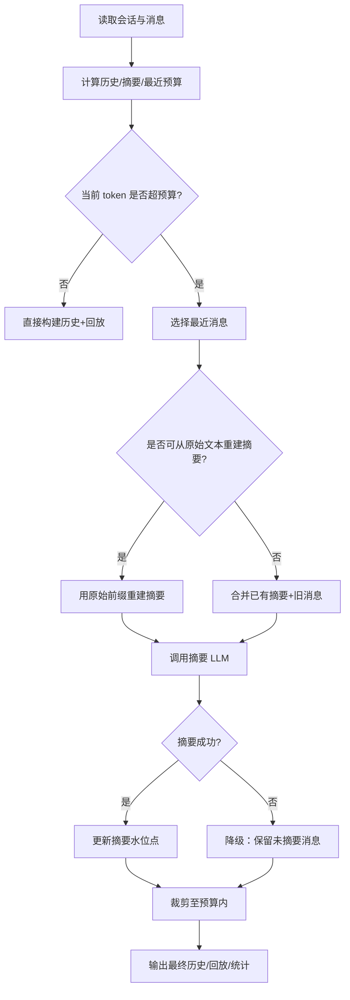
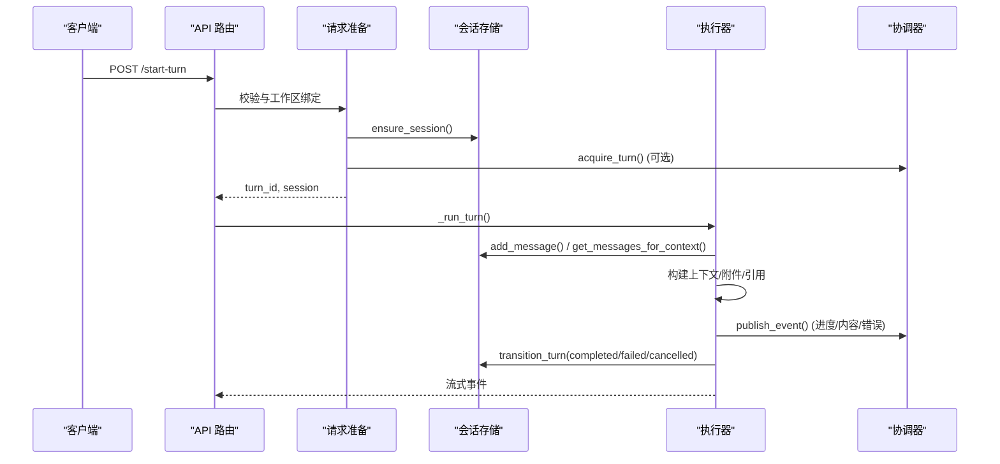
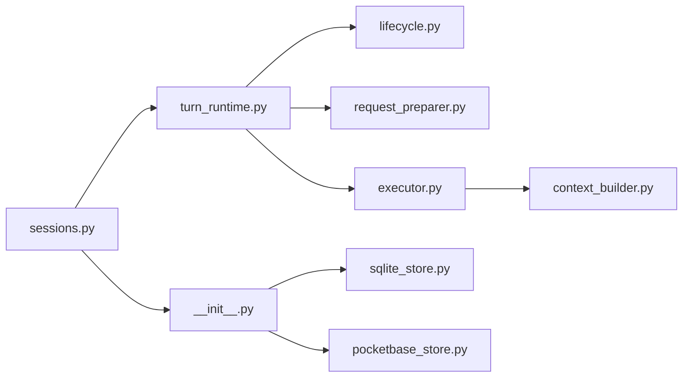
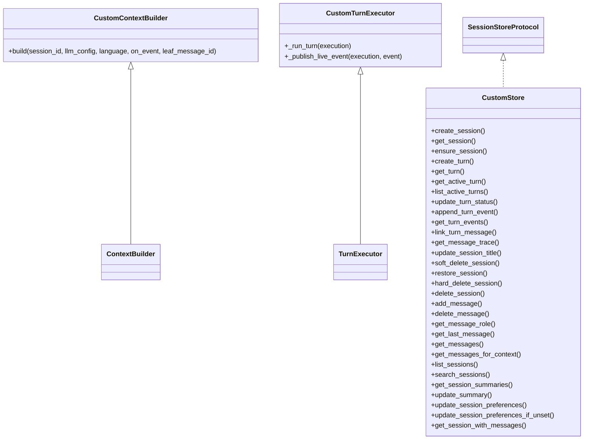

# 会话核心架构

<cite>
**本文引用的文件**   
- [deeptutor/services/session/__init__.py](file://deeptutor/services/session/__init__.py)
- [deeptutor/services/session/protocol.py](file://deeptutor/services/session/protocol.py)
- [deeptutor/services/session/sqlite_store.py](file://deeptutor/services/session/sqlite_store.py)
- [deeptutor/services/session/pocketbase_store.py](file://deeptutor/services/session/pocketbase_store.py)
- [deeptutor/services/session/context_builder.py](file://deeptutor/services/session/context_builder.py)
- [deeptutor/services/session/turn_runtime.py](file://deeptutor/services/session/turn_runtime.py)
- [deeptutor/services/session/turns/lifecycle.py](file://deeptutor/services/session/turns/lifecycle.py)
- [deeptutor/services/session/turns/request_preparer.py](file://deeptutor/services/session/turns/request_preparer.py)
- [deeptutor/services/session/turns/context_assembler.py](file://deeptutor/services/session/turns/context_assembler.py)
- [deeptutor/services/session/turns/executor.py](file://deeptutor/services/session/turns/executor.py)
- [deeptutor/api/routers/sessions.py](file://deeptutor/api/routers/sessions.py)
</cite>

## 目录
1. [简介](#简介)
2. [项目结构](#项目结构)
3. [核心组件](#核心组件)
4. [架构总览](#架构总览)
5. [详细组件分析](#详细组件分析)
6. [依赖关系分析](#依赖关系分析)
7. [性能与并发设计](#性能与并发设计)
8. [故障排查指南](#故障排查指南)
9. [结论](#结论)
10. [附录：扩展会话管理器接口示例](#附录扩展会话管理器接口示例)

## 简介
本文件系统性梳理 DeepTutor 的“统一会话管理”核心架构，重点覆盖以下目标：
- 统一会话管理器设计模式：接口抽象、后端可插拔（SQLite/PocketBase）、生命周期管理与状态转换。
- 会话协议定义：消息格式、事件类型、错误处理与幂等提交。
- 上下文构建器：历史消息管理、上下文窗口控制、摘要压缩与内存优化策略。
- 并发安全、事务化边界与性能监控机制。
- 面向扩展的实践：如何替换或增强会话存储与执行管线。

## 项目结构
会话子系统位于 `deeptutor/services/session`，围绕“协议 + 实现 + 运行时”三层组织：
- 协议层：`protocol.py` 定义统一的仓库与存储接口。
- 存储实现：`sqlite_store.py`、`pocketbase_store.py` 提供两种持久化后端。
- 运行时：`turn_runtime.py` 组合请求准备、上下文装配、执行、生命周期等切片。
- 上下文构建：`context_builder.py` 负责对话历史预算、摘要与模型回放。
- API 接入：`api/routers/sessions.py` 暴露会话列表、详情、搜索、删除、分支选择等能力。

**图示来源**
- [deeptutor/api/routers/sessions.py:251-296](file://deeptutor/api/routers/sessions.py#L251-L296)
- [deeptutor/services/session/__init__.py:15-38](file://deeptutor/services/session/__init__.py#L15-L38)
- [deeptutor/services/session/turn_runtime.py:26-52](file://deeptutor/services/session/turn_runtime.py#L26-L52)
- [deeptutor/services/session/turns/context_assembler.py:11-24](file://deeptutor/services/session/turns/context_assembler.py#L11-L24)

**章节来源**
- [deeptutor/services/session/__init__.py:1-51](file://deeptutor/services/session/__init__.py#L1-L51)
- [deeptutor/api/routers/sessions.py:251-296](file://deeptutor/api/routers/sessions.py#L251-L296)

## 核心组件
- 统一存储协议：`SessionStoreProtocol` 聚合会话、回合、消息三类仓库能力，屏蔽底层差异。
- 会话存储工厂：根据配置返回 SQLite 或 PocketBase 实现，并缓存实例。
- 回合运行时：组合请求准备、上下文装配、学习适配、执行、生命周期、标题服务等职责切片。
- 上下文构建器：按 LLM 上下文窗口计算预算，维护滚动摘要，裁剪历史，输出模型回放视图。
- API 路由：会话 CRUD、搜索、回收站、分支选择、消息事件追踪等。

**章节来源**
- [deeptutor/services/session/protocol.py:38-284](file://deeptutor/services/session/protocol.py#L38-L284)
- [deeptutor/services/session/__init__.py:15-38](file://deeptutor/services/session/__init__.py#L15-L38)
- [deeptutor/services/session/turn_runtime.py:26-52](file://deeptutor/services/session/turn_runtime.py#L26-L52)
- [deeptutor/services/session/context_builder.py:267-315](file://deeptutor/services/session/context_builder.py#L267-L315)
- [deeptutor/api/routers/sessions.py:251-296](file://deeptutor/api/routers/sessions.py#L251-L296)

## 架构总览
统一会话管理的核心思想是“协议驱动 + 多后端 + 运行时切片”。

**图示来源**
- [deeptutor/services/session/protocol.py:38-284](file://deeptutor/services/session/protocol.py#L38-L284)
- [deeptutor/services/session/sqlite_store.py:245-256](file://deeptutor/services/session/sqlite_store.py#L245-L256)
- [deeptutor/services/session/pocketbase_store.py:171-188](file://deeptutor/services/session/pocketbase_store.py#L171-L188)

## 详细组件分析

### 统一会话存储协议与会话工厂
- 协议抽象：将会话、回合、消息三类操作收敛到单一协议，便于在 SQLite 与 PocketBase 之间切换。
- 工厂选择：当启用 PocketBase 集成时，返回远程存储；否则回退到本地 SQLite。
- 实例缓存：按 scope 缓存存储实例，避免重复创建。

**图示来源**
- [deeptutor/services/session/__init__.py:15-38](file://deeptutor/services/session/__init__.py#L15-L38)

**章节来源**
- [deeptutor/services/session/protocol.py:38-284](file://deeptutor/services/session/protocol.py#L38-L284)
- [deeptutor/services/session/__init__.py:15-38](file://deeptutor/services/session/__init__.py#L15-L38)

### 会话生命周期与状态转换
- 活跃回合约束：同一会话在同一时刻只能有一个活跃回合；冲突通过 `ActiveTurnConflict` 表达。
- 状态机：回合从 `queued` → `running` → `waiting_input`（可选）→ `completed/failed/cancelled`。
- 防抖与租约：使用 fencing token 与协调器租约保证跨进程安全；丢失租约会取消执行。
- 订阅与收尾：`subscribe_turn` 支持断线重连、合成 DONE/ERROR 事件，确保前端流式状态一致。

**图示来源**
- [deeptutor/services/session/protocol.py:20-36](file://deeptutor/services/session/protocol.py#L20-L36)
- [deeptutor/services/session/turns/lifecycle.py:196-229](file://deeptutor/services/session/turns/lifecycle.py#L196-L229)
- [deeptutor/services/session/turns/lifecycle.py:380-543](file://deeptutor/services/session/turns/lifecycle.py#L380-L543)

**章节来源**
- [deeptutor/services/session/protocol.py:20-36](file://deeptutor/services/session/protocol.py#L20-L36)
- [deeptutor/services/session/turns/lifecycle.py:34-110](file://deeptutor/services/session/turns/lifecycle.py#L34-L110)
- [deeptutor/services/session/turns/lifecycle.py:196-229](file://deeptutor/services/session/turns/lifecycle.py#L196-L229)
- [deeptutor/services/session/turns/lifecycle.py:380-543](file://deeptutor/services/session/turns/lifecycle.py#L380-L543)

### 上下文构建器：历史管理、窗口控制与内存优化
- 预算规划：基于 LLM 有效上下文窗口计算历史预算、摘要预算与最近消息预算。
- 历史分组与回放：对含模型回合的消息进行分组回放，去重图片，估算投影 token。
- 摘要策略：当超出预算时，对旧消息做摘要；优先从原始文本重建以避免“摘要之摘要”漂移。
- 语言与提示：摘要指令按语言生成，中文会话自动切换提示语。
- 结果对象：返回对话历史、摘要、纯文本上下文、事件、token 计数、模型回放视图等。

**图示来源**
- [deeptutor/services/session/context_builder.py:267-315](file://deeptutor/services/session/context_builder.py#L267-L315)
- [deeptutor/services/session/context_builder.py:351-413](file://deeptutor/services/session/context_builder.py#L351-L413)
- [deeptutor/services/session/context_builder.py:415-585](file://deeptutor/services/session/context_builder.py#L415-L585)
- [deeptutor/services/session/context_builder.py:595-794](file://deeptutor/services/session/context_builder.py#L595-L794)

**章节来源**
- [deeptutor/services/session/context_builder.py:267-315](file://deeptutor/services/session/context_builder.py#L267-L315)
- [deeptutor/services/session/context_builder.py:351-413](file://deeptutor/services/session/context_builder.py#L351-L413)
- [deeptutor/services/session/context_builder.py:415-585](file://deeptutor/services/session/context_builder.py#L415-L585)
- [deeptutor/services/session/context_builder.py:595-794](file://deeptutor/services/session/context_builder.py#L595-L794)

### 回合执行管线：请求准备、上下文装配与执行
- 请求准备：校验工作区、能力路由、LLM 选择、工具白名单、阅读/掌握模式注入、侧聊上下文等。
- 上下文装配：根据模式选择普通或掌握模式的上下文构建器，组装系统提示、附件、引用、知识源清单。
- 执行主体：处理附件上传与解析、PDF 提取、阅读视口图片、历史会话引用、问答库上下文、人格注入、技能清单等。
- 事件发布：将进度、内容、错误、用量摘要等事件推送到协调器与本地订阅者。

**图示来源**
- [deeptutor/services/session/turns/request_preparer.py:179-223](file://deeptutor/services/session/turns/request_preparer.py#L179-L223)
- [deeptutor/services/session/turns/executor.py:141-179](file://deeptutor/services/session/turns/executor.py#L141-L179)
- [deeptutor/services/session/turns/executor.py:568-586](file://deeptutor/services/session/turns/executor.py#L568-L586)
- [deeptutor/services/session/turns/lifecycle.py:681-728](file://deeptutor/services/session/turns/lifecycle.py#L681-L728)

**章节来源**
- [deeptutor/services/session/turns/request_preparer.py:179-223](file://deeptutor/services/session/turns/request_preparer.py#L179-L223)
- [deeptutor/services/session/turns/context_assembler.py:11-24](file://deeptutor/services/session/turns/context_assembler.py#L11-L24)
- [deeptutor/services/session/turns/executor.py:141-179](file://deeptutor/services/session/turns/executor.py#L141-L179)
- [deeptutor/services/session/turns/executor.py:568-586](file://deeptutor/services/session/turns/executor.py#L568-L586)

### 消息格式、事件类型与错误处理
- 消息字段：角色、内容、能力、事件、附件、元数据、父消息 ID（编辑分支）。
- 事件类型：进度、内容、错误、阶段开始/结束、完成等，附带 trace 元数据与 seq 序号。
- 错误处理：
  - 活跃回合冲突：抛出 `ActiveTurnConflict`。
  - 摘要失败：降级为仅裁剪历史，不推进摘要水位。
  - 订阅收尾：若未收到 DONE，根据持久化回合状态合成 DONE/ERROR。
  - 大事件截断：UI 展示路径对 oversized tool_result/observation 进行截断。

**章节来源**
- [deeptutor/services/session/protocol.py:20-36](file://deeptutor/services/session/protocol.py#L20-L36)
- [deeptutor/services/session/context_builder.py:751-774](file://deeptutor/services/session/context_builder.py#L751-L774)
- [deeptutor/services/session/turns/lifecycle.py:545-616](file://deeptutor/services/session/turns/lifecycle.py#L545-L616)
- [deeptutor/api/routers/sessions.py:388-418](file://deeptutor/api/routers/sessions.py#L388-L418)

### 并发安全、事务化边界与性能监控
- 并发安全：
  - SQLite：WAL 模式、迁移锁、唯一索引限制活跃回合、fencing token 原子 CAS。
  - PocketBase：线程锁保护偏好 JSON 读写，按用户/工作区分片。
- 事务化边界：
  - 导入会话：失败时回滚已创建的记录。
  - 删除会话：先取消活跃回合，再级联清理子会话与附件。
- 性能监控：
  - 上下文构建：估算 token、投影 token、图像预算。
  - 运行期用量：TurnUsage 收集器在 DONE 事件中附加 usage_summary。
  - 事件批量刷新：缓冲前缀周期性落盘，减少 IO 抖动。

**章节来源**
- [deeptutor/services/session/sqlite_store.py:274-279](file://deeptutor/services/session/sqlite_store.py#L274-L279)
- [deeptutor/services/session/sqlite_store.py:572-656](file://deeptutor/services/session/sqlite_store.py#L572-L656)
- [deeptutor/services/session/pocketbase_store.py:171-188](file://deeptutor/services/session/pocketbase_store.py#L171-L188)
- [deeptutor/services/session/pocketbase_store.py:392-470](file://deeptutor/services/session/pocketbase_store.py#L392-L470)
- [deeptutor/services/session/turns/lifecycle.py:681-728](file://deeptutor/services/session/turns/lifecycle.py#L681-L728)

## 依赖关系分析
- API 路由依赖会话存储工厂与 Turn 应用服务。
- TurnRuntimeManager 组合多个行为切片，依赖协调器（可选）与存储。
- 上下文构建器依赖 LLM 配置、提示管理与模型回放工具。
- 存储实现依赖路径服务、工作区上下文与权限校验。

**图示来源**
- [deeptutor/api/routers/sessions.py:39-43](file://deeptutor/api/routers/sessions.py#L39-L43)
- [deeptutor/services/session/turn_runtime.py:26-52](file://deeptutor/services/session/turn_runtime.py#L26-L52)
- [deeptutor/services/session/__init__.py:15-38](file://deeptutor/services/session/__init__.py#L15-L38)

**章节来源**
- [deeptutor/api/routers/sessions.py:39-43](file://deeptutor/api/routers/sessions.py#L39-L43)
- [deeptutor/services/session/turn_runtime.py:26-52](file://deeptutor/services/session/turn_runtime.py#L26-L52)
- [deeptutor/services/session/__init__.py:15-38](file://deeptutor/services/session/__init__.py#L15-L38)

## 性能与并发设计
- SQLite 后端：
  - WAL 提升读并发；迁移锁串行化 schema 升级；唯一索引防止多活跃回合。
  - 增量索引与分页查询优化列表与搜索。
- PocketBase 后端：
  - 线程池执行网络调用；偏好 JSON 写加锁；按用户与工作区过滤。
- 事件与用量：
  - 事件缓冲 + 周期 flush；DONE 事件附加用量摘要。
- 上下文构建：
  - 投影 token 估算、图像预算独立、摘要输出上限与生成限制取最小值。

[本节为通用指导，不直接分析具体文件]

## 故障排查指南
- “会话仍有活跃回合”：检查是否存在 running/waiting_input 的回合；必要时调用取消或等待完成。
- 摘要失败：查看日志中的“Context condensation failed”，确认是否降级为仅裁剪历史。
- 订阅未收到 DONE：检查是否发生网络中断或生产者崩溃；系统会合成 DONE/ERROR。
- 大事件被截断：检查 tool_result/observation 是否超过阈值，前端会标记 `_truncated`。

**章节来源**
- [deeptutor/services/session/context_builder.py:751-774](file://deeptutor/services/session/context_builder.py#L751-L774)
- [deeptutor/services/session/turns/lifecycle.py:545-616](file://deeptutor/services/session/turns/lifecycle.py#L545-L616)
- [deeptutor/api/routers/sessions.py:388-418](file://deeptutor/api/routers/sessions.py#L388-L418)

## 结论
DeepTutor 的统一会话管理以协议为核心，结合 SQLite/PocketBase 双后端与模块化回合运行时，实现了高内聚、低耦合的可扩展架构。上下文构建器在保证模型输入质量的同时，通过预算规划与摘要策略有效控制成本与延迟。并发安全通过数据库约束、fencing token 与协调器租约共同保障，性能监控贯穿上下文构建与事件发布链路，为生产环境提供稳定可靠的会话体验。

[本节为总结性内容，不直接分析具体文件]

## 附录：扩展会话管理器接口示例
- 自定义存储实现：
  - 实现 `SessionStoreProtocol` 的所有方法，保持与 SQLite/PocketBase 一致的语义。
  - 在 `get_session_store()` 中注册你的后端，或在工厂中按条件返回。
- 扩展上下文构建：
  - 继承或替换 `ContextBuilder`，重写 `build` 以注入新的历史策略或预算规则。
  - 通过 `TurnContextAssembler._create_context_builder` 注入你的构建器。
- 扩展回合执行：
  - 在 `TurnExecutor._run_turn` 前后插入钩子，例如审计、指标采集或资源清理。
  - 通过 `TurnLifecycle._publish_live_event` 发布自定义事件。

**图示来源**
- [deeptutor/services/session/protocol.py:149-284](file://deeptutor/services/session/protocol.py#L149-L284)
- [deeptutor/services/session/context_builder.py:267-315](file://deeptutor/services/session/context_builder.py#L267-L315)
- [deeptutor/services/session/turns/executor.py:141-179](file://deeptutor/services/session/turns/executor.py#L141-L179)

**章节来源**
- [deeptutor/services/session/protocol.py:149-284](file://deeptutor/services/session/protocol.py#L149-L284)
- [deeptutor/services/session/context_builder.py:267-315](file://deeptutor/services/session/context_builder.py#L267-L315)
- [deeptutor/services/session/turns/executor.py:141-179](file://deeptutor/services/session/turns/executor.py#L141-L179)