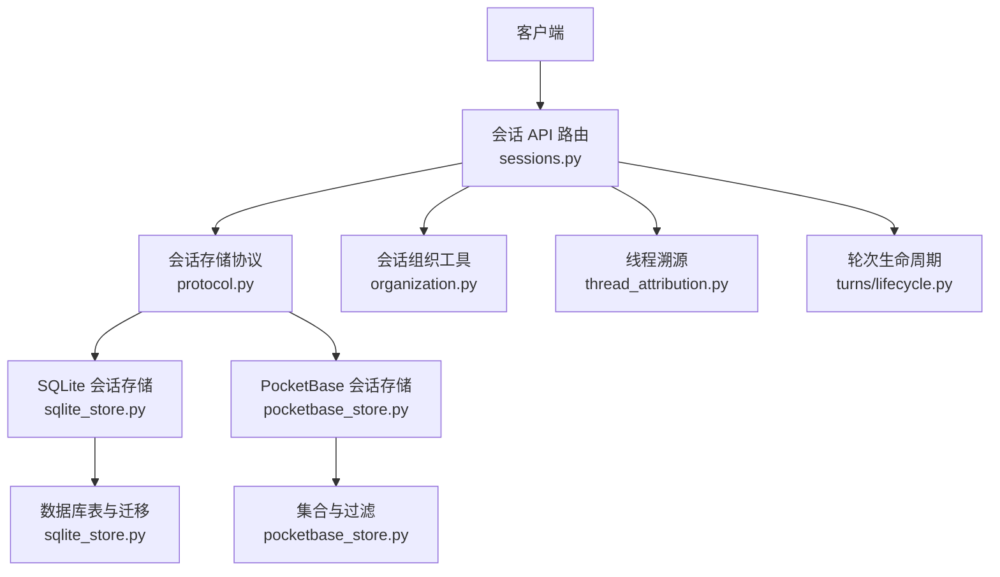
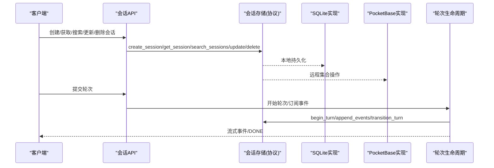
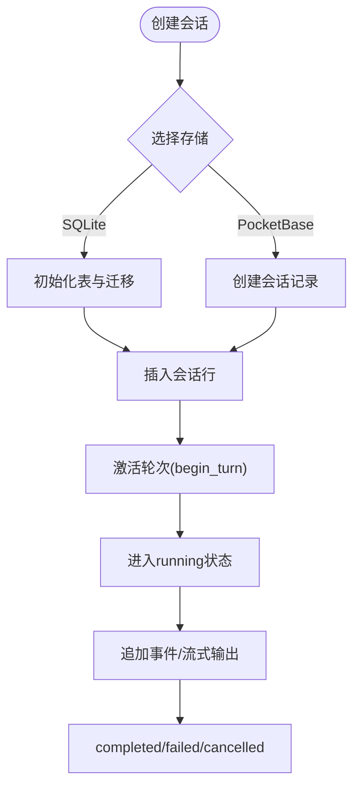
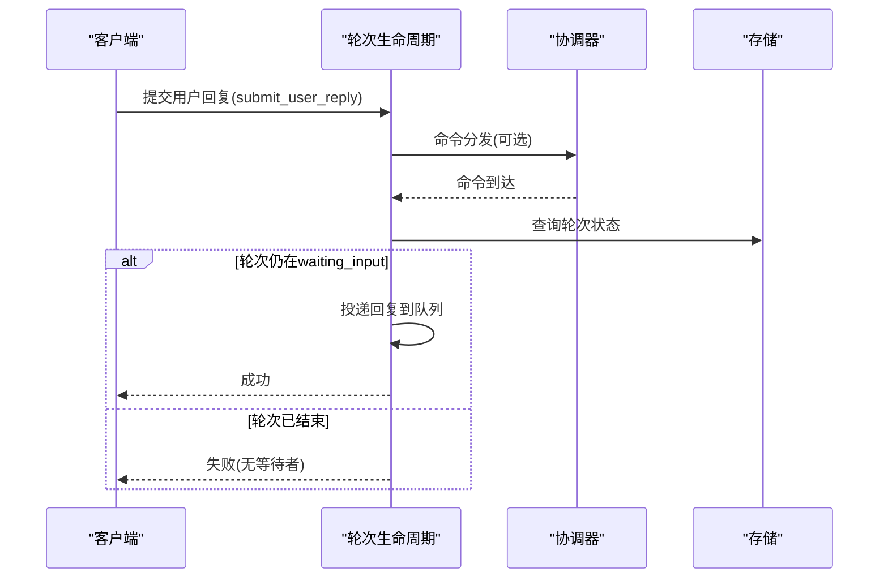
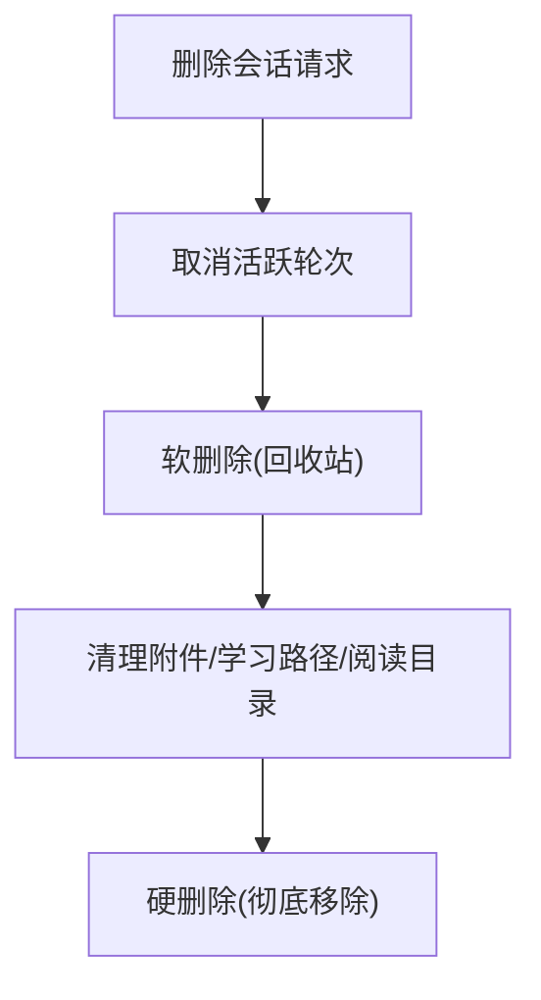
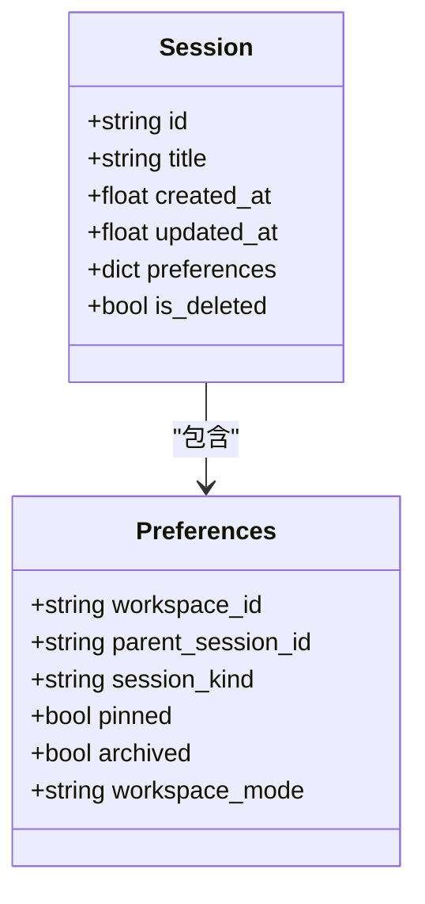
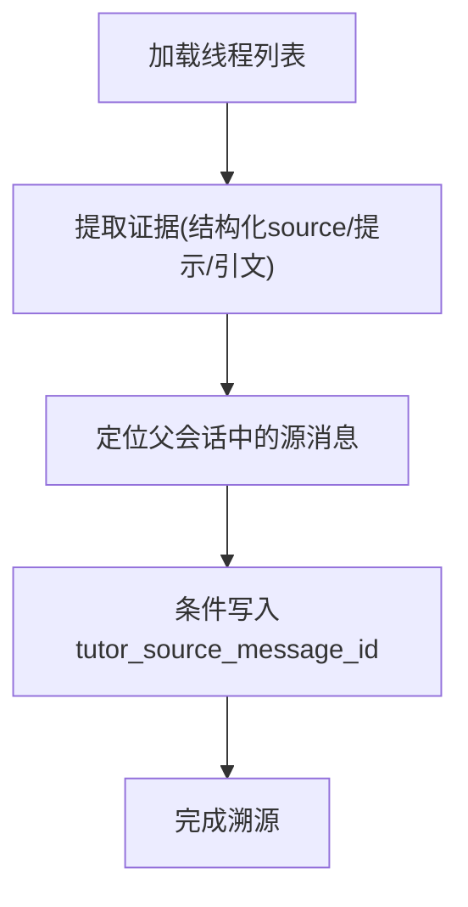
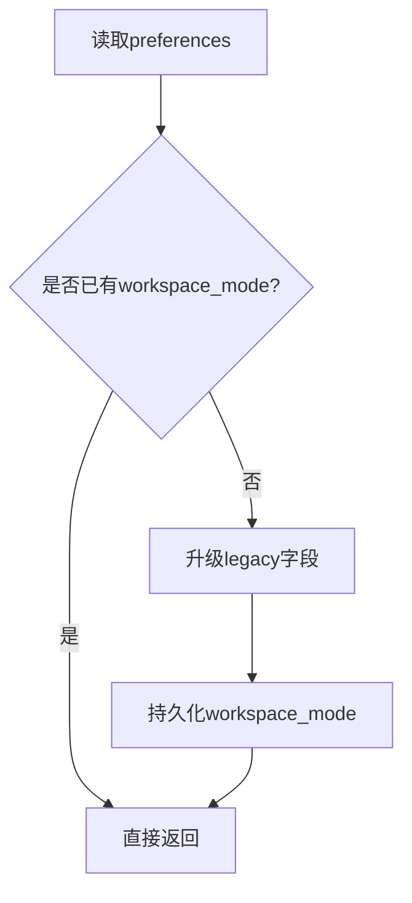
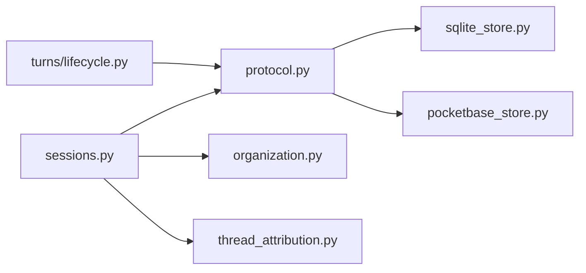

# 会话生命周期

<cite>
**本文引用的文件**   
- [deeptutor/services/session/protocol.py](file://deeptutor/services/session/protocol.py)
- [deeptutor/services/session/turns/lifecycle.py](file://deeptutor/services/session/turns/lifecycle.py)
- [deeptutor/services/session/sqlite_store.py](file://deeptutor/services/session/sqlite_store.py)
- [deeptutor/services/session/pocketbase_store.py](file://deeptutor/services/session/pocketbase_store.py)
- [deeptutor/api/routers/sessions.py](file://deeptutor/api/routers/sessions.py)
- [deeptutor/services/session/organization.py](file://deeptutor/services/session/organization.py)
- [deeptutor/services/session/thread_attribution.py](file://deeptutor/services/session/thread_attribution.py)
- [deeptutor/services/session/workspace_preferences.py](file://deeptutor/services/session/workspace_preferences.py)
</cite>

## 目录
1. [引言](#引言)
2. [项目结构](#项目结构)
3. [核心组件](#核心组件)
4. [架构总览](#架构总览)
5. [详细组件分析](#详细组件分析)
6. [依赖关系分析](#依赖关系分析)
7. [性能与资源管理](#性能与资源管理)
8. [故障排查指南](#故障排查指南)
9. [结论](#结论)

## 引言
本文面向 DeepTutor 的“统一会话”体系，系统性说明会话从创建、激活、暂停到销毁的完整生命周期，以及会话组织（分组、标签、搜索索引）、线程归属（多轮对话的组织结构与引用关系）、工作区偏好设置等关键机制。文档同时给出状态转换规则、触发条件、清理策略和资源回收建议，帮助开发者在扩展或维护会话功能时保持行为一致性和数据一致性。

## 项目结构
会话相关代码主要分布在以下位置：
- 协议与存储抽象：`deeptutor/services/session/protocol.py`
- 运行时与轮次生命周期：`deeptutor/services/session/turns/lifecycle.py`
- 持久化实现：SQLite 与 PocketBase 两种后端
  - `deeptutor/services/session/sqlite_store.py`
  - `deeptutor/services/session/pocketbase_store.py`
- API 路由层：`deeptutor/api/routers/sessions.py`
- 会话组织与父子关系校验：`deeptutor/services/session/organization.py`
- 线程溯源与回溯填充：`deeptutor/services/session/thread_attribution.py`
- 工作区偏好升级：`deeptutor/services/session/workspace_preferences.py`

**图表来源**
- [deeptutor/api/routers/sessions.py:251-296](file://deeptutor/api/routers/sessions.py#L251-L296)
- [deeptutor/services/session/protocol.py:38-150](file://deeptutor/services/session/protocol.py#L38-L150)
- [deeptutor/services/session/sqlite_store.py:245-530](file://deeptutor/services/session/sqlite_store.py#L245-L530)
- [deeptutor/services/session/pocketbase_store.py:171-365](file://deeptutor/services/session/pocketbase_store.py#L171-L365)
- [deeptutor/services/session/organization.py:8-56](file://deeptutor/services/session/organization.py#L8-L56)
- [deeptutor/services/session/thread_attribution.py:466-531](file://deeptutor/services/session/thread_attribution.py#L466-L531)
- [deeptutor/services/session/turns/lifecycle.py:34-104](file://deeptutor/services/session/turns/lifecycle.py#L34-L104)

**章节来源**
- [deeptutor/api/routers/sessions.py:251-296](file://deeptutor/api/routers/sessions.py#L251-L296)
- [deeptutor/services/session/protocol.py:38-150](file://deeptutor/services/session/protocol.py#L38-L150)

## 核心组件
- 会话存储协议：定义统一的会话、轮次和消息仓库接口，屏蔽 SQLite 与 PocketBase 的差异。
- 轮次生命周期：封装轮次的启动、协调、取消、事件订阅、恢复与关闭，保证分布式协作下的幂等与一致性。
- 会话 API：提供会话列表、详情、搜索、组织元数据更新、删除与恢复等能力。
- 会话组织：确保父子关系无环、快照遍历避免分页漂移。
- 线程溯源：为历史“小导师”线程自动回填其父会话中的源消息。
- 工作区偏好：将旧版 workspace 元数据规范化为明确的 workspace_mode。

**章节来源**
- [deeptutor/services/session/protocol.py:38-285](file://deeptutor/services/session/protocol.py#L38-L285)
- [deeptutor/services/session/turns/lifecycle.py:34-104](file://deeptutor/services/session/turns/lifecycle.py#L34-L104)
- [deeptutor/api/routers/sessions.py:251-296](file://deeptutor/api/routers/sessions.py#L251-L296)
- [deeptutor/services/session/organization.py:8-56](file://deeptutor/services/session/organization.py#L8-L56)
- [deeptutor/services/session/thread_attribution.py:466-531](file://deeptutor/services/session/thread_attribution.py#L466-L531)
- [deeptutor/services/session/workspace_preferences.py:17-42](file://deeptutor/services/session/workspace_preferences.py#L17-L42)

## 架构总览
会话生命周期由三层协同完成：
- API 层：接收请求，调用存储与组织工具，返回会话摘要或操作结果。
- 存储层：通过 SessionStoreProtocol 暴露会话、轮次、消息的增删改查与事件追加。
- 运行层：TurnLifecycle 负责轮次执行、事件流、协调器续约、取消与关闭。

**图表来源**
- [deeptutor/api/routers/sessions.py:251-296](file://deeptutor/api/routers/sessions.py#L251-L296)
- [deeptutor/services/session/protocol.py:38-150](file://deeptutor/services/session/protocol.py#L38-L150)
- [deeptutor/services/session/turns/lifecycle.py:380-544](file://deeptutor/services/session/turns/lifecycle.py#L380-L544)

## 详细组件分析

### 会话创建与激活
- 创建会话：
  - SQLite：初始化 schema，写入 sessions/messages/turns/turn_events 等表，支持 WAL 模式与增量迁移。
  - PocketBase：创建 sessions 记录，附带用户隔离字段与 workspace_id。
- 激活会话：
  - 通过 TurnRepository.begin_turn 创建轮次，状态包括 queued/running/waiting_input。
  - TurnLifecycle 持有执行上下文，协调器负责续租与命令分发。

**图表来源**
- [deeptutor/services/session/sqlite_store.py:274-530](file://deeptutor/services/session/sqlite_store.py#L274-L530)
- [deeptutor/services/session/pocketbase_store.py:260-365](file://deeptutor/services/session/pocketbase_store.py#L260-L365)
- [deeptutor/services/session/protocol.py:85-127](file://deeptutor/services/session/protocol.py#L85-L127)
- [deeptutor/services/session/turns/lifecycle.py:34-104](file://deeptutor/services/session/turns/lifecycle.py#L34-L104)

**章节来源**
- [deeptutor/services/session/sqlite_store.py:274-530](file://deeptutor/services/session/sqlite_store.py#L274-L530)
- [deeptutor/services/session/pocketbase_store.py:260-365](file://deeptutor/services/session/pocketbase_store.py#L260-L365)
- [deeptutor/services/session/protocol.py:85-127](file://deeptutor/services/session/protocol.py#L85-L127)
- [deeptutor/services/session/turns/lifecycle.py:34-104](file://deeptutor/services/session/turns/lifecycle.py#L34-L104)

### 会话暂停与恢复
- 暂停：
  - 当模型需要用户输入时，轮次状态进入 waiting_input。
  - TurnLifecycle.submit_user_reply 将回复投递到轮次队列，等待 pipeline 消费。
- 恢复：
  - 协调器收到 submit_user_reply 命令后，投递到对应轮次；若已终止则记录警告并可能触发取消路径。
  - 订阅者超时后会从持久事件回放补齐，并在必要时合成 DONE 事件。

**图表来源**
- [deeptutor/services/session/turns/lifecycle.py:329-378](file://deeptutor/services/session/turns/lifecycle.py#L329-L378)
- [deeptutor/services/session/turns/lifecycle.py:231-308](file://deeptutor/services/session/turns/lifecycle.py#L231-L308)
- [deeptutor/services/session/turns/lifecycle.py:380-544](file://deeptutor/services/session/turns/lifecycle.py#L380-L544)

**章节来源**
- [deeptutor/services/session/turns/lifecycle.py:329-378](file://deeptutor/services/session/turns/lifecycle.py#L329-L378)
- [deeptutor/services/session/turns/lifecycle.py:231-308](file://deeptutor/services/session/turns/lifecycle.py#L231-L308)
- [deeptutor/services/session/turns/lifecycle.py:380-544](file://deeptutor/services/session/turns/lifecycle.py#L380-L544)

### 会话销毁与清理
- 软删除：
  - 移动至回收站，保留数据以便恢复。
- 硬删除：
  - 要求先软删除，再彻底移除会话及其关联数据。
- 级联清理：
  - 删除前尝试取消活跃轮次。
  - 清理附件、学习路径关联、阅读目录缓存等。

**图表来源**
- [deeptutor/api/routers/sessions.py:697-753](file://deeptutor/api/routers/sessions.py#L697-L753)
- [deeptutor/services/session/pocketbase_store.py:472-557](file://deeptutor/services/session/pocketbase_store.py#L472-L557)

**章节来源**
- [deeptutor/api/routers/sessions.py:697-753](file://deeptutor/api/routers/sessions.py#L697-L753)
- [deeptutor/services/session/pocketbase_store.py:472-557](file://deeptutor/services/session/pocketbase_store.py#L472-L557)

### 会话组织机制
- 分组策略：
  - 通过 parent_session_id 建立父子关系，形成会话树。
  - 列表与搜索时按 workspace_id 与 archived 状态过滤。
- 标签系统：
  - session_kind、pinned、archived、workspace_mode 等元数据作为标签。
- 搜索索引：
  - 标题与用户/助手消息内容匹配，返回匹配片段与计数。

**图表来源**
- [deeptutor/services/session/organization.py:8-56](file://deeptutor/services/session/organization.py#L8-L56)
- [deeptutor/services/session/workspace_preferences.py:17-42](file://deeptutor/services/session/workspace_preferences.py#L17-L42)
- [deeptutor/api/routers/sessions.py:96-107](file://deeptutor/api/routers/sessions.py#L96-L107)

**章节来源**
- [deeptutor/services/session/organization.py:8-56](file://deeptutor/services/session/organization.py#L8-L56)
- [deeptutor/services/session/workspace_preferences.py:17-42](file://deeptutor/services/session/workspace_preferences.py#L17-L42)
- [deeptutor/api/routers/sessions.py:96-107](file://deeptutor/api/routers/sessions.py#L96-L107)

### 线程归属管理
- 历史线程溯源：
  - 根据结构化 source、提示证据、引文与角色信息定位父会话中的源消息。
  - 使用条件写入防止并发覆盖，失败冷却重试。
- 引用关系：
  - tutor_source_message_id 指向父会话中的具体消息，空值表示解绑。

**图表来源**
- [deeptutor/services/session/thread_attribution.py:466-531](file://deeptutor/services/session/thread_attribution.py#L466-L531)
- [deeptutor/services/session/thread_attribution.py:323-410](file://deeptutor/services/session/thread_attribution.py#L323-L410)

**章节来源**
- [deeptutor/services/session/thread_attribution.py:466-531](file://deeptutor/services/session/thread_attribution.py#L466-L531)
- [deeptutor/services/session/thread_attribution.py:323-410](file://deeptutor/services/session/thread_attribution.py#L323-L410)

### 工作区偏好设置
- 规范化：
  - 将 legacy capability/workspace_id 映射为明确的 workspace_mode。
  - 处理 deleted_at 与 archived 标志，避免误恢复归档会话。
- 默认行为：
  - 新会话默认携带 workspace_id，便于侧边栏分组。

**图表来源**
- [deeptutor/services/session/workspace_preferences.py:17-42](file://deeptutor/services/session/workspace_preferences.py#L17-L42)
- [deeptutor/services/session/sqlite_store.py:531-570](file://deeptutor/services/session/sqlite_store.py#L531-L570)
- [deeptutor/services/session/pocketbase_store.py:209-258](file://deeptutor/services/session/pocketbase_store.py#L209-L258)

**章节来源**
- [deeptutor/services/session/workspace_preferences.py:17-42](file://deeptutor/services/session/workspace_preferences.py#L17-L42)
- [deeptutor/services/session/sqlite_store.py:531-570](file://deeptutor/services/session/sqlite_store.py#L531-L570)
- [deeptutor/services/session/pocketbase_store.py:209-258](file://deeptutor/services/session/pocketbase_store.py#L209-L258)

## 依赖关系分析
- API 路由依赖存储协议与组织工具。
- 存储协议被 SQLite 与 PocketBase 实现。
- 轮次生命周期依赖存储协议与协调器。
- 线程溯源依赖存储的消息读取与条件写入能力。

**图表来源**
- [deeptutor/api/routers/sessions.py:18-31](file://deeptutor/api/routers/sessions.py#L18-L31)
- [deeptutor/services/session/protocol.py:38-150](file://deeptutor/services/session/protocol.py#L38-L150)
- [deeptutor/services/session/turns/lifecycle.py:15-24](file://deeptutor/services/session/turns/lifecycle.py#L15-L24)

**章节来源**
- [deeptutor/api/routers/sessions.py:18-31](file://deeptutor/api/routers/sessions.py#L18-L31)
- [deeptutor/services/session/protocol.py:38-150](file://deeptutor/services/session/protocol.py#L38-L150)
- [deeptutor/services/session/turns/lifecycle.py:15-24](file://deeptutor/services/session/turns/lifecycle.py#L15-L24)

## 性能与资源管理
- 事件持久化：
  - 批量追加事件，避免频繁 IO；终端状态前确保事件落盘。
- 订阅恢复：
  - 超时后回放持久事件，合成 DONE 以稳定前端状态。
- 内存与任务清理：
  - close 方法释放执行上下文、队列与协程，必要时取消 pending 任务。
- 存储优化：
  - SQLite 启用 WAL，减少读写阻塞；PocketBase 使用分页与过滤减少网络开销。

**章节来源**
- [deeptutor/services/session/turns/lifecycle.py:730-800](file://deeptutor/services/session/turns/lifecycle.py#L730-L800)
- [deeptutor/services/session/turns/lifecycle.py:380-544](file://deeptutor/services/session/turns/lifecycle.py#L380-L544)
- [deeptutor/services/session/sqlite_store.py:274-530](file://deeptutor/services/session/sqlite_store.py#L274-L530)
- [deeptutor/services/session/pocketbase_store.py:588-742](file://deeptutor/services/session/pocketbase_store.py#L588-L742)

## 故障排查指南
- 活跃轮次冲突：
  - 同一会话存在未终态轮次时，拒绝新轮次创建。
- 订阅丢失：
  - 检查协调器续租与命令分发；确认 DONE 事件是否合成。
- 溯源失败：
  - 查看冷却时间与条件写入日志；确认父会话消息可读。
- 删除失败：
  - 检查是否有活跃轮次；确认回收站状态与权限。

**章节来源**
- [deeptutor/services/session/protocol.py:20-36](file://deeptutor/services/session/protocol.py#L20-L36)
- [deeptutor/services/session/turns/lifecycle.py:231-308](file://deeptutor/services/session/turns/lifecycle.py#L231-L308)
- [deeptutor/services/session/thread_attribution.py:413-455](file://deeptutor/services/session/thread_attribution.py#L413-L455)
- [deeptutor/api/routers/sessions.py:697-753](file://deeptutor/api/routers/sessions.py#L697-L753)

## 结论
DeepTutor 的会话生命周期围绕协议抽象、双后端存储与轮次运行时代码展开，提供一致的创建、激活、暂停、恢复与销毁流程。通过组织元数据与线程溯源机制，会话可灵活分组与关联；工作区偏好确保跨产品线的语义清晰。在生产环境中，应关注事件持久化、订阅恢复与资源清理，以保证高可用与数据一致性。