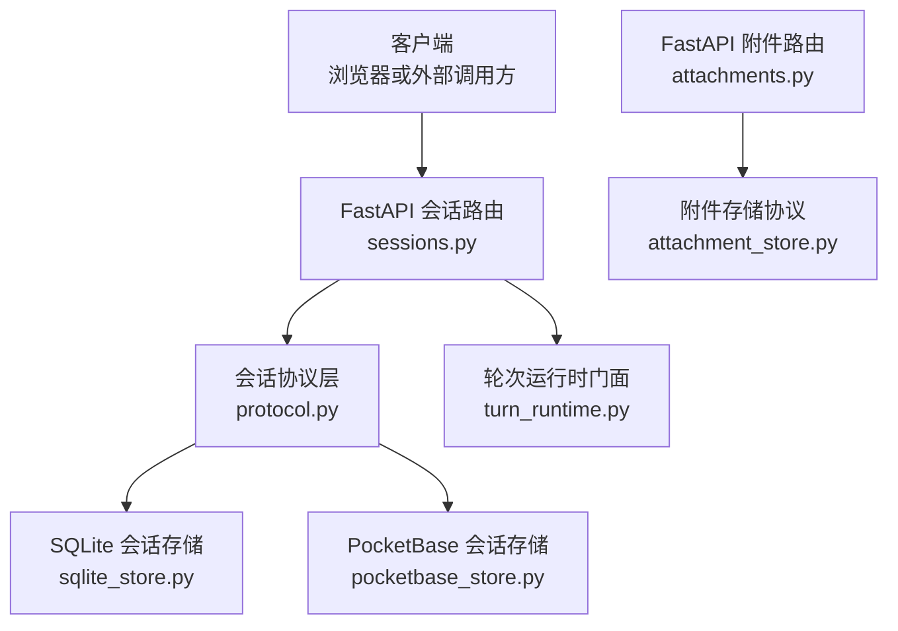
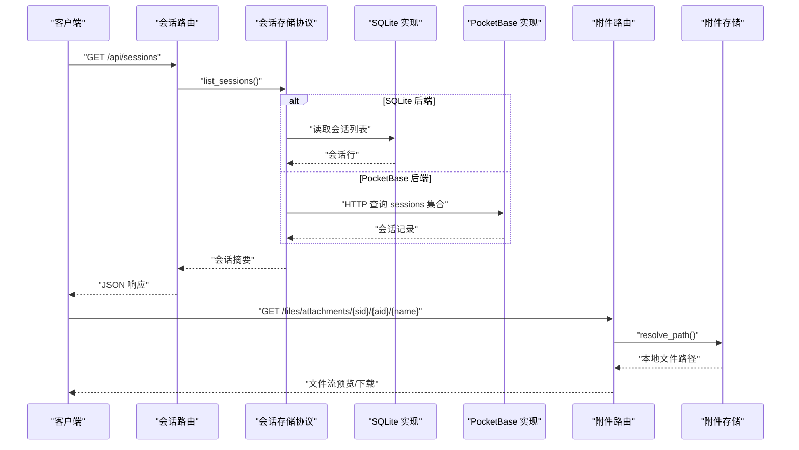
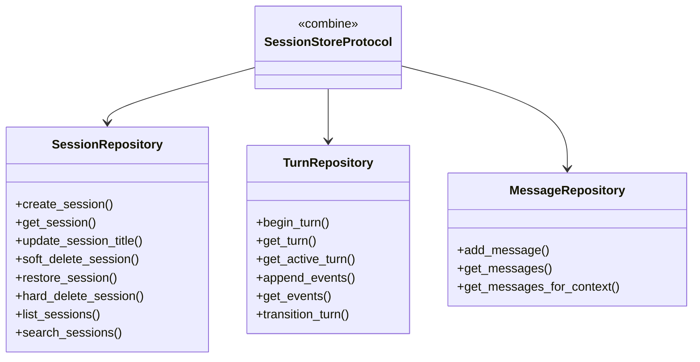
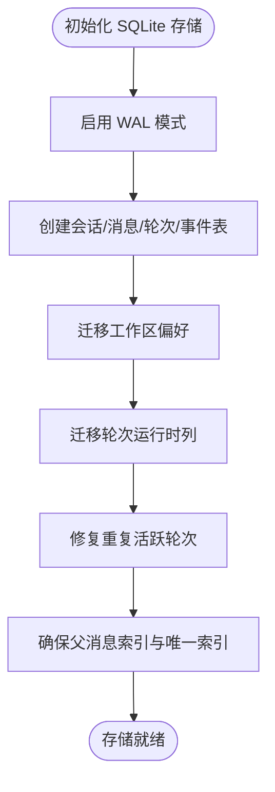
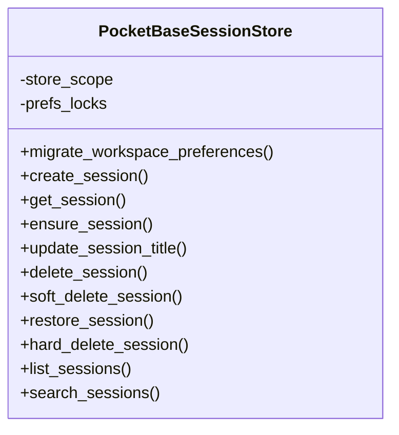
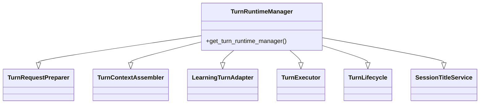
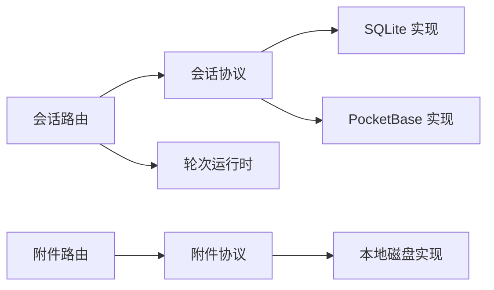
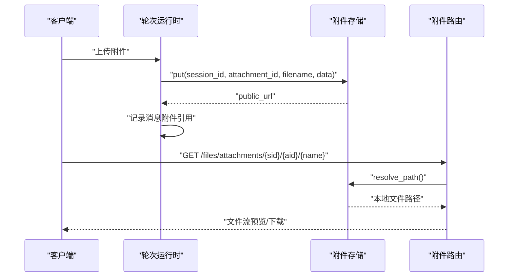

# 会话管理

<cite>
**本文引用的文件**   
- [sessions.py](file://deeptutor/api/routers/sessions.py)
- [attachments.py](file://deeptutor/api/routers/attachments.py)
- [protocol.py](file://deeptutor/services/session/protocol.py)
- [sqlite_store.py](file://deeptutor/services/session/sqlite_store.py)
- [pocketbase_store.py](file://deeptutor/services/session/pocketbase_store.py)
- [turn_runtime.py](file://deeptutor/services/session/turn_runtime.py)
- [attachment_store.py](file://deeptutor/services/storage/attachment_store.py)
</cite>

## 目录
1. [简介](#简介)
2. [项目结构](#项目结构)
3. [核心组件](#核心组件)
4. [架构总览](#架构总览)
5. [详细组件分析](#详细组件分析)
6. [依赖关系分析](#依赖关系分析)
7. [性能与并发特性](#性能与并发特性)
8. [持久化、备份与恢复](#持久化备份与恢复)
9. [附件管理机制](#附件管理机制)
10. [使用示例：创建、管理与查询会话](#使用示例创建管理与查询会话)
11. [清理策略与运维建议](#清理策略与运维建议)
12. [扩展开发指南](#扩展开发指南)
13. [故障排查](#故障排查)
14. [结论](#结论)

## 简介
本文件面向 DeepTutor 的“会话管理系统”，从系统架构、存储抽象、事件驱动、持久化、附件管理到清理策略和扩展点，提供从基础使用到高级定制的完整说明。重点包括：
- 统一会话接口：通过协议层隔离 SQLite 与 PocketBase 两种后端。
- 存储抽象层：会话、消息、轮次（Turn）三张核心表及对应仓库接口。
- 事件驱动机制：基于 `turn_events` 的事件追加、预览与追踪。
- 持久化策略：SQLite WAL、迁移锁、软删除回收站、硬删除清理。
- 附件管理：本地磁盘实现、路径安全校验、上传/预览/下载。
- 清理策略：会话删除时级联清理学习路径、任务板、阅读目录与附件。
- 扩展指南：如何替换存储后端、接入远程附件存储、新增会话组织字段。

## 项目结构
会话相关代码主要分布在以下位置：
- API 路由层：对外暴露会话列表、详情、搜索、重命名、组织元数据、删除与恢复等接口。
- 服务层：会话协议、SQLite/PocketBase 存储实现、轮次运行时门面。
- 存储层：聊天附件协议与本地磁盘实现。
- 前端侧：通过 FastAPI 路由访问会话与附件资源。

**图表来源**
- [sessions.py:251-467](file://deeptutor/api/routers/sessions.py#L251-L467)
- [attachments.py:40-79](file://deeptutor/api/routers/attachments.py#L40-L79)
- [protocol.py:38-276](file://deeptutor/services/session/protocol.py#L38-L276)
- [sqlite_store.py:245-529](file://deeptutor/services/session/sqlite_store.py#L245-L529)
- [pocketbase_store.py:171-365](file://deeptutor/services/session/pocketbase_store.py#L171-L365)
- [turn_runtime.py:26-55](file://deeptutor/services/session/turn_runtime.py#L26-L55)
- [attachment_store.py:65-103](file://deeptutor/services/storage/attachment_store.py#L65-L103)

**章节来源**
- [sessions.py:1-850](file://deeptutor/api/routers/sessions.py#L1-L850)
- [attachments.py:1-80](file://deeptutor/api/routers/attachments.py#L1-L80)
- [protocol.py:1-285](file://deeptutor/services/session/protocol.py#L1-L285)
- [sqlite_store.py:1-800](file://deeptutor/services/session/sqlite_store.py#L1-L800)
- [pocketbase_store.py:1-800](file://deeptutor/services/session/pocketbase_store.py#L1-L800)
- [turn_runtime.py:1-56](file://deeptutor/services/session/turn_runtime.py#L1-L56)
- [attachment_store.py:1-326](file://deeptutor/services/storage/attachment_store.py#L1-L326)

## 核心组件
- 统一会话协议：定义会话仓库、轮次仓库、消息仓库以及组合后的会话存储协议，屏蔽底层差异。
- SQLite 会话存储：以 SQLite 数据库持久化会话、消息、轮次与事件，支持 WAL、索引、迁移与并发控制。
- PocketBase 会话存储：以 HTTP 方式操作远端集合，保持与 SQLite 一致的语义与错误模型。
- 轮次运行时门面：将请求准备、上下文组装、执行、生命周期、标题服务等能力组合为兼容门面。
- 附件存储协议与本地实现：定义上传、删除、路径解析与清理接口，默认使用本地磁盘并保证路径安全。

**章节来源**
- [protocol.py:38-276](file://deeptutor/services/session/protocol.py#L38-L276)
- [sqlite_store.py:245-529](file://deeptutor/services/session/sqlite_store.py#L245-L529)
- [pocketbase_store.py:171-365](file://deeptutor/services/session/pocketbase_store.py#L171-L365)
- [turn_runtime.py:26-55](file://deeptutor/services/session/turn_runtime.py#L26-L55)
- [attachment_store.py:65-103](file://deeptutor/services/storage/attachment_store.py#L65-L103)

## 架构总览
会话系统的整体流程如下：
- 客户端通过 FastAPI 路由发起会话操作。
- 路由层调用会话存储协议，由具体实现（SQLite 或 PocketBase）完成数据读写。
- 轮次运行时负责会话中的对话轮次状态机与事件流。
- 附件通过独立存储协议写入本地磁盘，并通过专用路由进行预览与下载。

**图表来源**
- [sessions.py:251-270](file://deeptutor/api/routers/sessions.py#L251-L270)
- [sqlite_store.py:274-529](file://deeptutor/services/session/sqlite_store.py#L274-L529)
- [pocketbase_store.py:589-644](file://deeptutor/services/session/pocketbase_store.py#L589-L644)
- [attachments.py:40-79](file://deeptutor/api/routers/attachments.py#L40-L79)
- [attachment_store.py:233-242](file://deeptutor/services/storage/attachment_store.py#L233-L242)

## 详细组件分析

### 统一会话接口与存储抽象层
- 协议层定义了三种仓库：
  - 会话仓库：会话创建、获取、更新标题、软删除、恢复、硬删除、列表、搜索等。
  - 轮次仓库：开始轮次、获取轮次、活跃轮次、事件追加与查询、状态转换等。
  - 消息仓库：添加消息、获取消息、按会话查询、按上下文查询等。
- 组合协议 `SessionStoreProtocol` 将上述能力聚合，供上层调用。

**图表来源**
- [protocol.py:38-276](file://deeptutor/services/session/protocol.py#L38-L276)

**章节来源**
- [protocol.py:38-276](file://deeptutor/services/session/protocol.py#L38-L276)

### SQLite 会话存储实现
- 初始化阶段启用 WAL 模式，提升读多写少场景下的并发性能。
- 建表包含会话、消息、轮次、轮次事件、笔记条目、评估尝试等。
- 提供迁移逻辑：
  - 工作区偏好升级。
  - 轮次运行时列迁移与重复活跃轮次修复。
  - 笔记条目唯一约束重构与附加字段回填。
- 并发控制：
  - 进程内异步锁保护关键路径。
  - 跨进程迁移锁防止并发 schema 升级冲突。
  - 通过部分唯一索引限制每个会话仅有一个活跃轮次。

**图表来源**
- [sqlite_store.py:274-529](file://deeptutor/services/session/sqlite_store.py#L274-L529)
- [sqlite_store.py:572-656](file://deeptutor/services/session/sqlite_store.py#L572-L656)

**章节来源**
- [sqlite_store.py:245-529](file://deeptutor/services/session/sqlite_store.py#L245-L529)
- [sqlite_store.py:572-656](file://deeptutor/services/session/sqlite_store.py#L572-L656)

### PocketBase 会话存储实现
- 所有方法通过线程池执行 HTTP 调用，避免阻塞事件循环。
- 会话记录按用户与工作区隔离，过滤表达式中注入当前用户与工作区。
- 偏好字段采用进程内每会话锁合并 JSON，避免并发覆盖。
- 列表与搜索分页处理，兼容不同服务器版本的行为差异。

**图表来源**
- [pocketbase_store.py:171-365](file://deeptutor/services/session/pocketbase_store.py#L171-L365)
- [pocketbase_store.py:589-742](file://deeptutor/services/session/pocketbase_store.py#L589-L742)

**章节来源**
- [pocketbase_store.py:171-365](file://deeptutor/services/session/pocketbase_store.py#L171-L365)
- [pocketbase_store.py:589-742](file://deeptutor/services/session/pocketbase_store.py#L589-L742)

### 轮次运行时门面
- 将多个职责拆分为独立的 v2 服务，再通过门面类组合，保持向后兼容。
- 进程内单例缓存按存储作用域键区分实例，避免跨作用域共享状态。

**图表来源**
- [turn_runtime.py:26-55](file://deeptutor/services/session/turn_runtime.py#L26-L55)

**章节来源**
- [turn_runtime.py:26-55](file://deeptutor/services/session/turn_runtime.py#L26-L55)

## 依赖关系分析
- API 路由依赖会话存储协议与附件存储协议。
- 会话存储协议被 SQLite 与 PocketBase 实现满足。
- 轮次运行时门面依赖会话存储与作用域。
- 附件路由依赖附件存储协议与本地磁盘实现。

**图表来源**
- [sessions.py:18-31](file://deeptutor/api/routers/sessions.py#L18-L31)
- [attachments.py:27-30](file://deeptutor/api/routers/attachments.py#L27-L30)
- [protocol.py:38-276](file://deeptutor/services/session/protocol.py#L38-L276)
- [sqlite_store.py:245-529](file://deeptutor/services/session/sqlite_store.py#L245-L529)
- [pocketbase_store.py:171-365](file://deeptutor/services/session/pocketbase_store.py#L171-L365)
- [turn_runtime.py:26-55](file://deeptutor/services/session/turn_runtime.py#L26-L55)
- [attachment_store.py:65-103](file://deeptutor/services/storage/attachment_store.py#L65-L103)

**章节来源**
- [sessions.py:18-31](file://deeptutor/api/routers/sessions.py#L18-L31)
- [attachments.py:27-30](file://deeptutor/api/routers/attachments.py#L27-L30)
- [protocol.py:38-276](file://deeptutor/services/session/protocol.py#L38-L276)
- [sqlite_store.py:245-529](file://deeptutor/services/session/sqlite_store.py#L245-L529)
- [pocketbase_store.py:171-365](file://deeptutor/services/session/pocketbase_store.py#L171-L365)
- [turn_runtime.py:26-55](file://deeptutor/services/session/turn_runtime.py#L26-L55)
- [attachment_store.py:65-103](file://deeptutor/services/storage/attachment_store.py#L65-L103)

## 性能与并发特性
- SQLite 后端：
  - 启用 WAL 模式，允许读者在提交期间继续读取。
  - 使用进程内异步锁与跨进程迁移锁，避免并发 schema 升级冲突。
  - 通过部分唯一索引限制每个会话只有一个活跃轮次，防止并发竞争。
  - 对消息与事件建立索引，优化查询与排序。
- PocketBase 后端：
  - 所有 HTTP 调用在线程池中执行，避免阻塞事件循环。
  - 偏好字段合并使用进程内每会话锁，避免并发覆盖。
  - 列表与搜索分页处理，减少单次网络负载。
- 事件载荷裁剪：
  - 对 `tool_result` 与 `observation` 等大事件进行长度裁剪，避免 UI 渲染压力。

**章节来源**
- [sqlite_store.py:274-529](file://deeptutor/services/session/sqlite_store.py#L274-L529)
- [sqlite_store.py:572-656](file://deeptutor/services/session/sqlite_store.py#L572-L656)
- [pocketbase_store.py:171-365](file://deeptutor/services/session/pocketbase_store.py#L171-L365)
- [pocketbase_store.py:589-742](file://deeptutor/services/session/pocketbase_store.py#L589-L742)
- [sessions.py:299-418](file://deeptutor/api/routers/sessions.py#L299-L418)

## 持久化、备份与恢复
- 持久化：
  - SQLite 使用 WAL 模式与事务提交，保证一致性。
  - PocketBase 通过 HTTP 集合持久化，会话与消息分离。
- 备份与恢复：
  - SQLite 数据库文件位于用户目录，可随用户数据一起备份。
  - PocketBase 数据需通过其自身备份工具或数据库导出机制进行备份。
- 软删除与回收站：
  - 会话软删除后进入回收站，可通过恢复接口还原。
  - 硬删除要求先软删除，防止误删。
- 数据迁移：
  - SQLite 启动时执行幂等迁移，包括工作区偏好、轮次列、笔记条目约束等。
  - PocketBase 在读取时做字段归一化，并在下次偏好写入时持久化。

**章节来源**
- [sqlite_store.py:274-529](file://deeptutor/services/session/sqlite_store.py#L274-L529)
- [sqlite_store.py:531-570](file://deeptutor/services/session/sqlite_store.py#L531-L570)
- [pocketbase_store.py:209-258](file://deeptutor/services/session/pocketbase_store.py#L209-L258)
- [sessions.py:697-781](file://deeptutor/api/routers/sessions.py#L697-L781)

## 附件管理机制
- 协议设计：
  - `AttachmentStore` 定义上传、删除、路径解析与清理接口。
  - 默认实现为本地磁盘，未来可扩展 S3/MinIO/GCS。
- 上传与预览：
  - 上传时将字节写入本地磁盘，返回相对 URL。
  - 预览路由根据 session_id、attachment_id、filename 解析路径并返回文件流。
- 安全性：
  - 文件名经过安全化处理，拒绝目录穿越。
  - 路径解析前检查符号链接与根目录边界。
- 清理：
  - 会话删除时调用附件存储的 `delete_session`，递归清理该会话的所有附件。

**图表来源**
- [attachment_store.py:74-103](file://deeptutor/services/storage/attachment_store.py#L74-L103)
- [attachment_store.py:147-174](file://deeptutor/services/storage/attachment_store.py#L147-L174)
- [attachments.py:40-79](file://deeptutor/api/routers/attachments.py#L40-L79)

**章节来源**
- [attachment_store.py:65-103](file://deeptutor/services/storage/attachment_store.py#L65-L103)
- [attachment_store.py:147-174](file://deeptutor/services/storage/attachment_store.py#L147-L174)
- [attachments.py:40-79](file://deeptutor/api/routers/attachments.py#L40-L79)

## 使用示例：创建、管理与查询会话
以下为常见操作的 API 调用路径与行为说明（不展示具体代码内容）：
- 创建会话：
  - 调用会话存储协议的 `create_session`，返回会话元数据。
- 获取会话详情：
  - 调用 `get_session_with_messages`，附带消息与事件，并进行隐私元数据脱敏与大事件裁剪。
- 列出会话：
  - 调用 `list_sessions`，支持分页与工作区过滤。
- 搜索会话：
  - 调用 `search_sessions`，对标题与消息内容进行字面量匹配。
- 重命名会话：
  - 调用 `update_session_title`，并同步阅读目录（如启用）。
- 更新会话组织信息：
  - 调用 `update_session_preferences`，支持工作区、父会话、会话类型、置顶、归档等。
- 删除会话：
  - 调用 `delete_session`，级联停止活跃轮次、删除子会话、清理学习路径、任务板、阅读目录与附件。
- 恢复会话：
  - 调用 `restore_session`，从回收站恢复。
- 永久删除会话：
  - 调用 `hard_delete_session`，要求先软删除。

**章节来源**
- [sessions.py:251-467](file://deeptutor/api/routers/sessions.py#L251-L467)
- [sessions.py:537-694](file://deeptutor/api/routers/sessions.py#L537-L694)
- [sessions.py:697-781](file://deeptutor/api/routers/sessions.py#L697-L781)

## 清理策略与运维建议
- 会话删除清理：
  - 停止活跃轮次：若存储支持 `list_active_turns`，则逐个取消轮次。
  - 级联删除子会话：按父会话关系遍历并删除。
  - 清理外部依赖：学习路径、任务板、阅读目录与附件。
- 回收站管理：
  - 软删除后可恢复；硬删除前必须已软删除。
- 附件清理：
  - 会话删除时调用附件存储的 `delete_session`，递归清理目录。
- 迁移与备份：
  - SQLite 数据库文件应纳入用户数据备份范围。
  - PocketBase 数据需通过其备份工具或数据库导出机制进行备份。

**章节来源**
- [sessions.py:697-781](file://deeptutor/api/routers/sessions.py#L697-L781)
- [attachment_store.py:193-231](file://deeptutor/services/storage/attachment_store.py#L193-L231)

## 扩展开发指南
- 替换会话存储后端：
  - 实现 `SessionStoreProtocol`，满足会话、轮次、消息仓库接口。
  - 在应用容器中注册新实现，替换默认 SQLite 或 PocketBase。
- 接入远程附件存储：
  - 实现 `AttachmentStore`，提供 `put`、`delete_session`、`resolve_path`。
  - 在附件路由中处理远程存储的签名 URL 重定向。
- 新增会话组织字段：
  - 在协议层增加偏好字段写入方法。
  - 在 SQLite 迁移中增加列与索引。
  - 在 PocketBase 读取时做字段归一化。
- 扩展轮次运行时：
  - 在门面类中组合新的服务，保持向后兼容。
  - 通过作用域缓存区分不同存储实例。

**章节来源**
- [protocol.py:38-276](file://deeptutor/services/session/protocol.py#L38-L276)
- [attachment_store.py:65-103](file://deeptutor/services/storage/attachment_store.py#L65-L103)
- [sqlite_store.py:531-570](file://deeptutor/services/session/sqlite_store.py#L531-L570)
- [pocketbase_store.py:209-258](file://deeptutor/services/session/pocketbase_store.py#L209-L258)
- [turn_runtime.py:26-55](file://deeptutor/services/session/turn_runtime.py#L26-L55)

## 故障排查
- 会话不存在：
  - 检查会话 ID 是否正确，确认未处于回收站。
- 活跃轮次冲突：
  - 等待轮次结束或调用取消接口；SQLite 会通过部分唯一索引阻止并发活跃轮次。
- 附件无法预览：
  - 检查文件名是否安全，路径是否在根目录下；确认附件路由只服务于本地磁盘实现。
- 搜索无结果：
  - 检查搜索词是否被规范化为空；确认工作区过滤条件正确。
- 偏好字段丢失：
  - PocketBase 需在下次偏好写入时持久化；SQLite 需检查迁移是否成功。

**章节来源**
- [sessions.py:456-467](file://deeptutor/api/routers/sessions.py#L456-L467)
- [sqlite_store.py:572-656](file://deeptutor/services/session/sqlite_store.py#L572-L656)
- [attachments.py:40-79](file://deeptutor/api/routers/attachments.py#L40-L79)
- [pocketbase_store.py:209-258](file://deeptutor/services/session/pocketbase_store.py#L209-L258)

## 结论
DeepTutor 的会话管理系统通过统一协议层隔离 SQLite 与 PocketBase 后端，提供一致的会话、消息与轮次操作接口。SQLite 实现注重并发与迁移稳定性，PocketBase 实现注重网络调用与权限隔离。附件管理通过协议抽象支持本地磁盘与未来远程存储。清理策略确保会话删除时的数据一致性与外部依赖同步。扩展点清晰，便于按需替换存储后端、接入远程附件存储与新增会话组织字段。