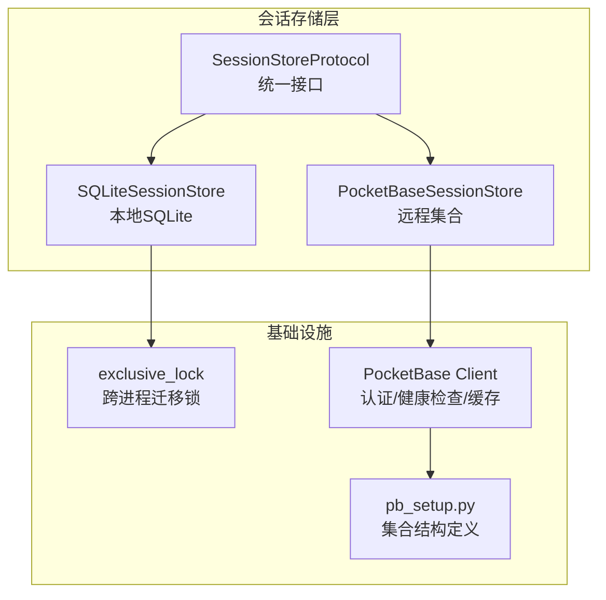
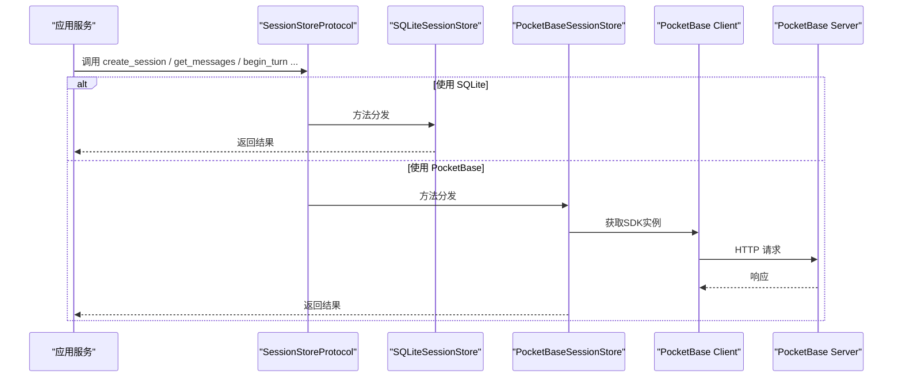
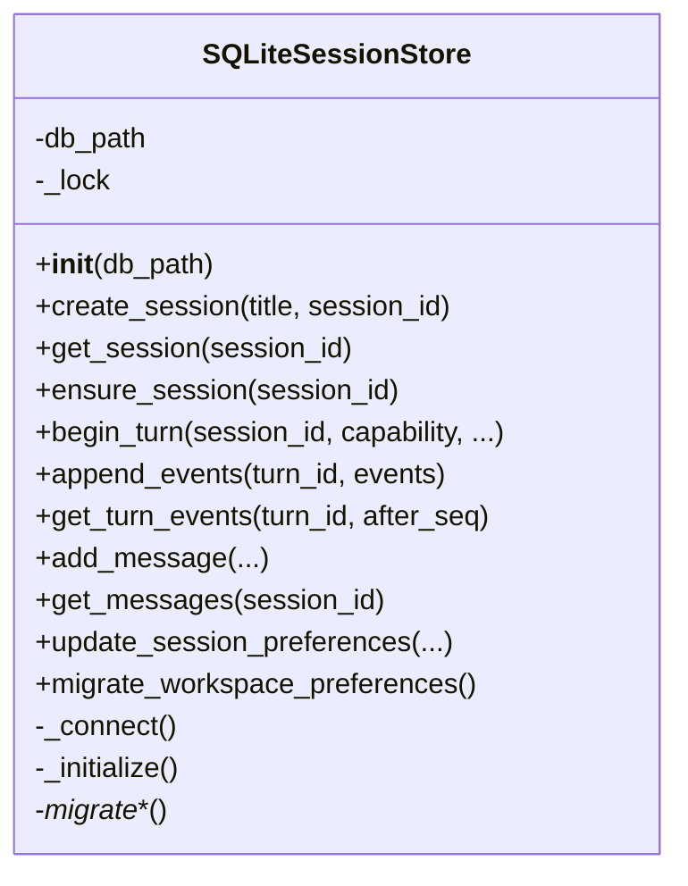
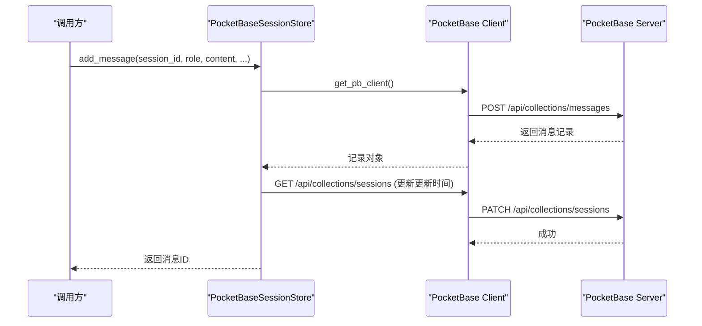
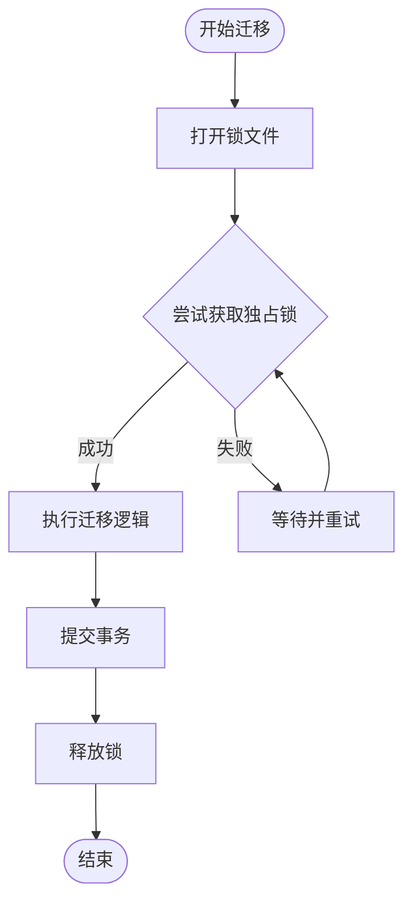
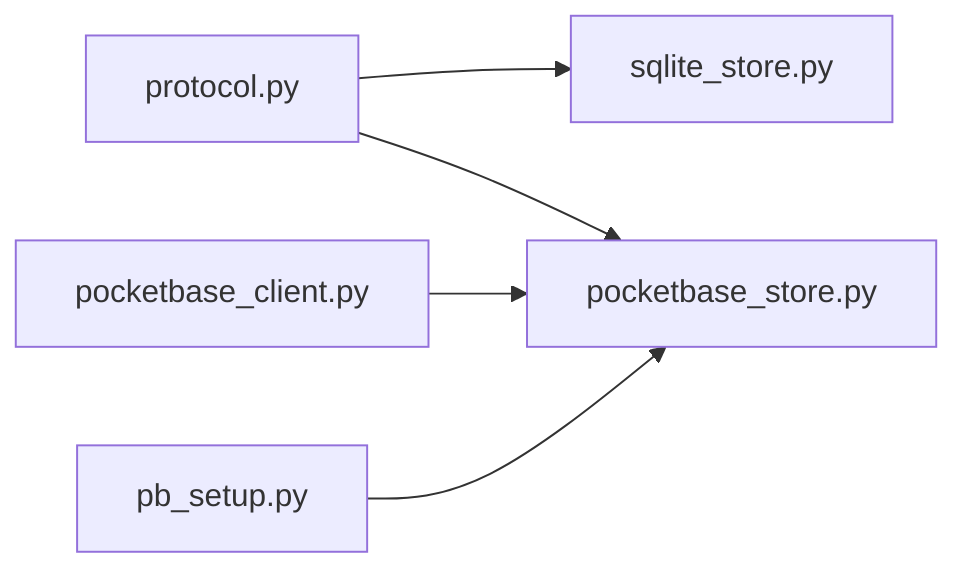

# 存储后端

<cite>
**本文引用的文件**   
- [sqlite_store.py](file://deeptutor/services/session/sqlite_store.py)
- [pocketbase_store.py](file://deeptutor/services/session/pocketbase_store.py)
- [protocol.py](file://deeptutor/services/session/protocol.py)
- [migration_lock.py](file://deeptutor/services/session/migration_lock.py)
- [pocketbase_client.py](file://deeptutor/services/pocketbase_client.py)
- [pb_setup.py](file://scripts/pb_setup.py)
</cite>

## 目录
1. [引言](#引言)
2. [项目结构](#项目结构)
3. [核心组件](#核心组件)
4. [架构总览](#架构总览)
5. [详细组件分析](#详细组件分析)
6. [依赖关系分析](#依赖关系分析)
7. [性能与并发特性](#性能与并发特性)
8. [故障恢复与最佳实践](#故障恢复与最佳实践)
9. [结论](#结论)
10. [附录：自定义存储后端实现指南](#附录自定义存储后端实现指南)

## 引言
本文件面向“会话存储后端”，聚焦以下目标：
- SQLite 存储实现：表结构、索引优化、查询路径和并发控制。
- PocketBase 存储适配器：远程同步机制、数据一致性、离线与回退策略。
- 迁移锁机制：跨进程数据库结构升级的原子性与一致性。
- 自定义存储后端：基于统一协议扩展新后端的步骤与注意事项。
- 备份恢复、连接池配置与并发访问控制建议。
- 数据存储最佳实践与故障恢复方案。

## 项目结构
会话存储相关代码集中在 `deeptutor/services/session`，并配套 PocketBase 客户端与集合初始化脚本：
- `services/session/sqlite_store.py`：SQLite 本地会话、消息、轮次、事件等持久化实现。
- `services/session/pocketbase_store.py`：PocketBase 远程集合实现的会话存储。
- `services/session/protocol.py`：统一的存储接口协议，屏蔽具体后端差异。
- `services/session/migration_lock.py`：跨进程互斥锁，用于迁移阶段串行化。
- `services/pocketbase_client.py`：PocketBase SDK 单例、健康检查与令牌校验缓存。
- `scripts/pb_setup.py`：部署时创建 PocketBase 集合（sessions、messages、turns、turn_events 等）的结构定义。

**图表来源**
- [protocol.py:38-276](file://deeptutor/services/session/protocol.py#L38-L276)
- [sqlite_store.py:245-256](file://deeptutor/services/session/sqlite_store.py#L245-L256)
- [pocketbase_store.py:171-189](file://deeptutor/services/session/pocketbase_store.py#L171-L189)
- [migration_lock.py:18-49](file://deeptutor/services/session/migration_lock.py#L18-L49)
- [pocketbase_client.py:56-108](file://deeptutor/services/pocketbase_client.py#L56-L108)
- [pb_setup.py:190-220](file://scripts/pb_setup.py#L190-L220)

**章节来源**
- [protocol.py:38-276](file://deeptutor/services/session/protocol.py#L38-L276)
- [sqlite_store.py:245-256](file://deeptutor/services/session/sqlite_store.py#L245-L256)
- [pocketbase_store.py:171-189](file://deeptutor/services/session/pocketbase_store.py#L171-L189)
- [migration_lock.py:18-49](file://deeptutor/services/session/migration_lock.py#L18-L49)
- [pocketbase_client.py:56-108](file://deeptutor/services/pocketbase_client.py#L56-L108)
- [pb_setup.py:190-220](file://scripts/pb_setup.py#L190-L220)

## 核心组件
- 统一协议：定义 SessionRepository、TurnRepository、MessageRepository 以及组合后的 SessionStoreProtocol，确保上层调用对 SQLite 与 PocketBase 无感知。
- SQLite 存储：提供本地 WAL 模式、事务封装、迁移与索引维护、提交去重与会话活跃轮次保护。
- PocketBase 存储：通过 HTTP 调用远端集合，按用户与工作区隔离，合并偏好字段，并在终端状态前刷新事件以保证一致性。
- 迁移锁：使用操作系统级文件锁保证多进程下迁移只由一个进程执行。
- PocketBase 客户端：管理 SDK 实例、管理员认证、健康检查与令牌校验缓存。

**章节来源**
- [protocol.py:38-276](file://deeptutor/services/session/protocol.py#L38-L276)
- [sqlite_store.py:245-256](file://deeptutor/services/session/sqlite_store.py#L245-L256)
- [pocketbase_store.py:171-189](file://deeptutor/services/session/pocketbase_store.py#L171-L189)
- [migration_lock.py:18-49](file://deeptutor/services/session/migration_lock.py#L18-L49)
- [pocketbase_client.py:56-108](file://deeptutor/services/pocketbase_client.py#L56-L108)

## 架构总览
会话存储采用“协议 + 多实现”的架构：
- 上层业务仅依赖 SessionStoreProtocol。
- SQLite 作为默认本地后端；PocketBase 作为可配置的远程后端。
- 迁移在启动或首次访问时进行，受 exclusive_lock 保护。
- PocketBase 侧通过 pb_setup.py 初始化集合结构，运行时通过 pocketbase_client.py 访问。

**图表来源**
- [protocol.py:38-276](file://deeptutor/services/session/protocol.py#L38-L276)
- [sqlite_store.py:1110-1130](file://deeptutor/services/session/sqlite_store.py#L1110-L1130)
- [pocketbase_store.py:87-91](file://deeptutor/services/session/pocketbase_store.py#L87-L91)
- [pocketbase_client.py:56-108](file://deeptutor/services/pocketbase_client.py#L56-L108)

## 详细组件分析

### SQLite 存储实现
SQLiteSessionStore 负责会话、消息、轮次、事件、笔记条目、评估尝试等数据的持久化。关键设计点：
- 表结构：包含 sessions、messages、turns、turn_submissions、turn_events、notebook_entries、assessment_attempts、reading_quiz_pending、reading_quiz_rewards、notebook_categories、notebook_entry_categories 等。
- 索引优化：为常用查询路径建立复合索引，如按 session_id+updated_at、session_id+status、turn_events(turn_id, seq)、notebook_entries(session_id, created_at) 等。
- 迁移与兼容性：通过 ALTER TABLE、重建表、条件索引等方式逐步演进 schema，避免破坏历史数据。
- 并发与一致性：WAL 模式提升读写并发；部分唯一索引防止同一会话同时存在多个活跃轮次；提交去重表 turn_submissions 保障幂等。
- 连接管理：每次操作新建 sqlite3.Connection，设置 foreign_keys=ON、busy_timeout，并通过上下文管理器确保事务语义与连接释放。

**图表来源**
- [sqlite_store.py:245-256](file://deeptutor/services/session/sqlite_store.py#L245-L256)
- [sqlite_store.py:274-529](file://deeptutor/services/session/sqlite_store.py#L274-L529)
- [sqlite_store.py:1110-1130](file://deeptutor/services/session/sqlite_store.py#L1110-L1130)
- [sqlite_store.py:1132-1173](file://deeptutor/services/session/sqlite_store.py#L1132-L1173)
- [sqlite_store.py:1450-1577](file://deeptutor/services/session/sqlite_store.py#L1450-L1577)
- [sqlite_store.py:1879-1902](file://deeptutor/services/session/sqlite_store.py#L1879-L1902)

#### 表结构与索引
- sessions：会话元数据，含标题、时间戳、压缩摘要、工作区偏好 JSON。
- messages：消息内容、角色、能力、事件与附件 JSON、元数据 JSON、父消息分支指针。
- turns：轮次状态机（queued/running/waiting_input/completed/failed/cancelled），含 owner_id、fencing_token、state_version、failure_code、retryable、assistant_message_id。
- turn_submissions：提交去重与编辑替换，支持 superseded_by。
- turn_events：有序事件流，seq 唯一约束，便于增量拉取。
- notebook_entries：问答记录，支持来源、材料、章节、掌握路径、知识点、评分趋势、是否收藏、AI 判断等。
- assessment_attempts：不可变评估尝试，支持关联与链接状态。
- reading_quiz_pending/rewards：阅读测验待处理与奖励。
- notebook_categories/notebook_entry_categories：分类与多对多关系。

索引包括：
- idx_messages_session_created：会话内消息排序。
- idx_messages_parent：分支查找。
- idx_sessions_updated_at：会话列表排序。
- idx_turns_session_updated / idx_turns_session_status：轮次查询。
- idx_turn_events_turn_seq：事件顺序读取。
- idx_notebook_entries_session / bookmarked / review / linkage：笔记与评估查询。
- idx_assessment_attempts_session_time / origin_time / linkage：评估尝试聚合。

**章节来源**
- [sqlite_store.py:274-529](file://deeptutor/services/session/sqlite_store.py#L274-L529)
- [sqlite_store.py:800-1108](file://deeptutor/services/session/sqlite_store.py#L800-L1108)

#### 查询与性能调优
- 会话列表与搜索：按 updated_at 降序分页，必要时二次翻页以支持 offset。
- 消息与事件：按 session_id 与 msg_created_at 排序；事件按 turn_id 与 seq 顺序读取。
- 轮次状态：通过 partial unique index 限制同一会话的活跃轮次数量。
- 提交去重：turn_submissions 保证 client_submission_id 的唯一性，支持编辑替换与幂等重放。
- 偏好字段合并：preferences_json 通过 read-merge-write 与线程锁避免覆盖。

**章节来源**
- [sqlite_store.py:1110-1130](file://deeptutor/services/session/sqlite_store.py#L1110-L1130)
- [sqlite_store.py:1175-1319](file://deeptutor/services/session/sqlite_store.py#L1175-L1319)
- [sqlite_store.py:1450-1577](file://deeptutor/services/session/sqlite_store.py#L1450-L1577)
- [sqlite_store.py:1879-1902](file://deeptutor/services/session/sqlite_store.py#L1879-L1902)

### PocketBase 存储适配器
PocketBaseSessionStore 将会话数据映射到 PocketBase 的 collections：sessions、messages、turns、turn_events。关键设计点：
- 用户与工作区隔离：所有查询附加 user_id 与 workspace_id 过滤，避免跨用户/工作区访问。
- 偏好字段合并：preferences_json 通过 per-session 线程锁串行化，避免并发覆盖。
- 终端状态前刷新事件：确保 DONE 事件与状态变更一致，避免丢失追踪信息。
- 离线与回退：当 PocketBase 不可用时，系统可通过健康检查与错误日志降级至 SQLite（见客户端 ping）。
- 导入与清理：import_legacy_session 在失败时回滚已创建的记录；delete_session 级联删除子集合。

**图表来源**
- [pocketbase_store.py:932-982](file://deeptutor/services/session/pocketbase_store.py#L932-L982)
- [pocketbase_store.py:838-884](file://deeptutor/services/session/pocketbase_store.py#L838-L884)
- [pocketbase_client.py:56-108](file://deeptutor/services/pocketbase_client.py#L56-L108)

#### 远程同步机制与冲突解决
- 同步模型：直接 HTTP 调用，非本地缓存；每个方法最多几次网络往返，延迟可接受。
- 冲突检测：ActiveTurnConflict 表示会话已有活跃轮次；SQLite 通过 partial unique index 强制，PocketBase 通过服务端集合约束与客户端扫描 active 状态。
- 幂等与重放：submission_id 去重，支持编辑替换与旧任务重放。
- 数据一致性：终端状态变更前 flush 事件，保证 DONE 不脱离上传任务。

**章节来源**
- [pocketbase_store.py:1-14](file://deeptutor/services/session/pocketbase_store.py#L1-L14)
- [pocketbase_store.py:1373-1451](file://deeptutor/services/session/pocketbase_store.py#L1373-L1451)
- [pocketbase_store.py:1573-1599](file://deeptutor/services/session/pocketbase_store.py#L1573-L1599)
- [protocol.py:20-36](file://deeptutor/services/session/protocol.py#L20-L36)

#### 离线支持与回退
- 健康检查：ping_pocketbase 在启动时探测服务器可达性。
- 错误处理：各方法捕获异常并记录警告，返回空结果或 False，避免中断主流程。
- 回退策略：当 PocketBase 不可用，上层可选择 SQLite 后端继续运行。

**章节来源**
- [pocketbase_client.py:164-197](file://deeptutor/services/pocketbase_client.py#L164-L197)
- [pocketbase_store.py:838-884](file://deeptutor/services/session/pocketbase_store.py#L838-L884)

### 迁移锁机制
exclusive_lock 使用 fcntl（POSIX）或 msvcrt（Windows）对锁文件加独占锁，确保多进程下迁移串行执行，避免 WAL 切换与触发器重复创建等问题。SQLiteSessionStore 在初始化与偏好迁移中均使用该锁。

**图表来源**
- [migration_lock.py:18-49](file://deeptutor/services/session/migration_lock.py#L18-L49)
- [sqlite_store.py:57-63](file://deeptutor/services/session/sqlite_store.py#L57-L63)
- [sqlite_store.py:254-256](file://deeptutor/services/session/sqlite_store.py#L254-L256)

**章节来源**
- [migration_lock.py:18-49](file://deeptutor/services/session/migration_lock.py#L18-L49)
- [sqlite_store.py:57-63](file://deeptutor/services/session/sqlite_store.py#L57-L63)
- [sqlite_store.py:254-256](file://deeptutor/services/session/sqlite_store.py#L254-L256)

## 依赖关系分析
- SQLiteSessionStore 依赖 protocol 定义的接口与 ActiveTurnConflict 异常类型。
- PocketBaseSessionStore 依赖 pocketbase_client 提供的 SDK 单例与健康检查。
- 两者都依赖 workspace 上下文与当前用户上下文进行隔离。
- pb_setup.py 定义了 PocketBase 集合结构，与运行时写入字段保持一致。

**图表来源**
- [protocol.py:38-276](file://deeptutor/services/session/protocol.py#L38-L276)
- [sqlite_store.py:245-256](file://deeptutor/services/session/sqlite_store.py#L245-L256)
- [pocketbase_store.py:171-189](file://deeptutor/services/session/pocketbase_store.py#L171-L189)
- [pocketbase_client.py:56-108](file://deeptutor/services/pocketbase_client.py#L56-L108)
- [pb_setup.py:190-220](file://scripts/pb_setup.py#L190-L220)

**章节来源**
- [protocol.py:38-276](file://deeptutor/services/session/protocol.py#L38-L276)
- [sqlite_store.py:245-256](file://deeptutor/services/session/sqlite_store.py#L245-L256)
- [pocketbase_store.py:171-189](file://deeptutor/services/session/pocketbase_store.py#L171-L189)
- [pocketbase_client.py:56-108](file://deeptutor/services/pocketbase_client.py#L56-L108)
- [pb_setup.py:190-220](file://scripts/pb_setup.py#L190-L220)

## 性能与并发特性
- SQLite：
  - WAL 模式允许读并发与写提交并行。
  - busy_timeout 与 timeout 参数降低锁竞争导致的失败。
  - 复合索引减少全表扫描，提高会话列表、消息与事件查询效率。
  - 部分唯一索引防止同一会话多个活跃轮次。
- PocketBase：
  - 直接 HTTP 调用，延迟约 5–10 ms，适合低频高可靠写入。
  - 偏好字段合并使用线程锁串行化，避免并发覆盖。
  - 终端状态前刷新事件，保证一致性。
- 通用：
  - 活动轮次冲突通过 ActiveTurnConflict 明确表达，便于上层重试或提示。
  - 提交去重与编辑替换保证幂等与一致性。

[本节为一般性指导，无需特定文件引用]

## 故障恢复与最佳实践
- 备份恢复：
  - SQLite：定期复制 .db 与 .db-wal/.db-shm 文件；迁移期间使用 exclusive_lock 避免损坏。
  - PocketBase：导出集合数据或使用官方备份工具；导入时使用 pb_setup.py 初始化结构。
- 连接池：
  - SQLite：当前实现为每次操作新建连接，避免连接泄漏；如需更高吞吐，可引入连接池但需保持事务边界与锁策略。
  - PocketBase：复用 SDK 单例，避免重复认证开销。
- 并发访问控制：
  - SQLite：使用 _run 串行化异步调用到线程；WAL 与 busy_timeout 缓解竞争。
  - PocketBase：偏好字段合并使用 per-session 线程锁；活动轮次通过服务端约束与客户端扫描双重保护。
- 错误处理：
  - 捕获异常并记录警告，返回空结果或 False，避免中断主流程。
  - 健康检查与令牌校验缓存提升可用性。

**章节来源**
- [sqlite_store.py:1110-1130](file://deeptutor/services/session/sqlite_store.py#L1110-L1130)
- [pocketbase_store.py:838-884](file://deeptutor/services/session/pocketbase_store.py#L838-L884)
- [pocketbase_client.py:164-197](file://deeptutor/services/pocketbase_client.py#L164-L197)

## 结论
本项目通过统一协议抽象了 SQLite 与 PocketBase 两种会话存储后端，既保证了本地高性能与强一致性，又提供了远程可扩展的云端能力。迁移锁机制确保了数据库结构升级的安全与原子性；提交去重与活动轮次保护提升了并发安全性。在实际部署中，建议结合备份策略、连接池优化与错误监控，进一步提升系统的稳定性与可维护性。

[本节为总结性内容，无需特定文件引用]

## 附录：自定义存储后端实现指南
要实现自定义存储后端，请遵循以下步骤：
1. 实现 SessionStoreProtocol 接口，涵盖会话、轮次、消息与事件等核心方法。
2. 参考 SQLiteSessionStore 与 PocketBaseSessionStore 的实现风格：
   - 使用上下文管理器管理资源（连接、HTTP 客户端）。
   - 保证事务语义与错误回滚。
   - 对用户与工作区进行隔离。
3. 处理并发与一致性：
   - 使用锁或唯一索引防止竞态条件。
   - 在终端状态变更前刷新事件，保证一致性。
4. 提供迁移与兼容性支持：
   - 检测 schema 版本并执行增量迁移。
   - 保留历史数据并平滑过渡。
5. 集成到系统：
   - 根据配置选择后端（SQLite 或 PocketBase）。
   - 注册新的后端实现，供上层调用。

示例参考路径：
- 接口定义：[protocol.py:38-276](file://deeptutor/services/session/protocol.py#L38-L276)
- SQLite 实现：[sqlite_store.py:245-256](file://deeptutor/services/session/sqlite_store.py#L245-L256)
- PocketBase 实现：[pocketbase_store.py:171-189](file://deeptutor/services/session/pocketbase_store.py#L171-L189)

**章节来源**
- [protocol.py:38-276](file://deeptutor/services/session/protocol.py#L38-L276)
- [sqlite_store.py:245-256](file://deeptutor/services/session/sqlite_store.py#L245-L256)
- [pocketbase_store.py:171-189](file://deeptutor/services/session/pocketbase_store.py#L171-L189)