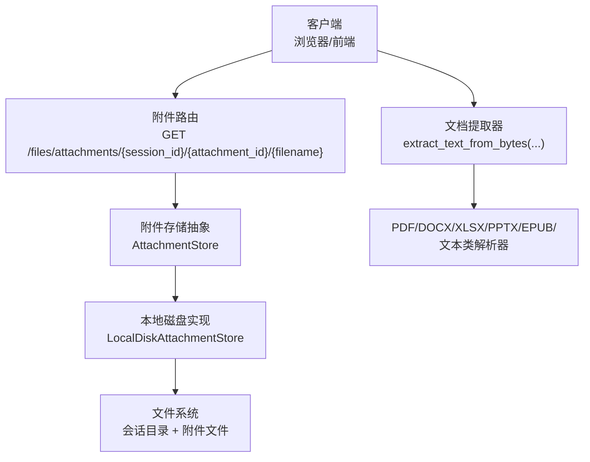
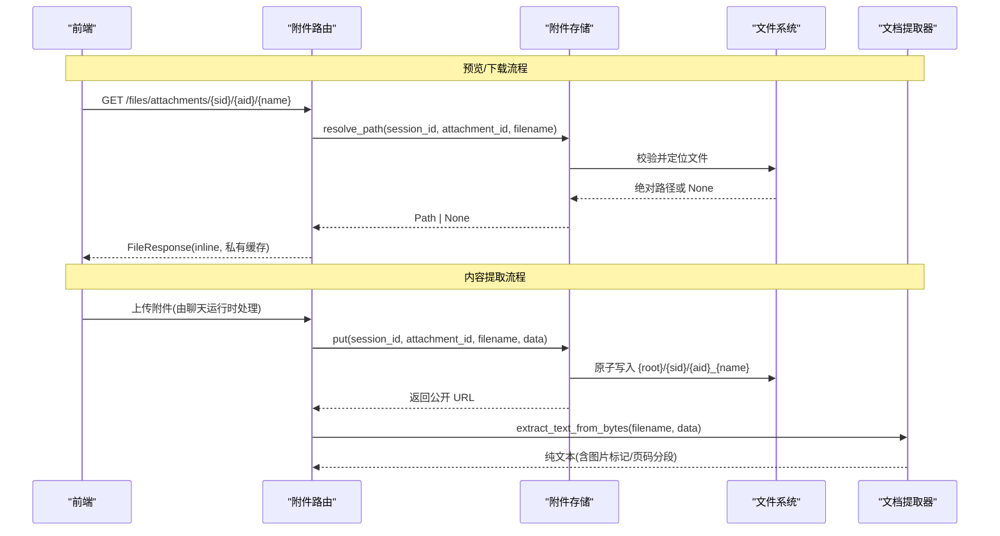
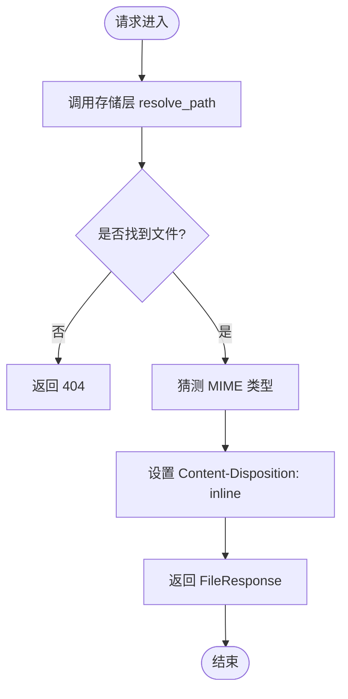
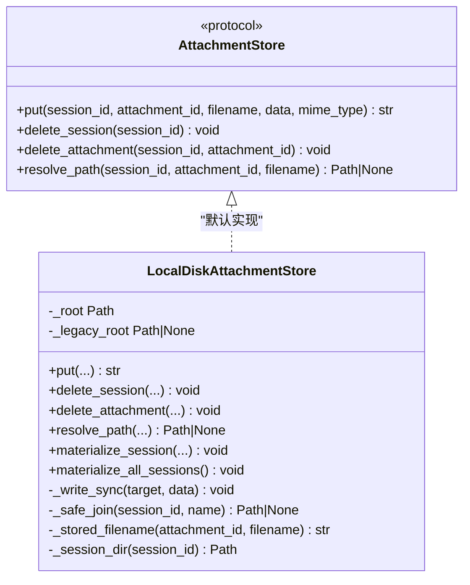
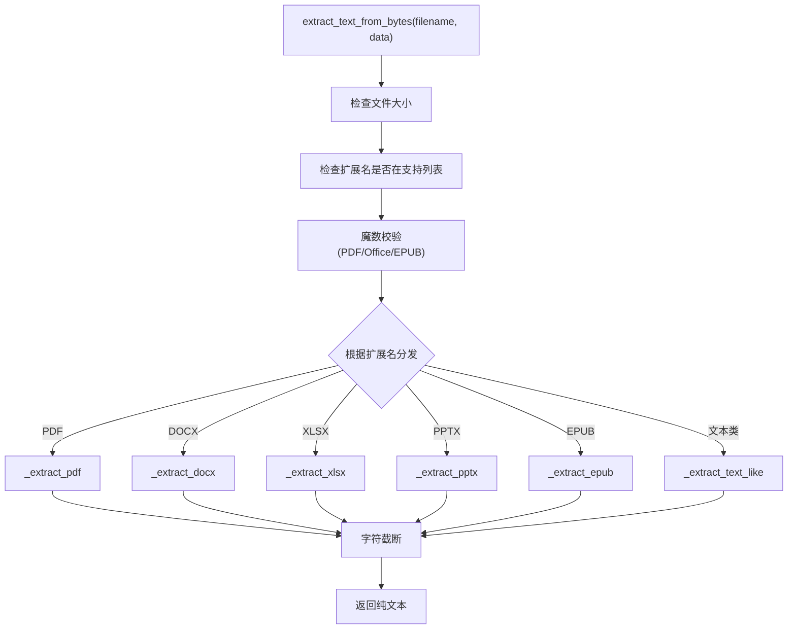
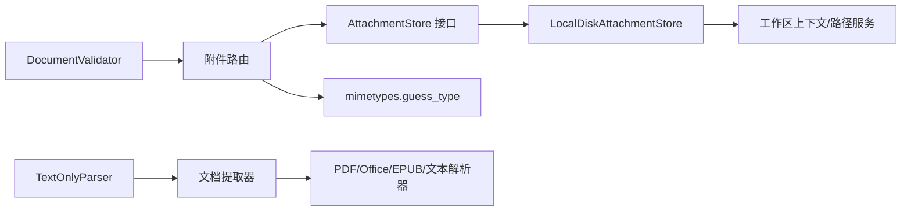

# 附件管理

<cite>
**本文引用的文件**   
- [attachments.py](file://deeptutor/api/routers/attachments.py)
- [attachment_store.py](file://deeptutor/services/storage/attachment_store.py)
- [document_extractor.py](file://deeptutor/utils/document_extractor.py)
- [document_validator.py](file://deeptutor/utils/document_validator.py)
- [file_io.py](file://deeptutor/services/file_io.py)
- [engine.py](file://deeptutor/services/parsing/engines/text_only/engine.py)
- [test_knowledge_zip_upload.py](file://tests/api/test_knowledge_zip_upload.py)
</cite>

## 目录
1. [简介](#简介)
2. [项目结构](#项目结构)
3. [核心组件](#核心组件)
4. [架构总览](#架构总览)
5. [详细组件分析](#详细组件分析)
6. [依赖关系分析](#依赖关系分析)
7. [性能与容量限制](#性能与容量限制)
8. [故障排查指南](#故障排查指南)
9. [结论](#结论)
10. [附录：处理不同类型附件的代码示例路径](#附录处理不同类型附件的代码示例路径)

## 简介
本文件面向 DeepTutor 的“附件管理”子系统，系统性说明附件从上传、验证、存储、预览到清理的完整生命周期；解释支持的文档类型（文本、图片、PDF、Office 文档、EPUB 等）及其处理方法；阐述文档提取器如何解析内容、提取元数据并做格式转换；同时给出文件大小限制、安全检查与存储优化策略。文档以代码级实现为依据，并提供可视化架构图和流程图，帮助不同技术背景的读者理解系统行为与安全边界。

## 项目结构
附件相关能力横跨 API 路由、存储服务、工具层与测试：
- API 路由提供附件下载/预览接口，负责安全地返回本地磁盘上的附件文件。
- 存储服务定义统一的附件写入、删除、路径解析协议，并提供默认本地磁盘实现。
- 文档提取器负责将二进制或结构化文档转换为纯文本，供聊天上下文使用。
- 文档校验器提供通用的上传安全校验（扩展名、MIME、文件名清洗）。
- 通用文件 IO 工具提供原子写、fsync 降级告警与权限错误重试。
- 文本解析引擎适配器暴露内置解析器的可用格式集合。
- 测试覆盖压缩包上传、Zip Slip 防护与非法压缩包拒绝等场景。

图表来源
- [attachments.py:40-79](file://deeptutor/api/routers/attachments.py#L40-L79)
- [attachment_store.py:65-103](file://deeptutor/services/storage/attachment_store.py#L65-L103)
- [attachment_store.py:105-174](file://deeptutor/services/storage/attachment_store.py#L105-L174)
- [document_extractor.py:239-287](file://deeptutor/utils/document_extractor.py#L239-L287)

章节来源
- [attachments.py:1-80](file://deeptutor/api/routers/attachments.py#L1-L80)
- [attachment_store.py:1-326](file://deeptutor/services/storage/attachment_store.py#L1-L326)
- [document_extractor.py:1-800](file://deeptutor/utils/document_extractor.py#L1-L800)
- [document_validator.py:1-207](file://deeptutor/utils/document_validator.py#L1-L207)
- [file_io.py:1-134](file://deeptutor/services/file_io.py#L1-L134)
- [engine.py:17-52](file://deeptutor/services/parsing/engines/text_only/engine.py#L17-L52)
- [test_knowledge_zip_upload.py:52-95](file://tests/api/test_knowledge_zip_upload.py#L52-L95)

## 核心组件
- 附件路由：提供安全的附件读取接口，仅允许通过存储层解析出的绝对路径访问文件，并设置合适的响应头用于浏览器内联预览。
- 附件存储抽象与本地实现：定义统一接口 put/delete/resolve_path，本地实现保证路径安全、原子写入、按会话隔离、兼容旧路径迁移。
- 文档提取器：对 PDF、DOCX、XLSX、PPTX、EPUB 以及文本类文件进行字节级解析，输出可嵌入聊天上下文的纯文本，并对图片和富媒体生成标记。
- 文档校验器：提供扩展名白名单、MIME 校验、文件名清洗与大小上限检查。
- 通用文件 IO：提供原子写、fsync 降级告警、Windows 共享锁重试等健壮性保障。
- 文本解析引擎适配器：对外暴露内置解析器支持的文件扩展集合，便于上层选择与展示。

章节来源
- [attachments.py:1-80](file://deeptutor/api/routers/attachments.py#L1-L80)
- [attachment_store.py:65-174](file://deeptutor/services/storage/attachment_store.py#L65-L174)
- [document_extractor.py:239-310](file://deeptutor/utils/document_extractor.py#L239-L310)
- [document_validator.py:13-151](file://deeptutor/utils/document_validator.py#L13-L151)
- [file_io.py:70-130](file://deeptutor/services/file_io.py#L70-L130)
- [engine.py:17-52](file://deeptutor/services/parsing/engines/text_only/engine.py#L17-L52)

## 架构总览
附件在系统中的流转分为两条主线：
- 预览/下载线：前端通过 GET /files/attachments/{session_id}/{attachment_id}/{filename} 请求附件，路由调用存储层 resolve_path 获取安全路径后返回 FileResponse。
- 内容提取线：聊天运行时在持久化附件后，调用文档提取器将二进制文档转为纯文本，以便注入 LLM 上下文。

图表来源
- [attachments.py:40-79](file://deeptutor/api/routers/attachments.py#L40-L79)
- [attachment_store.py:147-174](file://deeptutor/services/storage/attachment_store.py#L147-L174)
- [document_extractor.py:239-287](file://deeptutor/utils/document_extractor.py#L239-L287)

## 详细组件分析

### 附件路由：预览与下载
- 路由只接受已持久化的附件，并通过存储层 resolve_path 获取绝对路径，防止任意路径访问。
- 响应头使用 Content-Disposition: inline，使浏览器尽可能内联预览 PDF/图片；未知类型回退为下载。
- 设置 Cache-Control: private, max-age=0, must-revalidate，避免中间缓存用户上传内容。
- 若后端不是本地磁盘实现，直接返回 501，提示当前不可服务（未来可扩展为签名 URL 重定向）。

图表来源
- [attachments.py:40-79](file://deeptutor/api/routers/attachments.py#L40-L79)

章节来源
- [attachments.py:1-80](file://deeptutor/api/routers/attachments.py#L1-L80)

### 附件存储：本地磁盘实现
- 设计目标：默认本地磁盘、可插拔后端、路径安全。
- 目录布局：{root}/{session_id}/{attachment_id}_{filename}，前缀防同名冲突。
- 安全机制：
  - _safe_join 拒绝符号链接与路径穿越，确保最终路径位于 root 下。
  - 文件名经 safe_filename 清洗，URL 段 percent-encode。
- 写入过程：先写 .tmp 再 os.replace，避免半写文件被静态处理器读到。
- 删除策略：按会话或附件 ID 清理，空目录自动移除。
- 兼容旧路径：支持 legacy_root 迁移与 materialize_session。

图表来源
- [attachment_store.py:65-103](file://deeptutor/services/storage/attachment_store.py#L65-L103)
- [attachment_store.py:105-174](file://deeptutor/services/storage/attachment_store.py#L105-L174)
- [attachment_store.py:193-242](file://deeptutor/services/storage/attachment_store.py#L193-L242)

章节来源
- [attachment_store.py:1-326](file://deeptutor/services/storage/attachment_store.py#L1-L326)

### 文档提取器：内容解析、元数据与格式转换
- 支持三类格式族：
  - 二进制 Office：PDF、DOCX、XLSX、PPTX。
  - EPUB：ZIP 中的 XHTML，按 OPF spine 顺序提取。
  - 文本类：纯文本、Markdown、源码、JSON、XML、CSV 等，扩展集来自 FileTypeRouter.TEXT_EXTENSIONS。
- 入口函数：
  - extract_text_from_bytes：字节输入，文本输出，带单文件字节数与字符数截断。
  - extract_text_from_path：基于路径读取并委托给 bytes 版本。
  - extract_text_from_path_isolated：在隔离进程中执行，超时保护并透传公共错误类型。
- 安全与健壮性：
  - 魔数校验：PDF 以 %PDF- 开头，OOXML/EPUB 以 PK\x03\x04 开头，防止扩展名欺骗。
  - 加密检测：PDF 加密直接报错，不尝试暴力破解。
  - 图片提取：PDF/DOCX/PPTX 会提取内嵌图片并以标记形式插入文本流，控制每轮图片数量与总字节数。
- 各格式处理要点：
  - PDF：优先 pymupdf，失败回退 pypdf；分页输出并附加图片摘要。
  - DOCX：优先 rich OOXML 解析，失败回退 python-docx 与原始 OOXML 路径。
  - XLSX：优先 openpyxl 只读模式，失败回退原始 OOXML。
  - PPTX：优先 rich 解析，失败回退 python-pptx 与原始 OOXML。
  - EPUB：解析 container.xml -> OPF -> spine，跳过 __MACOSX 资源叉成员，容忍部分损坏章节。
  - 文本类：复用 FileTypeRouter.decode_bytes 的多编码回退链。

图表来源
- [document_extractor.py:239-287](file://deeptutor/utils/document_extractor.py#L239-L287)
- [document_extractor.py:369-445](file://deeptutor/utils/document_extractor.py#L369-L445)
- [document_extractor.py:448-598](file://deeptutor/utils/document_extractor.py#L448-L598)
- [document_extractor.py:601-614](file://deeptutor/utils/document_extractor.py#L601-L614)
- [document_extractor.py:616-800](file://deeptutor/utils/document_extractor.py#L616-L800)

章节来源
- [document_extractor.py:1-800](file://deeptutor/utils/document_extractor.py#L1-L800)

### 文档校验器：上传安全与类型白名单
- 最大文件大小：200MB（全局常量）。
- 允许的扩展名：pdf、txt、md、doc、docx、rtf、html、htm、xml、json、csv、xlsx、xls、pptx、ppt、epub。
- 允许的 MIME 类型：对应上述扩展名的常见 MIME。
- 校验流程：
  - 可选大小检查。
  - 文件名规范化与危险字符清洗。
  - 扩展名匹配（支持多段后缀如 tar.gz）。
  - 当未显式传入扩展名集合时，额外进行 MIME 校验。
- 辅助方法：get_file_info、validate_file。

章节来源
- [document_validator.py:13-151](file://deeptutor/utils/document_validator.py#L13-L151)
- [document_validator.py:153-207](file://deeptutor/utils/document_validator.py#L153-L207)

### 通用文件 IO：原子性与可靠性
- atomic_write_json / atomic_write_text：临时文件写入 + fsync + 原子替换，避免部分写入。
- fsync 失败降级：记录限频警告，不影响主流程。
- Windows 共享锁重试：指数退避重试 PermissionError。

章节来源
- [file_io.py:70-130](file://deeptutor/services/file_io.py#L70-L130)

### 文本解析引擎适配器：内置解析器能力
- TextOnlyParser 暴露 supported_formats 为 SUPPORTED_DOC_EXTENSIONS，便于上层展示与选择。
- parse 方法中可输出进度信息，并将结果落盘为 Markdown。

章节来源
- [engine.py:17-52](file://deeptutor/services/parsing/engines/text_only/engine.py#L17-L52)

## 依赖关系分析
- 路由依赖存储抽象，实际运行期总是本地磁盘实现；未来可切换远程后端并重定向到签名 URL。
- 存储实现依赖工作区上下文与路径服务，决定附件根目录与旧路径兼容。
- 文档提取器依赖外部库（pymupdf、pypdf、python-docx、openpyxl、python-pptx），采用惰性加载与回退策略。
- 校验器与文本解析引擎共享扩展名集合，保持知识库与聊天管道一致。

图表来源
- [attachments.py:20-30](file://deeptutor/api/routers/attachments.py#L20-L30)
- [attachment_store.py:39-42](file://deeptutor/services/storage/attachment_store.py#L39-L42)
- [document_extractor.py:35-46](file://deeptutor/utils/document_extractor.py#L35-L46)
- [engine.py:9-10](file://deeptutor/services/parsing/engines/text_only/engine.py#L9-L10)
- [document_validator.py:6-10](file://deeptutor/utils/document_validator.py#L6-L10)

章节来源
- [attachments.py:1-80](file://deeptutor/api/routers/attachments.py#L1-L80)
- [attachment_store.py:1-326](file://deeptutor/services/storage/attachment_store.py#L1-L326)
- [document_extractor.py:1-800](file://deeptutor/utils/document_extractor.py#L1-L800)
- [engine.py:17-52](file://deeptutor/services/parsing/engines/text_only/engine.py#L17-L52)
- [document_validator.py:1-207](file://deeptutor/utils/document_validator.py#L1-L207)

## 性能与容量限制
- 文档提取尺寸限制：
  - 单文件字节上限：默认 20MB（可通过配置覆盖）。
  - 单次对话总字节上限：默认 25MB。
  - 单文档字符上限：默认 200,000。
  - 单次对话总字符上限：默认 150,000。
  - 每轮内嵌图片上限：最多 16 张，总字节不超过 12MB。
- 上传大小限制：
  - 文档校验器默认最大 200MB（适用于通用上传场景）。
- 存储优化：
  - 本地磁盘原子写入，避免半写文件。
  - 会话目录隔离，按 attachment_id 前缀去重。
  - 清理策略：按会话或附件删除，空目录自动移除。
  - 兼容旧路径迁移，减少历史数据迁移成本。
- I/O 可靠性：
  - fsync 失败降级告警，避免频繁日志噪声。
  - Windows 共享锁重试，提升稳定性。

章节来源
- [document_extractor.py:71-81](file://deeptutor/utils/document_extractor.py#L71-L81)
- [document_extractor.py:84-106](file://deeptutor/utils/document_extractor.py#L84-L106)
- [document_validator.py:16-17](file://deeptutor/utils/document_validator.py#L16-L17)
- [attachment_store.py:176-191](file://deeptutor/services/storage/attachment_store.py#L176-L191)
- [attachment_store.py:193-231](file://deeptutor/services/storage/attachment_store.py#L193-L231)
- [file_io.py:18-47](file://deeptutor/services/file_io.py#L18-L47)
- [file_io.py:50-72](file://deeptutor/services/file_io.py#L50-L72)

## 故障排查指南
- 预览 404：
  - 可能原因：附件不存在或路径穿越被拒绝。
  - 排查点：确认 store.resolve_path 返回非空；检查 session_id/attachment_id/filename 是否与存储命名一致。
- 预览 501：
  - 可能原因：后端不是本地磁盘实现。
  - 处理建议：当前仅支持本地磁盘直出；远程后端应改为签名 URL 重定向。
- 文档无法提取：
  - 可能原因：扩展名不支持、魔数校验失败、文件加密、解析库缺失。
  - 排查点：查看 DocumentExtractionError 子类（Unsupported/Corrupt/Empty/TooLarge）；确认 pymupdf/pypdf/docx/openpyxl/pptx 安装情况。
- 压缩包上传异常：
  - 可能原因：非法 ZIP、无受支持成员、Zip Slip 攻击。
  - 参考测试用例：[test_knowledge_zip_upload.py:52-95](file://tests/api/test_knowledge_zip_upload.py#L52-L95)。
- 存储写入失败：
  - 可能原因：磁盘空间不足、权限问题、fsync 失败。
  - 排查点：观察 fsync 降级告警与 PermissionError 重试日志。

章节来源
- [attachments.py:53-79](file://deeptutor/api/routers/attachments.py#L53-L79)
- [document_extractor.py:150-171](file://deeptutor/utils/document_extractor.py#L150-L171)
- [document_extractor.py:213-237](file://deeptutor/utils/document_extractor.py#L213-L237)
- [test_knowledge_zip_upload.py:52-95](file://tests/api/test_knowledge_zip_upload.py#L52-L95)
- [file_io.py:18-47](file://deeptutor/services/file_io.py#L18-L47)

## 结论
DeepTutor 的附件管理子系统围绕“安全、可靠、可扩展”展开：
- 安全性：路径穿越防护、魔数校验、扩展名/MIME 白名单、文件名清洗、内联预览与私有缓存。
- 可靠性：原子写入、fsync 降级告警、Windows 共享锁重试、隔离进程解析与超时保护。
- 可扩展性：存储后端抽象、惰性加载解析库、兼容旧路径迁移。
- 性能：严格的字节/字符/图片限额，避免大附件拖垮聊天上下文。

该体系既满足聊天附件的即时预览与内容提取需求，也为未来引入远程对象存储与更丰富的多媒体处理预留了接口。

## 附录：处理不同类型附件的代码示例路径
- 上传与保存（压缩包与 Zip Slip 防护）：
  - [test_knowledge_zip_upload.py:52-95](file://tests/api/test_knowledge_zip_upload.py#L52-L95)
- 文档提取入口与限制：
  - [document_extractor.py:239-287](file://deeptutor/utils/document_extractor.py#L239-L287)
  - [document_extractor.py:84-106](file://deeptutor/utils/document_extractor.py#L84-L106)
- PDF 解析与图片提取：
  - [document_extractor.py:369-445](file://deeptutor/utils/document_extractor.py#L369-L445)
- DOCX 解析与图片标记：
  - [document_extractor.py:448-509](file://deeptutor/utils/document_extractor.py#L448-L509)
- XLSX 解析：
  - [document_extractor.py:512-547](file://deeptutor/utils/document_extractor.py#L512-L547)
- PPTX 解析与图片标记：
  - [document_extractor.py:550-598](file://deeptutor/utils/document_extractor.py#L550-L598)
- 文本类解码：
  - [document_extractor.py:601-614](file://deeptutor/utils/document_extractor.py#L601-L614)
- EPUB 解析与章节顺序：
  - [document_extractor.py:616-800](file://deeptutor/utils/document_extractor.py#L616-L800)
- 附件预览/下载路由：
  - [attachments.py:40-79](file://deeptutor/api/routers/attachments.py#L40-L79)
- 附件存储写入与路径解析：
  - [attachment_store.py:147-174](file://deeptutor/services/storage/attachment_store.py#L147-L174)
  - [attachment_store.py:233-242](file://deeptutor/services/storage/attachment_store.py#L233-L242)
- 通用文件 IO 原子写与重试：
  - [file_io.py:70-130](file://deeptutor/services/file_io.py#L70-L130)
- 内置解析器能力声明：
  - [engine.py:17-52](file://deeptutor/services/parsing/engines/text_only/engine.py#L17-L52)