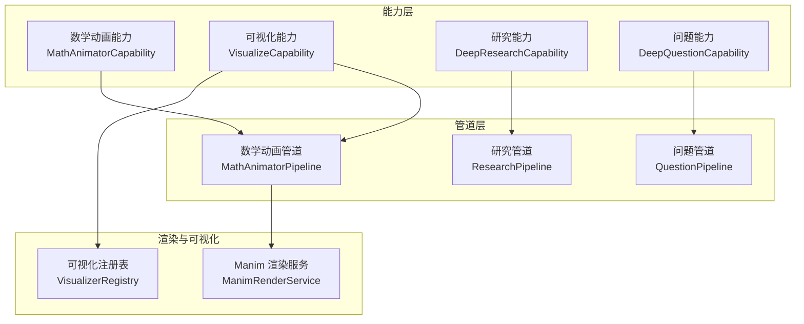
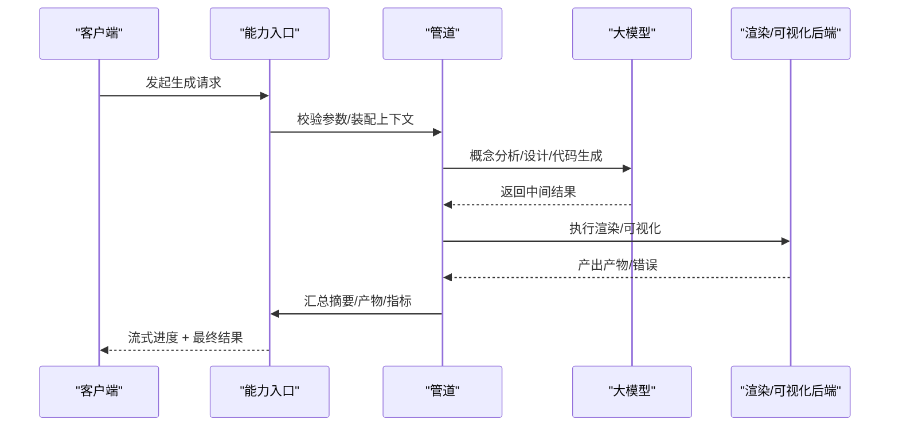
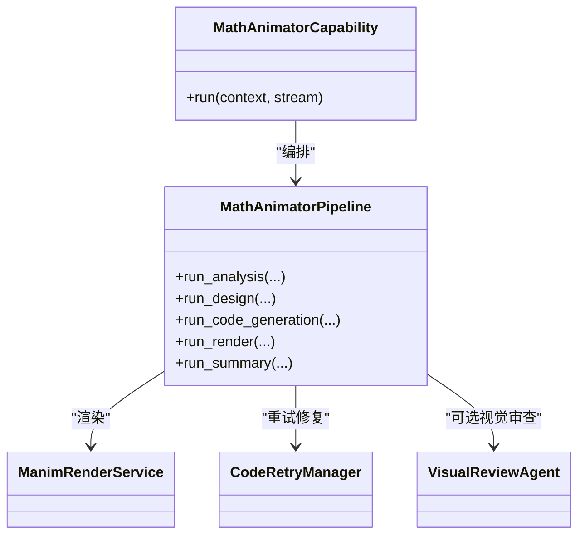
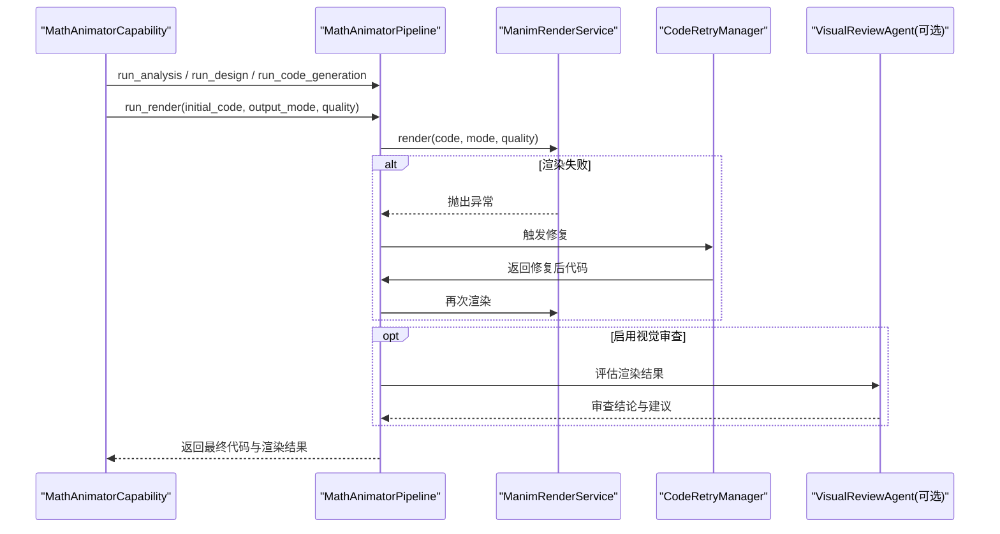
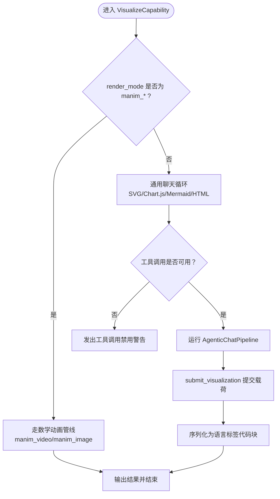
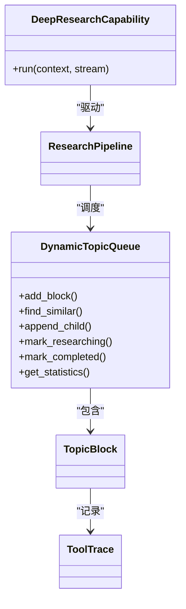
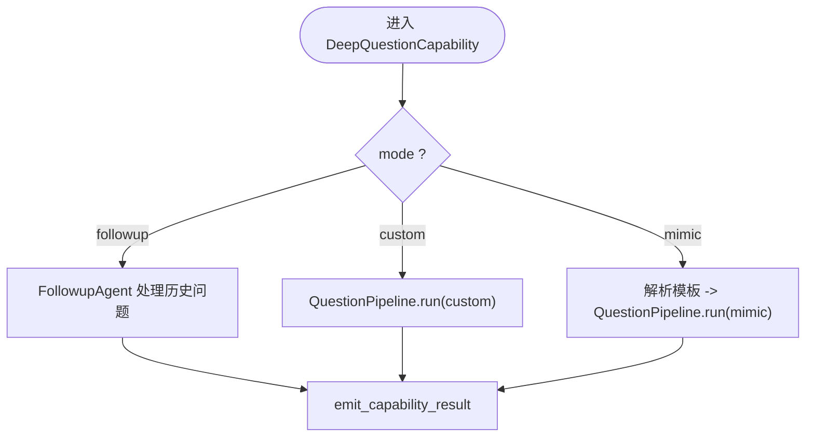
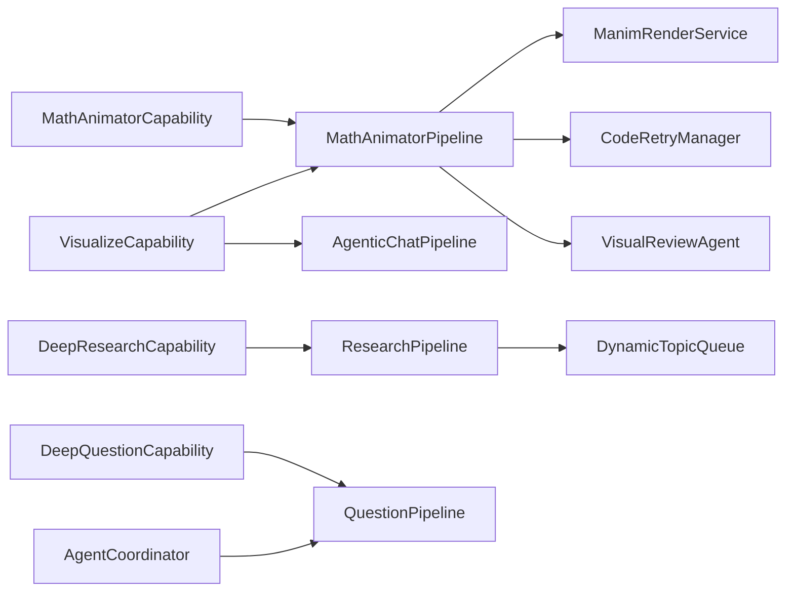

# 内容生成引擎

<cite>
**本文引用的文件**   
- [capability.py](file://deeptutor/agents/math_animator/capability.py)
- [pipeline.py](file://deeptutor/agents/math_animator/pipeline.py)
- [models.py](file://deeptutor/agents/math_animator/models.py)
- [capability.py](file://deeptutor/agents/visualize/capability.py)
- [models.py](file://deeptutor/agents/visualize/models.py)
- [capability.py](file://deeptutor/agents/research/capability.py)
- [data_structures.py](file://deeptutor/agents/research/data_structures.py)
- [capability.py](file://deeptutor/agents/question/capability.py)
- [coordinator.py](file://deeptutor/agents/question/coordinator.py)
- [capability_protocol.py](file://deeptutor/core/capability_protocol.py)
</cite>

## 目录
1. [简介](#简介)
2. [项目结构](#项目结构)
3. [核心组件](#核心组件)
4. [架构总览](#架构总览)
5. [详细组件分析](#详细组件分析)
6. [依赖关系分析](#依赖关系分析)
7. [性能与优化](#性能与优化)
8. [故障排查指南](#故障排查指南)
9. [结论](#结论)
10. [附录：配置与调用示例](#附录配置与调用示例)

## 简介
本文件面向“内容生成引擎”的开发者与使用者，系统性梳理以下能力模块：
- 数学动画生成器：将用户意图转化为可执行的 Manim 脚本并渲染为视频或图片。
- 可视化工具：基于插件化可视化器的通用图表、流程图、思维导图与 HTML 交互页面生成。
- 研究助手：深度研究任务的主题分解、工具编排、迭代报告与结果汇总。
- 问题生成器：支持自定义题型、难度控制与“仿卷模式”（从试卷模板抽取题目风格）。

文档同时说明智能体协作机制（任务分解、结果整合、质量控制）、输出格式、渲染方式、扩展方法与性能优化建议，既适合初学者入门，也提供深入定制指南。

## 项目结构
内容生成引擎以“能力（Capability）+ 管道（Pipeline）+ 模型（Model）”分层组织：
- 能力层：对外暴露统一入口，负责参数校验、上下文装配、阶段事件流与最终结果封装。
- 管道层：编排多个子智能体（概念分析、设计、代码生成、修复、总结等），串联 LLM 调用与渲染流程。
- 模型层：定义结构化数据契约，保证各阶段输入输出的稳定性与可序列化性。

图示来源
- [capability.py:19-220](file://deeptutor/agents/math_animator/capability.py#L19-L220)
- [pipeline.py:30-374](file://deeptutor/agents/math_animator/pipeline.py#L30-L374)
- [capability.py:89-234](file://deeptutor/agents/visualize/capability.py#L89-L234)
- [capability.py:40-93](file://deeptutor/agents/research/capability.py#L40-L93)
- [capability.py:29-160](file://deeptutor/agents/question/capability.py#L29-L160)

章节来源
- [capability_protocol.py:46-82](file://deeptutor/core/capability_protocol.py#L46-L82)

## 核心组件
- 数学动画生成器
  - 能力：校验可选依赖、构建请求配置、分阶段触发分析/设计/代码生成/渲染/总结，并通过 StreamBus 推送进度与思考片段。
  - 管道：协调概念分析、概念设计、代码生成、视觉审查（可选）、Manim 渲染与重试修复、工作区产物发布。
  - 模型：概念分析、场景设计、生成代码、摘要、渲染产物、重试记录、视觉审查结果等。
- 可视化工具
  - 能力：根据 render_mode 分流到通用聊天循环（SVG/Chart.js/Mermaid/HTML）或复用数学动画管线（Manim 视频/图片）。
  - 模型：可视化分析（render_type、visual_genre、chart_type 等）与审查结果。
- 研究助手
  - 能力：两阶段大纲预览流程；组装运行时配置；驱动 ResearchPipeline 完成主题分解、工具调用与报告汇总。
  - 数据结构：TopicBlock、ToolTrace、DynamicTopicQueue 等，支撑队列调度、去重、状态追踪与统计。
- 问题生成器
  - 能力：followup 单问答复、custom 模式（探索→计划→逐题循环）、mimic 模式（解析 PDF/目录模板后跳过探索与计划）。
  - 兼容层：AgentCoordinator 保留旧接口，内部委托 QuestionPipeline。

章节来源
- [capability.py:19-220](file://deeptutor/agents/math_animator/capability.py#L19-L220)
- [pipeline.py:30-374](file://deeptutor/agents/math_animator/pipeline.py#L30-L374)
- [models.py:8-97](file://deeptutor/agents/math_animator/models.py#L8-L97)
- [capability.py:89-234](file://deeptutor/agents/visualize/capability.py#L89-L234)
- [models.py:12-121](file://deeptutor/agents/visualize/models.py#L12-L121)
- [capability.py:40-93](file://deeptutor/agents/research/capability.py#L40-L93)
- [data_structures.py:44-571](file://deeptutor/agents/research/data_structures.py#L44-L571)
- [capability.py:29-160](file://deeptutor/agents/question/capability.py#L29-L160)
- [coordinator.py:31-243](file://deeptutor/agents/question/coordinator.py#L31-L243)

## 架构总览
整体采用“能力入口 + 管道编排 + 渲染/可视化后端”的分层架构：
- 能力入口统一实现 TurnCapability 协议，负责生命周期、事件流与结果封装。
- 管道内聚多智能体协作，明确职责边界，便于替换与扩展。
- 渲染与可视化后端解耦，Manim 作为可选依赖，通用可视化通过注册表分发。

图示来源
- [capability_protocol.py:46-82](file://deeptutor/core/capability_protocol.py#L46-L82)
- [capability.py:19-220](file://deeptutor/agents/math_animator/capability.py#L19-L220)
- [pipeline.py:157-261](file://deeptutor/agents/math_animator/pipeline.py#L157-L261)
- [capability.py:89-234](file://deeptutor/agents/visualize/capability.py#L89-L234)

## 详细组件分析

### 数学动画生成器
- 能力职责
  - 检查可选依赖 manim，加载 LLM 配置与请求配置。
  - 分阶段触发分析、设计、代码生成、渲染与总结，并通过 StreamBus 推送阶段进度、思考片段与错误信息。
  - 最终输出包含 response、summary、code、artifacts、workspace_items、timings、render、analysis、design 等字段。
- 管道编排
  - 概念分析：提取学习目标、数学焦点、视觉目标、叙事步骤等。
  - 概念设计：生成标题、场景大纲、视觉风格、动画备注、图像计划与代码约束。
  - 代码生成：结合时长目标与风格提示生成 Manim 脚本。
  - 渲染与重试：ManimRenderService 执行渲染；失败时由 CodeRetryManager 驱动 repair_agent 进行针对性修复，最多重试若干轮。
  - 视觉审查（可选）：若启用视觉审查，则构造附件并调用 VisualReviewAgent 评估渲染质量。
  - 工作区产物发布：将最终 Manim 文件快照至通用展示层，并回填 URL。
- 模型契约
  - ConceptAnalysis、SceneDesign、GeneratedCode、SummaryPayload、RenderedArtifact、RetryAttempt、VisualReviewResult、RenderResult。

图示来源
- [capability.py:19-220](file://deeptutor/agents/math_animator/capability.py#L19-L220)
- [pipeline.py:30-374](file://deeptutor/agents/math_animator/pipeline.py#L30-L374)
- [models.py:8-97](file://deeptutor/agents/math_animator/models.py#L8-L97)

章节来源
- [capability.py:19-220](file://deeptutor/agents/math_animator/capability.py#L19-L220)
- [pipeline.py:104-304](file://deeptutor/agents/math_animator/pipeline.py#L104-L304)
- [models.py:8-97](file://deeptutor/agents/math_animator/models.py#L8-L97)

#### 数学动画渲染时序

图示来源
- [pipeline.py:157-261](file://deeptutor/agents/math_animator/pipeline.py#L157-L261)
- [capability.py:145-154](file://deeptutor/agents/math_animator/capability.py#L145-L154)

### 可视化工具
- 能力职责
  - 根据 render_mode 分流：
    - 通用路径：通过共享聊天循环（AgenticChatPipeline）生成 SVG/Chart.js/Mermaid/HTML，并通过 submit_visualization 工具提交画布载荷。
    - Manim 路径：复用数学动画管线，输出 manim_video 或 manim_image。
  - 检测工具调用是否可用，若不可用给出诊断提示，避免长时间无结果的等待。
  - 最终输出包含 render_type、payload、presentation、analysis、review、engine、loop 等字段。
- 模型契约
  - VisualizationAnalysis：描述 render_type、description、data_description、chart_type、visual_elements、rationale、visual_genre，并提供枚举降级策略。
  - ReviewResult：记录优化后的代码、是否变更与审查备注。

图示来源
- [capability.py:89-234](file://deeptutor/agents/visualize/capability.py#L89-L234)
- [capability.py:260-491](file://deeptutor/agents/visualize/capability.py#L260-L491)
- [models.py:12-121](file://deeptutor/agents/visualize/models.py#L12-L121)

章节来源
- [capability.py:89-234](file://deeptutor/agents/visualize/capability.py#L89-L234)
- [models.py:12-121](file://deeptutor/agents/visualize/models.py#L12-L121)

### 研究助手
- 能力职责
  - 校验请求配置，组装运行时配置（含 KB、工具集等）。
  - 两阶段大纲预览：首次调用返回 outline_preview，前端编辑确认后二次调用继续 Phase 3+4。
  - 将 context、topic、attachments、stream 交给 ResearchPipeline 执行。
- 数据结构
  - TopicBlock：最小调度单元，包含 sub_topic、overview、status、tool_traces、iteration_count 等。
  - ToolTrace：单次工具调用的完整轨迹，含 query、raw_answer、summary、时间戳与截断标记。
  - DynamicTopicQueue：动态主题队列，支持添加、去重、查找相似、追加子节点、状态流转、统计与持久化。

图示来源
- [capability.py:40-93](file://deeptutor/agents/research/capability.py#L40-L93)
- [data_structures.py:44-571](file://deeptutor/agents/research/data_structures.py#L44-L571)

章节来源
- [capability.py:40-93](file://deeptutor/agents/research/capability.py#L40-L93)
- [data_structures.py:44-571](file://deeptutor/agents/research/data_structures.py#L44-L571)

### 问题生成器
- 能力职责
  - followup 模式：针对历史问题进行单轮回复。
  - custom 模式：通过 QuestionPipeline 完成探索→计划→逐题循环。
  - mimic 模式：先解析 PDF/目录得到模板，再传入 templates_override 跳过探索与计划。
  - 兼容层 AgentCoordinator：保留旧接口，内部委托 QuestionPipeline，并转发流事件。
- 输出与事件
  - 支持流式 thinking/tool_call/tool_result/result 事件，便于前端实时展示。

图示来源
- [capability.py:29-160](file://deeptutor/agents/question/capability.py#L29-L160)
- [capability.py:176-349](file://deeptutor/agents/question/capability.py#L176-L349)
- [coordinator.py:31-243](file://deeptutor/agents/question/coordinator.py#L31-L243)

章节来源
- [capability.py:29-160](file://deeptutor/agents/question/capability.py#L29-L160)
- [capability.py:176-349](file://deeptutor/agents/question/capability.py#L176-L349)
- [coordinator.py:31-243](file://deeptutor/agents/question/coordinator.py#L31-L243)

## 依赖关系分析
- 能力与管道
  - 数学动画：MathAnimatorCapability → MathAnimatorPipeline → ManimRenderService / CodeRetryManager / VisualReviewAgent。
  - 可视化：VisualizeCapability → AgenticChatPipeline（通用）或 MathAnimatorPipeline（Manim）。
  - 研究：DeepResearchCapability → ResearchPipeline → DynamicTopicQueue。
  - 问题：DeepQuestionCapability → QuestionPipeline；AgentCoordinator 作为兼容适配器。
- 外部依赖
  - manim：数学动画渲染可选依赖，缺失时抛出明确错误。
  - LLM 配置：通过 get_llm_config 获取 api_key/base_url/api_version。
  - 工作区服务：publish workspace items 以回填 artifact.url。

图示来源
- [capability.py:19-220](file://deeptutor/agents/math_animator/capability.py#L19-L220)
- [pipeline.py:30-374](file://deeptutor/agents/math_animator/pipeline.py#L30-L374)
- [capability.py:89-234](file://deeptutor/agents/visualize/capability.py#L89-L234)
- [capability.py:40-93](file://deeptutor/agents/research/capability.py#L40-L93)
- [data_structures.py:240-571](file://deeptutor/agents/research/data_structures.py#L240-L571)
- [capability.py:29-160](file://deeptutor/agents/question/capability.py#L29-L160)
- [coordinator.py:31-243](file://deeptutor/agents/question/coordinator.py#L31-L243)

章节来源
- [capability_protocol.py:46-82](file://deeptutor/core/capability_protocol.py#L46-L82)

## 性能与优化
- 数学动画
  - 使用 task_model_agent 选择更快的任务模型进行代码修复，减少推理耗时。
  - 布局预检（geometry_review）在渲染前进行干跑检查，失败即回滚修复，避免无效帧绘制。
  - 限制最大布局修复轮次，防止无限循环。
- 可视化
  - 对本地 OpenAI 兼容服务器默认关闭原生工具调用，提前发出诊断提示，避免长时无响应。
  - 合理设置 max_tokens 与 temperature，避免思维链占用过多 token 导致 submit_visualization 被截断。
- 研究
  - DynamicTopicQueue 提供模糊去重与相似度阈值，降低重复主题开销。
  - ToolTrace 对 raw_answer 做大小限制与 JSON 友好截断，控制上下文体积。
- 问题
  - mimic 模式直接传入模板，跳过探索与计划，显著缩短首回合耗时。
  - 流式事件转发确保 UI 即时反馈，提升感知性能。

[本节为通用指导，不直接分析具体文件]

## 故障排查指南
- 数学动画
  - 缺少 manim 依赖：会抛出明确错误，需安装可选依赖。
  - 渲染失败：查看 retry_history 与 visual_review，定位布局或语法问题；必要时调整 quality 或 style_hint。
- 可视化
  - 工具调用未启用：出现“无有效画布载荷”错误时，检查模型的工具调用能力设置。
  - 未知 render_type/visual_genre：系统会自动降级为 svg 或忽略未知值，关注日志中的警告。
- 研究
  - 主题重复：检查 DynamicTopicQueue.find_similar 阈值与 stopword 列表，必要时调整去重策略。
  - 工具结果过大：查看 ToolTrace.raw_answer_truncated 与原始大小，确认截断是否影响后续推理。
- 问题
  - mimic 模式需要 PDF 或已解析目录：若无可用输入，将回退到 custom 模式并附加模仿提示。
  - 旧接口兼容：优先使用新 Capability/Pipeline；如必须使用 AgentCoordinator，注意其仅做适配转发。

章节来源
- [capability.py:23-28](file://deeptutor/agents/math_animator/capability.py#L23-L28)
- [capability.py:145-154](file://deeptutor/agents/math_animator/capability.py#L145-L154)
- [capability.py:145-198](file://deeptutor/agents/visualize/capability.py#L145-L198)
- [models.py:83-104](file://deeptutor/agents/visualize/models.py#L83-L104)
- [data_structures.py:82-134](file://deeptutor/agents/research/data_structures.py#L82-L134)
- [capability.py:323-349](file://deeptutor/agents/question/capability.py#L323-L349)

## 结论
内容生成引擎通过统一的能力协议与清晰的管道编排，将数学动画、可视化、研究与问题生成四大能力有机整合。借助可选依赖与插件化注册表，系统在保持灵活性的同时兼顾了稳定性与可扩展性。对于使用者，可通过配置不同的输出模式、质量与风格提示获得多样化结果；对于开发者，可在管道中插入新的智能体或替换渲染后端，快速扩展新的内容形态。

[本节为总结性内容，不直接分析具体文件]

## 附录：配置与调用示例
以下为常见调用方式的要点说明（不展示具体代码，仅提供调用思路与关键参数）：
- 数学动画
  - 入口：MathAnimatorCapability.run
  - 关键参数：output_mode（image/video）、quality、style_hint、enable_visual_review
  - 输出关键字段：response、summary、code.language/content、artifacts[].url、workspace_items[]、timings、render.quality/retry_attempts/retry_history/source_code_path/visual_review、analysis、design
- 可视化
  - 入口：VisualizeCapability.run
  - 关键参数：render_mode（svg/chartjs/mermaid/mindmap/html/manim_video/manim_image）、quality、style_hint、enable_visual_review
  - 输出关键字段：render_type、payload.data、presentation.description、analysis.render_type/engine/requested_type、review.changed/review_notes、engine、loop
- 研究
  - 入口：DeepResearchCapability.run
  - 关键参数：mode、depth、manual_subtopics、manual_max_iterations、confirmed_outline（二次调用）
  - 输出关键字段：outline_preview、sub_topics[]、research_config.mode/depth/manual_subtopics/manual_max_iterations
- 问题
  - 入口：DeepQuestionCapability.run
  - 关键参数：mode（followup/custom/mimic）、topic、num_questions、difficulty、question_types、per_type_counts、paper_path/max_questions（mimic）
  - 输出关键字段：response、mode、results[]、metadata.success/error、trace（legacy）

章节来源
- [capability.py:19-220](file://deeptutor/agents/math_animator/capability.py#L19-L220)
- [capability.py:89-234](file://deeptutor/agents/visualize/capability.py#L89-L234)
- [capability.py:40-93](file://deeptutor/agents/research/capability.py#L40-L93)
- [capability.py:29-160](file://deeptutor/agents/question/capability.py#L29-L160)