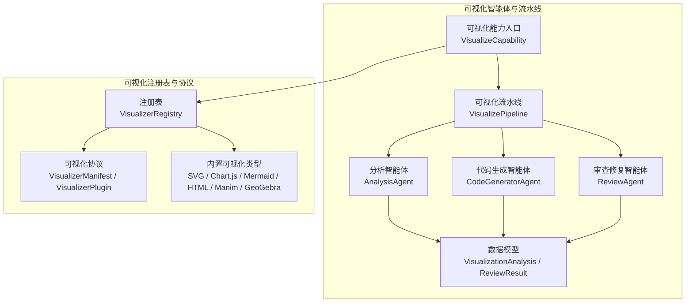
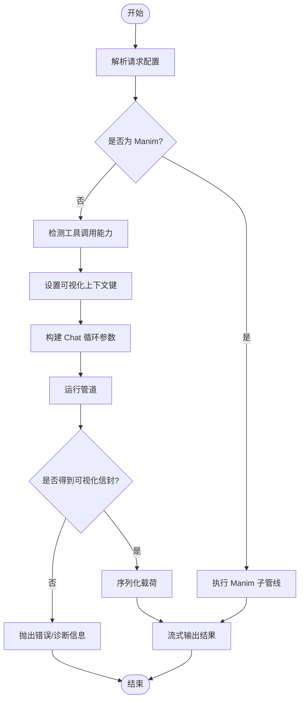
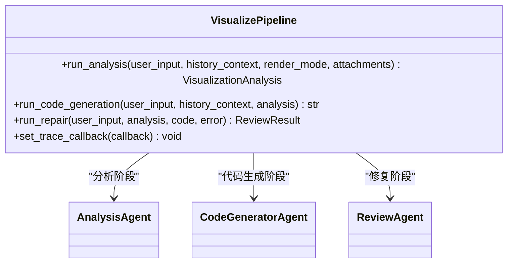
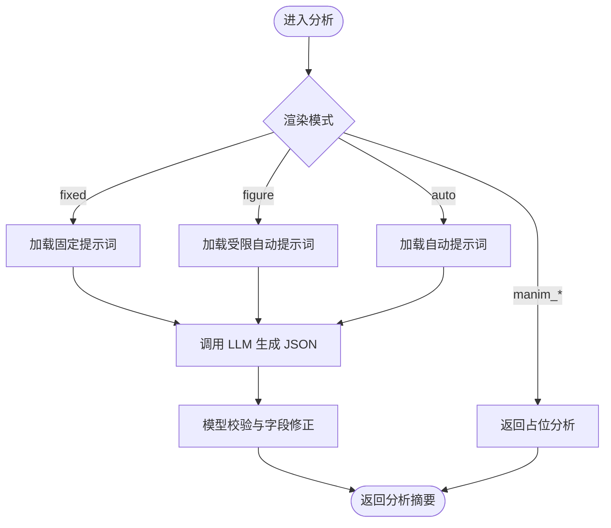
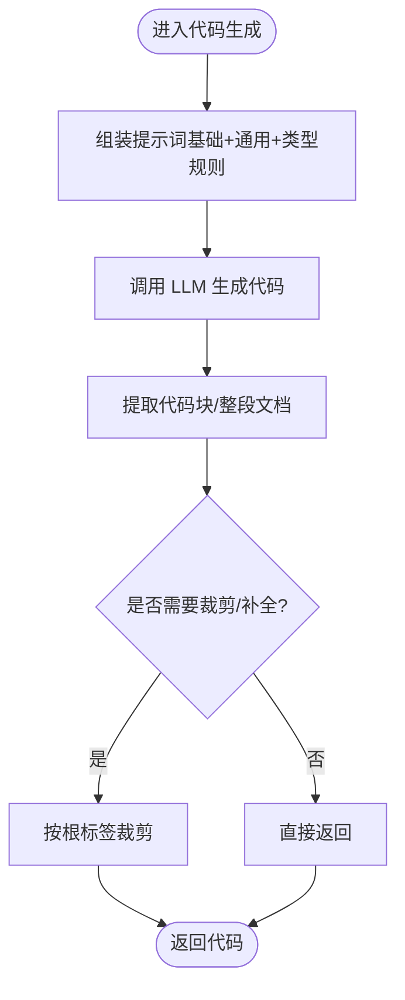
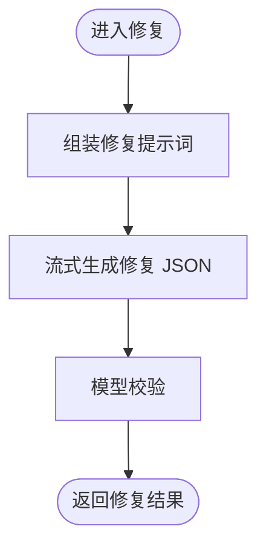
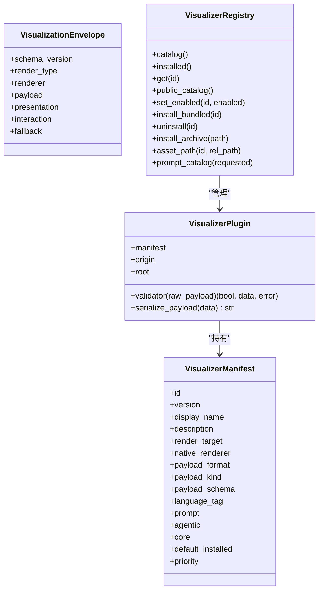
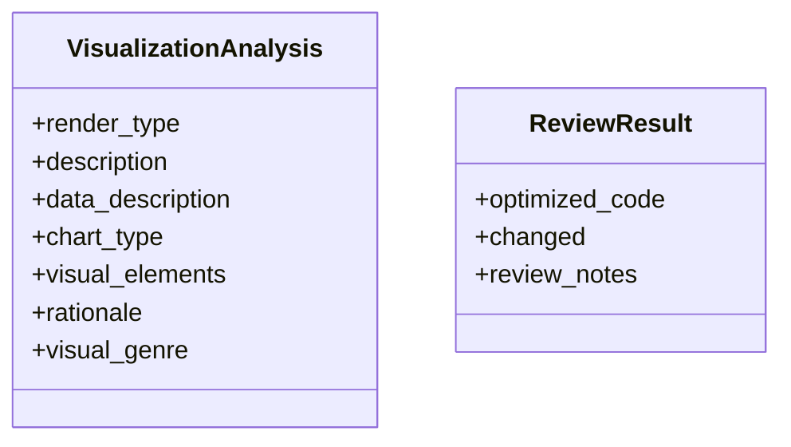
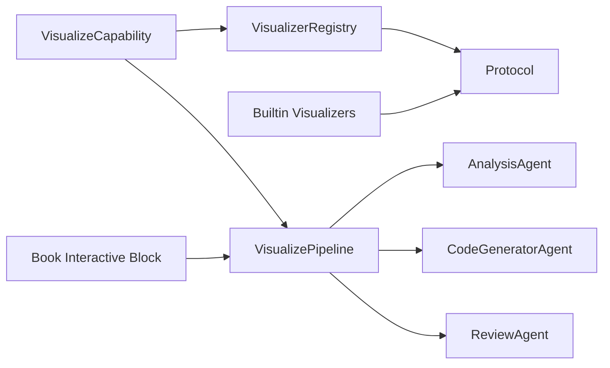

# 可视化图表生成器

<cite>
**本文引用的文件**   
- [capability.py](file://deeptutor/agents/visualize/capability.py)
- [pipeline.py](file://deeptutor/agents/visualize/pipeline.py)
- [analysis_agent.py](file://deeptutor/agents/visualize/agents/analysis_agent.py)
- [code_generator_agent.py](file://deeptutor/agents/visualize/agents/code_generator_agent.py)
- [review_agent.py](file://deeptutor/agents/visualize/agents/review_agent.py)
- [models.py](file://deeptutor/agents/visualize/models.py)
- [protocol.py](file://deeptutor/visualizers/protocol.py)
- [registry.py](file://deeptutor/visualizers/registry.py)
- [builtin.py](file://deeptutor/visualizers/builtin.py)
- [interactive.py](file://deeptutor/book/blocks/interactive.py)
</cite>

## 目录
1. [简介](#简介)
2. [项目结构](#项目结构)
3. [核心组件](#核心组件)
4. [架构总览](#架构总览)
5. [详细组件分析](#详细组件分析)
6. [依赖关系分析](#依赖关系分析)
7. [性能与可扩展性](#性能与可扩展性)
8. [故障排查指南](#故障排查指南)
9. [结论](#结论)
10. [附录：配置与使用示例](#附录配置与使用示例)

## 简介
本文件面向分析师与开发者，系统性说明 DeepTutor 中的“可视化图表生成器”如何从自然语言或结构化数据出发，智能选择图表类型、生成布局与样式，并输出可渲染的可视化产物。系统由“可视化能力入口 + 三阶段智能体流水线 + 可视化注册表与协议 + 内置渲染器”组成，支持 SVG、Chart.js、Mermaid、思维导图、交互式 HTML，以及 Manim 动画/分镜图；同时提供 GeoGebra 扩展包。文档包含架构图、类图、时序图与流程图，帮助读者理解数据解析、图表类型选择、代码生成、校验修复与前端渲染的全链路流程。

## 项目结构
可视化相关代码主要分布在两个层次：
- 智能体与流水线层：负责意图分析、图表类型选择、代码生成与修复。
- 可视化注册表与协议层：定义可视化插件契约、注册与启用策略、载荷校验与序列化。



**图示来源**
- [capability.py:89-234](file://deeptutor/agents/visualize/capability.py#L89-L234)
- [pipeline.py:13-88](file://deeptutor/agents/visualize/pipeline.py#L13-L88)
- [protocol.py:23-171](file://deeptutor/visualizers/protocol.py#L23-L171)
- [registry.py:13-155](file://deeptutor/visualizers/registry.py#L13-L155)
- [builtin.py:156-365](file://deeptutor/visualizers/builtin.py#L156-L365)

**章节来源**
- [capability.py:89-234](file://deeptutor/agents/visualize/capability.py#L89-L234)
- [pipeline.py:13-88](file://deeptutor/agents/visualize/pipeline.py#L13-L88)
- [protocol.py:23-171](file://deeptutor/visualizers/protocol.py#L23-L171)
- [registry.py:13-155](file://deeptutor/visualizers/registry.py#L13-L155)
- [builtin.py:156-365](file://deeptutor/visualizers/builtin.py#L156-L365)

## 核心组件
- 可视化能力入口（VisualizeCapability）
  - 统一入口，负责请求校验、渲染模式路由、工具调用能力检查、Manim 子管线调度、通用 Chat 循环编排、结果封装与流式事件广播。
- 可视化流水线（VisualizePipeline）
  - 编排分析、代码生成、修复三个阶段，注入 LLM 配置与追踪回调。
- 分析智能体（AnalysisAgent）
  - 根据用户输入与对话历史，产出结构化分析摘要，决定 render_type、chart_type、视觉元素与教学风格（visual_genre）。
- 代码生成智能体（CodeGeneratorAgent）
  - 基于分析摘要与规则提示，生成目标格式的可渲染代码（SVG/Chart.js/Mermaid/HTML），并进行边界清理与根标签裁剪。
- 审查修复智能体（ReviewAgent）
  - 在本地确定性校验失败后，针对具体错误进行定向修复，返回优化后的代码与变更说明。
- 可视化协议与注册表（Protocol + Registry + Builtin）
  - 定义可视化插件清单、载荷格式、校验器、注册与启用策略，并提供内置可视化类型与验证逻辑。

**章节来源**
- [capability.py:89-234](file://deeptutor/agents/visualize/capability.py#L89-L234)
- [pipeline.py:13-88](file://deeptutor/agents/visualize/pipeline.py#L13-L88)
- [analysis_agent.py:13-102](file://deeptutor/agents/visualize/agents/analysis_agent.py#L13-L102)
- [code_generator_agent.py:14-118](file://deeptutor/agents/visualize/agents/code_generator_agent.py#L14-L118)
- [review_agent.py:14-76](file://deeptutor/agents/visualize/agents/review_agent.py#L14-L76)
- [protocol.py:23-171](file://deeptutor/visualizers/protocol.py#L23-L171)
- [registry.py:13-155](file://deeptutor/visualizers/registry.py#L13-L155)
- [builtin.py:156-365](file://deeptutor/visualizers/builtin.py#L156-L365)

## 架构总览
可视化生成器的整体工作流如下：
- 入口接收请求，校验渲染模式，必要时检测工具调用能力是否可用。
- 若为 Manim 视频/图片，走专用子管线（概念分析→设计→代码生成→渲染→总结）。
- 否则进入通用 Chat 循环：通过可视化注册表加载插件提示与载荷约束，驱动模型产出可视化载荷，经校验后封装为统一信封，最终流式输出到前端画布。

```mermaid
sequenceDiagram
participant Client as "客户端"
participant API as "可视化能力入口"
participant Reg as "可视化注册表"
participant Loop as "Chat 循环/管道"
participant Validator as "载荷校验器"
participant Canvas as "前端画布"
Client->>API : 提交可视化请求
API->>Reg : 查询可用可视化类型
alt 渲染模式为 Manim
API->>API : 启动 Manim 子管线
API-->>Client : 流式进度与产物
else 通用可视化
API->>Loop : 运行分析/生成/审查
Loop->>Validator : 校验载荷
Validator-->>Loop : 通过/失败
Loop->>API : 返回可视化信封
API->>Canvas : 输出内容/元数据
end
```

**图示来源**
- [capability.py:92-234](file://deeptutor/agents/visualize/capability.py#L92-L234)
- [registry.py:13-155](file://deeptutor/visualizers/registry.py#L13-L155)
- [protocol.py:112-171](file://deeptutor/visualizers/protocol.py#L112-L171)

## 详细组件分析

### 可视化能力入口（VisualizeCapability）
职责要点：
- 校验请求配置，解析渲染模式（auto/svg/chartjs/mermaid/mindmap/html/manim_video/manim_image）。
- 检测工具调用能力，若禁用则提前给出诊断信息。
- 对 Manim 渲染类型走专用子管线，其余类型走通用 Chat 循环。
- 将可视化载荷封装为统一信封，附带渲染类型、描述、引擎信息等，并通过流式总线输出。

关键流程（简化）：
- 解析请求 → 校验渲染模式 → 检测工具调用 → 设置上下文键 → 构建管道参数 → 运行管道 → 提取信封 → 序列化载荷 → 输出内容。



**图示来源**
- [capability.py:92-234](file://deeptutor/agents/visualize/capability.py#L92-L234)

**章节来源**
- [capability.py:92-234](file://deeptutor/agents/visualize/capability.py#L92-L234)

### 可视化流水线（VisualizePipeline）
职责要点：
- 组合 AnalysisAgent、CodeGeneratorAgent、ReviewAgent。
- 暴露 run_analysis、run_code_generation、run_repair 三个方法，供上层编排。
- 支持注入追踪回调，便于调试与性能统计。



**图示来源**
- [pipeline.py:13-88](file://deeptutor/agents/visualize/pipeline.py#L13-L88)

**章节来源**
- [pipeline.py:13-88](file://deeptutor/agents/visualize/pipeline.py#L13-L88)

### 分析智能体（AnalysisAgent）
职责要点：
- 根据用户输入与对话历史，结合提示词模板，调用 LLM 生成结构化分析摘要。
- 支持固定渲染模式（svg/chartjs/mermaid/mindmap/html）、受限自动模式（figure）与完全自动模式。
- 对 Manim 模式短路返回占位分析，交由 Manim 子管线处理。



**图示来源**
- [analysis_agent.py:30-102](file://deeptutor/agents/visualize/agents/analysis_agent.py#L30-L102)

**章节来源**
- [analysis_agent.py:30-102](file://deeptutor/agents/visualize/agents/analysis_agent.py#L30-L102)

### 代码生成智能体（CodeGeneratorAgent）
职责要点：
- 组装系统提示词：基础规则 + 通用规则 + 特定渲染类型规则。
- 根据分析摘要生成目标格式代码，并对 HTML/SVG 做根标签裁剪与完整性检查。
- 对不同渲染类型选择合适的语言提示（svg/javascript/mermaid/html）。



**图示来源**
- [code_generator_agent.py:31-118](file://deeptutor/agents/visualize/agents/code_generator_agent.py#L31-L118)

**章节来源**
- [code_generator_agent.py:31-118](file://deeptutor/agents/visualize/agents/code_generator_agent.py#L31-L118)

### 审查修复智能体（ReviewAgent）
职责要点：
- 仅在本地确定性校验失败后被调用。
- 以“用户输入 + 分析摘要 + 原始代码 + 错误信息”为上下文，流式生成修复方案。
- 返回优化后的代码、是否变更及审查备注。



**图示来源**
- [review_agent.py:31-76](file://deeptutor/agents/visualize/agents/review_agent.py#L31-L76)

**章节来源**
- [review_agent.py:31-76](file://deeptutor/agents/visualize/agents/review_agent.py#L31-L76)

### 可视化协议与注册表（Protocol + Registry + Builtin）
职责要点：
- 协议层定义可视化插件清单（VisualizerManifest）、运行时包装（VisualizerPlugin）、载荷校验与序列化、可视化信封等。
- 注册表负责聚合核心、捆绑与用户可视化类型，管理安装/启用状态，并提供公开目录与提示词目录。
- 内置可视化类型包括 SVG、Mermaid、思维导图、Chart.js、交互式 HTML、Manim 动画/分镜图，以及捆绑的 GeoGebra。



**图示来源**
- [protocol.py:23-171](file://deeptutor/visualizers/protocol.py#L23-L171)
- [registry.py:13-155](file://deeptutor/visualizers/registry.py#L13-L155)

**章节来源**
- [protocol.py:23-171](file://deeptutor/visualizers/protocol.py#L23-L171)
- [registry.py:13-155](file://deeptutor/visualizers/registry.py#L13-L155)
- [builtin.py:156-365](file://deeptutor/visualizers/builtin.py#L156-L365)

### 数据模型（VisualizationAnalysis / ReviewResult）
职责要点：
- VisualizationAnalysis 描述渲染类型、图表类型、视觉元素、教学风格与理由，并对未知枚举值进行降级处理，保证下游稳定。
- ReviewResult 描述修复后的代码、是否变更与审查备注。



**图示来源**
- [models.py:35-121](file://deeptutor/agents/visualize/models.py#L35-L121)

**章节来源**
- [models.py:35-121](file://deeptutor/agents/visualize/models.py#L35-L121)

## 依赖关系分析
- 入口依赖注册表获取可用可视化类型与提示词目录。
- 流水线依赖三个智能体，智能体依赖 LLM 调用与提示词模板。
- 协议层被注册表与内置类型共同依赖，确保载荷校验与序列化一致。
- 书籍交互模块可直接调用可视化流水线生成 HTML 交互页面。



**图示来源**
- [capability.py:92-234](file://deeptutor/agents/visualize/capability.py#L92-L234)
- [pipeline.py:13-88](file://deeptutor/agents/visualize/pipeline.py#L13-L88)
- [protocol.py:23-171](file://deeptutor/visualizers/protocol.py#L23-L171)
- [builtin.py:156-365](file://deeptutor/visualizers/builtin.py#L156-L365)
- [interactive.py:68-96](file://deeptutor/book/blocks/interactive.py#L68-L96)

**章节来源**
- [capability.py:92-234](file://deeptutor/agents/visualize/capability.py#L92-L234)
- [pipeline.py:13-88](file://deeptutor/agents/visualize/pipeline.py#L13-L88)
- [protocol.py:23-171](file://deeptutor/visualizers/protocol.py#L23-L171)
- [builtin.py:156-365](file://deeptutor/visualizers/builtin.py#L156-L365)
- [interactive.py:68-96](file://deeptutor/book/blocks/interactive.py#L68-L96)

## 性能与可扩展性
- 性能特性
  - 分析阶段与代码生成阶段采用阻塞式 LLM 调用，避免部分 JSON 无法消费的问题。
  - 修复阶段采用流式生成，提升用户体验与可观测性。
  - Manim 子管线分阶段计时（概念分析、设计、代码生成、重试、渲染输出、总结），便于定位瓶颈。
- 可扩展性
  - 新增可视化类型只需实现 VisualizerManifest 与可选 validator，并在注册表中注册。
  - 可通过 prompt_catalog 动态向模型注入可视化类型的使用规则与载荷 Schema。
  - 内置类型已覆盖常见教学场景，GeoGebra 作为捆绑扩展满足数学构造需求。

[本节为通用指导，不直接分析具体文件]

## 故障排查指南
常见问题与定位建议：
- 工具调用未启用导致无可视化载荷
  - 现象：完成一轮推理但未产出 submit_visualization 载荷。
  - 原因：本地兼容服务器默认未启用工具调用。
  - 处理：在设置中启用模型的工具调用能力，然后重新运行可视化。
- 渲染模式未安装或禁用
  - 现象：指定 render_mode 不存在或未启用。
  - 处理：检查注册表可用列表，安装或启用对应可视化类型。
- 载荷校验失败
  - 现象：JSON Schema 或自定义校验报错。
  - 处理：查看错误位置与消息，修正载荷结构或字段；必要时触发修复智能体。
- HTML 不完整或缺少交互控件
  - 现象：缺少 doctype/html/body/script 或交互控件、重置按钮、无障碍标签。
  - 处理：按内置 HTML 校验规则补全结构与控件。
- Chart.js 类型不支持或数据结构非法
  - 现象：type 不在支持集合内，或 datasets 为空/非对象。
  - 处理：调整 chart type 与数据集结构，确保 label 与 data 非空。

**章节来源**
- [capability.py:145-198](file://deeptutor/agents/visualize/capability.py#L145-L198)
- [builtin.py:20-102](file://deeptutor/visualizers/builtin.py#L20-L102)

## 结论
可视化图表生成器通过“智能体流水线 + 可视化注册表 + 协议校验”的分层架构，实现了从自然语言到可渲染可视化的端到端自动化。其优势在于：
- 类型选择智能：依据用户意图与数据特征选择合适渲染类型。
- 生成质量可控：通过规则提示、载荷校验与修复智能体保障输出可用性。
- 扩展性强：插件化注册表与协议使新增可视化类型与渲染器变得简单。
- 可观测性好：多阶段流式事件与计时便于监控与调优。

[本节为总结性内容，不直接分析具体文件]

## 附录：配置与使用示例
以下示例展示如何从不同数据源生成可视化图表。由于仓库未提供具体的 CSV/数据库/API 读取脚本，这里给出基于现有能力的调用方式与配置要点。

- 从 CSV 文件生成图表
  - 步骤
    - 将 CSV 数据转换为结构化数据（如表格行数组）。
    - 在用户输入中描述数据含义与分析目标。
    - 调用可视化能力入口，选择 chartjs 或 mermaid（如流程图/ERD）。
  - 关键点
    - 对于定量比较/趋势/分布，优先 chartjs。
    - 对于结构化关系/流程，优先 mermaid。
  - 参考路径
    - [pipeline.py:47-73](file://deeptutor/agents/visualize/pipeline.py#L47-L73)
    - [builtin.py:230-253](file://deeptutor/visualizers/builtin.py#L230-L253)

- 从数据库查询结果生成图表
  - 步骤
    - 执行 SQL 查询，得到结构化结果集。
    - 在用户输入中说明字段含义、维度与指标。
    - 根据数据形态选择 chartjs（柱状图/折线图/散点图等）或 mermaid（ERD/类图）。
  - 关键点
    - Chart.js 要求严格 JSON，包含 type、data、datasets 等。
    - Mermaid 节点 ID 不含空格，避免保留字。
  - 参考路径
    - [builtin.py:60-102](file://deeptutor/visualizers/builtin.py#L60-L102)
    - [code_generator_agent.py:76-118](file://deeptutor/agents/visualize/agents/code_generator_agent.py#L76-L118)

- 从 API 响应生成可视化
  - 步骤
    - 拉取 API 响应，解析为结构化数据。
    - 在用户输入中描述业务语义与交互需求。
    - 如需交互体验，选择 html；如需静态图，选择 svg/mermaid/chartjs。
  - 关键点
    - HTML 需完整文档结构，包含交互控件与重置按钮。
    - 可使用 sendPrompt 触发后续问答。
  - 参考路径
    - [builtin.py:254-278](file://deeptutor/visualizers/builtin.py#L254-L278)
    - [interactive.py:68-96](file://deeptutor/book/blocks/interactive.py#L68-L96)

- 交互功能、响应式设计与导出格式
  - 交互功能
    - HTML 可视化支持点击触发后续问题、步进器、控件重置等。
  - 响应式设计
    - HTML 使用响应式尺寸与最大宽度限制，适配 iframe 容器。
  - 导出格式
    - SVG：image/svg+xml
    - Chart.js：application/vnd.chartjs+json
    - Mermaid：text/vnd.mermaid
    - HTML：text/html
    - Manim：video/mp4 或 image/png（artifact）
  - 参考路径
    - [builtin.py:156-315](file://deeptutor/visualizers/builtin.py#L156-L315)

- 自定义主题与交互元素
  - SVG 主题
    - 使用宿主提供的 CSS 类（t/th/ts、box、arr、leader、c-*）实现主题感知与明暗模式。
  - HTML 主题
    - 在 <style> 中定义主题变量与样式，遵循响应式与无障碍规范。
  - 交互元素
    - 添加按钮、输入框、下拉框等控件，并确保有 aria-label 或 label。
  - 参考路径
    - [code_generator_agent.yaml:33-110](file://deeptutor/agents/visualize/prompts/en/code_generator_agent.yaml#L33-L110)
    - [builtin.py:254-278](file://deeptutor/visualizers/builtin.py#L254-L278)

- 性能优化技巧
  - 控制复杂度预算：减少颜色数量、限制每行节点数、拆分复杂图。
  - 合理选择渲染类型：静态图优先 svg/chartjs/mermaid，交互才用 html。
  - 利用注册表的 prompt_catalog 注入最小必要规则，降低提示词体积。
  - 使用 Manim 子管线的阶段计时定位瓶颈。
  - 参考路径
    - [code_generator_agent.yaml:13-27](file://deeptutor/agents/visualize/prompts/en/code_generator_agent.yaml#L13-L27)
    - [capability.py:318-455](file://deeptutor/agents/visualize/capability.py#L318-L455)

**章节来源**
- [pipeline.py:47-73](file://deeptutor/agents/visualize/pipeline.py#L47-L73)
- [builtin.py:60-102](file://deeptutor/visualizers/builtin.py#L60-L102)
- [builtin.py:230-278](file://deeptutor/visualizers/builtin.py#L230-L278)
- [code_generator_agent.py:76-118](file://deeptutor/agents/visualize/agents/code_generator_agent.py#L76-L118)
- [interactive.py:68-96](file://deeptutor/book/blocks/interactive.py#L68-L96)
- [capability.py:318-455](file://deeptutor/agents/visualize/capability.py#L318-L455)