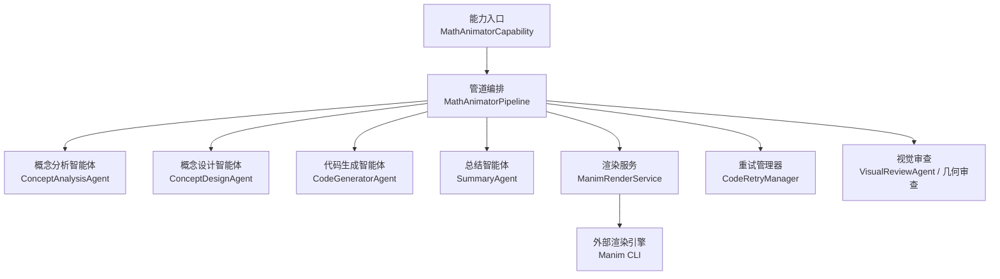
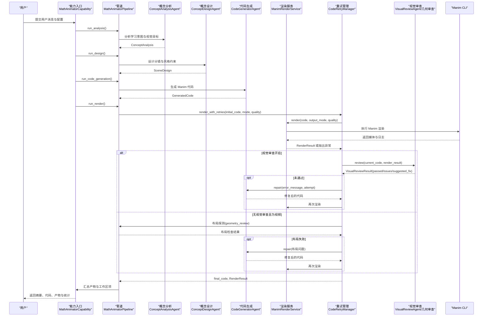
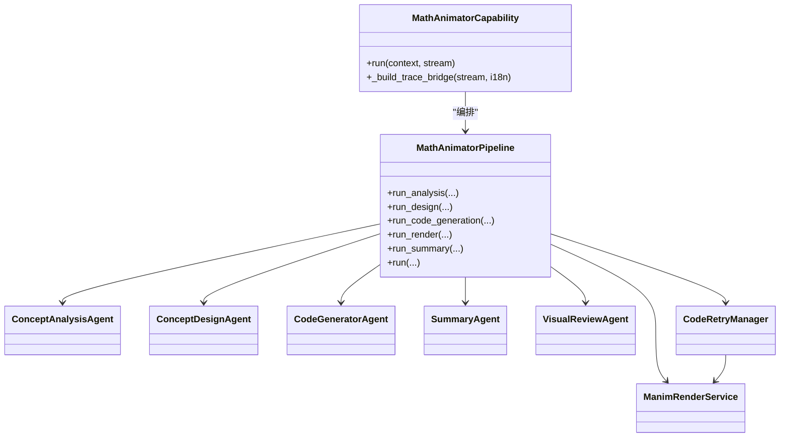

# 数学动画生成器

<cite>
**本文引用的文件**   
- [capability.py](file://deeptutor/agents/math_animator/capability.py)
- [pipeline.py](file://deeptutor/agents/math_animator/pipeline.py)
- [renderer.py](file://deeptutor/agents/math_animator/renderer.py)
- [retry_manager.py](file://deeptutor/agents/math_animator/retry_manager.py)
- [models.py](file://deeptutor/agents/math_animator/models.py)
- [request_config.py](file://deeptutor/agents/math_animator/request_config.py)
- [duration_utils.py](file://deeptutor/agents/math_animator/duration_utils.py)
- [utils.py](file://deeptutor/agents/math_animator/utils.py)
- [concept_analysis_agent.py](file://deeptutor/agents/math_animator/agents/concept_analysis_agent.py)
- [concept_design_agent.py](file://deeptutor/agents/math_animator/agents/concept_design_agent.py)
- [code_generator_agent.py](file://deeptutor/agents/math_animator/agents/code_generator_agent.py)
- [visual_review_agent.py](file://deeptutor/agents/math_animator/agents/visual_review_agent.py)
</cite>

## 目录
1. [简介](#简介)
2. [项目结构](#项目结构)
3. [核心组件](#核心组件)
4. [架构总览](#架构总览)
5. [详细组件分析](#详细组件分析)
6. [依赖关系分析](#依赖关系分析)
7. [性能与渲染优化](#性能与渲染优化)
8. [故障排查指南](#故障排查指南)
9. [结论](#结论)
10. [附录：配置与使用示例](#附录配置与使用示例)

## 简介
本文件面向教育者与开发者，系统性说明 DeepTutor 中“数学动画生成器”的完整实现。内容覆盖从用户输入到最终视频或图像产物的全链路：概念分析、场景设计、代码生成、Manim 渲染、布局探测与视觉审查、重试修复、时间轴控制、持续时间估算、工作区产物发布，以及可视化审查能力。文档同时提供架构图、时序图、流程图和类图，帮助读者快速理解系统行为并开展二次开发。

## 项目结构
数学动画能力位于 `deeptutor/agents/math_animator` 下，采用“能力入口 + 管道编排 + 多智能体 + 渲染服务 + 重试机制”的分层组织方式：
- 能力入口：对外暴露 `MathAnimatorCapability`，负责 LLM 配置加载、阶段计时、流式进度与结果输出。
- 管道编排：`MathAnimatorPipeline` 串联概念分析、概念设计、代码生成、渲染与总结。
- 智能体：概念分析、概念设计、代码生成、总结、视觉审查等 Agent。
- 渲染服务：封装 Manim 子进程调用、媒体目录管理、错误处理与产物收集。
- 重试机制：基于渲染失败与视觉审查反馈的代码修复循环。
- 辅助模块：请求配置校验、持续时间解析、工具函数与数据模型。

**图示来源**
- [capability.py:19-220](file://deeptutor/agents/math_animator/capability.py#L19-L220)
- [pipeline.py:30-374](file://deeptutor/agents/math_animator/pipeline.py#L30-L374)
- [renderer.py:36-289](file://deeptutor/agents/math_animator/renderer.py#L36-L289)
- [retry_manager.py:21-162](file://deeptutor/agents/math_animator/retry_manager.py#L21-L162)

**章节来源**
- [capability.py:19-220](file://deeptutor/agents/math_animator/capability.py#L19-L220)
- [pipeline.py:30-374](file://deeptutor/agents/math_animator/pipeline.py#L30-L374)

## 核心组件
- MathAnimatorCapability：能力门面，负责依赖检查（Manim）、LLM 配置注入、阶段计时、流式事件桥接与最终结果发射。
- MathAnimatorPipeline：编排概念分析、概念设计、代码生成、渲染与总结；支持可选视觉审查与布局探测；将产物发布到工作区。
- ManimRenderService：封装 Manim CLI 调用、质量参数映射、媒体目录与产物路径管理、实时日志流读取与超时保护。
- CodeRetryManager：统一渲染重试与代码修复循环，支持视觉审查失败回退与不可重试环境错误识别。
- 智能体族：ConceptAnalysisAgent、ConceptDesignAgent、CodeGeneratorAgent、SummaryAgent、VisualReviewAgent，分别承担结构化分析与代码生成任务。
- 配置与模型：MathAnimatorRequestConfig、ConceptAnalysis、SceneDesign、GeneratedCode、RenderResult、VisualReviewResult 等 Pydantic 模型。

**章节来源**
- [capability.py:19-220](file://deeptutor/agents/math_animator/capability.py#L19-L220)
- [pipeline.py:30-374](file://deeptutor/agents/math_animator/pipeline.py#L30-L374)
- [renderer.py:36-289](file://deeptutor/agents/math_animator/renderer.py#L36-L289)
- [retry_manager.py:21-162](file://deeptutor/agents/math_animator/retry_manager.py#L21-L162)
- [models.py:8-98](file://deeptutor/agents/math_animator/models.py#L8-L98)
- [request_config.py:10-43](file://deeptutor/agents/math_animator/request_config.py#L10-L43)

## 架构总览
下图展示从用户消息到最终产物的端到端流程，包括阶段划分、重试与视觉审查分支。

**图示来源**
- [capability.py:22-220](file://deeptutor/agents/math_animator/capability.py#L22-L220)
- [pipeline.py:104-304](file://deeptutor/agents/math_animator/pipeline.py#L104-L304)
- [retry_manager.py:44-158](file://deeptutor/agents/math_animator/retry_manager.py#L44-L158)
- [renderer.py:61-289](file://deeptutor/agents/math_animator/renderer.py#L61-L289)

## 详细组件分析

### 能力入口：MathAnimatorCapability
职责与要点：
- 依赖检查：若未安装 Manim 相关依赖，直接抛出明确错误提示。
- 配置加载：从运行时获取 LLM 配置，校验 math_animator 请求配置。
- 阶段计时：对 concept_analysis、concept_design、code_generation、code_retry、summary、render_output 各阶段计时。
- 流式桥接：将内部 trace 事件转换为 StreamBus 的 thinking/progress/error/sources 事件，便于前端展示。
- 结果发射：统一输出 response、summary、code、artifacts、workspace_items、timings、render 元信息、analysis/design 等。

关键流程片段参考：
- 依赖检查与管线初始化：[capability.py:22-50](file://deeptutor/agents/math_animator/capability.py#L22-L50)
- 阶段运行与计时：[capability.py:66-185](file://deeptutor/agents/math_animator/capability.py#L66-L185)
- 结果发射与渲染元信息：[capability.py:195-220](file://deeptutor/agents/math_animator/capability.py#L195-L220)
- 追踪桥接逻辑：[capability.py:222-302](file://deeptutor/agents/math_animator/capability.py#L222-L302)

**章节来源**
- [capability.py:22-302](file://deeptutor/agents/math_animator/capability.py#L22-L302)

### 管道编排：MathAnimatorPipeline
职责与要点：
- 组装各智能体：概念分析、概念设计、代码生成、总结、视觉审查（可选）。
- 持续时间解析：从用户输入与 style_hint 中提取目标时长，传递给代码生成与修复阶段。
- 渲染与布局探测：当启用视觉审查时走视觉审查分支；否则在视频模式下进行几何布局探测，最多若干轮修复后再渲染。
- 工作区产物发布：将最终 Manim 源文件与产物快照发布到通用工作区，并回填 URL。
- 总结生成：综合分析、设计与渲染结果生成教学性摘要。

关键流程片段参考：
- 构造与智能体装配：[pipeline.py:30-90](file://deeptutor/agents/math_animator/pipeline.py#L30-L90)
- 分析/设计/代码生成接口：[pipeline.py:104-155](file://deeptutor/agents/math_animator/pipeline.py#L104-L155)
- 渲染主流程与布局探测：[pipeline.py:157-261](file://deeptutor/agents/math_animator/pipeline.py#L157-L261)
- 工作区产物发布：[pipeline.py:263-287](file://deeptutor/agents/math_animator/pipeline.py#L263-L287)
- 总结与统一 run：[pipeline.py:289-374](file://deeptutor/agents/math_animator/pipeline.py#L289-L374)

**章节来源**
- [pipeline.py:30-374](file://deeptutor/agents/math_animator/pipeline.py#L30-L374)

### 渲染服务：ManimRenderService
职责与要点：
- 目录规划：source、artifacts、media、meta 四目录隔离，按 turn_id 隔离实例。
- 模式区分：video 模式渲染完整视频；image 模式要求代码包含 YON_IMAGE 锚点块，逐个渲染 PNG。
- Manim 调用：通过 subprocess.Popen 启动 manim CLI，线程读取 stdout/stderr 并通过队列异步上报进度。
- 质量参数：low/medium/high 映射为 -ql/-qm/-qh。
- 错误处理：捕获非零退出码，拼接精简错误信息，抛出 ManimRenderError；必要时清理子进程树。
- 产物定位：忽略 partial_movie_files 中间文件，选择最新生成的最终媒体文件。

关键流程片段参考：
- 构造与目录准备：[renderer.py:36-59](file://deeptutor/agents/math_animator/renderer.py#L36-L59)
- 渲染入口与模式分发：[renderer.py:61-81](file://deeptutor/agents/math_animator/renderer.py#L61-L81)
- 视频渲染：[renderer.py:83-94](file://deeptutor/agents/math_animator/renderer.py#L83-L94)
- 图片块渲染：[renderer.py:96-134](file://deeptutor/agents/math_animator/renderer.py#L96-L134)
- Manim 子进程与流式日志：[renderer.py:136-229](file://deeptutor/agents/math_animator/renderer.py#L136-L229)
- 产物查找与构建：[renderer.py:236-281](file://deeptutor/agents/math_animator/renderer.py#L236-L281)

**章节来源**
- [renderer.py:36-289](file://deeptutor/agents/math_animator/renderer.py#L36-L289)

### 重试机制：CodeRetryManager
职责与要点：
- 渲染重试：对 ManimRenderError 进行最多 N 次修复重试。
- 视觉审查回退：若开启视觉审查且未通过，则根据 suggested_fix 触发代码修复。
- 不可重试环境错误：识别 LaTeX 缺失等环境错误，给出明确指引。
- 超时保护：修复与审查均设置超时，避免长时间阻塞。
- 历史记录：记录每次重试的错误与建议修复，供上层展示与诊断。

关键流程片段参考：
- 构造与参数：[retry_manager.py:21-43](file://deeptutor/agents/math_animator/retry_manager.py#L21-L43)
- 渲染与审查主循环：[retry_manager.py:44-158](file://deeptutor/agents/math_animator/retry_manager.py#L44-L158)
- 不可重试环境错误判断：[retry_manager.py:12-18](file://deeptutor/agents/math_animator/retry_manager.py#L12-L18)

**章节来源**
- [retry_manager.py:12-158](file://deeptutor/agents/math_animator/retry_manager.py#L12-L158)

### 智能体族与提示词工程
- ConceptAnalysisAgent：从用户消息、历史上下文与附件出发，输出学习目标、数学焦点、视觉目标、叙事步骤等结构化分析。
- ConceptDesignAgent：基于分析结果与输出模式，生成分镜大纲、视觉风格、动画备注、图像计划与代码约束。
- CodeGeneratorAgent：根据分析+设计+目标时长生成可执行的 Manim 代码；具备修复能力，结合错误信息与重试策略提升成功率。
- SummaryAgent：对分析、设计与渲染结果进行教学性总结。
- VisualReviewAgent：对已渲染帧进行视觉质量审查，输出是否通过、问题清单与建议修复。

关键流程片段参考：
- 概念分析：[concept_analysis_agent.py:14-98](file://deeptutor/agents/math_animator/agents/concept_analysis_agent.py#L14-L98)
- 概念设计：[concept_design_agent.py:14-77](file://deeptutor/agents/math_animator/agents/concept_design_agent.py#L14-L77)
- 代码生成与修复：[code_generator_agent.py:31-269](file://deeptutor/agents/math_animator/agents/code_generator_agent.py#L31-L269)
- 视觉审查：[visual_review_agent.py](file://deeptutor/agents/math_animator/agents/visual_review_agent.py)

**章节来源**
- [concept_analysis_agent.py:14-98](file://deeptutor/agents/math_animator/agents/concept_analysis_agent.py#L14-L98)
- [concept_design_agent.py:14-77](file://deeptutor/agents/math_animator/agents/concept_design_agent.py#L14-L77)
- [code_generator_agent.py:31-269](file://deeptutor/agents/math_animator/agents/code_generator_agent.py#L31-L269)
- [visual_review_agent.py](file://deeptutor/agents/math_animator/agents/visual_review_agent.py)

### 数据模型与配置
- 请求配置：output_mode(video/image)、quality(low/medium/high)、style_hint、enable_visual_review。
- 数据模型：ConceptAnalysis、SceneDesign、GeneratedCode、RenderResult、RenderedArtifact、VisualReviewResult、RetryAttempt 等。
- 持续时间解析：从自然语言中提取秒或分钟目标时长，用于节奏预算。

关键流程片段参考：
- 请求配置校验：[request_config.py:10-43](file://deeptutor/agents/math_animator/request_config.py#L10-L43)
- 数据模型定义：[models.py:8-98](file://deeptutor/agents/math_animator/models.py#L8-L98)
- 持续时间解析：[duration_utils.py:20-40](file://deeptutor/agents/math_animator/duration_utils.py#L20-L40)

**章节来源**
- [request_config.py:10-43](file://deeptutor/agents/math_animator/request_config.py#L10-L43)
- [models.py:8-98](file://deeptutor/agents/math_animator/models.py#L8-L98)
- [duration_utils.py:20-40](file://deeptutor/agents/math_animator/duration_utils.py#L20-L40)

## 依赖关系分析
- 能力入口依赖管道与流式总线，不直接耦合具体智能体。
- 管道依赖各智能体与渲染服务，并通过重试管理器协调修复。
- 渲染服务依赖外部 Manim CLI，并通过路径服务或工作区根路径决定产物访问方式。
- 重试管理器依赖渲染服务与修复回调（默认由代码生成智能体提供修复能力）。
- 视觉审查可在两种模式下工作：启用视觉审查智能体，或仅做几何布局探测。

**图示来源**
- [capability.py:19-220](file://deeptutor/agents/math_animator/capability.py#L19-L220)
- [pipeline.py:30-374](file://deeptutor/agents/math_animator/pipeline.py#L30-L374)
- [renderer.py:36-289](file://deeptutor/agents/math_animator/renderer.py#L36-L289)
- [retry_manager.py:21-162](file://deeptutor/agents/math_animator/retry_manager.py#L21-L162)

**章节来源**
- [capability.py:19-220](file://deeptutor/agents/math_animator/capability.py#L19-L220)
- [pipeline.py:30-374](file://deeptutor/agents/math_animator/pipeline.py#L30-L374)
- [renderer.py:36-289](file://deeptutor/agents/math_animator/renderer.py#L36-L289)
- [retry_manager.py:21-162](file://deeptutor/agents/math_animator/retry_manager.py#L21-L162)

## 性能与渲染优化
- 子进程与流式日志：使用 subprocess.Popen 与线程读取 stdout/stderr，通过 asyncio.Queue 安全地跨线程传递日志，避免 Windows SelectorEventLoop 兼容性问题。
- 超时保护：Manim 渲染过程设置 300 秒超时；视觉审查与代码修复也各自设置超时，防止长时间阻塞。
- 质量参数映射：quality 字段映射到 Manim CLI 的质量标志，平衡画质与渲染速度。
- 产物去重与定位：忽略 partial_movie_files 中间文件，选择最新生成的最终媒体文件，减少 I/O 开销。
- 布局探测前置：在未启用视觉审查的视频模式下，先进行几何布局探测，失败再修复，避免无效帧绘制。
- 工作区产物发布：将最终产物与源码快照发布到工作区，便于前端复用与缓存。

**章节来源**
- [renderer.py:136-229](file://deeptutor/agents/math_animator/renderer.py#L136-L229)
- [pipeline.py:202-237](file://deeptutor/agents/math_animator/pipeline.py#L202-L237)
- [pipeline.py:263-287](file://deeptutor/agents/math_animator/pipeline.py#L263-L287)

## 故障排查指南
常见问题与定位建议：
- Manim 未安装或依赖缺失：能力入口会直接报错，需安装 math-animator 依赖。
- LaTeX 缺失导致 Tex/MathTex 渲染失败：重试管理器识别不可重试环境错误，提示安装 LaTeX 或改用 Text。
- 代码截断或 JSON 解析失败：代码生成智能体会根据 outcome.truncated 动态提高 max_tokens 并降低推理强度，多次重试后仍失败会抛出明确错误。
- 布局重叠或可读性差：视觉审查或几何布局探测失败时，会触发修复流程；若无视觉审查，则使用几何审查作为兜底。
- 渲染超时或进程卡死：Manim 渲染有 300 秒超时；异常时会尝试清理子进程树，避免僵尸进程。

关键定位参考：
- 依赖检查与错误提示：[capability.py:22-28](file://deeptutor/agents/math_animator/capability.py#L22-L28)
- LaTeX 缺失与环境错误：[retry_manager.py:12-18](file://deeptutor/agents/math_animator/retry_manager.py#L12-L18)
- 代码截断与结构化输出失败：[code_generator_agent.py:147-244](file://deeptutor/agents/math_animator/agents/code_generator_agent.py#L147-L244)
- 渲染错误与日志聚合：[renderer.py:196-229](file://deeptutor/agents/math_animator/renderer.py#L196-L229)
- 修复提示增强：[utils.py:29-61](file://deeptutor/agents/math_animator/utils.py#L29-L61)

**章节来源**
- [capability.py:22-28](file://deeptutor/agents/math_animator/capability.py#L22-L28)
- [retry_manager.py:12-18](file://deeptutor/agents/math_animator/retry_manager.py#L12-L18)
- [code_generator_agent.py:147-244](file://deeptutor/agents/math_animator/agents/code_generator_agent.py#L147-L244)
- [renderer.py:196-229](file://deeptutor/agents/math_animator/renderer.py#L196-L229)
- [utils.py:29-61](file://deeptutor/agents/math_animator/utils.py#L29-L61)

## 结论
数学动画生成器以“分析-设计-生成-渲染-审查-修复”的闭环为核心，结合 Manim 渲染引擎与智能体提示词工程，实现了从自然语言到高质量数学动画的自动化生产。其优势在于：
- 明确的阶段划分与可观测的流式进度。
- 强大的重试与修复机制，兼顾渲染错误与视觉质量问题。
- 灵活的配置与模式切换，支持视频与图像两种输出。
- 可扩展的视觉审查与布局探测，适配不同场景需求。
对于教育者，可通过简单配置生成几何图形、函数图像与公式动画；对于开发者，可基于现有智能体与渲染服务扩展自定义样式、动画类型与审查策略。

## 附录：配置与使用示例
以下为常见配置与使用思路（不展示具体代码内容）：
- 生成几何图形动画（如三角形、圆、坐标系）：
  - 设置 output_mode=video，quality=medium。
  - 在 style_hint 中描述几何元素与运动轨迹（例如“展示三角形内角和定理的动态证明”）。
  - 如需控制时长，可在用户消息中加入“约 10 秒”等表述，系统会自动解析为目标时长。
- 生成函数图像动画（如 y=sin(x) 的波形展开）：
  - 设置 output_mode=video，quality=high。
  - 在 style_hint 中强调坐标轴、网格线、标注与描点动画顺序。
  - 可加入“逐步绘制曲线，持续约 15 秒”等指令以引导节奏。
- 生成数学公式动画（如推导过程、符号变换）：
  - 设置 output_mode=image，并在代码中使用 YON_IMAGE 锚点块分段渲染关键步骤。
  - 注意：若使用 Tex/MathTex，需确保本地 LaTeX 可用；否则建议使用 Text 以避免环境错误。
- 启用视觉审查：
  - 设置 enable_visual_review=true，系统将自动审查帧的重叠、可读性与构图，并在失败时触发修复。
- 调试技巧：
  - 关注 capability 输出的 timings 与 render.retry_history，定位耗时与失败原因。
  - 查看 workspace_items 中的源码与产物链接，便于复现与对比。
  - 若出现 LaTeX 缺失或 Manim 进程超时，优先检查环境依赖与超时阈值。

**章节来源**
- [request_config.py:10-43](file://deeptutor/agents/math_animator/request_config.py#L10-L43)
- [duration_utils.py:20-40](file://deeptutor/agents/math_animator/duration_utils.py#L20-L40)
- [renderer.py:96-134](file://deeptutor/agents/math_animator/renderer.py#L96-L134)
- [capability.py:195-220](file://deeptutor/agents/math_animator/capability.py#L195-L220)