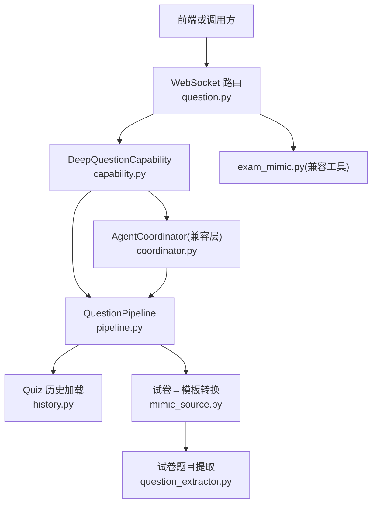
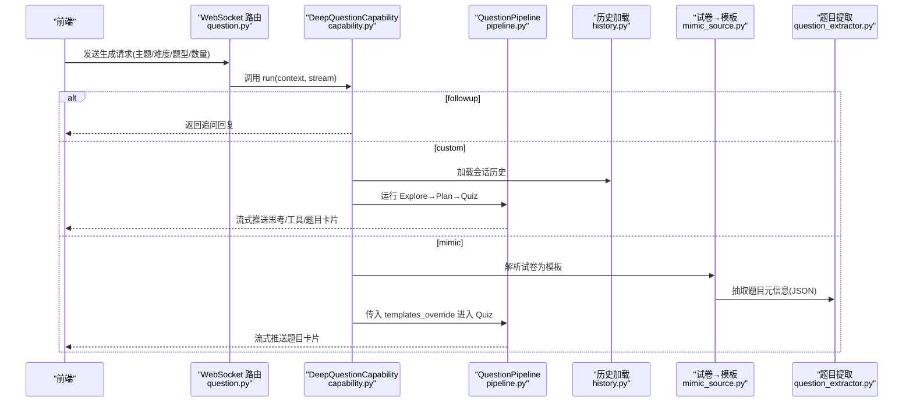
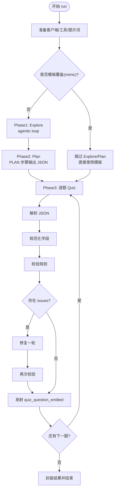
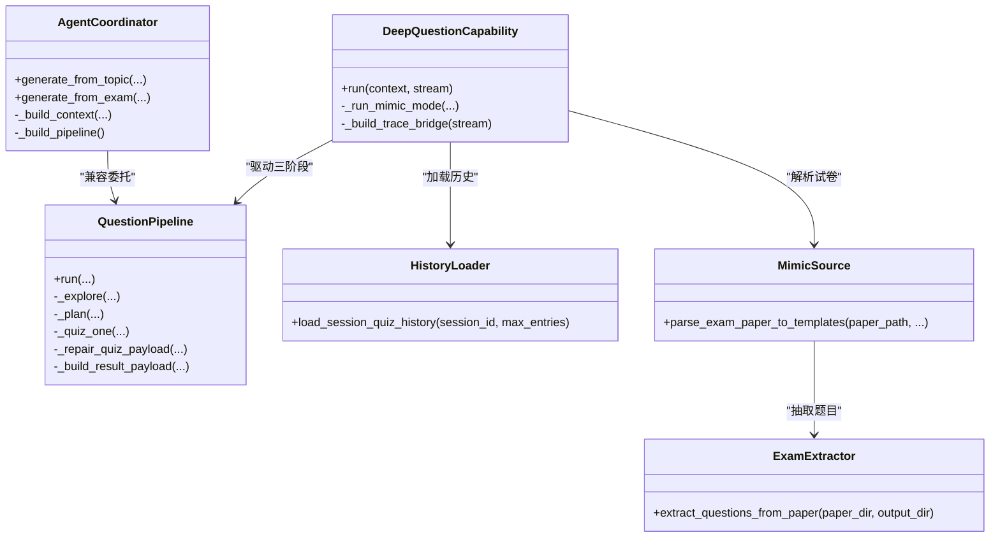

# 智能问题生成器

<cite>
**本文引用的文件**   
- [capability.py](file://deeptutor/agents/question/capability.py)
- [pipeline.py](file://deeptutor/agents/question/pipeline.py)
- [coordinator.py](file://deeptutor/agents/question/coordinator.py)
- [history.py](file://deeptutor/agents/question/history.py)
- [mimic_source.py](file://deeptutor/agents/question/mimic_source.py)
- [question.py](file://deeptutor/api/routers/question.py)
- [exam_mimic.py](file://deeptutor/tools/question/exam_mimic.py)
- [question_extractor.py](file://deeptutor/tools/question/question_extractor.py)
</cite>

## 目录
1. [简介](#简介)
2. [项目结构](#项目结构)
3. [核心组件](#核心组件)
4. [架构总览](#架构总览)
5. [详细组件分析](#详细组件分析)
6. [依赖关系分析](#依赖关系分析)
7. [性能与可扩展性](#性能与可扩展性)
8. [故障排查指南](#故障排查指南)
9. [结论](#结论)
10. [附录：配置与使用示例](#附录配置与使用示例)

## 简介
本文件面向教师与开发者，系统性说明 DeepTutor 中的“智能问题生成器”。它负责根据学习内容自动生成测验题目，支持选择题、概念题、填空题、简答题、论述题和编程题等多种题型；提供“主题模式”和“模仿模式”两种生成路径；内置历史记忆、质量校验、修复重试、流式进度、多语言输出、题库与版本化输出等能力。同时给出与学习系统集成的方式，包括自适应测试与个性化练习推荐。

## 项目结构
问题生成相关代码主要位于以下模块：
- 能力入口与路由：`deeptutor/agents/question/capability.py`、`deeptutor/api/routers/question.py`
- 核心编排引擎：`deeptutor/agents/question/pipeline.py`
- 兼容适配器（旧接口）：`deeptutor/agents/question/coordinator.py`
- 会话历史加载：`deeptutor/agents/question/history.py`
- 试卷解析与模板转换：`deeptutor/agents/question/mimic_source.py`
- 工具层试卷提取：`deeptutor/tools/question/question_extractor.py`、`deeptutor/tools/question/exam_mimic.py`

**图示来源**
- [question.py:361-581](file://deeptutor/api/routers/question.py#L361-L581)
- [capability.py:29-174](file://deeptutor/agents/question/capability.py#L29-L174)
- [pipeline.py:369-614](file://deeptutor/agents/question/pipeline.py#L369-L614)
- [coordinator.py:31-92](file://deeptutor/agents/question/coordinator.py#L31-L92)
- [history.py:34-100](file://deeptutor/agents/question/history.py#L34-L100)
- [mimic_source.py:58-157](file://deeptutor/agents/question/mimic_source.py#L58-L157)
- [question_extractor.py:324-381](file://deeptutor/tools/question/question_extractor.py#L324-L381)

**章节来源**
- [capability.py:29-174](file://deeptutor/agents/question/capability.py#L29-L174)
- [pipeline.py:369-614](file://deeptutor/agents/question/pipeline.py#L369-L614)
- [coordinator.py:31-92](file://deeptutor/agents/question/coordinator.py#L31-L92)
- [history.py:34-100](file://deeptutor/agents/question/history.py#L34-L100)
- [mimic_source.py:58-157](file://deeptutor/agents/question/mimic_source.py#L58-L157)
- [question_extractor.py:324-381](file://deeptutor/tools/question/question_extractor.py#L324-L381)
- [question.py:361-581](file://deeptutor/api/routers/question.py#L361-L581)

## 核心组件
- 能力入口 `DeepQuestionCapability`：统一处理 followup、自定义主题生成、模仿模式三种路径，并注入会话历史、知识库、工具集与运行时配置。
- 编排引擎 `QuestionPipeline`：三阶段流程（探索 Explore → 计划 Plan → 逐题 Quiz），包含类型/难度归一化、JSON 解析与修复、增量发射、结果封装。
- 兼容协调器 `AgentCoordinator`：为旧接口保留的适配层，内部委托给 `QuestionPipeline`。
- 历史管理 `load_session_quiz_history`：从会话存储读取已答题目，避免重复并辅助弱项覆盖。
- 模仿源处理 `parse_exam_paper_to_templates`：将 PDF/已解析目录转换为 `QuizTemplate` 列表，供 Pipeline 直接跳过探索与计划阶段。
- 工具层提取 `extract_questions_from_paper`：基于 MinerU 解析产物，调用 LLM 抽取题目元信息并落盘 JSON。

**章节来源**
- [capability.py:29-174](file://deeptutor/agents/question/capability.py#L29-L174)
- [pipeline.py:369-614](file://deeptutor/agents/question/pipeline.py#L369-L614)
- [coordinator.py:31-92](file://deeptutor/agents/question/coordinator.py#L31-L92)
- [history.py:34-100](file://deeptutor/agents/question/history.py#L34-L100)
- [mimic_source.py:58-157](file://deeptutor/agents/question/mimic_source.py#L58-L157)
- [question_extractor.py:324-381](file://deeptutor/tools/question/question_extractor.py#L324-L381)

## 架构总览
智能问题生成器的端到端流程如下：
- 前端通过 WebSocket 发起请求，路由层进行鉴权、任务 ID 分配与日志转发。
- 能力层判断模式：followup、custom、mimic。
- custom 模式下，Pipeline 执行 Explore → Plan → Quiz 三阶段，期间持续向客户端推送思考、工具调用、题目卡片与最终结果。
- mimic 模式下，先解析试卷得到模板，再直接进入逐题生成阶段。
- 所有阶段均支持多语言、知识检索、工具调用、用量追踪与结构化事件流。

**图示来源**
- [question.py:361-581](file://deeptutor/api/routers/question.py#L361-L581)
- [capability.py:29-174](file://deeptutor/agents/question/capability.py#L29-L174)
- [pipeline.py:457-614](file://deeptutor/agents/question/pipeline.py#L457-L614)
- [history.py:34-100](file://deeptutor/agents/question/history.py#L34-L100)
- [mimic_source.py:58-157](file://deeptutor/agents/question/mimic_source.py#L58-L157)
- [question_extractor.py:324-381](file://deeptutor/tools/question/question_extractor.py#L324-L381)

## 详细组件分析

### 能力入口：DeepQuestionCapability
职责
- 解析上下文与参数：主题、数量、难度、题型白名单、按题型数量分布、会话历史、附件、工作区输出目录。
- 分支处理：
  - followup：调用 FollowupAgent 对上一题进行追问解释。
  - custom：构造 `QuestionPipeline` 并驱动三阶段生成。
  - mimic：优先走 PDF 附件或已解析目录；若无可用试卷则降级为 custom 并在用户消息前注入“模仿附件风格”的提示。
- 流式桥接：将 LLM 与工具的 trace 事件映射到 StreamBus，便于前端渲染。

关键行为
- 输入校验：custom 模式缺少主题时直接返回可重试错误。
- 历史注入：加载会话内已答题目，帮助规划与去重。
- 运行时配置：从 main.yaml 构建 question 能力运行时参数，控制预算、迭代上限等。

**章节来源**
- [capability.py:29-174](file://deeptutor/agents/question/capability.py#L29-L174)
- [capability.py:176-350](file://deeptutor/agents/question/capability.py#L176-L350)
- [capability.py:351-469](file://deeptutor/agents/question/capability.py#L351-L469)

### 编排引擎：QuestionPipeline
职责
- 统一入口 `run`：接收上下文、用户消息、数量、难度、题型白名单、按题型数量分布、对话上下文、附件、历史、模板覆盖、StreamBus。
- 三阶段流程：
  - Explore：一次 agentic loop，产出用户可见的“探索前言”与“探索轨迹”，用于后续 Plan/Quiz。
  - Plan：一次性 PLAN 步骤输出 JSON 计划，包含每道题的 topic、question_type、difficulty。
  - Quiz：对每个模板执行 agentic loop，产出严格 JSON 的题目对象，并进行解析、规范化、校验与修复。
- 增量发射：每生成一道题即通过 `quiz_question_emitted` 事件推送到前端，实现“即时渲染”。
- 结果封装：汇总成功/失败数、模板、结果数组、分析摘要，并区分 custom/mimic 模式。

数据结构
- `QuizTemplate`：单题模板（topic、question_type、difficulty、source、reference_*）。
- `QuizPlan`：分析摘要 + 模板列表。
- `QuizHistoryEntry`：会话内已答题目条目。
- `QuizPair`：最终发给前端的题目对象（含选项、解释、难度、元数据等）。

类型与难度
- 支持的题型枚举：choice、concept、fill_in_blank、short_answer、written、coding。
- 难度枚举：easy、medium、hard。
- 输入归一化：过滤未知题型、去重、非正计数剔除；当允许集合为空时视为“任意题型”。

JSON 解析与修复
- 解析策略：优先完整 JSON，其次尝试 fenced code block，最后回退到首个 JSON 对象。
- 规范化：按题型约束字段（如 choice 必须 A/B/C/D，concept 答案必须是 true/false，fill_in_blank 必须包含占位符等）。
- 校验与修复：收集 issues，触发一次修复轮次；若仍失败，记录 issues 并继续交付，保证可用性。

**图示来源**
- [pipeline.py:457-614](file://deeptutor/agents/question/pipeline.py#L457-L614)
- [pipeline.py:808-871](file://deeptutor/agents/question/pipeline.py#L808-L871)
- [pipeline.py:876-967](file://deeptutor/agents/question/pipeline.py#L876-L967)
- [pipeline.py:1384-1502](file://deeptutor/agents/question/pipeline.py#L1384-L1502)

**章节来源**
- [pipeline.py:369-614](file://deeptutor/agents/question/pipeline.py#L369-L614)
- [pipeline.py:808-871](file://deeptutor/agents/question/pipeline.py#L808-L871)
- [pipeline.py:876-967](file://deeptutor/agents/question/pipeline.py#L876-L967)
- [pipeline.py:1384-1502](file://deeptutor/agents/question/pipeline.py#L1384-L1502)

### 兼容协调器：AgentCoordinator
职责
- 为旧接口提供兼容方法：`generate_from_topic`、`generate_from_exam`。
- 内部创建 `UnifiedContext` 与 `QuestionPipeline`，并通过 `StreamBus` 转发事件。
- 将新 Pipeline 的结果包装成旧摘要格式，保持向后兼容。

典型用法
- 外部工具或旧路由通过该协调器调用新的 Pipeline，无需关心内部细节。

**章节来源**
- [coordinator.py:31-92](file://deeptutor/agents/question/coordinator.py#L31-L92)
- [coordinator.py:94-149](file://deeptutor/agents/question/coordinator.py#L94-L149)
- [coordinator.py:151-242](file://deeptutor/agents/question/coordinator.py#L151-L242)

### 历史管理：load_session_quiz_history
职责
- 从 SQLite 会话存储中读取最近 N 条笔记条目，作为“已答题目历史”。
- 排序确保时间顺序稳定（created_at ASC, id ASC），以便 LLM 按“最早→最新”阅读。
- 将空作答标记为 `is_correct=None`，避免误导模型认为“错误”。

作用
- 在 Explore 阶段提示模型避免重复、覆盖薄弱知识点。
- 在 Quiz 阶段提供“之前已问过的题目”上下文，降低重复率。

**章节来源**
- [history.py:34-100](file://deeptutor/agents/question/history.py#L34-L100)

### 模仿源处理：parse_exam_paper_to_templates
职责
- 将上传的 PDF 或已解析目录转换为 `QuizTemplate` 列表。
- 支持两种模式：
  - upload：调用解析服务解析 PDF，并将题目 JSON 写入会话输出目录。
  - parsed：直接使用已有解析目录，跳过解析步骤。
- 对每道题进行类型与难度的强制归一化，未知值降级为默认值。

输出
- 模板列表与 trace 信息（工作目录、问题文件路径、模板数量）。

**章节来源**
- [mimic_source.py:58-157](file://deeptutor/agents/question/mimic_source.py#L58-L157)

### 工具层：试卷题目提取 exam_mimic / question_extractor
- `exam_mimic.py`：薄封装，委托给 `AgentCoordinator`，对外暴露 `mimic_exam_questions`，兼容旧调用方。
- `question_extractor.py`：读取 MinerU 解析产物（Markdown 与 content_list.json），调用 LLM 抽取题目元信息（题号、题干、题型、难度、参考答案、图片），保存为 JSON。

**章节来源**
- [exam_mimic.py:18-70](file://deeptutor/tools/question/exam_mimic.py#L18-L70)
- [question_extractor.py:324-381](file://deeptutor/tools/question/question_extractor.py#L324-L381)

### WebSocket 路由与实时流
- `/mimic`：支持两种模式（upload/parsed），实时推送解析与生成状态，捕获标准输出并清理 ANSI 颜色码后发送给前端。
- `/generate`：为 custom 模式提供任务 ID、进度、批量摘要与完成信号；错误时更新任务状态并返回错误信息。

**章节来源**
- [question.py:49-359](file://deeptutor/api/routers/question.py#L49-L359)
- [question.py:361-581](file://deeptutor/api/routers/question.py#L361-L581)

## 依赖关系分析
- 能力层依赖 Pipeline 与 History，并根据模式选择是否调用 MimicSource。
- Pipeline 依赖 LLM 客户端、工具注册表、Prompt 管理器、StreamBus 与 UsageTracker。
- Coordinator 仅作为兼容层，不引入额外业务逻辑。
- 工具层与解析服务解耦，通过统一的解析服务与 LLM 工厂调用。

**图示来源**
- [capability.py:29-174](file://deeptutor/agents/question/capability.py#L29-L174)
- [pipeline.py:369-614](file://deeptutor/agents/question/pipeline.py#L369-L614)
- [coordinator.py:31-92](file://deeptutor/agents/question/coordinator.py#L31-L92)
- [history.py:34-100](file://deeptutor/agents/question/history.py#L34-L100)
- [mimic_source.py:58-157](file://deeptutor/agents/question/mimic_source.py#L58-L157)
- [question_extractor.py:324-381](file://deeptutor/tools/question/question_extractor.py#L324-L381)

**章节来源**
- [capability.py:29-174](file://deeptutor/agents/question/capability.py#L29-L174)
- [pipeline.py:369-614](file://deeptutor/agents/question/pipeline.py#L369-L614)
- [coordinator.py:31-92](file://deeptutor/agents/question/coordinator.py#L31-L92)
- [history.py:34-100](file://deeptutor/agents/question/history.py#L34-L100)
- [mimic_source.py:58-157](file://deeptutor/agents/question/mimic_source.py#L58-L157)
- [question_extractor.py:324-381](file://deeptutor/tools/question/question_extractor.py#L324-L381)

## 性能与可扩展性
- 流式处理：Explore 阶段的 FINISH 文本与 Quiz 阶段的题目卡片均实时推送，减少等待时间。
- 预算与迭代上限：通过运行时配置控制 Explore 最大迭代次数、每题 Quiz 最大迭代次数、各阶段 token 预算。
- 工具结果压缩：Explore 阶段对每次工具结果进行“反思摘要”，减少后续循环的上下文膨胀。
- 修复重试：Plan 与 Quiz 阶段在推理过度或 JSON 不可用时自动降推理强度重试，提升成功率。
- 扩展点：
  - 新增题型：在 Pipeline 的类型枚举与校验逻辑中添加新类型，并在 Prompt 中补充对应约束。
  - 新增工具：通过工具注册表挂载新工具，并在 Pipeline 的工具组合策略中启用。
  - 自定义模板：在 mimic 模式下通过 `templates_override` 直接注入模板，绕过 Explore/Plan。

[本节为通用指导，不涉及具体文件分析]

## 故障排查指南
常见问题与定位建议：
- 无题目生成：检查 Plan 是否产出空模板；查看是否触发“计划不可用”警告；确认 allowed_types 与 per_type_counts 是否正确。
- JSON 解析失败：查看 `_parse_quiz_payload` 的回退逻辑；确认模型是否输出 fenced JSON；必要时调整 prompt 或增加修复轮次。
- 题型不匹配：检查 `_normalize_quiz_payload` 与 `_collect_quiz_issues` 的规则；确认题型是否为 choice/concept/fill_in_blank 等。
- 历史未生效：确认会话 ID 正确且存储可读；检查 `load_session_quiz_history` 是否返回空列表。
- 试卷解析失败：确认 PDF 是否有效、MinerU 后端是否配置、解析目录是否存在 `_questions.json`。
- WebSocket 断开：路由层会捕获断连并清理资源；检查任务状态是否被更新为 error。

**章节来源**
- [pipeline.py:808-871](file://deeptutor/agents/question/pipeline.py#L808-L871)
- [pipeline.py:1384-1502](file://deeptutor/agents/question/pipeline.py#L1384-L1502)
- [history.py:34-100](file://deeptutor/agents/question/history.py#L34-L100)
- [mimic_source.py:58-157](file://deeptutor/agents/question/mimic_source.py#L58-L157)
- [question.py:361-581](file://deeptutor/api/routers/question.py#L361-L581)

## 结论
智能问题生成器以 `DeepQuestionCapability` 为入口，以 `QuestionPipeline` 为核心编排引擎，结合历史管理与模仿源处理，实现了从主题到题目的自动化生成，以及从试卷到题目的高质量复刻。其设计强调流式交互、健壮性（解析与修复）、可配置性与可扩展性，既满足教师快速出题的需求，也为开发者提供了清晰的扩展点与集成方式。

[本节为总结，不涉及具体文件分析]

## 附录：配置与使用示例

### 支持的题目类型与生成策略
- 选择题（choice）：需要 A/B/C/D 四个选项，正确答案为选项键。
- 概念题（concept）：判断题，答案为 true/false。
- 填空题（fill_in_blank）：题干中包含占位符，要求填写短答案。
- 简答题（short_answer）：概念性问题，期望简短段落回答。
- 论述题（written）：长文、证明或多步推导。
- 编程题（coding）：期望代码或伪代码。

生成策略要点：
- 类型白名单：通过 `question_types` 限制 Planner 可选类型。
- 按题型数量：通过 `per_type_counts` 指定每种题型的数量目标。
- 难度控制：传入 difficulty（easy/medium/hard），Planner 与 Quiz 阶段均会遵循。

**章节来源**
- [pipeline.py:156-174](file://deeptutor/agents/question/pipeline.py#L156-L174)
- [pipeline.py:187-247](file://deeptutor/agents/question/pipeline.py#L187-L247)
- [pipeline.py:808-871](file://deeptutor/agents/question/pipeline.py#L808-L871)

### 配置示例（概念性）
- 主题模式：
  - 输入：knowledge_point=“电路基础”，difficulty=“medium”，question_type=“choice”，count=5
  - 行为：Explore 检索相关知识 → Plan 生成 5 个模板 → Quiz 逐个生成选择题
- 模仿模式：
  - 输入：mode=mimic，paper_path=“已解析目录”或上传 PDF，max_questions=10
  - 行为：解析试卷 → 抽取题目元信息 → 直接生成对应题型与难度的题目

注意：以上为概念性示例，实际参数请根据前端表单或 API 契约传递。

**章节来源**
- [capability.py:117-174](file://deeptutor/agents/question/capability.py#L117-L174)
- [mimic_source.py:58-157](file://deeptutor/agents/question/mimic_source.py#L58-L157)

### 题目质量评估标准
- 必填字段：question、correct_answer、explanation 不得为空。
- 题型约束：
  - choice：options 必须为 A/B/C/D，correct_answer 必须为选项键。
  - concept：options 必须为空，correct_answer 必须为 true/false。
  - fill_in_blank：options 必须为空，question 必须包含占位符。
  - 其他题型：options 必须为空，correct_answer 不应像选项键。
- 修复机制：检测到 issues 后触发修复轮次，仍失败则保留 issues 并交付。

**章节来源**
- [pipeline.py:1422-1502](file://deeptutor/agents/question/pipeline.py#L1422-L1502)

### 重复检测与多语言支持
- 重复检测：通过会话历史避免重复提问；Planner 与 Quiz 阶段均可参考“之前已问过的题目”。
- 多语言：Pipeline 与 Capability 层均支持语言指令注入，Prompts 按语言加载，LLM 输出遵循用户语言。

**章节来源**
- [history.py:34-100](file://deeptutor/agents/question/history.py#L34-L100)
- [pipeline.py:441-453](file://deeptutor/agents/question/pipeline.py#L441-L453)
- [capability.py:35-40](file://deeptutor/agents/question/capability.py#L35-L40)

### 题库管理与版本控制
- 输出目录：每个任务有独立的工作区目录；mimic 模式将解析产物与题目 JSON 保存在批次目录下。
- 版本化：题目 JSON 文件名包含时间戳，便于回溯与对比。
- 统计：提取工具会输出题目总数、带图题目数等统计信息。

**章节来源**
- [question_extractor.py:286-321](file://deeptutor/tools/question/question_extractor.py#L286-L321)
- [mimic_source.py:127-157](file://deeptutor/agents/question/mimic_source.py#L127-L157)

### 与学习系统集成（自适应测试与个性化推荐）
- 自适应测试：利用 QuizHistoryEntry 与 LearningService 的掌握度模型，可在 Explore 阶段识别薄弱知识点并定向覆盖。
- 个性化推荐：根据用户偏好（preference）与历史表现，调整题型分布与难度。

**章节来源**
- [pipeline.py:334-362](file://deeptutor/agents/question/pipeline.py#L334-L362)
- [capability.py:138-159](file://deeptutor/agents/question/capability.py#L138-L159)

### 自定义题目模板、评分规则与教学策略
- 自定义模板：通过 `templates_override` 直接注入模板，跳过 Explore/Plan，适合批量导入或离线生成。
- 评分规则：可在 Quiz 阶段通过 Prompt 与工具扩展评分逻辑；前端可结合 explanation 与 correct_answer 进行自动评分。
- 教学策略：通过 runtime_config 控制 Explore/Plan/Quiz 的预算与迭代上限，配合 Prompt 工程实现不同教学策略（如启发式、讲解式、练习式）。

**章节来源**
- [pipeline.py:457-514](file://deeptutor/agents/question/pipeline.py#L457-L514)
- [capability.py:139-159](file://deeptutor/agents/question/capability.py#L139-L159)