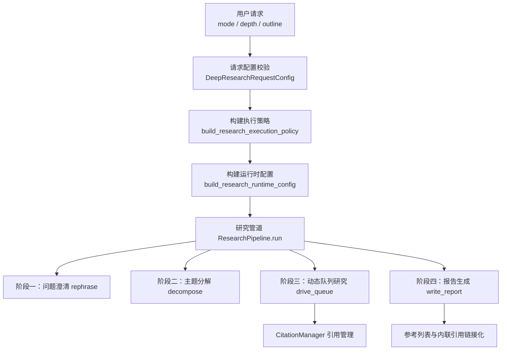
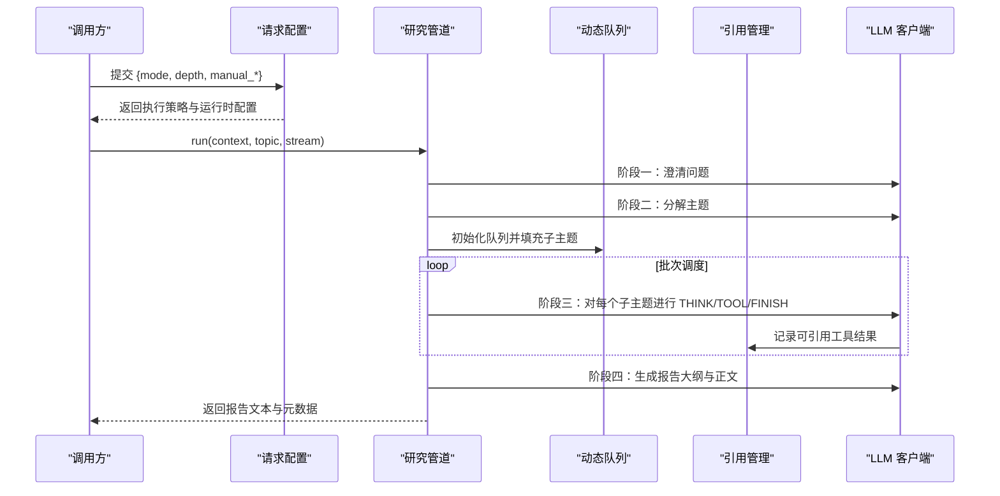
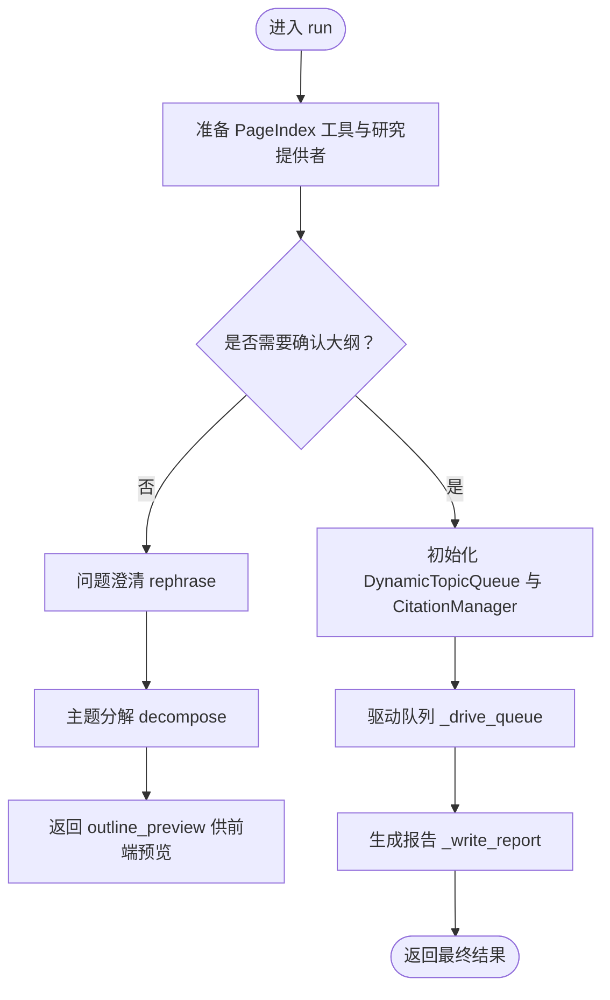
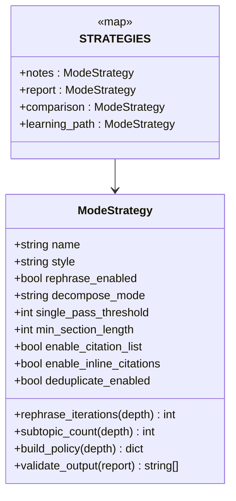
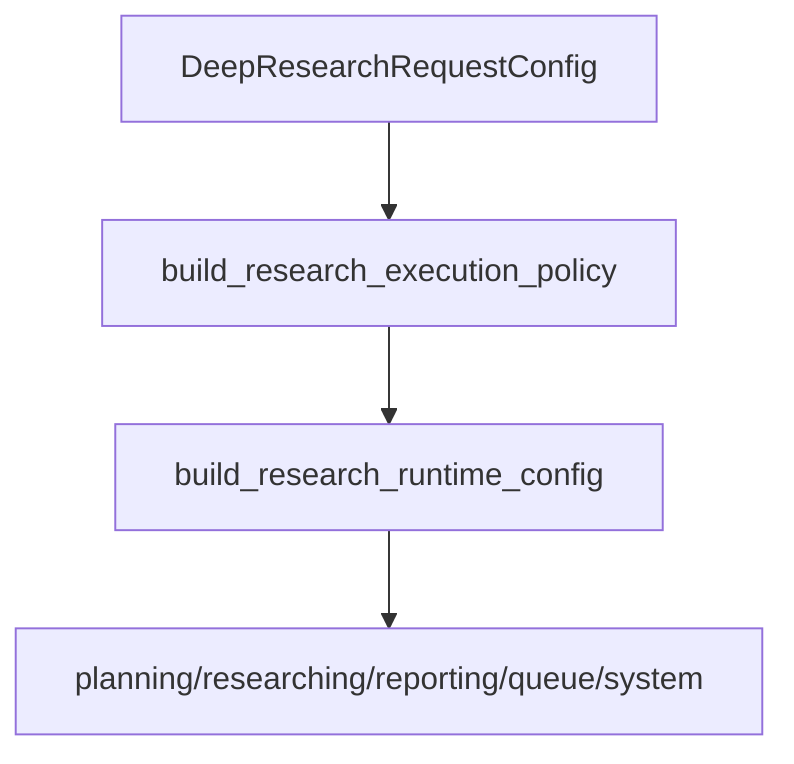
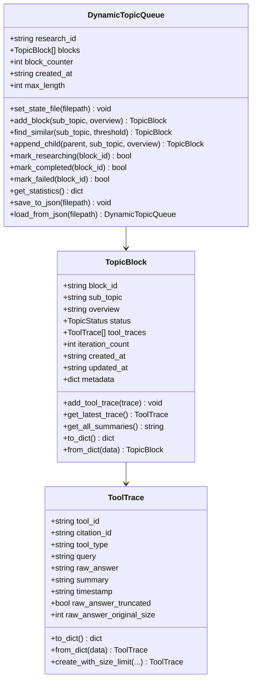
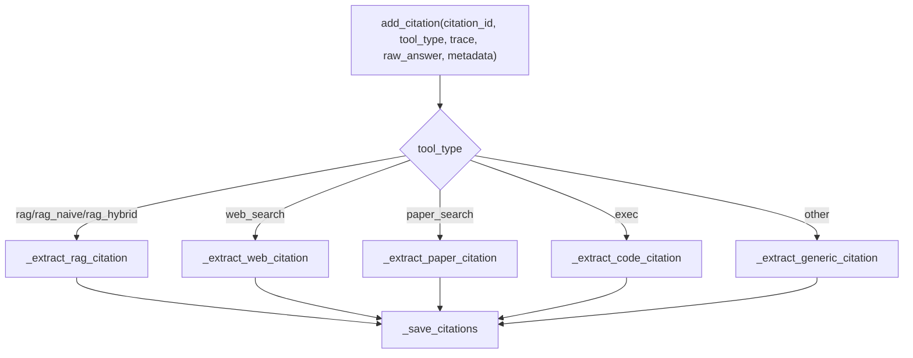
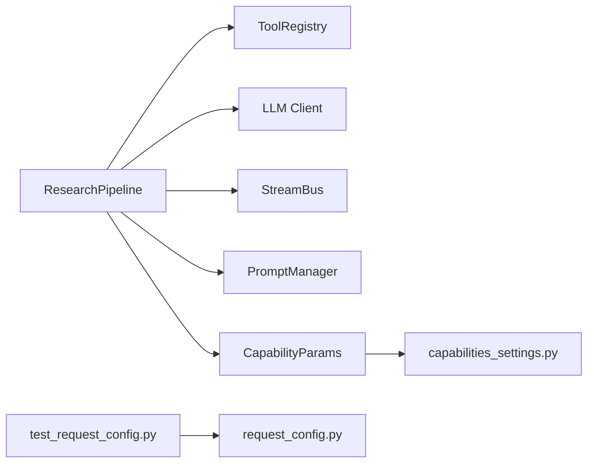
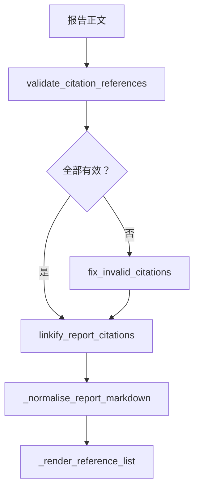
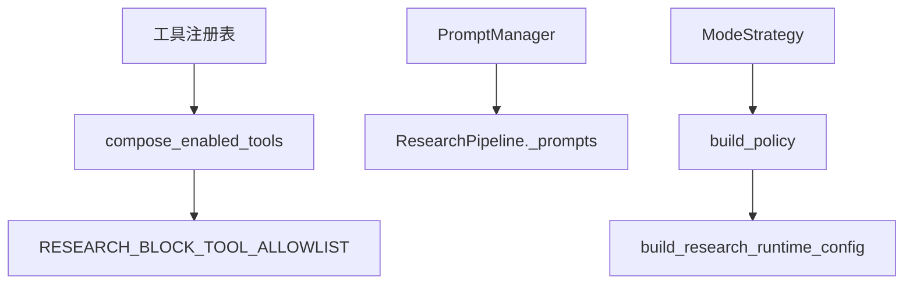

# 研究分析助手

<cite>
**本文引用的文件**   
- [pipeline.py](file://deeptutor/agents/research/pipeline.py)
- [mode_strategy.py](file://deeptutor/agents/research/mode_strategy.py)
- [request_config.py](file://deeptutor/agents/research/request_config.py)
- [data_structures.py](file://deeptutor/agents/research/data_structures.py)
- [citation_manager.py](file://deeptutor/agents/research/utils/citation_manager.py)
- [capability.py](file://deeptutor/agents/research/capability.py)
- [capabilities_settings.py](file://deeptutor/services/config/capabilities_settings.py)
- [test_request_config.py](file://tests/agents/research/test_request_config.py)
</cite>

## 目录
1. [引言](#引言)
2. [项目结构](#项目结构)
3. [核心组件](#核心组件)
4. [架构总览](#架构总览)
5. [详细组件分析](#详细组件分析)
6. [依赖关系分析](#依赖关系分析)
7. [性能与资源控制](#性能与资源控制)
8. [使用示例与工作流](#使用示例与工作流)
9. [引用格式、参考文献管理与学术规范检查](#引用格式参考文献管理与学术规范检查)
10. [研究质量控制、事实核查与偏见检测](#研究质量控制事实核查与偏见检测)
11. [外部工具集成与自定义模板](#外部工具集成与自定义模板)
12. [故障排查指南](#故障排查指南)
13. [结论](#结论)

## 引言
本文件面向研究人员与开发者，系统性说明 DeepTutor 中“研究分析助手”的实现原理。该能力以多阶段智能体管道为核心，围绕问题澄清、主题分解、证据检索、知识整合与报告生成展开；同时提供多种工作模式（深度研究、快速浏览、对比分析等）和可配置的研究深度（快速、标准、深入、手动），并内置引用管理、APA 风格参考列表、引用校验与去重机制。文档既帮助研究者理解端到端工作流程，也为开发者提供扩展点、参数含义与定制建议。

## 项目结构
研究分析助手主要位于 `deeptutor/agents/research` 下，关键文件职责如下：
- `pipeline.py`：四阶段研究管道编排器，负责问题澄清、主题分解、动态队列驱动研究与报告生成。
- `mode_strategy.py`：定义研究模式策略（笔记、报告、对比、学习路径）及其行为约束。
- `request_config.py`：请求配置校验、意图到执行策略映射、运行时配置组装。
- `data_structures.py`：主题块、工具调用轨迹、动态主题队列等数据结构。
- `utils/citation_manager.py`：引用 ID 管理、来源抽取、参考列表渲染、引用编号映射与去重。
- `capability.py`：研究能力的对外入口（与上层能力注册交互）。
- `services/config/capabilities_settings.py`：将主配置中的研究能力参数注入运行时。

**图示来源**
- [request_config.py:25-119](file://deeptutor/agents/research/request_config.py#L25-L119)
- [pipeline.py:527-721](file://deeptutor/agents/research/pipeline.py#L527-L721)
- [citation_manager.py:62-128](file://deeptutor/agents/research/utils/citation_manager.py#L62-L128)

**章节来源**
- [pipeline.py:1-30](file://deeptutor/agents/research/pipeline.py#L1-L30)
- [request_config.py:25-119](file://deeptutor/agents/research/request_config.py#L25-L119)

## 核心组件
- 研究管道 `ResearchPipeline`：统一编排四个阶段，维护 LLM 客户端、工具集、提示词、预算与流式输出。
- 模式策略 `ModeStrategy`：为不同研究模式设定最小段落长度、是否启用引用列表、单遍阈值、子主题数量等。
- 请求配置 `DeepResearchRequestConfig`：校验 mode/depth/manual_subtopics/manual_max_iterations 等字段，并映射为执行策略。
- 数据模型 `TopicBlock` / `ToolTrace` / `DynamicTopicQueue`：表示待研究主题、工具调用轨迹与动态调度队列。
- 引用管理器 `CitationManager`：生成稳定引用 ID、抽取 RAG/网页/论文/代码来源、格式化参考列表、建立正文引用编号映射。

**章节来源**
- [pipeline.py:341-505](file://deeptutor/agents/research/pipeline.py#L341-L505)
- [mode_strategy.py:24-140](file://deeptutor/agents/research/mode_strategy.py#L24-L140)
- [request_config.py:25-119](file://deeptutor/agents/research/request_config.py#L25-L119)
- [data_structures.py:66-237](file://deeptutor/agents/research/data_structures.py#L66-L237)
- [citation_manager.py:62-128](file://deeptutor/agents/research/utils/citation_manager.py#L62-L128)

## 架构总览
研究分析助手的整体流程由“请求配置 → 策略映射 → 管道运行 → 结果输出”构成。其中：
- 请求层：通过 Pydantic 模型校验输入，并将 mode/depth 映射为 planning/researching/reporting/queue 四类运行时配置。
- 策略层：根据模式选择最小段落长度、是否允许自动分解、是否启用引用列表等。
- 管道层：按阶段推进，支持并行或串行执行多个子主题，并在每个可引用工具调用后生成摘要与引用条目。
- 输出层：生成结构化报告，附带参考列表与内联引用链接，同时暴露部分元数据（如失败子主题数量）。

**图示来源**
- [request_config.py:66-119](file://deeptutor/agents/research/request_config.py#L66-L119)
- [pipeline.py:527-721](file://deeptutor/agents/research/pipeline.py#L527-L721)
- [pipeline.py:1168-1230](file://deeptutor/agents/research/pipeline.py#L1168-L1230)
- [citation_manager.py:278-332](file://deeptutor/agents/research/utils/citation_manager.py#L278-L332)

## 详细组件分析

### 研究管道 ResearchPipeline
- 生命周期：构造时加载语言、KB 类型、LLM 客户端、工具注册表、提示词与默认预算；`run` 方法协调准备阶段与四个处理阶段。
- 阶段一（Rephrase）：仅暴露 `ask_user` 工具，最多若干轮问答，最终产出精炼后的研究主题。
- 阶段二（Decompose）：一次性要求 LLM 输出子主题列表，若解析失败则回退为单一主题。
- 阶段三（Research Blocks）：基于动态队列并发或串行驱动每个子主题的 THINK/TOOL/APPEND/FINISH 循环；支持追加新子主题、去重与状态标记。
- 阶段四（Reporting）：先生成报告大纲，再依次写出引言、各节与结论；最后标准化 Markdown、链接引用并生成参考列表。

**图示来源**
- [pipeline.py:527-721](file://deeptutor/agents/research/pipeline.py#L527-L721)
- [pipeline.py:766-847](file://deeptutor/agents/research/pipeline.py#L766-L847)
- [pipeline.py:852-936](file://deeptutor/agents/research/pipeline.py#L852-L936)
- [pipeline.py:1168-1230](file://deeptutor/agents/research/pipeline.py#L1168-L1230)
- [pipeline.py:1286-1420](file://deeptutor/agents/research/pipeline.py#L1286-L1420)

**章节来源**
- [pipeline.py:341-505](file://deeptutor/agents/research/pipeline.py#L341-L505)
- [pipeline.py:527-721](file://deeptutor/agents/research/pipeline.py#L527-L721)
- [pipeline.py:766-936](file://deeptutor/agents/research/pipeline.py#L766-L936)
- [pipeline.py:1168-1420](file://deeptutor/agents/research/pipeline.py#L1168-L1420)

### 模式策略 ModeStrategy
- 支持的四种模式：
  - notes：学习笔记风格，要求包含定义框与要点总结。
  - report：研究报告风格，自动分解主题，较长段落。
  - comparison：对比分析风格，强制表格输出，支持更深层的复述轮次。
  - learning_path：学习路径风格，要求包含 Checkpoint 节点。
- 每种模式提供：
  - 是否启用问题澄清。
  - 自动或手动分解模式。
  - 最小段落长度与单遍阈值。
  - 是否启用引用列表与内联引用。
  - 去重开关（主要用于论文去重）。
- 策略通过 `build_policy(depth)` 输出给运行时配置，再由管道消费。

**图示来源**
- [mode_strategy.py:24-140](file://deeptutor/agents/research/mode_strategy.py#L24-L140)

**章节来源**
- [mode_strategy.py:17-140](file://deeptutor/agents/research/mode_strategy.py#L17-L140)

### 请求配置 RequestConfig
- 输入字段：
  - `mode`：research 模式（notes/report/comparison/learning_path）。
  - `depth`：研究深度（quick/standard/deep/manual）。
  - `manual_subtopics`：手动模式下初始子主题数（1-10）。
  - `manual_max_iterations`：手动模式下最大迭代次数（1-10）。
- 输出策略：
  - planning：rephrase 是否启用及最大迭代次数；decompose 的模式与初始子主题数。
  - researching：每块最大迭代次数、迭代模式、执行模式（series/parallel）、最大并行主题数。
  - reporting：最小段落长度、单遍阈值、引用列表与内联引用开关、去重开关、style。
  - queue：队列最大长度。
- 运行时配置：合并基础配置、注入 research 相关 key，并设置输出目录。

**图示来源**
- [request_config.py:25-119](file://deeptutor/agents/research/request_config.py#L25-L119)
- [request_config.py:122-187](file://deeptutor/agents/research/request_config.py#L122-L187)
- [request_config.py:190-239](file://deeptutor/agents/research/request_config.py#L190-L239)

**章节来源**
- [request_config.py:25-119](file://deeptutor/agents/research/request_config.py#L25-L119)
- [request_config.py:122-187](file://deeptutor/agents/research/request_config.py#L122-L187)
- [request_config.py:190-239](file://deeptutor/agents/research/request_config.py#L190-L239)

### 数据结构 DataStructures
- `ToolTrace`：记录一次工具调用的完整信息，包括查询、原始答案、摘要、时间戳、截断标志与原始大小；具备 JSON 感知的截断逻辑。
- `TopicBlock`：队列的最小调度单元，包含标题、概述、状态、工具轨迹、迭代计数与元数据。
- `DynamicTopicQueue`：动态主题队列，支持添加、模糊相似去重、父子关系标记、状态更新、统计与持久化。

**图示来源**
- [data_structures.py:66-237](file://deeptutor/agents/research/data_structures.py#L66-L237)
- [data_structures.py:240-561](file://deeptutor/agents/research/data_structures.py#L240-L561)

**章节来源**
- [data_structures.py:66-237](file://deeptutor/agents/research/data_structures.py#L66-L237)
- [data_structures.py:240-561](file://deeptutor/agents/research/data_structures.py#L240-L561)

### 引用管理 CitationManager
- 引用 ID 生成：规划阶段使用 PLAN-XX，研究阶段使用 CIT-X-XX，支持从已有文件恢复计数器。
- 来源抽取：
  - RAG：优先从结构化 `metadata["sources"]` 抽取，否则回退解析原始答案；提取标题、片段、来源文件、页码、chunk_id、相似度分数。
  - Web Search：优先从结构化 `metadata["citations/results/web_results/search_results/urls"]` 抽取，否则解析原始答案；提取 URL、标题、摘要、域名。
  - Paper Search：优先从 `metadata["papers"]` 抽取，否则解析原始答案；提取作者、年份、URL、arXiv ID、摘要、DOI、会议/期刊。
  - Exec：记录查询与摘要。
  - 未知工具：通用格式。
- 参考列表渲染：
  - paper_search：APA 风格，支持 arXiv 链接。
  - rag：显示 KB 名称与前三条来源标题。
  - web_search：列出可点击链接。
  - 其他：显示工具类型与查询。
- 引用编号映射：按出现顺序分配 ref_number，并对同一论文（标题+第一作者）进行去重。

**图示来源**
- [citation_manager.py:278-332](file://deeptutor/agents/research/utils/citation_manager.py#L278-L332)
- [citation_manager.py:334-532](file://deeptutor/agents/research/utils/citation_manager.py#L334-L532)
- [citation_manager.py:570-690](file://deeptutor/agents/research/utils/citation_manager.py#L570-L690)
- [citation_manager.py:692-800](file://deeptutor/agents/research/utils/citation_manager.py#L692-L800)

**章节来源**
- [citation_manager.py:62-128](file://deeptutor/agents/research/utils/citation_manager.py#L62-L128)
- [citation_manager.py:278-332](file://deeptutor/agents/research/utils/citation_manager.py#L278-L332)
- [citation_manager.py:334-532](file://deeptutor/agents/research/utils/citation_manager.py#L334-L532)
- [citation_manager.py:570-690](file://deeptutor/agents/research/utils/citation_manager.py#L570-L690)
- [citation_manager.py:692-800](file://deeptutor/agents/research/utils/citation_manager.py#L692-L800)

## 依赖关系分析
- 管道依赖：
  - 运行时智能体原语：`run_agentic_loop`、`run_labeled_step`、`dispatch_tool_calls`、`classify_label` 等。
  - 工具注册表：用于构建工具 Schema 与提示文本。
  - 提示词管理器：加载 research pipeline 的多语言提示词。
  - LLM 配置：绑定 binding/model/api_key/base_url 等。
  - 流式总线：用于进度、错误与内容流式输出。
- 配置依赖：
  - `capabilities_settings.py` 将主配置中的 `capabilities.research.researching` 参数（note_agent_mode、tool_timeout、tool_max_retries、paper_search_years_limit）注入运行时。
- 测试依赖：
  - `test_request_config.py` 验证策略不包含已移除的 enable_* 字段，且 runtime config 携带 intent 与 rag.kb_name。

**图示来源**
- [pipeline.py:43-102](file://deeptutor/agents/research/pipeline.py#L43-L102)
- [capabilities_settings.py:263-284](file://deeptutor/services/config/capabilities_settings.py#L263-L284)
- [test_request_config.py:43-79](file://tests/agents/research/test_request_config.py#L43-L79)

**章节来源**
- [pipeline.py:43-102](file://deeptutor/agents/research/pipeline.py#L43-L102)
- [capabilities_settings.py:263-284](file://deeptutor/services/config/capabilities_settings.py#L263-L284)
- [test_request_config.py:43-79](file://tests/agents/research/test_request_config.py#L43-L79)

## 性能与资源控制
- 工具超时与重试：
  - 默认工具超时 240 秒，避免取消仍在工作的慢速工具（RAG/搜索链）。
  - 默认重试次数为 0，仅在调用方明确知道工具不稳定时开启。
- 并行与队列：
  - 深度模式默认并行执行最多 3 个子主题；快速模式串行执行。
  - 队列最大长度受 depth 与 mode 共同影响（quick=2, standard=5, deep=8）。
- 迭代预算：
  - 每块最大迭代次数由 depth 决定（quick=1, standard=3, deep=5）。
  - 当达到最大迭代时，尝试强制 FINISH 修复协议，最多三次尝试。
- Token 预算：
  - 通过 `get_capability_params("research")` 获取 block/outline/note 等阶段的 max_tokens。
  - Note Agent 侧车对长原始答案进行截断（默认 8000 字符）以减少上下文压力。

**章节来源**
- [pipeline.py:429-469](file://deeptutor/agents/research/pipeline.py#L429-L469)
- [pipeline.py:1047-1101](file://deeptutor/agents/research/pipeline.py#L1047-L1101)
- [request_config.py:190-231](file://deeptutor/agents/research/request_config.py#L190-L231)
- [pipeline.py:1235-1275](file://deeptutor/agents/research/pipeline.py#L1235-L1275)

## 使用示例与工作流

### 学术文献综述
- 推荐模式：report
- 推荐深度：deep
- 工作流：
  1. 提交 mode=report、depth=deep。
  2. 系统自动生成子主题（例如理论基础、方法论、实证研究、争议点、未来方向）。
  3. 每个子主题并行检索 RAG/网页/论文，生成证据与摘要。
  4. 报告生成阶段自动组织引言、分节与结论，并附 APA 参考列表。
- 预期输出：结构化 Markdown 报告，含内联引用与可折叠参考列表。

### 技术调研
- 推荐模式：report 或 notes
- 推荐深度：standard
- 工作流：
  1. 提交 mode=report 或 notes、depth=standard。
  2. 如需手动控制，设置 manual_subtopics 与 manual_max_iterations。
  3. 系统结合知识库（KB）与网页搜索，产出技术背景、实现方案与对比要点。
- 适用场景：框架选型、API 对比、开源库生态调研。

### 竞品分析
- 推荐模式：comparison
- 推荐深度：standard 或 deep
- 工作流：
  1. 提交 mode=comparison、depth=standard/deep。
  2. 系统强制输出 Markdown 表格，比较功能、性能、价格、生态等维度。
  3. 可附加知识库（如产品文档）提升准确性。
- 预期输出：对比表格与简要分析段落，附带来源链接。

### 学习路径设计
- 推荐模式：learning_path
- 推荐深度：standard
- 工作流：
  1. 提交 mode=learning_path、depth=standard。
  2. 系统生成学习路径，包含知识点、Checkpoint 与阶段性任务。
  3. 适合课程设计与自我学习计划制定。

**章节来源**
- [mode_strategy.py:97-135](file://deeptutor/agents/research/mode_strategy.py#L97-L135)
- [request_config.py:190-231](file://deeptutor/agents/research/request_config.py#L190-L231)

## 引用格式、参考文献管理与学术规范检查

### 引用格式支持
- paper_search：APA 风格，支持 arXiv 链接；多条论文分别渲染。
- rag：显示 KB 名称与来源标题。
- web_search：显示可点击链接。
- exec：显示“Code Execution”与查询摘要。
- 未知工具：通用格式。

### 参考文献管理
- 引用 ID：PLAN-XX（规划阶段）、CIT-X-XX（研究阶段）。
- 持久化：citations.json 存储引用与计数器，支持恢复。
- 去重：对同一论文（标题+第一作者）进行去重，避免重复编号。
- 编号映射：按正文首次出现顺序分配 ref_number，保证正文链接与附录一致。

### 学术规范检查
- 引用校验：`validate_citation_references` 检查正文中的 `[[CIT-...]]` 是否有效。
- 无效引用修复：`fix_invalid_citations` 移除无效引用。
- 报告标准化：清理重复标题、规范化引用标记、过滤未知引用 ID。

**图示来源**
- [citation_manager.py:219-276](file://deeptutor/agents/research/utils/citation_manager.py#L219-L276)
- [pipeline.py:1460-1515](file://deeptutor/agents/research/pipeline.py#L1460-L1515)
- [pipeline.py:1422-1458](file://deeptutor/agents/research/pipeline.py#L1422-L1458)

**章节来源**
- [citation_manager.py:219-276](file://deeptutor/agents/research/utils/citation_manager.py#L219-L276)
- [citation_manager.py:570-690](file://deeptutor/agents/research/utils/citation_manager.py#L570-L690)
- [citation_manager.py:692-800](file://deeptutor/agents/research/utils/citation_manager.py#L692-L800)
- [pipeline.py:1422-1515](file://deeptutor/agents/research/pipeline.py#L1422-L1515)

## 研究质量控制、事实核查与偏见检测

### 质量控制机制
- 子主题去重：
  - `DynamicTopicQueue.find_similar` 使用序列匹配与词集合相似度（Jaccard/Containment）防止近似重复。
  - 默认阈值 0.85，平衡误判与漏判。
- 迭代保护：
  - 达到最大迭代时触发强制 FINISH 修复，最多三次尝试，避免无限循环。
- 部分结果透明：
  - 若存在未完成子主题，输出警告通知与元数据（partial、failed_block_titles）。

### 事实核查建议
- 优先使用结构化来源：
  - RAG 与网页搜索均优先读取结构化 metadata，减少文本解析误差。
- 交叉验证：
  - 在 comparison 模式中利用表格对比不同来源观点。
- 引用校验：
  - 使用 `validate_citation_references` 确保正文引用有效。

### 偏见检测建议
- 模式约束：
  - comparison 模式强制表格输出，便于横向对比。
- 多源证据：
  - 鼓励同时使用 RAG、网页搜索与论文搜索，降低单一来源偏差。
- 人工复核：
  - 对自动化生成的结论进行人工审阅，尤其关注结论段落的倾向性表述。

**章节来源**
- [data_structures.py:288-372](file://deeptutor/agents/research/data_structures.py#L288-L372)
- [pipeline.py:1047-1101](file://deeptutor/agents/research/pipeline.py#L1047-L1101)
- [pipeline.py:660-688](file://deeptutor/agents/research/pipeline.py#L660-L688)
- [citation_manager.py:334-455](file://deeptutor/agents/research/utils/citation_manager.py#L334-L455)

## 外部工具集成与自定义模板

### 外部研究工具集成
- 可引用工具白名单：
  - rag、web_search、paper_search、exec、workspace_*、obsidian_*。
- 工具组合策略：
  - 使用共享的 `compose_enabled_tools` 策略，与聊天能力保持一致。
  - 当附加 KB 时自动挂载 rag；Obsidian 知识库只读工具（search/read/list）在研究块中可用。
- 运行时参数：
  - note_agent_mode、tool_timeout、tool_max_retries、paper_search_years_limit 可通过主配置注入。

### 自定义研究模板
- 提示词加载：
  - 通过 `get_prompt_manager().load_prompts(module_name="research", agent_name="pipeline", language=self.language)` 加载多语言提示词。
- 模式策略扩展：
  - 新增模式需在 `STRATEGIES` 中添加 `ModeStrategy`，定义 style、rephrase_enabled、decompose_mode、min_section_length 等。
- 请求配置扩展：
  - 在 `DeepResearchRequestConfig` 中增加字段并添加 validator，随后在 `_build_depth_policy` 或 `_build_mode_policy` 中消费。

**图示来源**
- [pipeline.py:112-138](file://deeptutor/agents/research/pipeline.py#L112-L138)
- [pipeline.py:511-522](file://deeptutor/agents/research/pipeline.py#L511-L522)
- [mode_strategy.py:97-140](file://deeptutor/agents/research/mode_strategy.py#L97-L140)
- [request_config.py:122-187](file://deeptutor/agents/research/request_config.py#L122-L187)

**章节来源**
- [pipeline.py:112-138](file://deeptutor/agents/research/pipeline.py#L112-L138)
- [pipeline.py:511-522](file://deeptutor/agents/research/pipeline.py#L511-L522)
- [mode_strategy.py:97-140](file://deeptutor/agents/research/mode_strategy.py#L97-L140)
- [request_config.py:122-187](file://deeptutor/agents/research/request_config.py#L122-L187)

## 故障排查指南
- 常见问题：
  - 子主题未完成：检查 `failed_block_titles` 与日志中的 partial results 警告。
  - 工具超时：调整 `tool_timeout` 与 `tool_max_retries`。
  - 引用缺失：使用 `validate_citation_references` 检查正文引用。
  - 报告不完整：捕获 `IncompleteReportError`，查看缺失部分并重试。
- 调试建议：
  - 观察流式事件（stage=researching/reporting）定位卡住阶段。
  - 检查 citations.json 是否成功写入与恢复。
  - 在 comparison 模式中确认表格输出是否符合预期。

**章节来源**
- [pipeline.py:660-688](file://deeptutor/agents/research/pipeline.py#L660-L688)
- [pipeline.py:723-761](file://deeptutor/agents/research/pipeline.py#L723-L761)
- [citation_manager.py:219-276](file://deeptutor/agents/research/utils/citation_manager.py#L219-L276)

## 结论
研究分析助手通过清晰的四阶段管道、灵活的模式策略与稳健的引用管理，为学术研究、技术调研与竞品分析提供了端到端解决方案。其设计兼顾用户体验（流式输出、可视化进度）与工程健壮性（超时、重试、去重、部分结果透明）。开发者可通过扩展模式策略、请求配置与提示词模板，进一步定制研究流程以满足特定领域需求。