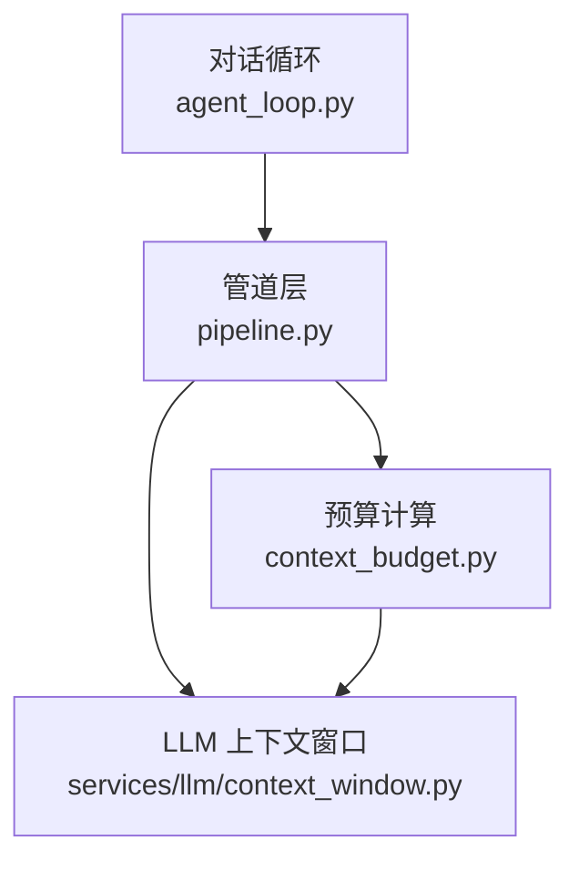
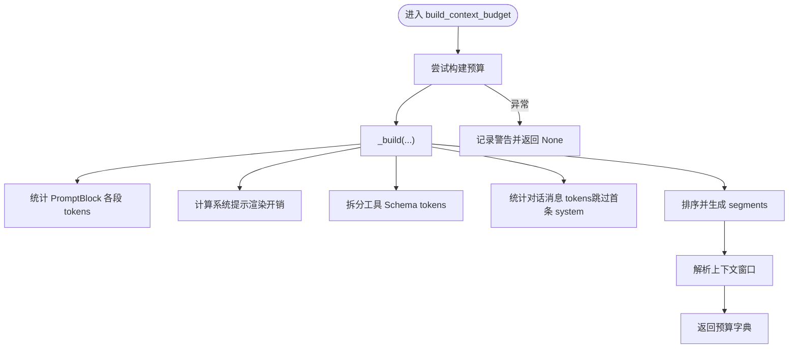
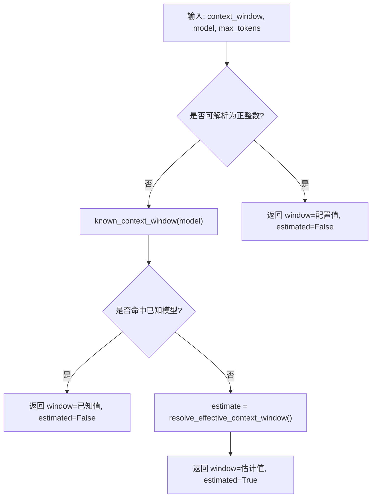
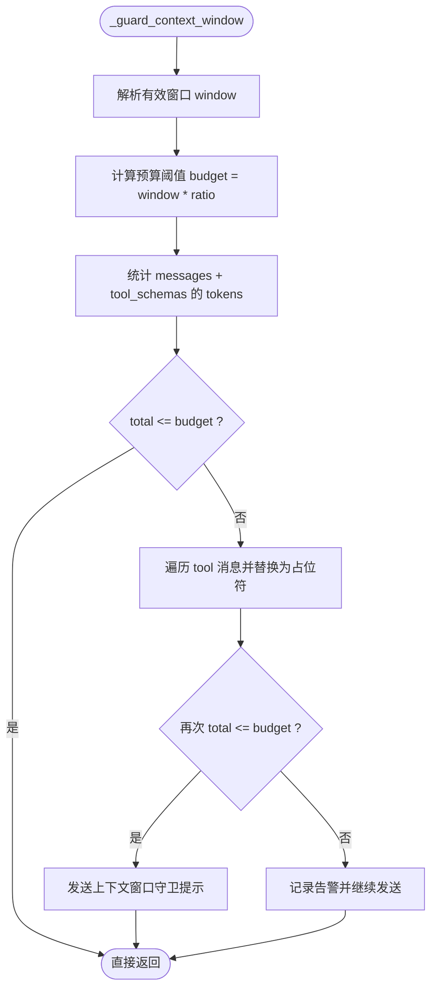
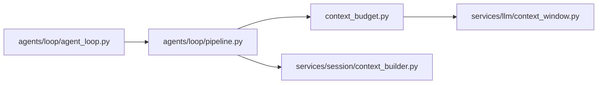

# 上下文预算控制

<cite>
**本文引用的文件**   
- [context_budget.py](file://deeptutor/agents/loop/context_budget.py)
- [pipeline.py](file://deeptutor/agents/loop/pipeline.py)
- [agent_loop.py](file://deeptutor/agents/loop/agent_loop.py)
- [context_window.py](file://deeptutor/services/llm/context_window.py)
- [test_context_budget.py](file://tests/agents/chat/test_context_budget.py)
</cite>

## 目录
1. [引言](#引言)
2. [项目结构](#项目结构)
3. [核心组件](#核心组件)
4. [架构总览](#架构总览)
5. [详细组件分析](#详细组件分析)
6. [依赖关系分析](#依赖关系分析)
7. [性能与内存考量](#性能与内存考量)
8. [故障恢复与可观测性](#故障恢复与可观测性)
9. [配置参数与优化建议](#配置参数与优化建议)
10. [结论](#结论)

## 引言
本文件系统性梳理 DeepTutor 对话循环中的“上下文预算控制”机制，覆盖以下关键主题：
- 上下文窗口大小解析与估算
- 每轮请求的上下文分块计量（PromptBlock、消息、工具 Schema）
- 自动裁剪策略（按工具结果裁剪以保活对话）
- 对话质量与系统性能的平衡（优先级、重要性评估、资源分配）
- 配置项说明与调优技巧
- 健壮性设计（降级、错误隔离）、可观测性与故障恢复

该机制的目标是：在模型上下文窗口有限的约束下，尽可能保留高价值信息，同时保证调用稳定、可观测、可恢复。

## 项目结构
围绕上下文预算控制的核心代码分布在以下模块：
- 会话层：对话循环入口、最终结果组装、预算上报
- 管道层：上下文窗口守卫、预算测量封装
- 预算计算层：分块统计、窗口信息解析、计数器探测
- LLM 服务层：模型上下文窗口常量、默认值与有效窗口解析



**图表来源** 
- [agent_loop.py:280-305](file://deeptutor/agents/loop/agent_loop.py#L280-L305)
- [pipeline.py:1707-1772](file://deeptutor/agents/loop/pipeline.py#L1707-L1772)
- [context_budget.py:142-239](file://deeptutor/agents/loop/context_budget.py#L142-L239)
- [context_window.py:148-206](file://deeptutor/services/llm/context_window.py#L148-L206)

**章节来源**
- [agent_loop.py:280-305](file://deeptutor/agents/loop/agent_loop.py#L280-L305)
- [pipeline.py:1707-1772](file://deeptutor/agents/loop/pipeline.py#L1707-L1772)
- [context_budget.py:142-239](file://deeptutor/agents/loop/context_budget.py#L142-L239)
- [context_window.py:148-206](file://deeptutor/services/llm/context_window.py#L148-L206)

## 核心组件
- 预算构建器：将一次真实 LLM 请求拆解为多个上下文片段并统计 token 用量
- 上下文窗口解析器：从配置、模型名或启发式规则中确定窗口大小
- 上下文窗口守卫：在发送前对超出阈值的请求进行工具结果裁剪
- 对话循环集成点：在回合结束时收集并上报预算指标

关键职责边界：
- 预算构建器只负责“事后度量”，不改变已发送的请求
- 上下文窗口守卫负责“事前保护”，通过裁剪降低风险
- 对话循环负责“流程编排”和“结果上报”

**章节来源**
- [context_budget.py:142-239](file://deeptutor/agents/loop/context_budget.py#L142-L239)
- [context_window.py:148-206](file://deeptutor/services/llm/context_window.py#L148-L206)
- [pipeline.py:1707-1772](file://deeptutor/agents/loop/pipeline.py#L1707-L1772)
- [agent_loop.py:280-305](file://deeptutor/agents/loop/agent_loop.py#L280-L305)

## 架构总览
下图展示一次对话回合中，上下文预算控制的端到端流程：

```mermaid
sequenceDiagram
participant Loop as "对话循环<br/>agent_loop.py"
participant Pipe as "管道层<br/>pipeline.py"
participant Bud as "预算计算<br/>context_budget.py"
participant Win as "窗口解析<br/>context_window.py"
Loop->>Pipe : "执行一轮对话"
Pipe->>Pipe : "_guard_context_window()<br/>必要时裁剪工具结果"
Pipe-->>Loop : "返回本轮消息与工具Schema"
Loop->>Pipe : "measure_context_budget(request)"
Pipe->>Bud : "build_context_budget(...)"
Bud->>Win : "resolve_window_info(...)"
Win-->>Bud : "window, estimated"
Bud-->>Pipe : "segments, used_tokens, free_tokens"
Pipe-->>Loop : "预算结果"
Loop-->>Loop : "写入 payload.metadata.context_budget"
```

**图表来源** 
- [agent_loop.py:280-305](file://deeptutor/agents/loop/agent_loop.py#L280-L305)
- [pipeline.py:1707-1772](file://deeptutor/agents/loop/pipeline.py#L1707-L1772)
- [context_budget.py:142-239](file://deeptutor/agents/loop/context_budget.py#L142-L239)
- [context_window.py:148-206](file://deeptutor/services/llm/context_window.py#L148-L206)

## 详细组件分析

### 预算构建器：上下文分块与 Token 统计
预算构建器将一次真实请求拆分为多个语义片段，包括：
- 系统提示（由 PromptBlock 渲染）
- 记忆、技能、工作区等动态/静态 PromptBlock
- 工具 Schema（内置与延迟加载）
- 对话消息（排除首条 system 以避免重复计数）

核心要点：
- 使用“已发送”的消息列表与工具 Schema 作为唯一事实源，避免重算漂移
- 对未识别的 PromptBlock 名称统一归入“能力脚本”段
- 输出包含 segments、used_tokens、free_tokens、model、counter、deferred_tool_count 等字段
- 所有异常被捕获并返回 None，确保预算失败不会导致回合失败



**图表来源** 
- [context_budget.py:142-239](file://deeptutor/agents/loop/context_budget.py#L142-L239)

**章节来源**
- [context_budget.py:33-55](file://deeptutor/agents/loop/context_budget.py#L33-L55)
- [context_budget.py:142-239](file://deeptutor/agents/loop/context_budget.py#L142-L239)
- [context_budget.py:242-337](file://deeptutor/agents/loop/context_budget.py#L242-L337)

### 上下文窗口解析：配置、已知模型与启发式
窗口解析遵循以下优先级：
1. 显式配置的 context_window（原样用于读数，不做上限钳制）
2. 已知模型上下文窗口表（按模型名精确匹配或去除日期后缀后匹配）
3. 启发式估计：根据模型家族标记选择较大默认值，否则回退到较小默认值
4. 历史规划使用的“有效窗口”会做上限钳制，但预算读数必须显示用户可见的配置值



**图表来源** 
- [context_budget.py:78-106](file://deeptutor/agents/loop/context_budget.py#L78-L106)
- [context_window.py:148-206](file://deeptutor/services/llm/context_window.py#L148-L206)

**章节来源**
- [context_budget.py:78-106](file://deeptutor/agents/loop/context_budget.py#L78-L106)
- [context_window.py:148-206](file://deeptutor/services/llm/context_window.py#L148-L206)

### 上下文窗口守卫：自动裁剪策略
守卫在每次 LLM 调用前检查消息与工具 Schema 的总 token 量，若超过阈值则从“tool”角色消息中逐步替换为占位符，直到低于阈值。

关键点：
- 阈值基于“有效上下文窗口”的比例（CONTEXT_WINDOW_GUARD_RATIO）
- 仅裁剪 tool 角色的内容，避免破坏其他消息
- 若仍无法达标，记录告警并原样发送，保证可用性
- 触发裁剪时通过流事件通知前端



**图表来源** 
- [pipeline.py:1707-1755](file://deeptutor/agents/loop/pipeline.py#L1707-L1755)

**章节来源**
- [pipeline.py:1707-1755](file://deeptutor/agents/loop/pipeline.py#L1707-L1755)

### 对话循环集成：预算上报与强制收尾
对话循环在回合结束后：
- 若存在最后一次请求快照，则调用管道层的 measure_context_budget 获取预算
- 将预算写入 payload.metadata.context_budget，供前端展示与分析
- 当探索预算耗尽时，进入“结算阶段”，禁用工具以促使模型给出最终答案

```mermaid
sequenceDiagram
participant Loop as "对话循环"
participant Pipe as "管道层"
Loop->>Pipe : "measure_context_budget(last_request)"
Pipe-->>Loop : "budget or None"
alt 有预算
Loop->>Loop : "payload.metadata.context_budget = budget"
else 无预算
Loop->>Loop : "忽略预算字段"
end
Note over Loop : "探索预算耗尽 -> 进入结算阶段 -> 禁用工具 -> 强制收尾"
```

**图表来源** 
- [agent_loop.py:280-305](file://deeptutor/agents/loop/agent_loop.py#L280-L305)
- [pipeline.py:1757-1772](file://deeptutor/agents/loop/pipeline.py#L1757-L1772)

**章节来源**
- [agent_loop.py:280-305](file://deeptutor/agents/loop/agent_loop.py#L280-L305)
- [pipeline.py:1757-1772](file://deeptutor/agents/loop/pipeline.py#L1757-L1772)

## 依赖关系分析
- 预算构建器依赖：
  - PromptBlock 协议（用于分段统计）
  - LLMRequestSnapshot（记录实际发送的消息与工具 Schema）
  - services/llm/context_window（窗口解析与默认值）
- 管道层依赖：
  - 预算构建器（封装测量）
  - services/session.context_builder（token 计数实现）
- 对话循环依赖：
  - 管道层（守卫与测量）
  - 流总线（进度与结果事件）



**图表来源** 
- [context_budget.py:22-27](file://deeptutor/agents/loop/context_budget.py#L22-L27)
- [pipeline.py:1787-1803](file://deeptutor/agents/loop/pipeline.py#L1787-L1803)
- [agent_loop.py:280-305](file://deeptutor/agents/loop/agent_loop.py#L280-L305)

**章节来源**
- [context_budget.py:22-27](file://deeptutor/agents/loop/context_budget.py#L22-L27)
- [pipeline.py:1787-1803](file://deeptutor/agents/loop/pipeline.py#L1787-L1803)
- [agent_loop.py:280-305](file://deeptutor/agents/loop/agent_loop.py#L280-L305)

## 性能与内存考量
- Token 计数器的选择：
  - 优先使用 tiktoken（cl100k_base），不可用时回退启发式估算
  - detect_counter_name 用于报告实际使用的计数器类型，避免误导
- 内存占用控制：
  - 预算构建器对已发送内容进行一次性统计，不持有额外大对象
  - 工具 Schema 与消息均按浅拷贝处理，避免引用污染
- 性能特征：
  - 预算构建为 O(n) 扫描（n 为 PromptBlock 数量与消息数量）
  - 守卫裁剪为 O(m)（m 为 tool 消息数量），通常很小
- 优化建议：
  - 合理设置 CONTEXT_WINDOW_GUARD_RATIO，避免频繁裁剪影响体验
  - 减少冗余 PromptBlock 与过长工具描述
  - 对长工具结果采用分页或摘要策略，降低单次请求体积

[本节为通用指导，不直接分析具体文件]

## 故障恢复与可观测性
- 健壮性：
  - 预算构建失败返回 None，不影响回合主流程
  - 守卫解析窗口失败直接返回，避免阻塞调用
- 可观测性：
  - 触发裁剪时通过流事件发送“上下文窗口守卫”提示
  - 回合结果携带 context_budget，包含 segments、used/free tokens、model、counter 等
- 恢复策略：
  - 探索预算耗尽后进入结算阶段，禁用工具以促使模型收敛
  - 强制收尾失败时记录日志并返回兜底答案，保障用户体验

**章节来源**
- [context_budget.py:158-171](file://deeptutor/agents/loop/context_budget.py#L158-L171)
- [pipeline.py:1741-1755](file://deeptutor/agents/loop/pipeline.py#L1741-L1755)
- [agent_loop.py:408-479](file://deeptutor/agents/loop/agent_loop.py#L408-L479)

## 配置参数与优化建议

### 关键配置项
- context_window
  - 含义：模型上下文窗口大小（用户可见值）
  - 行为：预算读数直接使用，不做上限钳制；历史规划使用“有效窗口”时会钳制
- max_tokens
  - 含义：最大输出 token 数
  - 行为：参与启发式窗口估计，但不等于上下文容量
- CONTEXT_WINDOW_GUARD_RATIO
  - 含义：守卫阈值比例（budget = window * ratio）
  - 行为：超过阈值时对 tool 消息进行裁剪

### 优化技巧
- 模型选择与窗口预估
  - 对于已知大窗口模型族（如 gpt-4o、gemini、claude 等），系统会使用较大的默认窗口
  - 若部署环境提供准确 provider 元数据，优先使用 provider 值
- PromptBlock 管理
  - 合并相近语义的 PromptBlock，减少分割开销
  - 移除未使用或低价值的 PromptBlock
- 工具 Schema 精简
  - 缩短工具描述，避免过长 JSON 占用过多上下文
  - 延迟加载 MCP 工具，仅在需要时注入完整 Schema
- 工具结果控制
  - 对长工具结果进行摘要或截断，减少后续回合的累积压力
- 前端展示
  - 利用 context_budget.segments 展示各部分占比，帮助用户理解上下文构成

**章节来源**
- [context_budget.py:78-106](file://deeptutor/agents/loop/context_budget.py#L78-L106)
- [context_window.py:170-206](file://deeptutor/services/llm/context_window.py#L170-L206)
- [pipeline.py:1707-1755](file://deeptutor/agents/loop/pipeline.py#L1707-L1755)

## 结论
DeepTutor 的上下文预算控制通过“事前守卫 + 事后度量”的双轨机制，在保证对话可用性的前提下，最大化保留高价值上下文。其设计强调：
- 以“已发送请求”为唯一事实源，确保度量准确性
- 通过分层解析窗口大小，兼顾配置透明与启发式鲁棒性
- 以工具结果为主要裁剪目标，平衡对话质量与系统稳定性
- 提供丰富的可观测字段，便于前端展示与运维诊断

在实际部署中，建议结合业务场景调整 guard 比例、PromptBlock 结构与工具 Schema 粒度，以获得最佳的用户体验与资源效率。