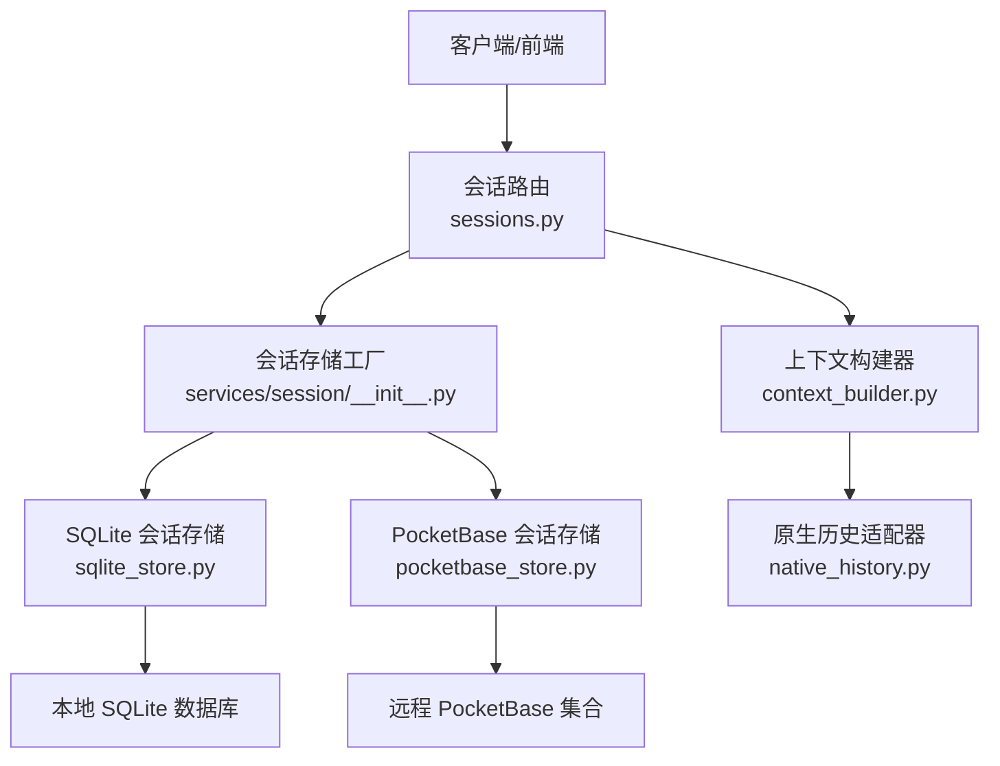
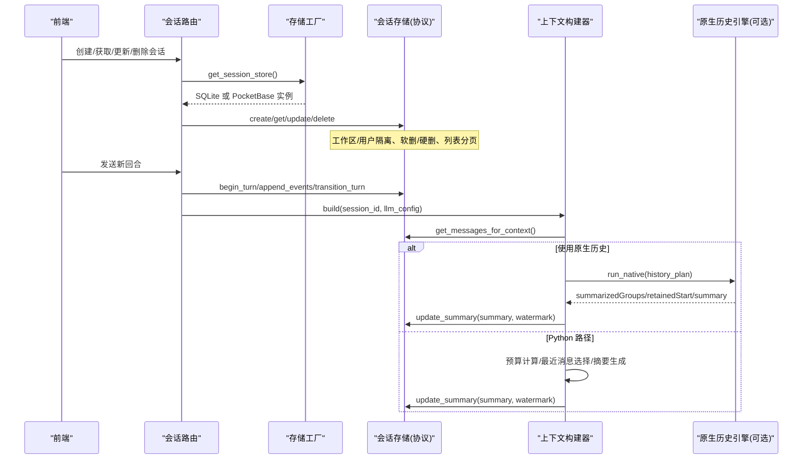
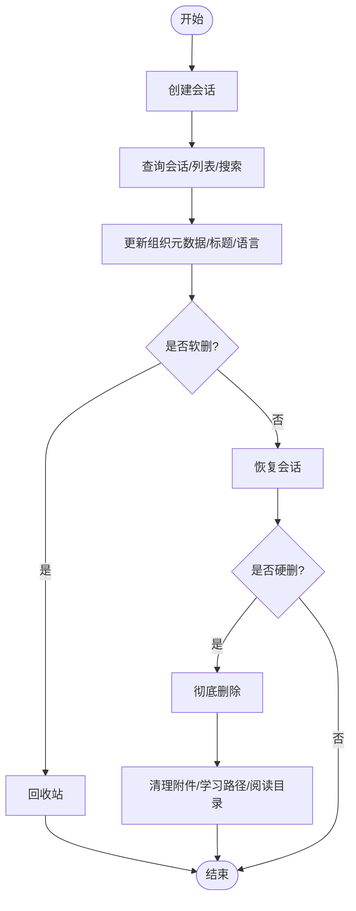
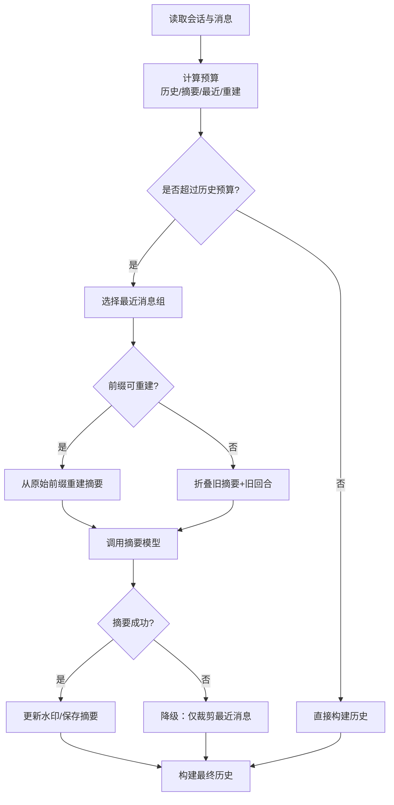
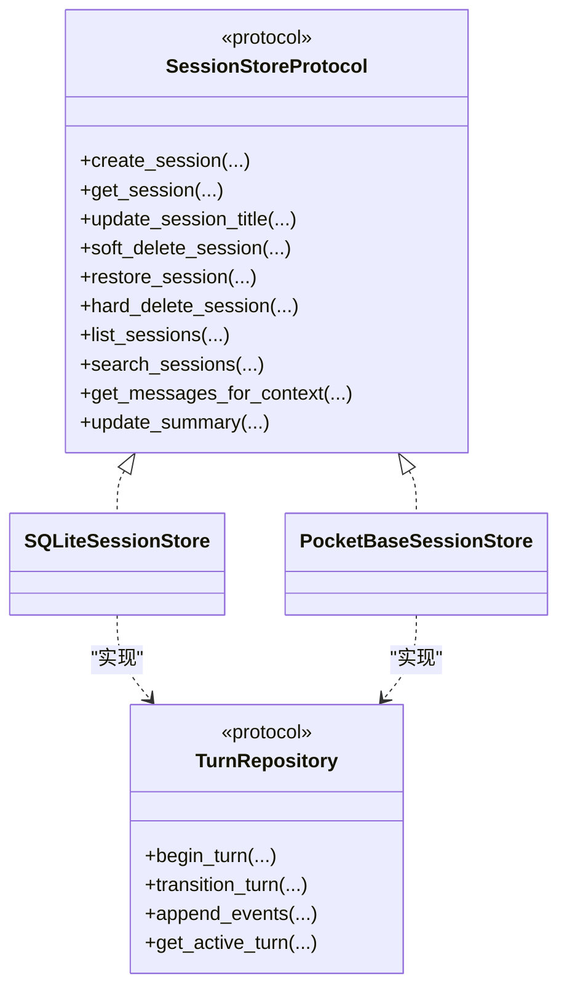
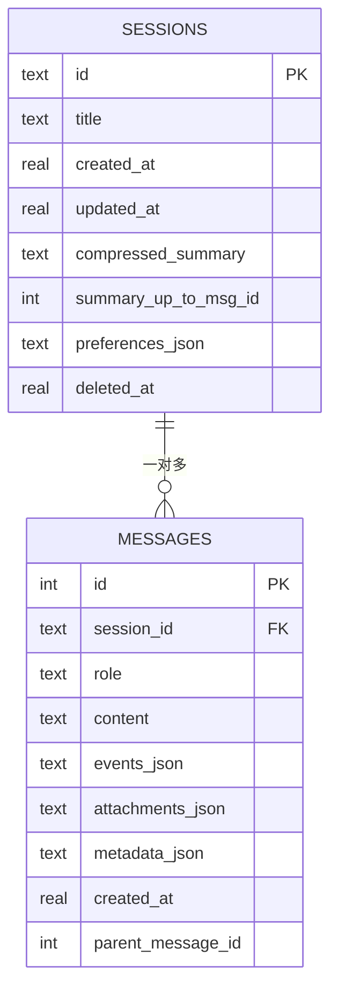
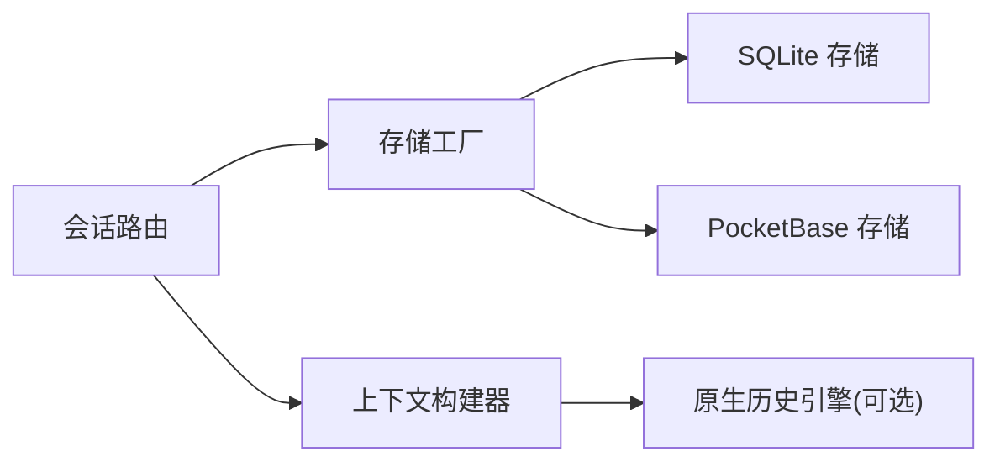

# 会话管理器

<cite>
**本文引用的文件**   
- [sessions.py](file://deeptutor/api/routers/sessions.py)
- [__init__.py](file://deeptutor/services/session/__init__.py)
- [protocol.py](file://deeptutor/services/session/protocol.py)
- [sqlite_store.py](file://deeptutor/services/session/sqlite_store.py)
- [pocketbase_store.py](file://deeptutor/services/session/pocketbase_store.py)
- [context_builder.py](file://deeptutor/services/session/context_builder.py)
- [native_history.py](file://deeptutor/services/session/native_history.py)
</cite>

## 目录
1. [引言](#引言)
2. [项目结构](#项目结构)
3. [核心组件](#核心组件)
4. [架构总览](#架构总览)
5. [详细组件分析](#详细组件分析)
6. [依赖关系分析](#依赖关系分析)
7. [性能与内存优化](#性能与内存优化)
8. [并发安全与数据一致性](#并发安全与数据一致性)
9. [故障排查指南](#故障排查指南)
10. [结论](#结论)
11. [附录：配置与管理示例](#附录配置与管理示例)

## 引言
本文件面向 DeepTutor 的“会话管理器”，系统性说明会话生命周期、多轮对话上下文维护、持久化与恢复、销毁策略，以及并发安全、数据一致性与性能调优实践。文档既覆盖基础会话操作（创建、查询、重命名、删除），也深入讲解高级能力（编辑分支、工作区隔离、摘要压缩、原生历史规划、提交替换等）。

## 项目结构
会话管理相关代码主要分布在以下位置：
- API 层：统一会话历史接口，负责路由、参数校验、权限与工作区过滤、软删/硬删、回收站、搜索、组织元数据更新等。
- 服务层：会话存储协议与实现（SQLite/PocketBase）、回合运行时协议、上下文构建器、原生历史适配器。
- 工具与辅助：消息事件预览、提供者响应状态脱敏、搜索归一化、工作区偏好升级等。

**图表来源**
- [sessions.py:1-800](file://deeptutor/api/routers/sessions.py#L1-L800)
- [__init__.py:1-51](file://deeptutor/services/session/__init__.py#L1-L51)
- [sqlite_store.py:245-530](file://deeptutor/services/session/sqlite_store.py#L245-L530)
- [pocketbase_store.py:171-365](file://deeptutor/services/session/pocketbase_store.py#L171-L365)
- [context_builder.py:267-316](file://deeptutor/services/session/context_builder.py#L267-L316)
- [native_history.py:20-106](file://deeptutor/services/session/native_history.py#L20-L106)

**章节来源**
- [sessions.py:1-800](file://deeptutor/api/routers/sessions.py#L1-L800)
- [__init__.py:1-51](file://deeptutor/services/session/__init__.py#L1-L51)

## 核心组件
- 会话存储协议：定义统一的 SessionRepository/TurnRepository/MessageRepository/SessionStoreProtocol，屏蔽底层实现差异。
- SQLite 会话存储：本地零配置默认后端，支持会话、消息、回合、事件、笔记条目等表结构与迁移。
- PocketBase 会话存储：远程集合后端，按用户与工作区隔离，提供相同协议能力。
- 上下文构建器：基于模型上下文窗口预算，动态选择最近消息、生成并持久化摘要，必要时回退到折叠式合并。
- 原生历史适配器：在 TypeScript 引擎中执行历史规划与摘要，Python 侧仅做结果落盘与分支选择。
- 会话路由：对外暴露会话 CRUD、组织元数据、线程、消息事件、回收站、搜索、提交替换等接口。

**章节来源**
- [protocol.py:38-285](file://deeptutor/services/session/protocol.py#L38-L285)
- [sqlite_store.py:245-530](file://deeptutor/services/session/sqlite_store.py#L245-L530)
- [pocketbase_store.py:171-365](file://deeptutor/services/session/pocketbase_store.py#L171-L365)
- [context_builder.py:267-316](file://deeptutor/services/session/context_builder.py#L267-L316)
- [native_history.py:20-106](file://deeptutor/services/session/native_history.py#L20-L106)
- [sessions.py:1-800](file://deeptutor/api/routers/sessions.py#L1-L800)

## 架构总览
会话管理器采用“协议 + 多实现”的分层设计：API 路由通过工厂获取当前会话存储后端；上下文构建器从存储读取消息并按预算裁剪历史；当需要压缩时，调用 LLM 生成摘要并更新水印；若启用原生历史引擎，则把规划任务交给 TS 引擎完成。

**图表来源**
- [sessions.py:39-79](file://deeptutor/api/routers/sessions.py#L39-L79)
- [__init__.py:15-38](file://deeptutor/services/session/__init__.py#L15-L38)
- [context_builder.py:595-794](file://deeptutor/services/session/context_builder.py#L595-L794)
- [native_history.py:55-106](file://deeptutor/services/session/native_history.py#L55-L106)

## 详细组件分析

### 会话生命周期管理
- 创建：路由调用存储的 create_session，返回会话元数据；PocketBase 会设置初始 preferences/workspace_id/status/id。
- 查询：get_session/get_session_with_messages 返回列表与详情；搜索接口对标题与消息内容做字面量匹配。
- 更新：重命名、回复语言、组织元数据（工作区、父会话、置顶/归档、Little Tutor 线程源消息）均通过 update_session_preferences 或专用字段更新。
- 软删/恢复/硬删：软删进入回收站；恢复从回收站还原；硬删要求先软删，再彻底移除记录。
- 删除级联：删除会话前尝试取消活跃回合；随后删除子会话（父子树遍历），最后清理附件、学习路径、阅读目录等外部资源。

**图表来源**
- [pocketbase_store.py:261-365](file://deeptutor/services/session/pocketbase_store.py#L261-L365)
- [pocketbase_store.py:472-557](file://deeptutor/services/session/pocketbase_store.py#L472-L557)
- [sessions.py:537-694](file://deeptutor/api/routers/sessions.py#L537-L694)
- [sessions.py:697-781](file://deeptutor/api/routers/sessions.py#L697-L781)

**章节来源**
- [sessions.py:251-296](file://deeptutor/api/routers/sessions.py#L251-L296)
- [sessions.py:456-512](file://deeptutor/api/routers/sessions.py#L456-L512)
- [sessions.py:537-694](file://deeptutor/api/routers/sessions.py#L537-L694)
- [sessions.py:697-781](file://deeptutor/api/routers/sessions.py#L697-L781)
- [pocketbase_store.py:261-365](file://deeptutor/services/session/pocketbase_store.py#L261-L365)
- [pocketbase_store.py:472-557](file://deeptutor/services/session/pocketbase_store.py#L472-L557)

### 多轮对话上下文维护
- 历史分组与回放：将消息按回合分组，支持模型回放视图，去重用户图片，估算 token 预算。
- 预算划分：根据模型上下文窗口计算历史预算、摘要预算、最近消息预算与重建预算。
- 最近消息选择：二分查找最长可容纳后缀，保证最新整轮保留；非模型回放路径按文本估算选择。
- 摘要生成：当超出预算时，优先从原始前缀重建摘要，否则折叠旧摘要+旧回合；失败时降级为仅裁剪最近消息。
- 水印机制：成功摘要后推进 summary_up_to_msg_id，避免重复压缩；分支切换时校验水印是否在祖先链上。
- 原生历史：在 TS 引擎中执行规划，Python 侧只负责持久化摘要与选择保留组。

**图表来源**
- [context_builder.py:291-316](file://deeptutor/services/session/context_builder.py#L291-L316)
- [context_builder.py:351-413](file://deeptutor/services/session/context_builder.py#L351-L413)
- [context_builder.py:415-585](file://deeptutor/services/session/context_builder.py#L415-L585)
- [context_builder.py:595-794](file://deeptutor/services/session/context_builder.py#L595-L794)
- [native_history.py:20-106](file://deeptutor/services/session/native_history.py#L20-L106)

**章节来源**
- [context_builder.py:118-157](file://deeptutor/services/session/context_builder.py#L118-L157)
- [context_builder.py:267-316](file://deeptutor/services/session/context_builder.py#L267-L316)
- [context_builder.py:351-413](file://deeptutor/services/session/context_builder.py#L351-L413)
- [context_builder.py:415-585](file://deeptutor/services/session/context_builder.py#L415-L585)
- [context_builder.py:595-794](file://deeptutor/services/session/context_builder.py#L595-L794)
- [native_history.py:20-106](file://deeptutor/services/session/native_history.py#L20-L106)

### 并发安全与数据一致性
- 活跃回合冲突：协议定义 ActiveTurnConflict，用于标识会话仍拥有未终态回合；SQLite 通过部分唯一索引限制同一会话同时存在多个活跃回合。
- 围栏令牌与状态版本：回合行包含 fencing_token 与 state_version，配合 transition_turn 进行乐观锁式状态迁移。
- 偏好写入串行化：PocketBase 端按 user+session 粒度加进程内 threading.Lock，避免 JSON 偏好字段并发写丢失。
- 工作区与用户隔离：所有查询都附加 workspace_id 与 user_id 过滤，防止跨用户/工作区越权访问。
- 导入事务性：PocketBase 导入旧会话时，若中途失败会回滚已创建的会话与消息行。

**图表来源**
- [protocol.py:38-285](file://deeptutor/services/session/protocol.py#L38-L285)
- [sqlite_store.py:245-530](file://deeptutor/services/session/sqlite_store.py#L245-L530)
- [pocketbase_store.py:171-365](file://deeptutor/services/session/pocketbase_store.py#L171-L365)

**章节来源**
- [protocol.py:20-36](file://deeptutor/services/session/protocol.py#L20-L36)
- [sqlite_store.py:572-656](file://deeptutor/services/session/sqlite_store.py#L572-L656)
- [pocketbase_store.py:171-197](file://deeptutor/services/session/pocketbase_store.py#L171-L197)
- [pocketbase_store.py:401-470](file://deeptutor/services/session/pocketbase_store.py#L401-L470)

### 编辑分支与消息溯源
- 父消息指针：messages.parent_message_id 表示编辑分支上的前驱消息；根消息为 NULL，兄弟消息构成可切换分支。
- 上下文构建：ContextBuilder.get_messages_for_context 支持 leaf_message_id，仅包含该叶子消息的祖先路径，排除其他分支。
- Little Tutor 线程：会话可通过 parent_session_id 归属到父会话，并通过 tutor_source_message_id 关联源消息；路由提供线程列表与回溯填充。

**图表来源**
- [sqlite_store.py:274-316](file://deeptutor/services/session/sqlite_store.py#L274-L316)
- [sqlite_store.py:484-516](file://deeptutor/services/session/sqlite_store.py#L484-L516)
- [sessions.py:485-512](file://deeptutor/api/routers/sessions.py#L485-L512)

**章节来源**
- [sqlite_store.py:274-316](file://deeptutor/services/session/sqlite_store.py#L274-L316)
- [sqlite_store.py:484-516](file://deeptutor/services/session/sqlite_store.py#L484-L516)
- [sessions.py:485-512](file://deeptutor/api/routers/sessions.py#L485-L512)

### 提交替换与重试
- 提交替换：路由 expose replace_submission，原子性解决准入后再发送编辑重试；存储协议预留内部字段以标记提交回放与前后回合关系。
- 孤儿失败回合：当用户消息存在但助手回复缺失时，路由将失败回合信息附加到用户消息旁，便于 UI 展示与重试。

**章节来源**
- [sessions.py:45-79](file://deeptutor/api/routers/sessions.py#L45-L79)
- [sessions.py:314-386](file://deeptutor/api/routers/sessions.py#L314-L386)
- [protocol.py:12-17](file://deeptutor/services/session/protocol.py#L12-L17)

## 依赖关系分析
- API 路由依赖会话存储工厂，工厂根据集成开关返回 PocketBase 或 SQLite 实现。
- 上下文构建器依赖存储协议与 LLM 配置，可选择原生历史引擎。
- SQLite 存储负责本地数据库初始化、迁移、索引与并发约束；PocketBase 存储负责远程集合读写、用户与工作区隔离。

**图表来源**
- [__init__.py:15-38](file://deeptutor/services/session/__init__.py#L15-L38)
- [sessions.py:39-79](file://deeptutor/api/routers/sessions.py#L39-L79)
- [context_builder.py:643-659](file://deeptutor/services/session/context_builder.py#L643-L659)

**章节来源**
- [__init__.py:15-38](file://deeptutor/services/session/__init__.py#L15-L38)
- [sessions.py:39-79](file://deeptutor/api/routers/sessions.py#L39-L79)
- [context_builder.py:643-659](file://deeptutor/services/session/context_builder.py#L643-L659)

## 性能与内存优化
- 事件载荷截断：UI 返回的消息事件中，tool_result/observation 等大字段被截断，避免前端渲染压力；不影响模型输入。
- 搜索摘要与分页：搜索接口不加载完整转录，仅返回会话元数据与匹配片段；列表分页考虑 skip 与二次请求补齐。
- 历史预算上限：历史计划、摘要输出、原始重建阈值均有硬上限，避免超大上下文窗口导致无谓压缩。
- 图像预算估算：图像块单独估算 token，避免编码字节膨胀历史预算。
- WAL 模式：SQLite 开启 WAL，允许读并发与写并发，提升高负载场景稳定性。

**章节来源**
- [sessions.py:299-419](file://deeptutor/api/routers/sessions.py#L299-L419)
- [pocketbase_store.py:588-644](file://deeptutor/services/session/pocketbase_store.py#L588-L644)
- [context_builder.py:41-54](file://deeptutor/services/session/context_builder.py#L41-L54)
- [context_builder.py:58-64](file://deeptutor/services/session/context_builder.py#L58-L64)
- [sqlite_store.py:274-279](file://deeptutor/services/session/sqlite_store.py#L274-L279)

## 并发安全与数据一致性
- 活跃回合互斥：SQLite 通过部分唯一索引确保同一会话只有一个活跃回合；迁移脚本修复历史重复活跃行。
- 乐观锁：turns 表的 state_version 与 fencing_token 配合 transition_turn 实现状态迁移保护。
- 偏好字段并发写：PocketBase 存储按 (user_id, session_id) 维度加进程内锁，序列化 JSON 偏好合并。
- 用户与工作区隔离：所有查询附加 user_id 与 workspace_id 过滤，防止跨租户访问。
- 导入回滚：PocketBase 导入旧会话时，若中间失败，删除已创建的会话与消息，保持数据一致性。

**章节来源**
- [sqlite_store.py:572-656](file://deeptutor/services/session/sqlite_store.py#L572-L656)
- [pocketbase_store.py:171-197](file://deeptutor/services/session/pocketbase_store.py#L171-L197)
- [pocketbase_store.py:401-470](file://deeptutor/services/session/pocketbase_store.py#L401-L470)
- [pocketbase_store.py:127-168](file://deeptutor/services/session/pocketbase_store.py#L127-L168)

## 故障排查指南
- 会话不存在：GET/UPDATE/DELETE 会话时若找不到记录，返回 404；检查 session_id 与工作区过滤。
- 活跃回合冲突：新增回合时报 ActiveTurnConflict，需等待或取消现有回合；查看 list_active_turns 与 cancel_turn_and_wait。
- 回收站误删：软删后可恢复；硬删前必须软删；确认 deleted_at 与 archived 标志。
- 搜索为空：检查 query 长度与规范化；确认消息内容与标题是否匹配；注意搜索不加载完整转录。
- 摘要失败：上下文构建器捕获异常并降级为仅裁剪最近消息；检查 LLM 配置与 provider_response_state。
- 附件清理失败：删除会话后会异步清理附件、学习路径、阅读目录；日志记录失败但不阻断主流程。

**章节来源**
- [sessions.py:456-467](file://deeptutor/api/routers/sessions.py#L456-L467)
- [sessions.py:697-781](file://deeptutor/api/routers/sessions.py#L697-L781)
- [context_builder.py:751-774](file://deeptutor/services/session/context_builder.py#L751-L774)

## 结论
DeepTutor 的会话管理器通过协议抽象与多后端实现，提供了稳定、可扩展且高性能的会话生命周期管理能力。结合上下文预算控制、摘要压缩与原生历史引擎，系统在长对话场景中仍能保持低延迟与可控内存占用。并发安全方面，通过索引约束、乐观锁与进程内锁保障数据一致性；API 层提供完善的组织元数据、回收站与搜索能力，满足复杂业务需求。

## 附录：配置与管理示例
以下为常见会话管理操作的步骤说明（不包含具体代码内容，仅提供路径参考）：
- 创建会话
  - 调用会话存储的 create_session，传入可选标题与会话 ID。
  - 参考：[pocketbase_store.py:261-292](file://deeptutor/services/session/pocketbase_store.py#L261-L292)、[sqlite_store.py:245-279](file://deeptutor/services/session/sqlite_store.py#L245-L279)
- 获取会话详情
  - 调用 get_session_with_messages，并在路由层进行隐私脱敏与事件截断。
  - 参考：[sessions.py:456-467](file://deeptutor/api/routers/sessions.py#L456-L467)
- 更新组织元数据
  - 通过 patch /{session_id}/organization 更新 workspace_id、parent_session_id、session_kind、pinned、archived、tutor_source_message_id。
  - 参考：[sessions.py:573-694](file://deeptutor/api/routers/sessions.py#L573-L694)
- 软删/恢复/硬删
  - 软删进入回收站；恢复从回收站还原；硬删要求先软删。
  - 参考：[pocketbase_store.py:498-557](file://deeptutor/services/session/pocketbase_store.py#L498-L557)、[sessions.py:697-781](file://deeptutor/api/routers/sessions.py#L697-L781)
- 搜索会话
  - 调用 search_sessions，返回会话列表与匹配片段。
  - 参考：[pocketbase_store.py:647-742](file://deeptutor/services/session/pocketbase_store.py#L647-L742)、[sessions.py:281-296](file://deeptutor/api/routers/sessions.py#L281-L296)
- 构建上下文
  - 调用 ContextBuilder.build，传入 session_id、llm_config、language 与可选 leaf_message_id。
  - 参考：[context_builder.py:595-794](file://deeptutor/services/session/context_builder.py#L595-L794)
- 使用原生历史
  - 设置环境变量 DEEPTUTOR_CHAT_ENGINE=typescript-native，自动走 native_history 路径。
  - 参考：[context_builder.py:643-659](file://deeptutor/services/session/context_builder.py#L643-L659)、[native_history.py:20-106](file://deeptutor/services/session/native_history.py#L20-L106)