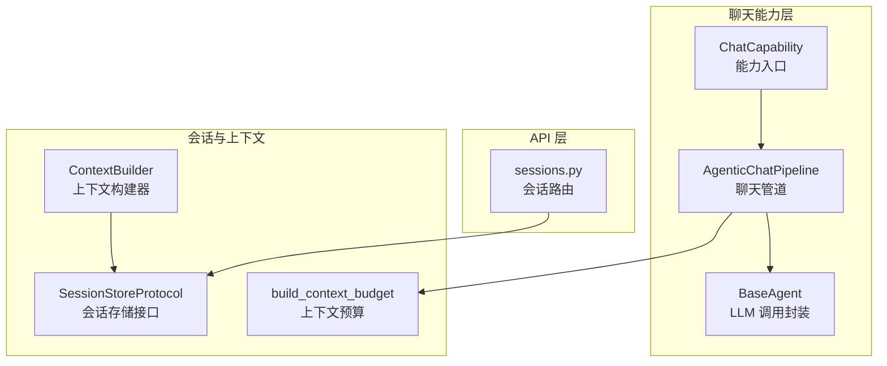
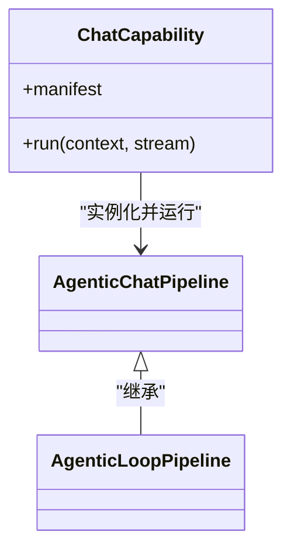
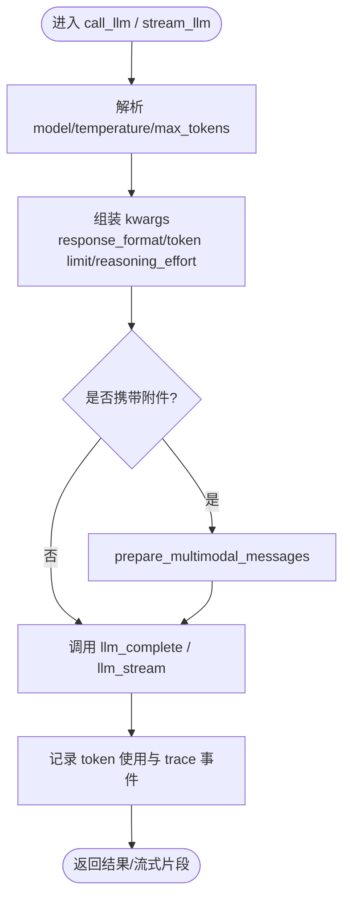
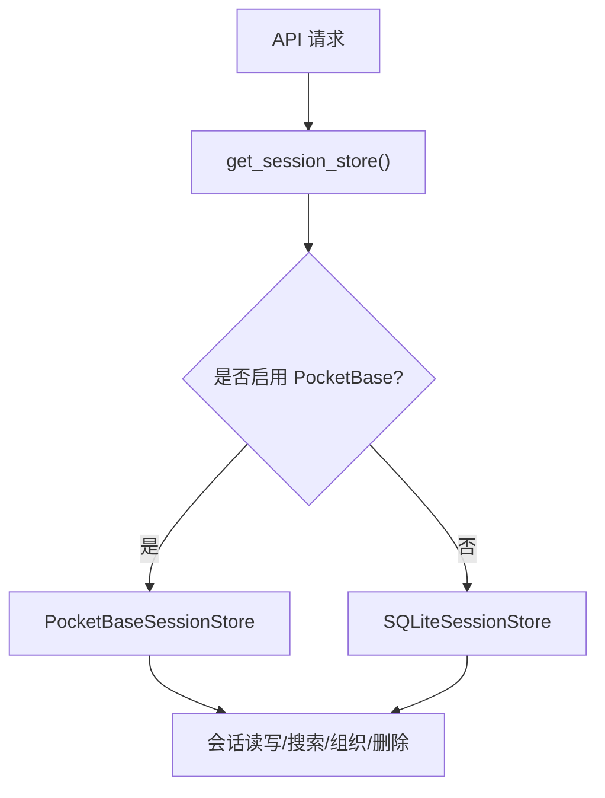
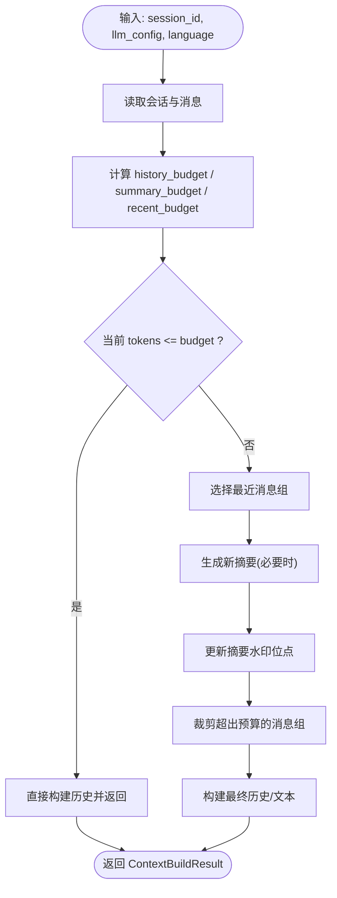
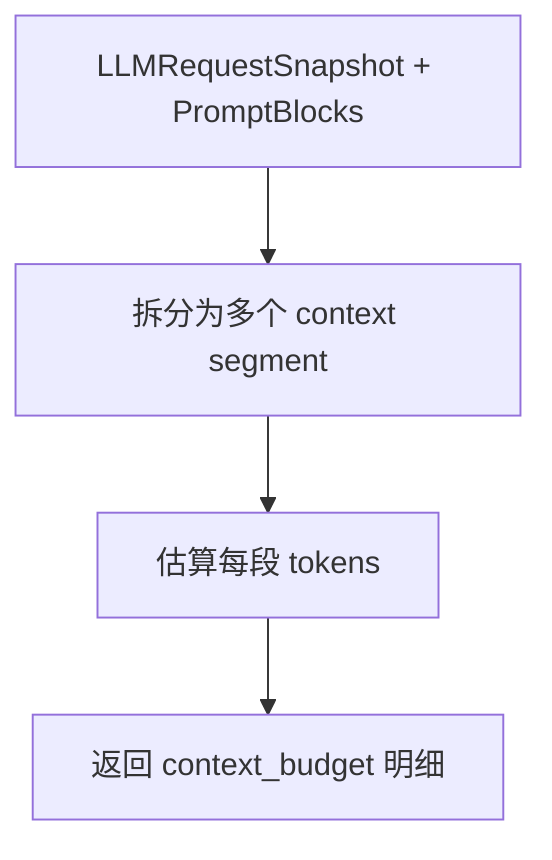
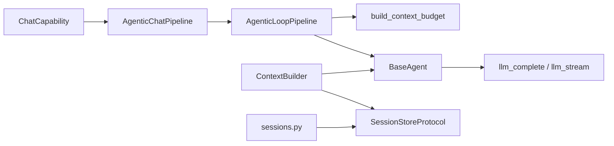

# 智能对话系统

<cite>
**本文引用的文件**   
- [agents/base_agent.py](file://deeptutor/agents/base_agent.py)
- [agents/chat/agentic_pipeline.py](file://deeptutor/agents/chat/agentic_pipeline.py)
- [agents/chat/capability.py](file://deeptutor/agents/chat/capability.py)
- [services/session/context_builder.py](file://deeptutor/services/session/context_builder.py)
- [services/session/__init__.py](file://deeptutor/services/session/__init__.py)
- [api/routers/sessions.py](file://deeptutor/api/routers/sessions.py)
- [agents/loop/context_budget.py](file://deeptutor/agents/loop/context_budget.py)
- [tests/agents/chat/test_context_budget.py](file://tests/agents/chat/test_context_budget.py)
</cite>

## 目录
1. [简介](#简介)
2. [项目结构](#项目结构)
3. [核心组件](#核心组件)
4. [架构总览](#架构总览)
5. [详细组件分析](#详细组件分析)
6. [依赖关系分析](#依赖关系分析)
7. [性能与上下文预算控制](#性能与上下文预算控制)
8. [错误处理与可观测性](#错误处理与可观测性)
9. [使用示例与最佳实践](#使用示例与最佳实践)
10. [故障排查指南](#故障排查指南)
11. [结论](#结论)

## 简介
本文件面向“智能对话系统”的开发者与使用者，系统性阐述聊天智能体的架构设计、消息处理流程、会话管理与上下文管理机制。重点包括：
- 聊天能力如何接入统一的 Agent 循环与工具生态
- 会话存储与多轮对话支持
- 上下文预算控制算法如何优化内存与响应性能
- 错误处理策略、性能优化技巧与最佳实践

## 项目结构
围绕智能对话的核心代码主要分布在以下模块：
- 聊天能力与管道：`deeptutor/agents/chat`
- 统一 Agent 基类与 LLM 调用封装：`deeptutor/agents/base_agent.py`
- 会话服务与上下文构建：`deeptutor/services/session`
- 会话 API：`deeptutor/api/routers/sessions.py`
- 上下文预算计算：`deeptutor/agents/loop/context_budget.py`



**图表来源**
- [agents/chat/capability.py:12-17](file://deeptutor/agents/chat/capability.py#L12-L17)
- [agents/chat/agentic_pipeline.py:36-37](file://deeptutor/agents/chat/agentic_pipeline.py#L36-L37)
- [agents/base_agent.py:33-46](file://deeptutor/agents/base_agent.py#L33-L46)
- [services/session/__init__.py:15-38](file://deeptutor/services/session/__init__.py#L15-L38)
- [services/session/context_builder.py:267-283](file://deeptutor/services/session/context_builder.py#L267-L283)
- [agents/loop/context_budget.py:142-142](file://deeptutor/agents/loop/context_budget.py#L142-L142)

**章节来源**
- [agents/chat/capability.py:1-18](file://deeptutor/agents/chat/capability.py#L1-L18)
- [agents/chat/agentic_pipeline.py:1-49](file://deeptutor/agents/chat/agentic_pipeline.py#L1-L49)
- [agents/base_agent.py:33-46](file://deeptutor/agents/base_agent.py#L33-L46)
- [services/session/__init__.py:1-51](file://deeptutor/services/session/__init__.py#L1-L51)
- [services/session/context_builder.py:267-283](file://deeptutor/services/session/context_builder.py#L267-L283)
- [agents/loop/context_budget.py:142-142](file://deeptutor/agents/loop/context_budget.py#L142-L142)

## 核心组件
- ChatCapability：将聊天能力注册为 TurnCapability，启动 AgenticChatPipeline。
- AgenticChatPipeline：绑定统一的探索式 Agent 循环，复用默认协议、工具表面与提示包。
- BaseAgent：统一 LLM 配置、参数、Prompt 加载、Token 统计、非流式与流式调用封装。
- ContextBuilder：按预算规划历史、选择最近消息、生成并维护压缩摘要，输出模型可用的历史与文本。
- SessionStoreProtocol：会话存储抽象，支持 SQLite 或 PocketBase 后端。
- sessions.py：会话生命周期 API（创建、查询、搜索、删除、恢复、归档等）。
- build_context_budget：对一次请求的上下文进行细粒度预算拆分，用于可观测性与诊断。

**章节来源**
- [agents/chat/capability.py:12-17](file://deeptutor/agents/chat/capability.py#L12-L17)
- [agents/chat/agentic_pipeline.py:36-37](file://deeptutor/agents/chat/agentic_pipeline.py#L36-L37)
- [agents/base_agent.py:33-46](file://deeptutor/agents/base_agent.py#L33-L46)
- [services/session/context_builder.py:267-283](file://deeptutor/services/session/context_builder.py#L267-L283)
- [services/session/__init__.py:15-38](file://deeptutor/services/session/__init__.py#L15-L38)
- [api/routers/sessions.py:456-467](file://deeptutor/api/routers/sessions.py#L456-L467)
- [agents/loop/context_budget.py:142-142](file://deeptutor/agents/loop/context_budget.py#L142-L142)

## 架构总览
下图展示从 API 到 Agent 循环、再到 LLM 与上下文构建的整体数据流。

```mermaid
sequenceDiagram
participant Client as "客户端"
participant API as "sessions.py 路由"
participant Store as "SessionStoreProtocol"
participant Capability as "ChatCapability"
participant Pipeline as "AgenticChatPipeline"
participant Loop as "Agent 循环"
participant Builder as "ContextBuilder"
participant LLM as "BaseAgent.call_llm/stream_llm"
Client->>API : 发送聊天请求
API->>Store : 读取会话与消息
API->>Capability : 执行聊天能力
Capability->>Pipeline : 运行聊天管道
Pipeline->>Loop : 进入探索式循环
Loop->>Builder : 构建上下文历史
Builder->>Store : 读取会话/消息/摘要
Loop->>LLM : 调用 LLM含工具/附件
LLM-->>Loop : 返回结果/流式片段
Loop-->>Capability : 产出最终回复
Capability-->>API : 完成回合
API-->>Client : 返回结果
```

**图表来源**
- [api/routers/sessions.py:456-467](file://deeptutor/api/routers/sessions.py#L456-L467)
- [agents/chat/capability.py:12-17](file://deeptutor/agents/chat/capability.py#L12-L17)
- [agents/chat/agentic_pipeline.py:36-37](file://deeptutor/agents/chat/agentic_pipeline.py#L36-L37)
- [services/session/context_builder.py:595-676](file://deeptutor/services/session/context_builder.py#L595-L676)
- [agents/base_agent.py:349-517](file://deeptutor/agents/base_agent.py#L349-L517)

## 详细组件分析

### 聊天能力与管道
- ChatCapability 作为 TurnCapability 的实现，负责实例化 AgenticChatPipeline 并传入语言上下文。
- AgenticChatPipeline 继承自通用 AgenticLoopPipeline，复用默认的协议、工具白名单与排除列表，仅覆盖预算与流命名空间。



**图表来源**
- [agents/chat/capability.py:12-17](file://deeptutor/agents/chat/capability.py#L12-L17)
- [agents/chat/agentic_pipeline.py:36-37](file://deeptutor/agents/chat/agentic_pipeline.py#L36-L37)

**章节来源**
- [agents/chat/capability.py:1-18](file://deeptutor/agents/chat/capability.py#L1-L18)
- [agents/chat/agentic_pipeline.py:1-49](file://deeptutor/agents/chat/agentic_pipeline.py#L1-L49)

### 统一 Agent 基类与 LLM 调用
BaseAgent 提供：
- 统一 LLM 配置管理（api_key、base_url、model、binding）
- 从 agents.yaml 加载 agent 参数（temperature、max_tokens、max_retries）
- PromptManager 集成
- 非流式 call_llm 与流式 stream_llm 封装
- Token 追踪（外部 TokenTracker 或共享 LLMStats）
- 结构化 trace 回调，便于可观测性



**图表来源**
- [agents/base_agent.py:349-517](file://deeptutor/agents/base_agent.py#L349-L517)
- [agents/base_agent.py:519-693](file://deeptutor/agents/base_agent.py#L519-L693)

**章节来源**
- [agents/base_agent.py:33-46](file://deeptutor/agents/base_agent.py#L33-L46)
- [agents/base_agent.py:349-517](file://deeptutor/agents/base_agent.py#L349-L517)
- [agents/base_agent.py:519-693](file://deeptutor/agents/base_agent.py#L519-L693)

### 会话管理器与持久化
- get_session_store() 根据配置返回 SQLite 或 PocketBase 会话存储实现。
- sessions.py 暴露会话 CRUD、组织元数据、分支选择、回收站、恢复与硬删除等 API。
- 会话包含标题、状态、偏好、工作区归属、父会话、线程归属等元信息。



**图表来源**
- [services/session/__init__.py:15-38](file://deeptutor/services/session/__init__.py#L15-L38)
- [api/routers/sessions.py:456-467](file://deeptutor/api/routers/sessions.py#L456-L467)

**章节来源**
- [services/session/__init__.py:1-51](file://deeptutor/services/session/__init__.py#L1-L51)
- [api/routers/sessions.py:456-467](file://deeptutor/api/routers/sessions.py#L456-L467)

### 上下文构建与多轮对话支持
ContextBuilder 负责：
- 基于有效上下文窗口计算历史预算与摘要预算
- 选择最近的完整轮次，保留最新一轮即使溢出
- 在需要时触发摘要生成，更新水印位点
- 输出 conversation_history、conversation_summary、context_text、token_count、budget、model_history 等



**图表来源**
- [services/session/context_builder.py:284-315](file://deeptutor/services/session/context_builder.py#L284-L315)
- [services/session/context_builder.py:351-389](file://deeptutor/services/session/context_builder.py#L351-L389)
- [services/session/context_builder.py:595-676](file://deeptutor/services/session/context_builder.py#L595-L676)
- [services/session/context_builder.py:776-794](file://deeptutor/services/session/context_builder.py#L776-L794)

**章节来源**
- [services/session/context_builder.py:267-283](file://deeptutor/services/session/context_builder.py#L267-L283)
- [services/session/context_builder.py:351-389](file://deeptutor/services/session/context_builder.py#L351-L389)
- [services/session/context_builder.py:595-676](file://deeptutor/services/session/context_builder.py#L595-L676)
- [services/session/context_builder.py:776-794](file://deeptutor/services/session/context_builder.py#L776-L794)

### 上下文预算控制算法
build_context_budget 对一次请求的上下文进行细粒度拆分，包括：
- general、runtime_policy、loop、memory、tools、extended_tools、solve 等块
- 结合 LLMRequestSnapshot 中的 messages、tool_schemas、loaded_deferred_names 等字段
- 输出每个 segment 的 tokens 估算，便于诊断与可视化

测试用例验证了各来源均落入独立 segment，且预算计算正确。



**图表来源**
- [agents/loop/context_budget.py:142-142](file://deeptutor/agents/loop/context_budget.py#L142-L142)
- [tests/agents/chat/test_context_budget.py:65-84](file://tests/agents/chat/test_context_budget.py#L65-L84)

**章节来源**
- [agents/loop/context_budget.py:142-142](file://deeptutor/agents/loop/context_budget.py#L142-L142)
- [tests/agents/chat/test_context_budget.py:65-84](file://tests/agents/chat/test_context_budget.py#L65-L84)

## 依赖关系分析
- ChatCapability 依赖 AgenticChatPipeline；后者复用通用 AgenticLoopPipeline。
- BaseAgent 依赖 LLM 工厂与服务（complete/stream），以及 PromptManager。
- ContextBuilder 依赖 SessionStoreProtocol 与 LLMConfig，并通过 _ContextSummaryAgent 调用 BaseAgent.stream_llm。
- sessions.py 通过 get_session_store() 获取具体存储实现。



**图表来源**
- [agents/chat/capability.py:12-17](file://deeptutor/agents/chat/capability.py#L12-L17)
- [agents/chat/agentic_pipeline.py:36-37](file://deeptutor/agents/chat/agentic_pipeline.py#L36-L37)
- [agents/base_agent.py:349-517](file://deeptutor/agents/base_agent.py#L349-L517)
- [services/session/context_builder.py:595-676](file://deeptutor/services/session/context_builder.py#L595-L676)
- [services/session/__init__.py:15-38](file://deeptutor/services/session/__init__.py#L15-L38)

**章节来源**
- [agents/chat/capability.py:1-18](file://deeptutor/agents/chat/capability.py#L1-L18)
- [agents/chat/agentic_pipeline.py:1-49](file://deeptutor/agents/chat/agentic_pipeline.py#L1-L49)
- [agents/base_agent.py:349-517](file://deeptutor/agents/base_agent.py#L349-L517)
- [services/session/context_builder.py:595-676](file://deeptutor/services/session/context_builder.py#L595-L676)
- [services/session/__init__.py:15-38](file://deeptutor/services/session/__init__.py#L15-L38)

## 性能与上下文预算控制
- 历史预算与摘要预算分离：history_budget_ratio 与 summary_target_ratio 分别控制历史长度与摘要大小，避免大上下文窗口下摘要膨胀。
- 最近消息选择采用二分查找，保证 O(log n) 复杂度，同时保留最新一轮即使溢出。
- 图像上下文单独估算（IMAGE_CONTEXT_TOKEN_ESTIMATE），避免图片编码字节占用过多文本预算。
- 摘要生成目标为硬上限的约 80%，配合 TRUNCATION_GUARD_RATIO 检测截断并修剪不完整尾部。
- 原始重建阈值（MAX_RAW_REBUILD_TOKENS）与折叠降级策略平衡漂移与成本。

建议：
- 合理设置 max_tokens 与 context_window，使 effective_context_window 更贴近实际模型限制。
- 在长会话中优先启用自动摘要，减少重复传输历史。
- 谨慎上传大量图片附件，注意 IMAGE_CONTEXT_TOKEN_ESTIMATE 的影响。

**章节来源**
- [services/session/context_builder.py:41-63](file://deeptutor/services/session/context_builder.py#L41-L63)
- [services/session/context_builder.py:284-315](file://deeptutor/services/session/context_builder.py#L284-L315)
- [services/session/context_builder.py:351-389](file://deeptutor/services/session/context_builder.py#L351-L389)
- [services/session/context_builder.py:581-593](file://deeptutor/services/session/context_builder.py#L581-L593)

## 错误处理与可观测性
- BaseAgent 在 LLM 调用失败时抛出异常，并记录 trace 事件（state=error），便于上层捕获与重试。
- ContextBuilder 在摘要生成失败时降级：保留现有摘要与尽可能多的未摘要消息，不推进水印位点，并在下次尝试。
- sessions.py 对缺失会话、活动轮次冲突、父会话校验失败等场景返回明确的 HTTP 状态码与详情。

建议：
- 在 API 层统一捕获 BaseAgent 抛出的异常，转换为用户友好的错误码。
- 对摘要失败路径增加告警与回退策略，确保会话仍可继续。
- 利用 trace 事件与 context_budget 明细进行问题定位与性能分析。

**章节来源**
- [agents/base_agent.py:473-482](file://deeptutor/agents/base_agent.py#L473-L482)
- [agents/base_agent.py:684-693](file://deeptutor/agents/base_agent.py#L684-L693)
- [services/session/context_builder.py:751-774](file://deeptutor/services/session/context_builder.py#L751-L774)
- [api/routers/sessions.py:456-467](file://deeptutor/api/routers/sessions.py#L456-L467)

## 使用示例与最佳实践
- 启用聊天能力：通过 TurnCapability 注册 ChatCapability，并在运行时注入 UnifiedContext 与 StreamBus。
- 配置 LLM：在 settings 中配置 api_key、base_url、model、binding；Agent 会自动刷新配置。
- 会话操作：通过 sessions.py 提供的 REST API 进行会话创建、查询、搜索、重命名、归档、删除与恢复。
- 上下文预算：保持合理的 history_budget_ratio 与 summary_target_ratio，避免过大的摘要输出。
- 附件与多模态：在 BaseAgent 调用时传入 attachments，系统会自动转换为多模态消息。

参考路径（不包含具体代码内容）：
- 聊天能力入口与管道：[agents/chat/capability.py:12-17](file://deeptutor/agents/chat/capability.py#L12-L17)、[agents/chat/agentic_pipeline.py:36-37](file://deeptutor/agents/chat/agentic_pipeline.py#L36-L37)
- LLM 调用封装：[agents/base_agent.py:349-517](file://deeptutor/agents/base_agent.py#L349-L517)、[agents/base_agent.py:519-693](file://deeptutor/agents/base_agent.py#L519-L693)
- 会话 API：[api/routers/sessions.py:456-467](file://deeptutor/api/routers/sessions.py#L456-L467)
- 上下文构建：[services/session/context_builder.py:595-676](file://deeptutor/services/session/context_builder.py#L595-L676)

**章节来源**
- [agents/chat/capability.py:12-17](file://deeptutor/agents/chat/capability.py#L12-L17)
- [agents/chat/agentic_pipeline.py:36-37](file://deeptutor/agents/chat/agentic_pipeline.py#L36-L37)
- [agents/base_agent.py:349-517](file://deeptutor/agents/base_agent.py#L349-L517)
- [agents/base_agent.py:519-693](file://deeptutor/agents/base_agent.py#L519-L693)
- [api/routers/sessions.py:456-467](file://deeptutor/api/routers/sessions.py#L456-L467)
- [services/session/context_builder.py:595-676](file://deeptutor/services/session/context_builder.py#L595-L676)

## 故障排查指南
常见问题与定位方法：
- LLM 调用失败：检查 BaseAgent 的 trace 事件与日志，确认 model、binding、max_tokens 配置是否正确。
- 上下文过大导致响应慢：查看 context_budget 明细，确认各 segment 是否异常膨胀；调整 history_budget_ratio 与 summary_target_ratio。
- 摘要生成失败：检查 ContextBuilder 的降级逻辑，确认是否保留了足够近期消息；必要时手动清理会话历史。
- 会话无法删除：确认是否存在活动轮次；先取消活动轮次再删除。

参考路径：
- LLM 错误与 trace：[agents/base_agent.py:473-482](file://deeptutor/agents/base_agent.py#L473-L482)、[agents/base_agent.py:684-693](file://deeptutor/agents/base_agent.py#L684-L693)
- 上下文预算明细：[agents/loop/context_budget.py:142-142](file://deeptutor/agents/loop/context_budget.py#L142-L142)、[tests/agents/chat/test_context_budget.py:65-84](file://tests/agents/chat/test_context_budget.py#L65-L84)
- 摘要失败降级：[services/session/context_builder.py:751-774](file://deeptutor/services/session/context_builder.py#L751-L774)
- 会话删除与活动轮次：[api/routers/sessions.py:697-732](file://deeptutor/api/routers/sessions.py#L697-L732)

**章节来源**
- [agents/base_agent.py:473-482](file://deeptutor/agents/base_agent.py#L473-L482)
- [agents/base_agent.py:684-693](file://deeptutor/agents/base_agent.py#L684-L693)
- [agents/loop/context_budget.py:142-142](file://deeptutor/agents/loop/context_budget.py#L142-L142)
- [tests/agents/chat/test_context_budget.py:65-84](file://tests/agents/chat/test_context_budget.py#L65-L84)
- [services/session/context_builder.py:751-774](file://deeptutor/services/session/context_builder.py#L751-L774)
- [api/routers/sessions.py:697-732](file://deeptutor/api/routers/sessions.py#L697-L732)

## 结论
本智能对话系统以统一的 Agent 基类与聊天能力为核心，结合会话存储与上下文构建器，实现了高效的多轮对话与上下文预算控制。通过可观测性的 trace 事件与 context_budget 明细，系统可在复杂场景中保持稳定与高性能。建议在工程实践中合理配置 LLM 与预算参数，充分利用摘要机制与最近消息选择策略，以获得更好的用户体验与资源利用率。