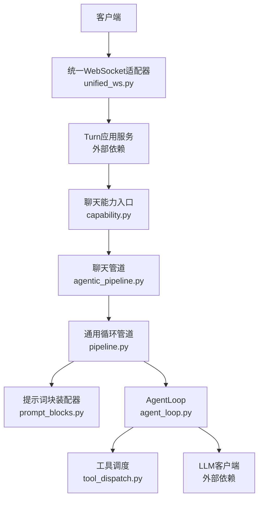
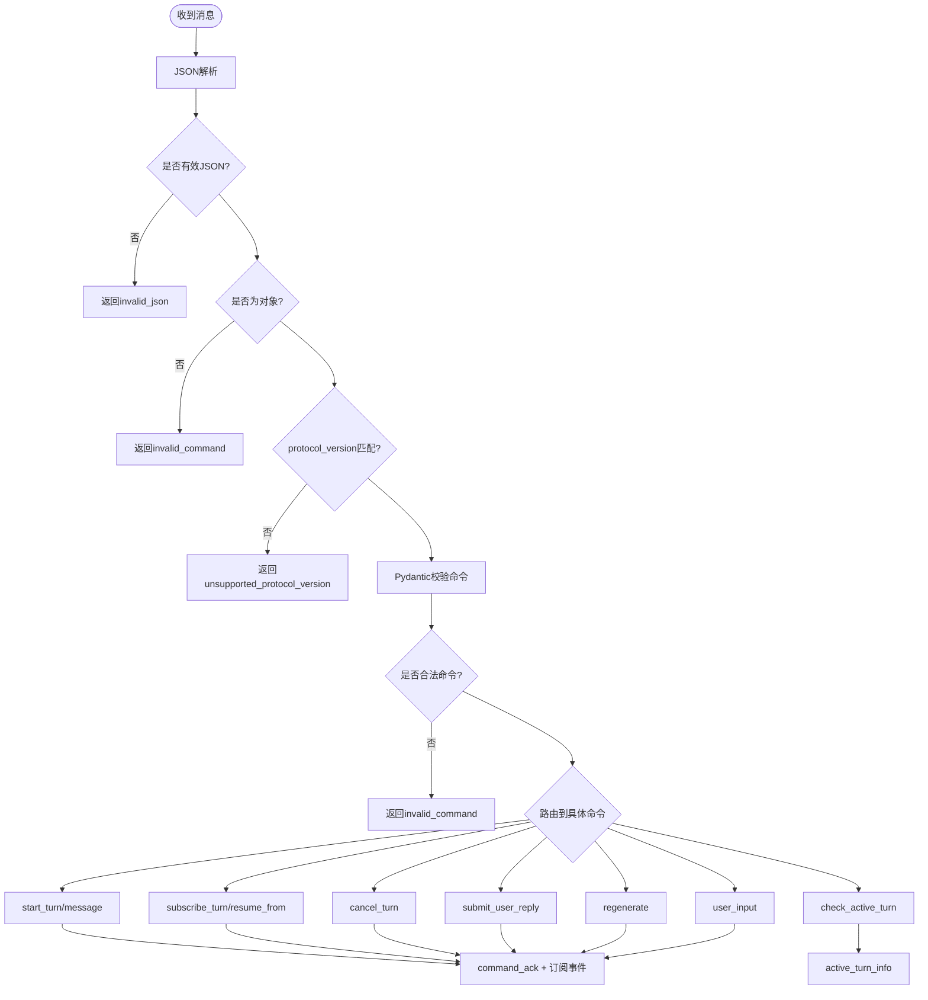
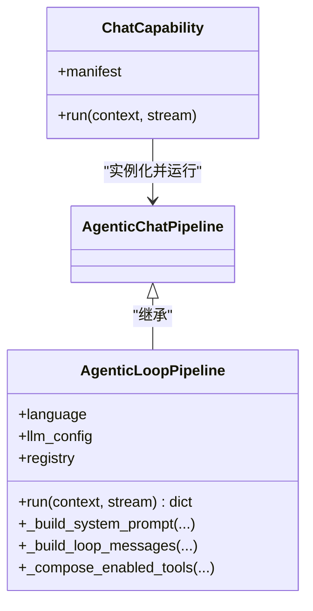
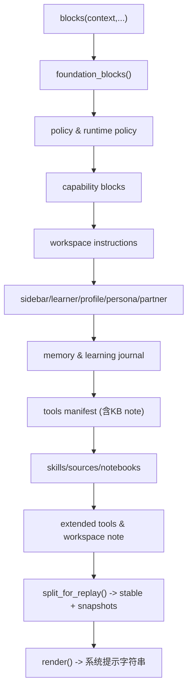
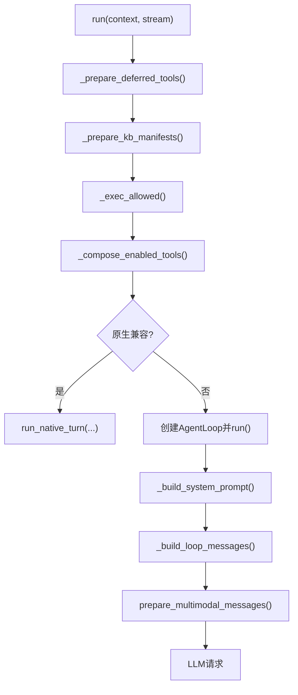
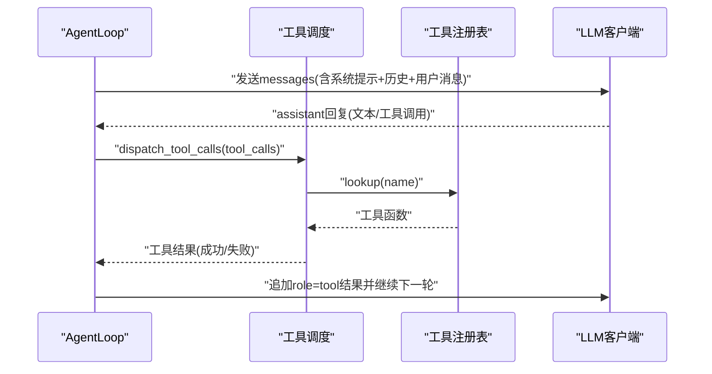
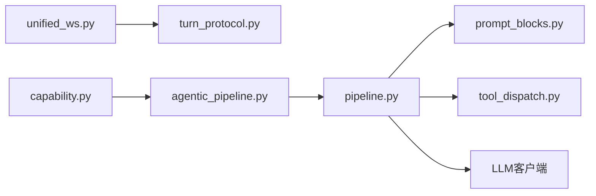

# 消息处理流程

<cite>
**本文引用的文件**   
- [unified_ws.py](file://deeptutor/api/routers/unified_ws.py)
- [pipeline.py](file://deeptutor/agents/loop/pipeline.py)
- [prompt_blocks.py](file://deeptutor/agents/loop/prompt_blocks.py)
- [agentic_pipeline.py](file://deeptutor/agents/chat/agentic_pipeline.py)
- [capability.py](file://deeptutor/agents/chat/capability.py)
- [agent_loop.py](file://deeptutor/agents/loop/agent_loop.py)
- [tool_dispatch.py](file://deeptutor/runtime/agentic/tool_dispatch.py)
- [turn_protocol.py](file://deeptutor/api/contracts/turn_protocol.py)
</cite>

## 目录
1. [引言](#引言)
2. [项目结构](#项目结构)
3. [核心组件](#核心组件)
4. [架构总览](#架构总览)
5. [详细组件分析](#详细组件分析)
6. [依赖关系分析](#依赖关系分析)
7. [性能与传输优化](#性能与传输优化)
8. [故障排查指南](#故障排查指南)
9. [结论](#结论)

## 引言
本文面向“消息处理流程”的完整知识体系，覆盖从前端 WebSocket 命令到后端智能体循环、提示词块组装、工具调用与结果回写的全链路。重点包括：
- 消息接收、解析、校验与路由
- 提示词块的构建策略（系统提示、用户输入、工具响应）
- 多轮探索循环中的上下文预算、工具调度与流式事件
- 协议版本控制、错误码与可重试机制
- 序列化格式、传输优化与可扩展定制点

## 项目结构
本项目的消息处理主要涉及以下层次：
- 接入层：统一 WebSocket 适配器负责鉴权、协议校验、命令分发与订阅转发
- 编排层：能力入口将聊天能力绑定到“探索循环”管道
- 循环层：通用 AgentLoop 驱动 LLM 请求、工具调度、状态推进与事件广播
- 提示层：结构化提示词块装配器负责系统提示、运行时快照与用户消息拼接
- 工具层：工具注册表、权限视图与延迟加载工具在每轮动态组合



**图表来源**
- [unified_ws.py:43-238](file://deeptutor/api/routers/unified_ws.py#L43-L238)
- [capability.py:12-17](file://deeptutor/agents/chat/capability.py#L12-L17)
- [agentic_pipeline.py:36-48](file://deeptutor/agents/chat/agentic_pipeline.py#L36-L48)
- [pipeline.py:200-451](file://deeptutor/agents/loop/pipeline.py#L200-L451)
- [prompt_blocks.py:43-188](file://deeptutor/agents/loop/prompt_blocks.py#L43-L188)

**章节来源**
- [unified_ws.py:43-238](file://deeptutor/api/routers/unified_ws.py#L43-L238)
- [capability.py:12-17](file://deeptutor/agents/chat/capability.py#L12-L17)
- [agentic_pipeline.py:36-48](file://deeptutor/agents/chat/agentic_pipeline.py#L36-L48)
- [pipeline.py:200-451](file://deeptutor/agents/loop/pipeline.py#L200-L451)
- [prompt_blocks.py:43-188](file://deeptutor/agents/loop/prompt_blocks.py#L43-L188)

## 核心组件
- 统一 WebSocket 适配器
  - 负责鉴权、协议版本校验、命令反序列化、命令确认、订阅管理与错误上报
  - 支持 start_turn、subscribe_turn、resume_from、check_active_turn、cancel_turn、submit_user_reply、regenerate、user_input 等命令
- 聊天能力与管道
  - ChatCapability 将语言参数注入 AgenticChatPipeline
  - AgenticChatPipeline 继承通用循环管道，复用工具组合、预算与提示装配逻辑
- 通用循环管道
  - 负责准备延迟工具、知识库清单、启用工具集、构建系统提示与消息列表、选择原生或 Python 实现、创建并运行 AgentLoop
- 提示词块装配器
  - 将身份、运行时上下文、策略、工具清单、工作区说明、能力块等组织为稳定系统提示；用户消息作为尾部追加，便于缓存命中
- AgentLoop 与工具调度
  - 驱动多轮探索循环，按预算与并行限制调度工具，收集文本、推理内容与输出项，并通过 StreamBus 推送事件

**章节来源**
- [unified_ws.py:43-389](file://deeptutor/api/routers/unified_ws.py#L43-L389)
- [capability.py:12-17](file://deeptutor/agents/chat/capability.py#L12-L17)
- [agentic_pipeline.py:36-48](file://deeptutor/agents/chat/agentic_pipeline.py#L36-L48)
- [pipeline.py:200-451](file://deeptutor/agents/loop/pipeline.py#L200-L451)
- [prompt_blocks.py:43-188](file://deeptutor/agents/loop/prompt_blocks.py#L43-L188)

## 架构总览
下图展示一次“开始对话轮次”的端到端时序：

```mermaid
sequenceDiagram
participant C as "客户端"
participant WS as "统一WebSocket适配器"
participant TS as "Turn应用服务"
participant CAP as "聊天能力"
participant PIPE as "聊天管道"
participant LOOP as "AgentLoop"
participant TD as "工具调度"
participant LLM as "LLM客户端"
C->>WS : "start_turn / message"
WS->>WS : "校验协议版本与命令结构"
WS->>TS : "start_turn(载荷)"
TS-->>WS : "返回turn_id"
WS->>C : "command_ack(accepted=true)"
WS->>C : "订阅turn事件流"
LOOP->>PIPE : "run(context, stream)"
PIPE->>LOOP : "创建并启动循环"
LOOP->>LLM : "发送系统提示+历史+用户消息"
LLM-->>LOOP : "文本增量/工具调用"
LOOP->>TD : "dispatch_tool_calls(工具名+参数)"
TD-->>LOOP : "工具结果"
LOOP->>LLM : "携带工具结果继续下一轮"
LOOP-->>WS : "stream事件(文本/工具/完成)"
WS-->>C : "转发事件"
```

**图表来源**
- [unified_ws.py:43-238](file://deeptutor/api/routers/unified_ws.py#L43-L238)
- [pipeline.py:403-451](file://deeptutor/agents/loop/pipeline.py#L403-L451)
- [agent_loop.py](file://deeptutor/agents/loop/agent_loop.py)
- [tool_dispatch.py](file://deeptutor/runtime/agentic/tool_dispatch.py)

## 详细组件分析

### 统一 WebSocket 适配器：接收、解析、验证与路由
- 鉴权与会话
  - 通过 ws_require_auth 获取用户令牌，失败则直接返回
  - 建立 WebSocket 连接后，解析 application_container 并初始化 turns 服务
- 协议与命令校验
  - 所有消息必须为 JSON 对象，且 protocol_version 必须匹配 PROTOCOL_VERSION
  - 使用 TypeAdapter(ClientCommand) 对命令进行 Pydantic 校验，不合法则返回 invalid_command
- 命令路由
  - start_turn/message：调用 turns.start_turn，成功后订阅 turn 事件
  - subscribe_turn/resume_from：按 after_seq 重放事件
  - check_active_turn：返回 session 当前活跃 turn 信息
  - cancel_turn：取消活跃 turn，返回 command_ack
  - submit_user_reply：提交 ask_user 等待的用户回答
  - regenerate：基于会话重新生成最后一轮
  - user_input：向活跃 turn 提交中间输入
- 错误与重试
  - send_protocol_error/send_error 统一封装错误事件，包含 error_code、retryable、session_id、turn_id
  - 订阅失败会触发 subscription_failed 并标记可重试



**图表来源**
- [unified_ws.py:43-389](file://deeptutor/api/routers/unified_ws.py#L43-L389)

**章节来源**
- [unified_ws.py:43-389](file://deeptutor/api/routers/unified_ws.py#L43-L389)

### 聊天能力与管道：从能力到循环
- ChatCapability.run 将 UnifiedContext 与 StreamBus 传入 AgenticChatPipeline
- AgenticChatPipeline 仅声明类名，实际行为由基类 AgenticLoopPipeline 提供，包括：
  - 工具白名单与排除集合
  - 默认提示模块与装配器
  - 工作区命名空间与事件源/阶段



**图表来源**
- [capability.py:12-17](file://deeptutor/agents/chat/capability.py#L12-L17)
- [agentic_pipeline.py:36-48](file://deeptutor/agents/chat/agentic_pipeline.py#L36-L48)
- [pipeline.py:200-451](file://deeptutor/agents/loop/pipeline.py#L200-L451)

**章节来源**
- [capability.py:12-17](file://deeptutor/agents/chat/capability.py#L12-L17)
- [agentic_pipeline.py:36-48](file://deeptutor/agents/chat/agentic_pipeline.py#L36-L48)
- [pipeline.py:200-451](file://deeptutor/agents/loop/pipeline.py#L200-L451)

### 提示词块装配器：系统提示、用户输入与工具响应的组合
- 块分类
  - 基础块：general、runtime_context、runtime_policy、loop.system
  - 运行时快照块：runtime_context、memory、learning_journal、learner_profile、sources、notebooks、workspace、tools、knowledge_base_note、extended_tools
- 系统提示构建
  - blocks() 聚合身份、策略、工作区说明、侧边栏上下文、学习者画像、人格风格、伙伴策略、记忆、学习日志、工具清单、技能/来源/笔记本清单、扩展工具与工作区说明
  - split_for_replay() 将稳定指令与可变快照分离，保证回放时位置稳定
  - render() 拼接块并附加语言指令，允许用户在非固定会话中覆盖输出语言
- 用户消息
  - user_message() 将 context.user_message 作为尾部用户内容，必要时追加 KB seed
- 工具清单
  - _tool_manifest() 根据已启用工具与延迟工具生成提示文本，供模型理解可用工具



**图表来源**
- [prompt_blocks.py:119-188](file://deeptutor/agents/loop/prompt_blocks.py#L119-L188)
- [prompt_blocks.py:99-117](file://deeptutor/agents/loop/prompt_blocks.py#L99-L117)
- [prompt_blocks.py:81-97](file://deeptutor/agents/loop/prompt_blocks.py#L81-L97)
- [prompt_blocks.py:271-284](file://deeptutor/agents/loop/prompt_blocks.py#L271-L284)

**章节来源**
- [prompt_blocks.py:43-188](file://deeptutor/agents/loop/prompt_blocks.py#L43-L188)
- [prompt_blocks.py:271-284](file://deeptutor/agents/loop/prompt_blocks.py#L271-L284)

### 循环管道：消息构建、附件处理与多轮执行
- 系统提示构建
  - _build_system_prompt() 调用装配器 blocks()，记录最后提示块用于上下文预算拆分，再 split_for_replay() 得到稳定块与运行时快照，最终 render() 输出系统提示
- 消息列表构建
  - _build_loop_messages() 组装 system 提示、历史消息、压缩摘要快照、运行时快照与用户消息，并通过 prepare_multimodal_messages 处理附件
- 工具组合与延迟加载
  - _prepare_deferred_tools() 构建 ProviderToolView，合并 PageIndex SDK 工具，设置拒绝消息与渐进加载
  - _compose_enabled_tools() 根据上下文、科学检索标志、可选工具白名单与挂载标志计算本轮工具集
- 执行路径选择
  - 若满足 TypeScript 原生兼容条件，走 run_native_turn；否则创建 AgentLoop 并运行
- 预算与并发
  - DEFAULT_MAX_ROUNDS=8，IMAGE_TOKEN_GUARD_RESERVE=4096，MAX_PARALLEL_TOOL_CALLS 来自工具调度模块



**图表来源**
- [pipeline.py:403-451](file://deeptutor/agents/loop/pipeline.py#L403-L451)
- [pipeline.py:463-583](file://deeptutor/agents/loop/pipeline.py#L463-L583)
- [pipeline.py:644-747](file://deeptutor/agents/loop/pipeline.py#L644-L747)
- [pipeline.py:782-800](file://deeptutor/agents/loop/pipeline.py#L782-L800)

**章节来源**
- [pipeline.py:403-451](file://deeptutor/agents/loop/pipeline.py#L403-L451)
- [pipeline.py:463-583](file://deeptutor/agents/loop/pipeline.py#L463-L583)
- [pipeline.py:644-747](file://deeptutor/agents/loop/pipeline.py#L644-L747)
- [pipeline.py:782-800](file://deeptutor/agents/loop/pipeline.py#L782-L800)

### AgentLoop 与工具调度：多轮探索与结果回写
- AgentLoop
  - 维护单轮对话历史、工具调用状态、文本增量与推理内容
  - 依据预算与并行限制调度工具，并将工具结果以 role=tool 追加到消息列表
- 工具调度
  - dispatch_tool_calls 负责解析模型的工具调用、并发执行、错误包装与结果回传
  - MAX_PARALLEL_TOOL_CALLS 控制同批并行度，避免资源争用



**图表来源**
- [agent_loop.py](file://deeptutor/agents/loop/agent_loop.py)
- [tool_dispatch.py](file://deeptutor/runtime/agentic/tool_dispatch.py)

**章节来源**
- [agent_loop.py](file://deeptutor/agents/loop/agent_loop.py)
- [tool_dispatch.py](file://deeptutor/runtime/agentic/tool_dispatch.py)

## 依赖关系分析
- 组件耦合
  - unified_ws.py 依赖 turn_protocol.ClientCommand 与 PROTOCOL_VERSION，承担协议边界
  - capability.py 仅依赖 pipeline 与 StreamBus，保持能力层简洁
  - agentic_pipeline.py 暴露常量与子类，复用 loop.pipeline 的全部能力
  - pipeline.py 依赖 prompt_blocks、tool_registry、LLM 配置与工具调度
  - prompt_blocks.py 依赖 capabilities.protocol.PromptBlock 与服务端 prompt 管理
- 外部依赖
  - FastAPI/Pydantic 用于 WebSocket 路由与命令校验
  - LLM 客户端与工具注册表为运行时依赖



**图表来源**
- [unified_ws.py:18-27](file://deeptutor/api/routers/unified_ws.py#L18-L27)
- [capability.py:5-9](file://deeptutor/agents/chat/capability.py#L5-L9)
- [agentic_pipeline.py:20-48](file://deeptutor/agents/chat/agentic_pipeline.py#L20-L48)
- [pipeline.py:31-90](file://deeptutor/agents/loop/pipeline.py#L31-L90)
- [prompt_blocks.py:19-22](file://deeptutor/agents/loop/prompt_blocks.py#L19-L22)

**章节来源**
- [unified_ws.py:18-27](file://deeptutor/api/routers/unified_ws.py#L18-L27)
- [capability.py:5-9](file://deeptutor/agents/chat/capability.py#L5-L9)
- [agentic_pipeline.py:20-48](file://deeptutor/agents/chat/agentic_pipeline.py#L20-L48)
- [pipeline.py:31-90](file://deeptutor/agents/loop/pipeline.py#L31-L90)
- [prompt_blocks.py:19-22](file://deeptutor/agents/loop/prompt_blocks.py#L19-L22)

## 性能与传输优化
- 协议与序列化
  - 所有 WebSocket 消息为 JSON，使用 ensure_ascii=False 提升中文传输效率
  - 每条消息附带 protocol_version，便于客户端升级与兼容性检查
- 流式与重放
  - 通过 subscribe_turn/after_seq 实现断线重连与增量重放，减少全量同步开销
  - 订阅任务独立管理，取消旧订阅避免重复转发
- 提示缓存与快照
  - 系统提示与运行时快照分离，变更部分以快照追加，保持前缀稳定以提升 LLM 提示缓存命中率
- 工具与并发
  - MAX_PARALLEL_TOOL_CALLS 控制工具并行度，避免过载
  - 延迟工具按需加载，未授权工具拒绝并提供友好提示

[本节为通用指导，无需代码引用]

## 故障排查指南
- 常见协议错误
  - invalid_json：客户端发送非 JSON 文本
  - invalid_command：命令字段不符合 ClientCommand 定义
  - unsupported_protocol_version：客户端协议版本不匹配
  - missing_turn_id/missing_session_id：缺少必要标识符
  - turn_not_active/turn_not_waiting_input：轮次状态不匹配
  - subscription_failed：订阅失败，标记 retryable=true
- 定位建议
  - 检查客户端发送的 protocol_version 与服务器一致
  - 核对命令字段类型与必填项
  - 查看 command_ack 的 accepted 与 error_code
  - 对于订阅失败，关注 after_seq 是否正确传递
- 恢复策略
  - 对 retryable=true 的错误进行指数退避重试
  - 使用 resume_from 指定 after_seq 重放缺失事件
  - 对 cancel_turn 失败，检查 turn 是否已被其他进程接管

**章节来源**
- [unified_ws.py:75-128](file://deeptutor/api/routers/unified_ws.py#L75-L128)
- [unified_ws.py:194-207](file://deeptutor/api/routers/unified_ws.py#L194-L207)
- [unified_ws.py:244-372](file://deeptutor/api/routers/unified_ws.py#L244-L372)

## 结论
本流程以统一 WebSocket 为入口，严格校验协议与命令，将消息路由至 Turn 服务，再由聊天能力与循环管道驱动多轮探索。提示词块装配器确保系统提示稳定、运行时快照可回放，工具调度在预算与并发约束下安全执行。通过协议版本控制、错误码与重放机制，系统在可靠性与性能之间取得平衡，并为高级定制（如专属循环协议、能力扩展、工具白名单）提供了清晰的扩展点。