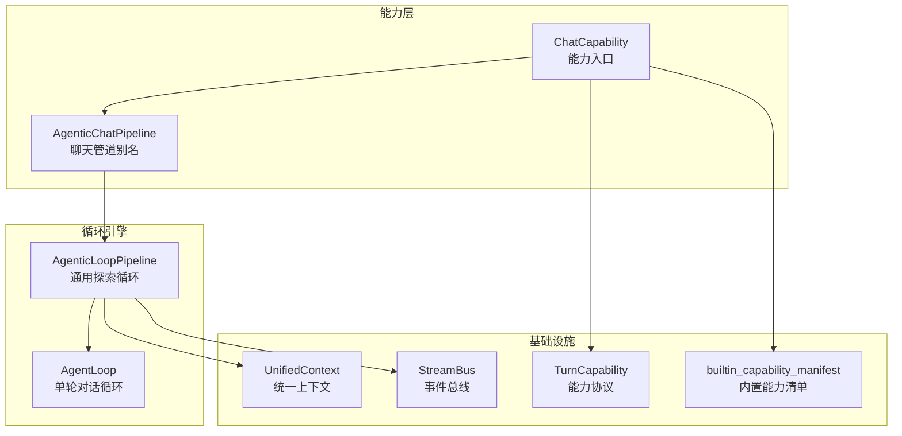
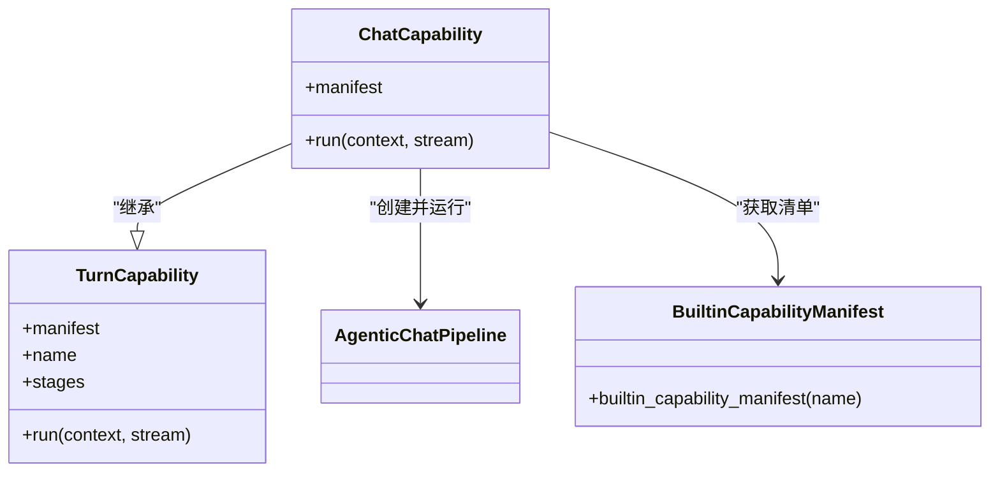
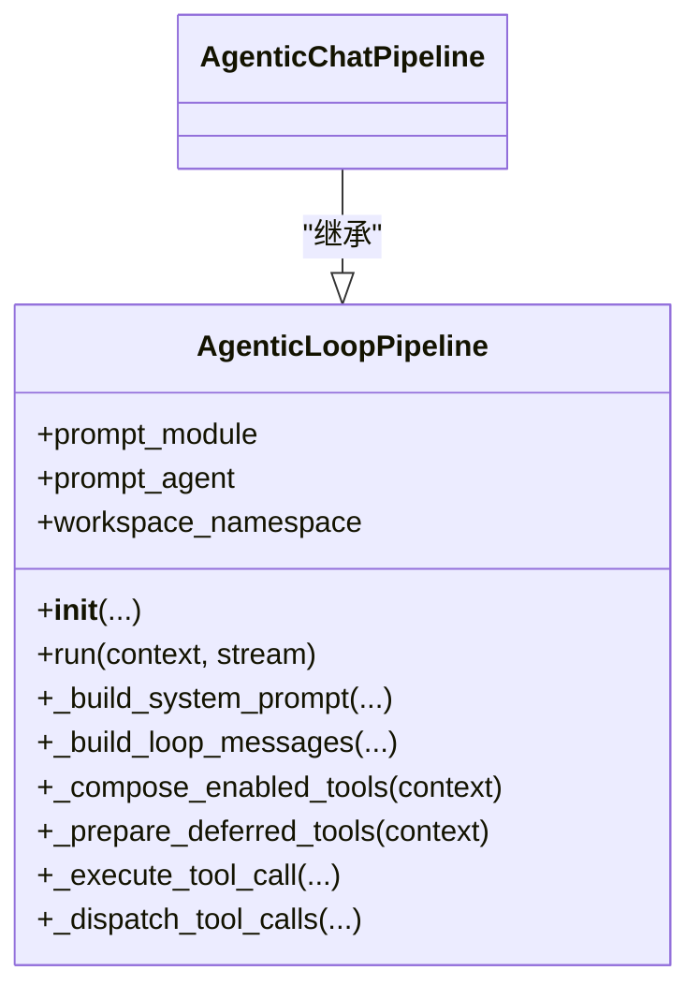
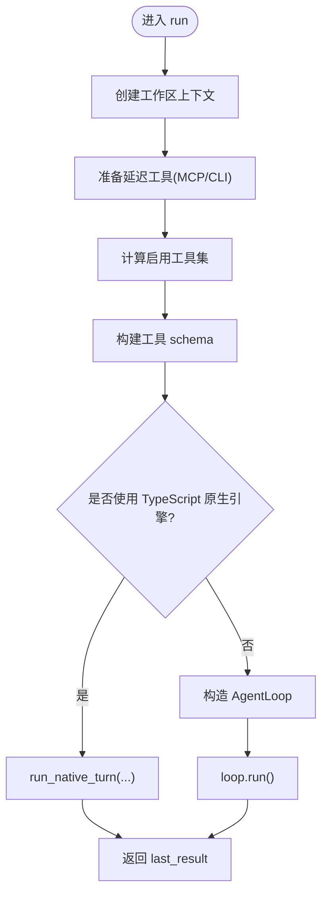
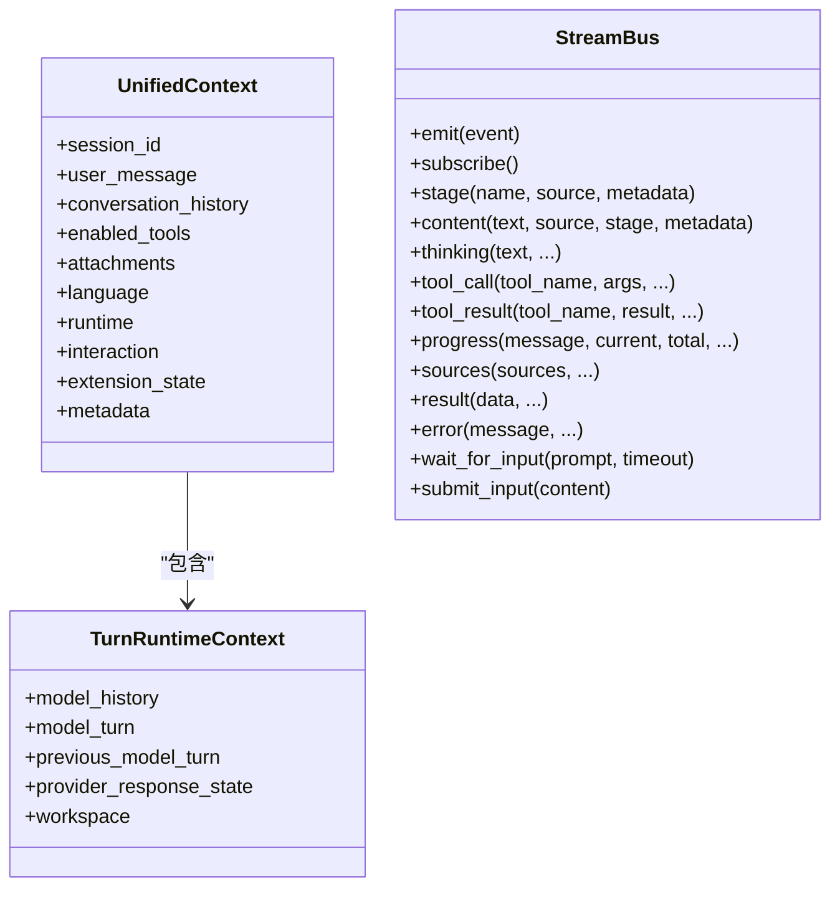
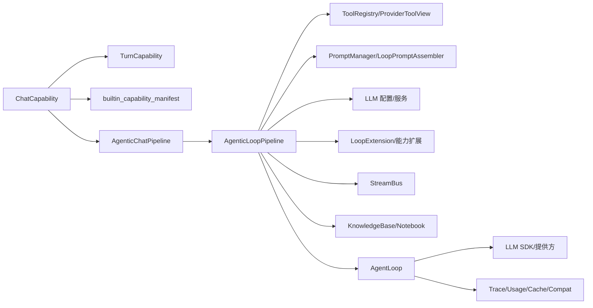
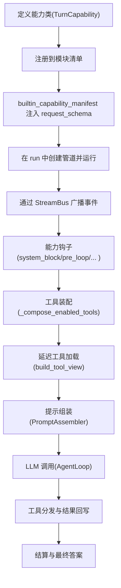

# 聊天智能体核心

<cite>
**本文引用的文件**   
- [capability.py](file://deeptutor/agents/chat/capability.py)
- [agentic_pipeline.py](file://deeptutor/agents/chat/agentic_pipeline.py)
- [pipeline.py](file://deeptutor/agents/loop/pipeline.py)
- [agent_loop.py](file://deeptutor/agents/loop/agent_loop.py)
- [capability_protocol.py](file://deeptutor/core/capability_protocol.py)
- [context.py](file://deeptutor/core/context.py)
- [stream_bus.py](file://deeptutor/runtime/stream_bus.py)
- [builtin_capabilities.py](file://deeptutor/runtime/bootstrap/builtin_capabilities.py)
</cite>

## 目录
1. [引言](#引言)
2. [项目结构](#项目结构)
3. [核心组件](#核心组件)
4. [架构总览](#架构总览)
5. [详细组件分析](#详细组件分析)
6. [依赖关系分析](#依赖关系分析)
7. [性能与预算控制](#性能与预算控制)
8. [错误处理与可观测性](#错误处理与可观测性)
9. [扩展与自定义指南](#扩展与自定义指南)
10. [故障排查](#故障排查)
11. [结论](#结论)

## 引言
本文聚焦 DeepTutor 的“聊天智能体”核心实现，围绕以下目标展开：
- 解释 ChatCapability 的能力注册机制、能力元数据注入与语言适配。
- 深入说明 AgenticChatPipeline 如何复用通用探索循环，完成从消息接收、上下文构建到响应生成的完整流程。
- 梳理管道执行流程：工具装配、延迟工具加载、系统提示组装、多轮 LLM 调用、工具分发、结算阶段与最终结果输出。
- 给出扩展与自定义实践：新增能力、覆盖工具集、调整预算、接入外部工具等。
- 总结错误处理策略、性能优化技巧与最佳实践。

## 项目结构
聊天智能体位于 agents/chat 子模块，并通过通用的 agents/loop 提供统一的“探索循环”引擎；能力协议定义在 core/capability_protocol；统一上下文在 core/context；事件流通过 runtime/stream_bus 广播。



**图表来源**
- [capability.py:12-17](file://deeptutor/agents/chat/capability.py#L12-L17)
- [agentic_pipeline.py:36-48](file://deeptutor/agents/chat/agentic_pipeline.py#L36-L48)
- [pipeline.py:200-451](file://deeptutor/agents/loop/pipeline.py#L200-L451)
- [agent_loop.py:173-305](file://deeptutor/agents/loop/agent_loop.py#L173-L305)
- [capability_protocol.py:46-73](file://deeptutor/core/capability_protocol.py#L46-L73)
- [context.py:92-156](file://deeptutor/core/context.py#L92-L156)
- [stream_bus.py:32-188](file://deeptutor/runtime/stream_bus.py#L32-L188)
- [builtin_capabilities.py:33-40](file://deeptutor/runtime/bootstrap/builtin_capabilities.py#L33-L40)

**章节来源**
- [capability.py:1-17](file://deeptutor/agents/chat/capability.py#L1-L17)
- [agentic_pipeline.py:1-48](file://deeptutor/agents/chat/agentic_pipeline.py#L1-L48)
- [pipeline.py:1-111](file://deeptutor/agents/loop/pipeline.py#L1-L111)
- [capability_protocol.py:1-103](file://deeptutor/core/capability_protocol.py#L1-L103)
- [context.py:1-175](file://deeptutor/core/context.py#L1-L175)
- [stream_bus.py:1-188](file://deeptutor/runtime/stream_bus.py#L1-L188)
- [builtin_capabilities.py:1-49](file://deeptutor/runtime/bootstrap/builtin_capabilities.py#L1-L49)

## 核心组件
- ChatCapability：聊天能力的运行时入口，负责绑定能力清单并启动 AgenticChatPipeline。
- AgenticChatPipeline：聊天场景下的管道别名，继承通用 AgenticLoopPipeline，复用其全部编排逻辑。
- AgenticLoopPipeline：通用“探索循环”主机，负责工具装配、提示组装、上下文窗口保护、LLM 客户端构建、能力钩子集成等。
- AgentLoop：单轮对话循环，驱动多轮 LLM 调用、工具分发、结算阶段与最终结果生成。
- TurnCapability：能力协议基类，要求子类提供 manifest 和 run。
- UnifiedContext：贯穿 orchestrator、工具、能力的统一上下文对象。
- StreamBus：异步事件总线，用于向前端或 CLI 推送内容、思考、工具调用、进度、结果等。
- builtin_capability_manifest：为内置能力动态注入请求模式等元数据。

**章节来源**
- [capability.py:12-17](file://deeptutor/agents/chat/capability.py#L12-L17)
- [agentic_pipeline.py:36-48](file://deeptutor/agents/chat/agentic_pipeline.py#L36-L48)
- [pipeline.py:200-451](file://deeptutor/agents/loop/pipeline.py#L200-L451)
- [agent_loop.py:173-305](file://deeptutor/agents/loop/agent_loop.py#L173-L305)
- [capability_protocol.py:46-73](file://deeptutor/core/capability_protocol.py#L46-L73)
- [context.py:92-156](file://deeptutor/core/context.py#L92-L156)
- [stream_bus.py:32-188](file://deeptutor/runtime/stream_bus.py#L32-L188)
- [builtin_capabilities.py:33-40](file://deeptutor/runtime/bootstrap/builtin_capabilities.py#L33-L40)

## 架构总览
聊天智能体的运行路径如下：
1. 能力层：ChatCapability 使用内置能力清单创建管道实例。
2. 管道层：AgenticChatPipeline 继承通用管道，复用默认提示包、工具集与预算策略。
3. 循环层：AgentLoop 维护一轮对话，反复调用 LLM，解析工具调用并分发执行。
4. 基础设施：UnifiedContext 携带会话、历史、附件、语言、工具开关等；StreamBus 广播事件；能力协议约束能力实现。

```mermaid
sequenceDiagram
participant Caller as "调用方"
participant Cap as "ChatCapability"
participant Pipe as "AgenticChatPipeline"
participant Loop as "AgentLoop"
participant LLM as "LLM 提供方"
participant Bus as "StreamBus"
Caller->>Cap : 调用 run(context, stream)
Cap->>Pipe : 构造管道(language=context.language)
Pipe->>Pipe : 准备工具/延迟工具/工作区/KB
Pipe->>Loop : 构造并运行单轮对话
Loop->>LLM : 发送消息(含系统提示+历史+用户输入)
LLM-->>Loop : 流式文本/工具调用
Loop->>Bus : 推送内容/思考/工具调用/进度
Loop->>Pipe : 分发工具调用并收集结果
Pipe-->>Loop : 返回工具结果
Loop->>LLM : 继续下一轮(直到无工具调用)
Loop-->>Pipe : 返回最终结果
Pipe-->>Cap : 返回 last_result
Cap-->>Caller : 完成
```

**图表来源**
- [capability.py:15-17](file://deeptutor/agents/chat/capability.py#L15-L17)
- [pipeline.py:403-451](file://deeptutor/agents/loop/pipeline.py#L403-L451)
- [agent_loop.py:208-305](file://deeptutor/agents/loop/agent_loop.py#L208-L305)
- [stream_bus.py:96-188](file://deeptutor/runtime/stream_bus.py#L96-L188)

## 详细组件分析

### ChatCapability：能力入口与语言适配
- 职责：声明 chat 能力的 manifest，并在 run 中创建 AgenticChatPipeline，将 context.language 传入。
- 能力清单：通过 builtin_capability_manifest 动态注入 request_schema 等元数据。
- 语言适配：语言来自 UnifiedContext.language，由管道内部 normalize_language 后参与提示组装与工具描述本地化。



**图表来源**
- [capability_protocol.py:46-73](file://deeptutor/core/capability_protocol.py#L46-L73)
- [capability.py:12-17](file://deeptutor/agents/chat/capability.py#L12-L17)
- [builtin_capabilities.py:33-40](file://deeptutor/runtime/bootstrap/builtin_capabilities.py#L33-L40)

**章节来源**
- [capability.py:12-17](file://deeptutor/agents/chat/capability.py#L12-L17)
- [builtin_capabilities.py:33-40](file://deeptutor/runtime/bootstrap/builtin_capabilities.py#L33-L40)

### AgenticChatPipeline：聊天管道的轻量别名
- 设计意图：chat 是基础宿主所描述的默认循环，因此只需命名与导出常量；真正的编排逻辑在 AgenticLoopPipeline。
- 重导出：CHAT_OPTIONAL_TOOLS、LOOP_EXCLUDED_TOOLS、KB_SEED_*、_DispatchOutcome、_read_int 等供测试与 capability 引用。



**图表来源**
- [agentic_pipeline.py:36-48](file://deeptutor/agents/chat/agentic_pipeline.py#L36-L48)
- [pipeline.py:200-451](file://deeptutor/agents/loop/pipeline.py#L200-L451)

**章节来源**
- [agentic_pipeline.py:1-48](file://deeptutor/agents/chat/agentic_pipeline.py#L1-L48)

### AgenticLoopPipeline：通用探索循环主机
关键职责与流程要点：
- 初始化：加载 LLM 配置、工具注册表、聊天参数（温度、最大轮次、token 上限）、提示管理器、PromptAssembler、LLMClientConfig。
- 运行入口 run：创建工作区、准备延迟工具、计算启用工具集、构建工具 schema、选择原生 TS 引擎或 Python 引擎、构造 AgentLoop 并运行。
- 系统提示构建：通过 PromptAssembler 合并能力块、工具清单、知识库摘要、笔记本清单、工作区说明等。
- 消息构建：拼接 system prompt、模型历史、会话历史、运行时快照、用户消息，并处理附件的多模态转换。
- 工具装配：根据用户开关、伙伴环境、知识能力、技能清单、内存/笔记/问答库等条件组合工具；支持强制挂载与抑制。
- 延迟工具：基于 ToolScope 构建 ProviderToolView，渐进加载 MCP/CLI 工具，并注入工具清单到系统提示。
- 执行工具：封装 execute_tool_call，统一错误消息、检索提示、空结果提示等。
- 能力钩子：pre_loop、system_block、owned_tools、rebinding_tools、finish_instruction、tool_round_output_policy、final_text_override 等。



**图表来源**
- [pipeline.py:403-451](file://deeptutor/agents/loop/pipeline.py#L403-L451)

**章节来源**
- [pipeline.py:230-323](file://deeptutor/agents/loop/pipeline.py#L230-L323)
- [pipeline.py:403-451](file://deeptutor/agents/loop/pipeline.py#L403-L451)
- [pipeline.py:463-583](file://deeptutor/agents/loop/pipeline.py#L463-L583)
- [pipeline.py:644-747](file://deeptutor/agents/loop/pipeline.py#L644-L747)
- [pipeline.py:782-849](file://deeptutor/agents/loop/pipeline.py#L782-L849)
- [pipeline.py:1169-1194](file://deeptutor/agents/loop/pipeline.py#L1169-L1194)

### AgentLoop：单轮对话循环
- 职责：维护一轮对话状态，按预算进行探索与结算，流式输出内容，分发工具调用，并最终产出答案。
- 关键流程：
  - 预简报：执行 active capabilities 的 pre_loop，作为本轮 seed 的一部分。
  - 构建消息：拼装系统提示、历史、运行时快照、用户输入。
  - 调度器：支持 python 与 typescript 两种调度后端。
  - LLM 调用：支持流式、工具调用、重试、缓存指纹、prompt caching、reasoning budget 检测。
  - 工具分发：解析 DSML 或 native tool calls，并行/串行执行，回写 role=tool 结果。
  - 结算阶段：当探索预算耗尽时，进入有限轮次的结算，确保必要交互完成。
  - 收尾：写入 model_turn、sources、emit RESULT，返回 payload。

```mermaid
sequenceDiagram
participant Loop as "AgentLoop"
participant Pipe as "AgenticLoopPipeline"
participant LLM as "LLM 提供方"
participant Tools as "工具集合"
participant Bus as "StreamBus"
Loop->>Pipe : _capability_pre_loop_briefings()
Loop->>Pipe : _build_loop_messages()
Loop->>LLM : 流式调用(messages, tools?)
LLM-->>Loop : 文本片段/工具调用
Loop->>Bus : content/thinking/tool_call/progress
alt 有工具调用
Loop->>Pipe : _dispatch_tool_calls(...)
Pipe->>Tools : 执行工具
Tools-->>Pipe : 工具结果
Pipe-->>Loop : 结果(role=tool)
Loop->>LLM : 继续下一轮
else 无工具调用
Loop->>Loop : 判断是否 finish/settlement
Loop->>Bus : call_status(finish/narration)
end
Loop-->>Pipe : 返回最终结果
```

**图表来源**
- [agent_loop.py:208-305](file://deeptutor/agents/loop/agent_loop.py#L208-L305)
- [agent_loop.py:312-333](file://deeptutor/agents/loop/agent_loop.py#L312-L333)
- [agent_loop.py:408-517](file://deeptutor/agents/loop/agent_loop.py#L408-L517)
- [agent_loop.py:640-800](file://deeptutor/agents/loop/agent_loop.py#L640-L800)

**章节来源**
- [agent_loop.py:173-305](file://deeptutor/agents/loop/agent_loop.py#L173-L305)
- [agent_loop.py:312-333](file://deeptutor/agents/loop/agent_loop.py#L312-L333)
- [agent_loop.py:408-517](file://deeptutor/agents/loop/agent_loop.py#L408-L517)
- [agent_loop.py:640-800](file://deeptutor/agents/loop/agent_loop.py#L640-L800)

### 统一上下文与事件总线
- UnifiedContext：承载 session_id、user_message、conversation_history、enabled_tools、attachments、language、runtime、interaction、extension_state、metadata 等。
- StreamBus：提供 emit、subscribe、stage、content、thinking、observation、tool_call、tool_result、progress、sources、result、error、wait_for_input、submit_input 等方法，支持跨事件循环安全投递与历史回放。



**图表来源**
- [context.py:50-156](file://deeptutor/core/context.py#L50-L156)
- [stream_bus.py:32-188](file://deeptutor/runtime/stream_bus.py#L32-L188)

**章节来源**
- [context.py:92-156](file://deeptutor/core/context.py#L92-L156)
- [stream_bus.py:32-188](file://deeptutor/runtime/stream_bus.py#L32-L188)

## 依赖关系分析
- ChatCapability 依赖 TurnCapability 协议与 builtin_capability_manifest。
- AgenticChatPipeline 仅做名称与常量重导出，实际行为来自 AgenticLoopPipeline。
- AgenticLoopPipeline 依赖：
  - 工具注册表与 ProviderToolView（工具权限与视图）。
  - PromptManager 与 LoopPromptAssembler（提示组装）。
  - LLM 配置与服务（模型、绑定、base_url、api_version、extra_headers）。
  - 能力扩展协议（active_loop_capabilities、LoopExtension）。
  - StreamBus（事件广播）。
  - Knowledge Base 清单与 Notebook 清单（可选）。
- AgentLoop 依赖：
  - LLM SDK 流式接口、工具调用解析（DSML/native）、UsageTracker、TraceMetadata。
  - 服务层：LLM 传输错误、请求缓存指纹、prompt caching 支持、图像去重等。



**图表来源**
- [capability.py:12-17](file://deeptutor/agents/chat/capability.py#L12-L17)
- [agentic_pipeline.py:36-48](file://deeptutor/agents/chat/agentic_pipeline.py#L36-L48)
- [pipeline.py:200-451](file://deeptutor/agents/loop/pipeline.py#L200-L451)
- [agent_loop.py:173-305](file://deeptutor/agents/loop/agent_loop.py#L173-L305)
- [builtin_capabilities.py:33-40](file://deeptutor/runtime/bootstrap/builtin_capabilities.py#L33-L40)

**章节来源**
- [pipeline.py:200-451](file://deeptutor/agents/loop/pipeline.py#L200-L451)
- [agent_loop.py:173-305](file://deeptutor/agents/loop/agent_loop.py#L173-L305)

## 性能与预算控制
- 轮次预算：DEFAULT_MAX_ROUNDS 为默认探索轮次上限；effective_max_rounds 可被能力提升最小值。
- Token 预算：exploring_max_tokens/respond_max_tokens/loop_max_tokens 控制每轮 token 上限；respond_max_tokens 同时作为最终回答预算。
- 上下文窗口保护：CONTEXT_WINDOW_GUARD_RATIO 与 IMAGE_TOKEN_GUARD_RESERVE 保守预留图片 token；必要时截断或降级。
- 推理预算恢复：ReasoningBudgetRecovery 根据配置策略处理 reasoning-only 的情况，避免浪费探索预算。
- 请求缓存：fingerprint_request 与 compare_requests 对消息与工具 schema 进行指纹比对，减少重复请求。
- Prompt Caching：对支持 provider 附加 cache_control 标记，稳定历史段与瞬态上下文分离，提高缓存命中率。
- 工具并行：MAX_PARALLEL_TOOL_CALLS 限制并发工具调用数量，避免资源争用。

**章节来源**
- [pipeline.py:102-111](file://deeptutor/agents/loop/pipeline.py#L102-L111)
- [pipeline.py:285-306](file://deeptutor/agents/loop/pipeline.py#L285-L306)
- [pipeline.py:369-401](file://deeptutor/agents/loop/pipeline.py#L369-L401)
- [agent_loop.py:96-115](file://deeptutor/agents/loop/agent_loop.py#L96-L115)
- [agent_loop.py:593-638](file://deeptutor/agents/loop/agent_loop.py#L593-L638)
- [agent_loop.py:726-756](file://deeptutor/agents/loop/agent_loop.py#L726-L756)

## 错误处理与可观测性
- 能力前置失败：CapabilityPrerequisiteError 不应被绕过，用于强制中断不满足前置条件的 turn。
- 提供者传输错误：LLMProviderTransportError 在 forced-finish 中保留结构化错误，避免掩盖真实失败。
- 推理预算耗尽：LLMReasoningBudgetExhausted 抛出带诊断信息的异常，便于上层展示与重试建议。
- 工具错误：tool_error_message_factory 提供本地化的工具错误消息，避免暴露内部细节。
- 可观测性：
  - StreamBus 广播 STAGE_START/STAGE_END、CONTENT、THINKING、TOOL_CALL、TOOL_RESULT、PROGRESS、SOURCES、RESULT、ERROR。
  - TraceMetadata 与 UsageTracker 记录调用 ID、阶段、标签、角色、分组、用量分解等。
  - model_turn 持久化当前轮的消息、工具、路由、指纹等信息，便于回放与分析。

**章节来源**
- [capability_protocol.py:21-23](file://deeptutor/core/capability_protocol.py#L21-L23)
- [agent_loop.py:408-517](file://deeptutor/agents/loop/agent_loop.py#L408-L517)
- [pipeline.py:1169-1194](file://deeptutor/agents/loop/pipeline.py#L1169-L1194)
- [stream_bus.py:96-344](file://deeptutor/runtime/stream_bus.py#L96-L344)
- [agent_loop.py:252-305](file://deeptutor/agents/loop/agent_loop.py#L252-L305)

## 扩展与自定义指南

### 扩展聊天智能体行为的常见方式
- 新增能力：
  - 实现 TurnCapability 子类，提供 manifest 与 run。
  - 通过模块清单注册能力，使 builtin_capability_manifest 能注入 request_schema。
  - 在 run 中使用 StreamBus 分阶段广播事件，保持可观测性。
- 覆盖工具集：
  - 在 AgenticLoopPipeline 子类中重写 _compose_enabled_tools，以改变工具装配策略。
  - 使用 capability_owned_tools 与 rebinding_tools 让能力拥有专属工具或重定向工具行为。
- 调整预算与温度：
  - 在 __init__ 中传入 max_rounds、temperature、max_tokens 覆盖默认值。
  - 通过 context.runtime.min_loop_rounds 提升最小轮次下限。
- 接入外部工具：
  - 利用延迟工具机制（MCP/CLI），通过 build_tool_view 与 ToolScope 授权与过滤。
  - 在系统提示中注入工具清单，使模型知道可用工具及其用法。
- 定制提示：
  - 设置 prompt_base_module/prompt_base_agent 合并基础提示包。
  - 通过 LoopPromptAssembler 的 foundation_blocks 定制系统提示结构。
- 语言适配：
  - 在 UnifiedContext.language 中指定语言，管道会 normalize_language 并影响工具描述与提示文本。
  - 若需固定回复语言，可通过 context.metadata.reply_language_fixed 禁止用户覆盖。



**图表来源**
- [capability_protocol.py:46-73](file://deeptutor/core/capability_protocol.py#L46-L73)
- [builtin_capabilities.py:33-40](file://deeptutor/runtime/bootstrap/builtin_capabilities.py#L33-L40)
- [pipeline.py:644-747](file://deeptutor/agents/loop/pipeline.py#L644-L747)
- [pipeline.py:782-849](file://deeptutor/agents/loop/pipeline.py#L782-L849)
- [pipeline.py:463-583](file://deeptutor/agents/loop/pipeline.py#L463-L583)
- [agent_loop.py:208-305](file://deeptutor/agents/loop/agent_loop.py#L208-L305)

**章节来源**
- [capability_protocol.py:46-73](file://deeptutor/core/capability_protocol.py#L46-L73)
- [builtin_capabilities.py:33-40](file://deeptutor/runtime/bootstrap/builtin_capabilities.py#L33-L40)
- [pipeline.py:463-583](file://deeptutor/agents/loop/pipeline.py#L463-L583)
- [pipeline.py:644-747](file://deeptutor/agents/loop/pipeline.py#L644-L747)
- [pipeline.py:782-849](file://deeptutor/agents/loop/pipeline.py#L782-L849)
- [agent_loop.py:208-305](file://deeptutor/agents/loop/agent_loop.py#L208-L305)

## 故障排查
- 工具不可用：
  - 检查 ToolScope 授权与 caller_whitelist，确认延迟工具已正确加载。
  - 查看系统提示中的工具清单是否包含目标工具。
- 流式超时：
  - 关注 _STREAM_IDLE_TIMEOUT_SECONDS 与 LLMProviderTransportError，确认网络与提供方稳定性。
- 推理预算耗尽：
  - 观察 LLMReasoningBudgetExhausted 的诊断信息，降低 reasoning_effort 或拆分任务。
- 上下文窗口超限：
  - 检查 CONTEXT_WINDOW_GUARD_RATIO 与 IMAGE_TOKEN_GUARD_RESERVE，适当减少图片或历史长度。
- 能力前置失败：
  - 检查 CapabilityPrerequisiteError 的来源，确保前置条件满足后再执行 turn。

**章节来源**
- [pipeline.py:693-710](file://deeptutor/agents/loop/pipeline.py#L693-L710)
- [agent_loop.py:118-128](file://deeptutor/agents/loop/agent_loop.py#L118-L128)
- [agent_loop.py:484-502](file://deeptutor/agents/loop/agent_loop.py#L484-L502)
- [capability_protocol.py:21-23](file://deeptutor/core/capability_protocol.py#L21-L23)

## 结论
聊天智能体的核心由 ChatCapability 与 AgenticChatPipeline 组成，前者作为能力入口，后者复用通用 AgenticLoopPipeline 的探索循环引擎。该引擎统一管理工具装配、延迟工具加载、提示组装、上下文窗口保护、LLM 调用与工具分发，并通过 StreamBus 提供丰富的可观测性。通过能力钩子与配置项，开发者可以灵活扩展聊天智能体的行为，包括工具集、预算、语言与提示结构。在实际使用中，应重点关注错误处理、预算控制与可观测性，以确保系统的稳定性与可维护性。