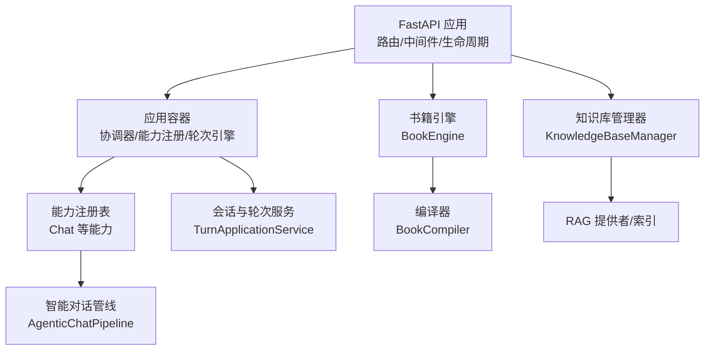
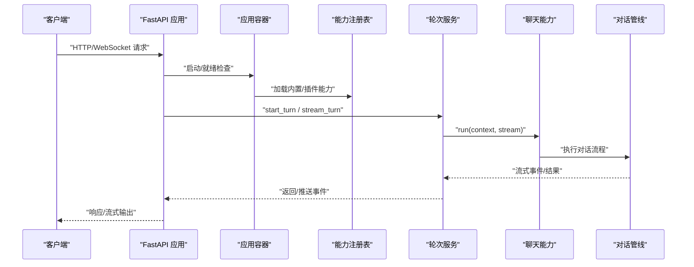
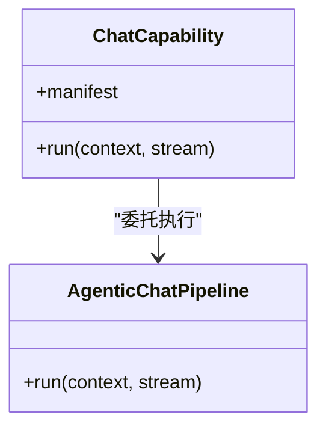
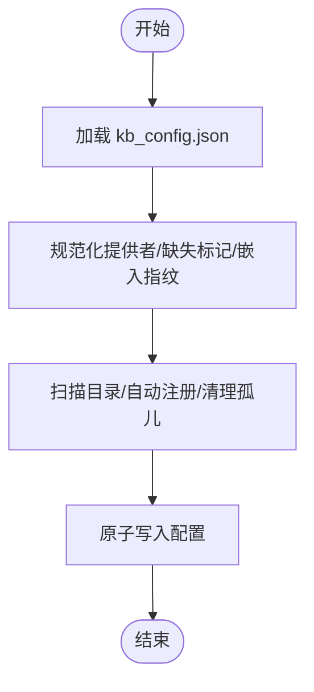
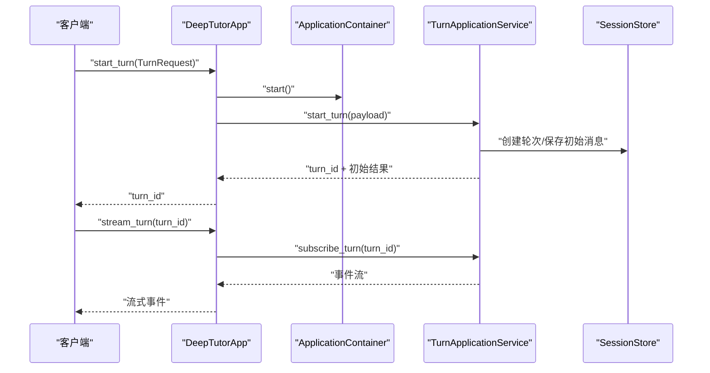
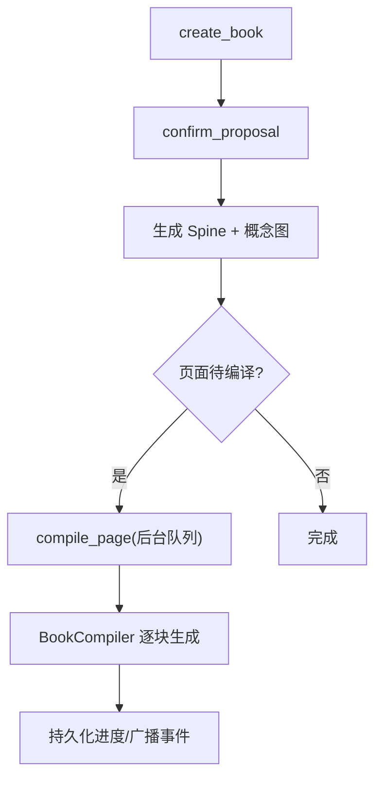
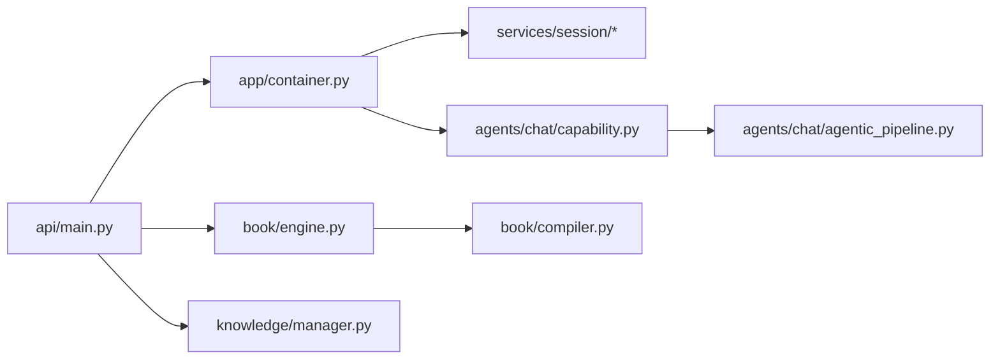

# 核心功能模块

<cite>
**本文引用的文件**   
- [deeptutor/api/main.py](file://deeptutor/api/main.py)
- [deeptutor/app/container.py](file://deeptutor/app/container.py)
- [deeptutor/app/facade.py](file://deeptutor/app/facade.py)
- [deeptutor/agents/chat/capability.py](file://deeptutor/agents/chat/capability.py)
- [deeptutor/knowledge/manager.py](file://deeptutor/knowledge/manager.py)
- [deeptutor/book/engine.py](file://deeptutor/book/engine.py)
- [deeptutor/book/compiler.py](file://deeptutor/book/compiler.py)
- [deeptutor/services/config/capabilities_settings.py](file://deeptutor/services/config/capabilities_settings.py)
</cite>

## 目录
1. [简介](#简介)
2. [项目结构](#项目结构)
3. [核心组件](#核心组件)
4. [架构总览](#架构总览)
5. [详细组件分析](#详细组件分析)
6. [依赖关系分析](#依赖关系分析)
7. [性能考虑](#性能考虑)
8. [故障排查指南](#故障排查指南)
9. [结论](#结论)
10. [附录](#附录)

## 简介
本文件面向 DeepTutor 的核心功能模块，聚焦以下四大能力：
- 智能对话系统：以“会话轮次”为单位的可流式、可取消、可恢复的 Agent 对话执行。
- 知识管理系统：多类型知识库注册、索引版本管理、嵌入指纹与状态同步。
- 会话管理：工作区隔离、轮次生命周期、事件订阅与用户回复注入。
- 内容生成引擎：书籍（Book）从创意到章节大纲再到页面块生成的编排与编译。

文档将说明各模块职责、接口契约、交互关系、配置项、使用模式与最佳实践，并通过代码级图示展示依赖和数据流转，帮助初学者快速上手，同时为高级用户提供足够的实现细节与优化建议。

## 项目结构
DeepTutor 后端采用 FastAPI 应用 + 模块化服务 + 能力（Capability）扩展的结构：
- API 层负责 HTTP/WebSocket 入口、中间件、健康检查与路由加载。
- 应用容器负责启动协调器、能力注册、TurnEngine 与会话运行时。
- 能力层通过 TurnCapability 暴露具体业务（如聊天）。
- 知识管理与书籍引擎作为独立编排子系统，分别由各自的 Engine/Manager 驱动。

**图表来源**
- [deeptutor/api/main.py:108-188](file://deeptutor/api/main.py#L108-L188)
- [deeptutor/app/container.py:78-121](file://deeptutor/app/container.py#L78-L121)
- [deeptutor/agents/chat/capability.py:12-17](file://deeptutor/agents/chat/capability.py#L12-L17)
- [deeptutor/book/engine.py:317-332](file://deeptutor/book/engine.py#L317-L332)
- [deeptutor/knowledge/manager.py:322-335](file://deeptutor/knowledge/manager.py#L322-L335)

**章节来源**
- [deeptutor/api/main.py:108-188](file://deeptutor/api/main.py#L108-L188)
- [deeptutor/app/container.py:78-121](file://deeptutor/app/container.py#L78-L121)

## 核心组件
- 智能对话系统
  - 通过 TurnCapability 暴露 chat 能力，内部由 AgenticChatPipeline 驱动。
  - 支持流式输出、上下文预算、工具调用与中断恢复。
- 知识管理系统
  - KnowledgeBaseManager 维护 kb_config.json，处理多提供者索引、嵌入签名、状态与进度。
  - 支持连接型知识库（Obsidian、Linked Index 等）与本地索引。
- 会话管理
  - ApplicationContainer 构建 TurnEngine 与 TurnApplicationService，提供 start_turn/stream_turn/cancel_turn/submit_user_reply 等能力。
  - 基于工作区上下文隔离数据访问。
- 内容生成引擎
  - BookEngine 编排书籍创建、确认提案、生成章节大纲、页面块编译与后台队列。
  - BookCompiler 按页驱动 Block 生成，支持细粒度事件流与失败熔断。

**章节来源**
- [deeptutor/agents/chat/capability.py:12-17](file://deeptutor/agents/chat/capability.py#L12-L17)
- [deeptutor/knowledge/manager.py:322-335](file://deeptutor/knowledge/manager.py#L322-L335)
- [deeptutor/app/container.py:78-121](file://deeptutor/app/container.py#L78-L121)
- [deeptutor/book/engine.py:317-332](file://deeptutor/book/engine.py#L317-L332)

## 架构总览
下图展示了请求从 API 进入，经容器装配能力与轮次引擎，最终落到具体能力（聊天）或子系统（书籍、知识库）的整体流程。

**图表来源**
- [deeptutor/api/main.py:108-188](file://deeptutor/api/main.py#L108-L188)
- [deeptutor/app/container.py:78-121](file://deeptutor/app/container.py#L78-L121)
- [deeptutor/agents/chat/capability.py:12-17](file://deeptutor/agents/chat/capability.py#L12-L17)

## 详细组件分析

### 智能对话系统（聊天能力）
- 职责
  - 暴露 chat 能力，封装 AgenticChatPipeline 的执行。
  - 接收统一上下文（语言、身份、工具集等），向 StreamBus 推送流式事件。
- 关键接口
  - run(context, stream): 执行一次对话轮次。
- 配置项
  - 温度、最大轮次、阶段 Token 预算等由 capabilities_settings 提供默认值并可被合并覆盖。
- 使用模式
  - 通过 TurnCapability 注册后，由 TurnEngine 调度；前端通过 start_turn 触发，stream_turn 订阅事件。
- 最佳实践
  - 合理设置 max_rounds 与 stage_budgets，避免长对话耗尽配额。
  - 结合上下文预算与工具调用限制，控制 LLM 调用成本。

**图表来源**
- [deeptutor/agents/chat/capability.py:12-17](file://deeptutor/agents/chat/capability.py#L12-L17)

**章节来源**
- [deeptutor/agents/chat/capability.py:12-17](file://deeptutor/agents/chat/capability.py#L12-L17)
- [deeptutor/services/config/capabilities_settings.py:188-223](file://deeptutor/services/config/capabilities_settings.py#L188-L223)

### 知识管理系统（知识库管理器）
- 职责
  - 管理多个知识库的注册、状态、进度、索引版本与嵌入指纹。
  - 自动发现未注册的有效知识库，清理孤儿条目，并与 PocketBase 同步元数据。
- 关键接口
  - list_knowledge_bases(): 列出所有知识库名称。
  - get_kb_status(name): 获取状态与进度。
  - update_kb_status(name, status, progress): 更新状态与进度并持久化。
- 数据结构
  - kb_config.json：包含 knowledge_bases 字典，每项含 provider、status、progress、embedding_* 字段。
- 并发与一致性
  - 使用原子写入与共享锁保护配置读写；对慢盘进行单飞重算与缓存。
- 使用模式
  - 添加文档后更新状态为 ready/error/processing；UI 根据 status 与 index_versions 渲染。
- 最佳实践
  - 切换嵌入模型后需重建索引；对连接型知识库（Obsidian/Linked）不在此处做嵌入版本校验。

**图表来源**
- [deeptutor/knowledge/manager.py:362-470](file://deeptutor/knowledge/manager.py#L362-L470)
- [deeptutor/knowledge/manager.py:651-740](file://deeptutor/knowledge/manager.py#L651-L740)

**章节来源**
- [deeptutor/knowledge/manager.py:322-335](file://deeptutor/knowledge/manager.py#L322-L335)
- [deeptutor/knowledge/manager.py:362-470](file://deeptutor/knowledge/manager.py#L362-L470)
- [deeptutor/knowledge/manager.py:651-740](file://deeptutor/knowledge/manager.py#L651-L740)

### 会话管理（轮次与服务）
- 职责
  - 提供会话与轮次的生命周期管理：创建、流式订阅、取消、用户回复注入。
  - 在工作区上下文中隔离数据访问，确保多租户安全。
- 关键接口
  - start_turn(request): 启动轮次，返回 turn_id 与初始结果。
  - stream_turn(turn_id, after_seq): 订阅轮次事件流。
  - cancel_turn(turn_id): 取消进行中轮次。
  - submit_user_reply(turn_id, text, answers): 注入用户回答。
- 使用模式
  - 前端先 start_turn，再 stream_turn 拉取增量事件；必要时 submit_user_reply 继续对话。
- 最佳实践
  - 在 UI 中显示“进行中/已暂停/已完成”状态；对长时间任务启用取消与重试策略。

**图表来源**
- [deeptutor/app/facade.py:129-179](file://deeptutor/app/facade.py#L129-L179)
- [deeptutor/app/container.py:78-121](file://deeptutor/app/container.py#L78-L121)

**章节来源**
- [deeptutor/app/facade.py:129-179](file://deeptutor/app/facade.py#L129-L179)
- [deeptutor/app/container.py:78-121](file://deeptutor/app/container.py#L78-L121)

### 内容生成引擎（书籍引擎与编译器）
- 职责
  - BookEngine：编排书籍从创意→提案→章节大纲→页面块生成的全流程，管理后台队列与熔断。
  - BookCompiler：按页驱动 Block 生成，持久化进度，广播细粒度事件。
- 关键接口
  - create_book(...): 捕获输入，运行创意 Agent，产出草案与提案。
  - confirm_proposal(...): 探索源材料，合成 Spine 与概念图。
  - compile_page(book, page): 编译指定页面，聚合块状态。
- 数据结构
  - Book/Spine/Page/Block：描述书籍结构与块级内容。
- 使用模式
  - 前端依次调用 create_book → confirm_proposal → 打开页面触发 compile_page。
- 最佳实践
  - 对系统性失败（配额/鉴权/超时）启用熔断，避免无意义重试。
  - 利用 BookStream 事件驱动 UI 实时更新。

**图表来源**
- [deeptutor/book/engine.py:467-550](file://deeptutor/book/engine.py#L467-L550)
- [deeptutor/book/engine.py:558-701](file://deeptutor/book/engine.py#L558-L701)
- [deeptutor/book/compiler.py:1-19](file://deeptutor/book/compiler.py#L1-L19)

**章节来源**
- [deeptutor/book/engine.py:317-332](file://deeptutor/book/engine.py#L317-L332)
- [deeptutor/book/engine.py:467-550](file://deeptutor/book/engine.py#L467-L550)
- [deeptutor/book/engine.py:558-701](file://deeptutor/book/engine.py#L558-L701)
- [deeptutor/book/compiler.py:1-19](file://deeptutor/book/compiler.py#L1-L19)

## 依赖关系分析
- API 层依赖
  - 生命周期中初始化应用容器、事件总线、后台任务监督器，并挂载路由。
  - 健康检查端点依赖协调器健康状态。
- 容器依赖
  - 根据配置选择 Redis/Memory 协调器，构建 TurnEngine 与 TurnApplicationService。
  - 提供迁移与恢复能力（历史聊天、工作区偏好、书籍会话关联）。
- 能力与管线
  - ChatCapability 依赖 AgenticChatPipeline；配置来自 capabilities_settings。
- 书籍引擎
  - BookEngine 依赖 BookStorage、BookCompiler、事件总线与 Workspace 活动上下文。
- 知识库管理器
  - 依赖 RAG 提供者工厂、嵌入签名、索引版本探测与 PocketBase 客户端。

**图表来源**
- [deeptutor/api/main.py:108-188](file://deeptutor/api/main.py#L108-L188)
- [deeptutor/app/container.py:78-121](file://deeptutor/app/container.py#L78-L121)
- [deeptutor/agents/chat/capability.py:12-17](file://deeptutor/agents/chat/capability.py#L12-L17)
- [deeptutor/book/engine.py:317-332](file://deeptutor/book/engine.py#L317-L332)
- [deeptutor/knowledge/manager.py:322-335](file://deeptutor/knowledge/manager.py#L322-L335)

**章节来源**
- [deeptutor/api/main.py:108-188](file://deeptutor/api/main.py#L108-L188)
- [deeptutor/app/container.py:78-121](file://deeptutor/app/container.py#L78-L121)
- [deeptutor/agents/chat/capability.py:12-17](file://deeptutor/agents/chat/capability.py#L12-L17)
- [deeptutor/book/engine.py:317-332](file://deeptutor/book/engine.py#L317-L332)
- [deeptutor/knowledge/manager.py:322-335](file://deeptutor/knowledge/manager.py#L322-L335)

## 性能考虑
- 对话系统
  - 合理设置 temperature、max_rounds 与 stage_budgets，避免长轮次与高开销阶段。
  - 使用流式输出减少首字延迟；对长任务启用取消与重试。
- 知识库
  - 使用原子写入与缓存降低频繁读写的竞争；对慢盘进行单飞重算。
  - 切换嵌入模型后及时重建索引，避免 UI 误报“需要重新索引”。
- 书籍引擎
  - 后台队列与 in-flight 表避免重复编译同一页面；系统性失败时熔断。
  - 利用 BookStream 事件驱动 UI，避免轮询开销。

[本节为通用指导，无需特定文件引用]

## 故障排查指南
- API 层
  - 健康检查返回 not_ready：检查协调器健康与应用容器是否成功启动。
  - CORS 错误：检查 _build_cors_settings 中的 allow_origins 与 allow_origin_regex。
- 容器与会话
  - 轮次无法恢复：检查 TurnRecoveryService 与协调器健康；查看 recover_once 日志。
- 知识库
  - 状态异常：检查 kb_config.json 的 status/progress/embedding_mismatch；确认索引版本与嵌入签名匹配。
  - PocketBase 同步失败：查看 _sync_kb_to_pb 的调试日志。
- 书籍引擎
  - 页面持续失败：检查 systemic_failure_reason 分类（quota/authentication/rate_limit/provider/content）。
  - 生成被暂停：确认 BookStatus.PAUSED 原因，必要时显式恢复。

**章节来源**
- [deeptutor/api/main.py:379-420](file://deeptutor/api/main.py#L379-L420)
- [deeptutor/api/main.py:478-492](file://deeptutor/api/main.py#L478-L492)
- [deeptutor/app/container.py:162-209](file://deeptutor/app/container.py#L162-L209)
- [deeptutor/knowledge/manager.py:500-625](file://deeptutor/knowledge/manager.py#L500-L625)
- [deeptutor/book/engine.py:219-247](file://deeptutor/book/engine.py#L219-L247)

## 结论
DeepTutor 的核心模块围绕“对话—知识—会话—内容生成”形成清晰的分层与协作：
- API 层提供稳定入口与生命周期管理。
- 应用容器统一装配能力与轮次引擎，保证多租户与工作区隔离。
- 聊天能力通过管线驱动流式对话，配合会话服务实现完整交互闭环。
- 知识库管理器保障多提供者索引的一致性与可观测性。
- 书籍引擎将复杂的内容生产流程解耦为可编排的阶段，并以事件驱动提升用户体验。

在实际使用中，建议优先关注配置调优（对话预算、知识库嵌入）、事件流与错误分类，以获得更稳定、高效且可观测的系统表现。

[本节为总结性内容，无需特定文件引用]

## 附录
- 常用配置键（聊天能力）
  - temperature：采样温度。
  - max_rounds：最大对话轮次。
  - stage_budgets.exploring/responding.max_tokens：阶段 Token 预算。
- 知识库状态
  - initializing/processing/ready/error：生命周期状态。
  - needs_reindex/embedding_mismatch：索引与嵌入不一致提示。
- 书籍状态
  - DRAFT/SPINE_READY/PARTIAL/READY/ERROR/PAUSED：书籍整体状态。
  - PageStatus/BlockStatus：页面与块的细粒度状态。

[本节为补充信息，无需特定文件引用]