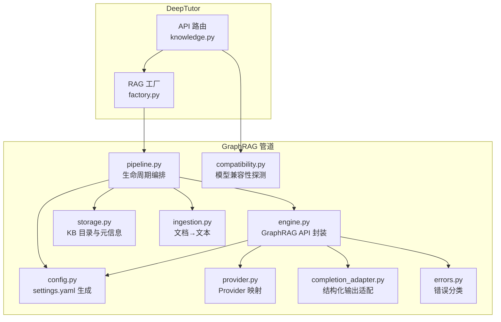
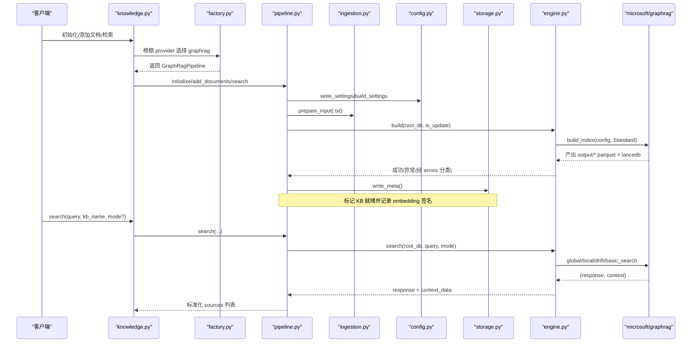
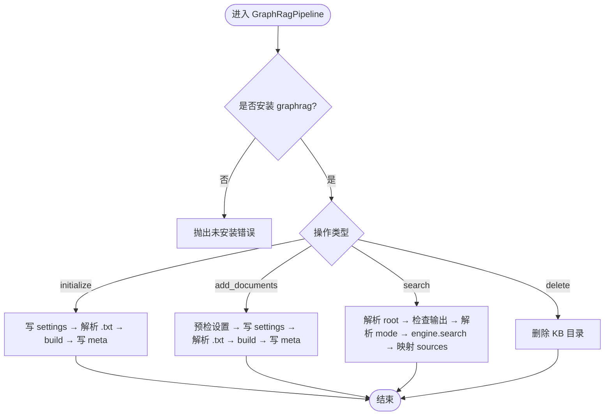
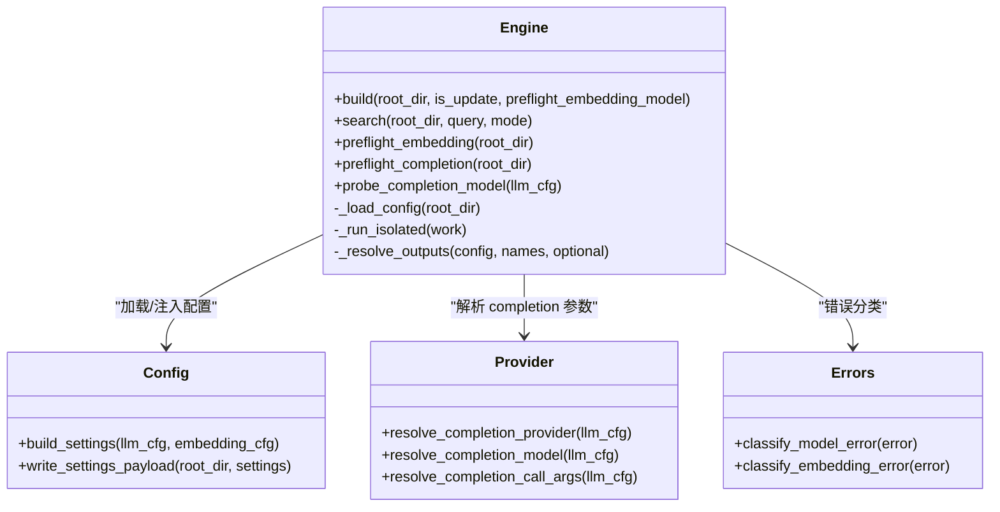
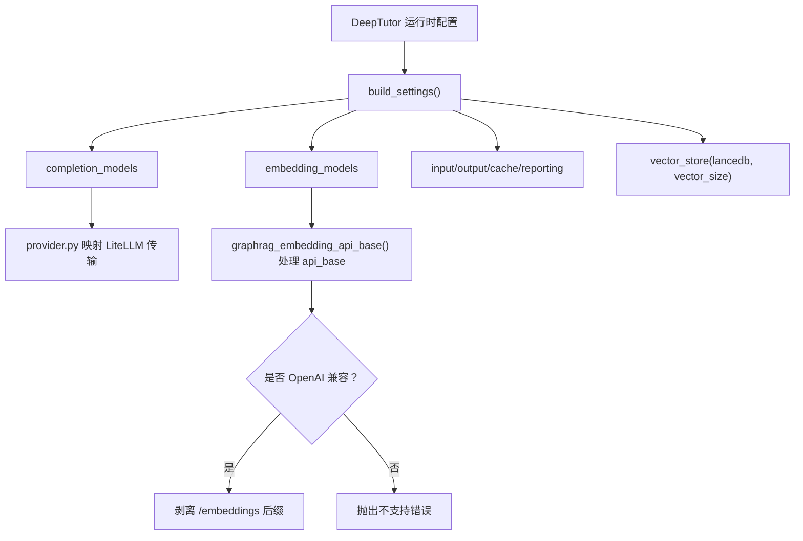
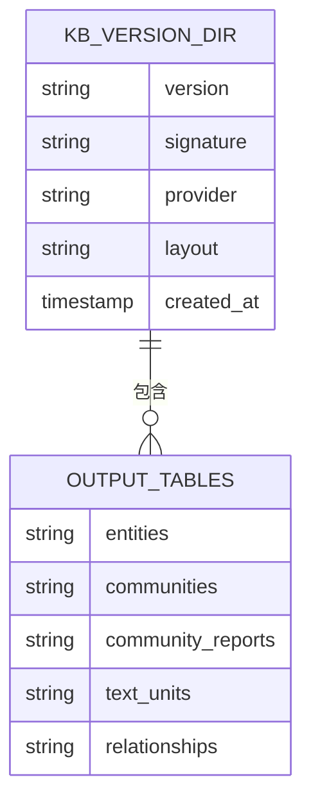
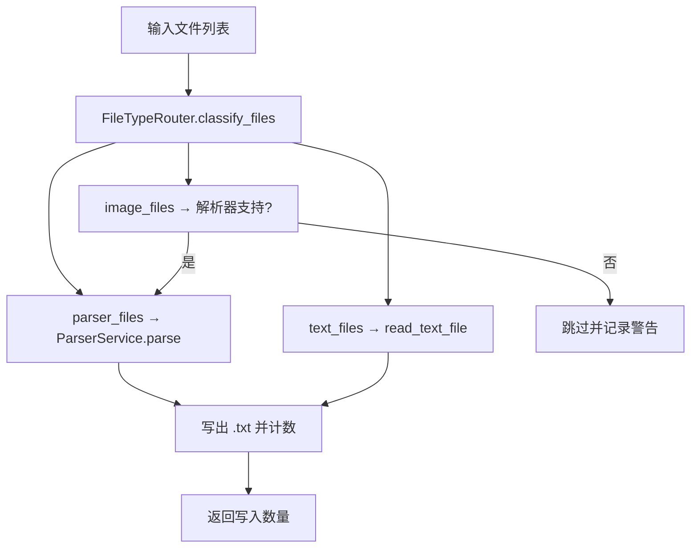
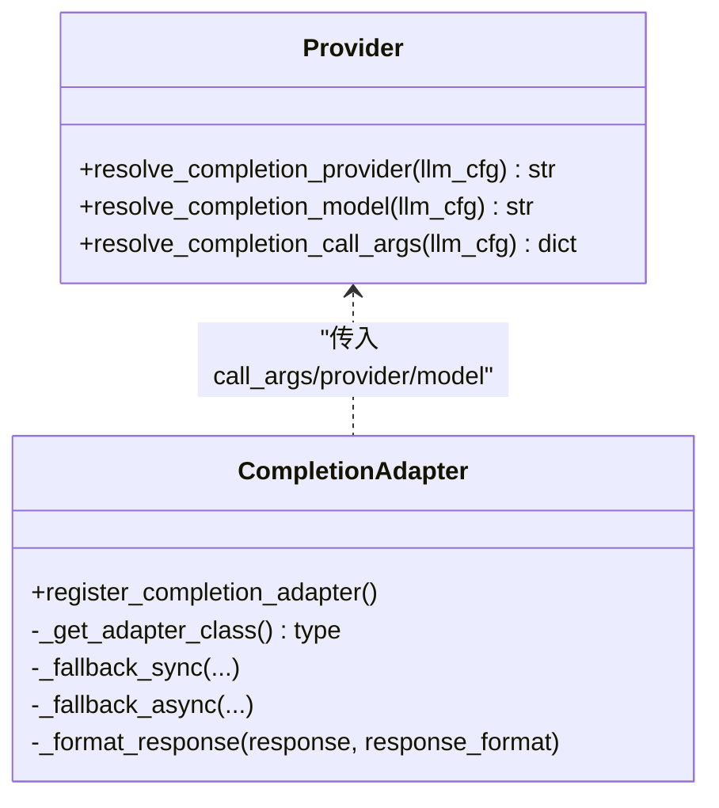
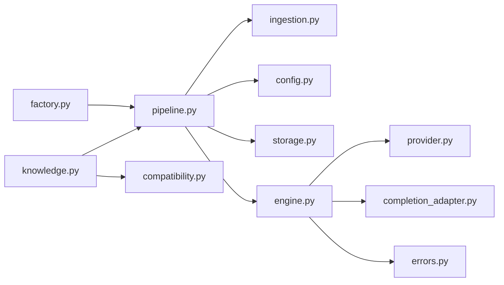

# GraphRAG 管道实现

<cite>
**本文引用的文件**   
- [deeptutor/services/rag/pipelines/graphrag/pipeline.py](file://deeptutor/services/rag/pipelines/graphrag/pipeline.py)
- [deeptutor/services/rag/pipelines/graphrag/engine.py](file://deeptutor/services/rag/pipelines/graphrag/engine.py)
- [deeptutor/services/rag/pipelines/graphrag/config.py](file://deeptutor/services/rag/pipelines/graphrag/config.py)
- [deeptutor/services/rag/pipelines/graphrag/storage.py](file://deeptutor/services/rag/pipelines/graphrag/storage.py)
- [deeptutor/services/rag/pipelines/graphrag/provider.py](file://deeptutor/services/rag/pipelines/graphrag/provider.py)
- [deeptutor/services/rag/pipelines/graphrag/ingestion.py](file://deeptutor/services/rag/pipelines/graphrag/ingestion.py)
- [deeptutor/services/rag/pipelines/graphrag/completion_adapter.py](file://deeptutor/services/rag/pipelines/graphrag/completion_adapter.py)
- [deeptutor/services/rag/pipelines/graphrag/errors.py](file://deeptutor/services/rag/pipelines/graphrag/errors.py)
- [deeptutor/services/rag/pipelines/graphrag/compatibility.py](file://deeptutor/services/rag/pipelines/graphrag/compatibility.py)
- [deeptutor/api/routers/knowledge.py](file://deeptutor/api/routers/knowledge.py)
- [deeptutor/services/rag/factory.py](file://deeptutor/services/rag/factory.py)
</cite>

## 目录
1. [引言](#引言)
2. [项目结构](#项目结构)
3. [核心组件](#核心组件)
4. [架构总览](#架构总览)
5. [详细组件分析](#详细组件分析)
6. [依赖关系分析](#依赖关系分析)
7. [性能与优化](#性能与优化)
8. [故障排查指南](#故障排查指南)
9. [结论](#结论)
10. [附录：配置与集成示例](#附录配置与集成示例)

## 引言
本文件系统性梳理 DeepTutor 中基于 microsoft/graphrag 的 GraphRAG 管道实现，覆盖知识图谱构建、实体关系提取、图遍历检索机制、数据摄取流程、存储结构、查询优化策略，以及与向量检索的结合方式。文档同时提供面向初学者的概念说明和面向高级用户的深度定制要点，包括如何构建领域知识图谱、优化图查询性能、集成外部图数据库（通过 GraphRAG 的 LanceDB 向量存储）以及调试与性能分析最佳实践。

## 项目结构
GraphRAG 管道位于 services/rag/pipelines/graphrag 下，采用“编排 + 引擎 + 配置 + 存储 + 摄取 + 适配 + 错误”的分层组织：
- pipeline.py：对外暴露 RAGPipeline 契约，负责初始化、增量添加、检索、删除等生命周期管理。
- engine.py：对 graphrag Python API 的薄封装，统一事件循环隔离、预检、索引构建、检索模式路由。
- config.py：将 DeepTutor 运行时 LLM/Embedding 配置桥接为 GraphRAG settings.yaml。
- storage.py：定义 KB 版本目录布局、输出表检测、元信息写入。
- ingestion.py：将多模态/结构化文档解析为纯文本 .txt 供 GraphRAG 消费。
- provider.py：在 DeepTutor 模型绑定与 LiteLLM 传输之间做映射。
- completion_adapter.py：注册自定义 completion 类型，提供结构化输出兼容与降级策略。
- errors.py：稳定、脱敏的错误分类与消息。
- compatibility.py：在不改变全局状态的前提下探测模型兼容性。

**图表来源** 
- [deeptutor/api/routers/knowledge.py:1650-1684](file://deeptutor/api/routers/knowledge.py#L1650-L1684)
- [deeptutor/services/rag/factory.py:1-23](file://deeptutor/services/rag/factory.py#L1-L23)
- [deeptutor/services/rag/pipelines/graphrag/pipeline.py:39-284](file://deeptutor/services/rag/pipelines/graphrag/pipeline.py#L39-L284)
- [deeptutor/services/rag/pipelines/graphrag/engine.py:79-479](file://deeptutor/services/rag/pipelines/graphrag/engine.py#L79-L479)

**章节来源**
- [deeptutor/services/rag/pipelines/graphrag/pipeline.py:1-284](file://deeptutor/services/rag/pipelines/graphrag/pipeline.py#L1-L284)
- [deeptutor/services/rag/pipelines/graphrag/engine.py:1-479](file://deeptutor/services/rag/pipelines/graphrag/engine.py#L1-L479)
- [deeptutor/services/rag/pipelines/graphrag/config.py:1-358](file://deeptutor/services/rag/pipelines/graphrag/config.py#L1-L358)
- [deeptutor/services/rag/pipelines/graphrag/storage.py:1-128](file://deeptutor/services/rag/pipelines/graphrag/storage.py#L1-L128)
- [deeptutor/services/rag/pipelines/graphrag/ingestion.py:1-136](file://deeptutor/services/rag/pipelines/graphrag/ingestion.py#L1-L136)
- [deeptutor/services/rag/pipelines/graphrag/provider.py:1-135](file://deeptutor/services/rag/pipelines/graphrag/provider.py#L1-L135)
- [deeptutor/services/rag/pipelines/graphrag/completion_adapter.py:1-252](file://deeptutor/services/rag/pipelines/graphrag/completion_adapter.py#L1-L252)
- [deeptutor/services/rag/pipelines/graphrag/errors.py:1-329](file://deeptutor/services/rag/pipelines/graphrag/errors.py#L1-L329)
- [deeptutor/services/rag/pipelines/graphrag/compatibility.py:1-43](file://deeptutor/services/rag/pipelines/graphrag/compatibility.py#L1-L43)
- [deeptutor/api/routers/knowledge.py:1650-1684](file://deeptutor/api/routers/knowledge.py#L1650-L1684)
- [deeptutor/services/rag/factory.py:1-23](file://deeptutor/services/rag/factory.py#L1-L23)

## 核心组件
- GraphRagPipeline：实现 RAGPipeline 契约，负责 KB 初始化、增量添加、检索、删除；内部委托 ingestion、config、storage、engine。
- Engine：唯一直接导入 graphrag 的模块，封装 build_index、global/local/drift/basic 搜索、preflight 预检、事件循环隔离。
- Config：从 DeepTutor 运行时配置生成 GraphRAG settings.yaml，注入 completion/embedding 模型、输入输出路径、缓存、LanceDB 向量维度。
- Storage：维护 version-N 目录布局，检测 parquet 输出表，写 meta.json 标记就绪并携带 embedding 签名。
- Ingestion：复用 DeepTutor 解析服务，将 PDF/DOCX/图片等转为 .txt，避免 GraphRAG 自行解析。
- Provider：将 DeepTutor 模型绑定映射到 LiteLLM 支持的传输（openai/anthropic/azure/deepseek），拒绝 OAuth-only 传输。
- CompletionAdapter：注册 deeptutor_litellm 完成类型，支持 Pydantic 结构化输出，并在不支持时回退为 JSON 指令+本地校验。
- Errors：对认证、限流、连接、端点、维度不匹配、结构化输出失败等进行稳定分类。
- Compatibility：在不修改全局状态的情况下探测指定或当前模型的 GraphRAG 结构化输出能力。

**章节来源**
- [deeptutor/services/rag/pipelines/graphrag/pipeline.py:39-284](file://deeptutor/services/rag/pipelines/graphrag/pipeline.py#L39-L284)
- [deeptutor/services/rag/pipelines/graphrag/engine.py:79-479](file://deeptutor/services/rag/pipelines/graphrag/engine.py#L79-L479)
- [deeptutor/services/rag/pipelines/graphrag/config.py:239-318](file://deeptutor/services/rag/pipelines/graphrag/config.py#L239-L318)
- [deeptutor/services/rag/pipelines/graphrag/storage.py:47-127](file://deeptutor/services/rag/pipelines/graphrag/storage.py#L47-L127)
- [deeptutor/services/rag/pipelines/graphrag/ingestion.py:60-135](file://deeptutor/services/rag/pipelines/graphrag/ingestion.py#L60-L135)
- [deeptutor/services/rag/pipelines/graphrag/provider.py:25-81](file://deeptutor/services/rag/pipelines/graphrag/provider.py#L25-L81)
- [deeptutor/services/rag/pipelines/graphrag/completion_adapter.py:190-249](file://deeptutor/services/rag/pipelines/graphrag/completion_adapter.py#L190-L249)
- [deeptutor/services/rag/pipelines/graphrag/errors.py:49-184](file://deeptutor/services/rag/pipelines/graphrag/errors.py#L49-L184)
- [deeptutor/services/rag/pipelines/graphrag/compatibility.py:13-39](file://deeptutor/services/rag/pipelines/graphrag/compatibility.py#L13-L39)

## 架构总览
GraphRAG 管道以“配置驱动 + 本地工程根”的方式工作：DeepTutor 负责文档解析与运行时模型选择，GraphRAG 仅消费 .txt 输入并产出 entities/relationships/communities/text_units 等 Parquet 表及 LanceDB 向量索引。检索阶段按 mode 路由到 global/local/drift/basic 四种查询方法，并通过 reformat_context_data 标准化上下文用于溯源展示。

**图表来源**
- [deeptutor/api/routers/knowledge.py:1650-1684](file://deeptutor/api/routers/knowledge.py#L1650-L1684)
- [deeptutor/services/rag/factory.py:1-23](file://deeptutor/services/rag/factory.py#L1-L23)
- [deeptutor/services/rag/pipelines/graphrag/pipeline.py:88-231](file://deeptutor/services/rag/pipelines/graphrag/pipeline.py#L88-L231)
- [deeptutor/services/rag/pipelines/graphrag/engine.py:316-469](file://deeptutor/services/rag/pipelines/graphrag/engine.py#L316-L469)

## 详细组件分析

### 生命周期与编排（GraphRagPipeline）
- 可用性检查：若未安装可选依赖 graphrag，抛出明确错误提示安装命令。
- 初始化 initialize：
  - 解析 KB 目录与版本目录；
  - 写入 settings.yaml；
  - 调用 ingestion.prepare_input 将多源文件转为 input/*.txt；
  - 调用 _build 执行 GraphRAG 构建；
  - 写 meta.json 标记就绪；
  - 回调已索引文件名集合。
- 增量添加 add_documents：
  - 判断是否为更新；
  - 先 preflight_embedding + preflight_completion 校验设置快照；
  - 写入 settings 快照后准备输入并构建；
  - 写 meta.json。
- 检索 search：
  - 解析 KB 与版本目录；
  - 若无输出则返回 needs_reindex 提示；
  - 解析 mode（local/global/drift/basic）；
  - 调用 engine.search 并将 context 映射为 sources。
- 删除 delete：移除 KB 目录。

**图表来源**
- [deeptutor/services/rag/pipelines/graphrag/pipeline.py:48-251](file://deeptutor/services/rag/pipelines/graphrag/pipeline.py#L48-L251)

**章节来源**
- [deeptutor/services/rag/pipelines/graphrag/pipeline.py:48-251](file://deeptutor/services/rag/pipelines/graphrag/pipeline.py#L48-L251)

### 引擎封装与检索路由（Engine）
- 事件循环隔离：为避免 uvloop 与 nest_asyncio 冲突，所有 graphrag 调用在独立 asyncio 线程中运行。
- 配置加载：_load_config 注入 DeepTutor 的 embedding 配置，并将 completion model 类型统一为自定义类型。
- 预检：
  - preflight_embedding：调用真实 embedding 客户端验证响应与维度；
  - preflight_completion：构造社区报告结构化响应并校验。
- 构建 build：
  - 可选预检 embedding；
  - 调用 graphrag.api.build_index(method=Standard)；
  - 收集 workflow error 并按 embedding/model 分类抛出。
- 检索 search：
  - 按 mode 决定输出表；
  - 读取 DataReader 表；
  - 调用 global/local/drift/basic_search；
  - 使用 reformat_context_data 标准化上下文。

**图表来源**
- [deeptutor/services/rag/pipelines/graphrag/engine.py:79-479](file://deeptutor/services/rag/pipelines/graphrag/engine.py#L79-L479)
- [deeptutor/services/rag/pipelines/graphrag/config.py:239-318](file://deeptutor/services/rag/pipelines/graphrag/config.py#L239-L318)
- [deeptutor/services/rag/pipelines/graphrag/provider.py:25-81](file://deeptutor/services/rag/pipelines/graphrag/provider.py#L25-L81)
- [deeptutor/services/rag/pipelines/graphrag/errors.py:229-291](file://deeptutor/services/rag/pipelines/graphrag/errors.py#L229-L291)

**章节来源**
- [deeptutor/services/rag/pipelines/graphrag/engine.py:112-140](file://deeptutor/services/rag/pipelines/graphrag/engine.py#L112-L140)
- [deeptutor/services/rag/pipelines/graphrag/engine.py:288-375](file://deeptutor/services/rag/pipelines/graphrag/engine.py#L288-L375)
- [deeptutor/services/rag/pipelines/graphrag/engine.py:396-469](file://deeptutor/services/rag/pipelines/graphrag/engine.py#L396-L469)

### 配置桥接（Config）
- 生成 settings.yaml：
  - completion_models：使用自定义 COMPLETION_TYPE，绑定 DeepTutor 的 LLM profile；
  - embedding_models：OpenAI 风格传输，必要时剥离 /embeddings 后缀；
  - input/output/cache/reporting：指向 version-N 下的相对目录；
  - vector_store：lancedb，显式声明 vector_size 以匹配非默认维度模型。
- 模式与查询配置：
  - SUPPORTED_MODES = ("local","global","drift","basic")，默认 local；
  - GraphRagQueryConfig 包含 response_type/community_level/dynamic_community_selection。
- 传输校验：
  - ensure_graphrag_embedding_transport 限制为 OpenAI 兼容 embedding 传输；
  - Gemini 需显式 /embeddings 路径。

**图表来源**
- [deeptutor/services/rag/pipelines/graphrag/config.py:239-318](file://deeptutor/services/rag/pipelines/graphrag/config.py#L239-L318)
- [deeptutor/services/rag/pipelines/graphrag/config.py:108-158](file://deeptutor/services/rag/pipelines/graphrag/config.py#L108-L158)
- [deeptutor/services/rag/pipelines/graphrag/provider.py:25-81](file://deeptutor/services/rag/pipelines/graphrag/provider.py#L25-L81)

**章节来源**
- [deeptutor/services/rag/pipelines/graphrag/config.py:45-74](file://deeptutor/services/rag/pipelines/graphrag/config.py#L45-L74)
- [deeptutor/services/rag/pipelines/graphrag/config.py:161-182](file://deeptutor/services/rag/pipelines/graphrag/config.py#L161-L182)
- [deeptutor/services/rag/pipelines/graphrag/config.py:239-318](file://deeptutor/services/rag/pipelines/graphrag/config.py#L239-L318)

### 存储结构与元信息（Storage）
- 目录布局：version-N 作为 GraphRAG 工程根，包含 settings.yaml、input、output、cache、logs、meta.json。
- 输出检测：has_output 检查 entities/communities/community_reports/text_units/relationships 等 parquet 是否存在。
- 已索引输入名：indexed_input_names 通过 documents.parquet 与 text_units.parquet 反查哪些原始文件被持久化。
- 元信息：write_meta 写入 provider=graphrag、layout=flat、embedding 签名，便于 UI 与外部链接库识别。

**图表来源**
- [deeptutor/services/rag/pipelines/graphrag/storage.py:1-127](file://deeptutor/services/rag/pipelines/graphrag/storage.py#L1-L127)

**章节来源**
- [deeptutor/services/rag/pipelines/graphrag/storage.py:47-127](file://deeptutor/services/rag/pipelines/graphrag/storage.py#L47-L127)

### 文档摄取（Ingestion）
- 目标：将任意受支持文件转换为 .txt 放入 input/，避免 GraphRAG 自行解析。
- 流程：
  - FileTypeRouter 分类 parser_files/text_files/image_files/unsupported；
  - parser_files 走 DeepTutor ParserService，优先 markdown，其次 blocks 拼接；
  - image_files 仅在解析器支持时转换；
  - 去重命名防止同名冲突；
  - 空文档跳过并记录警告。

**图表来源**
- [deeptutor/services/rag/pipelines/graphrag/ingestion.py:60-135](file://deeptutor/services/rag/pipelines/graphrag/ingestion.py#L60-L135)

**章节来源**
- [deeptutor/services/rag/pipelines/graphrag/ingestion.py:27-57](file://deeptutor/services/rag/pipelines/graphrag/ingestion.py#L27-L57)
- [deeptutor/services/rag/pipelines/graphrag/ingestion.py:60-135](file://deeptutor/services/rag/pipelines/graphrag/ingestion.py#L60-L135)

### 模型与传输适配（Provider + CompletionAdapter）
- Provider：
  - resolve_completion_provider：将 DeepTutor backend 映射为 LiteLLM 传输（openai/anthropic/azure/deepseek），OAuth-only 直接拒绝。
  - resolve_completion_model：去除 provider 前缀，保留裸模型名。
  - resolve_completion_call_args：注入 extra_headers、reasoning_effort（OpenAI 兼容走专用函数）。
- CompletionAdapter：
  - 注册 deeptutor_litellm 完成类型；
  - 当 response_format 为 Pydantic 模型时：
    - 第三方 Anthropic 兼容端点使用 prompt-only 结构化输出；
    - 否则尝试原生 structured output；
    - 失败时回退为 JSON 指令 + 本地 Pydantic 校验；
    - 区分截断与不兼容两类错误。

**图表来源**
- [deeptutor/services/rag/pipelines/graphrag/provider.py:25-81](file://deeptutor/services/rag/pipelines/graphrag/provider.py#L25-L81)
- [deeptutor/services/rag/pipelines/graphrag/completion_adapter.py:190-249](file://deeptutor/services/rag/pipelines/graphrag/completion_adapter.py#L190-L249)

**章节来源**
- [deeptutor/services/rag/pipelines/graphrag/provider.py:25-81](file://deeptutor/services/rag/pipelines/graphrag/provider.py#L25-L81)
- [deeptutor/services/rag/pipelines/graphrag/completion_adapter.py:35-129](file://deeptutor/services/rag/pipelines/graphrag/completion_adapter.py#L35-L129)
- [deeptutor/services/rag/pipelines/graphrag/completion_adapter.py:190-249](file://deeptutor/services/rag/pipelines/graphrag/completion_adapter.py#L190-L249)

### 错误处理与可观测性（Errors）
- 模型错误：认证失败、限流、连接失败、端点不存在、结构化输出不兼容、输出截断。
- Embedding 错误：认证失败、限流、连接失败、端点不存在、响应不可用、维度不匹配、传输不支持。
- 分类工具：
  - classify_model_error：将上游异常映射为稳定错误类；
  - classify_embedding_error：同上，针对 embedding 通道；
  - is_unsupported_schema_error：识别结构化输出不被支持的错误。

**章节来源**
- [deeptutor/services/rag/pipelines/graphrag/errors.py:49-184](file://deeptutor/services/rag/pipelines/graphrag/errors.py#L49-L184)
- [deeptutor/services/rag/pipelines/graphrag/errors.py:206-291](file://deeptutor/services/rag/pipelines/graphrag/errors.py#L206-L291)

### 模型兼容性探测（Compatibility）
- probe_configured_completion_model：按 profile_id/model_id 临时解析运行时配置并探测结构化输出能力。
- probe_active_completion_model：探测当前全局活动模型。
- 结果不含敏感信息，包含 status/compatible/code/message/retryable 等字段。

**章节来源**
- [deeptutor/services/rag/pipelines/graphrag/compatibility.py:13-39](file://deeptutor/services/rag/pipelines/graphrag/compatibility.py#L13-L39)
- [deeptutor/services/rag/pipelines/graphrag/engine.py:237-251](file://deeptutor/services/rag/pipelines/graphrag/engine.py#L237-L251)

## 依赖关系分析
- 外部依赖：
  - microsoft/graphrag（可选，pip install 'deeptutor[graphrag]'）；
  - graphrag_llm（结构化输出与 completion/embedding 客户端）；
  - graphrag_storage + lancedb（向量存储）。
- 内部依赖：
  - factory.py 根据 provider 选择 graphrag 管道；
  - knowledge.py 暴露 GraphRAG 查询旋钮配置接口；
  - embedding_binding 在检索时可能重写 storage root（例如外部链接索引场景）。

**图表来源**
- [deeptutor/services/rag/factory.py:1-23](file://deeptutor/services/rag/factory.py#L1-L23)
- [deeptutor/api/routers/knowledge.py:1650-1684](file://deeptutor/api/routers/knowledge.py#L1650-L1684)
- [deeptutor/services/rag/pipelines/graphrag/pipeline.py:31-33](file://deeptutor/services/rag/pipelines/graphrag/pipeline.py#L31-L33)

**章节来源**
- [deeptutor/services/rag/factory.py:1-23](file://deeptutor/services/rag/factory.py#L1-L23)
- [deeptutor/api/routers/knowledge.py:1650-1684](file://deeptutor/api/routers/knowledge.py#L1650-L1684)

## 性能与优化
- 事件循环隔离：避免 uvloop 与 nest_asyncio 冲突，确保 GraphRAG 在独立线程内运行，降低对主服务 loop 的影响。
- 预检优先：
  - 先预检 embedding，再预检 completion，减少不必要的结构化输出请求；
  - 更新模式下先预检 settings 快照，避免污染现有 index。
- 输出表按需加载：不同 mode 只加载需要的 parquet 表，减少 IO。
- 向量维度显式声明：在 vector_store.vector_size 中写入实际维度，避免 LanceDB 默认值导致的不匹配。
- 检索模式选择：
  - local：实体中心、成本较低，适合一般问答；
  - global：社区级 map-reduce，成本高但全局推理强；
  - drift：结合 text_units/relationships 进行漂移感知检索；
  - basic：仅 text_units，最轻量。
- 结构化输出降级：CompletionAdapter 在不支持结构化输出的后端自动回退为 JSON 指令+本地校验，提升兼容性。

**章节来源**
- [deeptutor/services/rag/pipelines/graphrag/engine.py:112-140](file://deeptutor/services/rag/pipelines/graphrag/engine.py#L112-L140)
- [deeptutor/services/rag/pipelines/graphrag/engine.py:316-375](file://deeptutor/services/rag/pipelines/graphrag/engine.py#L316-L375)
- [deeptutor/services/rag/pipelines/graphrag/engine.py:378-469](file://deeptutor/services/rag/pipelines/graphrag/engine.py#L378-L469)
- [deeptutor/services/rag/pipelines/graphrag/config.py:311-318](file://deeptutor/services/rag/pipelines/graphrag/config.py#L311-L318)
- [deeptutor/services/rag/pipelines/graphrag/completion_adapter.py:190-249](file://deeptutor/services/rag/pipelines/graphrag/completion_adapter.py#L190-L249)

## 故障排查指南
- 未安装 graphrag：
  - 现象：初始化/检索时报错提示未安装；
  - 解决：安装可选依赖 pip install 'deeptutor[graphrag]'。
- 无索引：
  - 现象：search 返回 needs_reindex；
  - 解决：先 initialize 或 add_documents 构建索引。
- 模型不兼容：
  - 现象：structured output 校验失败或返回 incompatible；
  - 解决：更换支持结构化输出的模型或使用兼容性探测接口验证。
- 维度不匹配：
  - 现象：embedding 返回维度与配置的 vector_size 不一致；
  - 解决：修正 embedding 维度配置。
- 传输不支持：
  - 现象：embedding 使用非 OpenAI 兼容传输或 Gemini 非 /embeddings 端点；
  - 解决：切换到 OpenAI 兼容 embedding 端点。
- 鉴权/限流/连接问题：
  - 现象：认证失败、429、连接超时等；
  - 解决：检查密钥、网络、速率限制与重试策略。

**章节来源**
- [deeptutor/services/rag/pipelines/graphrag/pipeline.py:48-53](file://deeptutor/services/rag/pipelines/graphrag/pipeline.py#L48-L53)
- [deeptutor/services/rag/pipelines/graphrag/pipeline.py:196-206](file://deeptutor/services/rag/pipelines/graphrag/pipeline.py#L196-L206)
- [deeptutor/services/rag/pipelines/graphrag/errors.py:63-184](file://deeptutor/services/rag/pipelines/graphrag/errors.py#L63-L184)
- [deeptutor/services/rag/pipelines/graphrag/config.py:144-158](file://deeptutor/services/rag/pipelines/graphrag/config.py#L144-L158)

## 结论
DeepTutor 的 GraphRAG 管道以“配置驱动 + 本地工程根”的方式，将文档解析与模型选择留在 DeepTutor 侧，GraphRAG 专注图构建与检索。该设计实现了：
- 清晰的职责边界与低耦合；
- 稳定的错误分类与可观测性；
- 灵活的检索模式与结构化输出兼容；
- 可扩展的 Provider 映射与外部图数据库集成（LanceDB）。
对于初学者，可从 local 模式起步，逐步探索 global/drift 模式以获得更强的图推理能力；对于高级用户，可通过调整 GraphRagQueryConfig、Provider 映射与 CompletionAdapter 行为，实现更精细的性能与兼容性控制。

## 附录：配置与集成示例

### 构建领域知识图谱（步骤）
- 准备文档：PDF/DOCX/图片等由 DeepTutor 解析为 .txt。
- 初始化 KB：
  - 调用 GraphRagPipeline.initialize(kb_name, file_paths)；
  - 自动生成 settings.yaml、input/*.txt、output/*.parquet、lancedb。
- 增量添加：
  - 调用 add_documents(file_paths)，自动预检设置并增量构建。
- 检索：
  - 调用 search(query, kb_name, mode="local"/"global"/"drift"/"basic")；
  - 返回 answer + sources（entities/reports/sources 等）。

**章节来源**
- [deeptutor/services/rag/pipelines/graphrag/pipeline.py:88-231](file://deeptutor/services/rag/pipelines/graphrag/pipeline.py#L88-L231)

### 查询旋钮配置（API）
- GET /knowledge-bases/rag-pipelines/graphrag/config：读取 response_type/community_level/dynamic_community_selection。
- PUT /knowledge-bases/rag-pipelines/graphrag/config：保存查询旋钮，下次查询生效。

**章节来源**
- [deeptutor/api/routers/knowledge.py:1650-1684](file://deeptutor/api/routers/knowledge.py#L1650-L1684)

### 模型兼容性探测（API）
- POST /knowledge-bases/rag-pipelines/graphrag/model-compatibility：传入 profile_id/model_id，返回 secret-free 兼容性结果。

**章节来源**
- [deeptutor/api/routers/knowledge.py:1968-1981](file://deeptutor/api/routers/knowledge.py#L1968-L1981)
- [deeptutor/services/rag/pipelines/graphrag/compatibility.py:13-39](file://deeptutor/services/rag/pipelines/graphrag/compatibility.py#L13-L39)

### 与向量检索的结合
- GraphRAG 使用 LanceDB 作为向量存储，向量维度由 embedding 配置显式写入 vector_store.vector_size；
- DeepTutor 的其他 RAG 引擎（如 llamaindex/lightRAG）仍可使用各自的向量检索；GraphRAG 侧重图结构检索与社区摘要推理；
- 可在上层组合多种检索结果（例如 GraphRAG 的社区报告 + 向量片段），由业务逻辑融合。

**章节来源**
- [deeptutor/services/rag/pipelines/graphrag/config.py:311-318](file://deeptutor/services/rag/pipelines/graphrag/config.py#L311-L318)
- [deeptutor/services/rag/factory.py:1-23](file://deeptutor/services/rag/factory.py#L1-L23)

### 调试与性能分析建议
- 启用 GraphRAG 日志：logging 名称包含 "graphrag" 与 "graphrag_llm" 的日志会被任务日志流捕获。
- 预检优先：在初始化/更新前先调用 preflight_embedding/preflight_completion，尽早发现配置问题。
- 模式对比：先用 local 快速验证，再用 global/drift 评估质量与成本。
- 输出表检查：确认 output/entities.parquet、communities.parquet、community_reports.parquet、text_units.parquet、relationships.parquet 存在。
- 维度一致性：确保 embedding 返回维度与 vector_store.vector_size 一致。

**章节来源**
- [deeptutor/api/utils/task_log_stream.py:320](file://deeptutor/api/utils/task_log_stream.py#L320)
- [deeptutor/services/rag/pipelines/graphrag/engine.py:288-375](file://deeptutor/services/rag/pipelines/graphrag/engine.py#L288-L375)
- [deeptutor/services/rag/pipelines/graphrag/storage.py:36-62](file://deeptutor/services/rag/pipelines/graphrag/storage.py#L36-L62)