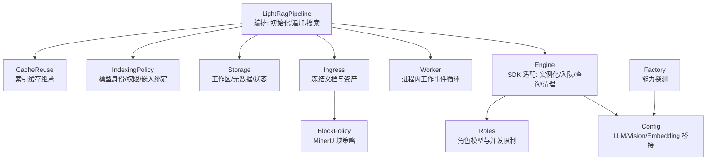
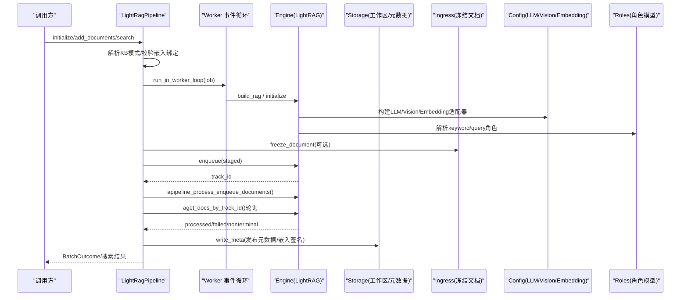
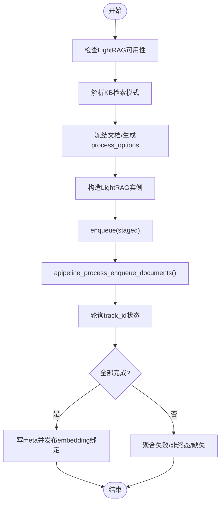
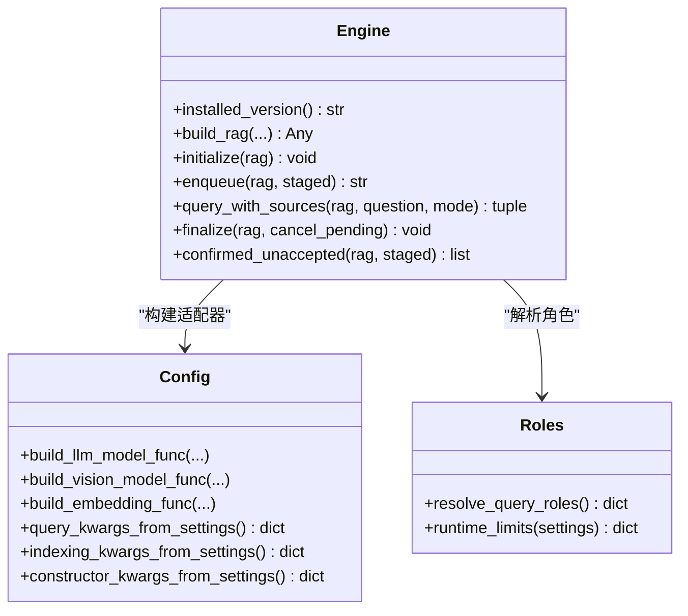
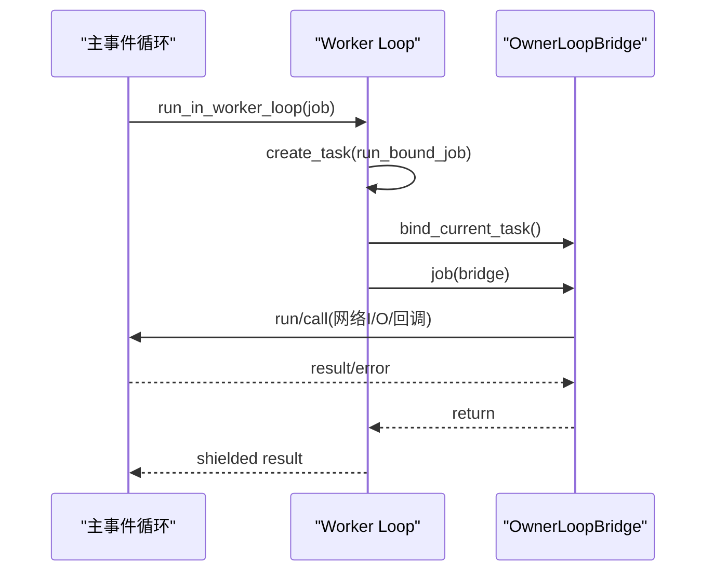
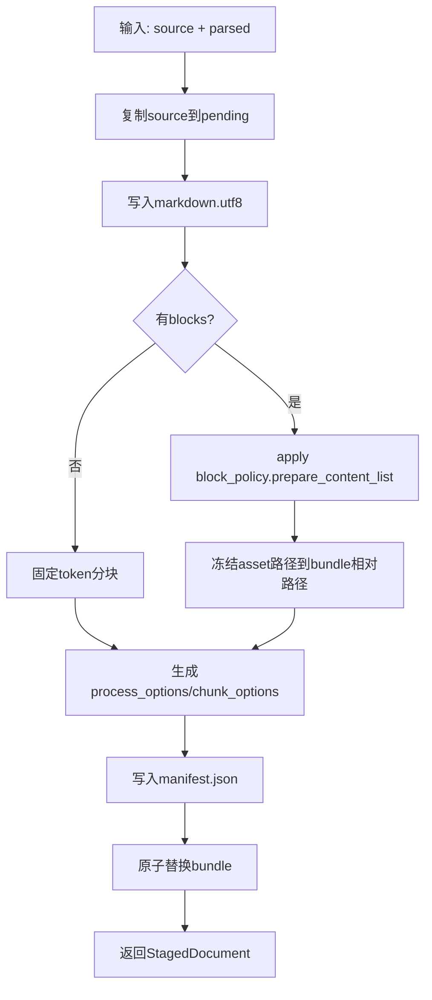
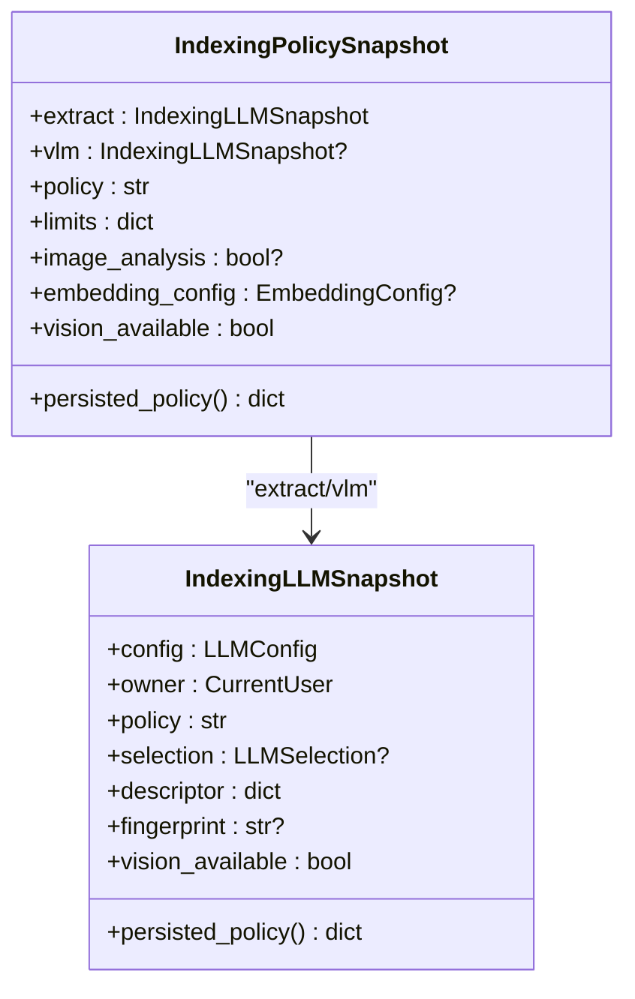
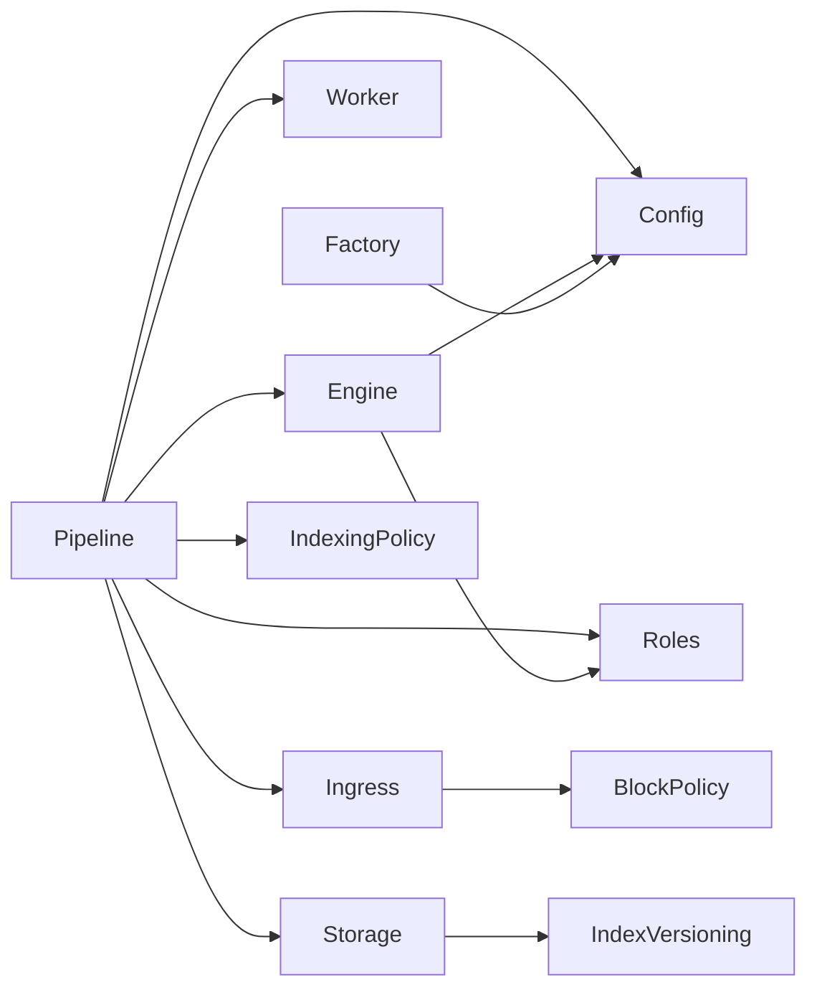

# LightRAG 管道实现

<cite>
**本文引用的文件**   
- [pipeline.py](file://deeptutor/services/rag/pipelines/lightrag/pipeline.py)
- [engine.py](file://deeptutor/services/rag/pipelines/lightrag/engine.py)
- [config.py](file://deeptutor/services/rag/pipelines/lightrag/config.py)
- [block_policy.py](file://deeptutor/services/rag/pipelines/lightrag/block_policy.py)
- [indexing_policy.py](file://deeptutor/services/rag/pipelines/lightrag/indexing_policy.py)
- [worker.py](file://deeptutor/services/rag/pipelines/lightrag/worker.py)
- [ingress.py](file://deeptutor/services/rag/pipelines/lightrag/ingress.py)
- [storage.py](file://deeptutor/services/rag/pipelines/lightrag/storage.py)
- [roles.py](file://deeptutor/services/rag/pipelines/lightrag/roles.py)
- [cache_reuse.py](file://deeptutor/services/rag/pipelines/lightrag/cache_reuse.py)
- [factory.py](file://deeptutor/services/rag/factory.py)
</cite>

## 目录
1. [引言](#引言)
2. [项目结构](#项目结构)
3. [核心组件](#核心组件)
4. [架构总览](#架构总览)
5. [详细组件分析](#详细组件分析)
6. [依赖关系分析](#依赖关系分析)
7. [性能与内存优化](#性能与内存优化)
8. [故障排查指南](#故障排查指南)
9. [结论](#结论)
10. [附录：配置示例与迁移指南](#附录配置示例与迁移指南)

## 引言
本文件系统性梳理 DeepTutor 中基于 LightRAG 的 RAG 管道实现，重点覆盖轻量级索引构建、内存隔离、分布式（多进程）工作循环、块策略、索引策略、工作进程管理、数据摄入流程、存储后端选择、查询优化策略，以及与 LlamaIndex 的性能对比、适用场景和迁移建议。文档既适合初学者理解 LightRAG 的优势特点，也为高级用户提供深度配置与性能调优的技术细节。

## 项目结构
LightRAG 管道位于 `deeptutor/services/rag/pipelines/lightrag`，围绕“编排 + 适配 + 策略 + 存储”分层组织：
- 编排层：`pipeline.py` 负责 KB 初始化、增量追加、搜索、错误处理与进度协调。
- SDK 适配层：`engine.py` 锁定 LightRAG 精确版本，封装实例化、入队、查询、资源清理等契约。
- 配置桥接层：`config.py` 将 DeepTutor 的 LLM/Vision/Embedding 能力桥接到 LightRAG，并统一重试与模式解析。
- 策略层：`indexing_policy.py` 冻结模型身份与权限；`block_policy.py` 对 MinerU 结构化输出做可审计的块过滤；`roles.py` 按角色解析模型与并发限制。
- 工作循环层：`worker.py` 提供进程内独立事件循环，避免阻塞主服务事件循环。
- 数据摄入层：`ingress.py` 将解析结果冻结为不可变 bundle，校验来源与资产路径。
- 存储层：`storage.py` 维护 LightRAG 本地工作区、发布元数据、嵌入签名与状态检测。
- 缓存复用层：`cache_reuse.py` 在重建时继承已验证的索引响应缓存，减少重复计算。
- 工厂集成：`factory.py` 探测 LightRAG 是否可用，并向上层暴露能力。

**图表来源**
- [pipeline.py:98-693](file://deeptutor/services/rag/pipelines/lightrag/pipeline.py#L98-L693)
- [engine.py:217-537](file://deeptutor/services/rag/pipelines/lightrag/engine.py#L217-L537)
- [config.py:140-454](file://deeptutor/services/rag/pipelines/lightrag/config.py#L140-L454)
- [worker.py:173-259](file://deeptutor/services/rag/pipelines/lightrag/worker.py#L173-L259)
- [ingress.py:184-341](file://deeptutor/services/rag/pipelines/lightrag/ingress.py#L184-L341)
- [storage.py:296-348](file://deeptutor/services/rag/pipelines/lightrag/storage.py#L296-L348)
- [block_policy.py:89-182](file://deeptutor/services/rag/pipelines/lightrag/block_policy.py#L89-L182)
- [indexing_policy.py:214-419](file://deeptutor/services/rag/pipelines/lightrag/indexing_policy.py#L214-L419)
- [cache_reuse.py:81-134](file://deeptutor/services/rag/pipelines/lightrag/cache_reuse.py#L81-L134)
- [factory.py:230-247](file://deeptutor/services/rag/factory.py#L230-L247)

**章节来源**
- [pipeline.py:98-693](file://deeptutor/services/rag/pipelines/lightrag/pipeline.py#L98-L693)
- [engine.py:217-537](file://deeptutor/services/rag/pipelines/lightrag/engine.py#L217-L537)
- [config.py:140-454](file://deeptutor/services/rag/pipelines/lightrag/config.py#L140-L454)
- [worker.py:173-259](file://deeptutor/services/rag/pipelines/lightrag/worker.py#L173-L259)
- [ingress.py:184-341](file://deeptutor/services/rag/pipelines/lightrag/ingress.py#L184-L341)
- [storage.py:296-348](file://deeptutor/services/rag/pipelines/lightrag/storage.py#L296-L348)
- [block_policy.py:89-182](file://deeptutor/services/rag/pipelines/lightrag/block_policy.py#L89-L182)
- [indexing_policy.py:214-419](file://deeptutor/services/rag/pipelines/lightrag/indexing_policy.py#L214-L419)
- [cache_reuse.py:81-134](file://deeptutor/services/rag/pipelines/lightrag/cache_reuse.py#L81-L134)
- [factory.py:230-247](file://deeptutor/services/rag/factory.py#L230-L247)

## 核心组件
- LightRagPipeline：对外暴露 initialize/add_documents/search/delete，内部协调阶段化文档、SDK 调用、状态轮询、发布元数据与错误聚合。
- Engine：锁定 lightrag-hku==1.5.7，注册自定义解析器，构造 LightRAG 实例，封装 enqueue/query_with_sources/initialize/finalize，并对返回结构进行契约校验。
- Config：桥接 LLM/Vision/Embedding，统一重试策略、查询参数、索引并行度、构造函数参数，并提供可用性检测与模式归一化。
- Worker：进程内独立事件循环，OwnerLoopBridge 将网络 I/O 与回调调度回请求所属事件循环，避免阻塞主循环。
- Ingress：冻结解析结果为不可变 bundle，校验源文件、Markdown、Blocks、Assets 的完整性与路径安全。
- BlockPolicy：对 MinerU 结构化输出进行分类、过滤与审计记录，保留未知类型以兼容新 schema。
- IndexingPolicy：冻结 extract/vlm 角色模型、指纹、权限、并发限制与嵌入配置，确保索引身份稳定且可审计。
- Storage：维护 LightRAG 工作区、meta.json、doc_status、published 标记、嵌入签名匹配与失败摘要。
- CacheReuse：重建时从历史版本继承已验证的 extract/summary/analysis/smartheading 缓存条目，加速重建。
- Roles：按角色解析模型、校验推理强度与视觉能力，提供运行时并发与超时限制。

**章节来源**
- [pipeline.py:98-693](file://deeptutor/services/rag/pipelines/lightrag/pipeline.py#L98-L693)
- [engine.py:32-537](file://deeptutor/services/rag/pipelines/lightrag/engine.py#L32-L537)
- [config.py:40-454](file://deeptutor/services/rag/pipelines/lightrag/config.py#L40-L454)
- [worker.py:1-259](file://deeptutor/services/rag/pipelines/lightrag/worker.py#L1-L259)
- [ingress.py:1-365](file://deeptutor/services/rag/pipelines/lightrag/ingress.py#L1-L365)
- [block_policy.py:1-267](file://deeptutor/services/rag/pipelines/lightrag/block_policy.py#L1-L267)
- [indexing_policy.py:1-697](file://deeptutor/services/rag/pipelines/lightrag/indexing_policy.py#L1-L697)
- [storage.py:1-364](file://deeptutor/services/rag/pipelines/lightrag/storage.py#L1-L364)
- [cache_reuse.py:1-138](file://deeptutor/services/rag/pipelines/lightrag/cache_reuse.py#L1-L138)
- [roles.py:1-133](file://deeptutor/services/rag/pipelines/lightrag/roles.py#L1-L133)

## 架构总览
LightRAG 管道通过“编排 + 适配 + 策略 + 存储”的分层设计，将重型同步 I/O 与图合并操作隔离到独立事件循环，同时严格约束 LightRAG SDK 的版本与接口契约，保证行为可预测。

**图表来源**
- [pipeline.py:280-372](file://deeptutor/services/rag/pipelines/lightrag/pipeline.py#L280-L372)
- [engine.py:217-376](file://deeptutor/services/rag/pipelines/lightrag/engine.py#L217-L376)
- [config.py:255-434](file://deeptutor/services/rag/pipelines/lightrag/config.py#L255-L434)
- [roles.py:110-133](file://deeptutor/services/rag/pipelines/lightrag/roles.py#L110-L133)
- [ingress.py:184-341](file://deeptutor/services/rag/pipelines/lightrag/ingress.py#L184-L341)
- [storage.py:296-348](file://deeptutor/services/rag/pipelines/lightrag/storage.py#L296-L348)

## 详细组件分析

### LightRagPipeline：编排与生命周期管理
- 初始化与追加：
  - 校验 LightRAG 是否安装，解析 KB 模式，冻结索引策略快照，必要时继承历史索引缓存。
  - 在 worker 事件循环中执行 staging → enqueue → process → reconcile → finalize 流程。
  - 成功后写入 meta.json 并发布 embedding binding；失败时清理候选版本或保留未接受文档以便重试。
- 搜索：
  - 定位最新 published 根目录，校验嵌入兼容性，解析 query roles，构造 LightRAG 实例并执行查询。
  - 将结构化 sources 标准化为 chunk/entity/relation/reference/query_metadata。
- 错误处理：
  - 聚合 preflight_failed/failed/nonterminal/missing，抛出 LightRagBatchError 携带完整 outcome。
  - 对 not_configured/embedding_mismatch/retrieval_error 等错误类型返回统一 error_result。

**图表来源**
- [pipeline.py:105-122](file://deeptutor/services/rag/pipelines/lightrag/pipeline.py#L105-L122)
- [pipeline.py:124-152](file://deeptutor/services/rag/pipelines/lightrag/pipeline.py#L124-L152)
- [pipeline.py:280-372](file://deeptutor/services/rag/pipelines/lightrag/pipeline.py#L280-L372)
- [pipeline.py:420-468](file://deeptutor/services/rag/pipelines/lightrag/pipeline.py#L420-L468)
- [pipeline.py:505-582](file://deeptutor/services/rag/pipelines/lightrag/pipeline.py#L505-L582)
- [pipeline.py:609-667](file://deeptutor/services/rag/pipelines/lightrag/pipeline.py#L609-L667)

**章节来源**
- [pipeline.py:98-693](file://deeptutor/services/rag/pipelines/lightrag/pipeline.py#L98-L693)

### Engine：SDK 适配与契约校验
- 版本锁定：强制 lightrag-hku==1.5.7，否则抛出契约错误。
- 解析器注册：注册 deeptutor 解析器，限定 queue_group 与后缀集合。
- 实例构造：注入 io_bridge、role_llm_configs、embedding_func、vlm_process_enable、auto_manage_storages_states=false，并通过 indexing_kwargs_from_settings/constructor_kwargs_from_settings 注入并发与超时。
- 入队与查询：
  - enqueue 使用 pending_parse 格式与 process_options/chunk_options。
  - query_with_sources 构造 QueryParam，校验返回结构，提取 references/chunks/entities/relationships。
- 资源清理：shutdown 所有 managed queue funcs，finalize storages。

**图表来源**
- [engine.py:32-118](file://deeptutor/services/rag/pipelines/lightrag/engine.py#L32-L118)
- [engine.py:175-292](file://deeptutor/services/rag/pipelines/lightrag/engine.py#L175-L292)
- [engine.py:295-376](file://deeptutor/services/rag/pipelines/lightrag/engine.py#L295-L376)
- [engine.py:487-520](file://deeptutor/services/rag/pipelines/lightrag/engine.py#L487-L520)
- [config.py:255-434](file://deeptutor/services/rag/pipelines/lightrag/config.py#L255-L434)
- [roles.py:110-133](file://deeptutor/services/rag/pipelines/lightrag/roles.py#L110-L133)

**章节来源**
- [engine.py:32-537](file://deeptutor/services/rag/pipelines/lightrag/engine.py#L32-L537)
- [config.py:140-454](file://deeptutor/services/rag/pipelines/lightrag/config.py#L140-L454)
- [roles.py:1-133](file://deeptutor/services/rag/pipelines/lightrag/roles.py#L1-L133)

### Worker：进程内工作事件循环与跨循环回调
- 单进程全局 worker loop：避免 fork 后锁失效，线程守护运行。
- OwnerLoopBridge：将网络 I/O 与回调调度回 owner 事件循环，支持取消传播与 pending future 管理。
- run_in_worker_loop：创建任务、绑定 controller、屏蔽取消信号直到清理完成，优雅等待 grace period。

**图表来源**
- [worker.py:34-57](file://deeptutor/services/rag/pipelines/lightrag/worker.py#L34-L57)
- [worker.py:105-170](file://deeptutor/services/rag/pipelines/lightrag/worker.py#L105-L170)
- [worker.py:173-259](file://deeptutor/services/rag/pipelines/lightrag/worker.py#L173-L259)

**章节来源**
- [worker.py:1-259](file://deeptutor/services/rag/pipelines/lightrag/worker.py#L1-L259)

### Ingress：冻结文档与资产安全边界
- 冻结流程：复制 source/markdown/blocks/assets，计算 sha256，生成 manifest，原子替换 bundle。
- 安全校验：拒绝符号链接、硬链接、越界路径、哈希漂移、空文档。
- 块策略集成：仅当 engine=mineru 时应用 block_policy.prepare_content_list，生成 audit ledger。

**图表来源**
- [ingress.py:184-341](file://deeptutor/services/rag/pipelines/lightrag/ingress.py#L184-L341)
- [block_policy.py:89-182](file://deeptutor/services/rag/pipelines/lightrag/block_policy.py#L89-L182)

**章节来源**
- [ingress.py:1-365](file://deeptutor/services/rag/pipelines/lightrag/ingress.py#L1-L365)
- [block_policy.py:1-267](file://deeptutor/services/rag/pipelines/lightrag/block_policy.py#L1-L267)

### IndexingPolicy：模型身份冻结与嵌入绑定
- 冻结 extract/vlm 角色模型，生成 descriptor/fingerprint，校验 vision_available。
- 绑定目标版本与内容修订，防止队列期间目标被修改。
- with_embedding 冻结嵌入配置，若 KB 存在 embedding_binding 则校验其状态。
- public_rebuild_config 暴露去敏感化的重建确认信息。

**图表来源**
- [indexing_policy.py:86-158](file://deeptutor/services/rag/pipelines/lightrag/indexing_policy.py#L86-L158)
- [indexing_policy.py:214-419](file://deeptutor/services/rag/pipelines/lightrag/indexing_policy.py#L214-L419)
- [indexing_policy.py:543-595](file://deeptutor/services/rag/pipelines/lightrag/indexing_policy.py#L543-L595)

**章节来源**
- [indexing_policy.py:1-697](file://deeptutor/services/rag/pipelines/lightrag/indexing_policy.py#L1-L697)

### Storage：工作区布局与发布元数据
- working_dir 即 version-N 根目录，_store_root 优先解析 native workspace。
- has_output/doc_count/failure_summary 基于 doc_status 与 vdb/kv_store 文件判断就绪与失败。
- write_meta 写入 provider/signature/state/workspace/parser_inputs/indexing_policy/embedding_signature 等字段。
- latest_published_root/published_root_for_embedding 支持按 embedding_signature 定位版本。

**章节来源**
- [storage.py:1-364](file://deeptutor/services/rag/pipelines/lightrag/storage.py#L1-L364)

### CacheReuse：索引缓存继承
- 仅继承 extract/summary/analysis/smartheading 类型的索引响应缓存，键匹配正则与 cache_type。
- 合并策略：最近中断版本优先，其次已发布且策略指纹一致的历史版本。
- 写入 target workspace 下的 kv_store_llm_response_cache.json。

**章节来源**
- [cache_reuse.py:1-138](file://deeptutor/services/rag/pipelines/lightrag/cache_reuse.py#L1-L138)

### Roles：角色模型与并发限制
- resolve_selection 校验推理强度与视觉能力，支持 legacy 默认值。
- runtime_limits 提供 per-role max_async/timeout。
- resolve_query_roles 返回 keyword/query 角色的 RoleCall。

**章节来源**
- [roles.py:1-133](file://deeptutor/services/rag/pipelines/lightrag/roles.py#L1-L133)

## 依赖关系分析
- LightRagPipeline 依赖 Engine/Worker/Ingress/Storage/IndexingPolicy/Config/Roles。
- Engine 依赖 Config/Roles，并强依赖 lightrag-hku==1.5.7。
- Config 依赖 LLM/Embedding 客户端与 Multi-User 上下文。
- Ingress 依赖 BlockPolicy 与 FileIO。
- Storage 依赖 IndexVersioning 与 EmbeddingSignature。
- Factory 探测 lightrag 模块是否存在，决定 UI 是否暴露 LightRAG 能力。

**图表来源**
- [pipeline.py:24-32](file://deeptutor/services/rag/pipelines/lightrag/pipeline.py#L24-L32)
- [engine.py:19-30](file://deeptutor/services/rag/pipelines/lightrag/engine.py#L19-L30)
- [config.py:140-454](file://deeptutor/services/rag/pipelines/lightrag/config.py#L140-L454)
- [ingress.py:18-18](file://deeptutor/services/rag/pipelines/lightrag/ingress.py#L18-L18)
- [storage.py:254-273](file://deeptutor/services/rag/pipelines/lightrag/storage.py#L254-L273)
- [factory.py:230-247](file://deeptutor/services/rag/factory.py#L230-L247)

**章节来源**
- [pipeline.py:24-32](file://deeptutor/services/rag/pipelines/lightrag/pipeline.py#L24-L32)
- [engine.py:19-30](file://deeptutor/services/rag/pipelines/lightrag/engine.py#L19-L30)
- [config.py:140-454](file://deeptutor/services/rag/pipelines/lightrag/config.py#L140-L454)
- [ingress.py:18-18](file://deeptutor/services/rag/pipelines/lightrag/ingress.py#L18-L18)
- [storage.py:254-273](file://deeptutor/services/rag/pipelines/lightrag/storage.py#L254-L273)
- [factory.py:230-247](file://deeptutor/services/rag/factory.py#L230-L247)

## 性能与内存优化
- 事件循环隔离：Worker 将 LightRAG 的同步图合并与 JSON 序列化移出主事件循环，避免阻塞 API 与 LLM 工作。
- 并发控制：
  - 索引并行解析：max_parallel_parse_native 来自 settings。
  - LLM 并发：llm_model_max_async 与 per-role max_async。
  - 超时：default_llm_timeout 与 per-role timeout。
- 内存优化：
  - auto_manage_storages_states=false，由 pipeline 显式 initialize/finalize，避免 SDK 自动状态管理带来的额外开销。
  - Ingress 冻结文档与资产，避免大对象在主循环持有。
  - CacheReuse 继承索引缓存，减少重复 LLM 调用。
- 查询优化：
  - top_k 与 response_type 来自 settings。
  - 模式归一化：hybrid 作为默认，兼顾 KG 与向量检索。
- 错误重试：
  - 适配器层统一重试，避免与 Provider 重试叠加；最大尝试次数与延迟上限受控。

[本节为通用性能指导，不直接分析具体文件]

## 故障排查指南
- LightRAG 未安装：
  - 现象：LightRagNotAvailableError。
  - 处理：安装 deeptutor[rag-lightrag]。
- 嵌入不兼容：
  - 现象：EmbeddingMismatchError。
  - 处理：恢复原嵌入配置或重建索引。
- 模型身份变更：
  - 现象：IndexingModelChangedError。
  - 处理：重新选择模型并重建索引。
- 文档摄入失败：
  - 现象：IngressError/契约错误。
  - 处理：检查 canonical basename、asset 路径、哈希一致性、空文档。
- 查询失败：
  - 现象：LightRagContractError/HTTP 状态码异常。
  - 处理：检查 LLM/Vision 配置、重试分类、status_code 解析。

**章节来源**
- [config.py:61-137](file://deeptutor/services/rag/pipelines/lightrag/config.py#L61-L137)
- [engine.py:39-66](file://deeptutor/services/rag/pipelines/lightrag/engine.py#L39-L66)
- [ingress.py:27-110](file://deeptutor/services/rag/pipelines/lightrag/ingress.py#L27-L110)
- [indexing_policy.py:30-47](file://deeptutor/services/rag/pipelines/lightrag/indexing_policy.py#L30-L47)
- [pipeline.py:63-77](file://deeptutor/services/rag/pipelines/lightrag/pipeline.py#L63-L77)

## 结论
DeepTutor 的 LightRAG 管道通过严格的 SDK 版本锁定、契约校验、事件循环隔离与策略冻结，实现了轻量级、可审计、可扩展的知识库构建与检索。它在保持易用性的同时，为大规模文档处理提供了并发控制、内存优化与分布式处理能力，并与 LlamaIndex 形成互补：LightRAG 侧重知识图谱与轻量索引，LlamaIndex 提供更丰富的混合检索与重排序生态。

[本节为总结性内容，不直接分析具体文件]

## 附录：配置示例与迁移指南

### 配置项说明（LightRAG 设置）
- top_k：检索返回片段数量，默认 60。
- response_type：回答格式，默认 Multiple Paragraphs。
- max_concurrent_files：索引并行解析数，默认 1。
- llm_model_max_async：LLM 并发上限，默认 4。
- entity_extract_max_gleaning：实体抽取回溯次数，默认 1。
- llm_timeout：LLM 超时秒数，默认 240。
- role_models：按角色（extract/keyword/query/vlm）选择模型与并发/超时。

**章节来源**
- [config.py:159-196](file://deeptutor/services/rag/pipelines/lightrag/config.py#L159-L196)
- [roles.py:96-107](file://deeptutor/services/rag/pipelines/lightrag/roles.py#L96-L107)

### 内存限制与多进程处理
- 内存限制：
  - 通过 auto_manage_storages_states=false 与显式 initialize/finalize 控制资源生命周期。
  - 使用 Worker 隔离同步 I/O，避免主事件循环阻塞。
- 多进程处理：
  - Worker 为进程内独立事件循环，适用于当前进程内的并发任务；如需跨进程扩展，应结合外部任务队列或 LightRAG Server。

**章节来源**
- [engine.py:278-292](file://deeptutor/services/rag/pipelines/lightrag/engine.py#L278-L292)
- [worker.py:173-259](file://deeptutor/services/rag/pipelines/lightrag/worker.py#L173-L259)

### 大规模文档处理优化
- 启用 CacheReuse：重建时继承历史索引缓存，减少重复 LLM 调用。
- 调整并发：提高 max_concurrent_files 与 llm_model_max_async，注意 Provider 限流。
- 分批次摄入：分批 enqueue 与 reconcile，避免单次过大负载。
- 使用 hybrid 模式：兼顾 KG 与向量检索，提升召回质量。

**章节来源**
- [cache_reuse.py:81-134](file://deeptutor/services/rag/pipelines/lightrag/cache_reuse.py#L81-L134)
- [config.py:173-196](file://deeptutor/services/rag/pipelines/lightrag/config.py#L173-L196)
- [pipeline.py:280-372](file://deeptutor/services/rag/pipelines/lightrag/pipeline.py#L280-L372)

### 与 LlamaIndex 的性能对比与适用场景
- LightRAG：
  - 优势：轻量索引、知识图谱检索、低依赖、快速重建、可审计策略。
  - 适用：中小规模知识库、需要图谱关联与快速迭代的应用。
- LlamaIndex：
  - 优势：混合向量+BM25、交叉编码器重排序、FAISS exact-flat/HNSW 索引、丰富生态。
  - 适用：大规模检索、需要高精度重排序与复杂检索策略的应用。

[本节为概念性对比，不直接分析具体文件]

### 迁移指南（LightRAG ↔ LlamaIndex）
- 从 LlamaIndex 迁移到 LightRAG：
  - 评估是否需要知识图谱关联与轻量索引。
  - 配置 role_models 与 embedding，重建索引。
  - 使用 hybrid 模式逐步验证召回质量。
- 从 LightRAG 迁移到 LlamaIndex：
  - 评估是否需要混合检索与重排序。
  - 配置 LlamaIndex 引擎与 FAISS 索引。
  - 迁移文档与元数据，验证检索效果。

[本节为概念性迁移指导，不直接分析具体文件]